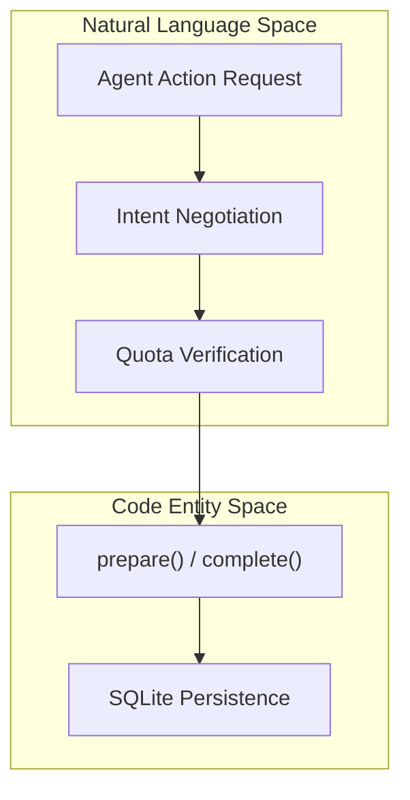
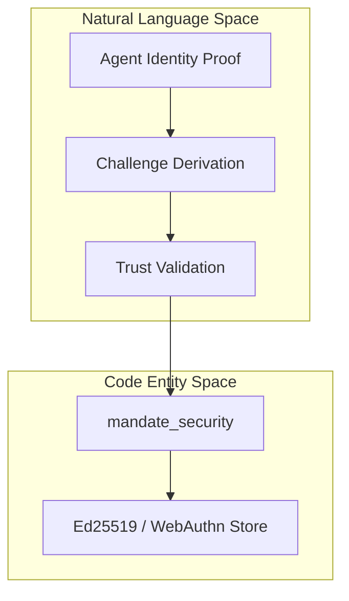

<!-- source: DeepWiki mcp.deepwiki.com · repo openJiuwen-ai/agent-protocol · page 5 A4P Python SDK · fetched 2026-11-02 -->

# A4P Python SDK

Relevant source files

The following files were used as context for generating this wiki page:

- [README.md](README.md)
- [README_zh.md](README_zh.md)

The **Agentic Authentication, Authorization and Audit Protocol (A4P) Python SDK** provides verifiable authorization boundaries, cryptographic credential validation, and mandate-based access control for multi-agent systems and tool invocations [README.md:7-14](). 

This parent page outlines the core architectural pillars of the A4P SDK, including its operational authorization models, cryptographic signature verification layers, and client-server execution environments. Detailed technical specifications are maintained in the respective child pages.

---

## 5.1. Authorization Model: Operation and Intent Mandates

The A4P authorization model governs how autonomous agents request, negotiate, and execute actions against secured resources. It utilizes a two-phase protocol separating preparation from completion, ensuring that all resource accesses adhere to strict scopes and consumption quotas.

States and transactions are persisted locally using lightweight database backends, enabling verifiable audit trails for every agentic interaction. For comprehensive details on two-phase flows, scope matching, quota tracking, and persistence models, see [Authorization Model: Operation and Intent Mandates](#5.1).

*Figure 5.1: Bridging natural language intent flows to A4P execution and persistence routines.*

Sources: `[README.md:7-14]()`

---

## 5.2. Signatures, Credentials and Security

Verifiable trust in the A4P ecosystem relies on robust cryptographic primitives. The SDK supports multiple signature mechanisms—including Ed25519 and WebAuthn—to authenticate agents and sign delegation mandates. 

The credential subsystem manages public-key stores, challenge-response derivation pipelines, and trust configurations, ensuring that forged or unauthorized mandates are rejected before execution. For deep dives into cryptographic bindings and security configurations, see [Signatures, Credentials and Security](#5.2).

*Figure 5.2: Mapping authentication concepts to cryptographic security modules.*

Sources: `[README.md:7-14]()`

---

## 5.3. A4P Server, Client and Examples

To facilitate rapid deployment and integration, the SDK packages production-ready client and server components. The HTTP server tier exposes endpoints for mandate exchange, while client libraries wrap these capabilities for seamless integration into agent runtimes.

Reference implementations—such as the `note_mcp_a4p` demo—demonstrate end-to-end integration with Model Context Protocol servers under strict A4P constraints. For implementation patterns, test harnesses, and authorizer setups, see [A4P Server, Client and Examples](#5.3).

Sources: `[README.md:7-14]()`

---

