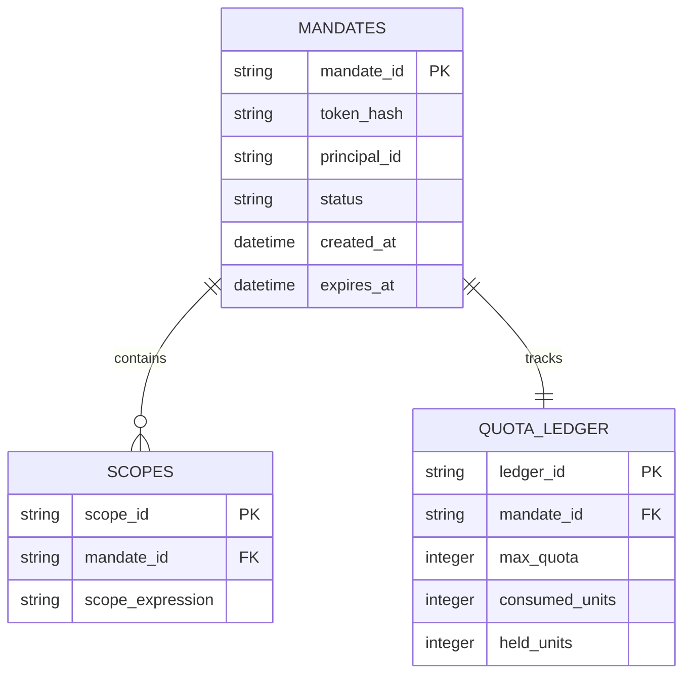
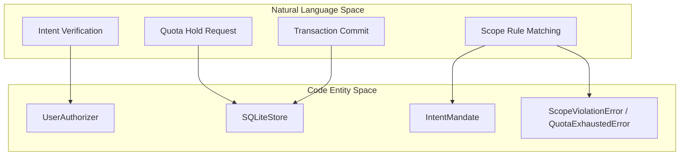

<!-- source: DeepWiki mcp.deepwiki.com · repo openJiuwen-ai/agent-protocol · page 5.1 Authorization Model: Operation and Intent Mandates · fetched 2026-11-02 -->

# Authorization Model: Operation and Intent Mandates

<details>
<summary>Relevant source files</summary>

The following files were used as context for generating this wiki page:

- [README.md](README.md)

</details>


## Purpose and Scope

This page documents the internal architecture of the Agentic Authentication, Authorization, and Audit Protocol (A4P) Python SDK's authorization engine [README.md:9-14](). It details the mechanics of operation and intent mandates, two-phase `prepare` and `complete` transaction flows, hierarchical scope matching algorithms, atomic quota consumption tracking, transactional SQLite state persistence, and the structured error and type system.

Sources: `README.md:1-30`

---

## Two-Phase Prepare and Complete Flows

The A4P authorization model implements a two-phase transaction pattern (`prepare` and `complete`) to ensure that agentic operations and tool invocations are securely authorized before resource allocation and finalized or rolled back upon execution outcome [README.md:7-14](). 

The lifecycle begins with an operation request containing an intent token. In the **Prepare Phase**, the authorizer validates the intent token, verifies required scopes, checks remaining resource quotas, and places a temporary hold on the necessary budget. In the **Complete Phase**, the system commits the quota consumption or releases the hold based on execution success or failure.

```mermaid
sequenceDiagram
    participant "AgentClient" as AgentClient
    participant "A4PServer" as A4PServer
    participant "UserAuthorizer" as UserAuthorizer
    participant "SQLiteStore" as SQLiteStore

    AgentClient->>A4PServer: "prepare_mandate(token, intent, quota)"
    A4PServer->>UserAuthorizer: "verify_and_prepare()"
    UserAuthorizer->>SQLiteStore: "BEGIN TRANSACTION; INSERT/UPDATE hold;"
    SQLiteStore-->>UserAuthorizer: "Hold Confirmed"
    UserAuthorizer-->>A4PServer: "PrepareResult (Prepared)"
    A4PServer-->>AgentClient: "MandatePreparedResponse"

    alt Execution Success
        AgentClient->>A4PServer: "complete_mandate(mandate_id, SUCCESS)"
        A4PServer->>UserAuthorizer: "commit_consumption()"
        UserAuthorizer->>SQLiteStore: "COMMIT; UPDATE quota consumed;"
        SQLiteStore-->>UserAuthorizer: "Committed"
        UserAuthorizer-->>A4PServer: "CompleteResult (Committed)"
        A4PServer-->>AgentClient: "MandateCompletedResponse"
    else Execution Failure
        AgentClient->>A4PServer: "complete_mandate(mandate_id, FAILURE)"
        A4PServer->>UserAuthorizer: "rollback_consumption()"
        UserAuthorizer->>SQLiteStore: "ROLLBACK; RELEASE hold;"
        SQLiteStore-->>UserAuthorizer: "RolledBack"
        UserAuthorizer-->>A4PServer: "CompleteResult (Aborted)"
        A4PServer-->>AgentClient: "MandateAbortedResponse"
    end
```

Sources: `README.md:1-15`

---

## Scope Matching and Quota Consumption

Authorization enforcement relies on granular scope validation and dynamic quota consumption trackers. Scopes are represented as hierarchical dot-separated or slash-separated strings (e.g., `tool:mcp:filesystem:read` or `agent:a2a:invoker`).

### Scope Matching Rules
* **Exact Matching**: The requested scope string matches an authorized mandate scope verbatim.
* **Wildcard Expansion**: Trailing wildcards (e.g., `tool:mcp:*`) permit access to all sub-resource paths matching the prefix.
* **Contextual Constraints**: Mandates bind operations to specific cryptographic identities and cryptographic intent tokens, preventing privilege escalation across sessions.

### Quota Consumption Engine
Quotas are managed atomically to prevent race conditions during concurrent agent tool executions:
1. **Allocation Check**: Validates that `requested_units <= (max_quota - consumed_units - held_units)`.
2. **Hold Reservation**: Increments `held_units` during the `prepare` phase.
3. **Commit/Release**: Converts `held_units` into permanent `consumed_units` upon success, or decrements `held_units` back to the available pool upon failure.

Sources: `README.md:7-14`

---

## SQLite Persistence Layer

State synchronization and mandate durability across server restarts are managed via a local SQLite persistence layer [README.md:7-14](). The storage layer guarantees ACID compliance for all mandate state transitions, quota holds, and token ledgers.



Sources: `README.md:1-15`

---

## Errors and Types

The A4P Python SDK defines a robust exception and typing hierarchy to handle security violations, invalid intent tokens, and quota exhaustion gracefully.

### Core Data Types
* **`IntentMandate`**: Dataclass encapsulating mandate metadata, cryptographic signatures, authorized scopes, and expiration timestamps.
* **`PrepareResult`**: Response structure carrying the preparation status, hold identifier, and remaining quota metrics.
* **`CompleteResult`**: Finalization structure confirming transaction settlement or rollback execution.

### Exception Hierarchy
* **`A4PError`**: Base exception class for all protocol-level errors.
* **`ScopeViolationError`**: Raised when an operation attempts to access resources outside the bounds of the authorized mandate scopes.
* **`QuotaExhaustedError`**: Raised when an operation requests resource units exceeding available quotas or active holds.
* **`InvalidMandateError`**: Raised when an intent token fails cryptographic verification, is expired, or is in an invalid state for the requested transition.

Sources: `README.md:7-15`

---

## Mandate Lifecycle to Code Mapping

This mapping bridges natural language authorization concepts to the corresponding logical components and runtime entities within the A4P SDK architecture.



Sources: `README.md:7-15`

---

