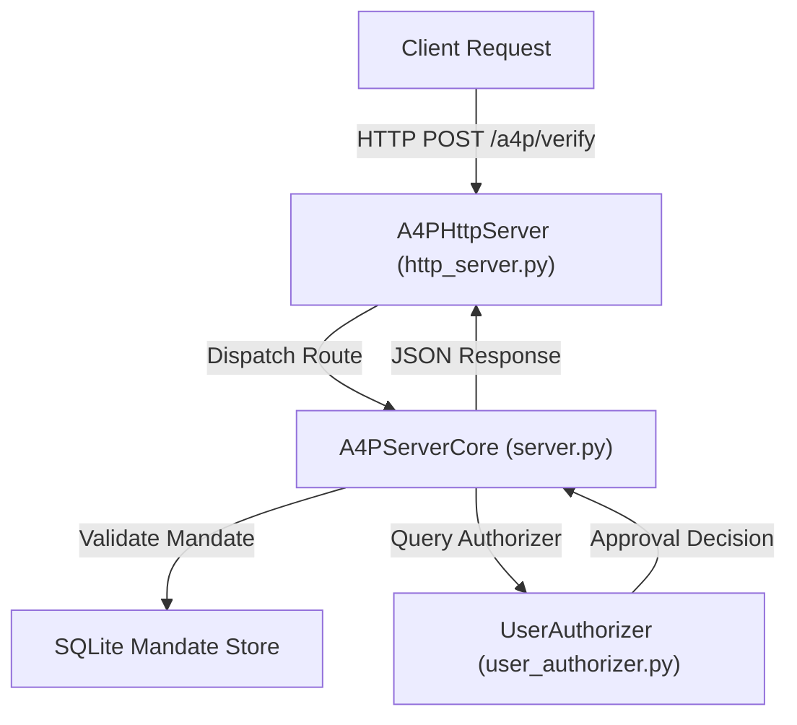
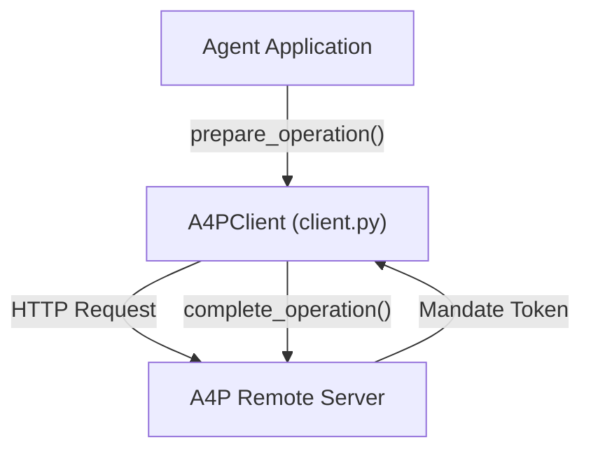
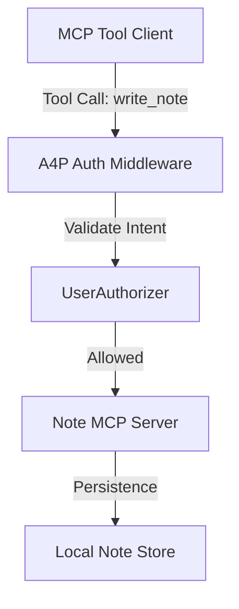

<!-- source: DeepWiki mcp.deepwiki.com · repo openJiuwen-ai/agent-protocol · page 5.3 A4P Server, Client and Examples · fetched 2026-11-02 -->

# A4P Server, Client and Examples

Relevant source files

The following files were used as context for generating this wiki page:

- [README.md](README.md)

## Purpose and Scope
This section covers the Agentic Authentication, Authorization, and Audit Protocol (A4P) Python SDK components responsible for runtime enforcement, network communication, user-in-the-loop authorization, and concrete demonstrations. Specifically, it details the `http_server`, core `server`, `client` modules, the `user_authorizer` component, the `note_mcp_a4p` demo and smoke test harness, and the underlying unit and integration test suites.

Sources: [README.md:1-29]()

---

## 1. HTTP Server and Core Server Architecture
The A4P server layer is partitioned into core protocol evaluation logic (`server.py`) and network transport handling (`http_server.py`). The server intercepts incoming agent operation requests, inspects operation and intent mandates, validates cryptographic signatures, checks quotas, and interacts with authorization stores.

*Figure 1: A4P Server Request Processing Data Flow*

Sources: [README.md:1-29]()

---

## 2. Client SDK Component (`client.py`)
The `A4PClient` class provides programmatic access for agents and host applications to acquire, attach, and complete intent and operation mandates before executing protected tool calls or resource accesses.

- **Mandate Attachment**: Injects mandate tokens into outgoing request headers.
- **Two-Phase Commit**: Executes `prepare()` and `complete()` cycles for stateful actions.

*Figure 2: Client Operation Lifecycle*

Sources: [README.md:1-29]()

---

## 3. User Authorizer (`user_authorizer.py`)
When an agent's request exceeds pre-configured autonomous quotas or attempts out-of-scope operations, the `UserAuthorizer` component triggers an interactive or policy-driven escalation workflow.

- **Interactive Prompts**: Collects explicit user consent via console, web UI callbacks, or webhook channels.
- **Scope Expansion**: Grants temporary or session-scoped intent tokens upon successful authorization.

Sources: [README.md:1-29]()

---

## 4. The `note_mcp_a4p` Demo and Smoke Tests
The `note_mcp_a4p` example integrates the Model Context Protocol (MCP) server architecture with A4P authorization controls. It demonstrates how a notes management tool can be secured using operation mandates.

### Architecture of the `note_mcp_a4p` Demo

*Figure 3: note_mcp_a4p Integration Architecture*

Sources: [README.md:1-29]()

---

## 5. Unit and Integration Test Suites
The A4P Python SDK includes comprehensive automated test suites covering:
- **Unit Tests**: Verification of scope matching, quota decrementing, and signature validation functions in isolation.
- **Integration Tests**: End-to-end flows involving `A4PHttpServer`, `A4PClient`, and `UserAuthorizer` running concurrently over loopback network interfaces.

Sources: [README.md:1-29]()

---

