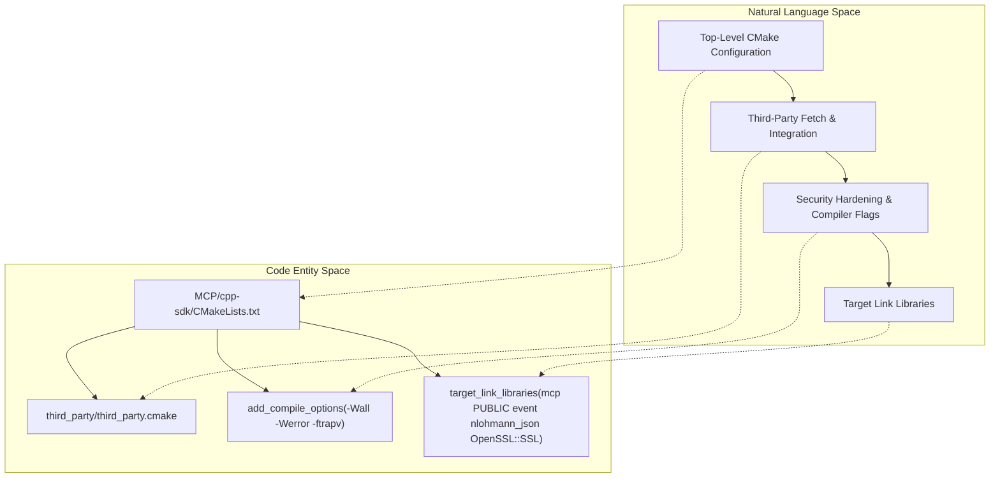
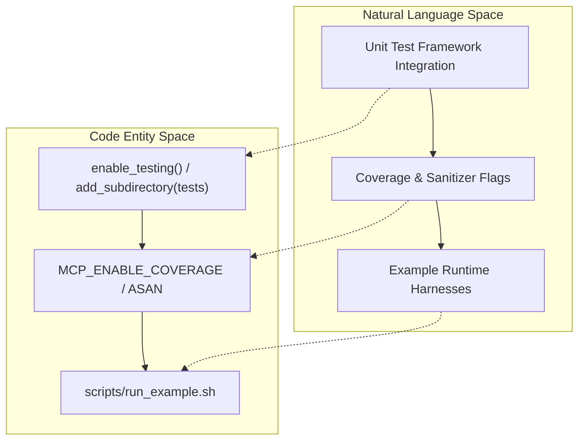

<!-- source: DeepWiki mcp.deepwiki.com · repo openJiuwen-ai/agent-protocol · page 6 Build, Tooling and Documentation · fetched 2026-11-02 -->

# Build, Tooling and Documentation

Relevant source files

The following files were used as context for generating this wiki page:

- [MCP/cpp-sdk/CMakeLists.txt](MCP/cpp-sdk/CMakeLists.txt)

## Purpose and Scope

This page documents the cross-cutting build systems, tooling infrastructure, testing frameworks, and documentation management across the `agent-protocol` monorepo. It serves as the parent navigation hub for CMake configurations, third-party dependency orchestration, test execution pipelines, and example runtime harnesses.

For deeper technical details, consult the child pages:
- [CMake and Third-party Dependencies](#6.1)
- [Testing Infrastructure](#6.2)
- [Example Run Scripts](#6.3)

Sources: `MCP/cpp-sdk/CMakeLists.txt:1-181`

---

## Build System Architecture Diagram

*Figure 6.1: Build System Architecture mapping natural language concepts to `MCP/cpp-sdk/CMakeLists.txt` entities.*

Sources: `MCP/cpp-sdk/CMakeLists.txt:1-181`

---

## 6.1. CMake and Third-party Dependencies

The build system relies on CMake (version 3.15+) to coordinate C++ compilation, dependency fetching, and security hardening flags [MCP/cpp-sdk/CMakeLists.txt:1-70]. Third-party dependencies such as `nlohmann_json`, `nlohmann_json_schema_validator`, `libevent`, and `http_parser` are managed via `third_party/third_party.cmake` [MCP/cpp-sdk/CMakeLists.txt:20], while system packages like OpenSSL and libcurl are located via `find_package` [MCP/cpp-sdk/CMakeLists.txt:22-26].

Security hardening flags—including stack protection (`-fstack-protector-strong`), non-executable stacks (`-Wl,-z,noexecstack`), and relocation read-only sections (`-Wl,-z,relro,-z,now`)—are enforced across targets [MCP/cpp-sdk/CMakeLists.txt:56-69]. Build options allow toggling tests, examples, code coverage, AddressSanitizer (ASAN), and client/server component splits [MCP/cpp-sdk/CMakeLists.txt:8-16].

For details on configuration options, find_package scripts, and install rules, see [CMake and Third-party Dependencies](#6.1).

Sources: `MCP/cpp-sdk/CMakeLists.txt:1-181`

---

## Testing & Tooling Pipeline Diagram

*Figure 6.2: Testing and Tooling Pipeline mapping test flags and scripts to CMake targets.*

Sources: `MCP/cpp-sdk/CMakeLists.txt:8-40`, `MCP/cpp-sdk/CMakeLists.txt:139-146`

---

## 6.2. Testing Infrastructure

The testing infrastructure includes unit test CMake trees organized per module (such as client, server, event, net, and transport under `tests/ut`), integration test suites, and script-based runners like `run_ut.sh` [MCP/cpp-sdk/CMakeLists.txt:8-12, 139-142]. Developers can enable code coverage via `-fprofile-arcs -ftest-coverage` [MCP/cpp-sdk/CMakeLists.txt:31-40] or memory error detection using AddressSanitizer (`ASAN`) flags [MCP/cpp-sdk/CMakeLists.txt:48-65].

Python test suites complement the C++ unit tests, providing end-to-end verification for agent registries and authentication protocols.

For details on test directory structures, coverage reports, and ASAN configurations, see [Testing Infrastructure](#6.2).

Sources: `MCP/cpp-sdk/CMakeLists.txt:8-12`, `MCP/cpp-sdk/CMakeLists.txt:31-65`, `MCP/cpp-sdk/CMakeLists.txt:139-142`

---

## 6.3. Example Run Scripts

To validate functionality across subsystems, per-example `run_example.sh` harnesses are provided within the MCP and A2A directories [MCP/cpp-sdk/CMakeLists.txt:144-146]. These scripts orchestrate environment variables, launch server and client binaries, and verify expected network endpoints and JSON-RPC message exchanges.

When `MCP_ENABLE_EXAMPLES` is active, build outputs are prepared for execution via these runner scripts [MCP/cpp-sdk/CMakeLists.txt:9, 144-146].

For details on environment setup, expected port allocations, and script invocation syntax, see [Example Run Scripts](#6.3).

Sources: `MCP/cpp-sdk/CMakeLists.txt:8-9`, `MCP/cpp-sdk/CMakeLists.txt:144-146`

---

