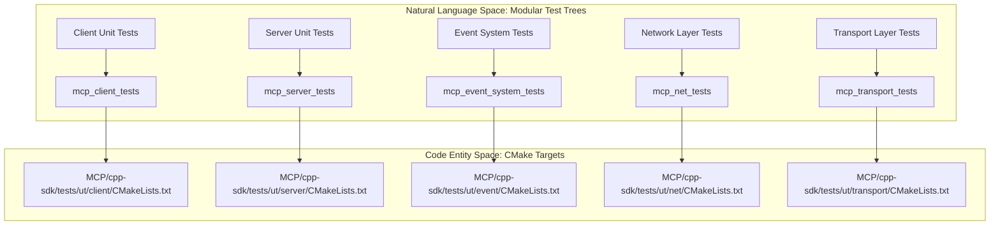
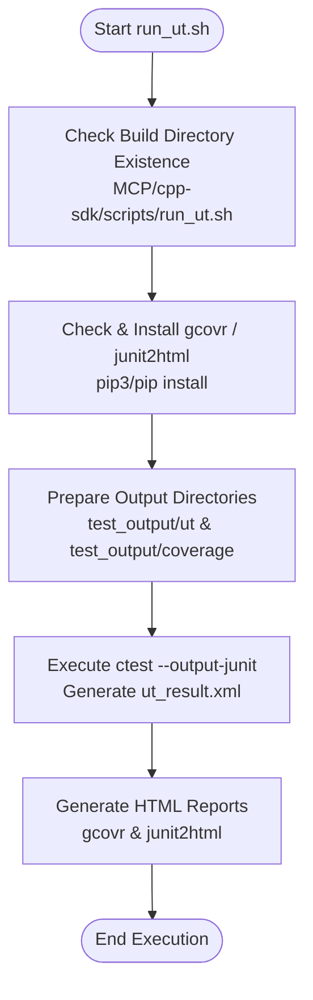

<!-- source: DeepWiki mcp.deepwiki.com · repo openJiuwen-ai/agent-protocol · page 6.2 Testing Infrastructure · fetched 2026-11-02 -->

# Testing Infrastructure

Relevant source files

The following files were used as context for generating this wiki page:

- [MCP/cpp-sdk/scripts/run_ut.sh](MCP/cpp-sdk/scripts/run_ut.sh)
- [MCP/cpp-sdk/tests/ut/client/CMakeLists.txt](MCP/cpp-sdk/tests/ut/client/CMakeLists.txt)
- [MCP/cpp-sdk/tests/ut/event/CMakeLists.txt](MCP/cpp-sdk/tests/ut/event/CMakeLists.txt)
- [MCP/cpp-sdk/tests/ut/net/CMakeLists.txt](MCP/cpp-sdk/tests/ut/net/CMakeLists.txt)
- [MCP/cpp-sdk/tests/ut/server/CMakeLists.txt](MCP/cpp-sdk/tests/ut/server/CMakeLists.txt)
- [MCP/cpp-sdk/tests/ut/transport/CMakeLists.txt](MCP/cpp-sdk/tests/ut/transport/CMakeLists.txt)

## Purpose and Scope

This page documents the testing infrastructure for the `agent-protocol` codebase, focusing on the MCP C++ SDK unit test suites, modular CMake integration trees (`client`, `server`, `event`, `net`, `transport`), test automation via `run_ut.sh`, code coverage integration, AddressSanitizer (ASAN) configuration, and Python test suite integration. 

Sources: `[MCP/cpp-sdk/scripts/run_ut.sh:1-250]`, `[MCP/cpp-sdk/tests/ut/client/CMakeLists.txt:1-43]`, `[MCP/cpp-sdk/tests/ut/event/CMakeLists.txt:1-41]`, `[MCP/cpp-sdk/tests/ut/net/CMakeLists.txt:1-29]`, `[MCP/cpp-sdk/tests/ut/server/CMakeLists.txt:1-39]`, `[MCP/cpp-sdk/tests/ut/transport/CMakeLists.txt:1-38]()`

---

## Modular Unit Test CMake Trees

The unit testing framework relies on Google Test (`GTest::gtest_main`) and is structured into isolated module-level executables defined by dedicated `CMakeLists.txt` files under `tests/ut/`. Each module compiles its own test targets, links respective object libraries via generator expressions (e.g., `$<TARGET_OBJECTS:mcp_server>`), and registers tests with CTest using `gtest_discover_tests`.

### Module Test Targets

| Subsystem | CMake Path | Executable Target | Source Object Dependencies |
| :--- | :--- | :--- | :--- |
| **Client** | `tests/ut/client/CMakeLists.txt` | `mcp_client_tests` | `$<TARGET_OBJECTS:mcp_client>`, `$<TARGET_OBJECTS:mcp_server>` |
| **Server** | `tests/ut/server/CMakeLists.txt` | `mcp_server_tests` | `$<TARGET_OBJECTS:mcp_server>` |
| **Event** | `tests/ut/event/CMakeLists.txt` | `mcp_event_system_tests` | `$<TARGET_OBJECTS:mcp_event>` |
| **Net** | `tests/ut/net/CMakeLists.txt` | `mcp_net_tests` | `$<TARGET_OBJECTS:mcp_net>` |
| **Transport** | `tests/ut/transport/CMakeLists.txt` | `mcp_transport_tests` | `$<TARGET_OBJECTS:mcp_transport>` |

Sources: `[MCP/cpp-sdk/tests/ut/client/CMakeLists.txt:3-43]`, `[MCP/cpp-sdk/tests/ut/event/CMakeLists.txt:3-41]`, `[MCP/cpp-sdk/tests/ut/net/CMakeLists.txt:3-29]`, `[MCP/cpp-sdk/tests/ut/server/CMakeLists.txt:3-39]`, `[MCP/cpp-sdk/tests/ut/transport/CMakeLists.txt:3-38]()`

---

## Test Automation with `run_ut.sh`

The shell script `run_ut.sh` automates the execution of unit tests, validates build artifacts, manages Python-based reporting tools (`gcovr` and `junit2html`), and aggregates coverage metrics.

### Execution Workflow

1. **Build Directory Verification**: Confirms that the target build directory exists and contains compiled binaries.
2. **Dependency Resolution**: Checks for `gcovr` and `junit2html`, installing them via `pip3` or `pip` if missing.
3. **Test Execution**: Invokes `ctest` with `--output-junit` to capture test results in XML format.
4. **Report Generation**: Converts JUnit XML reports into HTML formats and processes coverage data.

Sources: `[MCP/cpp-sdk/scripts/run_ut.sh:1-249]()`

---

## Coverage and AddressSanitizer (ASAN) Flags

To ensure memory safety and measure test adequacy, the build system supports instrumentation flags passed during CMake configuration.

* **Code Coverage**: Enabled via `--coverage` (or `-DCMAKE_CXX_FLAGS="--coverage -O0 -g"`), allowing `gcovr` to track line and branch execution across object files like `mcp_client`, `mcp_server`, `mcp_event`, `mcp_net`, and `mcp_transport`.
* **AddressSanitizer (ASAN)**: Configured via compiler flags `-fsanitize=address -fno-omit-frame-pointer` to detect memory leaks, buffer overflows, and use-after-free bugs during unit test execution.

Sources: `[MCP/cpp-sdk/scripts/run_ut.sh:68-80]`, `[MCP/cpp-sdk/tests/ut/client/CMakeLists.txt:13-14]`, `[MCP/cpp-sdk/tests/ut/event/CMakeLists.txt:11-11]`, `[MCP/cpp-sdk/tests/ut/net/CMakeLists.txt:11-11]`, `[MCP/cpp-sdk/tests/ut/server/CMakeLists.txt:13-13]`, `[MCP/cpp-sdk/tests/ut/transport/CMakeLists.txt:13-13]()`

---

## Python Test Suites Integration

Complementing the C++ unit test trees, the Python subprojects (`A4P` and `A2X`) maintain dedicated test suites using `pytest`. These test suites validate protocol interactions, authorization mandates, registry search engines, and FastAPI backend endpoints. They integrate into the wider CI/CD pipeline alongside CTest executions.

Sources: `[MCP/cpp-sdk/scripts/run_ut.sh:110-124]()`

---

