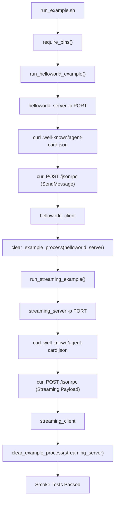
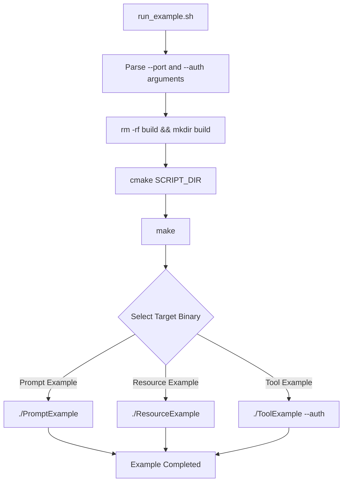

<!-- source: DeepWiki mcp.deepwiki.com · repo openJiuwen-ai/agent-protocol · page 6.3 Example Run Scripts · fetched 2026-11-02 -->

# Example Run Scripts

Relevant source files

The following files were used as context for generating this wiki page:

- [A2A/cpp-sdk/scripts/run_example.sh](A2A/cpp-sdk/scripts/run_example.sh)
- [MCP/cpp-sdk/example/client_example/prompt_example/run_example.sh](MCP/cpp-sdk/example/client_example/prompt_example/run_example.sh)
- [MCP/cpp-sdk/example/client_example/resource_example/run_example.sh](MCP/cpp-sdk/example/client_example/resource_example/run_example.sh)
- [MCP/cpp-sdk/example/client_example/tool_example/run_example.sh](MCP/cpp-sdk/example/client_example/tool_example/run_example.sh)

## Purpose and Scope
This page details the per-example execution harnesses (`run_example.sh`) provided within the `agent-protocol` repository for the A2A and MCP C++ SDKs. It covers environment variables, build configuration steps, expected HTTP endpoints, JSON-RPC method invocation patterns, and process orchestration implemented by these shell scripts.

---

## 1. A2A Smoke-Test and Example Harness
The A2A SDK provides a master smoke-test and run harness located at `A2A/cpp-sdk/scripts/run_example.sh`. This script automates binary verification, environment setup (`LD_LIBRARY_PATH`), background server process management, HTTP endpoint validation via `curl`, and client execution for both the `helloworld` and `streaming` agent examples.

### Configuration and Environment Variables
The A2A harness relies on specific environment variables to resolve output directories, ports, and dynamic library search paths:
* `A2A_OUTPUT_DIR`: Overrides the default build output directory (`${ROOT}/output`) [A2A/cpp-sdk/scripts/run_example.sh:16]().
* `A2A_EXAMPLE_PORT`: Sets the TCP port for the local HTTP and JSON-RPC servers (defaults to `8888`) [A2A/cpp-sdk/scripts/run_example.sh:22]().
* `LD_LIBRARY_PATH`: Prepends `${OUTPUT_DIR}/lib` so runtime libraries like `liba2a.so` are resolved correctly [A2A/cpp-sdk/scripts/run_example.sh:20]().

### Expected Endpoints and JSON-RPC Routines
When servers (`helloworld_server` and `streaming_server`) run, they expose standard HTTP and JSON-RPC endpoints on `127.0.0.1:${PORT}`:
* Agent Card Endpoint: `GET /.well-known/agent-card.json` — verified for containing a valid agent name using `expect_agent_card_http()` [A2A/cpp-sdk/scripts/run_example.sh:24](), [A2A/cpp-sdk/scripts/run_example.sh:84]().
* JSON-RPC Endpoint: `POST /jsonrpc` — used for remote method calls such as `GetAgentCard` and `SendMessage` via `jsonrpc_expect_result()` [A2A/cpp-sdk/scripts/run_example.sh:23](), [A2A/cpp-sdk/scripts/run_example.sh:69]().

### Process Orchestration Functions
The script implements helper functions to ensure clean startup and shutdown cycles:
* `require_bins()`: Validates the presence of executable binaries `helloworld_server`, `helloworld_client`, `streaming_server`, and `streaming_client` in `${OUTPUT_DIR}/bin` [A2A/cpp-sdk/scripts/run_example.sh:26]().
* `clear_example_process()`: Queries PIDs using `pgrep` matching target server process names and terminates them gracefully or forcefully [A2A/cpp-sdk/scripts/run_example.sh:55]().
* `run_helloworld_example()`: Launches `helloworld_server`, checks HTTP agent cards and JSON-RPC methods, and invokes `helloworld_client` [A2A/cpp-sdk/scripts/run_example.sh:98]().
* `run_streaming_example()`: Launches `streaming_server`, validates payload streaming structures, and runs `streaming_client` [A2A/cpp-sdk/scripts/run_example.sh:119]().

*Sources: [A2A/cpp-sdk/scripts/run_example.sh:1-143]()*

---

## 2. MCP Client Example Run Scripts
The MCP C++ SDK provides individual build-and-run scripts for each client example under `MCP/cpp-sdk/example/client_example/`. These include `prompt_example`, `resource_example`, and `tool_example`.

### Argument Parsing and Validation
Each MCP `run_example.sh` script parses command-line arguments to support custom ports and optional authorization flags:
* `--port=<port>`: Validates that the supplied port is numeric and falls within the valid TCP range (`1` to `65535`) [MCP/cpp-sdk/example/client_example/prompt_example/run_example.sh:17]().
* `--auth`: Supported specifically by `tool_example/run_example.sh` to enable authenticated connections using a pre-configured test token (`valid-token-12345`) pointing to `http://127.0.0.1:8001/mcp` [MCP/cpp-sdk/example/client_example/tool_example/run_example.sh:32](), [MCP/cpp-sdk/example/client_example/tool_example/run_example.sh:61]().

### Build and Execution Workflow
The MCP example harnesses automate local out-of-source CMake builds before invoking the compiled binary:
1. Directory Resolution: Determines `SCRIPT_DIR` based on script execution context [MCP/cpp-sdk/example/client_example/prompt_example/run_example.sh:41]().
2. CMake Configuration: Cleans and creates a local `build` directory, executes `cmake ..`, and runs `make` [MCP/cpp-sdk/example/client_example/prompt_example/run_example.sh:45]().
3. Binary Invocation: Executes the respective compiled target (`PromptExample`, `ResourceExample`, or `ToolExample`) passing along any parsed `APP_ARGS` [MCP/cpp-sdk/example/client_example/prompt_example/run_example.sh:56]().

*Sources: [MCP/cpp-sdk/example/client_example/prompt_example/run_example.sh:1-61](), [MCP/cpp-sdk/example/client_example/resource_example/run_example.sh:1-61](), [MCP/cpp-sdk/example/client_example/tool_example/run_example.sh:1-76]()*

---

