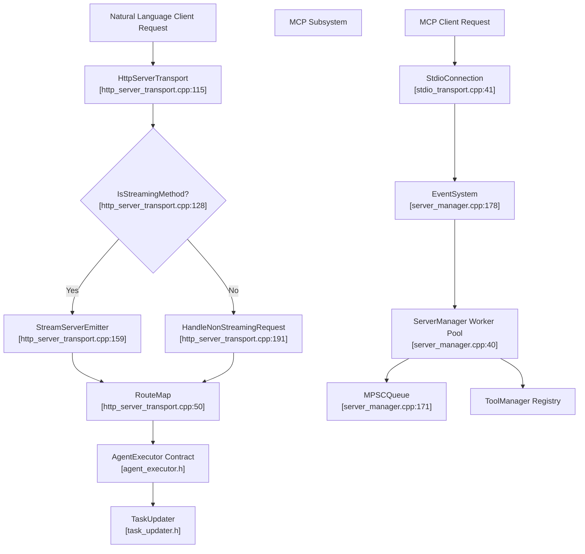
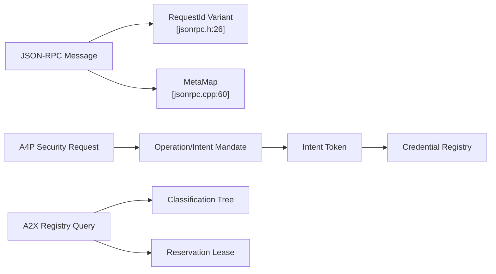

<!-- source: DeepWiki mcp.deepwiki.com · repo openJiuwen-ai/agent-protocol · page 7 Glossary · fetched 2026-11-02 -->

# Glossary

Relevant source files

The following files were used as context for generating this wiki page:

- [A2A/cpp-sdk/CMakeLists.txt](A2A/cpp-sdk/CMakeLists.txt)
- [A2A/cpp-sdk/README.md](A2A/cpp-sdk/README.md)
- [A2A/cpp-sdk/src/CMakeLists.txt](A2A/cpp-sdk/src/CMakeLists.txt)
- [A2A/cpp-sdk/src/transport/http_server_transport.cpp](A2A/cpp-sdk/src/transport/http_server_transport.cpp)
- [MCP/cpp-sdk/src/server/server_manager.cpp](MCP/cpp-sdk/src/server/server_manager.cpp)
- [MCP/cpp-sdk/src/shared/jsonrpc.cpp](MCP/cpp-sdk/src/shared/jsonrpc.cpp)
- [MCP/cpp-sdk/src/shared/jsonrpc.h](MCP/cpp-sdk/src/shared/jsonrpc.h)
- [MCP/cpp-sdk/src/transport/stdio_transport.cpp](MCP/cpp-sdk/src/transport/stdio_transport.cpp)
- [README.md](README.md)

## Purpose and Scope

This page serves as the formal technical glossary for the `agent-protocol` monorepo (`https://github.com/openJiuwen-ai/agent-protocol`). It defines the core protocols, architectural subsystems, classes, data structures, and transport mechanisms implemented across the Model Context Protocol (MCP) C++ SDK, Agent-to-Agent (A2A) C++ SDK, A2X Agent Registry, and A4P Python SDK. Each entry details its role, implementation characteristics, and primary file code pointers.

---

## 1. Protocol and Architecture Overviews

### MCP (Model Context Protocol)
- **Definition**: A standardized client-server protocol enabling Large Language Models (LLMs) to securely access contextual data, prompts, and tools across various runtimes.
- **Implementation**: Implemented in C++ under `MCP/cpp-sdk/`. Provides robust JSON-RPC 2.0 message dispatching, capability negotiation, and multi-transport support.
- **Sources**: `README.md:11-11`, `MCP/cpp-sdk/src/shared/jsonrpc.h:1-234` [MCP/cpp-sdk/src/shared/jsonrpc.h:1-234]()

### A2A (Agent-to-Agent Protocol)
- **Definition**: An interoperability specification (`v1.0.0`) governing agent discovery, asynchronous messaging, task lifecycle management, and streaming updates between autonomous agent instances.
- **Implementation**: Implemented in C++ under `A2A/cpp-sdk/`. Uses HTTP and JSON-RPC over `libcurl` and `libevent` with Server-Sent Events (SSE) for real-time task progress reporting.
- **Sources**: `A2A/cpp-sdk/README.md:15-22`, `A2A/cpp-sdk/src/CMakeLists.txt:1-125` [A2A/cpp-sdk/src/CMakeLists.txt:1-122]()

### A2X (Agent Registry)
- **Definition**: A hierarchical capability catalog and search engine built with FastAPI, enabling recursive LLM-driven agent discovery, service registration, reservation leases, and clustering.
- **Implementation**: Python-based service located in the repository supporting vector retrieval, classification trees, and Web UI integration.
- **Sources**: `README.md:13-13` [README.md:13-13]()

### A4P (Agentic Authentication, Authorization, and Audit Protocol)
- **Definition**: A security SDK establishing verifiable authorization boundaries, two-phase operation/intent mandates, cryptographic signatures (Ed25519/WebAuthn), and quota tracking across agent execution workflows.
- **Implementation**: Python SDK providing middleware and authorizers for cryptographic authorization.
- **Sources**: `README.md:14-14` [README.md:14-14]()

---

## 2. Core Data Structures and Types

### Agent Card
- **Definition**: A standardized metadata document describing an agent's identity, capabilities, endpoints, and input/output schemas, published for discovery by clients and registries.
- **Implementation**: Exposed via card resolution endpoints and parsed in client resolvers.
- **Sources**: `A2A/cpp-sdk/README.md:19-20`, `A2A/cpp-sdk/src/transport/http_server_transport.cpp:96-113` [A2A/cpp-sdk/src/transport/http_server_transport.cpp:96-113]()

### JSON-RPC RequestId
- **Definition**: A variant type representing a JSON-RPC request identifier, supporting either a 64-bit integer (`int64_t`) or a string (`std::string`).
- **Implementation**: Defined as `std::variant<int64_t, std::string>` with dedicated serialization/deserialization adl_serializer bindings.
- **Sources**: `MCP/cpp-sdk/src/shared/jsonrpc.h:25-26`, `MCP/cpp-sdk/src/shared/jsonrpc.cpp:20-36` [MCP/cpp-sdk/src/shared/jsonrpc.cpp:20-36]()

### MetaMap
- **Definition**: A key-value metadata map structure used to hold extensible string properties (serialized from JSON objects with tolerant stringification fallback for non-string values).
- **Implementation**: Used in MCP context and parameter structures (`_meta`).
- **Sources**: `MCP/cpp-sdk/src/shared/jsonrpc.cpp:60-76` [MCP/cpp-sdk/src/shared/jsonrpc.cpp:60-76]()

### TaskArtifactParam
- **Definition**: A data structure representing multimodal artifacts (files, data streams, or references) produced or consumed during task execution in A2A workflows.
- **Sources**: `A2A/cpp-sdk/README.md:21-21` [A2A/cpp-sdk/README.md:21-21]()

---

## 3. Transports and Networking

### Streamable HTTP
- **Definition**: An MCP and A2A transport mechanism supporting chunked streaming responses, persistent HTTP connections, and dual-direction JSON-RPC messaging over standard HTTP endpoints.
- **Implementation**: Managed by `ServerManager` parsing endpoints, establishing worker threads, and routing requests.
- **Sources**: `MCP/cpp-sdk/src/server/server_manager.cpp:34-141` [MCP/cpp-sdk/src/server/server_manager.cpp:34-141]()

### SSE (Server-Sent Events)
- **Definition**: A server push technology enabling a client to receive automatic updates from a server via an HTTP connection, utilized in A2A streaming tasks and message streams.
- **Implementation**: Handled in transport layers via `StreamServerEmitter` to push `text/event-stream` formatted messages.
- **Sources**: `A2A/cpp-sdk/src/transport/http_server_transport.cpp:115-189` [A2A/cpp-sdk/src/transport/http_server_transport.cpp:115-189]()

### StdioConnection
- **Definition**: A non-blocking stdin/stdout communication channel connection handler used for local process-based MCP client-server interaction or subprocess spawning.
- **Implementation**: Registers file descriptor readability events (`EventType::READ`) via an internal event loop.
- **Sources**: `MCP/cpp-sdk/src/transport/stdio_transport.cpp:41-50` [MCP/cpp-sdk/src/transport/stdio_transport.cpp:41-50]()

---

## 4. Concurrency, Queues, and Event Systems

### EventSystem
- **Definition**: An underlying event notification loop abstraction (wrapping libevent primitives) managing file descriptor polling, timeouts, and background worker threads.
- **Implementation**: Initialized per worker thread in `ServerManager` and within `StdioConnection`.
- **Sources**: `MCP/cpp-sdk/src/server/server_manager.cpp:178-180`, `MCP/cpp-sdk/src/transport/stdio_transport.cpp:41-47` [MCP/cpp-sdk/src/transport/stdio_transport.cpp:41-47]()

### MPSCQueue
- **Definition**: A Multi-Producer Single-Consumer lock-free or mutex-protected queue used to marshal incoming requests across worker threads.
- **Implementation**: Allocated per worker thread pool in `ServerManager`.
- **Sources**: `MCP/cpp-sdk/src/server/server_manager.cpp:171-171` [MCP/cpp-sdk/src/server/server_manager.cpp:171-171]()

---

## 5. Server Management and Execution Contracts

### AgentExecutor
- **Definition**: A server-side core interface contract implemented by developers to handle incoming agent task execution, message processing, and business logic execution.
- **Sources**: `A2A/cpp-sdk/README.md:20-20`, `A2A/cpp-sdk/src/CMakeLists.txt:101-101` [A2A/cpp-sdk/src/CMakeLists.txt:101-101]()

### TaskUpdater
- **Definition**: A utility contract provided to `AgentExecutor` implementations to push incremental task state changes, logs, and artifacts asynchronously to clients.
- **Sources**: `A2A/cpp-sdk/src/CMakeLists.txt:106-106` [A2A/cpp-sdk/src/CMakeLists.txt:106-106]()

### ToolManager
- **Definition**: An MCP registry manager responsible for tool registration, listing validation, parameter schema checking, and tool invocation dispatching.
- **Sources**: `MCP/cpp-sdk/src/server/server_manager.cpp:1-567` [MCP/cpp-sdk/src/server/server_manager.cpp:1-566]()

### RouteMap
- **Definition**: An HTTP routing table mapping URI paths to specific request handler callbacks (`RouteMap`) in both MCP and A2A HTTP server managers.
- **Implementation**: `Server::RouteMap` associates URI strings with `std::function` handlers.
- **Sources**: `MCP/cpp-sdk/src/server/server_manager.cpp:127-131`, `A2A/cpp-sdk/src/transport/http_server_transport.cpp:50-55` [A2A/cpp-sdk/src/transport/http_server_transport.cpp:50-55]()

### StreamServerEmitter
- **Definition**: An emitter utility class responsible for formatting and pushing server-sent event frames (`text/event-stream`) over HTTP request contexts.
- **Implementation**: Constructed using an `HttpRequestContext` to transmit streaming responses.
- **Sources**: `A2A/cpp-sdk/src/transport/http_server_transport.cpp:159-159` [A2A/cpp-sdk/src/transport/http_server_transport.cpp:159-159]()

### ProtocolVersionInterceptor
- **Definition**: A client-side interceptor inspecting and injecting protocol version headers or negotiation parameters into outgoing A2A RPC requests.
- **Sources**: `A2A/cpp-sdk/src/CMakeLists.txt:77-77` [A2A/cpp-sdk/src/CMakeLists.txt:77-77]()

---

## 6. Authorization and Registry Concepts

### Operation/Intent Mandate
- **Definition**: A two-phase authorization construct (`prepare`/`complete`) in A4P defining cryptographic scopes, resource constraints, and quota allocations required before executing sensitive agent actions.
- **Sources**: `README.md:14-14` [README.md:14-14]()

### Intent Token
- **Definition**: A cryptographically signed token issued upon successful mandate preparation, proving authorization ownership during tool or agent calls.
- **Sources**: `README.md:14-14` [README.md:14-14]()

### Credential Registry
- **Definition**: An A4P security store managing public keys, WebAuthn authenticators, and cryptographic trust configurations for verifying agent credentials.
- **Sources**: `README.md:14-14` [README.md:14-14]()

### Reservation Lease
- **Definition**: A temporary service reservation mechanism in the A2X registry locking agent resources or capacity for an active workflow session.
- **Sources**: `README.md:13-13` [README.md:13-13]()

### Classification Tree
- **Definition**: A hierarchical taxonomy structure used by the A2X search engine to categorize agent capabilities for recursive LLM-driven navigation.
- **Sources**: `README.md:13-13` [README.md:13-13]()

### Dataset and Embedding Model
- **Definition**: Training and evaluation corpora paired with vector embedding models used by A2X retrieval backends to perform semantic agent discovery.
- **Sources**: `README.md:13-13` [README.md:13-13]()

---

## 7. Architecture Mapping Diagrams

To bridge the natural language definitions of protocol concepts to their concrete C++ and Python code entities, the following diagrams illustrate their topological relationships and invocation pathways.

### Diagram: Protocol Request & Transport Routing Entity Map

*Sources: `A2A/cpp-sdk/src/transport/http_server_transport.cpp:50-191`, `MCP/cpp-sdk/src/server/server_manager.cpp:40-180`, `MCP/cpp-sdk/src/transport/stdio_transport.cpp:41-47`*

### Diagram: Data Serialization and Authorization Mapping

*Sources: `MCP/cpp-sdk/src/shared/jsonrpc.h:26-26`, `MCP/cpp-sdk/src/shared/jsonrpc.cpp:60-76`, `README.md:13-14`*