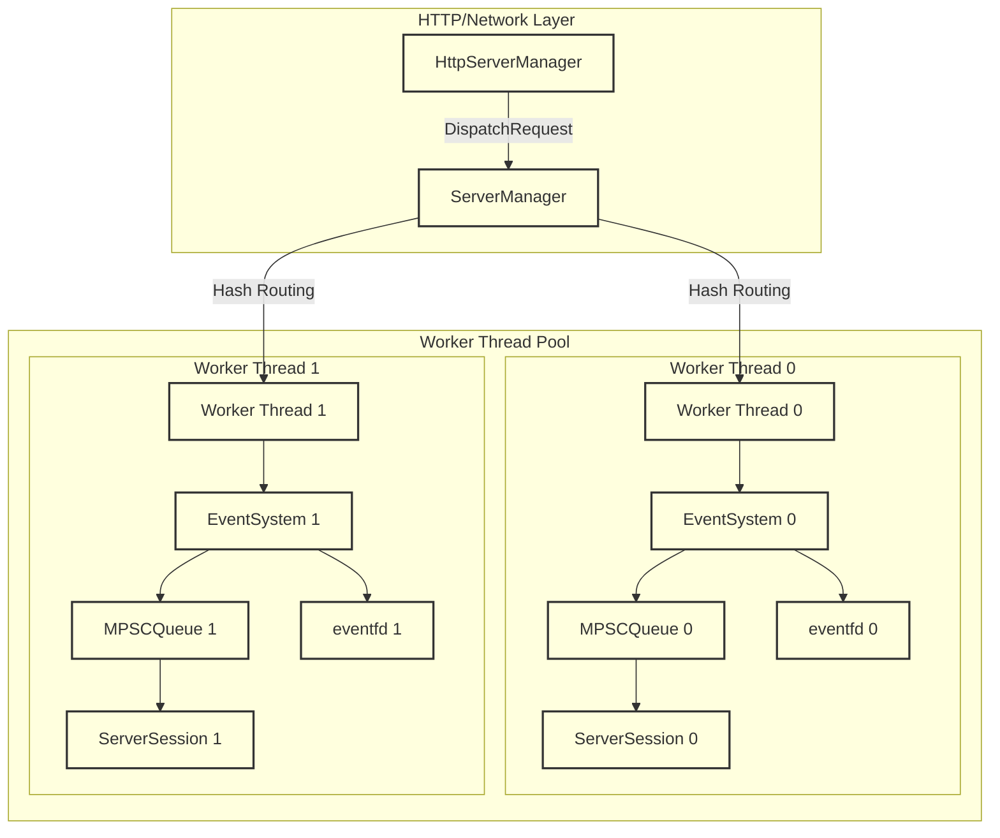
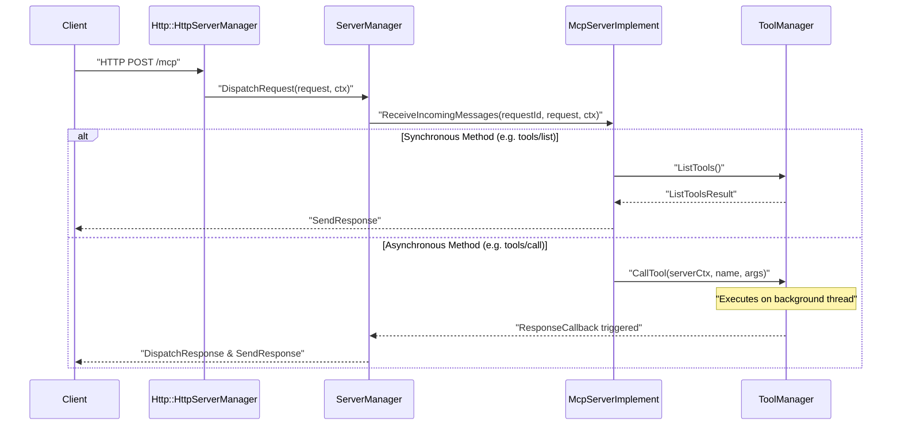

<!-- source: DeepWiki mcp.deepwiki.com · repo openJiuwen-ai/agent-protocol · extra page ServerManager and Concurrency · fetched 2026-11-02 -->

# ServerManager and Concurrency

<details>
<summary>Relevant source files</summary>

The following files were used as context for generating this wiki page:

- [MCP/cpp-sdk/src/server/mcp_server_implement.cpp](MCP/cpp-sdk/src/server/mcp_server_implement.cpp)
- [MCP/cpp-sdk/src/server/server_manager.cpp](MCP/cpp-sdk/src/server/server_manager.cpp)
- [MCP/cpp-sdk/src/shared/common_type.h](MCP/cpp-sdk/src/shared/common_type.h)
- [MCP/cpp-sdk/src/shared/message_queue/lock_free_queue.h](MCP/cpp-sdk/src/shared/message_queue/lock_free_queue.h)
- [MCP/cpp-sdk/src/transport/stdio_transport.cpp](MCP/cpp-sdk/src/transport/stdio_transport.cpp)

</details>


This page documents the concurrency architecture of the Model Context Protocol (MCP) C++ SDK. It details how `ServerManager` coordinates worker thread pools, lock-free and MPSC queues, `eventfd`-based event notifications, session routing, and authentication/authorization hooks.

---

## 1. Worker Thread Pools and Event-Driven Architecture

The core concurrency model relies on a multi-threaded event-driven dispatcher managed by `ServerManager`. When initialized in HTTP mode, `ServerManager` spawns a configurable number of worker threads (`workerThreads`), each running an independent `EventSystem` event loop.

Each worker thread executes `ServerManager::ThreadMain`, setting a custom thread name (`MCP-Worker-{id}`) and starting its blocking event loop:

```cpp
void ServerManager::ThreadMain(int id)
{
    SetCurrentThreadName("MCP-Worker-" + std::to_string(id));
    MCP_LOG(MCP_LOG_LEVEL_INFO, "Protocol thread " + std::to_string(id) + " started");
    eventSystems_[id]->Start(false); // Block current thread
    MCP_LOG(MCP_LOG_LEVEL_INFO, "Protocol thread " + std::to_string(id) + " event loop ended");
}
```
*Cited from: `[MCP/cpp-sdk/src/server/server_manager.cpp:40-48]()`*

### Concurrency Topology Diagram


*Sources: `[MCP/cpp-sdk/src/server/server_manager.cpp:34-180]()`, `[MCP/cpp-sdk/src/server/server_manager.h]()`*

---

## 2. MPSC and Lock-Free Queue Mechanics

To safely pass requests and asynchronous tool responses between producer threads (such as network IO threads or user-provided tool execution threads) and worker threads, the SDK implements high-performance synchronization queues in `lock_free_queue.h`.

### `LockFreeSPSCQueue`
A single-producer single-consumer ring-buffer queue (`LockFreeSPSCQueue`) uses atomic indices with relaxed and acquire-release semantics to avoid locking overheads:

```cpp
template <typename T>
class LockFreeSPSCQueue {
    // Uses cache-line alignment (MCP_LFQ_CACHELINE_SIZE = 64) 
    // to prevent false sharing on writePos and readPos.
};
```
*Cited from: `[MCP/cpp-sdk/src/shared/message_queue/lock_free_queue.h:35-170]()`*

### `MPSCQueue`
For multi-producer scenarios (where multiple threads dispatch responses to a single worker thread), `MPSCQueue` provides a bounded-capacity ring buffer with atomic tail/head increments:
* Capacity must be a power of 2 (`MCP_LFQ_MIN_CAPACITY`).
* Cache line padding prevents hardware cache contention.

*Sources: `[MCP/cpp-sdk/src/shared/message_queue/lock_free_queue.h:35-213]()`*

---

## 3. `eventfd` Notification Subsystem

When a worker thread's queue receives a message or asynchronous tool callback from an external thread, the event loop needs to be woken up instantly. The SDK achieves this using Linux `eventfd` descriptors registered inside `EventSystem`.

* `threadQueueEventIds_` tracks the event IDs associated with each worker queue `eventfd`.
* When an external thread calls `DispatchResponse`, it writes to the target thread's `eventfd`, triggering a readable event on the target `EventSystem` instance.
* The event loop wakes up, pops items from the thread-local `MPSCQueue`, and processes them on the correct worker thread context.

*Sources: `[MCP/cpp-sdk/src/server/server_manager.cpp:167-180]()`*

---

## 4. Session Routing and Request Handling

Incoming requests are mapped to active sessions via `ServerRequestContext` and managed inside `McpServerImplement`. 

```cpp
void McpServerImplement::ReceiveIncomingMessages(const RequestId& requestId, const Request& request,
                                                 ServerRequestContext& ctx)
{
    const std::string& method = request.method_;
    auto session = ctx.activeSession.lock();

    {
        std::lock_guard<std::mutex> lock(session->reqMtx);
        session->sessionRequests[requestId] = ctx;
    }
    // Method routing...
}
```
*Cited from: `[MCP/cpp-sdk/src/server/mcp_server_implement.cpp:39-48]()`*

### Stateless vs. Stateful Request Handling
* **Stateless Requests**: Methods like `tools/list`, `prompts/list`, or `ping` execute entirely within the incoming request handler and immediately return a JSON-RPC response via `session->SendResponse`.
* **Stateful Requests / Asynchronous Tools**: Methods like `tools/call` can execute asynchronously. A `ResponseCallback` is captured, wrapping the `RequestId`, `ServerRequestContext`, and `ServerSession`:
```cpp
ResponseCallback responseCallback = [this, requestId, ctx, session](const Result& result) {
    const auto& toolResult = static_cast<const CallToolResult&>(result);
    auto resultPtr = std::make_shared<CallToolResult>(toolResult);
    serverManager_->DispatchResponse(requestId, resultPtr, ctx, session);
};
```
*Cited from: `[MCP/cpp-sdk/src/server/mcp_server_implement.cpp:155-159]()`*

### Request Routing Data Flow


*Sources: `[MCP/cpp-sdk/src/server/server_manager.cpp:127-130]()`, `[MCP/cpp-sdk/src/server/mcp_server_implement.cpp:39-175]()`*

---

## 5. Authentication and Authorization Hooks

`ServerManager` integrates pluggable authentication and authorization hooks via transport configuration options. During initialization, `ServerManager` captures the `authenticator_` and `authorizer_` instances:

```cpp
ServerManager::ServerManager(const ServerConfig& config, const StreamableHttpServerConfig& transportConfig)
    : config_(config), streamableConfig_(transportConfig), isStdio_{false},
      authenticator_(transportConfig.authenticator), authorizer_(transportConfig.authorizer) {}
```
*Cited from: `[MCP/cpp-sdk/src/server/server_manager.cpp:34-36]()`*

* **Authenticator**: Validates incoming credentials (e.g., Bearer tokens or API keys) attached to HTTP request headers before dispatching to worker queues.
* **Authorizer**: Checks whether the authenticated principal possesses the required privileges or scopes to invoke specific MCP tools or access protected resources.

*Sources: `[MCP/cpp-sdk/src/server/server_manager.cpp:34-38]()`*

---

