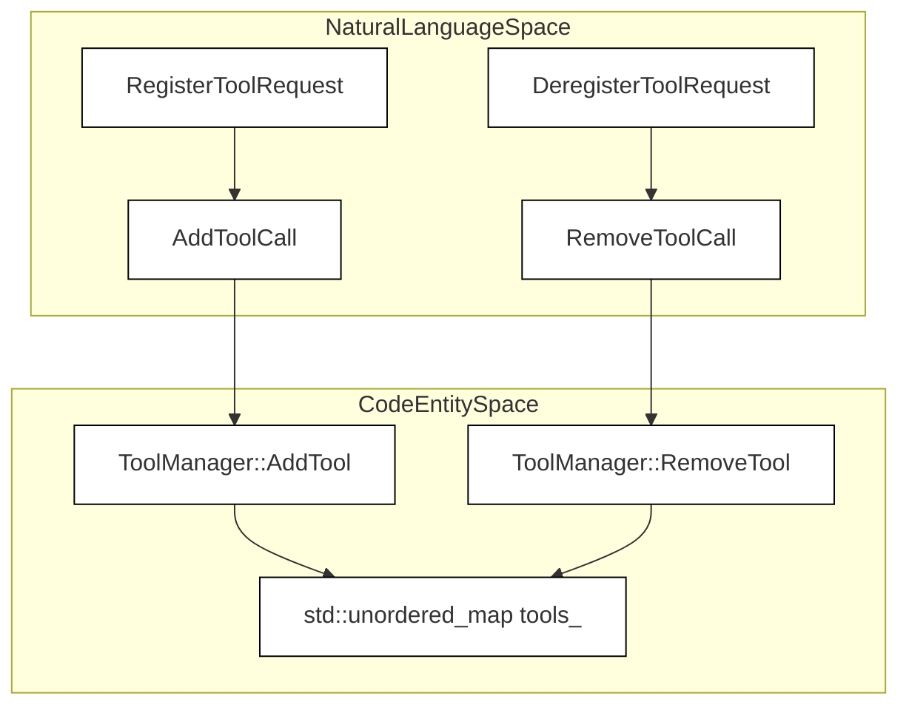
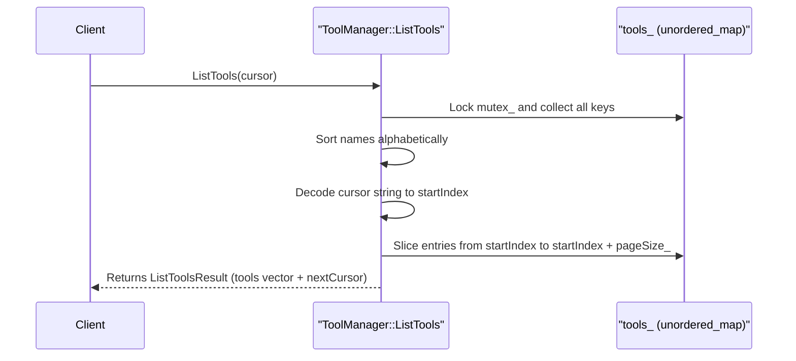
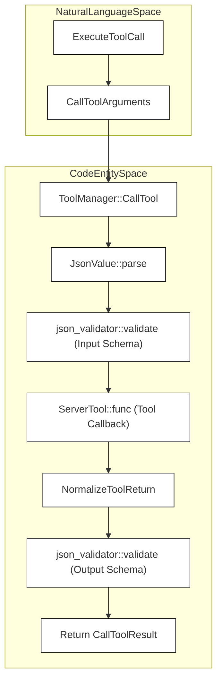

<!-- source: DeepWiki mcp.deepwiki.com · repo openJiuwen-ai/agent-protocol · extra page Tool, Prompt and Resource Managers · fetched 2026-11-02 -->

# Tool, Prompt and Resource Managers

Relevant source files

The following files were used as context for generating this wiki page:

- [MCP/cpp-sdk/src/server/tool_manager.cpp](MCP/cpp-sdk/src/server/tool_manager.cpp)
- [MCP/cpp-sdk/src/server/tool_manager.h](MCP/cpp-sdk/src/server/tool_manager.h)

## Purpose and Scope
This document covers the implementation of the `ToolManager` and associated registries within the Model Context Protocol (MCP) C++ SDK. It details the mechanisms for tool registration, lifecycle management, cursor-based pagination during tool listing, thread-safe access, JSON schema validation for inputs and outputs, and tool invocation semantics.

Sources: `[MCP/cpp-sdk/src/server/tool_manager.h:1-92]()`, `[MCP/cpp-sdk/src/server/tool_manager.cpp:1-207]()`

---

## 1. Core Data Structures: `ServerTool` and `ToolManager`

The MCP server relies on `ServerTool` to encapsulate individual tool metadata, execution handlers, and JSON schemas, while `ToolManager` manages the registry collection thread-safely.

### The `ServerTool` Structure
`ServerTool` represents a registered executable tool. It holds metadata such as the tool's name, optional title, description, JSON schemas for inputs and outputs, annotations, and icons.

- **`name`**: Unique string identifier for the tool.
- **`func`**: A `ToolFunc` callback handler responsible for tool execution.
- **`inputSchema` / `outputSchema`**: Optional JSON schema strings used to validate inputs and structured outputs.
- **`annotations` / `icons`**: Optional metadata structures for UI and capability introspection.

Sources: `[MCP/cpp-sdk/src/server/tool_manager.h:18-47]()`

### The `ToolManager` Class
`ToolManager` provides thread-safe container operations over an underlying `std::unordered_map<std::string, ServerTool>`. Concurrency control is achieved using a `mutable std::mutex`.

- **`overwrite_`**: Configuration flag determining behavior when adding a tool with an existing name (throws or overwrites with a warning).
- **`pageSize_`**: Configures the default chunk size for paginated listing operations.

Sources: `[MCP/cpp-sdk/src/server/tool_manager.h:49-88]()`

---

## 2. Registration and Lifecycle Semantics

Tools are registered and removed dynamically through `AddTool` and `RemoveTool`.

Sources: `[MCP/cpp-sdk/src/server/tool_manager.cpp:34-60]()`

### `AddTool`
`AddTool` acquires `mutex_`, checks if `tool.name` already exists within `tools_`, and handles collisions based on `overwrite_`:
- If `overwrite_` is `false`, a `std::runtime_error` is thrown.
- If `overwrite_` is `true`, a warning log is emitted via `MCP_LOG` and the existing tool is replaced.

Sources: `[MCP/cpp-sdk/src/server/tool_manager.cpp:34-45]()`

### `RemoveTool`
`RemoveTool` validates that the provided name is non-empty, acquires `mutex_`, and erases the entry if found. If the tool does not exist, a `std::runtime_error` is thrown.

Sources: `[MCP/cpp-sdk/src/server/tool_manager.cpp:47-60]()`

---

## 3. Listing and Cursor Pagination

Tools can be retrieved in batches using `ListTools`, which supports optional cursor-based pagination.

Sources: `[MCP/cpp-sdk/src/server/tool_manager.cpp:62-116]()`

### Pagination Logic
1. **Stable Sorting**: All tool names are copied into a `std::vector<std::string>` and sorted alphabetically to guarantee deterministic ordering across page requests.
2. **Cursor Decoding**: The optional cursor string is parsed as a 64-bit integer index (`std::stoll`). Invalid or out-of-bounds cursors fall back gracefully to index `0` or `names.size()`.
3. **Chunking**: A sub-range of size `pageSize_` is projected into standard `Tool` descriptors containing name, title, description, schemas, annotations, and icons.
4. **Next Cursor**: If more elements remain (`endIndex < names.size()`), `nextCursor` is populated with the string representation of `endIndex`.

Sources: `[MCP/cpp-sdk/src/server/tool_manager.cpp:66-115]()`

---

## 4. Invocation, Validation, and Normalization

Tool execution flows through `CallTool`, which handles argument parsing, JSON schema validation, return normalization, and error catching.

Sources: `[MCP/cpp-sdk/src/server/tool_manager.cpp:118-204]()`

### Execution Pipeline
1. **Lookup**: Acquires `mutex_`, retrieves the `ServerTool` by name, and copies it to minimize lock contention during execution.
2. **Argument Parsing**: Parses the raw argument string into a `JsonValue` (`nlohmann::json`).
3. **Input Validation**: If `tool.inputSchema` is defined, `nlohmann::json_schema::json_validator` validates the parsed arguments against the input schema.
4. **Context Construction**: Assembles a `ServerContext` depending on whether the function is asynchronous. Synchronous tools drop response callbacks to prevent double-responses.
5. **Invocation & Exception Catching**: Executes `tool.func(...)`. Exceptions thrown during execution are caught and converted into a `CallToolResult` with `isError = true` and the exception message wrapped in `TextContent`.
6. **Return Normalization**: Raw tool returns (either structured `CallToolResult` or raw `std::string`) are normalized via `NormalizeToolReturn`.
7. **Output Validation**: If `tool.outputSchema` is set and the result is not an error, the structured content is validated against the output schema.

Sources: `[MCP/cpp-sdk/src/server/tool_manager.cpp:14-32]`, `[MCP/cpp-sdk/src/server/tool_manager.cpp:118-196]()`

---

