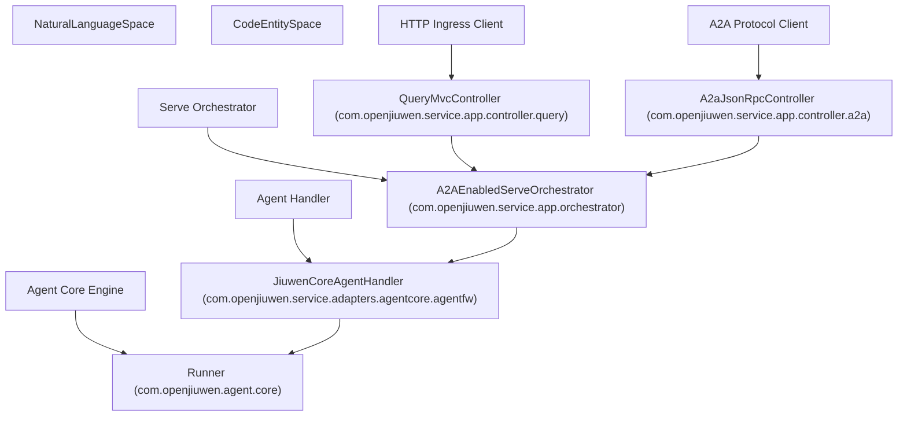
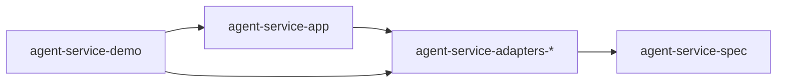

<!-- source: DeepWiki mcp.deepwiki.com · repo openJiuwen-ai/agent-runtime-java · page 1 Overview · fetched 2026-11-02 -->

# Overview

Relevant source files

The following files were used as context for generating this wiki page:

- [README.md](README.md)
- [README.zh.md](README.zh.md)
- [documents/zh/SUMMARY.md](documents/zh/SUMMARY.md)
- [pom.xml](pom.xml)
- [service/README.md](service/README.md)
- [service/agent-service-adapters/agent-service-adapters-common/pom.xml](service/agent-service-adapters/agent-service-adapters-common/pom.xml)
- [service/agent-service-adapters/agent-service-adapters-common/src/main/java/com/openjiuwen/service/adapters/common/security/ExternalAuthProperties.java](service/agent-service-adapters/agent-service-adapters-common/src/main/java/com/openjiuwen/service/adapters/common/security/ExternalAuthProperties.java)
- [service/agent-service-adapters/agent-service-adapters-common/src/main/java/com/openjiuwen/service/adapters/common/security/ExternalTlsConfig.java](service/agent-service-adapters/agent-service-adapters-common/src/main/java/com/openjiuwen/service/adapters/common/security/ExternalTlsConfig.java)
- [service/agent-service-adapters/agent-service-adapters-common/src/main/java/com/openjiuwen/service/adapters/common/security/GlobalTlsProperties.java](service/agent-service-adapters/agent-service-adapters-common/src/main/java/com/openjiuwen/service/adapters/common/security/GlobalTlsProperties.java)
- [service/agent-service-adapters/agent-service-adapters-common/src/main/resources/META-INF/spring/org.springframework.boot.autoconfigure.AutoConfiguration.imports](service/agent-service-adapters/agent-service-adapters-common/src/main/resources/META-INF/spring/org.springframework.boot.autoconfigure.AutoConfiguration.imports)

## Purpose and Scope

**openJiuwen Agent Runtime Java** (`agent-runtime-java`) is the Java implementation repository for the **Agent Distributed Runtime**, acting as a Spring Boot runtime that hosts OpenJiuwen agents over HTTP and the Agent-to-Agent (A2A) protocol [README.md:5-10](). The core runtime logic is organized under the `service/` directory as the **Agent Server** data plane, bridging inbound HTTP and JSON-RPC requests to the execution engine [README.md:5-10](), [service/README.md:1-5]().

This parent page provides a high-level summary of the repository architecture, module layout, and key runtime concepts. For concrete setup instructions or fine-grained API specifications, refer to the child pages:
- [Getting Started and Build](#1.1)
- [Module Layout and Spec Contracts](#1.2)

Sources: [README.md:5-10](), [service/README.md:1-5]()

---

## Module Map and Architecture

The codebase is structured into a multi-module Maven project rooted at `pom.xml` [pom.xml:23-25](). The primary delivery slice resides inside the `service/` aggregator module, separating contracts, adapters, application ingress, and runnable demonstrations [service/README.md:8-18]().

### System Architecture to Code Entities

The following diagram bridges high-level natural language runtime concepts to their respective Java packages and classes within the codebase:

Sources: [README.md:120-131](), [service/README.md:8-18]()

### Module Dependency Hierarchy

The runtime enforces strict, one-way dependency boundaries between modules: application ingress depends on adapters, which in turn depend solely on core specifications [README.md:21]().

Sources: [README.md:21](), [service/README.md:20-28]()

| Module Name | Packaging | Primary Responsibility | Cited Source |
| :--- | :--- | :--- | :--- |
| `agent-service-spec` | `jar` | Pure Java Data Transfer Objects (DTOs), SPI interfaces, and endpoint path constants. | [service/README.md:12]() |
| `agent-service-adapters-common` | `jar` | Engine-agnostic middleware clients (Redis), credential decryptors, and external call DFX. | [README.md:156](), [service/README.md:14]() |
| `agent-service-adapters-agentcore` | `jar` | `JiuwenCoreAgentHandler` bridge binding execution engines, Checkpointers, MCP, and Sandbox SPIs. | [README.md:157](), [service/README.md:15]() |
| `agent-service-app` | `jar` | Spring Boot auto-configurations, MVC/WebFlux controllers, orchestrators, and lifecycle handlers. | [service/README.md:16]() |
| `agent-service-demo` | `jar` (Spring Boot) | Runnable examples, YAML configurations, and smoke testing scripts. | [service/README.md:17]() |

Sources: [README.md:156-157](), [service/README.md:12-17]()

---

## Key Concepts

- **AgentHandler**: The primary Service Provider Interface (SPI) abstracting agent invocation, allowing integration with the OpenJiuwen Agent Core engine or custom execution proxies [README.md:161-162]().
- **ServeOrchestrator**: Coordinates incoming request lifecycles, streaming chunk dispatching (`QueryStreamObserver`), and remote A2A delegation [README.md:123]().
- **In-Process A2A**: Native support for Agent Cards (`/.well-known/agent-card.json`) and JSON-RPC message passing (`SendMessage`, `SendStreamingMessage`) without requiring an external sidecar process [README.md:19](), [READMEvmd:145-146]().
- **Adapters Layer**: Decouples business logic from middleware (Redis checkpointers) and external egress boundaries (MCP, Sandboxes, LLM APIs) [README.md:150-158]().

Sources: [README.md:19](), [README.md:123](), [README.md:150-162]()

---

## Child Pages

For comprehensive technical documentation, refer to the child pages:
- [Getting Started and Build](#1.1) — Details Maven multi-module builds, versioning constraints, dependency pinning, and running local demos [README.md:23-82]().
- [Module Layout and Spec Contracts](#1.2) — Covers `agent-service-spec` DTO definitions (`ServeRequest`, `QueryChunk`, `QueryRequest`/`Response`), SPI contracts (`AgentHandler`, `ServeOrchestrator`), and route paths [service/README.md:47-49]().

Sources: [README.md:23-82](), [service/README.md:47-49]()

---

