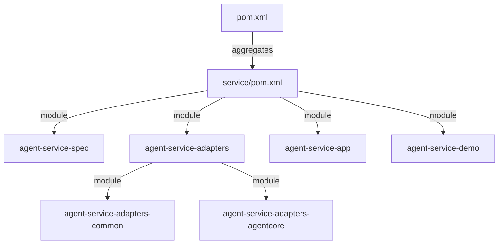
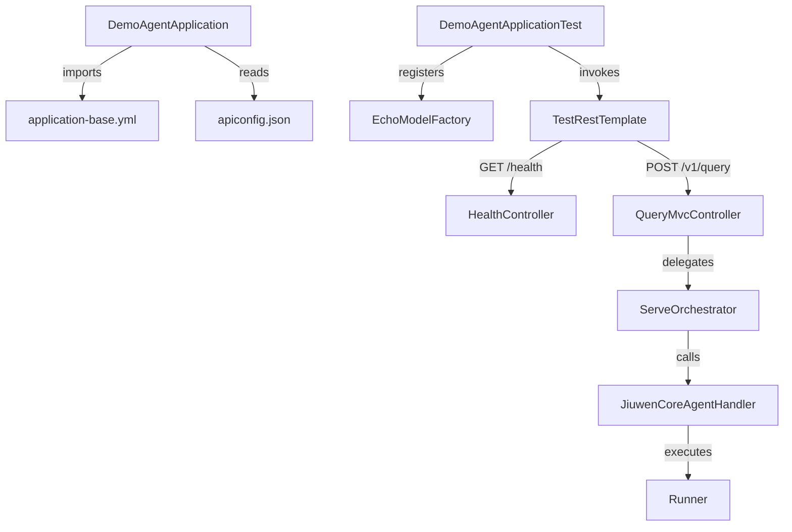

<!-- source: DeepWiki mcp.deepwiki.com · repo openJiuwen-ai/agent-runtime-java · page 1.1 Getting Started and Build · fetched 2026-11-02 -->

# Getting Started and Build

<details>
<summary>Relevant source files</summary>

The following files were used as context for generating this wiki page:

- [pom.xml](pom.xml)
- [service/agent-service-adapters/agent-service-adapters-agentcore/pom.xml](service/agent-service-adapters/agent-service-adapters-agentcore/pom.xml)
- [service/agent-service-adapters/agent-service-adapters-common/pom.xml](service/agent-service-adapters/agent-service-adapters-common/pom.xml)
- [service/agent-service-adapters/agent-service-adapters-common/src/main/java/com/openjiuwen/service/adapters/common/security/ExternalAuthProperties.java](service/agent-service-adapters/agent-service-adapters-common/src/main/java/com/openjiuwen/service/adapters/common/security/ExternalAuthProperties.java)
- [service/agent-service-adapters/agent-service-adapters-common/src/main/java/com/openjiuwen/service/adapters/common/security/ExternalTlsConfig.java](service/agent-service-adapters/agent-service-adapters-common/src/main/java/com/openjiuwen/service/adapters/common/security/ExternalTlsConfig.java)
- [service/agent-service-adapters/agent-service-adapters-common/src/main/java/com/openjiuwen/service/adapters/common/security/GlobalTlsProperties.java](service/agent-service-adapters/agent-service-adapters-common/src/main/java/com/openjiuwen/service/adapters/common/security/GlobalTlsProperties.java)
- [service/agent-service-adapters/agent-service-adapters-common/src/main/resources/META-INF/spring/org.springframework.boot.autoconfigure.AutoConfiguration.imports](service/agent-service-adapters/agent-service-adapters-common/src/main/resources/META-INF/spring/org.springframework.boot.autoconfigure.AutoConfiguration.imports)
- [service/agent-service-adapters/pom.xml](service/agent-service-adapters/pom.xml)
- [service/agent-service-app/pom.xml](service/agent-service-app/pom.xml)
- [service/agent-service-demo/README.md](service/agent-service-demo/README.md)
- [service/agent-service-demo/example/config/application-base.yml](service/agent-service-demo/example/config/application-base.yml)
- [service/agent-service-demo/example/redis/README.md](service/agent-service-demo/example/redis/README.md)
- [service/agent-service-demo/pom.xml](service/agent-service-demo/pom.xml)
- [service/agent-service-demo/src/main/resources/application.yml](service/agent-service-demo/src/main/resources/application.yml)
- [service/agent-service-demo/src/test/java/com/openjiuwen/service/demo/DemoAgentApplicationTest.java](service/agent-service-demo/src/test/java/com/openjiuwen/service/demo/DemoAgentApplicationTest.java)
- [service/agent-service-spec/pom.xml](service/agent-service-spec/pom.xml)
- [service/pom.xml](service/pom.xml)

</details>


## Purpose and Scope
This page details the Maven multi-module build layout, CI-friendly versioning strategy, strict dependency pinning rules, and procedures for running the `agent-service-demo` application locally. The repository `agent-runtime-java` hosts OpenJiuwen agents over the A2A protocol using Spring Boot `[pom.xml:8-14]`, `[service/agent-service-demo/README.md:1-6]()`.

Sources: `[pom.xml:8-14]()`, `[service/agent-service-demo/README.md:1-6]()`

---

## Maven Multi-Module Architecture
The codebase is structured as a Maven multi-module project rooted at `pom.xml`, delegating service aggregation to `service/pom.xml`. The leaf modules isolate specifications, adapters, application controllers, and runnable demos.


*Figure 1: Maven Multi-Module Build Dependency and Aggregation Topology.*

Sources: `[pom.xml:23-25]()`, `[service/pom.xml:57-72]()`, `[service/agent-service-adapters/pom.xml:21-25]()`

---

## CI-Friendly Versioning and Dependency Pinning
To support continuous integration and strict binary compatibility with `agent-core-java`, the project uses a Maven CI-friendly versioning property `${revision}` defined in `pom.xml` `[pom.xml:10-28]()`. 

Key runtime dependencies and BOM overrides are explicitly pinned in the root `dependencyManagement` block to avoid transitive version drift from `spring-boot-starter-parent` `[pom.xml:40-121]()`:
- `agent-core-java`: pinned to version `0.1.16` `[pom.xml:36-36]()`, `[pom.xml:116-120]()`.
- A2A Java SDK modules (`a2a-java-sdk-spec`, `a2a-java-sdk-server-common`, `a2a-java-sdk-jsonrpc-common`, `a2a-java-sdk-client`): pinned to `1.0.0.Final` `[pom.xml:34-34]`, `[pom.xml:93-113]()`.
- `opentelemetry.version`: overridden to `1.64.0` to match `agent-core-java` and prevent `NoSuchMethodError` `[pom.xml:63-65]()`.
- `gson`: pinned to `2.11.0` required by A2A SDK `JSONRPCUtils` `[pom.xml:55-56]`, `[pom.xml:152-156]()`.

Sources: `[pom.xml:10-121]()`

---

## Running the Demo App Locally
The `agent-service-demo` module provides a runnable Spring Boot application demonstrating the core query APIs, LLM integration, and middleware configurations `[service/agent-service-demo/README.md:1-27]`, `[service/agent-service-demo/pom.xml:15-19]()`.


*Figure 2: Demo Application Execution Flow and Component Integration.*

### Local Startup Procedure
1. Navigate to the service directory:
   ```bash
   cd agent-runtime-java/service
   ```
2. Configure LLM credentials by providing `apiconfig.json` or setting environment variables as specified in `[service/agent-service-demo/README.md:126-183]()`.
3. Start the demo application via Maven `[service/agent-service-demo/README.md:9-16]()`:
   ```bash
   mvn -pl agent-service-demo -am spring-boot:run
   ```
4. The service listens on port `8090` by default `[service/agent-service-demo/README.md:15-15]`, `[service/agent-service-demo/example/config/application-base.yml:4-5]()`.

Sources: `[service/agent-service-demo/README.md:1-183]`, `[service/agent-service-demo/pom.xml:15-19]`, `[service/agent-service-demo/src/test/java/com/openjiuwen/service/demo/DemoAgentApplicationTest.java:54-94]`, `[service/agent-service-demo/example/config/application-base.yml:1-46]()`

---

