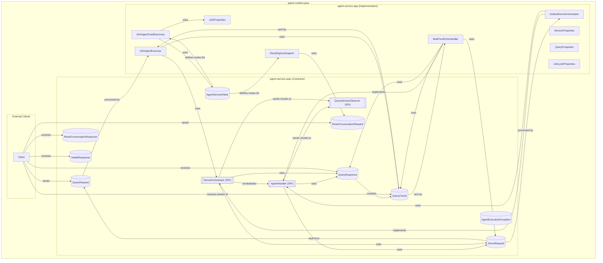
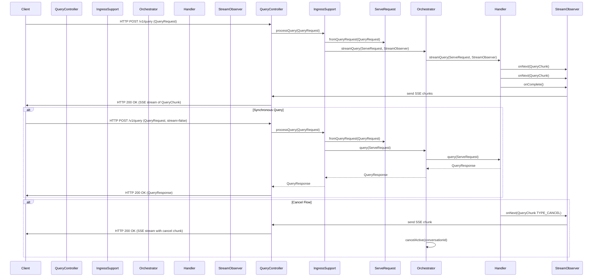

<!-- source: DeepWiki mcp.deepwiki.com · repo openJiuwen-ai/agent-runtime-java · page 1.2 Module Layout and Spec Contracts · fetched 2026-11-02 -->

# Module Layout and Spec Contracts

Relevant source files

The following files were used as context for generating this wiki page:

- [service/agent-service-app/src/main/java/com/openjiuwen/service/app/config/LifecycleProperties.java](service/agent-service-app/src/main/java/com/openjiuwen/service/app/config/LifecycleProperties.java)
- [service/agent-service-app/src/main/java/com/openjiuwen/service/app/config/QueryProperties.java](service/agent-service-app/src/main/java/com/openjiuwen/service/app/config/QueryProperties.java)
- [service/agent-service-app/src/main/java/com/openjiuwen/service/app/config/ServiceProperties.java](service/agent-service-app/src/main/java/com/openjiuwen/service/app/config/ServiceProperties.java)
- [service/agent-service-app/src/main/java/com/openjiuwen/service/app/controller/a2a/client/A2AAgentCardDiscovery.java](service/agent-service-app/src/main/java/com/openjiuwen/service/app/controller/a2a/client/A2AAgentCardDiscovery.java)
- [service/agent-service-app/src/main/java/com/openjiuwen/service/app/controller/reset/ResetIngressSupport.java](service/agent-service-app/src/main/java/com/openjiuwen/service/app/controller/reset/ResetIngressSupport.java)
- [service/agent-service-app/src/main/java/com/openjiuwen/service/app/orchestrator/DefaultServeOrchestrator.java](service/agent-service-app/src/main/java/com/openjiuwen/service/app/orchestrator/DefaultServeOrchestrator.java)
- [service/agent-service-app/src/test/java/com/openjiuwen/service/app/controller/a2a/A2AAgentExecutorCancelTest.java](service/agent-service-app/src/test/java/com/openjiuwen/service/app/controller/a2a/A2AAgentExecutorCancelTest.java)
- [service/agent-service-app/src/test/java/com/openjiuwen/service/app/controller/a2a/A2AProtocolAdapterTest.java](service/agent-service-app/src/test/java/com/openjiuwen/service/app/controller/a2a/A2AProtocolAdapterTest.java)
- [service/agent-service-app/src/test/java/com/openjiuwen/service/app/controller/a2a/client/A2AAgentCardDiscoveryTest.java](service/agent-service-app/src/test/java/com/openjiuwen/service/app/controller/a2a/client/A2AAgentCardDiscoveryTest.java)
- [service/agent-service-app/src/test/java/com/openjiuwen/service/app/it/MultiTurnEchoHandler.java](service/agent-service-app/src/test/java/com/openjiuwen/service/app/it/MultiTurnEchoHandler.java)
- [service/agent-service-spec/src/main/java/com/openjiuwen/service/spec/dto/HealthResponse.java](service/agent-service-spec/src/main/java/com/openjiuwen/service/spec/dto/HealthResponse.java)
- [service/agent-service-spec/src/main/java/com/openjiuwen/service/spec/dto/QueryChunk.java](service/agent-service-spec/src/main/java/com/openjiuwen/service/spec/dto/QueryChunk.java)
- [service/agent-service-spec/src/main/java/com/openjiuwen/service/spec/dto/QueryRequest.java](service/agent-service-spec/src/main/java/com/openjiuwen/service/spec/dto/QueryRequest.java)
- [service/agent-service-spec/src/main/java/com/openjiuwen/service/spec/dto/QueryResponse.java](service/agent-service-spec/src/main/java/com/openjiuwen/service/spec/dto/QueryResponse.java)
- [service/agent-service-spec/src/main/java/com/openjiuwen/service/spec/dto/ResetConversationRequest.java](service/agent-service-spec/src/main/java/com/openjiuwen/service/spec/dto/ResetConversationRequest.java)
- [service/agent-service-spec/src/main/java/com/openjiuwen/service/spec/dto/ResetConversationResponse.java](service/agent-service-spec/src/main/java/com/openjiuwen/service/spec/dto/ResetConversationResponse.java)
- [service/agent-service-spec/src/main/java/com/openjiuwen/service/spec/dto/ServeRequest.java](service/agent-service-spec/src/main/java/com/openjiuwen/service/spec/dto/ServeRequest.java)
- [service/agent-service-spec/src/main/java/com/openjiuwen/service/spec/exception/AgentExecutionException.java](service/agent-service-spec/src/main/java/com/openjiuwen/service/spec/exception/AgentExecutionException.java)
- [service/agent-service-spec/src/main/java/com/openjiuwen/service/spec/paths/AgentServicePaths.java](service/agent-service-spec/src/main/java/com/openjiuwen/service/spec/paths/AgentServicePaths.java)
- [service/agent-service-spec/src/main/java/com/openjiuwen/service/spec/spi/ServeOrchestrator.java](service/agent-service-spec/src/main/java/com/openjiuwen/service/spec/spi/ServeOrchestrator.java)
- [service/agent-service-spec/src/test/java/com/openjiuwen/service/spec/dto/ServeRequestTest.java](service/agent-service-spec/src/test/java/com/openjiuwen/service/spec/dto/ServeRequestTest.java)

This page details the `agent-service-spec` module, which defines the core Data Transfer Objects (DTOs), Service Provider Interfaces (SPIs), HTTP paths, and exceptions used throughout the `agent-runtime-java` codebase. It serves as the contract between different modules and external clients, ensuring a consistent interaction model.

## Data Transfer Objects (DTOs)

The `agent-service-spec` module defines several key DTOs for communication within the system and with external clients.

### ServeRequest

The `ServeRequest` class [service/agent-service-spec/src/main/java/com/openjiuwen/service/spec/dto/ServeRequest.java:20-126]() is a protocol-neutral DTO that represents an orchestration request. It is typically built from an external `QueryRequest` [service/agent-service-spec/src/main/java/com/openjiuwen/service/spec/dto/ServeRequest.java:42-51]() and contains information necessary for an agent to process a user's query.

Key fields include:
*   `conversationId`: A unique identifier for the conversation.
*   `messages`: A list of message maps, representing the conversation history.
*   `userId`, `spaceId`, `tenantId`: Identifiers for the user, space, and tenant.
*   `stream`: A boolean indicating whether the response should be streamed.
*   `metadata`: A map for additional, arbitrary metadata.

The `ServeRequest` also provides utility methods like `lastUserQuery()` [service/agent-service-spec/src/main/java/com/openjiuwen/service/spec/dto/ServeRequest.java:59-61]() to extract the content of the latest user message and `lastUserMessageMetadata()` [service/agent-service-spec/src/main/java/com/openjiuwen/service/spec/dto/ServeRequest.java:83-95]() to retrieve metadata associated with it.

Sources:
*   [service/agent-service-spec/src/main/java/com/openjiuwen/service/spec/dto/ServeRequest.java]()
*   [service/agent-service-spec/src/test/java/com/openjiuwen/service/spec/dto/ServeRequestTest.java]()

### QueryRequest and QueryResponse

The `QueryRequest` class [service/agent-service-spec/src/main/java/com/openjiuwen/service/spec/dto/QueryRequest.java:24-110]() is the external API request body for querying an agent. It aligns with the Python AgentApp's `QueryRequest`. It includes fields similar to `ServeRequest` but also handles a shorthand `message` field [service/agent-service-spec/src/main/java/com/openjiuwen/service/spec/dto/QueryRequest.java:48-51]() which is normalized into the `messages` list via `normalizeMessages()` [service/agent-service-spec/src/main/java/com/openjiuwen/service/spec/dto/QueryRequest.java:71-82]().

The `QueryResponse` class [service/agent-service-spec/src/main/java/com/openjiuwen/service/spec/dto/QueryResponse.java:12-24]() encapsulates the response from a query operation, containing the result data and the conversation ID.

Sources:
*   [service/agent-service-spec/src/main/java/com/openjiuwen/service/spec/dto/QueryRequest.java]()
*   [service/agent-service-spec/src/main/java/com/openjiuwen/service/spec/dto/QueryResponse.java]()

### QueryChunk

The `QueryChunk` class [service/agent-service-spec/src/main/java/com/openjiuwen/service/spec/dto/QueryChunk.java:14-59]() represents a single chunk of data in a streaming response (Server-Sent Events - SSE). It defines various types of chunks to convey different kinds of information during an agent's execution:
*   `TYPE_INTERRUPT`: Used for signals requiring input from the user [service/agent-service-spec/src/main/java/com/openjiuwen/service/spec/dto/QueryChunk.java:17]().
*   `TYPE_CHUNK`: For intermediate streaming content [service/agent-service-spec/src/main/java/com/openjiuwen/service/spec/dto/QueryChunk.java:20]().
*   `TYPE_REMOTE_AGENT_OUTPUT`: Carries business output from remote agents, including source provenance [service/agent-service-spec/src/main/java/com/openjiuwen/service/spec/dto/QueryChunk.java:23]().
*   `TYPE_CANCEL`: Indicates that the execution side requests the task to end in a canceled state [service/agent-service-spec/src/main/java/com/openjiuwen/service/spec/dto/QueryChunk.java:26-34]().
*   `TYPE_ERROR`: For error messages during streaming [service/agent-service-spec/src/main/java/com/openjiuwen/service/spec/dto/QueryChunk.java:37]().

Each chunk contains a `type` and `data` field [service/agent-service-spec/src/main/java/com/openjiuwen/service/spec/dto/QueryChunk.java:39-40](). The `TYPE_CANCEL` is distinct from other types and its presence leads to the task transitioning to a `TASK_STATE_CANCELED` state, overriding other potential terminal states [service/agent-service-app/src/test/java/com/openjiuwen/service/app/controller/a2a/A2AAgentExecutorCancelTest.java:45-49]().

Sources:
*   [service/agent-service-spec/src/main/java/com/openjiuwen/service/spec/dto/QueryChunk.java]()
*   [service/agent-service-app/src/test/java/com/openjiuwen/service/app/controller/a2a/A2AAgentExecutorCancelTest.java:45-49]()

### Other DTOs

*   `ResetConversationRequest` [service/agent-service-spec/src/main/java/com/openjiuwen/service/spec/dto/ResetConversationRequest.java:20-45]() and `ResetConversationResponse` [service/agent-service-spec/src/main/java/com/openjiuwen/service/spec/dto/ResetConversationResponse.java:12-23]() are used for resetting conversation states.
*   `HealthResponse` [service/agent-service-spec/src/main/java/com/openjiuwen/service/spec/dto/HealthResponse.java:17-51]() provides health status information for the service.

Sources:
*   [service/agent-service-spec/src/main/java/com/openjiuwen/service/spec/dto/ResetConversationRequest.java]()
*   [service/agent-service-spec/src/main/java/com/openjiuwen/service/spec/dto/ResetConversationResponse.java]()
*   [service/agent-service-spec/src/main/java/com/openjiuwen/service/spec/dto/HealthResponse.java]()

## Service Provider Interfaces (SPIs)

The `agent-service-spec` module defines key SPIs that allow different implementations of agent logic and orchestration to be plugged into the runtime.

### AgentHandler

The `AgentHandler` interface [service/agent-service-spec/src/main/java/com/openjiuwen/service/spec/spi/AgentHandler.java:12-29]() is the core interface for an agent's business logic. It defines methods for handling queries:
*   `streamQuery(ServeRequest request, QueryStreamObserver observer)`: For streaming responses, where chunks are sent to the `QueryStreamObserver`.
*   `query(ServeRequest request)`: For non-streaming, synchronous responses.
*   `clearSession(String conversationId)`: To clear the session state for a given conversation.

An example implementation, `MultiTurnEchoHandler` [service/agent-service-app/src/test/java/com/openjiuwen/service/app/it/MultiTurnEchoHandler.java:22-83](), demonstrates how an agent might build a reply and send it as a `QueryChunk`.

Sources:
*   [service/agent-service-spec/src/main/java/com/openjiuwen/service/spec/spi/AgentHandler.java]()
*   [service/agent-service-app/src/test/java/com/openjiuwen/service/app/it/MultiTurnEchoHandler.java]()

### ServeOrchestrator

The `ServeOrchestrator` interface [service/agent-service-spec/src/main/java/com/openjiuwen/service/spec/spi/ServeOrchestrator.java:12-27]() is responsible for orchestrating the execution of agent requests. It acts as a facade to the underlying `AgentHandler` and can manage aspects like conversation state, delegation, and error handling.
*   `streamQuery(ServeRequest request, QueryStreamObserver observer)`: Orchestrates a streaming query.
*   `query(ServeRequest request)`: Orchestrates a synchronous query.
*   `cancelActive(String conversationId)`: Cancels an active conversation.
*   `clearSession(String conversationId)`: Clears the session for a conversation.

The `DefaultServeOrchestrator` [service/agent-service-app/src/main/java/com/openjiuwen/service/app/orchestrator/DefaultServeOrchestrator.java:24-100]() is a basic implementation that directly delegates to an `AgentHandler`.

Sources:
*   [service/agent-service-spec/src/main/java/com/openjiuwen/service/spec/spi/ServeOrchestrator.java]()
*   [service/agent-service-app/src/main/java/com/openjiuwen/service/app/orchestrator/DefaultServeOrchestrator.java]()

### QueryStreamObserver

The `QueryStreamObserver` interface [service/agent-service-spec/src/main/java/com/openjiuwen/service/spec/spi/QueryStreamObserver.java:12-22]() is a callback interface used by `AgentHandler` and `ServeOrchestrator` to send streaming `QueryChunk`s back to the client.
*   `onNext(QueryChunk chunk)`: Called when a new chunk of data is available.
*   `onError(Throwable t)`: Called when an error occurs during streaming.
*   `onComplete()`: Called when the stream has finished successfully.

Sources:
*   [service/agent-service-spec/src/main/java/com/openjiuwen/service/spec/spi/QueryStreamObserver.java]()

## HTTP Paths

The `AgentServicePaths` class [service/agent-service-spec/src/main/java/com/openjiuwen/service/spec/paths/AgentServicePaths.java:12-35]() defines constant strings for various HTTP endpoints exposed by the agent service. This centralizes path definitions and ensures consistency.

Key paths include:
*   `/health`: For health probes [service/agent-service-spec/src/main/java/com/openjiuwen/service/spec/paths/AgentServicePaths.java:14]().
*   `/v1/query` and `/query`: For query operations, including a legacy path [service/agent-service-spec/src/main/java/com/openjiuwen/service/spec/paths/AgentServicePaths.java:17-20]().
*   `/v1/query/reactive`: For reactive query endpoints [service/agent-service-spec/src/main/java/com/openjiuwen/service/spec/paths/AgentServicePaths.java:23]().
*   `/v1/reset_conversation` and `/reset_conversation`: For resetting conversations, including a legacy path [service/agent-service-spec/src/main/java/com/openjiuwen/service/spec/paths/AgentServicePaths.java:26-29]().
*   `/v1/current_active_tasks`: For querying active tasks [service/agent-service-spec/src/main/java/com/openjiuwen/service/spec/paths/AgentServicePaths.java:32]().

Sources:
*   [service/agent-service-spec/src/main/java/com/openjiuwen/service/spec/paths/AgentServicePaths.java]()

## Exceptions

The `agent-service-spec` module defines custom exceptions for specific error conditions.
*   `AgentExecutionException` [service/agent-service-spec/src/main/java/com/openjiuwen/service/spec/exception/AgentExecutionException.java:12-24]() is a general exception for errors during agent execution.

Sources:
*   [service/agent-service-spec/src/main/java/com/openjiuwen/service/spec/exception/AgentExecutionException.java]()

## Module Layout Diagram

The following diagram illustrates the relationships between the `agent-service-spec` module and other key modules, highlighting how DTOs and SPIs define the contracts.

Sources:
*   [service/agent-service-spec/src/main/java/com/openjiuwen/service/spec/dto/ServeRequest.java]()
*   [service/agent-service-spec/src/main/java/com/openjiuwen/service/spec/dto/QueryRequest.java]()
*   [service/agent-service-spec/src/main/java/com/openjiuwen/service/spec/dto/QueryResponse.java]()
*   [service/agent-service-spec/src/main/java/com/openjiuwen/service/spec/dto/QueryChunk.java]()
*   [service/agent-service-spec/src/main/java/com/openjiuwen/service/spec/dto/ResetConversationRequest.java]()
*   [service/agent-service-spec/src/main/java/com/openjiuwen/service/spec/dto/ResetConversationResponse.java]()
*   [service/agent-service-spec/src/main/java/com/openjiuwen/service/spec/dto/HealthResponse.java]()
*   [service/agent-service-spec/src/main/java/com/openjiuwen/service/spec/spi/AgentHandler.java]()
*   [service/agent-service-spec/src/main/java/com/openjiuwen/service/spec/spi/ServeOrchestrator.java]()
*   [service/agent-service-spec/src/main/java/com/openjiuwen/service/spec/spi/QueryStreamObserver.java]()
*   [service/agent-service-spec/src/main/java/com/openjiuwen/service/spec/paths/AgentServicePaths.java]()
*   [service/agent-service-spec/src/main/java/com/openjiuwen/service/spec/exception/AgentExecutionException.java]()
*   [service/agent-service-app/src/main/java/com/openjiuwen/service/app/controller/a2a/client/A2AAgentCardDiscovery.java]()
*   [service/agent-service-app/src/main/java/com/openjiuwen/service/app/config/A2AProperties.java]()
*   [service/agent-service-app/src/main/java/com/openjiuwen/service/app/config/ServiceProperties.java]()
*   [service/agent-service-app/src/main/java/com/openjiuwen/service/app/config/QueryProperties.java]()
*   [service/agent-service-app/src/main/java/com/openjiuwen/service/app/config/LifecycleProperties.java]()
*   [service/agent-service-app/src/main/java/com/openjiuwen/service/app/orchestrator/DefaultServeOrchestrator.java]()
*   [service/agent-service-app/src/test/java/com/openjiuwen/service/app/it/MultiTurnEchoHandler.java]()
*   [service/agent-service-app/src/main/java/com/openjiuwen/service/app/controller/reset/ResetIngressSupport.java]()

## Configuration Properties

The `agent-service-app` module uses several configuration properties to customize behavior, many of which are related to the contracts defined in `agent-service-spec`.

*   `ServiceProperties` [service/agent-service-app/src/main/java/com/openjiuwen/service/app/config/ServiceProperties.java:17-29]() defines general service properties like `agentId` and `version`.
*   `QueryProperties` [service/agent-service-app/src/main/java/com/openjiuwen/service/app/config/QueryProperties.java:17-31]() configures the query endpoints, including enabling WebFlux endpoints and legacy paths.
*   `A2AProperties` [service/agent-service-app/src/main/java/com/openjiuwen/service/app/config/A2AProperties.java:20-100]() (not fully shown in provided content, but referenced) contains properties related to A2A communication, including remote agent configurations. For example, `A2AAgentCardDiscovery` [service/agent-service-app/src/main/java/com/openjiuwen/service/app/controller/a2a/client/A2AAgentCardDiscovery.java:59-60]() uses `A2AProperties` to discover remote agents. Validation of these properties is crucial, as seen in `A2AAgentCardDiscoveryTest` [service/agent-service-app/src/test/java/com/openjiuwen/service/app/controller/a2a/client/A2AAgentCardDiscoveryTest.java:36-76]().

Sources:
*   [service/agent-service-app/src/main/java/com/openjiuwen/service/app/config/ServiceProperties.java]()
*   [service/agent-service-app/src/main/java/com/openjiuwen/service/app/config/QueryProperties.java]()
*   [service/agent-service-app/src/main/java/com/openjiuwen/service/app/controller/a2a/client/A2AAgentCardDiscovery.java:59-60]()
*   [service/agent-service-app/src/test/java/com/openjiuwen/service/app/controller/a2a/client/A2AAgentCardDiscoveryTest.java:36-76]()

## Data Flow and Key Interactions

The following diagram illustrates a typical data flow for a query request, showing how the DTOs and SPIs interact.

Sources:
*   [service/agent-service-spec/src/main/java/com/openjiuwen/service/spec/dto/ServeRequest.java:42-51]()
*   [service/agent-service-spec/src/main/java/com/openjiuwen/service/spec/spi/ServeOrchestrator.java:18-21]()
*   [service/agent-service-spec/src/main/java/com/openjiuwen/service/spec/spi/AgentHandler.java:18-21]()
*   [service/agent-service-spec/src/main/java/com/openjiuwen/service/spec/spi/QueryStreamObserver.java:18-20]()
*   [service/agent-service-spec/src/main/java/com/openjiuwen/service/spec/dto/QueryChunk.java:17-37]()
*   [service/agent-service-app/src/test/java/com/openjiuwen/service/app/controller/a2a/A2AAgentExecutorCancelTest.java:54-57]()

---

