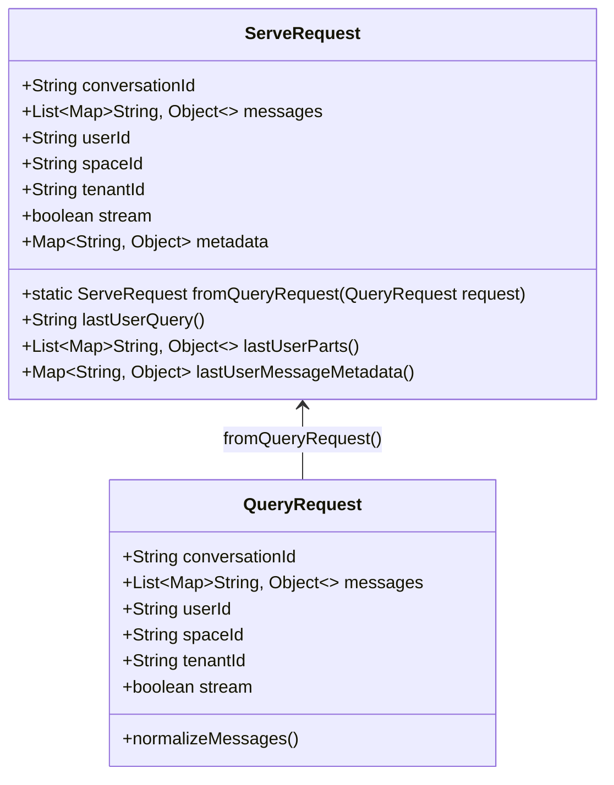

<!-- source: DeepWiki mcp.deepwiki.com · repo openJiuwen-ai/agent-runtime-java · page 10 Glossary · fetched 2026-11-02 -->

# Glossary

<details>
<summary>Relevant source files</summary>

The following files were used as context for generating this wiki page:

- [pom.xml](pom.xml)
- [service/agent-service-adapters/agent-service-adapters-common/pom.xml](service/agent-service-adapters/agent-service-adapters-common/pom.xml)
- [service/agent-service-adapters/agent-service-adapters-common/src/main/java/com/openjiuwen/service/adapters/common/security/ExternalAuthProperties.java](service/agent-service-adapters/agent-service-adapters-common/src/main/java/com/openjiuwen/service/adapters/common/security/ExternalAuthProperties.java)
- [service/agent-service-adapters/agent-service-adapters-common/src/main/java/com/openjiuwen/service/adapters/common/security/ExternalTlsConfig.java](service/agent-service-adapters/agent-service-adapters-common/src/main/java/com/openjiuwen/service/adapters/common/security/ExternalTlsConfig.java)
- [service/agent-service-adapters/agent-service-adapters-common/src/main/java/com/openjiuwen/service/adapters/common/security/GlobalTlsProperties.java](service/agent-service-adapters/agent-service-adapters-common/src/main/java/com/openjiuwen/service/adapters/common/security/GlobalTlsProperties.java)
- [service/agent-service-adapters/agent-service-adapters-common/src/main/resources/META-INF/spring/org.springframework.boot.autoconfigure.AutoConfiguration.imports](service/agent-service-adapters/agent-service-adapters-common/src/main/resources/META-INF/spring/org.springframework.boot.autoconfigure.AutoConfiguration.imports)
- [service/agent-service-app/src/main/java/com/openjiuwen/service/app/autoconfigure/HostedRuntimeAutoConfiguration.java](service/agent-service-app/src/main/java/com/openjiuwen/service/app/autoconfigure/HostedRuntimeAutoConfiguration.java)
- [service/agent-service-app/src/main/java/com/openjiuwen/service/app/controller/a2a/A2ATaskContinuation.java](service/agent-service-app/src/main/java/com/openjiuwen/service/app/controller/a2a/A2ATaskContinuation.java)
- [service/agent-service-app/src/main/java/com/openjiuwen/service/app/controller/a2a/client/A2AAgentCardDiscovery.java](service/agent-service-app/src/main/java/com/openjiuwen/service/app/controller/a2a/client/A2AAgentCardDiscovery.java)
- [service/agent-service-app/src/main/java/com/openjiuwen/service/app/controller/a2a/client/A2ARemoteAgentClient.java](service/agent-service-app/src/main/java/com/openjiuwen/service/app/controller/a2a/client/A2ARemoteAgentClient.java)
- [service/agent-service-app/src/main/java/com/openjiuwen/service/app/hosting/HostedAgentRuntime.java](service/agent-service-app/src/main/java/com/openjiuwen/service/app/hosting/HostedAgentRuntime.java)
- [service/agent-service-app/src/main/java/com/openjiuwen/service/app/hosting/HostedLifecycleCoordinator.java](service/agent-service-app/src/main/java/com/openjiuwen/service/app/hosting/HostedLifecycleCoordinator.java)
- [service/agent-service-app/src/main/java/com/openjiuwen/service/app/hosting/HostedRuntimeAssembler.java](service/agent-service-app/src/main/java/com/openjiuwen/service/app/hosting/HostedRuntimeAssembler.java)
- [service/agent-service-app/src/main/java/com/openjiuwen/service/app/orchestrator/A2AEnabledServeOrchestrator.java](service/agent-service-app/src/main/java/com/openjiuwen/service/app/orchestrator/A2AEnabledServeOrchestrator.java)
- [service/agent-service-app/src/main/java/com/openjiuwen/service/app/orchestrator/RemoteInvocationBatchCoordinator.java](service/agent-service-app/src/main/java/com/openjiuwen/service/app/orchestrator/RemoteInvocationBatchCoordinator.java)
- [service/agent-service-app/src/main/java/com/openjiuwen/service/app/orchestrator/RemoteInvocationCoordinatorState.java](service/agent-service-app/src/main/java/com/openjiuwen/service/app/orchestrator/RemoteInvocationCoordinatorState.java)
- [service/agent-service-app/src/main/java/com/openjiuwen/service/app/orchestrator/SerialQueryStreamObserver.java](service/agent-service-app/src/main/java/com/openjiuwen/service/app/orchestrator/SerialQueryStreamObserver.java)
- [service/agent-service-app/src/test/java/com/openjiuwen/service/app/controller/a2a/A2AAgentExecutorCancelTest.java](service/agent-service-app/src/test/java/com/openjiuwen/service/app/controller/a2a/A2AAgentExecutorCancelTest.java)
- [service/agent-service-app/src/test/java/com/openjiuwen/service/app/controller/a2a/A2AProtocolAdapterTest.java](service/agent-service-app/src/test/java/com/openjiuwen/service/app/controller/a2a/A2AProtocolAdapterTest.java)
- [service/agent-service-app/src/test/java/com/openjiuwen/service/app/controller/a2a/A2ATaskContinuationTest.java](service/agent-service-app/src/test/java/com/openjiuwen/service/app/controller/a2a/A2ATaskContinuationTest.java)
- [service/agent-service-app/src/test/java/com/openjiuwen/service/app/controller/a2a/client/A2AAgentCardDiscoveryTest.java](service/agent-service-app/src/test/java/com/openjiuwen/service/app/controller/a2a/client/A2AAgentCardDiscoveryTest.java)
- [service/agent-service-app/src/test/java/com/openjiuwen/service/app/controller/a2a/client/A2ARemoteAgentClientClassLoaderTest.java](service/agent-service-app/src/test/java/com/openjiuwen/service/app/controller/a2a/client/A2ARemoteAgentClientClassLoaderTest.java)
- [service/agent-service-app/src/test/java/com/openjiuwen/service/app/controller/a2a/client/A2ARemoteAgentClientStreamingLifecycleTest.java](service/agent-service-app/src/test/java/com/openjiuwen/service/app/controller/a2a/client/A2ARemoteAgentClientStreamingLifecycleTest.java)
- [service/agent-service-app/src/test/java/com/openjiuwen/service/app/hosting/HostedAssemblyTest.java](service/agent-service-app/src/test/java/com/openjiuwen/service/app/hosting/HostedAssemblyTest.java)
- [service/agent-service-app/src/test/java/com/openjiuwen/service/app/hosting/HostedCallbackContractTest.java](service/agent-service-app/src/test/java/com/openjiuwen/service/app/hosting/HostedCallbackContractTest.java)
- [service/agent-service-app/src/test/java/com/openjiuwen/service/app/hosting/HostedLifecycleTest.java](service/agent-service-app/src/test/java/com/openjiuwen/service/app/hosting/HostedLifecycleTest.java)
- [service/agent-service-app/src/test/java/com/openjiuwen/service/app/hosting/HostedPushJourneyTest.java](service/agent-service-app/src/test/java/com/openjiuwen/service/app/hosting/HostedPushJourneyTest.java)
- [service/agent-service-app/src/test/java/com/openjiuwen/service/app/orchestrator/A2AEnabledServeOrchestratorTest.java](service/agent-service-app/src/test/java/com/openjiuwen/service/app/orchestrator/A2AEnabledServeOrchestratorTest.java)
- [service/agent-service-app/src/test/java/com/openjiuwen/service/app/orchestrator/RemoteInvocationBatchCoordinatorTest.java](service/agent-service-app/src/test/java/com/openjiuwen/service/app/orchestrator/RemoteInvocationBatchCoordinatorTest.java)
- [service/agent-service-spec/src/main/java/com/openjiuwen/service/spec/dto/QueryChunk.java](service/agent-service-spec/src/main/java/com/openjiuwen/service/spec/dto/QueryChunk.java)
- [service/agent-service-spec/src/main/java/com/openjiuwen/service/spec/dto/ServeRequest.java](service/agent-service-spec/src/main/java/com/openjiuwen/service/spec/dto/ServeRequest.java)
- [service/agent-service-spec/src/test/java/com/openjiuwen/service/spec/dto/ServeRequestTest.java](service/agent-service-spec/src/test/java/com/openjiuwen/service/spec/dto/ServeRequestTest.java)

</details>


This page provides definitions for codebase-specific terms used within the `agent-runtime-java` project. Each term includes a brief explanation, its purpose, and pointers to relevant files for further technical detail.

## A2A (Agent-to-Agent)

A2A refers to the Agent-to-Agent protocol, which is a core communication mechanism for agents within the OpenJiuwen ecosystem. It enables agents to delegate tasks, exchange messages, and receive push notifications from other agents. The `agent-runtime-java` project acts as a runtime environment for hosting agents that communicate via this protocol. The A2A SDK is a key dependency [pom.xml:93-113]().

Sources:
- [pom.xml:93-113]()

## AgentCard

An `AgentCard` is a metadata descriptor for an agent, containing information such as its capabilities, available interfaces, and communication endpoints. It's crucial for agent discovery and interaction within the A2A ecosystem. Remote `AgentCard`s are discovered and registered by the `A2AAgentCardDiscovery` service [service/agent-service-app/src/main/java/com/openjiuwen/service/app/controller/a2a/client/A2AAgentCardDiscovery.java:33-48]().

Sources:
- [service/agent-service-app/src/main/java/com/openjiuwen/service/app/controller/a2a/client/A2AAgentCardDiscovery.java:33-48]()

## ServeRequest

`ServeRequest` is a protocol-neutral Data Transfer Object (DTO) that encapsulates an incoming request to an agent. It normalizes various ingress formats (e.g., HTTP query, A2A messages) into a consistent internal model for processing by the `ServeOrchestrator` and `AgentHandler`. It contains details like `conversationId`, `messages`, `userId`, `spaceId`, `tenantId`, and `metadata`.



Sources:
- [service/agent-service-spec/src/main/java/com/openjiuwen/service/spec/dto/ServeRequest.java:20-51]()
- [service/agent-service-spec/src/test/java/com/openjiuwen/service/spec/dto/ServeRequestTest.java]()

## QueryChunk Types

`QueryChunk` represents a piece of data streamed back from an agent during a `streamQuery` operation. It's a flexible DTO that can carry different types of information, indicated by its `type` field. Common types include:

*   `QueryChunk.TYPE_CHUNK`: Represents a regular text chunk of the agent's response.
*   `QueryChunk.TYPE_ARTIFACT`: Indicates an artifact generated by the agent.
*   `QueryChunk.TYPE_METADATA`: For transmitting metadata updates.
*   `QueryChunk.TYPE_INPUT_REQUIRED`: Signals that the agent requires further input from the user to proceed.
*   `QueryChunk.TYPE_ERROR`: Denotes an error condition during processing.

These types allow the client to interpret and render the streamed output appropriately.

Sources:
- [service/agent-service-spec/src/main/java/com/openjiuwen/service/spec/dto/QueryChunk.java]()

## Shadow Task

A "shadow task" is a local representation of a remote A2A task. When an agent delegates a task to another remote agent, the `RemoteInvocationBatchCoordinator` creates a shadow task in its local `TaskStore`. This shadow task tracks the state and progress of the remote invocation, allowing the orchestrator to manage the lifecycle of the delegated task, including handling interrupts and continuations. Shadow tasks are prefixed with `shadow:` and include the local agent's ID and the parent task ID [service/agent-service-app/src/main/java/com/openjiuwen/service/app/orchestrator/RemoteInvocationBatchCoordinator.java:62-63]().

Sources:
- [service/agent-service-app/src/main/java/com/openjiuwen/service/app/orchestrator/RemoteInvocationBatchCoordinator.java:62-63]()
- [service/agent-service-app/src/test/java/com/openjiuwen/service/app/orchestrator/RemoteInvocationBatchCoordinatorTest.java:96]()

## Batch Resolution

"Batch resolution" refers to the process by which the `RemoteInvocationBatchCoordinator` aggregates the outcomes of multiple parallel remote agent invocations. After all members of a batch have completed (either successfully or with an error), the coordinator resolves the overall batch status, collects results, and determines if the parent agent is ready to resume its execution or if further input is required. The `BatchResolution` object contains the aggregated results and the `isReadyToResume` flag [service/agent-service-app/src/main/java/com/openjiuwen/service/app/orchestrator/RemoteInvocationBatchCoordinator.java:167-169]().

Sources:
- [service/agent-service-app/src/main/java/com/openjiuwen/service/app/orchestrator/RemoteInvocationBatchCoordinator.java:167-169]()
- [service/agent-service-app/src/test/java/com/openjiuwen/service/app/orchestrator/RemoteInvocationBatchCoordinatorTest.java:114-117]()

## Admission Gate

The `TaskAdmissionGate` is a concurrency control mechanism that limits the number of active tasks an agent can process simultaneously. It prevents resource exhaustion and ensures fair scheduling. When a new task arrives, it must pass through the admission gate. If the gate is closed (due to exceeding concurrency limits), the task might be queued or rejected. The `A2AAgentExecutor` uses the `TaskAdmissionGate` [service/agent-service-app/src/main/java/com/openjiuwen/service/app/hosting/HostedRuntimeAssembler.java:117-118]().

Sources:
- [service/agent-service-app/src/main/java/com/openjiuwen/service/app/hosting/HostedRuntimeAssembler.java:117-118]()
- [service/agent-service-app/src/test/java/com/openjiuwen/service/app/controller/a2a/A2ATaskContinuationTest.java:88-89]()

## Hosted Runtime

A "hosted runtime" (`HostedAgentRuntime`) represents an isolated execution environment for a specific agent within the `agent-runtime-java` application. The `HostedRuntimeAssembler` is responsible for creating and configuring these runtimes, providing each agent with its own `TaskStore`, `ServeOrchestrator`, and other necessary components, potentially with scoped resources like Redis clients. This enables multi-tenancy, where multiple agents can be hosted within a single application instance without interfering with each other.

```mermaid
graph TD
    subgraph "Agent Runtime Java Application"
        HRA[HostedRuntimeAssembler] --> HAR1(HostedAgentRuntime "Agent A")
        HRA --> HAR2(HostedAgentRuntime "Agent B")
    end

    subgraph "HostedAgentRuntime"
        HAR1 -- "AgentHandler" --> AH1
        HAR1 -- "TaskStore (scoped)" --> TS1
        HAR1 -- "ServeOrchestrator" --> SO1
        HAR1 -- "A2AAgentExecutor" --> AE1
        HAR1 -- "ActiveStreamRegistry" --> ASR1
        HAR1 -- "RemoteInvocationBatchCoordinator" --> RIBC1
    end

    subgraph "HostedAgentRuntime"
        HAR2 -- "AgentHandler" --> AH2
        HAR2 -- "TaskStore (scoped)" --> TS2
        HAR2 -- "ServeOrchestrator" --> SO2
        HAR2 -- "A2AAgentExecutor" --> AE2
        HAR2 -- "ActiveStreamRegistry" --> ASR2
        HAR2 -- "RemoteInvocationBatchCoordinator" --> RIBC2
    end

    style HRA fill:#f9f,stroke:#333,stroke-width:2px
    style HAR1 fill:#bbf,stroke:#333,stroke-width:2px
    style HAR2 fill:#bbf,stroke:#333,stroke-width:2px
```

Sources:
- [service/agent-service-app/src/main/java/com/openjiuwen/service/app/hosting/HostedRuntimeAssembler.java:55-89]()
- [service/agent-service-app/src/main/java/com/openjiuwen/service/app/hosting/HostedAgentRuntime.java]()
- [service/agent-service-app/src/main/java/com/openjiuwen/service/app/autoconfigure/HostedRuntimeAutoConfiguration.java]()
- [service/agent-service-app/src/test/java/com/openjiuwen/service/app/hosting/HostedAssemblyTest.java]()
- [service/agent-service-app/src/test/java/com/openjiuwen/service/app/hosting/HostedLifecycleTest.java]()

## DFX (Design for X)

DFX is a general engineering principle referring to "Design for Excellence" or "Design for X," where X can be various quality attributes like reliability, maintainability, performance, security, etc. In the context of this codebase, DFX often implies considerations for robust, resilient, and observable systems. For example, the `A2ARemoteAgentClient` includes retry mechanisms for transient failures [service/agent-service-app/src/main/java/com/openjiuwen/service/app/controller/a2a/client/A2ARemoteAgentClient.java:100-101](), contributing to DFX for reliability. Similarly, the `A2ATaskContinuation` handles admission rejections with backoff and retries [service/agent-service-app/src/test/java/com/openjiuwen/service/app/controller/a2a/A2ATaskContinuationTest.java:83-99](), enhancing resilience.

Sources:
- [service/agent-service-app/src/main/java/com/openjiuwen/service/app/controller/a2a/client/A2ARemoteAgentClient.java:100-101]()
- [service/agent-service-app/src/test/java/com/openjiuwen/service/app/controller/a2a/A2ATaskContinuationTest.java:83-99]()

## Checkpointer

A "checkpointer" is a component responsible for persisting the state of an agent's conversation or task at critical points. This allows for recovery from failures and ensures that long-running tasks can be resumed. While not explicitly shown in the provided snippets, the `TaskStore` (e.g., `InMemoryTaskStore`) serves as the underlying mechanism for storing task states, which is fundamental to checkpointing. The `HostedRuntimeAssembler` decorates the `TaskStore` [service/agent-service-app/src/main/java/com/openjiuwen/service/app/hosting/HostedRuntimeAssembler.java:74-78](), implying that checkpointing logic might be injected or wrapped around the basic `TaskStore` implementation.

Sources:
- [service/agent-service-app/src/main/java/com/openjiuwen/service/app/hosting/HostedRuntimeAssembler.java:74-78]()
- [service/agent-service-app/src/test/java/com/openjiuwen/service/app/orchestrator/RemoteInvocationBatchCoordinatorTest.java:76]()

## Rail

In the context of agent interactions, a "rail" refers to a predefined path or constraint that guides the agent's behavior or output. It's a mechanism to ensure that an agent operates within certain boundaries, adheres to specific formats, or follows particular conversational flows. While not a direct code entity in the provided snippets, the concept of "interrupt rails" is mentioned in the demo description [service/agent-service-demo/pom.xml:30-31](), suggesting that agents can be configured with specific rules or guardrails for handling interruptions and delegations. This helps in controlling agent responses and ensuring alignment with desired outcomes.

Sources:
- [service/agent-service-demo/pom.xml:30-31]()