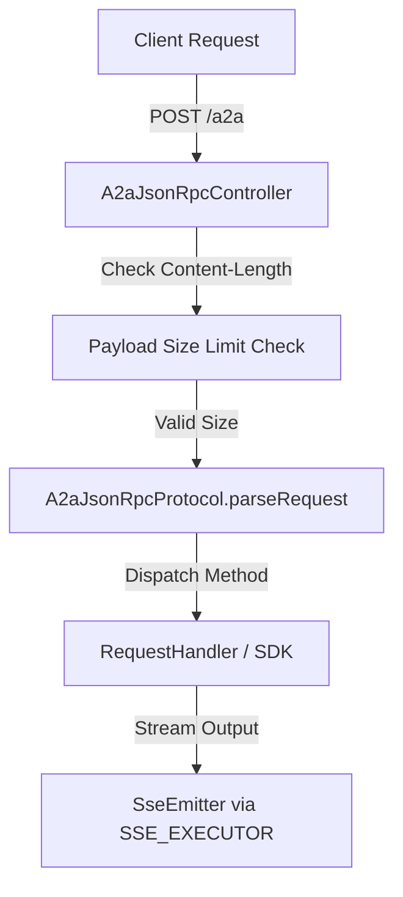
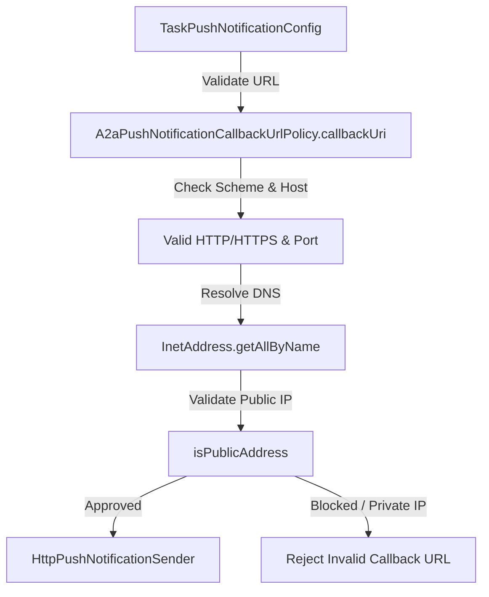

<!-- source: DeepWiki mcp.deepwiki.com · repo openJiuwen-ai/agent-runtime-java · page 2 A2A Protocol Layer · fetched 2026-11-02 -->

# A2A Protocol Layer

Relevant source files

The following files were used as context for generating this wiki page:

- [service/agent-service-adapters/agent-service-adapters-common/src/test/java/com/openjiuwen/service/adapters/common/security/SslContextFactoryTest.java](service/agent-service-adapters/agent-service-adapters-common/src/test/java/com/openjiuwen/service/adapters/common/security/SslContextFactoryTest.java)
- [service/agent-service-app/src/main/java/com/openjiuwen/service/app/controller/a2a/A2aJsonRpcController.java](service/agent-service-app/src/main/java/com/openjiuwen/service/app/controller/a2a/A2aJsonRpcController.java)
- [service/agent-service-app/src/main/java/com/openjiuwen/service/app/controller/a2a/A2aJsonRpcProtocol.java](service/agent-service-app/src/main/java/com/openjiuwen/service/app/controller/a2a/A2aJsonRpcProtocol.java)
- [service/agent-service-app/src/main/java/com/openjiuwen/service/app/controller/a2a/A2aPushNotificationCallbackUrlPolicy.java](service/agent-service-app/src/main/java/com/openjiuwen/service/app/controller/a2a/A2aPushNotificationCallbackUrlPolicy.java)
- [service/agent-service-app/src/test/java/com/openjiuwen/service/app/controller/a2a/A2aJsonRpcControllerTest.java](service/agent-service-app/src/test/java/com/openjiuwen/service/app/controller/a2a/A2aJsonRpcControllerTest.java)
- [service/agent-service-app/src/test/java/com/openjiuwen/service/app/controller/a2a/CallbackDestinationSecurityTest.java](service/agent-service-app/src/test/java/com/openjiuwen/service/app/controller/a2a/CallbackDestinationSecurityTest.java)
- [service/agent-service-app/src/test/java/com/openjiuwen/service/app/it/A2aIntegrationTest.java](service/agent-service-app/src/test/java/com/openjiuwen/service/app/it/A2aIntegrationTest.java)
- [service/agent-service-app/src/test/java/com/openjiuwen/service/app/it/SecurityAuthorizationConcurrencyIntegrationTest.java](service/agent-service-app/src/test/java/com/openjiuwen/service/app/it/SecurityAuthorizationConcurrencyIntegrationTest.java)
- [service/agent-service-app/src/test/java/com/openjiuwen/service/app/it/SecurityAuthorizationHeaderBoundaryIntegrationTest.java](service/agent-service-app/src/test/java/com/openjiuwen/service/app/it/SecurityAuthorizationHeaderBoundaryIntegrationTest.java)
- [service/agent-service-app/src/test/java/com/openjiuwen/service/app/it/support/AgentReadinessTestSupport.java](service/agent-service-app/src/test/java/com/openjiuwen/service/app/it/support/AgentReadinessTestSupport.java)

## Purpose and Scope

The A2A Protocol Layer serves as the inbound communication and synchronization boundary for the `agent-runtime-java` codebase. It exposes standard A2A (Agent-to-Agent) endpoints, manages JSON-RPC ingress parsing, handles Server-Sent Events (SSE) streaming, hosts agent capability cards, coordinates push notifications with strict SSRF policies, and delegates task execution via the underlying A2A SDK and orchestrators. 

As a parent page, this section provides a high-level architectural overview of the protocol stack. For comprehensive low-level details, refer to the child sections linked below.

---

## 2.1. JSON-RPC Ingress and SSE Streaming

The entry point for all A2A interactions is `A2aJsonRpcController`, which maps POST requests onto standard and custom routes such as `A2AServicePaths.A2A_JSONRPC` [service/agent-service-app/src/main/java/com/openjiuwen/service/app/controller/a2a/A2aJsonRpcController.java:111-115](). Before parsing JSON payloads, the controller enforces pre-admission boundaries using `Content-Length` checks against `maxMessageBytes` to reject oversized or malformed payloads with HTTP 413 [service/agent-service-app/src/main/java/com/openjiuwen/service/app/controller/a2a/A2aJsonRpcController.java:116-123](). 

Incoming raw requests are translated via `A2aJsonRpcProtocol` to validate JSON-RPC 2.0 conformance, method strings, and request IDs [service/agent-service-app/src/main/java/com/openjiuwen/service/app/controller/a2a/A2aJsonRpcProtocol.java:37-59](). Streaming subscriptions utilize dedicated execution pools (`SSE_EXECUTOR`) to keep long-lived SSE emitters off shared common thread pools [service/agent-service-app/src/main/java/com/openjiuwen/service/app/controller/a2a/A2aJsonRpcController.java:69-74]().

*Figure 1: JSON-RPC Ingress and SSE Dispatch Flow.*

> **Sources:**
> - [service/agent-service-app/src/main/java/com/openjiuwen/service/app/controller/a2a/A2aJsonRpcController.java:111-150]()
> - [service/agent-service-app/src/main/java/com/openjiuwen/service/app/controller/a2a/A2aJsonRpcProtocol.java:37-59]()

For deep configuration, params parsing logic, and SSE emitter lifecycle rules, see [JSON-RPC Ingress and SSE Streaming](#2.1).

---

## 2.2. A2AAgentExecutor and Execution Bridging

Once JSON-RPC requests are parsed and admitted, execution is handed off to the A2A SDK execution components and underlying orchestrators. The execution bridge maps incoming A2A `MessageSendParams` and task lifecycle commands into core execution events, converting agent interactions into structured query chunks and artifacts. It manages task states (such as `TASK_STATE_COMPLETED`), context propagation across multi-turn exchanges, and asynchronous interruption or cancellation signals.

> **Sources:**
> - [service/agent-service-app/src/test/java/com/openjiuwen/service/app/it/A2aIntegrationTest.java:103-125]()

For details on admission handoff, mapping rules, and interruption handlers, see [A2AAgentExecutor and Execution Bridging](#2.2).

---

## 2.3. Agent Cards and Capability Gating

Agent discovery and introspection are facilitated by controllers exposing well-known metadata paths (`A2AServicePaths`). The runtime publishes agent cards containing supported interfaces, skills, and authentication requirements. Capability gating ensures that advanced features like push notifications or specialized RPC extensions are exposed only when properly configured and authorized.

> **Sources:**
> - [service/agent-service-app/src/test/java/com/openjiuwen/service/app/it/A2aIntegrationTest.java:86-92]()

For controller implementation details and dynamic card generation factories, see [Agent Cards and Capability Gating](#2.3).

---

## 2.4. Push Notifications and Callbacks

Asynchronous task updates can be pushed to remote callback URLs. To prevent Server-Side Request Forgery (SSRF) and security bypasses, all callback configurations are validated at ingress and re-checked immediately before delivery using `A2aPushNotificationCallbackUrlPolicy` [service/agent-service-app/src/main/java/com/openjiuwen/service/app/controller/a2a/A2aPushNotificationCallbackUrlPolicy.java:20-61](). The policy enforces strict scheme checks (HTTP/https only), rejects non-public IP ranges (loopback, link-local, site-local, and reserved ranges), and verifies DNS entries against allowed hosts [service/agent-service-app/src/main/java/com/openjiuwen/service/app/controller/a2a/A2aPushNotificationCallbackUrlPolicy.java:33-89]().

*Figure 2: Push Notification SSRF Policy Validation Pipeline.*

> **Sources:**
> - [service/agent-service-app/src/main/java/com/openjiuwen/service/app/controller/a2a/A2aPushNotificationCallbackUrlPolicy.java:20-90]()
> - [service/agent-service-app/src/test/java/com/openjiuwen/service/app/controller/a2a/CallbackDestinationSecurityTest.java:38-78]()

For retry logic, idempotency, and task continuation recovery, see [Push Notifications and Callbacks](#2.4).

---

## 2.5. Task Stores and Event Bus Resilience

To maintain durability across restarts and scale across distributed nodes, A2A tasks and push notification configs rely on robust persistence and event propagation layers. Components such as `RedisTaskStore` and `WriteThrottlingTaskStore` buffer and persist task state, while `ResilientMainEventBusProcessor` ensures that event bus disruptions do not drop critical task transition notifications.

For implementation specifications and queue manager cleanup mechanisms, see [Task Stores and Event Bus Resilience](#2.5).

---

