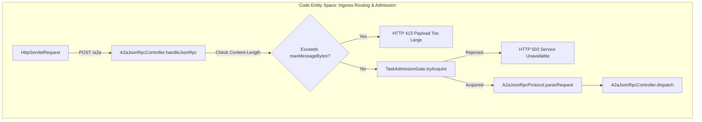
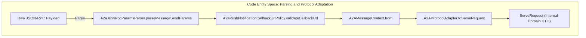

<!-- source: DeepWiki mcp.deepwiki.com · repo openJiuwen-ai/agent-runtime-java · page 2.1 JSON-RPC Ingress and SSE Streaming · fetched 2026-11-02 -->

# JSON-RPC Ingress and SSE Streaming

Relevant source files

The following files were used as context for generating this wiki page:

- [service/agent-service-adapters/agent-service-adapters-common/src/main/java/com/openjiuwen/service/adapters/common/security/ExternalHttpClientFactory.java](service/agent-service-adapters/agent-service-adapters-common/src/main/java/com/openjiuwen/service/adapters/common/security/ExternalHttpClientFactory.java)
- [service/agent-service-adapters/agent-service-adapters-common/src/test/java/com/openjiuwen/service/adapters/common/security/ExternalHttpClientFactoryTest.java](service/agent-service-adapters/agent-service-adapters-common/src/test/java/com/openjiuwen/service/adapters/common/security/ExternalHttpClientFactoryTest.java)
- [service/agent-service-app/src/main/java/com/openjiuwen/service/app/controller/a2a/A2AMessageContext.java](service/agent-service-app/src/main/java/com/openjiuwen/service/app/controller/a2a/A2AMessageContext.java)
- [service/agent-service-app/src/main/java/com/openjiuwen/service/app/controller/a2a/A2AProtocolAdapter.java](service/agent-service-app/src/main/java/com/openjiuwen/service/app/controller/a2a/A2AProtocolAdapter.java)
- [service/agent-service-app/src/main/java/com/openjiuwen/service/app/controller/a2a/A2aJsonRpcController.java](service/agent-service-app/src/main/java/com/openjiuwen/service/app/controller/a2a/A2aJsonRpcController.java)
- [service/agent-service-app/src/main/java/com/openjiuwen/service/app/controller/a2a/A2aJsonRpcParamsParser.java](service/agent-service-app/src/main/java/com/openjiuwen/service/app/controller/a2a/A2aJsonRpcParamsParser.java)
- [service/agent-service-app/src/main/java/com/openjiuwen/service/app/controller/a2a/A2aPushNotificationCallbackUrlPolicy.java](service/agent-service-app/src/main/java/com/openjiuwen/service/app/controller/a2a/A2aPushNotificationCallbackUrlPolicy.java)
- [service/agent-service-app/src/test/java/com/openjiuwen/service/app/controller/a2a/A2aJsonRpcControllerAdmissionTest.java](service/agent-service-app/src/test/java/com/openjiuwen/service/app/controller/a2a/A2aJsonRpcControllerAdmissionTest.java)
- [service/agent-service-app/src/test/java/com/openjiuwen/service/app/controller/a2a/A2aJsonRpcControllerTest.java](service/agent-service-app/src/test/java/com/openjiuwen/service/app/controller/a2a/A2aJsonRpcControllerTest.java)
- [service/agent-service-app/src/test/java/com/openjiuwen/service/app/controller/a2a/CallbackDestinationSecurityTest.java](service/agent-service-app/src/test/java/com/openjiuwen/service/app/controller/a2a/CallbackDestinationSecurityTest.java)
- [service/agent-service-app/src/test/java/com/openjiuwen/service/app/controller/a2a/client/A2ARemoteAgentClientSecurityTest.java](service/agent-service-app/src/test/java/com/openjiuwen/service/app/controller/a2a/client/A2ARemoteAgentClientSecurityTest.java)
- [service/agent-service-app/src/test/java/com/openjiuwen/service/app/controller/a2a/client/A2ARemoteAgentClientTlsTest.java](service/agent-service-app/src/test/java/com/openjiuwen/service/app/controller/a2a/client/A2ARemoteAgentClientTlsTest.java)
- [service/agent-service-app/src/test/java/com/openjiuwen/service/app/it/ConcurrencyAdmissionIntegrationTest.java](service/agent-service-app/src/test/java/com/openjiuwen/service/app/it/ConcurrencyAdmissionIntegrationTest.java)
- [service/agent-service-spec/src/main/java/com/openjiuwen/service/spec/concurrency/TaskAdmissionListener.java](service/agent-service-spec/src/main/java/com/openjiuwen/service/spec/concurrency/TaskAdmissionListener.java)

### Purpose and Scope
This document details the inbound Agent-to-Agent (A2A) protocol entry point in `agent-runtime-java`. It covers how raw HTTP requests are routed, pre-screened for payload size limits, governed by admission control gates, parsed via JSON-RPC protocol helpers, adapted into internal `ServeRequest` structures, and streamed via Server-Sent Events (SSE) using dedicated virtual-thread executors.

---

## 1. Routing and Ingress Boundary (`A2aJsonRpcController`)

The `A2aJsonRpcController` serves as the primary REST controller for inbound A2A methods (`SendMessage`, `SendStreamingMessage`, `GetTask`, and `SubscribeToTask`). It maps HTTP `POST` requests to standard and hosted paths defined in `A2AServicePaths` [service/agent-service-app/src/main/java/com/openjiuwen/service/app/controller/a2a/A2aJsonRpcController.java:111-113]().

### Content-Length Pre-Check and Admission Control
Before parsing JSON bodies, the controller enforces payload size limits and concurrency admission control:
1. **Payload Size Pre-Check**: The servlet request `Content-Length` header is evaluated against `A2AProperties.getMaxMessageBytes()` (defaulting to `A2aPartLimits.DEFAULT_MAX_REQUEST_BODY_BYTES`) [service/agent-service-app/src/main/java/com/openjiuwen/service/app/controller/a2a/A2aJsonRpcController.java:116-123](). If the body exceeds the limit or is chunked/missing where prohibited, HTTP `413 Payload Too Large` is returned immediately without parsing overhead [service/agent-service-app/src/main/java/com/openjiuwen/service/app/controller/a2a/A2aJsonRpcController.java:121-123]().
2. **Admission Gate**: Through `TaskAdmissionGate`, permits are acquired synchronously prior to request dispatch [service/agent-service-app/src/test/java/com/openjiuwen/service/app/controller/a2a/A2aJsonRpcControllerAdmissionTest.java:47-60](). If capacity is exhausted, the controller returns HTTP `503 Service Unavailable`. Acquired permits are embedded into the `ServerCallContext` state for downstream handover to `A2AAgentExecutor`; if a synchronous failure occurs before adoption, the controller releases the permit [service/agent-service-app/src/test/java/com/openjiuwen/service/app/controller/a2a/A2aJsonRpcControllerAdmissionTest.java:115-146]().

*Sources: [service/agent-service-app/src/main/java/com/openjiuwen/service/app/controller/a2a/A2aJsonRpcController.java:111-149](), [service/agent-service-app/src/test/java/com/openjiuwen/service/app/controller/a2a/A2aJsonRpcControllerAdmissionTest.java:47-146]()*

---

## 2. Parameter Parsing and Protocol Adapter

Once a JSON-RPC request is validated at the boundary, method-specific parameters and message payloads are parsed and translated into internal domain models.

### Parameter Parsing (`A2aJsonRpcParamsParser`)
`A2aJsonRpcParamsParser` extracts and validates JSON objects such as `MessageSendParams`, `TaskIdParams`, and configuration objects [service/agent-service-app/src/main/java/com/openjiuwen/service/app/controller/a2a/A2aJsonRpcParamsParser.java:61-80](). It guarantees strict typing for metadata maps and validates task push notification configurations [service/agent-service-app/src/main/java/com/openjiuwen/service/app/controller/a2a/A2aJsonRpcParamsParser.java:118-134]().

### Callback URL and SSRF Protection (`A2aPushNotificationCallbackUrlPolicy`)
Push notification URLs provided in request configurations are validated against SSRF vulnerabilities via `A2aPushNotificationCallbackUrlPolicy`. The policy rejects non-absolute schemes, loopback/private IP spaces, link-local addresses, and dynamic DNS rebinding vectors before any outgoing connections are attempted [service/agent-service-app/src/main/java/com/openjiuwen/service/app/controller/a2a/A2aPushNotificationCallbackUrlPolicy.java:33-90]().

### Protocol Adaptation (`A2AProtocolAdapter`)
The `A2AProtocolAdapter` translates SDK-parsed `A2AMessageContext` instances into internal `ServeRequest` objects [service/agent-service-app/src/main/java/com/openjiuwen/service/app/controller/a2a/A2AProtocolAdapter.java:56-94]():
* Extracts tenant routing headers (`x-user-id`, `x-space-id`, `x-tenant-id`) from `ServerCallContext` state [service/agent-service-app/src/main/java/com/openjiuwen/service/app/controller/a2a/A2AProtocolAdapter.java:63-68](), [service/agent-service-app/src/main/java/com/openjiuwen/service/app/controller/a2a/A2AMessageContext.java:71-89]().
* Normalizes SDK message parts (`TextPart`, `FilePart` with bytes or URIs, and `DataPart`) into unified map representations while preserving inbound wire order [service/agent-service-app/src/main/java/com/openjiuwen/service/app/controller/a2a/A2AProtocolAdapter.java:103-141]().
* Strips server-owned reserved metadata keys (`runtime.parentTaskId`, `runtime.remoteToolInputs`, etc.) to prevent client-side spoofing [service/agent-service-app/src/main/java/com/openjiuwen/service/app/controller/a2a/A2AProtocolAdapter.java:47-48]().

*Sources: [service/agent-service-app/src/main/java/com/openjiuwen/service/app/controller/a2a/A2aJsonRpcParamsParser.java:61-134](), [service/agent-service-app/src/main/java/com/openjiuwen/service/app/controller/a2a/A2aPushNotificationCallbackUrlPolicy.java:24-61](), [service/agent-service-app/src/main/java/com/openjiuwen/service/app/controller/a2a/A2AProtocolAdapter.java:56-94](), [service/agent-service-app/src/main/java/com/openjiuwen/service/app/controller/a2a/A2AMessageContext.java:50-89]()*

---

## 3. SSE Streaming and Concurrency Execution

For streaming RPC methods (`SendStreamingMessage` and `SubscribeToTask`), `A2aJsonRpcController` delegates execution management to reactive flows and dedicated streaming executors.

### Streaming Executor (`SSE_EXECUTOR`)
To prevent long-lived streaming connections and subscriptions from starving `ForkJoinPool.commonPool()`, the controller initializes a specialized `SSE_EXECUTOR` [service/agent-service-app/src/main/java/com/openjiuwen/service/app/controller/a2a/A2aJsonRpcController.java:69-74]():
* On JDK 21+, each subscription runs on dedicated virtual threads (`VirtualThreadSupport`).
* On JDK 17, a small daemon platform thread pool is utilized.

### SseEmitter Lifecycle
Streaming responses produce Spring `SseEmitter` instances that pump reactive streams (`Flow.Publisher`) emitted by the agent execution pipeline. Errors encountered during dispatch or execution are caught, mapped to standard JSON-RPC error payloads, and safely emitted or returned as appropriate protocol error responses [service/agent-service-app/src/main/java/com/openjiuwen/service/app/controller/a2a/A2aJsonRpcController.java:133-148]().

| Method Name | Inbound Transport | Concurrency Mechanism | Error Handling / Fallback |
| :--- | :--- | :--- | :--- |
| `SendMessage` | HTTP POST (JSON-RPC) | `TaskAdmissionGate` permit | HTTP 503 on rejection, JSON-RPC error on execution failure |
| `SendStreamingMessage` | HTTP POST (JSON-RPC + SSE) | `TaskAdmissionGate` + `SSE_EXECUTOR` | `SseEmitter` timeout/completion hooks, virtual thread isolation |
| `GetTask` / `SubscribeToTask` | HTTP POST / SSE | `SSE_EXECUTOR` | Standard `TaskNotFoundError` / `InvalidParamsError` mapping |

*Sources: [service/agent-service-app/src/main/java/com/openjiuwen/service/app/controller/a2a/A2aJsonRpcController.java:69-149]()*, [service/agent-service-adapters/agent-service-adapters-common/src/main/java/com/openjiuwen/service/adapters/common/concurrent/VirtualThreadSupport.java]()

---

