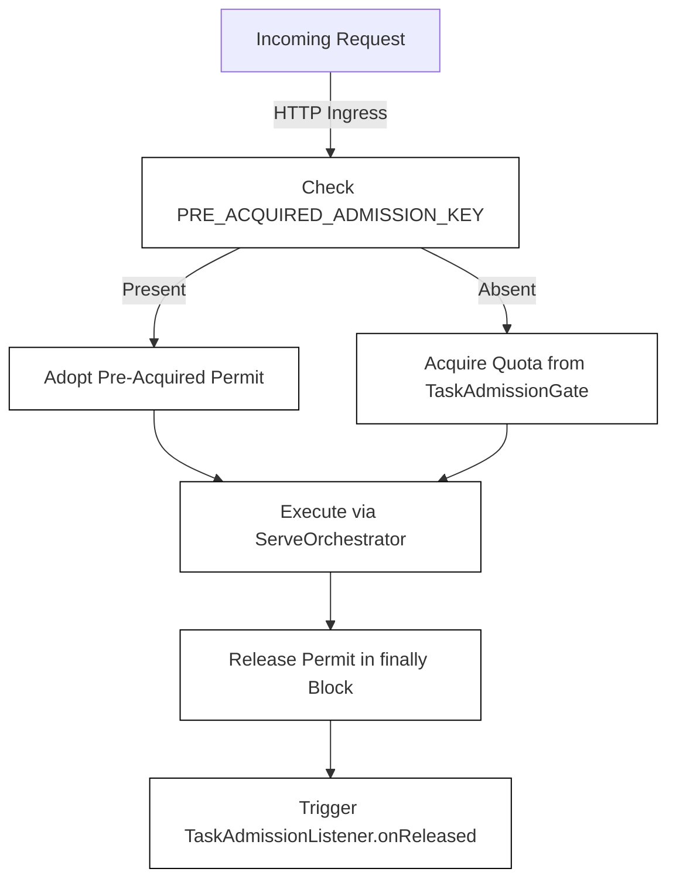
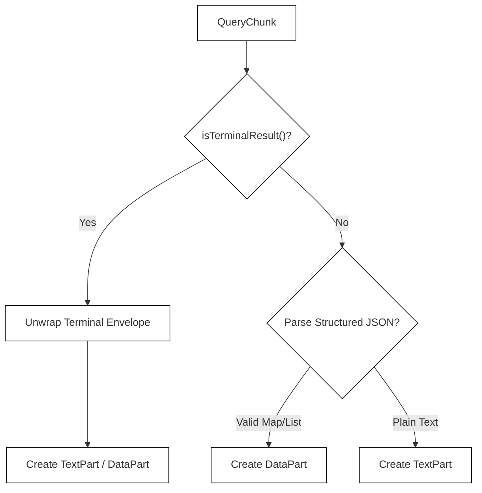

<!-- source: DeepWiki mcp.deepwiki.com · repo openJiuwen-ai/agent-runtime-java · page 2.2 A2AAgentExecutor and Execution Bridging · fetched 2026-11-02 -->

# A2AAgentExecutor and Execution Bridging

Relevant source files

The following files were used as context for generating this wiki page:

- [service/agent-service-adapters/agent-service-adapters-agentcore/src/main/java/com/openjiuwen/service/adapters/agentcore/agentfw/JiuwenCoreAgentHandler.java](service/agent-service-adapters/agent-service-adapters-agentcore/src/main/java/com/openjiuwen/service/adapters/agentcore/agentfw/JiuwenCoreAgentHandler.java)
- [service/agent-service-adapters/agent-service-adapters-agentcore/src/test/java/com/openjiuwen/service/adapters/agentcore/agentfw/CoreRunnerLifecycleCoordinatorTest.java](service/agent-service-adapters/agent-service-adapters-agentcore/src/test/java/com/openjiuwen/service/adapters/agentcore/agentfw/CoreRunnerLifecycleCoordinatorTest.java)
- [service/agent-service-adapters/agent-service-adapters-agentcore/src/test/java/com/openjiuwen/service/adapters/agentcore/agentfw/JiuwenCoreAgentHandlerTest.java](service/agent-service-adapters/agent-service-adapters-agentcore/src/test/java/com/openjiuwen/service/adapters/agentcore/agentfw/JiuwenCoreAgentHandlerTest.java)
- [service/agent-service-app/src/main/java/com/openjiuwen/service/app/config/SpringEnvironmentConfigProvider.java](service/agent-service-app/src/main/java/com/openjiuwen/service/app/config/SpringEnvironmentConfigProvider.java)
- [service/agent-service-app/src/main/java/com/openjiuwen/service/app/controller/a2a/A2AAgentExecutor.java](service/agent-service-app/src/main/java/com/openjiuwen/service/app/controller/a2a/A2AAgentExecutor.java)
- [service/agent-service-app/src/main/java/com/openjiuwen/service/app/controller/a2a/A2aErrorMetadata.java](service/agent-service-app/src/main/java/com/openjiuwen/service/app/controller/a2a/A2aErrorMetadata.java)
- [service/agent-service-app/src/main/java/com/openjiuwen/service/app/controller/a2a/A2aPartContent.java](service/agent-service-app/src/main/java/com/openjiuwen/service/app/controller/a2a/A2aPartContent.java)
- [service/agent-service-app/src/main/java/com/openjiuwen/service/app/controller/a2a/ChunkMapper.java](service/agent-service-app/src/main/java/com/openjiuwen/service/app/controller/a2a/ChunkMapper.java)
- [service/agent-service-app/src/main/java/com/openjiuwen/service/app/controller/a2a/client/RemoteAgentCaller.java](service/agent-service-app/src/main/java/com/openjiuwen/service/app/controller/a2a/client/RemoteAgentCaller.java)
- [service/agent-service-app/src/main/java/com/openjiuwen/service/app/controller/query/QuerySseSupport.java](service/agent-service-app/src/main/java/com/openjiuwen/service/app/controller/query/QuerySseSupport.java)
- [service/agent-service-app/src/test/java/com/openjiuwen/service/app/autoconfigure/A2AAutoConfigurationTest.java](service/agent-service-app/src/test/java/com/openjiuwen/service/app/autoconfigure/A2AAutoConfigurationTest.java)
- [service/agent-service-app/src/test/java/com/openjiuwen/service/app/controller/a2a/A2AAgentExecutorTest.java](service/agent-service-app/src/test/java/com/openjiuwen/service/app/controller/a2a/A2AAgentExecutorTest.java)
- [service/agent-service-app/src/test/java/com/openjiuwen/service/app/controller/a2a/ChunkMapperTest.java](service/agent-service-app/src/test/java/com/openjiuwen/service/app/controller/a2a/ChunkMapperTest.java)
- [service/agent-service-app/src/test/java/com/openjiuwen/service/app/controller/a2a/client/A2ARemoteAgentClientResultTest.java](service/agent-service-app/src/test/java/com/openjiuwen/service/app/controller/a2a/client/A2ARemoteAgentClientResultTest.java)
- [service/agent-service-spec/src/main/java/com/openjiuwen/service/spec/dto/AgentFailureDescriptor.java](service/agent-service-spec/src/main/java/com/openjiuwen/service/spec/dto/AgentFailureDescriptor.java)

## Purpose and Scope
This document covers the internal design and implementation of inbound A2A SDK execution requests within the `agent-runtime-java` module. It focuses on `A2AAgentExecutor`, authoritative admission control, the translation between A2A protocol payloads and internal `ServeOrchestrator` requests, chunk-to-artifact mapping via `ChunkMapper`, and the handling of task interruptions and cancellations.

---

## 1. Admission Control and Lifecycle Bridging (`A2AAgentExecutor`)

`A2AAgentExecutor` implements the A2A SDK `AgentExecutor` interface [service/agent-service-app/src/main/java/com/openjiuwen/service/app/controller/a2a/A2AAgentExecutor.java:17](). It serves as the bridge between the A2A SDK's asynchronous event pipeline and the internal `ServeOrchestrator` -> `AgentHandler` execution chain [service/agent-service-app/src/main/java/com/openjiuwen.service.app.controller.a2a/A2AAgentExecutor.java:42-44]().

### Permit Pre-Acquisition and Quota Management
To prevent redundant admission checks when a request enters through the HTTP/JSON-RPC boundary, the transport layer can pre-acquire an admission permit [service/agent-service-app/src/main/java/com/openjiuwen/service/app/controller/a2a/A2AAgentExecutor.java:52-64](). 

- **Pre-Acquired Permits**: When a request sets `PRE_ACQUIRED_ADMISSION_KEY` (`_a2a_admission_preacquired`) in the `ServerCallContext`, the executor consumes and adopts the permit rather than acquiring a new one [service/agent-service-app/src/main/java/com/openjiuwen/service/app/controller/a2a/A2AAgentExecutor.java:78-85]().
- **Direct Execution / Continuations**: Requests without the marker (such as callback continuations) acquire a permit directly from the `TaskAdmissionGate` [service/agent-service-app/src/main/java/com/openjiuwen/service/app/controller/a2a/A2AAgentExecutor.java:82-83]().
- **Guaranteed Release**: Quota occupancy is bracketed using a `try-finally` block. When `TaskAdmissionListener` is configured, `onAdmitted` and `onReleased` lifecycle callbacks precisely mirror the permit lifecycle [service/agent-service-app/src/main/java/com/openjiuwen/service/app/controller/a2a/A2AAgentExecutor.java:60-64]().

*Figure 1: Admission Control and Permit Bridging Flow.*

Sources: `service/agent-service-app/src/main/java/com/openjiuwen/service/app/controller/a2a/A2AAgentExecutor.java`

---

## 2. Execution and Streaming Pipeline

When `execute(RequestContext ctx, AgentEmitter emitter)` is invoked by the A2A SDK, `A2AAgentExecutor` parses the request parameters, maps conversation identifiers, and determines whether to invoke blocking or streaming orchestrator methods [service/agent-service-app/src/main/java/com/openjiuwen/service/app/controller/a2a/A2AAgentExecutor.java:156-157]().

- **Blocking vs. Streaming**: The execution path honors both the adapter configuration and stream flags present in the `RequestContext` [service/agent-service-app/src/test/java/com/openjiuwen/service/app/controller/a2a/A2AAgentExecutorTest.java:59-90]().
- **Stream Pump & Emitter**: For streaming executions, `QueryStreamObserver` callbacks receive `QueryChunk` events from `ServeOrchestrator.streamQuery`, projecting them immediately into A2A SDK `TaskArtifactUpdateEvent` items via `AgentEmitter`.
- **Drain Timeout**: Before closing streams, a grace period bounded by `CLOSE_DRAIN_TIMEOUT_MS` (60,000 ms) ensures that in-flight backlogged events dispatched via Redis or event buses finish processing without abrupt truncation [service/agent-service-app/src/main/java/com/openjiuwen/service/app/controller/a2a/A2AAgentExecutor.java:98-104]().

Sources: `service/agent-service-app/src/main/java/com/openjiuwen/service/app/controller/a2a/A2AAgentExecutor.java`, `service/agent-service-app/src/test/java/com/openjiuwen/service/app/controller/a2a/A2AAgentExecutorTest.java`

---

## 3. Chunk and Artifact Mapping (`ChunkMapper` & `A2aPartContent`)

The translation of internal runtime events into A2A-compliant structures is managed by `ChunkMapper` and `A2aPartContent` [service/agent-service-app/src/main/java/com/openjiuwen/service/app/controller/a2a/ChunkMapper.java:25-85](), [service/agent-service-app/src/main/java/com/openjiuwen/service/app/controller/a2a/A2aPartContent.java:25-104]().

### Chunk-to-Part Translation (`ChunkMapper`)
`ChunkMapper` converts a `QueryChunk` into a list of A2A SDK `Part<?>` objects based on its type and envelope structure:
- **Terminal Envelopes**: AgentCore terminal envelopes (such as `answer` or `workflow_final`) are unwrapped and projected as business text or structured data parts [service/agent-service-app/src/main/java/com/openjiuwen/service/app/controller/a2a/ChunkMapper.java:55-67]().
- **Structured Intermediate Chunks**: JSON objects and intermediate maps are encapsulated within `DataPart` instances [service/agent-service-app/src/main/java/com/openjiuwen/service/app/controller/a2a/ChunkMapper.java:60-64]().
- **Terminal Detection**: `isTerminalResult(QueryChunk)` identifies whether a chunk represents the final completion state of an execution stream [service/agent-service-app/src/main/java/com/openjiuwen/service/app/controller/a2a/ChunkMapper.java:50-53]().

*Figure 2: ChunkMapper Translation Pipeline.*

Sources: `service/agent-service-app/src/main/java/com/openjiuwen/service/app/controller/a2a/ChunkMapper.java`, `service/agent-service-app/src/main/java/com/openjiuwen/service/app/controller/a2a/A2aPartContent.java`

---

## 4. Interrupt and Cancellation Management

`A2AAgentExecutor` coordinates runtime interruptions and request cancellations through specific control tokens and task metadata states.

- **Interrupts (`_interrupt`)**: When an execution hits an `INPUT_REQUIRED` state or tool invocation barrier, interrupt context details are persisted into the task's status metadata. Upon subsequent task resumption, these metadata fields are restored to reconstruct the interaction session.
- **Cancellations (`_cancel`)**: Active executions maintain a thread-safe map (`activeCancellations`) mapping task IDs to `AtomicBoolean` cancellation flags [service/agent-service-app/src/main/java/com/openjiuwen/service/app/controller/a2a/A2AAgentExecutor.java:119-120](). When a cancellation signal arrives, the flag is flipped, prompting downstream stream observers to abort iteration and release resources.

Sources: `service/agent-service-app/src/main/java/com/openjiuwen/service/app/controller/a2a/A2AAgentExecutor.java`

---

