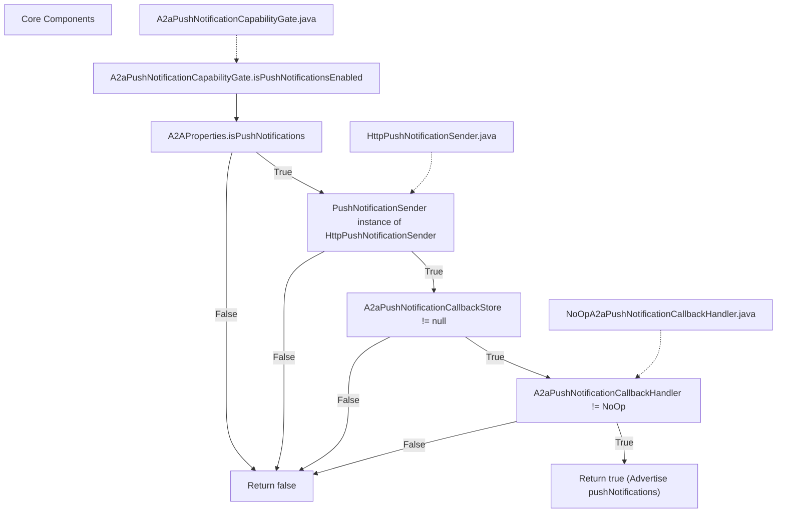

<!-- source: DeepWiki mcp.deepwiki.com · repo openJiuwen-ai/agent-runtime-java · page 2.3 Agent Cards and Capability Gating · fetched 2026-11-02 -->

# Agent Cards and Capability Gating

<details>
<summary>Relevant source files</summary>

The following files were used as context for generating this wiki page:

- [service/agent-service-app/src/main/java/com/openjiuwen/service/app/controller/a2a/A2aPushNotificationCapabilityGate.java](service/agent-service-app/src/main/java/com/openjiuwen/service/app/controller/a2a/A2aPushNotificationCapabilityGate.java)
- [service/agent-service-app/src/main/java/com/openjiuwen/service/app/controller/a2a/AgentCardController.java](service/agent-service-app/src/main/java/com/openjiuwen/service/app/controller/a2a/AgentCardController.java)
- [service/agent-service-app/src/main/java/com/openjiuwen/service/app/controller/a2a/NoOpA2aPushNotificationCallbackHandler.java](service/agent-service-app/src/main/java/com/openjiuwen/service/app/controller/a2a/NoOpA2aPushNotificationCallbackHandler.java)
- [service/agent-service-app/src/main/java/com/openjiuwen/service/app/hosting/HostedAgentCardFactory.java](service/agent-service-app/src/main/java/com/openjiuwen/service/app/hosting/HostedAgentCardFactory.java)
- [service/agent-service-app/src/test/java/com/openjiuwen/service/app/controller/a2a/AgentCardCapabilityGatingTest.java](service/agent-service-app/src/test/java/com/openjiuwen/service/app/controller/a2a/AgentCardCapabilityGatingTest.java)
- [service/agent-service-spec/src/main/java/com/openjiuwen/service/spec/paths/A2AServicePaths.java](service/agent-service-spec/src/main/java/com/openjiuwen/service/spec/paths/A2AServicePaths.java)

</details>


## Purpose and Scope
This page details the implementation of Agent Cards and capability gating within `agent-runtime-java`. It covers how agent metadata, skills, capabilities, and interface definitions are exposed according to the A2A (Agent-to-Agent) protocol spec. Key components include `AgentCardController`, `HostedAgentCardFactory`, `A2aPushNotificationCapabilityGate`, and `A2AServicePaths`.

---

## 1. A2A Service Paths and Well-Known Endpoints

The runtime exposes standard and compatible paths for publishing agent cards and managing multi-tenant hosted registrations [service/agent-service-spec/src/main/java/com/openjiuwen/service/spec/paths/A2AServicePaths.java:12-45](). These paths are consumed by remote agent clients and catalog discovery mechanisms.

| Constant Name | Path Value | Description |
| :--- | :--- | :--- |
| `WELL_KNOWN_AGENT_CARD` | `/.well-known/agent-card.json` | A2A standard Agent Card path [service/agent-service-spec/src/main/java/com/openjiuwen/service/spec/paths/A2AServicePaths.java:14-14]() |
| `WELL_KNOWN_AGENT_JSON` | `/.well-known/agent.json` | Compatible AgentScope / partial SDK path [service/agent-service-spec/src/main/java/com/openjiuwen/service/spec/paths/A2AServicePaths.java:17-17]() |
| `A2A_PREFIX` | `/a2a` | JSON-RPC mount prefix [service/agent-service-spec/src/main/java/com/openjiuwen/service/spec/paths/A2AServicePaths.java:20-20]() |
| `HOSTED_AGENTS` | `/a2a/agents` | Hosted agent discovery list [service/agent-service-spec/src/main/java/com/openjiuwen/service/spec/paths/A2AServicePaths.java:32-32]() |
| `HOSTED_AGENT_CARD` | `/a2a/agents/{agentId}/.well-known/agent-card.json` | Card for one registered hosted agent [service/agent-service-spec/src/main/java/com/openjiuwen/service/spec/paths/A2AServicePaths.java:38-38]() |
| `A2A_PUSH_NOTIFICATION_CALLBACK` | `/a2a/push-notifications/callback` | Fixed A2A push notification callback receiver path [service/agent-service-spec/src/main/java/com/openjiuwen/service/spec/paths/A2AServicePaths.java:29-29]() |

### Diagram: Agent Card Discovery and Routing Flow (Natural Language to Code Entity Space)
```mermaid
graph TD
    Client["Client Request"] -->|GET /.well-known/agent-card.json| StandardRoute["AgentCardController.getStandardCard"]
    Client -->|GET /.well-known/agent.json| CompatRoute["AgentCardController.getCompatCard"]
    Client -->|GET /a2a/agents/{agentId}/.well-known/agent-card.json| HostedCardRoute["AgentCardController.getHostedCard"]
    Client -->|GET /a2a/agents| HostedListRoute["AgentCardController.getHostedAgents"]

    StandardRoute -->|Calls| BuildCard["AgentCardController.buildCard"]
    CompatRoute -->|Calls| BuildCard
    HostedCardRoute -->|Delegates to| HostedCards["HostedAgentCardFactory.card"]
    HostedListRoute -->|Queries| HostedCatalog["HostedRuntimeCatalog.instances"]

    sub5["A2AServicePaths Constants"]
    A2AServicePathsWELL_KNOWN_AGENT_CARD["A2AServicePaths.WELL_KNOWN_AGENT_CARD"] -.-> StandardRoute
    A2AServicePathsHOSTED_AGENT_CARD["A2AServicePaths.HOSTED_AGENT_CARD"] -.-> HostedCardRoute
```
Sources: [service/agent-service-app/src/main/java/com/openjiuwen/service/app/controller/a2a/AgentCardController.java:38-155](), [service/agent-service-spec/src/main/java/com/openjiuwen/service/spec/paths/A2AServicePaths.java:12-45]()

---

## 2. Agent Card Generation and Data Model

`AgentCardController` handles single-tenant deployments or proxies multi-tenant views through `HostedAgentCardFactory` [service/agent-service-app/src/main/java/com/openjiuwen/service/app/controller/a2a/AgentCardController.java:97-141]().

### Single-Tenant Card Construction
When `HostedIngressResolver` is absent, `AgentCardController.buildCard()` constructs an `AgentCard` directly from `A2AProperties` and `ServiceProperties` [service/agent-service-app/src/main/java/com/openjiuwen/service/app/controller/a2a/AgentCardController.java:97-127](). It reads:
- Public URL or resolves base URL from `HttpServletRequest` [service/agent-service-app/src/main/java/com/openjiuwen/service/app/controller/a2a/AgentCardController.java:101-103]().
- Configured skills mapped into SDK `AgentSkill` DTOs [service/agent-service-app/src/main/java/com/openjiuwen/service/app/controller/a2a/AgentCardController.java:107-111]().
- Provider organization, version, documentation URL, and capabilities [service/agent-service-app/src/main/java/com/openjiuwen/service/app/controller/a2a/AgentCardController.java:112-126]().

### Hosted Card Freezing
`HostedAgentCardFactory` freezes card content at startup for each registered hosted agent ID [service/agent-service-app/src/main/java/com/openjiuwen/service/app/hosting/HostedAgentCardFactory.java:31-63](). 
- Validates that `a2a.json-rpc-path` is set to `/a2a` [service/agent-service-app/src/main/java/com/openjiuwen/service/app/hosting/HostedAgentCardFactory.java:45-47]().
- Overrides global defaults with agent-specific `HostedCardProperties` [service/agent-service-app/src/main/java/com/openjiuwen/service/app/hosting/HostedAgentCardFactory.java:50-55]().
- Generates dynamic request-scoped address views via `HostedAgentCardFactory.card(...)` [service/agent-service-app/src/main/java/com/openjiuwen/service/app/hosting/HostedAgentCardFactory.java:73-84]().

Sources: [service/agent-service-app/src/main/java/com/openjiuwen/service/app/controller/a2a/AgentCardController.java:81-127](), [service/agent-service-app/src/main/java/com/openjiuwen/service/app/hosting/HostedAgentCardFactory.java:31-100]()

---

## 3. Capability Gating for Push Notifications

Push notification advertising in the Agent Card is governed by `A2aPushNotificationCapabilityGate` [service/agent-service-app/src/main/java/com/openjiuwen/service/app/controller/a2a/A2aPushNotificationCapabilityGate.java:16-45](). An agent card will only advertise `pushNotifications = true` if all prerequisites are fulfilled.

### Evaluation Criteria
`A2aPushNotificationCapabilityGate.isPushNotificationsEnabled()` evaluates:
1. `properties.isPushNotifications()`: Operator switch is enabled in `A2AProperties` [service/agent-service-app/src/main/java/com/openjiuwen/service/app/controller/a2a/A2aPushNotificationCapabilityGate.java:39-39]().
2. `sender instanceof HttpPushNotificationSender`: The configured push notification sender is HTTP-based [service/agent-service-app/src/main/java/com/openjiuwen/service/app/controller/a2a/A2aPushNotificationCapabilityGate.java:40-40]().
3. `callbackStore != null`: A valid callback store is present [service/agent-service-app/src/main/java/com/openjiuwen/service/app/controller/a2a/A2aPushNotificationCapabilityGate.java:41-41]().
4. `callbackHandler != null && !(callbackHandler instanceof NoOpA2aPushNotificationCallbackHandler)`: A concrete recovery handler is registered [service/agent-service-app/src/main/java/com/openjiuwen/service/app/controller/a2a/A2aPushNotificationCapabilityGate.java:42-43]().

### Diagram: Capability Gating Decision Flow (Natural Language to Code Entity Space)

Sources: [service/agent-service-app/src/main/java/com/openjiuwen/service/app/controller/a2a/A2aPushNotificationCapabilityGate.java:16-45](), [service/agent-service-app/src/test/java/com/openjiuwen/service/app/controller/a2a/AgentCardCapabilityGatingTest.java:23-72]()

---

## 4. Hosted Agent Catalog and Discovery

In multi-tenant hosted environments, `AgentCardController` interacts with `HostedRuntimeCatalog` to publish discovery endpoints [service/agent-service-app/src/main/java/com/openjiuwen/service/app/controller/a2a/AgentCardController.java:148-155]().

- `getHostedAgents()`: Returns a `HostedAgentsResponse` containing the list of all registered agent identifiers (`agentId()`) and the designated default agent ID [service/agent-service-app/src/main/java/com/openjiuwen/service/app/controller/a2a/AgentCardController.java:148-155]().
- `getHostedCard(String agentId, HttpServletRequest request)`: Resolves the card for a specific hosted agent via `HostedAgentCardFactory`, throwing `HostedIngressResolver.SelectionException` if selection fails [service/agent-service-app/src/main/java/com/openjiuwen/service/app/controller/a2a/AgentCardController.java:136-164]().

Sources: [service/agent-service-app/src/main/java/com/openjiuwen/service/app/controller/a2a/AgentCardController.java:136-164]()

---

