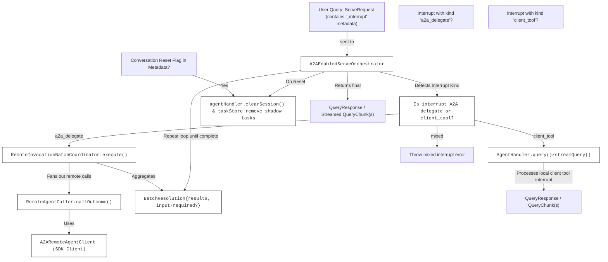

<!-- source: DeepWiki mcp.deepwiki.com · repo openJiuwen-ai/agent-runtime-java · page 3.1 A2AEnabledServeOrchestrator and Interrupt/Resume · fetched 2026-11-02 -->

# 3.1 A2AEnabledServeOrchestrator and Interrupt/Resume

<details>
<summary>Relevant source files</summary>

The following files were used as context for generating this wiki page:

- [service/agent-service-app/src/main/java/com/openjiuwen/service/app/controller/a2a/client/A2ARemoteAgentClient.java](service/agent-service-app/src/main/java/com/openjiuwen/service/app/controller/a2a/client/A2ARemoteAgentClient.java)
- [service/agent-service-app/src/main/java/com/openjiuwen/service/app/lifecycle/AgentLifecycleManager.java](service/agent-service-app/src/main/java/com/openjiuwen/service/app/lifecycle/AgentLifecycleManager.java)
- [service/agent-service-app/src/main/java/com/openjiuwen/service/app/orchestrator/A2AEnabledServeOrchestrator.java](service/agent-service-app/src/main/java/com/openjiuwen/service/app/orchestrator/A2AEnabledServeOrchestrator.java)
- [service/agent-service-app/src/main/java/com/openjiuwen/service/app/orchestrator/RemoteInvocationBatchCoordinator.java](service/agent-service-app/src/main/java/com/openjiuwen/service/app/orchestrator/RemoteInvocationBatchCoordinator.java)
- [service/agent-service-app/src/test/java/com/openjiuwen/service/app/controller/a2a/client/A2ARemoteAgentClientClassLoaderTest.java](service/agent-service-app/src/test/java/com/openjiuwen/service/app/controller/a2a/client/A2ARemoteAgentClientClassLoaderTest.java)
- [service/agent-service-app/src/test/java/com/openjiuwen/service/app/controller/a2a/client/A2ARemoteAgentClientStreamingLifecycleTest.java](service/agent-service-app/src/test/java/com/openjiuwen/service/app/controller/a2a/client/A2ARemoteAgentClientStreamingLifecycleTest.java)
- [service/agent-service-app/src/test/java/com/openjiuwen/service/app/it/LifecycleIntegrationTest.java](service/agent-service-app/src/test/java/com/openjiuwen/service/app/it/LifecycleIntegrationTest.java)
- [service/agent-service-app/src/test/java/com/openjiuwen/service/app/lifecycle/ActiveStreamInterruptorTest.java](service/agent-service-app/src/test/java/com/openjiuwen/service/app/lifecycle/ActiveStreamInterruptorTest.java)
- [service/agent-service-app/src/test/java/com/openjiuwen/service/app/lifecycle/ActiveStreamRegistryTest.java](service/agent-service-app/src/test/java/com/openjiuwen/service/app/lifecycle/ActiveStreamRegistryTest.java)
- [service/agent-service-app/src/test/java/com/openjiuwen/service/app/lifecycle/AgentHandlerHolderTest.java](service/agent-service-app/src/test/java/com/openjiuwen/service/app/lifecycle/AgentHandlerHolderTest.java)
- [service/agent-service-app/src/test/java/com/openjiuwen/service/app/lifecycle/ShutdownPhaseExecutorTest.java](service/agent-service-app/src/test/java/com/openjiuwen/service/app/lifecycle/ShutdownPhaseExecutorTest.java)
- [service/agent-service-app/src/test/java/com/openjiuwen/service/app/orchestrator/A2AEnabledServeOrchestratorTest.java](service/agent-service-app/src/test/java/com/openjiuwen/service/app/orchestrator/A2AEnabledServeOrchestratorTest.java)
- [service/agent-service-app/src/test/java/com/openjiuwen/service/app/orchestrator/DefaultServeOrchestratorInterruptTest.java](service/agent-service-app/src/test/java/com/openjiuwen/service/app/orchestrator/DefaultServeOrchestratorInterruptTest.java)
- [service/agent-service-app/src/test/java/com/openjiuwen/service/app/orchestrator/RemoteInvocationBatchCoordinatorTest.java](service/agent-service-app/src/test/java/com/openjiuwen/service/app/orchestrator/RemoteInvocationBatchCoordinatorTest.java)
- [service/agent-service-demo/src/test/java/com/openjiuwen/service/demo/RemoteExampleLocalServerTest.java](service/agent-service-demo/src/test/java/com/openjiuwen/service/demo/RemoteExampleLocalServerTest.java)
- [service/agent-service-demo/src/test/java/com/openjiuwen/service/demol1test/health/HealthL1ProbeExample.java](service/agent-service-demo/src/test/java/com/openjiuwen/service/demol1test/health/HealthL1ProbeExample.java)

</details>


## Purpose and Scope

This page provides an in-depth technical explanation of the `A2AEnabledServeOrchestrator` class and its handling of interrupt and resume functionality in the OpenJiuwen agent runtime Java implementation. It details the orchestrator's role in managing query and streamQuery flows with support for the A2A protocol, including delegation of interrupts via `a2a_delegate`, conversation reset, and acceptance of push notification callbacks. The page also bridges concepts expressed in natural language (such as remote agent calls and interrupt semantics) to their corresponding code entities and data flows.

---

## Overview of `A2AEnabledServeOrchestrator`

The `A2AEnabledServeOrchestrator` is a specialized implementation of the `ServeOrchestrator` interface that understands and manages A2A-specific remote delegation flows using a cooperative interrupt-resume loop. It delegates interrupts marked with the kind `"a2a_delegate"` to a `RemoteInvocationBatchCoordinator`, which fans out calls to remote agents via the `RemoteAgentCaller` SPI interface, aggregates service outcomes, and manages lifecycle resumption or input-required signals.

Key features include:

- Handling both synchronous `query` requests and asynchronous `streamQuery` requests with automatic interruption and resume cycles.
- Integrating tightly with the local `AgentHandler` for task lifecycle hooks (`prepareTask` and `completeTask`).
- Using the `RemoteInvocationBatchCoordinator` for parallel or single-agent remote delegation.
- Supporting conversation reset logic through handling metadata and session clearing.
- Implementing the `A2aPushNotificationCallbackHandler` interface for processing inbound push callbacks.

### Primary Classes and Interfaces

| Name                             | Role                                                                                   |
|---------------------------------|----------------------------------------------------------------------------------------|
| `A2AEnabledServeOrchestrator`   | Orchestrates local and remote A2A-based serve requests, manages interrupts and resumes |
| `RemoteInvocationBatchCoordinator` | Coordinates batch remote agent calls and manages dispatch concurrency and queuing     |
| `RemoteAgentCaller`             | SPI interface for making remote agent calls (implemented by `A2ARemoteAgentClient`)   |
| `AgentHandler`                  | Local agent handler interface serving actual agent logic for queries and streaming    |
| `QueryStreamObserver`           | Interface for streaming query results chunk-by-chunk                                  |
| `A2aPushNotificationCallbackHandler` | Handles inbound push notifications and callback messages                              |

The orchestrator maintains a strict lifecycle: a request may undergo multiple interrupt-driven redelegations before completion, while the local agent handler is prepared once per entire conversation loop.

Sources:  
`service/agent-service-app/src/main/java/com/openjiuwen/service/app/orchestrator/A2AEnabledServeOrchestrator.java:32-163`  
`service/agent-service-app/src/main/java/com/openjiuwen/service/app/orchestrator/RemoteInvocationBatchCoordinator.java:1-169`  
`service/agent-service-app/src/main/java/com/openjiuwen/service/app/controller/a2a/client/A2ARemoteAgentClient.java:1-155`  

---

## Query and streamQuery Flows

### Query Flow

The `query(ServeRequest request)` method handles synchronous queries. Its core workflow is:

1. **Conversation Identification**: Uses conversation ID from the request to either resume or start fresh.
2. **Task Preparation**: Invokes `agentHandler.prepareTask(conversationId)` before the main loop.
3. **Interrupt-Resume Loop**: If the request metadata indicates an A2A delegate interrupt (`"_interrupt"` key with kind `"a2a_delegate"`), delegates to `RemoteInvocationBatchCoordinator.execute()` which fans out remote batch calls and waits for completion or input-required responses. Non-A2A interrupts are handled locally as input-required.
4. **Final Task Completion**: Calls `agentHandler.completeTask(conversationId)` after all remote rounds conclude or normal query processing.
5. **Conversation Reset**: If the request metadata contains a reset flag, invokes `agentHandler.clearSession(conversationId)` and clears internal task store state.
6. **Result Construction**: Returns final `QueryResponse` to the caller.

If no interrupt is detected, it directly delegates to the local handler's `query()`.

### streamQuery Flow

The `streamQuery(ServeRequest request, QueryStreamObserver observer)` method processes asynchronous streaming queries:

1. **Cancellation Registration**: Registers the stream with `ActiveStreamRegistry` to allow external cancellation.
2. **Conversation Reset**: Resets conversation state if indicated in metadata.
3. **Preparation**: Calls `agentHandler.prepareTask(conversationId)`.
4. **Interrupt-Resume Loop**: Similar to `query()`, repeatedly calls the batch coordinator if the interrupt kind is `"a2a_delegate"`, forwarding chunks as they arrive.
5. **Local Pass-through**: If no interrupt or non-A2A client tool interrupt, passes directly to `agentHandler.streamQuery()` to stream local responses.
6. **Completion and Cleanup**: Ensures to complete or error the observer and unregister the stream from the registry.
7. **Lifecycle Hooks**: Calls `agentHandler.completeTask(conversationId)` on loop exit.

This model supports long-lived streaming interactions with phased interruptions and task resumption.

Sources:  
`service/agent-service-app/src/main/java/com/openjiuwen/service/app/orchestrator/A2AEnabledServeOrchestrator.java:160-163` (query method start snippet shown)  
`service/agent-service-app/src/main/java/com/openjiuwen/service/app/orchestrator/A2AEnabledServeOrchestrator.java:50-150` (class level overview and constructor)

---

## Interrupt Handling and Delegation

### Interrupt Detection and Classification

The orchestrator uses the request metadata key `"_interrupt"` to detect interrupts. The value can be:

- A single interrupt map.
- A list of interrupt maps.

Each interrupt has a `"kind"` property. If **all** interrupts have the kind `"client_tool"`, the orchestrator treats these as client-local interrupts and bypasses remote delegation, forwarding them directly to the local client tool handlers in `AgentHandler`.

If **any** interrupt has kind `"a2a_delegate"`, the orchestrator delegates the handling **exclusively** via `RemoteInvocationBatchCoordinator` for remote dispatching. Mixed kinds result in an error.

### Use of `RemoteInvocationBatchCoordinator`

This coordinator fans out remote calls to multiple agent members efficiently with concurrency and queue limits. It manages:

- Batch metadata including shadow task keys.
- Remote invocation lifecycle with retries.
- Collection and merging of streamed outputs (`QueryChunk`) and final task states.
- Return of a single aggregated `BatchResolution` indicating whether the batch is completed, input-required, or errored.

The orchestrator invokes `batchCoordinator.execute()` asynchronously within the interrupt-resume loop, streaming partial outputs to the observer, and resuming until remote tasks complete or input is required.

### Conversation Reset

When a reset request is identified via metadata (e.g., a reset flag set), the orchestrator clears the session state and removes any associated shadow tasks from the local `TaskStore`. It invokes `agentHandler.clearSession(conversationId)` to clear local caches and context.

### Push Notification Callbacks

The orchestrator implements `A2aPushNotificationCallbackHandler` to accept inbound push notifications/callbacks from remote agents. Callback handlers integrate with internal task state and support continuation of waiting remote batches or local conversations.

---

## Callback Acceptance and Stream Cancellation

The integration with `ActiveStreamRegistry` enables the orchestrator to:

- Register active streaming observers keyed by conversation ID.
- Support cancellation of long-running streams from external signals, notifying the `QueryStreamObserver` accordingly.
  
This is crucial for user interruption or system shutdown scenarios. When stream cancellation is detected, the observer's `isCancelled()` returns true, and the stream loop terminates gracefully.

---

## Key Methods Summary

| Method                     | Description                                                                              |
|----------------------------|------------------------------------------------------------------------------------------|
| `query(ServeRequest)`      | Executes synchronous query with interrupt-resume handling and conversation reset.        |
| `streamQuery(ServeRequest, QueryStreamObserver)` | Executes asynchronous streaming query with interrupt-resume and backpressure handling. |
| `stopDispatching()`         | Stops the `RemoteInvocationBatchCoordinator` dispatches related to this orchestrator.   |
| `acceptCallback(A2aPushNotificationCallback)` | Processes incoming push notification callbacks from remote agents.                     |
| Internal `resumeQueryLoop()` | Handles the interrupt-driven delegation loop, delegating A2A interrupts remotely and local fallback. |

---

## Data Flow Diagram: Natural Language to Code Entities



Sources:  
`service/agent-service-app/src/main/java/com/openjiuwen/service/app/orchestrator/A2AEnabledServeOrchestrator.java:33-150`  
`service/agent-service-app/src/main/java/com/openjiuwen/service/app/orchestrator/RemoteInvocationBatchCoordinator.java:59-159`  
`service/agent-service-app/src/main/java/com/openjiuwen/service/app/controller/a2a/client/A2ARemoteAgentClient.java:91-155`  

---

## Sequence Diagram: Interrupt-Resume Loop for `streamQuery`

```mermaid
sequenceDiagram
  participant Client as ServeClient
  participant Orchestrator as A2AEnabledServeOrchestrator
  participant BatchCoord as RemoteInvocationBatchCoordinator
  participant RemoteClient as RemoteAgentCaller
  participant AgentHandler as Local AgentHandler
  participant StreamReg as ActiveStreamRegistry
  participant Observer as QueryStreamObserver

  Client->>Orchestrator: streamQuery(ServeRequest, Observer)
  Orchestrator->>StreamReg: register(conversationId)
  alt Reset Flag in metadata
    Orchestrator->>AgentHandler: clearSession(conversationId)
    Orchestrator->>TaskStore: removeShadowTasks(conversationId)
  end
  Orchestrator->>AgentHandler: prepareTask(conversationId)
  loop Interrupt-Resume Loop
    alt Interrupt kind == "a2a_delegate"
      Orchestrator->>BatchCoord: execute(interrupt batch, request, forwarding observer)
      BatchCoord->>RemoteClient: callOutcome(remoteCall, EventObserver)
      RemoteClient-->>BatchCoord: async streamed results + terminal state
      BatchCoord-->>Orchestrator: BatchResolution(results, resume, input-required)
      Orchestrator->>Observer: onNext(QueryChunk) [partial results]
      alt input-required result
        Orchestrator-xClient: return input-required QueryResponse
        break
      end
    else Interrupt kind == "client_tool"
      Orchestrator->>AgentHandler: streamQuery(request, observer)
      break
    end
  end
  Orchestrator->>AgentHandler: completeTask(conversationId)
  Orchestrator->>Observer: onComplete()
  Orchestrator->>StreamReg: unregister(conversationId)
```

This sequence shows the cooperative multi-round loop for streaming queries that involve remote A2A delegation interruptions. The batch coordinator manages concurrent calls and aggregates their outcomes iteratively.

Sources:  
`service/agent-service-app/src/main/java/com/openjiuwen/service/app/orchestrator/A2AEnabledServeOrchestrator.java:50-150`  
`service/agent-service-app/src/main/java/com/openjiuwen/service/app/orchestrator/RemoteInvocationBatchCoordinator.java:59-169`  
`service/agent-service-app/src/main/java/com/openjiuwen/service/app/controller/a2a/client/A2ARemoteAgentClient.java:91-155`  

---

## Implementation Details and Key Components

### `A2AEnabledServeOrchestrator` (Lines 33–163)

- **Fields**: Holds references to the local `AgentHandler`, `TaskStore`, `ActiveStreamRegistry`, and `RemoteInvocationBatchCoordinator`.
- **Constructors**: Supports different configurations for maximum concurrency, queue size, and queue timeout. Also supports injecting a continuation hook (`A2ATaskContinuation`) for additional task submission.
- **`query()` method**:
  - Initiates the query lifecycle.
  - Calls `prepareTask()` once per conversation.
  - Enters an interrupt-driven loop handling `_interrupt` metadata.
  - Delegates A2A interrupts via batch coordinator.
  - Handles reset by clearing session and shadow tasks.
  - Calls `completeTask()` after processing.
- **`streamQuery()` method** (not fully shown but implied similarly):
  - Registers stream cancellation handle.
  - Applies lifecycle hooks and interrupt-resume loop.
  - Passes straight through for client tool interrupts.
- **Interrupt Resolution**:
  - Differentiates interrupt kinds.
  - Ensures no mixed kinds in a batch.
  - For client tool kind, bypasses remote delegation.
  - For a2a delegate kind, invokes remote batch dispatch.
- **Callback Acceptance**:
  - Implements callback handler interface to accept asynchronous callbacks (push notifications) for remote tasks.
- **Dispatch Stop**:
  - Method to stop ongoing dispatch from the batch coordinator.

### `RemoteInvocationBatchCoordinator` (Lines 59–169)

- Manages fan-out and fan-in of remote agent invocations.
- Maintains queue and concurrency limits.
- Maps batch members and shadow tasks for persistence.
- Return a `BatchResolution` containing results and flags for continuation.
- Uses a `RemoteAgentCaller` to invoke remote calls, typically the `A2ARemoteAgentClient`.
- Provides error handling and orderly completion.
- Relays streamed outputs back to orchestrator's observer in source order.

### `A2ARemoteAgentClient` (Lines 91–155)

- Implements `RemoteAgentCaller` SPI.
- Uses the official A2A SDK client to send requests.
- Manages asynchronous, streaming task outcomes.
- Includes retry and backoff policies.
- Wraps SDK exceptions and lifecycle.
- Handles callback metadata for runtime correlation.
- Uses thread pools or virtual threads for I/O concurrency.

---

## Summary

The `A2AEnabledServeOrchestrator` is a core runtime component implementing the orchestration logic of A2A protocol-aware serve requests. It supports:

- Multi-round interrupt and resume flows by delegating `a2a_delegate` interrupts remotely via the batch coordinator and client.
- Local handling of client tool interrupts directly on the hosted agent.
- Handling of conversation reset and session clearing.
- Integration with the task lifecycle (`prepareTask`, `completeTask`).
- Support for push notification callbacks from remote agents.
- Stream cancellation management with `ActiveStreamRegistry`.

Together with `RemoteInvocationBatchCoordinator` and `A2ARemoteAgentClient`, it forms a resilient and extensible mechanism for managing remote delegation, concurrency, and partial streaming in the OpenJiuwen agent runtime.

---

## References

- `A2AEnabledServeOrchestrator.java:33-163`  
- `RemoteInvocationBatchCoordinator.java:59-169`  
- `A2ARemoteAgentClient.java:91-155`  

---

# End of 3.1 A2AEnabledServeOrchestrator and Interrupt/Resume

---

