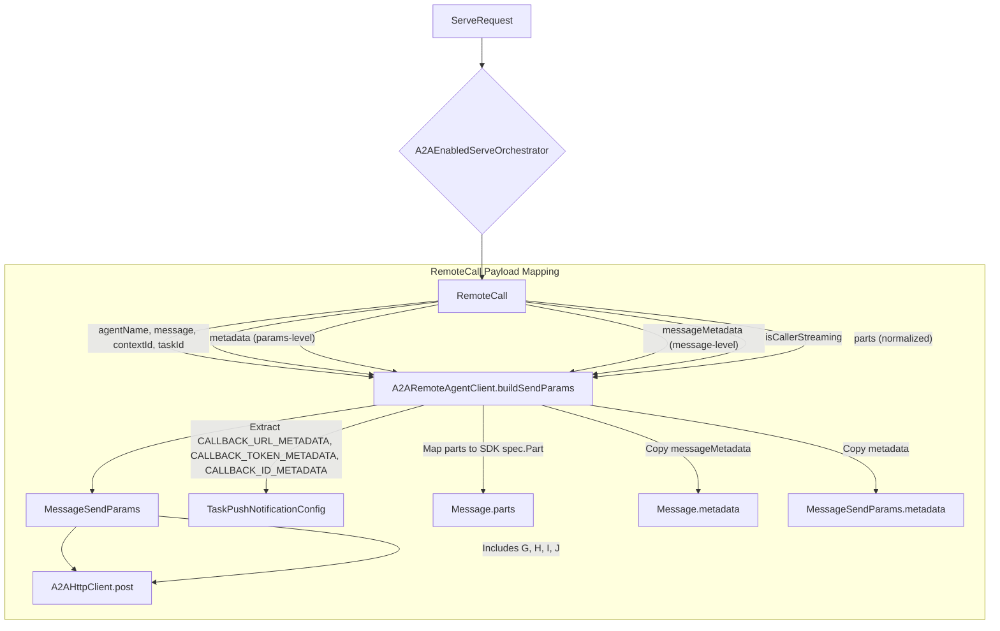

<!-- source: DeepWiki mcp.deepwiki.com · repo openJiuwen-ai/agent-runtime-java · page 3.3 Remote Agent Client, Catalog and Discovery · fetched 2026-11-02 -->

# Remote Agent Client, Catalog and Discovery

<details>
<summary>Relevant source files</summary>

The following files were used as context for generating this wiki page:

- [service/agent-service-app/src/main/java/com/openjiuwen/service/app/a2a/catalog/A2ARemoteAgentCardRegistry.java](service/agent-service-app/src/main/java/com/openjiuwen/service/app/a2a/catalog/A2ARemoteAgentCardRegistry.java)
- [service/agent-service-app/src/main/java/com/openjiuwen/service/app/a2a/catalog/RemoteAgentCatalogChangedEvent.java](service/agent-service-app/src/main/java/com/openjiuwen/service/app/a2a/catalog/RemoteAgentCatalogChangedEvent.java)
- [service/agent-service-app/src/main/java/com/openjiuwen/service/app/a2a/catalog/RemoteAgentCatalogSnapshot.java](service/agent-service-app/src/main/java/com/openjiuwen/service/app/a2a/catalog/RemoteAgentCatalogSnapshot.java)
- [service/agent-service-app/src/main/java/com/openjiuwen/service/app/a2a/catalog/RemoteAgentEntry.java](service/agent-service-app/src/main/java/com/openjiuwen/service/app/a2a/catalog/RemoteAgentEntry.java)
- [service/agent-service-app/src/main/java/com/openjiuwen/service/app/controller/a2a/client/A2AAgentCardDiscovery.java](service/agent-service-app/src/main/java/com/openjiuwen/service/app/controller/a2a/client/A2AAgentCardDiscovery.java)
- [service/agent-service-app/src/main/java/com/openjiuwen/service/app/controller/a2a/client/A2AOutboundRequest.java](service/agent-service-app/src/main/java/com/openjiuwen/service/app/controller/a2a/client/A2AOutboundRequest.java)
- [service/agent-service-app/src/main/java/com/openjiuwen/service/app/controller/a2a/client/A2APropagationHeaderProvider.java](service/agent-service-app/src/main/java/com/openjiuwen/service/app/controller/a2a/client/A2APropagationHeaderProvider.java)
- [service/agent-service-app/src/main/java/com/openjiuwen/service/app/controller/a2a/client/A2APropagationHeaderRegistry.java](service/agent-service-app/src/main/java/com/openjiuwen/service/app/controller/a2a/client/A2APropagationHeaderRegistry.java)
- [service/agent-service-app/src/main/java/com/openjiuwen/service/app/controller/a2a/client/HeaderInjectingA2AHttpClient.java](service/agent-service-app/src/main/java/com/openjiuwen/service/app/controller/a2a/client/HeaderInjectingA2AHttpClient.java)
- [service/agent-service-app/src/main/java/com/openjiuwen/service/app/controller/a2a/client/RemoteAgentCardResolver.java](service/agent-service-app/src/main/java/com/openjiuwen/service/app/controller/a2a/client/RemoteAgentCardResolver.java)
- [service/agent-service-app/src/main/java/com/openjiuwen/service/app/controller/a2a/client/RemoteCall.java](service/agent-service-app/src/main/java/com/openjiuwen/service/app/controller/a2a/client/RemoteCall.java)
- [service/agent-service-app/src/test/java/com/openjiuwen/service/app/a2a/catalog/A2ARemoteAgentCardRegistryTest.java](service/agent-service-app/src/test/java/com/openjiuwen/service/app/a2a/catalog/A2ARemoteAgentCardRegistryTest.java)
- [service/agent-service-app/src/test/java/com/openjiuwen/service/app/controller/a2a/A2AAgentExecutorCancelTest.java](service/agent-service-app/src/test/java/com/openjiuwen/service/app/controller/a2a/A2AAgentExecutorCancelTest.java)
- [service/agent-service-app/src/test/java/com/openjiuwen/service/app/controller/a2a/A2AProtocolAdapterTest.java](service/agent-service-app/src/test/java/com/openjiuwen/service/app/controller/a2a/A2AProtocolAdapterTest.java)
- [service/agent-service-app/src/test/java/com/openjiuwen/service/app/controller/a2a/client/A2AAgentCardDiscoveryTest.java](service/agent-service-app/src/test/java/com/openjiuwen/service/app/controller/a2a/client/A2AAgentCardDiscoveryTest.java)
- [service/agent-service-app/src/test/java/com/openjiuwen/service/app/controller/a2a/client/A2ARemoteAgentClientMetadataTest.java](service/agent-service-app/src/test/java/com/openjiuwen/service/app/controller/a2a/client/A2ARemoteAgentClientMetadataTest.java)
- [service/agent-service-app/src/test/java/com/openjiuwen/service/app/controller/a2a/client/HeaderInjectingA2AHttpClientTest.java](service/agent-service-app/src/test/java/com/openjiuwen/service/app/controller/a2a/client/HeaderInjectingA2AHttpClientTest.java)
- [service/agent-service-app/src/test/java/com/openjiuwen/service/app/controller/a2a/client/TestTaggingA2AHttpClientProvider.java](service/agent-service-app/src/test/java/com/openjiuwen/service/app/controller/a2a/client/TestTaggingA2AHttpClientProvider.java)
- [service/agent-service-app/src/test/resources/META-INF/services/org.a2aproject.sdk.client.http.A2AHttpClientProvider](service/agent-service-app/src/test/resources/META-INF/services/org.a2aproject.sdk.client.http.A2AHttpClientProvider)
- [service/agent-service-spec/src/main/java/com/openjiuwen/service/spec/dto/QueryChunk.java](service/agent-service-spec/src/main/java/com/openjiuwen/service/spec/dto/QueryChunk.java)
- [service/agent-service-spec/src/main/java/com/openjiuwen/service/spec/dto/ServeRequest.java](service/agent-service-spec/src/main/java/com/openjiuwen/service/spec/dto/ServeRequest.java)
- [service/agent-service-spec/src/test/java/com/openjiuwen/service/spec/dto/ServeRequestTest.java](service/agent-service-spec/src/test/java/com/openjiuwen/service/spec/dto/ServeRequestTest.java)

</details>


This page details the mechanisms for remote agent interaction within the `agent-runtime-java` codebase. It covers the `A2ARemoteAgentClient` for transport and retry logic, the mapping of `RemoteCall` payloads, the discovery of remote agent cards, the `A2ARemoteAgentCardRegistry` for catalog management and event publication, and the propagation of HTTP headers for distributed tracing and security.

## Remote Agent Client Transport and Retry

The `A2ARemoteAgentClient` is responsible for making outbound A2A calls to remote agents. It handles the underlying HTTP transport and incorporates retry mechanisms for transient failures.

### `A2ARemoteAgentClient` Payload Mapping

The `A2ARemoteAgentClient` translates internal `RemoteCall` objects into the `MessageSendParams` format expected by the A2A SDK. This involves mapping various fields and handling different types of message parts.

The `RemoteCall` record [service/agent-service-app/src/main/java/com/openjiuwen/service/app/controller/a2a/client/RemoteCall.java:29-31]() encapsulates the necessary information for a remote agent invocation, including the agent name, message content, context ID, task ID, and metadata.

The `buildSendParams` method [service/agent-service-app/src/test/java/com/openjiuwen/service/app/controller/a2a/client/A2ARemoteAgentClientMetadataTest.java:36]() in `A2ARemoteAgentClient` performs the conversion. It ensures that:
*   `tenant` information is not set directly from the `RemoteCall` [service/agent-service-app/src/test/java/com/openjiuwen/service/app/controller/a2a/client/A2ARemoteAgentClientMetadataTest.java:38]().
*   Message parts are correctly mapped. For example, `FilePart` objects are preserved [service/agent-service-app/src/test/java/com/openjiuwen/service/app/controller/a2a/client/A2ARemoteAgentClientMetadataTest.java:39-43]().
*   `paramsMetadata` and `messageMetadata` are handled independently, with `messageMetadata` being copied to prevent external modification [service/agent-service-app/src/test/java/com/openjiuwen/service/app/controller/a2a/client/A2ARemoteAgentClientMetadataTest.java:61-76]().
*   Callback-related metadata (`CALLBACK_URL_METADATA`, `CALLBACK_TOKEN_METADATA`, `CALLBACK_ID_METADATA`) is extracted from `paramsMetadata` and used to construct a `TaskPushNotificationConfig` within the `MessageSendParams` configuration [service/agent-service-app/src/test/java/com/openjiuwen/service/app/controller/a2a/client/A2ARemoteAgentClientMetadataTest.java:95-109](). This ensures that push notifications are correctly configured for remote tasks.
*   Various types of message parts (e.g., `url`, `raw`, `data`, `text`) are normalized and appended to the message [service/agent-service-app/src/test/java/com/openjiuwen/service/app/controller/a2a/client/A2ARemoteAgentClientMetadataTest.java:113-124]().


Sources:
- [service/agent-service-app/src/main/java/com/openjiuwen/service/app/controller/a2a/client/RemoteCall.java:29-31]()
- [service/agent-service-app/src/test/java/com/openjiuwen/service/app/controller/a2a/client/A2ARemoteAgentClientMetadataTest.java:36]()
- [service/agent-service-app/src/test/java/com/openjiuwen/service/app/controller/a2a/client/A2ARemoteAgentClientMetadataTest.java:38]()
- [service/agent-service-app/src/test/java/com/openjiuwen/service/app/controller/a2a/client/A2ARemoteAgentClientMetadataTest.java:39-43]()
- [service/agent-service-app/src/test/java/com/openjiuwen/service/app/controller/a2a/client/A2ARemoteAgentClientMetadataTest.java:61-76]()
- [service/agent-service-app/src/test/java/com/openjiuwen/service/app/controller/a2a/client/A2ARemoteAgentClientMetadataTest.java:95-109]()
- [service/agent-service-app/src/test/java/com/openjiuwen/service/app/controller/a2a/client/A2ARemoteAgentClientMetadataTest.java:113-124]()

## Agent Card Discovery

Remote agent cards are discovered by the `A2AAgentCardDiscovery` class [service/agent-service-app/src/main/java/com/openjiuwen/service/app/controller/a2a/client/A2AAgentCardDiscovery.java:49](). This component is responsible for fetching `AgentCard` information from configured remote A2A servers.

### Discovery Process

1.  **Configuration**: At application startup, `A2AAgentCardDiscovery` listens for `ApplicationReadyEvent` [service/agent-service-app/src/main/java/com/openjiuwen/service/app/controller/a2a/client/A2AAgentCardDiscovery.java:92]() and retrieves a list of remote agents from `A2AProperties` [service/agent-service-app/src/main/java/com/openjiuwen/service/app/controller/a2a/client/A2AAgentCardDiscovery.java:93-99]().
2.  **Validation**: Before discovery, the configured remote agents are validated to ensure `name` and `url` properties are not null or blank [service/agent-service-app/src/main/java/com/openjiuwen/service/app/controller/a2a/client/A2AAgentCardDiscovery.java:104-118]().
3.  **Fetching Agent Cards**: For each configured remote agent, `tryDiscover` [service/agent-service-app/src/main/java/com/openjiuwen/service/app/controller/a2a/client/A2AAgentCardDiscovery.java:120]() attempts to fetch its `AgentCard`.
    *   The `fetchCardInternal` method [service/agent-service-app/src/main/java/com/openjiuwen/service/app/controller/a2a/client/A2AAgentCardDiscovery.java:153]() constructs the agent card URL by appending `/.well-known/agent-card.json` to the base URL [service/agent-service-app/src/main/java/com/openjiuwen/service/app/controller/a2a/client/A2AAgentCardDiscovery.java:157]().
    *   It uses a `RestClient` to perform an HTTP GET request to this URL, expecting a JSON `AgentCard` in response [service/agent-service-app/src/main/java/com/openjiuwen/service/app/controller/a2a/client/A2AAgentCardDiscovery.java:158-159]().
4.  **Retry Mechanism**: If a discovery attempt fails due to a `RestClientException`, the system logs a warning and schedules a retry for that specific remote agent every 30 seconds using a `ScheduledExecutorService` [service/agent-service-app/src/main/java/com/openjiuwen/service/app/controller/a2a/client/A2AAgentCardDiscovery.java:123-137](). Once successful, the retry is canceled [service/agent-service-app/src/main/java/com/openjiuwen/service/app/controller/a2a/client/A2AAgentCardDiscovery.java:129-130]().
5.  **Registration**: Upon successful discovery, the `AgentCard` is registered with the `A2ARemoteAgentCardRegistry` [service/agent-service-app/src/main/java/com/openjiuwen/service/app/controller/a2a/client/A2AAgentCardDiscovery.java:148-149]().

### `RemoteAgentCardResolver` SPI

`A2AAgentCardDiscovery` implements the `RemoteAgentCardResolver` interface [service/agent-service-app/src/main/java/com/openjiuwen/service/app/controller/a2a/client/A2AAgentCardDiscovery.java:49](), which defines methods for resolving agent card URLs and JSON-RPC URLs.
*   `resolveCardUrl(String agentId)`: Derives the agent card fetch URL [service/agent-service-app/src/main/java/com/openjiuwen/service/app/controller/a2a/client/A2AAgentCardDiscovery.java:162-163]().
*   `resolveJsonRpcUrl(String agentId)`: Reads the cached card's first interface URL from `A2ARemoteAgentCardRegistry` [service/agent-service-app/src/main/java/com/openjiuwen/service/app/controller/a2a/client/A2AAgentCardDiscovery.java:162]().

```mermaid
graph TD
    A[ApplicationReadyEvent] --> B{A2AAgentCardDiscovery.discoverAll};
    B --> C{Validate Remote Agents};
    C -- "Valid" --> D{For each RemoteAgentProperties};
    D --> E[tryDiscover(remote)];
    E -- "Success" --> F[discoverAndRegister(remote)];
    F --> G[fetchCardInternal(baseUrl)];
    G -- "GET /.well-known/agent-card.json" --> H[RestClient];
    H --> I[AgentCard];
    I --> J[A2ARemoteAgentCardRegistry.register];
    E -- "Failure (RestClientException)" --> K[Schedule Retry (30s)];
    K --> E;
    J --> L[RemoteAgentCatalogChangedEvent];
    L --> M[Event Listeners];
```
Sources:
- [service/agent-service-app/src/main/java/com/openjiuwen/service/app/controller/a2a/client/A2AAgentCardDiscovery.java:49]()
- [service/agent-service-app/src/main/java/com/openjiuwen/service/app/controller/a2a/client/A2AAgentCardDiscovery.java:92]()
- [service/agent-service-app/src/main/java/com/openjiuwen/service/app/controller/a2a/client/A2AAgentCardDiscovery.java:93-99]()
- [service/agent-service-app/src/main/java/com/openjiuwen/service/app/controller/a2a/client/A2AAgentCardDiscovery.java:104-118]()
- [service/agent-service-app/src/main/java/com/openjiuwen/service/app/controller/a2a/client/A2AAgentCardDiscovery.java:120]()
- [service/agent-service-app/src/main/java/com/openjiuwen/service/app/controller/a2a/client/A2AAgentCardDiscovery.java:153]()
- [service/agent-service-app/src/main/java/com/openjiuwen/service/app/controller/a2a/client/A2AAgentCardDiscovery.java:157]()
- [service/agent-service-app/src/main/java/com/openjiuwen/service/app/controller/a2a/client/A2AAgentCardDiscovery.java:158-159]()
- [service/agent-service-app/src/main/java/com/openjiuwen/service/app/controller/a2a/client/A2AAgentCardDiscovery.java:123-137]()
- [service/agent-service-app/src/main/java/com/openjiuwen/service/app/controller/a2a/client/A2AAgentCardDiscovery.java:129-130]()
- [service/agent-service-app/src/main/java/com/openjiuwen/service/app/controller/a2a/client/A2AAgentCardDiscovery.java:148-149]()
- [service/agent-service-app/src/main/java/com/openjiuwen/service/app/controller/a2a/client/A2AAgentCardDiscovery.java:162-163]()
- [service/agent-service-app/src/main/java/com/openjiuwen/service/app/controller/a2a/client/A2AAgentCardDiscovery.java:162]()
- [service/agent-service-app/src/main/java/com/openjiuwen/service/app/controller/a2a/client/RemoteAgentCardResolver.java:47]()

## Catalog Registry and Events

The `A2ARemoteAgentCardRegistry` [service/agent-service-app/src/main/java/com/openjiuwen/service/app/a2a/catalog/A2ARemoteAgentCardRegistry.java:27]() acts as a thread-safe, in-memory catalog for discovered remote A2A `AgentCard`s.

### Registry Functionality

*   **Registration**: Agent cards are registered using the `register` methods [service/agent-service-app/src/main/java/com/openjiuwen/service/app/a2a/catalog/A2ARemoteAgentCardRegistry.java:67-68](), [service/agent-service-app/src/main/java/com/openjiuwen/service/app/a2a/catalog/A2ARemoteAgentCardRegistry.java:129-130](), [service/agent-service-app/src/main/java/com/openjiuwen/service/app/a2a/catalog/A2ARemoteAgentCardRegistry.java:141-142](), [service/agent-service-app/src/main/java/com/openjiuwen/service/app/a2a/catalog/A2ARemoteAgentCardRegistry.java:154-156](). These methods store `RemoteAgentEntry` objects, which include the agent name, `AgentCard`, timeout, streaming preference, and optional TLS configuration [service/agent-service-app/src/main/java/com/openjiuwen/service/app/a2a/catalog/RemoteAgentEntry.java:21-22]().
*   **Lookup**: Agents can be looked up by name using `get(String name)` [service/agent-service-app/src/main/java/com/openjiuwen/service/app/a2a/catalog/A2ARemoteAgentCardRegistry.java:86]() or `resolveUrl(String name)` [service/agent-service-app/src/main/java/com/openjiuwen/service/app/a2a/catalog/A2ARemoteAgentCardRegistry.java:96](). The `resolveUrl` method returns the JSON-RPC URL from the first supported interface of the `AgentCard` [service/agent-service-app/src/main/java/com/openjiuwen/service/app/a2a/catalog/A2ARemoteAgentCardRegistry.java:101-105]().
*   **Snapshotting**: The `snapshot()` method [service/agent-service-app/src/main/java/com/openjiuwen/service/app/a2a/catalog/A2ARemoteAgentCardRegistry.java:113]() provides an immutable, name-sorted `RemoteAgentCatalogSnapshot` [service/agent-service-app/src/main/java/com/openjiuwen/service/app/a2a/catalog/RemoteAgentCatalogSnapshot.java](). This snapshot includes a version number and a list of `RemoteAgentEntry` objects.
*   **Concurrency**: The registry uses a `ReentrantLock` to ensure thread-safe updates during registration [service/agent-service-app/src/main/java/com/openjiuwen/service/app/a2a/catalog/A2ARemoteAgentCardRegistry.java:37](), [service/agent-service-app/src/main/java/com/openjiuwen/service/app/a2a/catalog/A2ARemoteAgentCardRegistry.java:114](), [service/agent-service-app/src/main/java/com/openjiuwen/service/app/a2a/catalog/A2ARemoteAgentCardRegistry.java:158](). Concurrent registrations produce unique, complete versions of the catalog [service/agent-service-app/src/test/java/com/openjiuwen/service/app/a2a/catalog/A2ARemoteAgentCardRegistryTest.java:70-84]().

### Event Publication

The `A2ARemoteAgentCardRegistry` publishes `RemoteAgentCatalogChangedEvent` [service/agent-service-app/src/main/java/com/openjiuwen/service/app/a2a/catalog/RemoteAgentCatalogChangedEvent.java]() whenever the catalog is updated (e.g., an agent is registered or updated) [service/agent-service-app/src/main/java/com/openjiuwen/service/app/a2a/catalog/A2ARemoteAgentCardRegistry.java:167]().
*   These events contain the `RemoteAgentCatalogSnapshot` [service/agent-service-app/src/main/java/com/openjiuwen/service/app/a2a/catalog/RemoteAgentCatalogChangedEvent.java](), allowing other components to react to changes in the available remote agents.
*   Event publication is handled asynchronously using a `FutureTask` to prevent listener failures from blocking the registry update [service/agent-service-app/src/main/java/com/openjiuwen/service/app/a2a/catalog/A2ARemoteAgentCardRegistry.java:177-181](). Errors during publication are logged but do not prevent the registry from updating [service/agent-service-app/src/test/java/com/openjiuwen/service/app/a2a/catalog/A2ARemoteAgentCardRegistryTest.java:87-109]().

```mermaid
graph TD
    A[A2ARemoteAgentCardRegistry] --> B{register(name, card, timeout, streaming, tls)};
    B -- "Acquire updateLock" --> C[entries.put(name, RemoteAgentEntry)];
    C --> D[version++];
    D --> E[createSnapshot()];
    E --> F[publishCatalogChanged(snapshot)];
    F -- "Release updateLock" --> A;
    F --> G[FutureTask for eventPublisher.publishEvent];
    G --> H[RemoteAgentCatalogChangedEvent];
    H --> I[Event Listeners];

    subgraph RemoteAgentEntry
        J[name]
        K[card: AgentCard]
        L[timeoutSeconds]
        M[isStreaming]
        N[tls: ExternalTlsConfig]
    end
    C -- "Stores" --> J;
    C -- "Stores" --> K;
    C -- "Stores" --> L;
    C -- "Stores" --> M;
    C -- "Stores" --> N;
```
Sources:
- [service/agent-service-app/src/main/java/com/openjiuwen/service/app/a2a/catalog/A2ARemoteAgentCardRegistry.java:27]()
- [service/agent-service-app/src/main/java/com/openjiuwen/service/app/a2a/catalog/A2ARemoteAgentCardRegistry.java:67-68]()
- [service/agent-service-app/src/main/java/com/openjiuwen/service/app/a2a/catalog/A2ARemoteAgentCardRegistry.java:129-130]()
- [service/agent-service-app/src/main/java/com/openjiuwen/service/app/a2a/catalog/A2ARemoteAgentCardRegistry.java:141-142]()
- [service/agent-service-app/src/main/java/com/openjiuwen/service/app/a2a/catalog/A2ARemoteAgentCardRegistry.java:154-156]()
- [service/agent-service-app/src/main/java/com/openjiuwen/service/app/a2a/catalog/RemoteAgentEntry.java:21-22]()
- [service/agent-service-app/src/main/java/com/openjiuwen/service/app/a2a/catalog/A2ARemoteAgentCardRegistry.java:86]()
- [service/agent-service-app/src/main/java/com/openjiuwen/service/app/a2a/catalog/A2ARemoteAgentCardRegistry.java:96]()
- [service/agent-service-app/src/main/java/com/openjiuwen/service/app/a2a/catalog/A2ARemoteAgentCardRegistry.java:101-105]()
- [service/agent-service-app/src/main/java/com/openjiuwen/service/app/a2a/catalog/A2ARemoteAgentCardRegistry.java:113]()
- [service/agent-service-app/src/main/java/com/openjiuwen/service/app/a2a/catalog/RemoteAgentCatalogSnapshot.java]()
- [service/agent-service-app/src/main/java/com/openjiuwen/service/app/a2a/catalog/A2ARemoteAgentCardRegistry.java:37]()
- [service/agent-service-app/src/main/java/com/openjiuwen/service/app/a2a/catalog/A2ARemoteAgentCardRegistry.java:114]()
- [service/agent-service-app/src/main/java/com/openjiuwen/service/app/a2a/catalog/A2ARemoteAgentCardRegistry.java:158]()
- [service/agent-service-app/src/test/java/com/openjiuwen/service/app/a2a/catalog/A2ARemoteAgentCardRegistryTest.java:70-84]()
- [service/agent-service-app/src/main/java/com/openjiuwen/service/app/a2a/catalog/RemoteAgentCatalogChangedEvent.java]()
- [service/agent-service-app/src/main/java/com/openjiuwen/service/app/a2a/catalog/A2ARemoteAgentCardRegistry.java:167]()
- [service/agent-service-app/src/main/java/com/openjiuwen/service/app/a2a/catalog/RemoteAgentCatalogChangedEvent.java]()
- [service/agent-service-app/src/main/java/com/openjiuwen/service/app/a2a/catalog/A2ARemoteAgentCardRegistry.java:177-181]()
- [service/agent-service-app/src/test/java/com/openjiuwen/service/app/a2a/catalog/A2ARemoteAgentCardRegistryTest.java:87-109]()

## Header Propagation

The `HeaderInjectingA2AHttpClient` [service/agent-service-app/src/main/java/com/openjiuwen/service/app/controller/a2a/client/HeaderInjectingA2AHttpClient.java:26]() is a decorator for `A2AHttpClient` that injects propagation headers into outbound A2A requests. This is crucial for distributed tracing, security, and other cross-cutting concerns.

### Mechanism

1.  **Decoration**: `HeaderInjectingA2AHttpClient` wraps an existing `A2AHttpClient` instance [service/agent-service-app/src/main/java/com/openjiuwen/service/app/controller/a2a/client/HeaderInjectingA2AHttpClient.java:28]().
2.  **Header Resolution**: Before an HTTP request is sent, the `inject` method [service/agent-service-app/src/main/java/com/openjiuwen/service/app/controller/a2a/client/HeaderInjectingA2AHttpClient.java:117]() is called.
    *   It creates an `A2AOutboundRequest` [service/agent-service-app/src/main/java/com/openjiuwen/service/app/controller/a2a/client/A2AOutboundRequest.java]() object containing the current URL, HTTP method, and request body.
    *   It then queries the `A2APropagationHeaderRegistry` [service/agent-service-app/src/main/java/com/openjiuwen/service/app/controller/a2a/client/A2APropagationHeaderRegistry.java]() to obtain a map of headers to be injected [service/agent-service-app/src/main/java/com/openjiuwen/service/app/controller/a2a/client/HeaderInjectingA2AHttpClient.java:123-124]().
    *   Additionally, any `fixedHeaders` configured during the client's construction are also added [service/agent-service-app/src/main/java/com/openjiuwen/service/app/controller/a2a/client/HeaderInjectingA2AHttpClient.java:125]().
3.  **Injection**: The resolved headers are added to the underlying `A2AHttpClient.Builder` [service/agent-service-app/src/main/java/com/openjiuwen/service/app/controller/a2a/client/HeaderInjectingA2AHttpClient.java:124-125]().
4.  **Idempotency**: The `isInjected` flag ensures that headers are injected only once per request builder instance [service/agent-service-app/src/main/java/com/openjiuwen/service/app/controller/a2a/client/HeaderInjectingA2AHttpClient.java:118-120](). If a `A2APropagationHeaderProvider` throws an exception, the injection can be retried.

### `A2APropagationHeaderRegistry`

The `A2APropagationHeaderRegistry` [service/agent-service-app/src/main/java/com/openjiuwen/service/app/controller/a2a/client/A2APropagationHeaderRegistry.java]() is a static registry that holds `A2APropagationHeaderProvider` instances [service/agent-service-app/src/main/java/com/openjiuwen/service/app/controller/a2a/client/A2APropagationHeaderProvider.java](). These providers are responsible for generating the actual headers based on the `A2AOutboundRequest`. This design allows for flexible and pluggable header injection logic.

```mermaid
graph TD
    A[A2AHttpClient] --> B[HeaderInjectingA2AHttpClient];
    B --> C[createGet() / createPost() / createDelete()];
    C --> D[BaseWrapper (internal)];
    D --> E[inject(body)];
    E --> F[A2AOutboundRequest];
    F --> G[A2APropagationHeaderRegistry.provide(request)];
    G --> H[A2APropagationHeaderProvider (SPI)];
    H -- "Returns headers" --> E;
    E -- "Add fixedHeaders" --> I[Delegate Builder.addHeader];
    I --> J[Delegate A2AHttpClient];
    J --> K[HTTP Request];
```
Sources:
- [service/agent-service-app/src/main/java/com/openjiuwen/service/app/controller/a2a/client/HeaderInjectingA2AHttpClient.java:26]()
- [service/agent-service-app/src/main/java/com/openjiuwen/service/app/controller/a2a/client/HeaderInjectingA2AHttpClient.java:28]()
- [service/agent-service-app/src/main/java/com/openjiuwen/service/app/controller/a2a/client/HeaderInjectingA2AHttpClient.java:117]()
- [service/agent-service-app/src/main/java/com/openjiuwen/service/app/controller/a2a/client/A2AOutboundRequest.java]()
- [service/agent-service-app/src/main/java/com/openjiuwen/service/app/controller/a2a/client/A2APropagationHeaderRegistry.java]()
- [service/agent-service-app/src/main/java/com/openjiuwen/service/app/controller/a2a/client/HeaderInjectingA2AHttpClient.java:123-124]()
- [service/agent-service-app/src/main/java/com/openjiuwen/service/app/controller/a2a/client/HeaderInjectingA2AHttpClient.java:125]()
- [service/agent-service-app/src/main/java/com/openjiuwen/service/app/controller/a2a/client/HeaderInjectingA2AHttpClient.java:124-125]()
- [service/agent-service-app/src/main/java/com/openjiuwen/service/app/controller/a2a/client/HeaderInjectingA2AHttpClient.java:118-120]()
- [service/agent-service-app/src/main/java/com/openjiuwen/service/app/controller/a2a/client/A2APropagationHeaderRegistry.java]()
- [service/agent-service-app/src/main/java/com/openjiuwen/service/app/controller/a2a/client/A2APropagationHeaderProvider.java]()

---

