<!-- source: DeepWiki mcp.deepwiki.com · repo openJiuwen-ai/agent-runtime-java · page 4.1 Hosted Multi-Agent Runtimes · fetched 2026-11-02 -->

# Hosted Multi-Agent Runtimes

<details>
<summary>Relevant source files</summary>

The following files were used as context for generating this wiki page:

- [service/agent-service-app/src/main/java/com/openjiuwen/service/app/autoconfigure/HostedRuntimeAutoConfiguration.java](service/agent-service-app/src/main/java/com/openjiuwen/service/app/autoconfigure/HostedRuntimeAutoConfiguration.java)
- [service/agent-service-app/src/main/java/com/openjiuwen/service/app/controller/a2a/A2ATaskContinuation.java](service/agent-service-app/src/main/java/com/openjiuwen/service/app/controller/a2a/A2ATaskContinuation.java)
- [service/agent-service-app/src/main/java/com/openjiuwen/service/app/hosting/HostedAgentRuntime.java](service/agent-service-app/src/main/java/com/openjiuwen/service/app/hosting/HostedAgentRuntime.java)
- [service/agent-service-app/src/main/java/com/openjiuwen/service/app/hosting/HostedIngressResolver.java](service/agent-service-app/src/main/java/com/openjiuwen/service/app/hosting/HostedIngressResolver.java)
- [service/agent-service-app/src/main/java/com/openjiuwen/service/app/hosting/HostedLifecycleCoordinator.java](service/agent-service-app/src/main/java/com/openjiuwen/service/app/hosting/HostedLifecycleCoordinator.java)
- [service/agent-service-app/src/main/java/com/openjiuwen/service/app/hosting/HostedRuntimeAssembler.java](service/agent-service-app/src/main/java/com/openjiuwen/service/app/hosting/HostedRuntimeAssembler.java)
- [service/agent-service-app/src/main/java/com/openjiuwen/service/app/hosting/HostedRuntimeCatalog.java](service/agent-service-app/src/main/java/com/openjiuwen/service/app/hosting/HostedRuntimeCatalog.java)
- [service/agent-service-app/src/main/java/com/openjiuwen/service/app/orchestrator/RemoteInvocationCoordinatorState.java](service/agent-service-app/src/main/java/com/openjiuwen/service/app/orchestrator/RemoteInvocationCoordinatorState.java)
- [service/agent-service-app/src/main/java/com/openjiuwen/service/app/orchestrator/SerialQueryStreamObserver.java](service/agent-service-app/src/main/java/com/openjiuwen/service/app/orchestrator/SerialQueryStreamObserver.java)
- [service/agent-service-app/src/test/java/com/openjiuwen/service/app/controller/a2a/A2ATaskContinuationTest.java](service/agent-service-app/src/test/java/com/openjiuwen/service/app/controller/a2a/A2ATaskContinuationTest.java)
- [service/agent-service-app/src/test/java/com/openjiuwen/service/app/hosting/HostedAssemblyTest.java](service/agent-service-app/src/test/java/com/openjiuwen/service/app/hosting/HostedAssemblyTest.java)
- [service/agent-service-app/src/test/java/com/openjiuwen/service/app/hosting/HostedCallbackContractTest.java](service/agent-service-app/src/test/java/com/openjiuwen/service/app/hosting/HostedCallbackContractTest.java)
- [service/agent-service-app/src/test/java/com/openjiuwen/service/app/hosting/HostedDeploymentContractTest.java](service/agent-service-app/src/test/java/com/openjiuwen/service/app/hosting/HostedDeploymentContractTest.java)
- [service/agent-service-app/src/test/java/com/openjiuwen/service/app/hosting/HostedLifecycleTest.java](service/agent-service-app/src/test/java/com/openjiuwen/service/app/hosting/HostedLifecycleTest.java)
- [service/agent-service-app/src/test/java/com/openjiuwen/service/app/hosting/HostedPushJourneyTest.java](service/agent-service-app/src/test/java/com/openjiuwen/service/app/hosting/HostedPushJourneyTest.java)

</details>


This page details the architecture and implementation of hosted multi-agent runtimes within the `agent-runtime-java` codebase. It covers the `HostedRuntimeAssembler`, `HostedAgentRuntime`, the `HostedRuntimeCatalog`, ingress resolution, per-agent Redis isolation, and legacy facades. The core idea is to allow multiple `AgentHandler` instances to run within a single Spring Boot application, each with its own isolated execution environment and resources.

## HostedRuntimeAssembler

The `HostedRuntimeAssembler` [service/agent-service-app/src/main/java/com/openjiuwen/service/app/hosting/HostedRuntimeAssembler.java:55-65]() is responsible for parameterizing the execution graph for each registered agent. It takes `Dependencies` and a list of `Extension` objects during construction. Its primary method, `assemble(String applicationName, HostedAgentDefinitions.Entry entry)` [service/agent-service-app/src/main/java/com/openjiuwen/service/app/hosting/HostedRuntimeAssembler.java:67-90](), creates a `HostedAgentRuntime` instance for a given agent ID and its `AgentHandler`.

The assembly process involves several key steps:
1.  **Redis Isolation**: If a global `RuntimeRedisClient` is available, it creates a `ScopedRuntimeRedisClient` [service/agent-service-app/src/main/java/com/openjiuwen/service/app/hosting/HostedRuntimeAssembler.java:68-70]() for the specific agent, namespacing its keys with the application name and agent ID. This ensures per-agent Redis isolation.
2.  **TaskStore Creation**: An agent-specific `TaskStore` is created, potentially using the scoped Redis client [service/agent-service-app/src/main/java/com/openjiuwen/service/app/hosting/HostedRuntimeAssembler.java:73-74](). Extensions can then decorate this `TaskStore` [service/agent-service-app/src/main/java/com/openjiuwen/service/app/hosting/HostedRuntimeAssembler.java:76-78]().
3.  **Execution Graph Construction**: The `buildExecution` method [service/agent-service-app/src/main/java/com/openjiuwen/service/app/hosting/HostedRuntimeAssembler.java:92-130]() constructs the core execution components for the agent, including:
    *   `MainEventBus` and `InMemoryQueueManager` [service/agent-service-app/src/main/java/com/openjiuwen/service/app/hosting/HostedRuntimeAssembler.java:94-97]().
    *   `A2ATaskContinuation` [service/agent-service-app/src/main/java/com/openjiuwen/service/app/hosting/HostedRuntimeAssembler.java:105-106]() for handling task continuations and retries.
    *   `RemoteAgentCaller` [service/agent-service-app/src/main/java/com/openjiuwen/service/app/hosting/HostedRuntimeAssembler.java:108-111]() for remote agent invocations.
    *   `ActiveStreamRegistry` [service/agent-service-app/src/main/java/com/openjiuwen/service/app/hosting/HostedRuntimeAssembler.java:112]() to manage active streams.
    *   `A2AEnabledServeOrchestrator` [service/agent-service-app/src/main/java/com/openjiuwen/service/app/hosting/HostedRuntimeAssembler.java:113-114]() for orchestrating serve requests.
    *   `A2AAgentExecutor` [service/agent-service-app/src/main/java/com/openjiuwen/service/app/hosting/HostedRuntimeAssembler.java:117-118]() which executes agent requests.
    *   `HttpPushNotificationSender` [service/agent-service-app/src/main/java/com/openjiuwen/service/app/hosting/HostedRuntimeAssembler.java:120-122]() for sending push notifications.
    *   `DefaultRequestHandler` [service/agent-service-app/src/main/java/com/openjiuwen/service/app/hosting/HostedRuntimeAssembler.java:124-125]() from the A2A SDK.
4.  **Handler Configuration**: Extensions can further configure the `AgentHandler` [service/agent-service-app/src/main/java/com/openjiuwen/service/app/hosting/HostedRuntimeAssembler.java:81-83]().
5.  **Cleanup**: A list of `Runnable` tasks is maintained for proper shutdown and resource release [service/agent-service-app/src/main/java/com/openjiuwen/service/app/hosting/HostedRuntimeAssembler.java:84]().

### HostedRuntimeAssembler Dependencies

```mermaid
graph TD
    subgraph "HostedRuntimeAssembler"
        HRA[HostedRuntimeAssembler] --> HR[HostedAgentRuntime]
        HRA --> D[Dependencies]
        HRA --> E[Extension]
        HRA --> HAD[HostedAgentDefinitions.Entry]
        HRA --> SRC[ScopedRuntimeRedisClient]
        HRA --> TS[TaskStore]
        HRA --> TSP[TaskStateProvider]
        HRA --> MEB[MainEventBus]
        HRA --> IQM[InMemoryQueueManager]
        HRA --> ATC[A2ATaskContinuation]
        HRA --> RAC[RemoteAgentCaller]
        HRA --> ASR[ActiveStreamRegistry]
        HRA --> AESO[A2AEnabledServeOrchestrator]
        HRA --> TAL[TaskAdmissionListener]
        HRA --> AAE[A2AAgentExecutor]
        HRA --> IPNCS[InMemoryPushNotificationConfigStore]
        HRA --> HPNS[HttpPushNotificationSender]
        HRA --> AEP[A2AAutoConfiguration.createEventProcessor]
        HRA --> DRH[DefaultRequestHandler]
        HRA --> BF[AutowireCapableBeanFactory]
    end

    subgraph "Dependencies"
        D --> RC[RuntimeRedisClient]
        D --> MWP[MiddlewareProperties]
        D --> AP[A2AProperties]
        D --> HR_RES[A2AAutoConfiguration.HostedResources]
        D --> RIDS[RemoteInvocationDispatcher]
        D --> TAG[TaskAdmissionGate]
        D --> AP_AD[A2AProtocolAdapter]
        D --> HC[HttpClient]
        D --> BF_DEP[AutowireCapableBeanFactory]
    end

    subgraph "HostedAgentRuntime"
        HR --> AH[AgentHandler]
        HR --> HR_EXEC[HostedAgentRuntime.Execution]
        HR_EXEC --> AESO
        HR_EXEC --> DRH
        HR_EXEC --> TS
        HR_EXEC --> ASR
        HR_EXEC --> ATC
        HR_EXEC --> MEBP[MainEventBusProcessor]
        HR_EXEC --> IPNCS
    end
```


Sources:
- [service/agent-service-app/src/main/java/com/openjiuwen/service/app/hosting/HostedRuntimeAssembler.java:55-130]()
- [service/agent-service-app/src/main/java/com/openjiuwen/service/app/hosting/HostedAgentRuntime.java:116-121]()

## HostedAgentRuntime

The `HostedAgentRuntime` [service/agent-service-app/src/main/java/com/openjiuwen/service/app/hosting/HostedAgentRuntime.java:27-45]() class encapsulates the fixed dependencies of a single hosted agent. It is the result of the `HostedRuntimeAssembler`'s work and is not intended to be a request context or a separate execution framework. Each `HostedAgentRuntime` instance holds:
*   `agentId`: The unique identifier for the agent [service/agent-service-app/src/main/java/com/openjiuwen/service/app/hosting/HostedAgentRuntime.java:48]().
*   `handler`: The `AgentHandler` implementation for this agent [service/agent-service-app/src/main/java/com/openjiuwen/service/app/hosting/HostedAgentRuntime.java:51]().
*   `execution`: An `Execution` record [service/agent-service-app/src/main/java/com/openjiuwen/service/app/hosting/HostedAgentRuntime.java:96-97]() containing references to the agent's `A2AEnabledServeOrchestrator`, `RequestHandler`, `TaskStore`, `ActiveStreamRegistry`, `A2ATaskContinuation`, `MainEventBusProcessor`, and `A2aPushNotificationCallbackStore`.
*   `extensions`: A map of additional extension components [service/agent-service-app/src/main/java/com/openjiuwen/service/app/hosting/HostedAgentRuntime.java:107-109]().
*   `cleanup`: A list of `Runnable` tasks to be executed during shutdown [service/agent-service-app/src/main/java/com/openjiuwen/service/app/hosting/HostedAgentRuntime.java:111-112]().

This structure ensures that each hosted agent operates with its own isolated set of core components, preventing interference between different agents running in the same process.

Sources:
- [service/agent-service-app/src/main/java/com/openjiuwen/service/app/hosting/HostedAgentRuntime.java:27-121]()

## HostedRuntimeCatalog

The `HostedRuntimeCatalog` [service/agent-service-app/src/main/java/com/openjiuwen/service/app/hosting/HostedRuntimeCatalog.java]() acts as a registry for all `HostedAgentRuntime` instances. It is responsible for:
*   **Publication**: `publish(List<HostedAgentRuntime> instances)` [service/agent-service-app/src/main/java/com/openjiuwen/service/app/hosting/HostedRuntimeCatalog.java:40-42]() makes the assembled `HostedAgentRuntime` instances available.
*   **Resolution**: `resolve(String agentId)` [service/agent-service-app/src/main/java/com/openjiuwen/service/app/hosting/HostedRuntimeCatalog.java:44-46]() allows retrieving a specific `HostedAgentRuntime` by its `agentId`.
*   **Listing**: `instances()` [service/agent-service-app/src/main/java/com/openjiuwen/service/app/hosting/HostedRuntimeCatalog.java:50-52]() returns an immutable list of all currently hosted agent runtimes.
*   **Lifecycle**: It implements `DisposableBean` [service/agent-service-app/src/main/java/com/openjiuwen/service/app/hosting/HostedRuntimeCatalog.java:24]() to clear the catalog during application shutdown.

The `HostedRuntimeCatalog` is typically created by `HostedRuntimeAutoConfiguration` [service/agent-service-app/src/main/java/com/openjiuwen/service/app/autoconfigure/HostedRuntimeAutoConfiguration.java:104-109]() after checking that only one `HostedAgentDefinitions` bean is present.

Sources:
- [service/agent-service-app/src/main/java/com/openjiuwen/service/app/hosting/HostedRuntimeCatalog.java]()
- [service/agent-service-app/src/main/java/com/openjiuwen/service/app/autoconfigure/HostedRuntimeAutoConfiguration.java:104-109]()

## Ingress Resolver

The `HostedIngressResolver` [service/agent-service-app/src/main/java/com/openjiuwen/service/app/hosting/HostedIngressResolver.java]() is a component that uses the `HostedRuntimeCatalog` to resolve incoming requests to the correct `HostedAgentRuntime`. It provides methods to:
*   `resolve(String agentId)`: Returns the `HostedAgentRuntime` for a given `agentId`. If the agent is not found, it throws a `SelectionException` [service/agent-service-app/src/main/java/com/openjiuwen/service/app/hosting/HostedIngressResolver.java:34-36]().
*   `resolve(String agentId, Function<HostedAgentRuntime, T> mapper)`: Allows mapping the resolved runtime to a specific component, such as its `RequestHandler` or `ServeOrchestrator` [service/agent-service-app/src/main/java/com/openjiuwen/service/app/hosting/HostedIngressResolver.java:38-40]().

This resolver is crucial for routing requests in a multi-agent hosting environment, ensuring that each request is handled by the appropriate agent's execution context. It is also created by `HostedRuntimeAutoConfiguration` [service/agent-service-app/src/main/java/com/openjiuwen/service/app/autoconfigure/HostedRuntimeAutoConfiguration.java:117-120]().

Sources:
- [service/agent-service-app/src/main/java/com/openjiuwen/service/app/hosting/HostedIngressResolver.java]()
- [service/agent-service-app/src/main/java/com/openjiuwen/service/app/autoconfigure/HostedRuntimeAutoConfiguration.java:117-120]()

## Per-Agent Redis Isolation

Per-agent Redis isolation is a key feature of the hosted runtime, ensuring that each agent's data in Redis is logically separated from others, even when sharing the same Redis instance. This is achieved through the `ScopedRuntimeRedisClient` [service/agent-service-app/src/main/java/com/openjiuwen/service/app/hosting/ScopedRuntimeRedisClient.java]() class.

When a `HostedRuntimeAssembler` [service/agent-service-app/src/main/java/com/openjiuwen/service/app/hosting/HostedRuntimeAssembler.java:67-71]() assembles a `HostedAgentRuntime`, it checks if a global `RuntimeRedisClient` is available. If so, it wraps it with a `ScopedRuntimeRedisClient`. This scoped client prefixes all Redis keys with a namespace derived from the application name and the agent ID using `ScopedRuntimeRedisClient.namespace(applicationName, entry.agentId())` [service/agent-service-app/src/main/java/com/openjiuwen/service/app/hosting/ScopedRuntimeRedisClient.java:30-32]().

This mechanism ensures that:
*   **Data Separation**: Keys for `TaskStore` [service/agent-service-app/src/main/java/com/openjiuwen/service/app/hosting/HostedRuntimeAssembler.java:73-74]() and other Redis-backed components are unique to each agent.
*   **Resource Sharing**: Agents can share a single Redis instance without data collisions.
*   **Simplified Management**: The application administrator only needs to manage one Redis connection, while the runtime handles the logical isolation.

Sources:
- [service/agent-service-app/src/main/java/com/openjiuwen/service/app/hosting/HostedRuntimeAssembler.java:67-71]()
- [service/agent-service-app/src/main/java/com/openjiuwen/service/app/hosting/ScopedRuntimeRedisClient.java]()

## Legacy Facades

The `HostedRuntimeAutoConfiguration` [service/agent-service-app/src/main/java/com/openjiuwen/service/app/autoconfigure/HostedRuntimeAutoConfiguration.java]() provides compatibility facades for single-agent deployments when running in a hosted environment. These facades allow existing code that expects a single, globally available instance of certain components (like `AgentHandler`, `TaskStore`, `RequestHandler`, `ServeOrchestrator`, etc.) to continue functioning.

The key aspect of these facades is that they are **lazy** and **only select the default target** [service/agent-service-app/src/main/java/com/openjiuwen/service/app/autoconfigure/HostedRuntimeAutoConfiguration.java:70-71](). This means:
*   If there is only one hosted agent, these facades will transparently delegate to that agent's specific component.
*   If there are multiple hosted agents, and a component is requested via a facade, it will typically resolve to the "default" agent (often the first one registered or a specifically configured one).
*   The `HostedRuntimeAssembler` itself never consumes these facades; it always works with the explicitly scoped components.

This approach helps in migrating existing single-agent applications to a multi-agent hosted environment without requiring extensive refactoring of the agent's internal logic. The facades are implemented using `Proxy` objects [service/agent-service-app/src/main/java/com/openjiuwen/service/app/autoconfigure/HostedRuntimeAutoConfiguration.java:300-301]() that delegate to the `HostedIngressResolver` [service/agent-service-app/src/main/java/com/openjiuwen/service/app/autoconfigure/HostedRuntimeAutoConfiguration.java:302-303]() to find the appropriate agent's component.

```mermaid
graph TD
    subgraph "Legacy Facades"
        LF[Legacy Facade (e.g., TaskStore)] --> HIR[HostedIngressResolver]
        HIR --> HRC[HostedRuntimeCatalog]
        HRC --> HR[HostedAgentRuntime]
        HR --> TS[Agent-specific TaskStore]
    end

    subgraph "Hosted Runtime"
        HRA[HostedRuntimeAssembler] --> HR
        HR --> TS
    end

    style LF fill:#f9f,stroke:#333,stroke-width:2px
    style HRA fill:#ccf,stroke:#333,stroke-width:2px
```
Sources:
- [service/agent-service-app/src/main/java/com/openjiuwen/service/app/autoconfigure/HostedRuntimeAutoConfiguration.java:70-71]()
- [service/agent-service-app/src/main/java/com/openjiuwen/service/app/autoconfigure/HostedRuntimeAutoConfiguration.java:300-303]()

---

