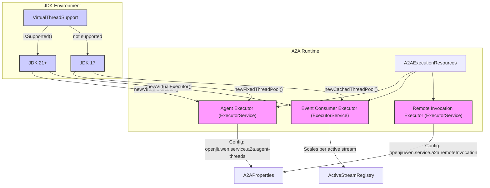
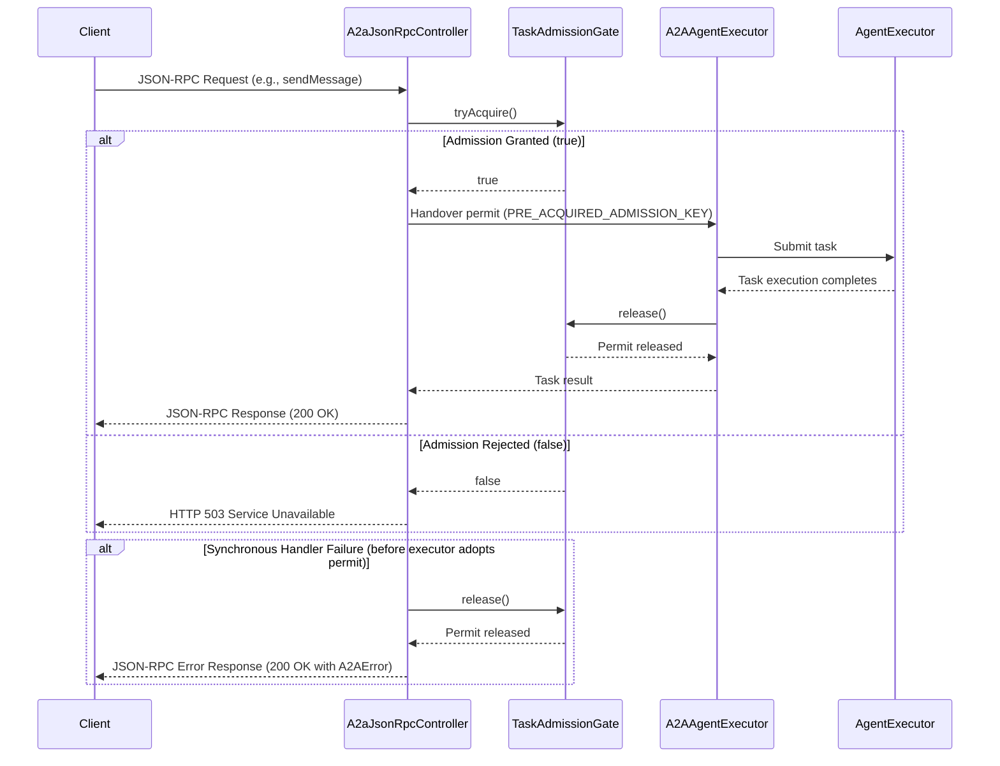

<!-- source: DeepWiki mcp.deepwiki.com · repo openJiuwen-ai/agent-runtime-java · page 4.3 Concurrency, Thread Pools and Admission · fetched 2026-11-02 -->

# Concurrency, Thread Pools and Admission

<details>
<summary>Relevant source files</summary>

The following files were used as context for generating this wiki page:

- [service/agent-service-adapters/agent-service-adapters-agentcore/src/test/java/com/openjiuwen/service/adapters/agentcore/agentfw/JiuwenCoreAgentHandlerProtectedMethodTest.java](service/agent-service-adapters/agent-service-adapters-agentcore/src/test/java/com/openjiuwen/service/adapters/agentcore/agentfw/JiuwenCoreAgentHandlerProtectedMethodTest.java)
- [service/agent-service-adapters/agent-service-adapters-common/src/main/java/com/openjiuwen/service/adapters/common/concurrent/VirtualThreadSupport.java](service/agent-service-adapters/agent-service-adapters-common/src/main/java/com/openjiuwen/service/adapters/common/concurrent/VirtualThreadSupport.java)
- [service/agent-service-adapters/agent-service-adapters-common/src/main/java/com/openjiuwen/service/adapters/common/external/ExternalCallExecutor.java](service/agent-service-adapters/agent-service-adapters-common/src/main/java/com/openjiuwen/service/adapters/common/external/ExternalCallExecutor.java)
- [service/agent-service-adapters/agent-service-adapters-common/src/test/java/com/openjiuwen/service/adapters/common/concurrent/VirtualThreadSupportTest.java](service/agent-service-adapters/agent-service-adapters-common/src/test/java/com/openjiuwen/service/adapters/common/concurrent/VirtualThreadSupportTest.java)
- [service/agent-service-app/src/main/java/com/openjiuwen/service/app/autoconfigure/A2AAutoConfiguration.java](service/agent-service-app/src/main/java/com/openjiuwen/service/app/autoconfigure/A2AAutoConfiguration.java)
- [service/agent-service-app/src/main/java/com/openjiuwen/service/app/config/A2AProperties.java](service/agent-service-app/src/main/java/com/openjiuwen/service/app/config/A2AProperties.java)
- [service/agent-service-app/src/main/java/com/openjiuwen/service/app/controller/probe/ActiveTaskController.java](service/agent-service-app/src/main/java/com/openjiuwen/service/app/controller/probe/ActiveTaskController.java)
- [service/agent-service-app/src/main/java/com/openjiuwen/service/app/controller/query/QuerySsePumpExecutor.java](service/agent-service-app/src/main/java/com/openjiuwen/service/app/controller/query/QuerySsePumpExecutor.java)
- [service/agent-service-app/src/test/java/com/openjiuwen/service/app/autoconfigure/A2AExecutionResourcesCapacityTest.java](service/agent-service-app/src/test/java/com/openjiuwen/service/app/autoconfigure/A2AExecutionResourcesCapacityTest.java)
- [service/agent-service-app/src/test/java/com/openjiuwen/service/app/controller/a2a/A2aJsonRpcControllerAdmissionTest.java](service/agent-service-app/src/test/java/com/openjiuwen/service/app/controller/a2a/A2aJsonRpcControllerAdmissionTest.java)
- [service/agent-service-app/src/test/java/com/openjiuwen/service/app/controller/probe/ActiveTaskControllerTest.java](service/agent-service-app/src/test/java/com/openjiuwen/service/app/controller/probe/ActiveTaskControllerTest.java)
- [service/agent-service-app/src/test/java/com/openjiuwen/service/app/controller/query/QuerySsePumpExecutorTest.java](service/agent-service-app/src/test/java/com/openjiuwen/service/app/controller/query/QuerySsePumpExecutorTest.java)
- [service/agent-service-app/src/test/java/com/openjiuwen/service/app/it/ActiveTaskQueryDegradedIntegrationTest.java](service/agent-service-app/src/test/java/com/openjiuwen/service/app/it/ActiveTaskQueryDegradedIntegrationTest.java)
- [service/agent-service-app/src/test/java/com/openjiuwen/service/app/it/ActiveTaskQueryIntegrationTest.java](service/agent-service-app/src/test/java/com/openjiuwen/service/app/it/ActiveTaskQueryIntegrationTest.java)
- [service/agent-service-app/src/test/java/com/openjiuwen/service/app/it/ConcurrencyAdmissionIntegrationTest.java](service/agent-service-app/src/test/java/com/openjiuwen/service/app/it/ConcurrencyAdmissionIntegrationTest.java)
- [service/agent-service-spec/src/main/java/com/openjiuwen/service/spec/concurrency/ActiveTaskQuery.java](service/agent-service-spec/src/main/java/com/openjiuwen/service/spec/concurrency/ActiveTaskQuery.java)
- [service/agent-service-spec/src/main/java/com/openjiuwen/service/spec/concurrency/TaskAdmissionListener.java](service/agent-service-spec/src/main/java/com/openjiuwen/service/spec/concurrency/TaskAdmissionListener.java)

</details>


This page details the concurrency model, thread pool configurations, and admission control mechanisms within the `agent-runtime-java` codebase. It covers key components like `A2AExecutionResources`, `VirtualThreadSupport`, `QuerySsePumpExecutor`, `TaskAdmissionGate`, `TaskAdmissionListener`, and `ActiveTaskQuery`, explaining their roles in managing task execution and system load.

## A2AExecutionResources

The `A2AExecutionResources` class [service/agent-service-app/src/main/java/com/openjiuwen/service/app/autoconfigure/A2AAutoConfiguration.java:600-600]() is a central component for managing the `Executor` instances used by the A2A runtime. It provides dedicated thread pools for different types of tasks, ensuring proper resource isolation and preventing resource exhaustion.

The primary executors managed by `A2AExecutionResources` are:
*   **Agent Executor**: Used for executing agent tasks. Its size is configurable via `openjiuwen.service.a2a.agent-threads` [service/agent-service-app/src/main/java/com/openjiuwen/service/app/config/A2AProperties.java:104-104](). If not specified, it defaults to `max(40, availableProcessors * 8)` [service/agent-service-app/src/test/java/com/openjiuwen/service/app/autoconfigure/A2AExecutionResourcesCapacityTest.java:51-51].
*   **Event Consumer Executor**: Handles the processing of events from the `MainEventBus`.
*   **Remote Invocation Executor**: Manages concurrent remote agent calls.

### Virtual Thread Support

`A2AExecutionResources` leverages `VirtualThreadSupport` [service/agent-service-app/src/main/java/com/openjiuwen/service/app/autoconfigure/A2AAutoConfiguration.java:600-600]() to dynamically adapt its thread pool strategy based on JDK version.

*   **JDK 21+ (Virtual Threads)**: If `VirtualThreadSupport.isSupported()` [service/agent-service-adapters/agent-service-adapters-common/src/main/java/com/openjiuwen/service/adapters/common/concurrent/VirtualThreadSupport.java:29-29]() returns `true`, the agent executor and event consumer executor are backed by virtual threads. In this scenario, the `agentConcurrencyCapacity()` [service/agent-service-app/src/test/java/com/openjiuwen/service/app/autoconfigure/A2AExecutionResourcesCapacityTest.java:111-112]() effectively becomes `Integer.MAX_VALUE`, as virtual threads do not have a fixed pool size. This allows for a very high number of concurrent I/O-bound tasks without exhausting platform threads.
*   **JDK 17 (Platform Threads)**: If virtual threads are not supported, traditional `ThreadPoolExecutor` instances are used. The `agent-threads` configuration directly controls the maximum pool size for the agent executor.

#### `VirtualThreadSupport`

The `VirtualThreadSupport` class [service/agent-service-adapters/agent-service-adapters-common/src/main/java/com/openjiuwen/service/adapters/common/concurrent/VirtualThreadSupport.java:19-19]() provides utility methods for creating virtual thread-backed executors.

```java
// service/agent-service-adapters/agent-service-adapters-common/src/main/java/com/openjiuwen/service/adapters/common/concurrent/VirtualThreadSupport.java
public final class VirtualThreadSupport {
    // ...
    public static boolean isSupported() {
        return IS_VIRTUAL_THREAD_SUPPORTED;
    }

    public static ExecutorService newVirtualExecutor(String namePrefix, Thread.UncaughtExceptionHandler handler) {
        // ...
    }
    // ...
}
```
The `isSupported()` method [service/agent-service-adapters/agent-service-adapters-common/src/main/java/com/openjiuwen/service/adapters/common/concurrent/VirtualThreadSupport.java:29-29]() checks for the availability of virtual threads. `newVirtualExecutor()` [service/agent-service-adapters/agent-service-adapters-common/src/main/java/com/openjiuwen/service/adapters/common/concurrent/VirtualThreadSupport.java:33-33]() creates an `ExecutorService` that uses virtual threads, with a customizable name prefix and uncaught exception handler.

### Diagram: A2AExecutionResources and VirtualThreadSupport


Sources:
* `service/agent-service-app/src/main/java/com/openjiuwen/service/app/autoconfigure/A2AAutoConfiguration.java`
* `service/agent-service-app/src/main/java/com/openjiuwen/service/app/config/A2AProperties.java`
* `service/agent-service-app/src/test/java/com/openjiuwen/service/app/autoconfigure/A2AExecutionResourcesCapacityTest.java`
* `service/agent-service-adapters/agent-service-adapters-common/src/main/java/com/openjiuwen/service/adapters/common/concurrent/VirtualThreadSupport.java`

## QuerySsePumpExecutor

The `QuerySsePumpExecutor` [service/agent-service-app/src/main/java/com/openjiuwen/service/app/controller/query/QuerySsePumpExecutor.java:38-38]() is a specialized `ExecutorService` dedicated to pumping agent stream chunks to Server-Sent Events (SSE) emitters. This executor is crucial for handling streaming responses efficiently.

Similar to `A2AExecutionResources`, `QuerySsePumpExecutor` adapts its implementation based on `VirtualThreadSupport`:

*   **JDK 21+ (Virtual Threads)**: Each active SSE connection runs on its own virtual thread. This eliminates the need for executor-level concurrency or queue limits, as virtual threads are lightweight and numerous. The executor is created using `VirtualThreadSupport.newVirtualExecutor()` [service/agent-service-app/src/main/java/com/openjiuwen/service/app/controller/query/QuerySsePumpExecutor.java:108-111]().
*   **JDK 17 (Platform Threads)**: A bounded platform thread pool is used. The default size is `max(40, CPU * 8)` worker threads, with an `ArrayBlockingQueue` of default capacity 128 [service/agent-service-app/src/main/java/com/openjiuwen/service/app/controller/query/QuerySsePumpExecutor.java:45-48](). If this pool is saturated, `execute()` [service/agent-service-app/src/main/java/com/openjiuwen/service/app/controller/query/QuerySsePumpExecutor.java:71-73]() throws a `RejectedExecutionException`, leading to an HTTP 503 error.

Configuration for JDK 17 can be adjusted via system properties or environment variables:
*   `openjiuwen.service.query.sse-pump.max-size` / `OPENJIUWEN_SERVICE_QUERY_SSE_PUMP_MAX_SIZE`
*   `openjiuwen.service.query.sse-pump.queue-size` / `OPENJIUWEN_SERVICE_QUERY_SSE_PUMP_QUEUE_SIZE`

Sources:
* `service/agent-service-app/src/main/java/com/openjiuwen/service/app/controller/query/QuerySsePumpExecutor.java`
* `service/agent-service-app/src/test/java/com/openjiuwen/service/app/controller/query/QuerySsePumpExecutorTest.java`
* `service/agent-service-adapters/agent-service-adapters-common/src/main/java/com/openjiuwen/service/adapters/common/concurrent/VirtualThreadSupport.java`

## Task Admission Gate and Listener

The system implements an admission control mechanism to prevent overload, primarily through `TaskAdmissionGate` [service/agent-service-spec/src/main/java/com/openjiuwen/service/spec/concurrency/TaskAdmissionGate.java:19-19]() and `TaskAdmissionListener` [service/agent-service-spec/src/main/java/com/openjiuwen/service/spec/concurrency/TaskAdmissionListener.java:19-19]().

### `TaskAdmissionGate`

The `TaskAdmissionGate` interface [service/agent-service-spec/src/main/java/com/openjiuwen/service/spec/concurrency/TaskAdmissionGate.java:19-19]() defines the contract for acquiring and releasing permits for concurrent tasks.

```java
// service/agent-service-spec/src/main/java/com/openjiuwen/service/spec/concurrency/TaskAdmissionGate.java
public interface TaskAdmissionGate {
    boolean tryAcquire();
    void release();
    int limit();
    int current();
}
```
*   `tryAcquire()`: Attempts to acquire a permit. Returns `true` if successful, `false` otherwise.
*   `release()`: Releases a previously acquired permit.
*   `limit()`: Returns the maximum number of concurrent tasks allowed.
*   `current()`: Returns the current number of active tasks.

The `A2aJsonRpcController` [service/agent-service-app/src/test/java/com/openjiuwen/service/app/controller/a2a/A2aJsonRpcControllerAdmissionTest.java:45-45]() uses `TaskAdmissionGate` to control the admission of incoming A2A requests.
*   When a request arrives, `tryAcquire()` is called [service/agent-service-app/src/test/java/com/openjiuwen/service/app/controller/a2a/A2aJsonRpcControllerAdmissionTest.java:80-80]().
*   If admission is rejected, an HTTP 503 response is returned [service/agent-service-app/src/test/java/com/openjiuwen/service/app/controller/a2a/A2aJsonRpcControllerAdmissionTest.java:53-53]().
*   If admitted, a permit is marked for handover to the `A2AAgentExecutor` [service/agent-service-app/src/test/java/com/openjiuwen/service/app/controller/a2a/A2aJsonRpcControllerAdmissionTest.java:88-89]().
*   If a synchronous failure occurs before the executor adopts the permit, the controller releases it [service/agent-service-app/src/test/java/com/openjiuwen/service/app/controller/a2a/A2aJsonRpcControllerAdmissionTest.java:128-128]().

The `A2AAutoConfiguration` [service/agent-service-app/src/main/java/com/openjiuwen/service/app/autoconfigure/A2AAutoConfiguration.java:102-103]() can optionally inject a `TaskAdmissionGate` bean. If the admission limit exceeds the configured `agent-threads` capacity (on platform thread environments), the application startup will fail [service/agent-service-app/src/test/java/com/openjiuwen/service/app/autoconfigure/A2AExecutionResourcesCapacityTest.java:80-89]().

### `TaskAdmissionListener`

The `TaskAdmissionListener` interface [service/agent-service-spec/src/main/java/com/openjiuwen/service/spec/concurrency/TaskAdmissionListener.java:19-19]() allows components to react to changes in the admission state.

```java
// service/agent-service-spec/src/main/java/com/openjiuwen/service/spec/concurrency/TaskAdmissionListener.java
public interface TaskAdmissionListener {
    void onAdmissionGranted(String taskId, String conversationId);
    void onAdmissionReleased(String taskId, String conversationId);
}
```
Implementations of this interface can perform actions such as logging, metrics collection, or updating internal state when a task is admitted or released.

### Diagram: Task Admission Flow


Sources:
* `service/agent-service-spec/src/main/java/com/openjiuwen/service/spec/concurrency/TaskAdmissionGate.java`
* `service/agent-service-spec/src/main/java/com/openjiuwen/service/spec/concurrency/TaskAdmissionListener.java`
* `service/agent-service-app/src/test/java/com/openjiuwen/service/app/controller/a2a/A2aJsonRpcControllerAdmissionTest.java`
* `service/agent-service-app/src/main/java/com/openjiuwen/service/app/autoconfigure/A2AAutoConfiguration.java`
* `service/agent-service-app/src/test/java/com/openjiuwen/service/app/autoconfigure/A2AExecutionResourcesCapacityTest.java`

## ActiveTaskQuery

The `ActiveTaskQuery` interface [service/agent-service-spec/src/main/java/com/openjiuwen/service/spec/concurrency/ActiveTaskQuery.java:18-18]() provides a way to query the current concurrency load and active tasks within the system. This is primarily used for diagnostic and monitoring purposes, exposed via the `/v1/current_active_tasks` endpoint [service/agent-service-app/src/main/java/com/openjiuwen/service/app/controller/probe/ActiveTaskController.java:61-62]().

```java
// service/agent-service-spec/src/main/java/com/openjiuwen/service/spec/concurrency/ActiveTaskQuery.java
public interface ActiveTaskQuery {
    ConcurrencyLoadSnapshot snapshot();
    Optional<ConcurrencyLoadSnapshot> snapshot(String agentId);
}
```
*   `snapshot()`: Returns a `ConcurrencyLoadSnapshot` for the entire process, including the configured maximum concurrent tasks, current active count, and a list of `ActiveTaskInfo` objects.
*   `snapshot(String agentId)`: Returns an optional `ConcurrencyLoadSnapshot` filtered for a specific hosted agent. If per-agent querying is not supported or the agent is not found, it returns `Optional.empty()`.

The `ActiveTaskController` [service/agent-service-app/src/main/java/com/openjiuwen/service/app/controller/probe/ActiveTaskController.java:33-34]() uses `ObjectProvider<ActiveTaskQuery>` to conditionally provide this functionality.
*   If an `ActiveTaskQuery` bean is present (typically from an "ext" module like `TaskQuotaTracker`), it returns a real snapshot [service/agent-service-app/src/test/java/com/openjiuwen/service/app/controller/probe/ActiveTaskControllerTest.java:31-47]().
*   If no `ActiveTaskQuery` bean is available, it returns a degraded response with zero active tasks and a `maxConcurrentTasks` of -1 (unlimited) [service/agent-service-app/src/main/java/com/openjiuwen/service/app/controller/probe/ActiveTaskController.java:72-73]().

Sources:
* `service/agent-service-spec/src/main/java/com/openjiuwen/service/spec/concurrency/ActiveTaskQuery.java`
* `service/agent-service-app/src/main/java/com/openjiuwen/service/app/controller/probe/ActiveTaskController.java`
* `service/agent-service-app/src/test/java/com/openjiuwen/service/app/controller/probe/ActiveTaskControllerTest.java`
* `service/agent-service-app/src/test/java/com/openjiuwen/service/app/it/ActiveTaskQueryDegradedIntegrationTest.java`
* `service/agent-service-app/src/test/java/com/openjiuwen/service/app/it/ActiveTaskQueryIntegrationTest.java`

---

