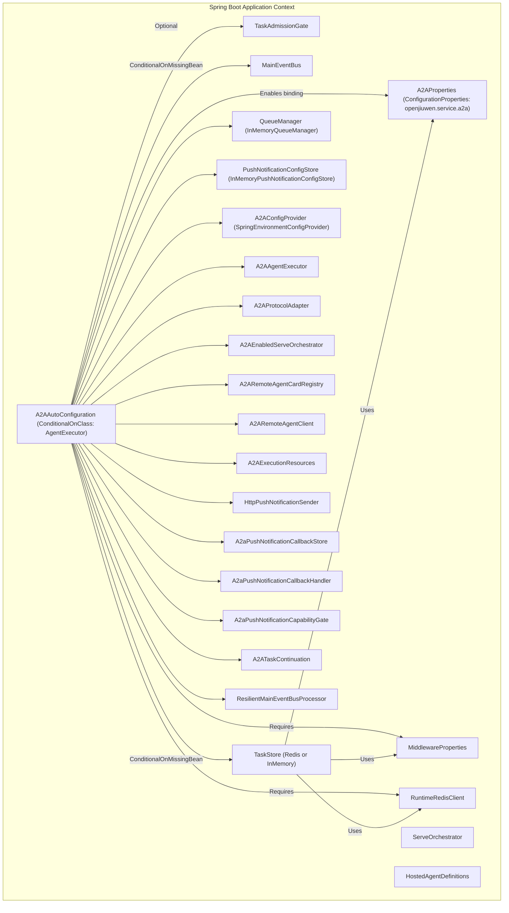
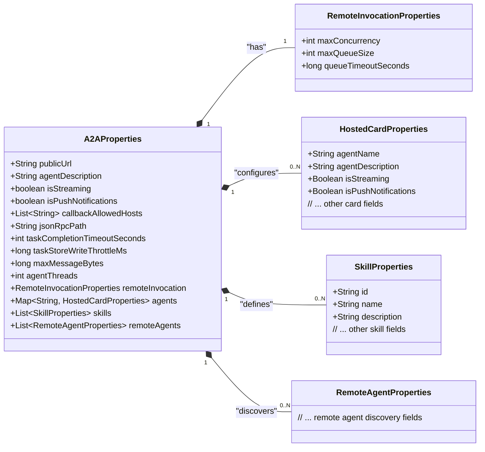
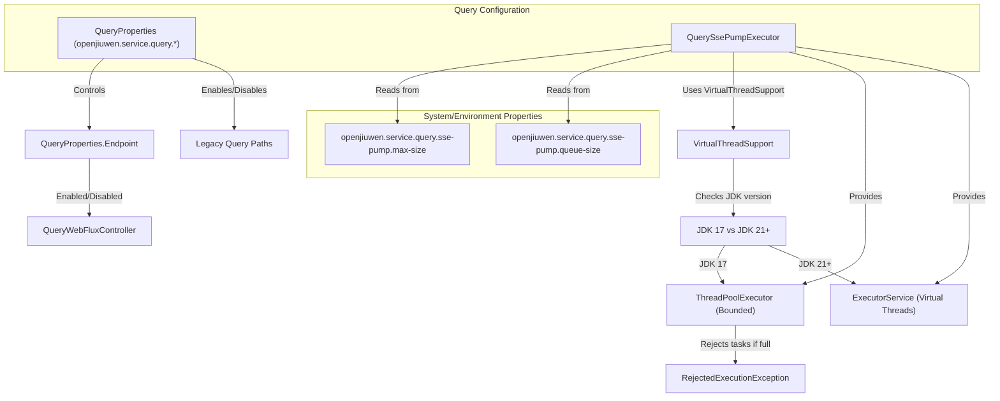

<!-- source: DeepWiki mcp.deepwiki.com · repo openJiuwen-ai/agent-runtime-java · page 4.4 Auto-Configuration and Properties · fetched 2026-11-02 -->

# Auto-Configuration and Properties

Relevant source files

The following files were used as context for generating this wiki page:

- [service/agent-service-adapters/agent-service-adapters-common/src/main/java/com/openjiuwen/service/adapters/common/concurrent/VirtualThreadSupport.java](service/agent-service-adapters/agent-service-adapters-common/src/main/java/com/openjiuwen/service/adapters/common/concurrent/VirtualThreadSupport.java)
- [service/agent-service-adapters/agent-service-adapters-common/src/main/java/com/openjiuwen/service/adapters/common/external/ExternalCallExecutor.java](service/agent-service-adapters/agent-service-adapters-common/src/main/java/com/openjiuwen/service/adapters/common/external/ExternalCallExecutor.java)
- [service/agent-service-adapters/agent-service-adapters-common/src/test/java/com/openjiuwen/service/adapters/common/concurrent/VirtualThreadSupportTest.java](service/agent-service-adapters/agent-service-adapters-common/src/test/java/com/openjiuwen/service/adapters/common/concurrent/VirtualThreadSupportTest.java)
- [service/agent-service-app/src/main/java/com/openjiuwen/service/app/autoconfigure/A2AAutoConfiguration.java](service/agent-service-app/src/main/java/com/openjiuwen/service/app/autoconfigure/A2AAutoConfiguration.java)
- [service/agent-service-app/src/main/java/com/openjiuwen/service/app/config/A2AProperties.java](service/agent-service-app/src/main/java/com/openjiuwen/service/app/config/A2AProperties.java)
- [service/agent-service-app/src/main/java/com/openjiuwen/service/app/config/LifecycleProperties.java](service/agent-service-app/src/main/java/com/openjiuwen/service/app/config/LifecycleProperties.java)
- [service/agent-service-app/src/main/java/com/openjiuwen/service/app/config/QueryProperties.java](service/agent-service-app/src/main/java/com/openjiuwen/service/app/config/QueryProperties.java)
- [service/agent-service-app/src/main/java/com/openjiuwen/service/app/config/ServiceProperties.java](service/agent-service-app/src/main/java/com/openjiuwen/service/app/config/ServiceProperties.java)
- [service/agent-service-app/src/main/java/com/openjiuwen/service/app/controller/query/QuerySsePumpExecutor.java](service/agent-service-app/src/main/java/com/openjiuwen/service/app/controller/query/QuerySsePumpExecutor.java)
- [service/agent-service-app/src/main/resources/META-INF/spring/org.springframework.boot.autoconfigure.AutoConfiguration.imports](service/agent-service-app/src/main/resources/META-INF/spring/org.springframework.boot.autoconfigure.AutoConfiguration.imports)
- [service/agent-service-app/src/test/java/com/openjiuwen/service/app/autoconfigure/A2AExecutionResourcesCapacityTest.java](service/agent-service-app/src/test/java/com/openjiuwen/service/app/autoconfigure/A2AExecutionResourcesCapacityTest.java)
- [service/agent-service-app/src/test/java/com/openjiuwen/service/app/controller/query/QuerySsePumpExecutorTest.java](service/agent-service-app/src/test/java/com/openjiuwen/service/app/controller/query/QuerySsePumpExecutorTest.java)
- [service/agent-service-spec/src/main/java/com/openjiuwen/service/spec/dto/HealthResponse.java](service/agent-service-spec/src/main/java/com/openjiuwen/service/spec/dto/HealthResponse.java)
- [service/agent-service-spec/src/main/java/com/openjiuwen/service/spec/dto/QueryRequest.java](service/agent-service-spec/src/main/java/com/openjiuwen/service/spec/dto/QueryRequest.java)
- [service/agent-service-spec/src/main/java/com/openjiuwen/service/spec/dto/QueryResponse.java](service/agent-service-spec/src/main/java/com/openjiuwen/service/spec/dto/QueryResponse.java)
- [service/agent-service-spec/src/main/java/com/openjiuwen/service/spec/dto/ResetConversationRequest.java](service/agent-service-spec/src/main/java/com/openjiuwen/service/spec/dto/ResetConversationRequest.java)
- [service/agent-service-spec/src/main/java/com/openjiuwen/service/spec/dto/ResetConversationResponse.java](service/agent-service-spec/src/main/java/com/openjiuwen/service/spec/dto/ResetConversationResponse.java)

This page details the Spring auto-configuration mechanisms and property classes used within the `agent-runtime-java` codebase. It covers how various components are automatically configured, the properties that control their behavior, and the relationship between these configurations and the overall system.

## Spring Auto-Configuration Imports

The `agent-runtime-java` project leverages Spring Boot's auto-configuration feature to simplify the setup and deployment of its services. Auto-configuration classes are registered via the `META-INF/spring/org.springframework.boot.autoconfigure.AutoConfiguration.imports` file. This file lists the fully qualified names of auto-configuration classes that Spring Boot should consider during application startup.

For this project, the primary auto-configuration classes are `A2AAutoConfiguration` and `HostedRuntimeAutoConfiguration`.

Sources:
- [service/agent-service-app/src/main/resources/META-INF/spring/org.springframework.boot.autoconfigure.AutoConfiguration.imports]()

## A2AAutoConfiguration

The `A2AAutoConfiguration` class [service/agent-service-app/src/main/java/com/openjiuwen/service/app/autoconfigure/A2AAutoConfiguration.java:89]() is responsible for automatically configuring beans related to the A2A (Agent-to-Agent) protocol server and client. This auto-configuration is activated only when `org.a2aproject.sdk.server.agentexecution.AgentExecutor` is present on the classpath [service/agent-service-app/src/main/java/com/openjiuwen/service/app/autoconfigure/A2AAutoConfiguration.java:90](). It also runs after `AgentServiceAutoConfiguration` and `RedisMiddlewareAutoConfiguration` [service/agent-service-app/src/main/java/com/openjiuwen/service/app/autoconfigure/A2AAutoConfiguration.java:89](), ensuring that foundational services are already configured.

This class enables the binding of properties defined in `A2AProperties` [service/agent-service-app/src/main/java/com/openjiuwen/service/app/autoconfigure/A2AAutoConfiguration.java:91]().

Key beans configured by `A2AAutoConfiguration` include:
*   **`MainEventBus`**: The SDK's main event bus, created if no other `MainEventBus` or `HostedAgentDefinitions` bean is present [service/agent-service-app/src/main/java/com/openjiuwen/service/app/autoconfigure/A2AAutoConfiguration.java:110-113]().
*   **`TaskStore`**: Configures a task store, defaulting to an in-memory store or using Redis if `MiddlewareProperties` and `RuntimeRedisClient` are available and configured for Redis [service/agent-service-app/src/main/java/com/openjiuwen/service/app/autoconfigure/A2AAutoConfiguration.java:124-132]().
*   **`QueueManager`**: Manages task queues, defaulting to `InMemoryQueueManager` [service/agent-service-app/src/main/java/com/openjiuwen/service/app/autoconfigure/A2AAutoConfiguration.java:139-142]().
*   **`PushNotificationConfigStore`**: Configures a push notification configuration store, defaulting to `InMemoryPushNotificationConfigStore` [service/agent-service-app/src/main/java/com/openjiuwen/service/app/autoconfigure/A2AAutoConfiguration.java:149-152]().
*   **`A2AConfigProvider`**: Provides A2A configuration, using `SpringEnvironmentConfigProvider` [service/agent-service-app/src/main/java/com/openjiuwen/service/app/autoconfigure/A2AAutoConfiguration.java:159-162]().
*   **`A2AAgentExecutor`**: The core A2A agent executor [service/agent-service-app/src/main/java/com/openjiuwen/service/app/autoconfigure/A2AAutoConfiguration.java:169-172]().
*   **`A2AProtocolAdapter`**: Adapts A2A requests [service/agent-service-app/src/main/java/com/openjiuwen/service/app/autoconfigure/A2AAutoConfiguration.java:179-182]().
*   **`ServeOrchestrator`**: Configures `A2AEnabledServeOrchestrator` for serving requests [service/agent-service-app/src/main/java/com/openjiuwen/service/app/autoconfigure/A2AAutoConfiguration.java:189-192]().
*   **`A2ARemoteAgentCardRegistry`**: Manages remote agent cards [service/agent-service-app/src/main/java/com/openjiuwen/service/app/autoconfigure/A2AAutoConfiguration.java:200-203]().
*   **`A2ARemoteAgentClient`**: Client for remote A2A agents [service/agent-service-app/src/main/java/com/openjiuwen/service/app/autoconfigure/A2AAutoConfiguration.java:210-213]().
*   **`A2AExecutionResources`**: Manages execution resources for A2A tasks, including thread pools [service/agent-service-app/src/main/java/com/openjiuwen/service/app/autoconfigure/A2AAutoConfiguration.java:220-223]().
*   **`HttpPushNotificationSender`**: Sends HTTP push notifications [service/agent-service-app/src/main/java/com/openjiuwen/service/app/autoconfigure/A2AAutoConfiguration.java:230-233]().
*   **`A2aPushNotificationCallbackStore`**: Stores push notification callbacks [service/agent-service-app/src/main/java/com/openjiuwen/service/app/autoconfigure/A2AAutoConfiguration.java:240-243]().
*   **`A2aPushNotificationCallbackHandler`**: Handles push notification callbacks [service/agent-service-app/src/main/java/com/openjiuwen/service/app/autoconfigure/A2AAutoConfiguration.java:250-253]().
*   **`A2aPushNotificationCapabilityGate`**: Gates push notification capabilities [service/agent-service-app/src/main/java/com/openjiuwen/service/app/autoconfigure/A2AAutoConfiguration.java:260-263]().
*   **`A2ATaskContinuation`**: Manages task continuations [service/agent-service-app/src/main/java/com/openjiuwen/service/app/autoconfigure/A2AAutoConfiguration.java:270-273]().
*   **`ResilientMainEventBusProcessor`**: Processes events from the main event bus resiliently [service/agent-service-app/src/main/java/com/openjiuwen/service/app/autoconfigure/A2AAutoConfiguration.java:280-283]().

**Diagram: A2AAutoConfiguration Bean Creation Flow**

Sources:
- [service/agent-service-app/src/main/java/com/openjiuwen/service/app/autoconfigure/A2AAutoConfiguration.java:89-283]()

## HostedRuntimeAutoConfiguration

(This section is not explicitly detailed in the provided code snippets, but its existence is implied by `A2AAutoConfiguration`'s `after` attribute. It would typically configure components specific to hosting multiple agent runtimes.)

## A2AProperties

The `A2AProperties` class [service/agent-service-app/src/main/java/com/openjiuwen/service/app/config/A2AProperties.java:29]() binds configuration properties prefixed with `openjiuwen.service.a2a.*`. These properties control various aspects of the A2A server and client, including AgentCard content, remote agent discovery, JSON-RPC endpoints, and task management.

Key properties include:
*   **`publicUrl`**: Public base URL for AgentCard `supportedInterfaces[].url` [service/agent-service-app/src/main/java/com/openjiuwen/service/app/config/A2AProperties.java:35]().
*   **`agentDescription`**: Description of the agent service [service/agent-service-app/src/main/java/com/openjiuwen/service/app/config/A2AProperties.java:37]().
*   **`isStreaming`**: Whether streaming is enabled [service/agent-service-app/src/main/java/com/openjiuwen/service/app/config/A2AProperties.java:43]().
*   **`isPushNotifications`**: Whether push notifications are enabled [service/agent-service-app/src/main/java/com/openjiuwen/service/app/config/A2AProperties.java:45]().
*   **`callbackAllowedHosts`**: List of trusted callback hosts [service/agent-service-app/src/main/java/com/openjiuwen/service/app/config/A2AProperties.java:52]().
*   **`jsonRpcPath`**: The path for JSON-RPC endpoints, defaulting to `/a2a` [service/agent-service-app/src/main/java/com/openjiuwen/service/app/config/A2AProperties.java:71]().
*   **`taskCompletionTimeoutSeconds`**: Timeout for task completion [service/agent-service-app/src/main/java/com/openjiuwen/service/app/config/A2AProperties.java:73]().
*   **`taskStoreWriteThrottleMs`**: Minimum interval for durable writes of A2A task snapshots to Redis [service/agent-service-app/src/main/java/com/openjiuwen/service/app/config/A2AProperties.java:86]().
*   **`maxMessageBytes`**: Maximum JSON-RPC request body size for `/a2a` [service/agent-service-app/src/main/java/com/openjiuwen/service/app/config/A2AProperties.java:94]().
*   **`agentThreads`**: A2A platform agent execution pool size. A value of `0` means auto-sizing to `max(40, availableProcessors * 8)` [service/agent-service-app/src/main/java/com/openjiuwen/service/app/config/A2AProperties.java:104](). This setting is crucial for concurrency and admission control. If virtual threads are supported, this setting does not limit the per-task executor [service/agent-service-app/src/main/java/com/openjiuwen/service/app/config/A2AProperties.java:102-104]().
*   **`remoteInvocation`**: Nested properties for remote invocation concurrency and queueing [service/agent-service-app/src/main/java/com/openjiuwen/service/app/config/A2AProperties.java:106-116]().
*   **`agents`**: Card-only overrides for hosted agents, keyed by identifier [service/agent-service-app/src/main/java/com/openjiuwen/service/app/config/A2AProperties.java:69]().
*   **`skills`**: List of `SkillProperties` defining skills for the AgentCard [service/agent-service-app/src/main/java/com/openjiuwen/service/app/config/A2AProperties.java:64, 189]().
*   **`remoteAgents`**: List of `RemoteAgentProperties` for remote agent discovery [service/agent-service-app/src/main/java/com/openjiuwen/service/app/config/A2AProperties.java:66, 210]().

The `agentThreads` property directly influences the `A2AExecutionResources` [service/agent-service-app/src/test/java/com/openjiuwen/service/app/autoconfigure/A2AExecutionResourcesCapacityTest.java:39](). If virtual threads are not supported, the `agentConcurrencyCapacity` is determined by `agentThreads` or an auto-sized default [service/agent-service-app/src/test/java/com/openjiuwen/service/app/autoconfigure/A2AExecutionResourcesCapacityTest.java:56-63, 70-75](). Startup fails if the `TaskAdmissionGate` limit exceeds this capacity [service/agent-service-app/src/test/java/com/openjiuwen/service/app/autoconfigure/A2AExecutionResourcesCapacityTest.java:79-89](). With virtual threads, the capacity is effectively `Integer.MAX_VALUE` [service/agent-service-app/src/test/java/com/openjiuwen/service/app/autoconfigure/A2AExecutionResourcesCapacityTest.java:107-113]().

**Diagram: A2AProperties Structure**

Sources:
- [service/agent-service-app/src/main/java/com/openjiuwen/service/app/config/A2AProperties.java:28-210]()
- [service/agent-service-app/src/test/java/com/openjiuwen/service/app/autoconfigure/A2AExecutionResourcesCapacityTest.java:39-138]()

## ServiceProperties

The `ServiceProperties` class [service/agent-service-app/src/main/java/com/openjiuwen/service/app/config/ServiceProperties.java:17]() binds configuration properties prefixed with `openjiuwen.service.*`. These properties define general runtime settings for the agent service.

Key properties include:
*   **`agentId`**: The agent ID registered in `Runner.resourceMgr()` for the default `JiuwenCoreAgentHandler` [service/agent-service-app/src/main/java/com/openjiuwen/service/app/config/ServiceProperties.java:23]().
*   **`version`**: The version reported by the Agent Service health probe [service/agent-service-app/src/main/java/com/openjiuwen/service/app/config/ServiceProperties.java:28](). This version is used in the `HealthResponse` DTO [service/agent-service-spec/src/main/java/com/openjiuwen/service/spec/dto/HealthResponse.java:23]().

Sources:
- [service/agent-service-app/src/main/java/com/openjiuwen/service/app/config/ServiceProperties.java:17-29]()
- [service/agent-service-spec/src/main/java/com/openjiuwen/service/spec/dto/HealthResponse.java:23]()

## Query Properties

The `QueryProperties` class [service/agent-service-app/src/main/java/com/openjiuwen/service/app/config/QueryProperties.java:18]() binds configuration properties prefixed with `openjiuwen.service.query.*`. These properties control the behavior of the external Query API endpoints.

Key properties include:
*   **`webflux.enabled`**: A boolean flag to enable or disable the WebFlux query endpoint [service/agent-service-app/src/main/java/com/openjiuwen/service/app/config/QueryProperties.java:20, 30]().
*   **`legacyPathEnabled`**: A boolean flag to enable or disable legacy query paths [service/agent-service-app/src/main/java/com/openjiuwen/service/app/config/QueryProperties.java:22]().

The `QuerySsePumpExecutor` also uses system properties or environment variables to configure its thread pool size for JDK 17 environments:
*   `openjiuwen.service.query.sse-pump.max-size` / `OPENJIUWEN_SERVICE_QUERY_SSE_PUMP_MAX_SIZE` [service/agent-service-app/src/main/java/com/openjiuwen/service/app/controller/query/QuerySsePumpExecutor.java:31, 41]().
*   `openjiuwen.service.query.sse-pump.queue-size` / `OPENJIUWEN_SERVICE_QUERY_SSE_PUMP_QUEUE_SIZE` [service/agent-service-app/src/main/java/com/openjiuwen/service/app/controller/query/QuerySsePumpExecutor.java:32, 43]().

These properties determine the maximum worker threads and the bounded overflow queue capacity for pumping agent stream chunks to `SseEmitter` [service/agent-service-app/src/main/java/com/openjiuwen/service/app/controller/query/QuerySsePumpExecutor.java:20-26](). If virtual threads are supported (JDK 21+), a virtual thread executor is used, and these properties do not apply [service/agent-service-app/src/main/java/com/openjiuwen/service/app/controller/query/QuerySsePumpExecutor.java:107-111]().

**Diagram: Query Configuration and SSE Pump Executor**

Sources:
- [service/agent-service-app/src/main/java/com/openjiuwen/service/app/config/QueryProperties.java:18-32]()
- [service/agent-service-app/src/main/java/com/openjiuwen/service/app/controller/query/QuerySsePumpExecutor.java:20-135]()
- [service/agent-service-app/src/test/java/com/openjiuwen/service/app/controller/query/QuerySsePumpExecutorTest.java:34-65]()
- [service/agent-service-adapters/agent-service-adapters-common/src/main/java/com/openjiuwen/service/adapters/common/concurrent/VirtualThreadSupport.java:33-35]()

## Lifecycle Properties

The `LifecycleProperties` class [service/agent-service-app/src/main/java/com/openjiuwen/service/app/config/LifecycleProperties.java]() (not fully shown in provided snippets, but its existence is implied by the naming convention) would typically bind configuration properties prefixed with `openjiuwen.service.lifecycle.*`. These properties would control aspects of the agent runtime's lifecycle, such as shutdown timeouts, initialization phases, or readiness checks.

Sources:
- [service/agent-service-app/src/main/java/com/openjiuwen/service/app/config/LifecycleProperties.java]()

---

