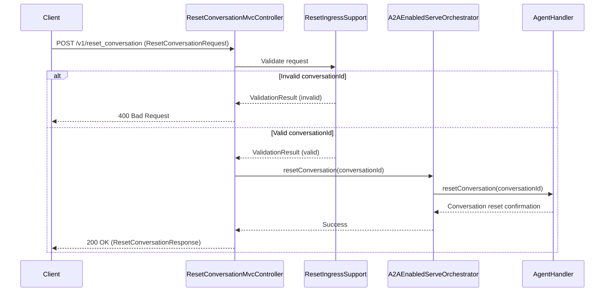
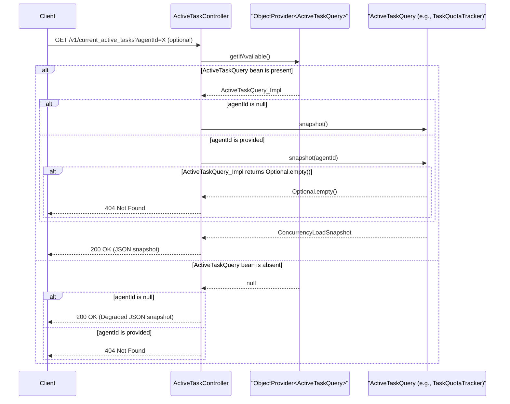

<!-- source: DeepWiki mcp.deepwiki.com · repo openJiuwen-ai/agent-runtime-java · page 5.2 Reset Conversation and Health Probes · fetched 2026-11-02 -->

# Reset Conversation and Health Probes

<details>
<summary>Relevant source files</summary>

The following files were used as context for generating this wiki page:

- [service/agent-service-adapters/agent-service-adapters-agentcore/src/test/java/com/openjiuwen/service/adapters/agentcore/agentfw/JiuwenCoreAgentHandlerProtectedMethodTest.java](service/agent-service-adapters/agent-service-adapters-agentcore/src/test/java/com/openjiuwen/service/adapters/agentcore/agentfw/JiuwenCoreAgentHandlerProtectedMethodTest.java)
- [service/agent-service-app/src/main/java/com/openjiuwen/service/app/controller/probe/ActiveTaskController.java](service/agent-service-app/src/main/java/com/openjiuwen/service/app/controller/probe/ActiveTaskController.java)
- [service/agent-service-app/src/main/java/com/openjiuwen/service/app/controller/probe/HealthController.java](service/agent-service-app/src/main/java/com/openjiuwen/service/app/controller/probe/HealthController.java)
- [service/agent-service-app/src/test/java/com/openjiuwen/service/app/controller/probe/ActiveTaskControllerTest.java](service/agent-service-app/src/test/java/com/openjiuwen/service/app/controller/probe/ActiveTaskControllerTest.java)
- [service/agent-service-app/src/test/java/com/openjiuwen/service/app/controller/reset/ResetIngressSupportTest.java](service/agent-service-app/src/test/java/com/openjiuwen/service/app/controller/reset/ResetIngressSupportTest.java)
- [service/agent-service-app/src/test/java/com/openjiuwen/service/app/it/ActiveTaskQueryDegradedIntegrationTest.java](service/agent-service-app/src/test/java/com/openjiuwen/service/app/it/ActiveTaskQueryDegradedIntegrationTest.java)
- [service/agent-service-app/src/test/java/com/openjiuwen/service/app/it/ActiveTaskQueryIntegrationTest.java](service/agent-service-app/src/test/java/com/openjiuwen/service/app/it/ActiveTaskQueryIntegrationTest.java)
- [service/agent-service-app/src/test/java/com/openjiuwen/service/probe/DefaultAgentReadinessIntegrationTest.java](service/agent-service-app/src/test/java/com/openjiuwen/service/probe/DefaultAgentReadinessIntegrationTest.java)
- [service/agent-service-app/src/test/java/com/openjiuwen/service/probe/HealthAutoConfigurationIntegrationTest.java](service/agent-service-app/src/test/java/com/openjiuwen/service/probe/HealthAutoConfigurationIntegrationTest.java)
- [service/agent-service-app/src/test/java/com/openjiuwen/service/probe/HealthControllerTest.java](service/agent-service-app/src/test/java/com/openjiuwen/service/probe/HealthControllerTest.java)
- [service/agent-service-spec/src/main/java/com/openjiuwen/service/spec/concurrency/ActiveTaskQuery.java](service/agent-service-spec/src/main/java/com/openjiuwen/service/spec/concurrency/ActiveTaskQuery.java)
- [service/agent-service-spec/src/test/java/com/openjiuwen/service/spec/dto/HealthResponseTest.java](service/agent-service-spec/src/test/java/com/openjiuwen/service/spec/dto/HealthResponseTest.java)
- [service/agent-service-spec/src/test/java/com/openjiuwen/service/spec/dto/ResetConversationResponseTest.java](service/agent-service-spec/src/test/java/com/openjiuwen/service/spec/dto/ResetConversationResponseTest.java)

</details>


This page details the implementation of the `/reset_conversation` endpoint, which allows for the termination of ongoing conversations, and the health and readiness probes (`/health`, `/v1/current_active_tasks`) that provide insights into the application's operational status and concurrency load. It covers the `ResetConversationMvcController`, `HealthController`, and `ActiveTaskController`, along with their supporting classes and ingress mechanisms.

## Reset Conversation Endpoint

The `ResetConversationMvcController` handles requests to reset a conversation. This is crucial for managing agent state and freeing up resources associated with a particular conversation.

### Implementation Details

The `ResetConversationMvcController` exposes two endpoints for resetting conversations: `/v1/reset_conversation` and a legacy endpoint `/reset_conversation` [service/agent-service-spec/src/test/java/com/openjiuwen/service/spec/dto/ResetConversationResponseTest.java:40-41](). Both endpoints accept a `ResetConversationRequest` which must contain a `conversationId`.

The `ResetIngressSupport` class is responsible for validating the incoming `ResetConversationRequest`. It ensures that the `conversationId` is present and not blank [service/agent-service-app/src/test/java/com/openjiuwen/service/app/controller/reset/ResetIngressSupportTest.java:31-38](). If the validation fails, it returns a `400 Bad Request` with an appropriate error message [service/agent-service-app/src/test/java/com/openjiuwen/service/app/controller/reset/ResetIngressSupportTest.java:42-45]().

Upon successful validation, the controller delegates the actual conversation reset logic to an `A2AEnabledServeOrchestrator` instance. The orchestrator's `resetConversation` method is invoked with the validated `conversationId`.

The response is a `ResetConversationResponse` indicating success or failure. A successful response will have a status of "ok" and a message confirming the conversation reset [service/agent-service-spec/src/test/java/com/openjiuwen/service/spec/dto/ResetConversationResponseTest.java:28-31]().

### Reset Conversation Flow


Sources:
- [service/agent-service-app/src/test/java/com/openjiuwen/service/app/controller/reset/ResetIngressSupportTest.java:31-38]()
- [service/agent-service-app/src/test/java/com/openjiuwen/service/app/controller/reset/ResetIngressSupportTest.java:42-45]()
- [service/agent-service-spec/src/test/java/com/openjiuwen/service/spec/dto/ResetConversationResponseTest.java:28-31]()
- [service/agent-service-spec/src/test/java/com/openjiuwen/service/spec/dto/ResetConversationResponseTest.java:40-41]()

## Health Probes

The application provides a health endpoint (`/health`) to report its operational status and readiness.

### HealthController

The `HealthController` exposes the `/health` endpoint [service/agent-service-app/src/main/java/com/openjiuwen/service/app/controller/probe/HealthController.java:47](). This endpoint returns a `HealthResponse` DTO [service/agent-service-app/src/main/java/com/openjiuwen/service/app/controller/probe/HealthController.java:48-49]() containing information about the application's health, including:
*   `status`: Always "healthy" if the endpoint is reachable [service/agent-service-app/src/main/java/com/openjiuwen/service/app/controller/probe/HealthController.java:26]().
*   `app`: The application name, defaulting to "agent-service" if not configured [service/agent-service-app/src/main/java/com/openjiuwen/service/app/controller/probe/HealthController.java:28,52-58]().
*   `version`: The application version, retrieved from `ServiceProperties` [service/agent-service-app/src/main/java/com/openjiuwen/service/app/controller/probe/HealthController.java:60-62]().
*   `process_up`: Indicates if the overall process is up, determined by `AgentReadiness.isProcessUp()` [service/agent-service-app/src/main/java/com/openjiuwen/service/app/controller/probe/HealthController.java:49]().
*   `agent_loaded`: Indicates if an agent handler has been successfully loaded, determined by `AgentReadiness.isAgentLoaded()` [service/agent-service-app/src/main/java/com/openjiuwen/service/app/controller/probe/HealthController.java:49]().

The `HealthController` is conditionally enabled for web applications via `@ConditionalOnWebApplication` [service/agent-service-app/src/main/java/com/openjiuwen/service/app/controller/probe/HealthController.java:23]().

### AgentReadiness

The `AgentReadiness` interface [service/agent-service-app/src/main/java/com/openjiuwen/service/app/controller/probe/HealthController.java:9]() provides methods to check the readiness state of the agent runtime.
*   `isProcessUp()`: Returns `true` if the Spring application context is fully initialized and the process is generally operational [service/agent-service-app/src/test/java/com/openjiuwen/service/probe/HealthControllerTest.java:38-40]().
*   `isAgentLoaded()`: Returns `true` if an `AgentHandler` bean is present, indicating that an agent is ready to process requests [service/agent-service-app/src/test/java/com/openjiuwen/service/probe/HealthControllerTest.java:42-44]().

The `DefaultAgentReadiness` implementation manages these states. For example, if no `AgentHandler` is present, `isAgentLoaded()` will return `false` [service/agent-service-app/src/test/java/com/openjiuwen/service/probe/DefaultAgentReadinessIntegrationTest.java:53-54](). If an `AgentHandler` is present, it returns `true` [service/agent-service-app/src/test/java/com/openjiuwen/service/probe/DefaultAgentReadinessIntegrationTest.java:74-75](). Importantly, the health probe does not invoke `query` or `streamQuery` methods on the `AgentHandler` to determine readiness [service/agent-service-app/src/test/java/com/openjiuwen/service/probe/DefaultAgentReadinessIntegrationTest.java:94-95,101-102]().

### Health Probe Data Flow

```mermaid
graph TD
    A[HTTP GET /health] --> B{HealthController}
    B --> C[AgentReadiness.isProcessUp()]
    B --> D[AgentReadiness.isAgentLoaded()]
    B --> E[AgentServiceIdentity.getAppName()]
    B --> F[ServiceProperties.getVersion()]
    C -- isProcessUp --> G[HealthResponse]
    D -- isAgentLoaded --> G
    E -- appName --> G
    F -- version --> G
    G --> H[JSON Response to Client]
```
Sources:
- [service/agent-service-app/src/main/java/com/openjiuwen/service/app/controller/probe/HealthController.java:9]()
- [service/agent-service-app/src/main/java/com/openjiuwen/service/app/controller/probe/HealthController.java:23]()
- [service/agent-service-app/src/main/java/com/openjiuwen/service/app/controller/probe/HealthController.java:26]()
- [service/agent-service-app/src/main/java/com/openjiuwen/service/app/controller/probe/HealthController.java:28,52-58]()
- [service/agent-service-app/src/main/java/com/openjiuwen/service/app/controller/probe/HealthController.java:47]()
- [service/agent-service-app/src/main/java/com/openjiuwen/service/app/controller/probe/HealthController.java:48-49]()
- [service/agent-service-app/src/main/java/com/openjiuwen/service/app/controller/probe/HealthController.java:60-62]()
- [service/agent-service-app/src/test/java/com/openjiuwen/service/probe/DefaultAgentReadinessIntegrationTest.java:53-54]()
- [service/agent-service-app/src/test/java/com/openjiuwen/service/probe/DefaultAgentReadinessIntegrationTest.java:74-75]()
- [service/agent-service-app/src/test/java/com/openjiuwen/service/probe/DefaultAgentReadinessIntegrationTest.java:94-95,101-102]()
- [service/agent-service-app/src/test/java/com/openjiuwen/service/probe/HealthControllerTest.java:38-40]()
- [service/agent-service-app/src/test/java/com/openjiuwen/service/probe/HealthControllerTest.java:42-44]()

## Active Task Controller

The `ActiveTaskController` provides an endpoint to query the current concurrency load and active tasks within the system. This is useful for monitoring and debugging.

### Implementation Details

The `ActiveTaskController` exposes the `/v1/current_active_tasks` endpoint [service/agent-service-app/src/main/java/com/openjiuwen/service/app/controller/probe/ActiveTaskController.java:61](). It can return a snapshot of all active tasks or filter them by a specific `agentId` using a request parameter [service/agent-service-app/src/main/java/com/openjiuwen/service/app/controller/probe/ActiveTaskController.java:63-64]().

The controller relies on an `ActiveTaskQuery` bean to retrieve the concurrency load snapshot [service/agent-service-app/src/main/java/com/openjiuwen/service/app/controller/probe/ActiveTaskController.java:35-36](). This bean is injected via `ObjectProvider<ActiveTaskQuery>` [service/agent-service-app/src/main/java/com/openjiuwen/service/app/controller/probe/ActiveTaskController.java:42](), allowing for graceful degradation if the `ActiveTaskQuery` bean is not available (e.g., if the `ext` module is not loaded) [service/agent-service-app/src/main/java/com/openjiuwen/service/app/controller/probe/ActiveTaskController.java:27-30]().

### Degraded Mode

If no `ActiveTaskQuery` bean is present, the controller returns a degraded response for the process-level query, indicating `-1` for `maxConcurrentTasks`, `0` for `currentActiveTasks`, and an empty list of tasks [service/agent-service-app/src/main/java/com/openjiuwen/service/app/controller/probe/ActiveTaskController.java:68-72,83-87](). For agent-specific queries in degraded mode, it returns a `404 Not Found` [service/agent-service-app/src/main/java/com/openjiuwen/service/app/controller/probe/ActiveTaskController.java:69-70]().

### ActiveTaskQuery Interface

The `ActiveTaskQuery` interface [service/agent-service-spec/src/main/java/com/openjiuwen/service/spec/concurrency/ActiveTaskQuery.java:18]() defines the contract for querying active tasks:
*   `snapshot()`: Returns a `ConcurrencyLoadSnapshot` for the entire process, including the configured maximum concurrent tasks, current active task count, and a list of `ActiveTaskInfo` objects [service/agent-service-spec/src/main/java/com/openjiuwen/service/spec/concurrency/ActiveTaskQuery.java:25-27]().
*   `snapshot(String agentId)`: Returns an `Optional<ConcurrencyLoadSnapshot>` for a specific hosted agent. The default implementation returns `Optional.empty()`, meaning per-agent querying is not available by default [service/agent-service-spec/src/main/java/com/openjiuwen/service/spec/concurrency/ActiveTaskQuery.java:39-41]().

### ConcurrencyLoadSnapshot and ActiveTaskInfo

*   `ConcurrencyLoadSnapshot`: Contains `maxConcurrentTasks`, `currentActiveTasks`, and a list of `ActiveTaskInfo` [service/agent-service-spec/src/main/java/com/openjiuwen/service/spec/concurrency/ActiveTaskQuery.java:25-27]().
*   `ActiveTaskInfo`: Represents a single active task with `taskId`, `conversationId`, `status`, and `startedAt` [service/agent-service-app/src/main/java/com/openjiuwen/service/app/controller/probe/ActiveTaskController.java:103-107]().

### Active Task Query Flow


Sources:
- [service/agent-service-app/src/main/java/com/openjiuwen/service/app/controller/probe/ActiveTaskController.java:27-30]()
- [service/agent-service-app/src/main/java/com/openjiuwen/service/app/controller/probe/ActiveTaskController.java:35-36]()
- [service/agent-service-app/src/main/java/com/openjiuwen/service/app/controller/probe/ActiveTaskController.java:42]()
- [service/agent-service-app/src/main/java/com/openjiuwen/service/app/controller/probe/ActiveTaskController.java:61]()
- [service/agent-service-app/src/main/java/com/openjiuwen/service/app/controller/probe/ActiveTaskController.java:63-64]()
- [service/agent-service-app/src/main/java/com/openjiuwen/service/app/controller/probe/ActiveTaskController.java:68-72,83-87]()
- [service/agent-service-app/src/main/java/com/openjiuwen/service/app/controller/probe/ActiveTaskController.java:69-70]()
- [service/agent-service-app/src/main/java/com/openjiuwen/service/app/controller/probe/ActiveTaskController.java:103-107]()
- [service/agent-service-spec/src/main/java/com/openjiuwen/service/spec/concurrency/ActiveTaskQuery.java:18]()
- [service/agent-service-spec/src/main/java/com/openjiuwen/service/spec/concurrency/ActiveTaskQuery.java:25-27]()
- [service/agent-service-spec/src/main/java/com/openjiuwen/service/spec/concurrency/ActiveTaskQuery.java:39-41]()

---

