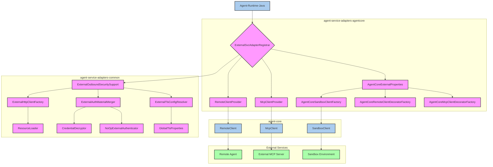

<!-- source: DeepWiki mcp.deepwiki.com · repo openJiuwen-ai/agent-runtime-java · page 6 Adapters Layer · fetched 2026-11-02 -->

# Adapters Layer

Relevant source files

The following files were used as context for generating this wiki page:

- [service/agent-service-adapters/agent-service-adapters-agentcore/src/main/java/com/openjiuwen/service/adapters/agentcore/autoconfigure/AgentCoreAdaptersAutoConfiguration.java](service/agent-service-adapters/agent-service-adapters-agentcore/src/main/java/com/openjiuwen/service/adapters/agentcore/autoconfigure/AgentCoreAdaptersAutoConfiguration.java)
- [service/agent-service-adapters/agent-service-adapters-agentcore/src/main/java/com/openjiuwen/service/adapters/agentcore/external/DefaultExternalSvcAdapterRegistrar.java](service/agent-service-adapters/agent-service-adapters-agentcore/src/main/java/com/openjiuwen/service/adapters/agentcore/external/DefaultExternalSvcAdapterRegistrar.java)
- [service/agent-service-adapters/agent-service-adapters-common/src/main/java/com/openjiuwen/service/adapters/common/security/ExternalOutboundSecuritySupport.java](service/agent-service-adapters/agent-service-adapters-common/src/main/java/com/openjiuwen/service/adapters/common/security/ExternalOutboundSecuritySupport.java)
- [service/agent-service-demo/example/outbound-security/src/main/java/com/openjiuwen/service/demo/example/outboundsecurity/MockOutboundSecureJiuwenBoxServer.java](service/agent-service-demo/example/outbound-security/src/main/java/com/openjiuwen/service/demo/example/outboundsecurity/MockOutboundSecureJiuwenBoxServer.java)
- [service/agent-service-demo/example/outbound-security/src/main/java/com/openjiuwen/service/demo/example/outboundsecurity/OutboundSecurityMcpClientExample.java](service/agent-service-demo/example/outbound-security/src/main/java/com/openjiuwen/service/demo/example/outboundsecurity/OutboundSecurityMcpClientExample.java)
- [service/agent-service-demo/example/outbound-security/src/main/java/com/openjiuwen/service/demo/example/outboundsecurity/OutboundSecuritySandboxClientExample.java](service/agent-service-demo/example/outbound-security/src/main/java/com/openjiuwen/service/demo/example/outboundsecurity/OutboundSecuritySandboxClientExample.java)
- [service/agent-service-demo/example/outbound-security/src/test/java/com/openjiuwen/service/demo/example/outboundsecurity/OutboundSecurityMcpE2EIT.java](service/agent-service-demo/example/outbound-security/src/test/java/com/openjiuwen/service/demo/example/outboundsecurity/OutboundSecurityMcpE2EIT.java)
- [service/agent-service-demo/example/outbound-security/src/test/java/com/openjiuwen/service/demo/example/outboundsecurity/OutboundSecuritySandboxE2EIT.java](service/agent-service-demo/example/outbound-security/src/test/java/com/openjiuwen/service/demo/example/outboundsecurity/OutboundSecuritySandboxE2EIT.java)
- [service/agent-service-spec/src/main/java/com/openjiuwen/service/spec/security/AuthMaterial.java](service/agent-service-spec/src/main/java/com/openjiuwen/service/spec/security/AuthMaterial.java)
- [service/agent-service-spec/src/main/java/com/openjiuwen/service/spec/security/ExternalAuthConfig.java](service/agent-service-spec/src/main/java/com/openjiuwen/service/spec/security/ExternalAuthConfig.java)

The `agent-service-adapters` module provides the crucial integration points between the `agent-runtime-java` and the core agent framework (`agent-core`), as well as various external services and infrastructure components. This layer is responsible for bridging the `agent-runtime-java`'s service-oriented architecture with the underlying agent execution environment and external dependencies. It encompasses the agent-core handler bridge, Redis middleware for caching and checkpointing, memory store abstractions, and external service integrations for components like MCP (Model Control Plane), Sandbox, and remote agents.

This page offers a high-level overview of the `agent-service-adapters` module. For detailed information on each sub-topic, please refer to the linked child pages.

## Agent-Core Handler Bridge

The Agent-Core Handler Bridge facilitates the interaction between the `agent-runtime-java`'s service layer and the `agent-core` framework. It primarily involves the `JiuwenCoreAgentHandler` [service/agent-service-adapters/agent-service-adapters-agentcore/src/main/java/com/openjiuwen/service/adapters/agentcore/autoconfigure/AgentCoreAdaptersAutoConfiguration.java:10]() which implements the `AgentHandler` [service/agent-service-adapters/agent-service-adapters-agentcore/src/main/java/com/openjiuwen/service/adapters/agentcore/autoconfigure/AgentCoreAdaptersAutoConfiguration.java:26]() interface, acting as the main entry point for `agent-core` execution. The `CoreRunnerLifecycleCoordinator` [service/agent-service-adapters/agent-service-adapters-agentcore/src/main/java/com/openjiuwen/service/adapters/agentcore/autoconfigure/AgentCoreAdaptersAutoConfiguration.java:9]() manages the lifecycle of `agent-core` runners and sessions, handling interactions and interruptions. This bridge ensures that requests from the `agent-runtime-java` are correctly mapped to `agent-core` operations and that responses are processed appropriately.

For details, see [Agent-Core Handler Bridge](#6.1).

Sources:
- [service/agent-service-adapters/agent-service-adapters-agentcore/src/main/java/com/openjiuwen/service/adapters/agentcore/autoconfigure/AgentCoreAdaptersAutoConfiguration.java:9-10]()
- [service/agent-service-adapters/agent-service-adapters-agentcore/src/main/java/com/openjiuwen/service/adapters/agentcore/autoconfigure/AgentCoreAdaptersAutoConfiguration.java:26]()

## Redis Middleware and Checkpointing

The `agent-service-adapters` module integrates with Redis to provide middleware functionalities such as caching and checkpointing. This involves a `Jedis` client factory for creating pooled or clustered runtime clients. Configuration for Redis is managed through `MiddlewareProperties`, and specialized assemblers are used for connection setup and checkpointer configuration. This middleware is crucial for maintaining state, improving performance, and enabling fault tolerance within the agent runtime.

For details, see [Redis Middleware and Checkpointing](#6.2).

Sources:

## Memory Stores (Mem0, Jiuwen)

The system provides an abstraction for memory stores through the `MemoryStoreFactory` and `MemoryStoreProvider` interfaces. This allows for flexible integration of different memory solutions. Currently, two primary memory stores are supported: `Mem0` and `Jiuwen` memory stores. These memory stores offer governed APIs to manage agent memory, and their configuration is handled through an auto-configuration mechanism.

For details, see [Memory Stores (Mem0, Jiuwen)](#6.3).

Sources:

## External Services (MCP, Sandbox, Remote)

The `agent-service-adapters` module is responsible for integrating with various external services, including the Model Control Plane (MCP), Sandbox environments, and remote agents. This integration is managed through `ExternalCallExecutor` policies, which define retry mechanisms, timeouts, circuit breakers, and auditing for external calls. Client factories and decorators, such as `AgentCoreMcpClientDecoratorFactory` [service/agent-service-adapters/agent-service-adapters-agentcore/src/main/java/com/openjiuwen/service/adapters/agentcore/autoconfigure/AgentCoreAdaptersAutoConfiguration.java:12]() and `AgentCoreSandboxClientFactory` [service/agent-service-adapters/agent-service-adapters-agentcore/src/main/java/com/openjiuwen/service/adapters/agentcore/autoconfigure/AgentCoreAdaptersAutoConfiguration.java:15](), are used to configure and decorate clients for these services. The `ExternalSvcAdapterRegistrar` [service/agent-service-adapters/agent-service-adapters-agentcore/src/main/java/com/openjiuwen/service/adapters/agentcore/autoconfigure/AgentCoreAdaptersAutoConfiguration.java:21]() is responsible for registering these external service adapters with the `agent-core` framework.

The `DefaultExternalSvcAdapterRegistrar` [service/agent-service-adapters/agent-service-adapters-agentcore/src/main/java/com/openjiuwen/service/adapters/agentcore/external/DefaultExternalSvcAdapterRegistrar.java:50]() plays a key role in wiring external service adapters into `agent-core` providers. It handles the configuration of `McpClientProvider` [service/agent-service-adapters/agent-service-adapters-agentcore/src/main/java/com/openjiuwen/service/adapters/agentcore/external/DefaultExternalSvcAdapterRegistrar.java:9]() and `RemoteClientProvider` [service/agent-service-adapters/agent-service-adapters-agentcore/src/main/java/com/openjiuwen/service/adapters/agentcore/external/DefaultExternalSvcAdapterRegistrar.java:21]() instances, ensuring that `agent-core` can interact with external MCP servers and remote agents. Outbound security, including TLS and authentication, is handled by `ExternalOutboundSecuritySupport` [service/agent-service-adapters/agent-service-adapters-common/src/main/java/com/openjiuwen/service/adapters/common/security/ExternalOutboundSecuritySupport.java:24](), which prepares `TlsMaterial` [service/agent-service-adapters/agent-service-adapters-common/src/main/java/com/openjiuwen/service/adapters/common/security/ExternalOutboundSecuritySupport.java:9]() and `AuthMaterial` [service/agent-service-adapters/agent-service-adapters-common/src/main/java/com/openjiuwen/service/adapters/common/security/ExternalOutboundSecuritySupport.java:8]() for secure communication.

### External Service Integration Flow

**Diagram: External Service Integration Flow**

For details, see [External Services (MCP, Sandbox, Remote)](#6.4).

Sources:
- [service/agent-service-adapters/agent-service-adapters-agentcore/src/main/java/com/openjiuwen/service/adapters/agentcore/autoconfigure/AgentCoreAdaptersAutoConfiguration.java:12]()
- [service/agent-service-adapters/agent-service-adapters-agentcore/src/main/java/com/openjiuwen/service/adapters/agentcore/autoconfigure/AgentCoreAdaptersAutoConfiguration.java:15]()
- [service/agent-service-adapters/agent-service-adapters-agentcore/src/main/java/com/openjiuwen/service/adapters/agentcore/autoconfigure/AgentCoreAdaptersAutoConfiguration.java:21]()
- [service/agent-service-adapters/agent-service-adapters-agentcore/src/main/java/com/openjiuwen/service/adapters/agentcore/external/DefaultExternalSvcAdapterRegistrar.java:50]()
- [service/agent-service-adapters/agent-service-adapters-agentcore/src/main/java/com/openjiuwen/service/adapters/agentcore/external/DefaultExternalSvcAdapterRegistrar.java:9]()
- [service/agent-service-adapters/agent-service-adapters-agentcore/src/main/java/com/openjiuwen/service/adapters/agentcore/external/DefaultExternalSvcAdapterRegistrar.java:21]()
- [service/agent-service-adapters/agent-service-adapters-common/src/main/java/com/openjiuwen/service/adapters/common/security/ExternalOutboundSecuritySupport.java:24]()
- [service/agent-service-adapters/agent-service-adapters-common/src/main/java/com/openjiuwen/service/adapters/common/security/ExternalOutboundSecuritySupport.java:9]()
- [service/agent-service-adapters/agent-service-adapters-common/src/main/java/com/openjiuwen/service/adapters/common/security/ExternalOutboundSecuritySupport.java:8]()

---

