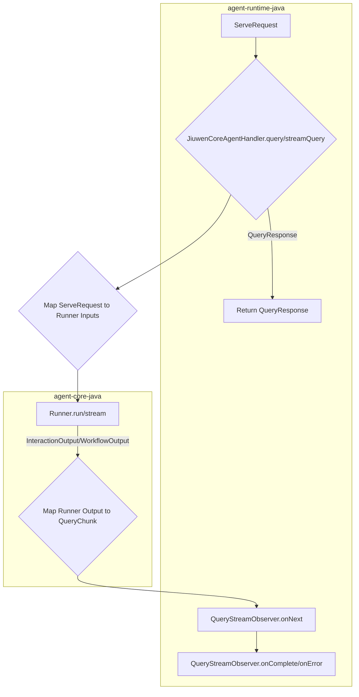

<!-- source: DeepWiki mcp.deepwiki.com · repo openJiuwen-ai/agent-runtime-java · page 6.1 Agent-Core Handler Bridge · fetched 2026-11-02 -->

# Agent-Core Handler Bridge

<details>
<summary>Relevant source files</summary>

The following files were used as context for generating this wiki page:

- [service/agent-service-adapters/agent-service-adapters-agentcore/src/main/java/com/openjiuwen/service/adapters/agentcore/agentfw/CoreRunnerLifecycleCoordinator.java](service/agent-service-adapters/agent-service-adapters-agentcore/src/main/java/com/openjiuwen/service/adapters/agentcore/agentfw/CoreRunnerLifecycleCoordinator.java)
- [service/agent-service-adapters/agent-service-adapters-agentcore/src/main/java/com/openjiuwen/service/adapters/agentcore/agentfw/JiuwenCoreAgentHandler.java](service/agent-service-adapters/agent-service-adapters-agentcore/src/main/java/com/openjiuwen/service/adapters/agentcore/agentfw/JiuwenCoreAgentHandler.java)
- [service/agent-service-adapters/agent-service-adapters-agentcore/src/test/java/com/openjiuwen/service/adapters/agentcore/agentfw/CoreRunnerLifecycleCoordinatorTest.java](service/agent-service-adapters/agent-service-adapters-agentcore/src/test/java/com/openjiuwen/service/adapters/agentcore/agentfw/CoreRunnerLifecycleCoordinatorTest.java)
- [service/agent-service-adapters/agent-service-adapters-agentcore/src/test/java/com/openjiuwen/service/adapters/agentcore/agentfw/JiuwenCoreAgentHandlerTest.java](service/agent-service-adapters/agent-service-adapters-agentcore/src/test/java/com/openjiuwen/service/adapters/agentcore/agentfw/JiuwenCoreAgentHandlerTest.java)
- [service/agent-service-app/src/main/java/com/openjiuwen/service/app/controller/a2a/A2AAgentExecutor.java](service/agent-service-app/src/main/java/com/openjiuwen/service/app/controller/a2a/A2AAgentExecutor.java)
- [service/agent-service-app/src/main/java/com/openjiuwen/service/app/controller/a2a/AgentCoreEnvelopeText.java](service/agent-service-app/src/main/java/com/openjiuwen/service/app/controller/a2a/AgentCoreEnvelopeText.java)
- [service/agent-service-app/src/test/java/com/openjiuwen/service/app/controller/a2a/A2AAgentExecutorTest.java](service/agent-service-app/src/test/java/com/openjiuwen/service/app/controller/a2a/A2AAgentExecutorTest.java)

</details>


This page details the integration between the `agent-runtime-java` and the `agent-core-java` framework, specifically focusing on the `JiuwenCoreAgentHandler` and `CoreRunnerLifecycleCoordinator`. It explains how `agent-core-java` agents are hosted, how runner sessions are managed, and how interactions and interrupts are mapped between the two systems. It also covers the extraction of user-facing text from `agent-core-java` output envelopes.

## JiuwenCoreAgentHandler

The `JiuwenCoreAgentHandler` [service/agent-service-adapters/agent-service-adapters-agentcore/src/main/java/com/openjiuwen/service/adapters/agentcore/agentfw/JiuwenCoreAgentHandler.java:57-57]() serves as the primary bridge between the `agent-runtime-java`'s `AgentHandler` SPI and the `agent-core-java`'s `Runner` framework. It enables the `agent-runtime-java` to host and execute agents developed using `agent-core-java`.

### Agent Initialization and Lifecycle

The `JiuwenCoreAgentHandler` is constructed with an `agent` instance, which can be either an `Object` representing the agent itself or an agent-id string [service/agent-service-adapters/agent-service-adapters-agentcore/src/main/java/com/openjiuwen/service/adapters/agentcore/agentfw/JiuwenCoreAgentHandler.java:140-147](). It can also be configured with `MiddlewareAdapterRegistrar` and `ExternalSvcAdapterRegistrar` instances to integrate `agent-core-java` with external services and middleware provided by `agent-runtime-java` [service/agent-service-adapters/agent-service-adapters-agentcore/src/main/java/com/openjiuwen/service/adapters/agentcore/agentfw/JiuwenCoreAgentHandler.java:140-149]().

The `start()` and `stop()` methods manage the lifecycle of the `agent-core-java` agent. When `start()` is called, it ensures that the `Runner` is initialized and configured with the necessary adapters [service/agent-service-adapters/agent-service-adapters-agentcore/src/main/java/com/openjiuwen/service/adapters/agentcore/agentfw/JiuwenCoreAgentHandler.java:174-174](). The `stop()` method handles the shutdown of the agent and its associated resources [service/agent-service-adapters/agent-service-adapters-agentcore/src/main/java/com/openjiuwen/service/adapters/agentcore/agentfw/JiuwenCoreAgentHandler.java:190-190]().

### Query Execution and Session Management

The `query()` method handles synchronous requests, while `streamQuery()` handles streaming requests [service/agent-service-adapters/agent-service-adapters-agentcore/src/main/java/com/openjiuwen/service/adapters/agentcore/agentfw/JiuwenCoreAgentHandler.java:206-206](). Both methods translate `ServeRequest` objects from `agent-runtime-java` into the input format expected by `agent-core-java`'s `Runner`. This includes mapping conversation IDs, user IDs, space IDs, and tenant IDs [service/agent-service-adapters/agent-service-adapters-agentcore/src/main/java/com/openjiuwen/service/adapters/agentcore/agentfw/JiuwenCoreAgentHandler.java:220-220]().

For `streamQuery()`, the `JiuwenCoreAgentHandler` creates an `AgentSessionApi` to manage the interaction with the `agent-core-java` `Runner` [service/agent-service-adapters/agent-service-adapters-agentcore/src/main/java/com/openjiuwen/service/adapters/agentcore/agentfw/JiuwenCoreAgentHandler.java:300-300](). It then iterates through the `Runner`'s output, converting `InteractionOutput` and `WorkflowOutput` into `QueryChunk` objects and sending them to the `QueryStreamObserver` [service/agent-service-adapters/agent-service-adapters-agentcore/src/main/java/com/openjiuwen/service/adapters/agentcore/agentfw/JiuwenCoreAgentHandler.java:320-320]().

A key aspect of session management is the handling of `conversation_id`. The `JiuwenCoreAgentHandler` ensures that subsequent requests with the same `conversation_id` continue the same `agent-core-java` session, allowing for conversational context to be maintained [service/agent-service-adapters/agent-service-adapters-agentcore/src/test/java/com/openjiuwen/service/adapters/agentcore/agentfw/JiuwenCoreAgentHandlerTest.java:137-144]().

#### Diagram: Query Execution Flow


Sources:
- [service/agent-service-adapters/agent-service-adapters-agentcore/src/main/java/com/openjiuwen/service/adapters/agentcore/agentfw/JiuwenCoreAgentHandler.java:206-206]()
- [service/agent-service-adapters/agent-service-adapters-agentcore/src/main/java/com/openjiuwen/service/adapters/agentcore/agentfw/JiuwenCoreAgentHandler.java:300-300]()
- [service/agent-service-adapters/agent-service-adapters-agentcore/src/main/java/com/openjiuwen/service/adapters/agentcore/agentfw/JiuwenCoreAgentHandler.java:320-320]()
- [service/agent-service-adapters/agent-service-adapters-agentcore/src/test/java/com/openjiuwen/service/adapters/agentcore/agentfw/JiuwenCoreAgentHandlerTest.java:137-144]()

### Interaction and Interrupt Mapping

The `JiuwenCoreAgentHandler` handles `agent-core-java`'s `InteractionOutput` by converting it into `QueryChunk` objects. Specifically, `ToolCallInterruptRequest` from `agent-core-java` is mapped to a `QueryChunk` with type `__interaction__` [service/agent-service-adapters/agent-service-adapters-agentcore/src/main/java/com/openjiuwen/service/adapters/agentcore/agentfw/JiuwenCoreAgentHandler.java:63-63](). This allows the `agent-runtime-java` to recognize and handle tool call interruptions.

When an `InteractiveInput` is received (e.g., from a delegated call), it is passed back to the `agent-core-java` `Runner` to continue the interrupted session [service/agent-service-adapters/agent-service-adapters-agentcore/src/main/java/com/openjiuwen/service/adapters/agentcore/agentfw/JiuwenCoreAgentHandler.java:400-400](). The `REMOTE_TOOL_RESULTS` key is used to pass the results of remote tool calls back to the `agent-core-java` `Runner` [service/agent-service-adapters/agent-service-adapters-agentcore/src/main/java/com/openjiuwen/service/adapters/agentcore/agentfw/JiuwenCoreAgentHandler.java:87-87]().

#### Diagram: Interaction/Interrupt Flow

```mermaid
graph TD
    A[Agent-Core Runner] -- ToolCallInterruptRequest --> B{JiuwenCoreAgentHandler};
    B -- Map to QueryChunk (type: "__interaction__") --> C[QueryStreamObserver.onNext];
    C -- User/System Response --> D[ServeRequest with InteractiveInput];
    D --> B;
    B -- Map to InteractiveInput --> E[Agent-Core Runner.continueSession];
```
Sources:
- [service/agent-service-adapters/agent-service-adapters-agentcore/src/main/java/com/openjiuwen/service/adapters/agentcore/agentfw/JiuwenCoreAgentHandler.java:63-63]()
- [service/agent-service-adapters/agent-service-adapters-agentcore/src/main/java/com/openjiuwen/service/adapters/agentcore/agentfw/JiuwenCoreAgentHandler.java:400-400]()
- [service/agent-service-adapters/agent-service-adapters-agentcore/src/main/java/com/openjiuwen/service/adapters/agentcore/agentfw/JiuwenCoreAgentHandler.java:87-87]()

### Envelope Text Extraction

The `AgentCoreEnvelopeText` utility class [service/agent-service-app/src/main/java/com/openjiuwen/service/app/controller/a2a/AgentCoreEnvelopeText.java:23-23]() is responsible for extracting user-facing text from `agent-core-java`'s output envelopes. It identifies "terminal" envelopes (e.g., `answer`, `workflow_final`) and extracts the business value, preferring nested `payload` maps and common content keys like `content`, `delta`, `output`, and `response` [service/agent-service-app/src/main/java/com/openjiuwen/service/app/controller/a2a/AgentCoreEnvelopeText.java:30-30](), [service/agent-service-app/src/main/java/com/openjiuwen/service/app/controller/a2a/AgentCoreEnvelopeText.java:78-82](), [service/agent-service-app/src/main/java/com/openjiuwen/service/app/controller/a2a/AgentCoreEnvelopeText.java:102-103](). This ensures that the `agent-runtime-java` can present meaningful output to the user.

Sources:
- [service/agent-service-app/src/main/java/com/openjiuwen/service/app/controller/a2a/AgentCoreEnvelopeText.java:23-23]()
- [service/agent-service-app/src/main/java/com/openjiuwen/service/app/controller/a2a/AgentCoreEnvelopeText.java:30-30]()
- [service/agent-service-app/src/main/java/com/openjiuwen/service/app/controller/a2a/AgentCoreEnvelopeText.java:78-82]()
- [service/agent-service-app/src/main/java/com/openjiuwen/service/app/controller/a2a/AgentCoreEnvelopeText.java:102-103]()

## CoreRunnerLifecycleCoordinator

The `CoreRunnerLifecycleCoordinator` [service/agent-service-adapters/agent-service-adapters-agentcore/src/main/java/com/openjiuwen/service/adapters/agentcore/agentfw/CoreRunnerLifecycleCoordinator.java:27-27]() is a shared lifecycle component responsible for managing the `agent-core-java` `Runner` instance across multiple `JiuwenCoreAgentHandler` instances within a hosted runtime.

### Shared Runner Ownership

This coordinator ensures that the `agent-core-java` `Runner` is started and stopped only once, even if multiple `JiuwenCoreAgentHandler` instances are present [service/agent-service-adapters/agent-service-adapters-agentcore/src/test/java/com/openjiuwen/service/adapters/agentcore/agentfw/CoreRunnerLifecycleCoordinatorTest.java:27-47](). It implements the `HostedSharedLifecycle` interface, providing `prepare()`, `start()`, and `stop()` methods for managing the shared `Runner` [service/agent-service-adapters/agent-service-adapters-agentcore/src/main/java/com/openjiuwen/service/adapters/agentcore/agentfw/CoreRunnerLifecycleCoordinator.java:46-46]().

During the `prepare()` phase, it validates that each `JiuwenCoreAgentHandler` is properly configured and that no agent object is hosted more than once [service/agent-service-adapters/agent-service-adapters-agentcore/src/main/java/com/openjiuwen/service/adapters/agentcore/agentfw/CoreRunnerLifecycleCoordinator.java:54-64](). It also ensures that all handlers use the same `MiddlewareAdapterRegistrar` and `ExternalSvcAdapterRegistrar` instances to maintain consistency [service/agent-service-adapters/agent-service-adapters-agentcore/src/test/java/com/openjiuwen/service/adapters/agentcore/agentcore/agentfw/CoreRunnerLifecycleCoordinatorTest.java:64-69]().

When `start()` is called, if there are `JiuwenCoreAgentHandler` instances, it applies the middleware and external service configurations to the `RunnerConfig` and then calls `Runner.start()` [service/agent-service-adapters/agent-service-adapters-agentcore/src/main/java/com/openjiuwen/service/adapters/agentcore/agentfw/CoreRunnerLifecycleCoordinator.java:85-91](). Similarly, `stop()` calls `Runner.stop()` if the `Runner` was started [service/agent-service-adapters/agent-service-adapters-agentcore/src/main/java/com/openjiuwen/service/adapters/agentcore/agentfw/CoreRunnerLifecycleCoordinator.java:100-102]().

Sources:
- [service/agent-service-adapters/agent-service-adapters-agentcore/src/main/java/com/openjiuwen/service/adapters/agentcore/agentfw/CoreRunnerLifecycleCoordinator.java:27-27]()
- [service/agent-service-adapters/agent-service-adapters-agentcore/src/test/java/com/openjiuwen/service/adapters/agentcore/agentfw/CoreRunnerLifecycleCoordinatorTest.java:27-47]()
- [service/agent-service-adapters/agent-service-adapters-agentcore/src/main/java/com/openjiuwen/service/adapters/agentcore/agentfw/CoreRunnerLifecycleCoordinator.java:46-46]()
- [service/agent-service-adapters/agent-service-adapters-agentcore/src/main/java/com/openjiuwen/service/adapters/agentcore/agentfw/CoreRunnerLifecycleCoordinator.java:54-64]()
- [service/agent-service-adapters/agent-service-adapters-agentcore/src/test/java/com/openjiuwen/service/adapters/agentcore/agentfw/CoreRunnerLifecycleCoordinatorTest.java:64-69]()
- [service/agent-service-adapters/agent-service-adapters-agentcore/src/main/java/com/openjiuwen/service/adapters/agentcore/agentfw/CoreRunnerLifecycleCoordinator.java:85-91]()
- [service/agent-service-adapters/agent-service-adapters-agentcore/src/main/java/com/openjiuwen/service/adapters/agentcore/agentfw/CoreRunnerLifecycleCoordinator.java:100-102]()

---

