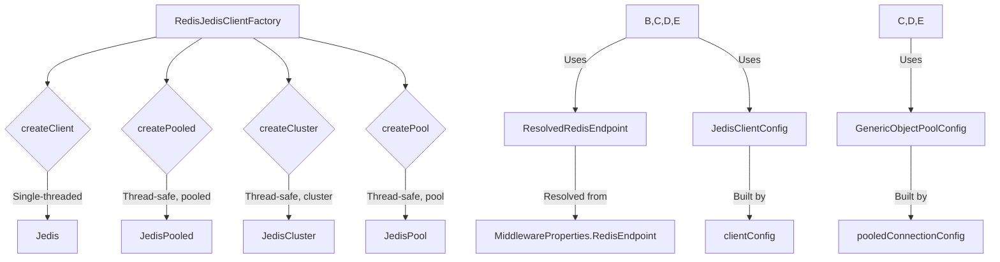

<!-- source: DeepWiki mcp.deepwiki.com · repo openJiuwen-ai/agent-runtime-java · page 6.2 Redis Middleware and Checkpointing · fetched 2026-11-02 -->

# Redis Middleware and Checkpointing

<details>
<summary>Relevant source files</summary>

The following files were used as context for generating this wiki page:

- [service/agent-service-adapters/agent-service-adapters-agentcore/src/main/java/com/openjiuwen/service/adapters/agentcore/autoconfigure/MiddlewareAdaptersAutoConfiguration.java](service/agent-service-adapters/agent-service-adapters-agentcore/src/main/java/com/openjiuwen/service/adapters/agentcore/autoconfigure/MiddlewareAdaptersAutoConfiguration.java)
- [service/agent-service-adapters/agent-service-adapters-agentcore/src/main/java/com/openjiuwen/service/adapters/agentcore/middleware/AgentCoreCheckpointerConfigAssembler.java](service/agent-service-adapters/agent-service-adapters-agentcore/src/main/java/com/openjiuwen/service/adapters/agentcore/middleware/AgentCoreCheckpointerConfigAssembler.java)
- [service/agent-service-adapters/agent-service-adapters-agentcore/src/main/java/com/openjiuwen/service/adapters/agentcore/middleware/DefaultMiddlewareAdapterRegistrar.java](service/agent-service-adapters/agent-service-adapters-agentcore/src/main/java/com/openjiuwen/service/adapters/agentcore/middleware/DefaultMiddlewareAdapterRegistrar.java)
- [service/agent-service-adapters/agent-service-adapters-agentcore/src/main/java/com/openjiuwen/service/adapters/agentcore/middleware/MiddlewareAdapterRegistrar.java](service/agent-service-adapters/agent-service-adapters-agentcore/src/main/java/com/openjiuwen/service/adapters/agentcore/middleware/MiddlewareAdapterRegistrar.java)
- [service/agent-service-adapters/agent-service-adapters-agentcore/src/test/java/com/openjiuwen/service/adapters/agentcore/agentfw/RedisCheckpointerMiddlewareIT.java](service/agent-service-adapters/agent-service-adapters-agentcore/src/test/java/com/openjiuwen/service/adapters/agentcore/agentfw/RedisCheckpointerMiddlewareIT.java)
- [service/agent-service-adapters/agent-service-adapters-agentcore/src/test/java/com/openjiuwen/service/adapters/agentcore/autoconfigure/MiddlewareAdaptersAutoConfigurationTest.java](service/agent-service-adapters/agent-service-adapters-agentcore/src/test/java/com/openjiuwen/service/adapters/agentcore/autoconfigure/MiddlewareAdaptersAutoConfigurationTest.java)
- [service/agent-service-adapters/agent-service-adapters-agentcore/src/test/java/com/openjiuwen/service/adapters/agentcore/autoconfigure/MiddlewareRedisSpringIT.java](service/agent-service-adapters/agent-service-adapters-agentcore/src/test/java/com/openjiuwen/service/adapters/agentcore/autoconfigure/MiddlewareRedisSpringIT.java)
- [service/agent-service-adapters/agent-service-adapters-agentcore/src/test/java/com/openjiuwen/service/adapters/agentcore/autoconfigure/RedisClusterMiddlewareSpringIT.java](service/agent-service-adapters/agent-service-adapters-agentcore/src/test/java/com/openjiuwen/service/adapters/agentcore/autoconfigure/RedisClusterMiddlewareSpringIT.java)
- [service/agent-service-adapters/agent-service-adapters-agentcore/src/test/java/com/openjiuwen/service/adapters/agentcore/middleware/AgentCoreCheckpointerConfigAssemblerTest.java](service/agent-service-adapters/agent-service-adapters-agentcore/src/test/java/com/openjiuwen/service/adapters/agentcore/middleware/AgentCoreCheckpointerConfigAssemblerTest.java)
- [service/agent-service-adapters/agent-service-adapters-common/src/main/java/com/openjiuwen/service/adapters/common/credential/CredentialDecryptor.java](service/agent-service-adapters/agent-service-adapters-common/src/main/java/com/openjiuwen/service/adapters/common/credential/CredentialDecryptor.java)
- [service/agent-service-adapters/agent-service-adapters-common/src/main/java/com/openjiuwen/service/adapters/common/credential/CredentialDecryptorAutoConfiguration.java](service/agent-service-adapters/agent-service-adapters-common/src/main/java/com/openjiuwen/service/adapters/common/credential/CredentialDecryptorAutoConfiguration.java)
- [service/agent-service-adapters/agent-service-adapters-common/src/main/java/com/openjiuwen/service/adapters/common/credential/PassthroughCredentialDecryptor.java](service/agent-service-adapters/agent-service-adapters-common/src/main/java/com/openjiuwen/service/adapters/common/credential/PassthroughCredentialDecryptor.java)
- [service/agent-service-adapters/agent-service-adapters-common/src/main/java/com/openjiuwen/service/adapters/common/middleware/MiddlewareProperties.java](service/agent-service-adapters/agent-service-adapters-common/src/main/java/com/openjiuwen/service/adapters/common/middleware/MiddlewareProperties.java)
- [service/agent-service-adapters/agent-service-adapters-common/src/main/java/com/openjiuwen/service/adapters/common/middleware/redis/JedisClusterRuntimeRedisClient.java](service/agent-service-adapters/agent-service-adapters-common/src/main/java/com/openjiuwen/service/adapters/common/middleware/redis/JedisClusterRuntimeRedisClient.java)
- [service/agent-service-adapters/agent-service-adapters-common/src/main/java/com/openjiuwen/service/adapters/common/middleware/redis/RedisConnectionAssembler.java](service/agent-service-adapters/agent-service-adapters-common/src/main/java/com/openjiuwen/service/adapters/common/middleware/redis/RedisConnectionAssembler.java)
- [service/agent-service-adapters/agent-service-adapters-common/src/main/java/com/openjiuwen/service/adapters/common/middleware/redis/RedisDatasourceDiagnostics.java](service/agent-service-adapters/agent-service-adapters-common/src/main/java/com/openjiuwen/service/adapters/common/middleware/redis/RedisDatasourceDiagnostics.java)
- [service/agent-service-adapters/agent-service-adapters-common/src/main/java/com/openjiuwen/service/adapters/common/middleware/redis/RedisJedisClientFactory.java](service/agent-service-adapters/agent-service-adapters-common/src/main/java/com/openjiuwen/service/adapters/common/middleware/redis/RedisJedisClientFactory.java)
- [service/agent-service-adapters/agent-service-adapters-common/src/main/java/com/openjiuwen/service/adapters/common/middleware/redis/RedisMiddlewareAutoConfiguration.java](service/agent-service-adapters/agent-service-adapters-common/src/main/java/com/openjiuwen/service/adapters/common/middleware/redis/RedisMiddlewareAutoConfiguration.java)
- [service/agent-service-adapters/agent-service-adapters-common/src/main/java/com/openjiuwen/service/adapters/common/middleware/redis/ResolvedRedisEndpoint.java](service/agent-service-adapters/agent-service-adapters-common/src/main/java/com/openjiuwen/service/adapters/common/middleware/redis/ResolvedRedisEndpoint.java)
- [service/agent-service-adapters/agent-service-adapters-common/src/main/java/com/openjiuwen/service/adapters/common/middleware/redis/UnifiedJedisRuntimeRedisClient.java](service/agent-service-adapters/agent-service-adapters-common/src/main/java/com/openjiuwen/service/adapters/common/middleware/redis/UnifiedJedisRuntimeRedisClient.java)
- [service/agent-service-adapters/agent-service-adapters-common/src/test/java/com/openjiuwen/service/adapters/common/middleware/MiddlewarePropertiesTest.java](service/agent-service-adapters/agent-service-adapters-common/src/test/java/com/openjiuwen/service/adapters/common/middleware/MiddlewarePropertiesTest.java)
- [service/agent-service-adapters/agent-service-adapters-common/src/test/java/com/openjiuwen/service/adapters/common/middleware/redis/JedisClusterRuntimeRedisClientTest.java](service/agent-service-adapters/agent-service-adapters-common/src/test/java/com/openjiuwen/service/adapters/common/middleware/redis/JedisClusterRuntimeRedisClientTest.java)
- [service/agent-service-adapters/agent-service-adapters-common/src/test/java/com/openjiuwen/service/adapters/common/middleware/redis/RedisConnectionAssemblerTest.java](service/agent-service-adapters/agent-service-adapters-common/src/test/java/com/openjiuwen/service/adapters/common/middleware/redis/RedisConnectionAssemblerTest.java)
- [service/agent-service-adapters/agent-service-adapters-common/src/test/java/com/openjiuwen/service/adapters/common/middleware/redis/RedisJedisClientFactoryTest.java](service/agent-service-adapters/agent-service-adapters-common/src/test/java/com/openjiuwen/service/adapters/common/middleware/redis/RedisJedisClientFactoryTest.java)

</details>


This page details the Redis middleware integration within the `agent-runtime-java` project, focusing on how Redis clients are created and managed, and how Redis is used for checkpointing agent states. It covers the `RedisJedisClientFactory` for creating various Jedis clients, the `MiddlewareProperties` for configuration, the `RedisConnectionAssembler` for resolving connection details, and the `AgentCoreCheckpointerConfigAssembler` for configuring agent checkpointing.

## Jedis Client Factory

The `RedisJedisClientFactory` [service/agent-service-adapters/agent-service-adapters-common/src/main/java/com/openjiuwen/service/adapters/common/middleware/redis/RedisJedisClientFactory.java:32-32]() is responsible for creating different types of Jedis clients based on the provided Redis endpoint configuration. It supports standalone, pooled, and cluster configurations.

### Standalone Client

The `createClient` methods [service/agent-service-adapters/agent-service-adapters-common/src/main/java/com/openjiuwen/service/adapters/common/middleware/redis/RedisJedisClientFactory.java:48-65]() build a single, non-thread-safe `Jedis` client. This is suitable for single-threaded access.

### Pooled Client

For concurrent access, `createPooled` methods [service/agent-service-adapters/agent-service-adapters-common/src/main/java/com/openjiuwen/service/adapters/common/middleware/redis/RedisJedisClientFactory.java:78-92]() create a thread-safe `JedisPooled` client. This client internally manages a connection pool, exposing the same command API as `Jedis`. Similarly, `createPool` [service/agent-service-adapters/agent-service-adapters-common/src/main/java/com/openjiuwen/service/adapters/common/middleware/redis/RedisJedisClientFactory.java:141-155]() creates a `JedisPool` where connections must be explicitly borrowed and returned.

### Cluster Client

The `createCluster` methods [service/agent-service-adapters/agent-service-adapters-common/src/main/java/com/openjiuwen/service/adapters/common/middleware/redis/RedisJedisClientFactory.java:101-129]() are used to build a thread-safe `JedisCluster` client for Redis cluster deployments. This method handles the parsing of cluster node addresses and configures the client for cluster operations.

### Client Configuration

All client creation methods rely on `clientConfig` [service/agent-service-adapters/agent-service-adapters-common/src/main/java/com/openjiuwen/service/adapters/common/middleware/redis/RedisJedisClientFactory.java:162-200]() to build a `JedisClientConfig` and `pooledConnectionConfig` [service/agent-service-adapters/agent-service-adapters-common/src/main/java/com/openjiuwen/service/adapters/common/middleware/redis/RedisJedisClientFactory.java:202-210]() for `GenericObjectPoolConfig` to manage connection pooling parameters like timeouts and maximum connections.


**Figure 1: Jedis Client Factory Overview**

Sources:
- [service/agent-service-adapters/agent-service-adapters-common/src/main/java/com/openjiuwen/service/adapters/common/middleware/redis/RedisJedisClientFactory.java:32-32]()
- [service/agent-service-adapters/agent-service-adapters-common/src/main/java/com/openjiuwen/service/adapters/common/middleware/redis/RedisJedisClientFactory.java:48-65]()
- [service/agent-service-adapters/agent-service-adapters-common/src/main/java/com/openjiuwen/service/adapters/common/middleware/redis/RedisJedisClientFactory.java:78-92]()
- [service/agent-service-adapters/agent-service-adapters-common/src/main/java/com/openjiuwen/service/adapters/common/middleware/redis/RedisJedisClientFactory.java:101-129]()
- [service/agent-service-adapters/agent-service-adapters-common/src/main/java/com/openjiuwen/service/adapters/common/middleware/redis/RedisJedisClientFactory.java:141-155]()
- [service/agent-service-adapters/agent-service-adapters-common/src/main/java/com/openjiuwen/service/adapters/common/middleware/redis/RedisJedisClientFactory.java:162-200]()
- [service/agent-service-adapters/agent-service-adapters-common/src/main/java/com.openjiuwen/service/adapters/common/middleware/redis/RedisJedisClientFactory.java:202-210]()

## MiddlewareProperties

The `MiddlewareProperties` class [service/agent-service-adapters/agent-service-adapters-common/src/main/java/com/openjiuwen/service/adapters/common/middleware/MiddlewareProperties.java:26-39]() binds configuration properties prefixed with `openjiuwen.service.middleware.*`. This includes settings for checkpointers, session stores, object storage, vector stores, memory, and Redis endpoints.

### Redis Endpoint Configuration

The `redis` property [service/agent-service-adapters/agent-service-adapters-common/src/main/java/com/openjiuwen/service/adapters/common/middleware/MiddlewareProperties.java:37-37]() is a map of named `RedisEndpoint` configurations. Each `RedisEndpoint` [service/agent-service-adapters/agent-service-adapters-common/src/main/java/com/openjiuwen/service/adapters/common/middleware/MiddlewareProperties.java:141-210]() can specify its `type` (standalone or cluster), `host`, `port`, `nodes` (for clusters), `database`, `timeoutMs`, and `encryptedPassword`.

### Checkpointer Configuration

The `checkpointer` property [service/agent-service-adapters/agent-service-adapters-common/src/main/java/com/openjiuwen/service/adapters/common/middleware/MiddlewareProperties.java:88-124]() defines the type of checkpointer to use (`in_memory` or `redis`), a `redisRef` to point to a specific Redis endpoint configuration, and a `ttlSeconds` for state expiration.

Sources:
- [service/agent-service-adapters/agent-service-adapters-common/src/main/java/com/openjiuwen/service/adapters/common/middleware/MiddlewareProperties.java:26-39]()
- [service/agent-service-adapters/agent-service-adapters-common/src/main/java/com/openjiuwen/service/adapters/common/middleware/MiddlewareProperties.java:37-37]()
- [service/agent-service-adapters/agent-service-adapters-common/src/main/java/com/openjiuwen/service/adapters/common/middleware/MiddlewareProperties.java:88-124]()
- [service/agent-service-adapters/agent-service-adapters-common/src/main/java/com/openjiuwen/service/adapters/common/middleware/MiddlewareProperties.java:141-210]()

## Redis Connection Assembler

The `RedisConnectionAssembler` [service/agent-service-adapters/agent-service-adapters-common/src/main/java/com/openjiuwen/service/adapters/common/middleware/redis/RedisConnectionAssembler.java:23-23]() is responsible for resolving and validating raw `MiddlewareProperties.RedisEndpoint` configurations into `ResolvedRedisEndpoint` objects. This ensures that all necessary connection details are present and correctly formatted before client creation.

### Resolution Process

The `resolve` method [service/agent-service-adapters/agent-service-adapters-common/src/main/java/com/openjiuwen/service/adapters/common/middleware/redis/RedisConnectionAssembler.java:44-51]() takes `MiddlewareProperties` and a `redisRef` to find and validate the corresponding Redis endpoint. It handles default values for port, database, and timeout, and validates host presence for standalone types or node list for cluster types.

### Connection Map and URL Building

The `buildConnectionMap` method [service/agent-service-adapters/agent-service-adapters-common/src/main/java/com/openjiuwen/service/adapters/common/middleware/redis/RedisConnectionAssembler.java:134-137]() creates a map containing connection details, including a Redis URL constructed by `buildRedisUrl` [service/agent-service-adapters/agent-service-adapters-common/src/main/java/com/openjiuwen/service/adapters/common/middleware/redis/RedisConnectionAssembler.java:220-220](). This URL includes host, port, database, and optionally the decrypted password.

```mermaid
graph TD
    A[MiddlewareProperties] --> B{getRedis};
    B --> C[Map<String, RedisEndpoint>];
    C --> D[RedisEndpoint "default"];
    C --> E[RedisEndpoint "cluster"];

    F[RedisConnectionAssembler] --> G{resolve(properties, redisRef)};
    G --> H[ResolvedRedisEndpoint];

    H -- "Used by" --> I[RedisJedisClientFactory];
    H -- "Used by" --> J[AgentCoreCheckpointerConfigAssembler];

    G -- "Validates and populates" --> H;
    H -- "Contains" --> K[type];
    H -- "Contains" --> L[host];
    H -- "Contains" --> M[port];
    H -- "Contains" --> N[nodes];
    H -- "Contains" --> O[database];
    H -- "Contains" --> P[timeoutMs];
    H -- "Contains" --> Q[encryptedPassword];

    F --> R{buildConnectionMap(ResolvedRedisEndpoint, decryptedPassword)};
    R --> S[Map<String, Object> "connection"];
    S -- "Includes" --> T[url];
```
**Figure 2: Redis Connection Assembly Flow**

Sources:
- [service/agent-service-adapters/agent-service-adapters-common/src/main/java/com/openjiuwen/service/adapters/common/middleware/redis/RedisConnectionAssembler.java:23-23]()
- [service/agent-service-adapters/agent-service-adapters-common/src/main/java/com/openjiuwen/service/adapters/common/middleware/redis/RedisConnectionAssembler.java:44-51]()
- [service/agent-service-adapters/agent-service-adapters-common/src/main/java/com/openjiuwen/service/adapters/common/middleware/redis/RedisConnectionAssembler.java:134-137]()
- [service/agent-service-adapters/agent-service-adapters-common/src/main/java/com/openjiuwen/service/adapters/common/middleware/redis/RedisConnectionAssembler.java:220-220]()

## Runtime Redis Clients

The `RedisMiddlewareAutoConfiguration` [service/agent-service-adapters/agent-service-adapters-common/src/main/java/com/openjiuwen/service/adapters/common/middleware/redis/RedisMiddlewareAutoConfiguration.java:28-31]() auto-configures `RuntimeRedisClient` beans. This client acts as an SPI (Service Provider Interface) for Redis operations, abstracting the underlying Jedis implementation.

### `UnifiedJedisRuntimeRedisClient`

This class [service/agent-service-adapters/agent-service-adapters-common/src/main/java/com/openjiuwen/service/adapters/common/middleware/redis/UnifiedJedisRuntimeRedisClient.java:22-22]() serves as a shared base for Jedis-backed `RuntimeRedisClient` implementations. It wraps a `UnifiedJedis` instance and provides common Redis commands. A key feature is `jedisDelegate()` [service/agent-service-adapters/agent-service-adapters-common/src/main/java/com/openjiuwen/service/adapters/common/middleware/redis/UnifiedJedisRuntimeRedisClient.java:38-40](), which exposes the native Jedis client for consumers needing advanced Jedis-specific capabilities like pipelining.

### `JedisPooledRuntimeRedisClient` and `JedisClusterRuntimeRedisClient`

These are concrete implementations of `RuntimeRedisClient` that wrap `JedisPooled` and `JedisCluster` respectively. They are created by `RedisJedisClientFactory` [service/agent-service-adapters/agent-service-adapters-common/src/main/java/com/openjiuwen/service/adapters/common/middleware/redis/RedisMiddlewareAutoConfiguration.java:47-49]() based on the resolved Redis endpoint type.

```mermaid
graph TD
    A[RedisMiddlewareAutoConfiguration] --> B{runtimeRedisClient Bean};
    B -- "ConditionalOnMissingBean(RuntimeRedisClient)" --> C[RuntimeRedisClient];

    C -- "If endpoint is cluster" --> D[JedisClusterRuntimeRedisClient];
    C -- "If endpoint is standalone" --> E[JedisPooledRuntimeRedisClient];

    D -- "Wraps" --> F[JedisCluster];
    E -- "Wraps" --> G[JedisPooled];

    F,G -- "Created by" --> H[RedisJedisClientFactory];
    H -- "Uses" --> I[ResolvedRedisEndpoint];
    I -- "Resolved by" --> J[RedisConnectionAssembler];

    D,E -- "Extends" --> K[UnifiedJedisRuntimeRedisClient];
    K -- "Exposes native client via" --> L[jedisDelegate()];
```
**Figure 3: Runtime Redis Client Auto-Configuration**

Sources:
- [service/agent-service-adapters/agent-service-adapters-common/src/main/java/com/openjiuwen/service/adapters/common/middleware/redis/RedisMiddlewareAutoConfiguration.java:28-31]()
- [service/agent-service-adapters/agent-service-adapters-common/src/main/java/com/openjiuwen/service/adapters/common/middleware/redis/RedisMiddlewareAutoConfiguration.java:47-49]()
- [service/agent-service-adapters/agent-service-adapters-common/src/main/java/com/openjiuwen/service/adapters/common/middleware/redis/UnifiedJedisRuntimeRedisClient.java:22-22]()
- [service/agent-service-adapters/agent-service-adapters-common/src/main/java/com/openjiuwen/service/adapters/common/middleware/redis/UnifiedJedisRuntimeRedisClient.java:38-40]()

## Checkpointer Configuration Assembler

The `AgentCoreCheckpointerConfigAssembler` [service/agent-service-adapters/agent-service-adapters-agentcore/src/main/java/com/openjiuwen/service/adapters/agentcore/middleware/AgentCoreCheckpointerConfigAssembler.java:24-24]() is responsible for building the `RunnerConfig.checkpointerConfig` map for the AgentCore. This configuration determines how agent session states are persisted.

### Building Checkpointer Configuration

The `build` method [service/agent-service-adapters/agent-service-adapters-agentcore/src/main/java/com/openjiuwen/service/adapters/agentcore/middleware/AgentCoreCheckpointerConfigAssembler.java:42-53]() takes `MiddlewareProperties`, a `CredentialDecryptor`, and a `RuntimeRedisClient` to construct the checkpointer configuration.

- **In-memory Checkpointer**: If `openjiuwen.service.middleware.checkpointer.type` is `in_memory` (or not specified), an in-memory configuration is returned [service/agent-service-adapters/agent-service-adapters-agentcore/src/main/java/com/openjiuwen/service/adapters/agentcore/middleware/AgentCoreCheckpointerConfigAssembler.java:45-46]().
- **Redis Checkpointer**: If the type is `redis`, it calls `buildRedisConf` [service/agent-service-adapters/agent-service-adapters-agentcore/src/main/java/com/openjiuwen/service/adapters/agentcore/middleware/AgentCoreCheckpointerConfigAssembler.java:49-49]() to create the Redis-specific configuration.

### Redis Configuration Details

The `buildRedisConf` method [service/agent-service-adapters/agent-service-adapters-agentcore/src/main/java/com/openjiuwen/service/adapters/agentcore/middleware/AgentCoreCheckpointerConfigAssembler.java:78-95]() performs the following:
1. **Validates `RuntimeRedisClient`**: Ensures a `RuntimeRedisClient` is provided [service/agent-service-adapters/agent-service-adapters-agentcore/src/main/java/com/openjiuwen/service/adapters/agentcore/middleware/AgentCoreCheckpointerConfigAssembler.java:80-82]().
2. **Resolves Redis Endpoint**: Uses `RedisConnectionAssembler.resolve` [service/agent-service-adapters/agent-service-adapters-agentcore/src/main/java/com/openjiuwen/service/adapters/agentcore/middleware/AgentCoreCheckpointerConfigAssembler.java:83-84]() to get the `ResolvedRedisEndpoint` based on `redisRef`.
3. **Decrypts Password**: Decrypts the Redis password using the provided `CredentialDecryptor` [service/agent-service-adapters/agent-service-adapters-agentcore/src/main/java/com/openjiuwen/service/adapters/agentcore/middleware/AgentCoreCheckpointerConfigAssembler.java:85-85]().
4. **Builds Connection Map**: Creates a connection map using `RedisConnectionAssembler.buildConnectionMap` [service/agent-service-adapters/agent-service-adapters-agentcore/src/main/java/com/openjiuwen/service/adapters/agentcore/middleware/AgentCoreCheckpointerConfigAssembler.java:87-87]().
5. **Unwraps Jedis Client**: Calls `unwrapJedis` [service/agent-service-adapters/agent-service-adapters-agentcore/src/main/java/com/openjiuwen/service/adapters/agentcore/middleware/AgentCoreCheckpointerConfigAssembler.java:64-69]() to extract the native Jedis client from `UnifiedJedisRuntimeRedisClient` if applicable, ensuring AgentCore receives the raw Jedis instance for optimized operations [service/agent-service-adapters/agent-service-adapters-agentcore/src/main/java/com/openjiuwen/service/adapters/agentcore/middleware/AgentCoreCheckpointerConfigAssembler.java:88-88]().
6. **Configures TTL**: Sets the `default_ttl` for the checkpointer, converting `ttlSeconds` from `MiddlewareProperties` to minutes [service/agent-service-adapters/agent-service-adapters-agentcore/src/main/java/com/openjiuwen/service/adapters/agentcore/middleware/AgentCoreCheckpointerConfigAssembler.java:91-93]().

```mermaid
graph TD
    A[MiddlewareAdaptersAutoConfiguration] --> B{middlewareAdapterRegistrar Bean};
    B -- "Calls" --> C[DefaultMiddlewareAdapterRegistrar];
    C -- "Calls" --> D[AgentCoreCheckpointerConfigAssembler.build];

    D -- "Input: MiddlewareProperties" --> E[MiddlewareProperties.Checkpointer];
    D -- "Input: CredentialDecryptor" --> F[CredentialDecryptor];
    D -- "Input: RuntimeRedisClient" --> G[RuntimeRedisClient];

    E -- "checkpointer.type" --> H{Checkpointer Type?};
    H -- "in_memory" --> I[Return Map("type": "in_memory", "conf": {})];
    H -- "redis" --> J[Call buildRedisConf];

    J --> K[RedisConnectionAssembler.resolve];
    J --> L[F.decrypt(password)];
    J --> M[RedisConnectionAssembler.buildConnectionMap];
    J --> N[unwrapJedis(G)];
    J --> O[Convert ttlSeconds to minutes];

    N -- "If G is UnifiedJedisRuntimeRedisClient" --> P[G.jedisDelegate()];
    N -- "Else" --> Q[G];

    J --> R[Return Map("type": "redis", "conf": {connection: ..., ttl: ...})];

    R --> S[RunnerConfig.setCheckpointerConfig];
```
**Figure 4: AgentCore Checkpointer Configuration Assembly**

Sources:
- [service/agent-service-adapters/agent-service-adapters-agentcore/src/main/java/com/openjiuwen/service/adapters/agentcore/middleware/AgentCoreCheckpointerConfigAssembler.java:24-24]()
- [service/agent-service-adapters/agent-service-adapters-agentcore/src/main/java/com/openjiuwen/service/adapters/agentcore/middleware/AgentCoreCheckpointerConfigAssembler.java:42-53]()
- [service/agent-service-adapters/agent-service-adapters-agentcore/src/main/java/com/openjiuwen/service/adapters/agentcore/middleware/AgentCoreCheckpointerConfigAssembler.java:45-46]()
- [service/agent-service-adapters/agent-service-adapters-agentcore/src/main/java/com/openjiuwen/service/adapters/agentcore/middleware/AgentCoreCheckpointerConfigAssembler.java:49-49]()
- [service/agent-service-adapters/agent-service-adapters-agentcore/src/main/java/com/openjiuwen/service/adapters/agentcore/middleware/AgentCoreCheckpointerConfigAssembler.java:64-69]()
- [service/agent-service-adapters/agent-service-adapters-agentcore/src/main/java/com/openjiuwen/service/adapters/agentcore/middleware/AgentCoreCheckpointerConfigAssembler.java:78-95]()
- [service/agent-service-adapters/agent-service-adapters-agentcore/src/main/java/com/openjiuwen/service/adapters/agentcore/middleware/AgentCoreCheckpointerConfigAssembler.java:80-82]()
- [service/agent-service-adapters/agent-service-adapters-agentcore/src/main/java/com/openjiuwen/service/adapters/agentcore/middleware/AgentCoreCheckpointerConfigAssembler.java:83-84]()
- [service/agent-service-adapters/agent-service-adapters-agentcore/src/main/java/com/openjiuwen/service/adapters/agentcore/middleware/AgentCoreCheckpointerConfigAssembler.java:85-85]()
- [service/agent-service-adapters/agent-service-adapters-agentcore/src/main/java/com/openjiuwen/service/adapters/agentcore/middleware/AgentCoreCheckpointerConfigAssembler.java:87-87]()
- [service/agent-service-adapters/agent-service-adapters-agentcore/src/main/java/com/openjiuwen/service/adapters/agentcore/middleware/AgentCoreCheckpointerConfigAssembler.java:88-88]()
- [service/agent-service-adapters/agent-service-adapters-agentcore/src/main/java/com/openjiuwen/service/adapters/agentcore/middleware/AgentCoreCheckpointerConfigAssembler.java:91-93]()

---

