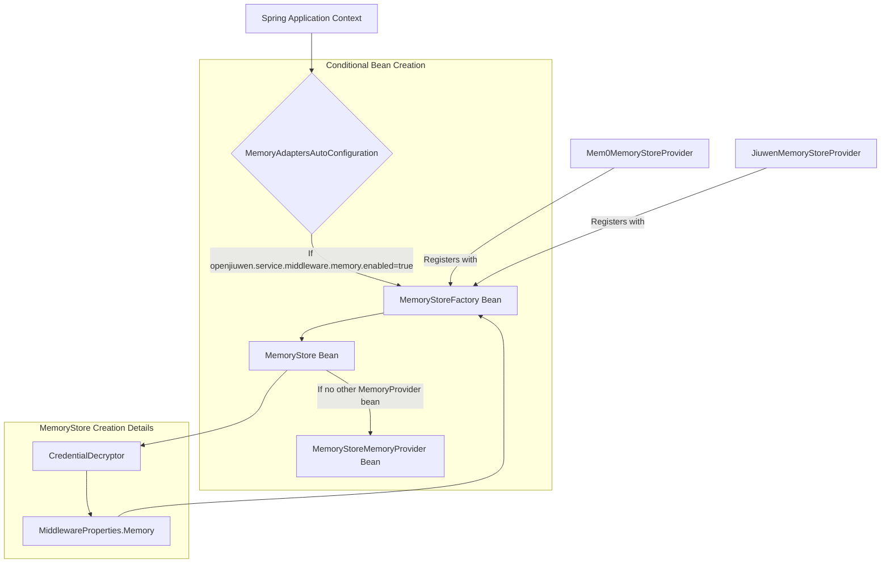

<!-- source: DeepWiki mcp.deepwiki.com · repo openJiuwen-ai/agent-runtime-java · page 6.3 Memory Stores (Mem0, Jiuwen) · fetched 2026-11-02 -->

# Memory Stores (Mem0, Jiuwen)

<details>
<summary>Relevant source files</summary>

The following files were used as context for generating this wiki page:

- [service/agent-service-adapters/agent-service-adapters-agentcore/src/main/java/com/openjiuwen/service/adapters/agentcore/autoconfigure/MemoryAdaptersAutoConfiguration.java](service/agent-service-adapters/agent-service-adapters-agentcore/src/main/java/com/openjiuwen/service/adapters/agentcore/autoconfigure/MemoryAdaptersAutoConfiguration.java)
- [service/agent-service-adapters/agent-service-adapters-agentcore/src/main/java/com/openjiuwen/service/adapters/agentcore/memory/MemoryStoreFactory.java](service/agent-service-adapters/agent-service-adapters-agentcore/src/main/java/com/openjiuwen/service/adapters/agentcore/memory/MemoryStoreFactory.java)
- [service/agent-service-adapters/agent-service-adapters-agentcore/src/main/java/com/openjiuwen/service/adapters/agentcore/memory/MemoryStoreMemoryProvider.java](service/agent-service-adapters/agent-service-adapters-agentcore/src/main/java/com/openjiuwen/service/adapters/agentcore/memory/MemoryStoreMemoryProvider.java)
- [service/agent-service-adapters/agent-service-adapters-agentcore/src/main/java/com/openjiuwen/service/adapters/agentcore/memory/MemoryStoreProvider.java](service/agent-service-adapters/agent-service-adapters-agentcore/src/main/java/com/openjiuwen/service/adapters/agentcore/memory/MemoryStoreProvider.java)
- [service/agent-service-adapters/agent-service-adapters-agentcore/src/main/java/com/openjiuwen/service/adapters/agentcore/memory/jiuwen/JiuwenMemoryApi.java](service/agent-service-adapters/agent-service-adapters-agentcore/src/main/java/com/openjiuwen/service/adapters/agentcore/memory/jiuwen/JiuwenMemoryApi.java)
- [service/agent-service-adapters/agent-service-adapters-agentcore/src/main/java/com/openjiuwen/service/adapters/agentcore/memory/jiuwen/JiuwenMemoryStore.java](service/agent-service-adapters/agent-service-adapters-agentcore/src/main/java/com/openjiuwen/service/adapters/agentcore/memory/jiuwen/JiuwenMemoryStore.java)
- [service/agent-service-adapters/agent-service-adapters-agentcore/src/main/java/com/openjiuwen/service/adapters/agentcore/memory/jiuwen/JiuwenMemoryStoreProvider.java](service/agent-service-adapters/agent-service-adapters-agentcore/src/main/java/com/openjiuwen/service/adapters/agentcore/memory/jiuwen/JiuwenMemoryStoreProvider.java)
- [service/agent-service-adapters/agent-service-adapters-agentcore/src/main/java/com/openjiuwen/service/adapters/agentcore/memory/mem0/GovernedMem0Api.java](service/agent-service-adapters/agent-service-adapters-agentcore/src/main/java/com/openjiuwen/service/adapters/agentcore/memory/mem0/GovernedMem0Api.java)
- [service/agent-service-adapters/agent-service-adapters-agentcore/src/main/java/com/openjiuwen/service/adapters/agentcore/memory/mem0/Mem0MemoryStore.java](service/agent-service-adapters/agent-service-adapters-agentcore/src/main/java/com/openjiuwen/service/adapters/agentcore/memory/mem0/Mem0MemoryStore.java)
- [service/agent-service-adapters/agent-service-adapters-agentcore/src/main/java/com/openjiuwen/service/adapters/agentcore/memory/mem0/Mem0MemoryStoreProvider.java](service/agent-service-adapters/agent-service-adapters-agentcore/src/main/java/com/openjiuwen/service/adapters/agentcore/memory/mem0/Mem0MemoryStoreProvider.java)
- [service/agent-service-adapters/agent-service-adapters-agentcore/src/test/java/com/openjiuwen/service/adapters/agentcore/autoconfigure/MemoryAdaptersAutoConfigurationTest.java](service/agent-service-adapters/agent-service-adapters-agentcore/src/test/java/com/openjiuwen/service/adapters/agentcore/autoconfigure/MemoryAdaptersAutoConfigurationTest.java)
- [service/agent-service-adapters/agent-service-adapters-agentcore/src/test/java/com/openjiuwen/service/adapters/agentcore/memory/MemoryStoreMemoryProviderTest.java](service/agent-service-adapters/agent-service-adapters-agentcore/src/test/java/com/openjiuwen/service/adapters/agentcore/memory/MemoryStoreMemoryProviderTest.java)
- [service/agent-service-adapters/agent-service-adapters-agentcore/src/test/java/com/openjiuwen/service/adapters/agentcore/memory/mem0/Mem0MemoryStoreTest.java](service/agent-service-adapters/agent-service-adapters-agentcore/src/test/java/com/openjiuwen/service/adapters/agentcore/memory/mem0/Mem0MemoryStoreTest.java)
- [service/agent-service-demo/example/memory/README.md](service/agent-service-demo/example/memory/README.md)
- [service/agent-service-demo/example/memory/application-jiuwen.yml](service/agent-service-demo/example/memory/application-jiuwen.yml)
- [service/agent-service-demo/example/memory/application-mem0.yml](service/agent-service-demo/example/memory/application-mem0.yml)
- [service/agent-service-demo/example/memory/application-memory.yml](service/agent-service-demo/example/memory/application-memory.yml)
- [service/agent-service-demo/example/memory/src/main/java/com/openjiuwen/service/demo/example/memory/MemoryDemoApplication.java](service/agent-service-demo/example/memory/src/main/java/com/openjiuwen/service/demo/example/memory/MemoryDemoApplication.java)
- [service/agent-service-demo/example/memory/src/main/java/com/openjiuwen/service/demo/example/memory/MemoryLifecycleAgentHandler.java](service/agent-service-demo/example/memory/src/main/java/com/openjiuwen/service/demo/example/memory/MemoryLifecycleAgentHandler.java)
- [service/agent-service-demo/example/memory/src/test/java/com/openjiuwen/service/demo/example/memory/JiuwenMemoryAgentEndToEndTest.java](service/agent-service-demo/example/memory/src/test/java/com/openjiuwen/service/demo/example/memory/JiuwenMemoryAgentEndToEndTest.java)
- [service/agent-service-demo/example/memory/src/test/java/com/openjiuwen/service/demo/example/memory/MemoryAgentEndToEndTest.java](service/agent-service-demo/example/memory/src/test/java/com/openjiuwen/service/demo/example/memory/MemoryAgentEndToEndTest.java)
- [service/agent-service-demo/example/security/src/test/java/com/openjiuwen/service/demo/example/security/SecurityDemoApplicationTest.java](service/agent-service-demo/example/security/src/test/java/com/openjiuwen/service/demo/example/security/SecurityDemoApplicationTest.java)
- [service/agent-service-demo/src/test/resources/application.yml](service/agent-service-demo/src/test/resources/application.yml)

</details>


This page details the memory store abstraction within the `agent-runtime-java` codebase, focusing on the `MemoryStoreFactory`/`MemoryStoreProvider` pattern, the concrete implementations for Mem0 and Jiuwen memory services, the governed APIs used for external calls, and the auto-configuration mechanisms.

## Memory Store Abstraction

The `agent-runtime-java` provides an abstraction for interacting with various memory services through the `MemoryStore` interface [service/agent-service-adapters/agent-service-adapters-agentcore/src/main/java/com/openjiuwen/service/adapters/common/memory/MemoryStore.java](). This interface defines core operations for managing agent memory: adding, searching, retrieving, and deleting memory records.

The `MemoryStoreFactory` [service/agent-service-adapters/agent-service-adapters-agentcore/src/main/java/com/openjiuwen/service/adapters/agentcore/memory/MemoryStoreFactory.java:26-67]() is responsible for creating provider-specific `MemoryStore` implementations based on the configured memory provider. It uses a collection of `MemoryStoreProvider` instances to achieve this.

### MemoryStoreProvider Interface

The `MemoryStoreProvider` [service/agent-service-adapters/agent-service-adapters-agentcore/src/main/java/com/openjiuwen/service/adapters/agentcore/memory/MemoryStoreProvider.java]() is a Service Provider Interface (SPI) that allows for the registration of new memory store implementations. To add a new memory provider, one needs to implement this interface and register it as a Spring Bean.

```java
public interface MemoryStoreProvider {
    String providerName();
    MemoryStore create(String apiKey, MiddlewareProperties.Memory memory);
}
```
Sources:
- [service/agent-service-adapters/agent-service-adapters-agentcore/src/main/java/com/openjiuwen/service/adapters/agentcore/memory/MemoryStoreFactory.java:26-67]()
- [service/agent-service-adapters/agent-service-adapters-agentcore/src/main/java/com/openjiuwen/service/adapters/agentcore/memory/MemoryStoreProvider.java]()

### MemoryStoreFactory

The `MemoryStoreFactory` [service/agent-service-adapters/agent-service-adapters-agentcore/src/main/java/com/openjiuwen/service/adapters/agentcore/memory/MemoryStoreFactory.java]() collects all available `MemoryStoreProvider` beans and maps them by their `providerName()`. When `create(String apiKey, MiddlewareProperties.Memory memory)` [service/agent-service-adapters/agent-service-adapters-agentcore/src/main/java/com/openjiuwen/service/adapters/agentcore/memory/MemoryStoreFactory.java:45-67]() is called, it looks up the appropriate provider based on the `openjiuwen.service.middleware.memory.provider` configuration property and delegates the creation of the `MemoryStore` instance to it.

```mermaid
graph TD
    A[MemoryStoreFactory] --> B{providerList: List<MemoryStoreProvider>};
    B --> C{create(apiKey, memoryConfig)};
    C --> D{Lookup MemoryStoreProvider by memoryConfig.provider};
    D -- "If found" --> E[MemoryStoreProvider.create(apiKey, memoryConfig)];
    E --> F[Return MemoryStore instance];
    D -- "If not found" --> G[Throw IllegalStateException];
```
**Diagram: MemoryStoreFactory Workflow**

Sources:
- [service/agent-service-adapters/agent-service-adapters-agentcore/src/main/java/com/openjiuwen/service/adapters/agentcore/memory/MemoryStoreFactory.java:26-67]()

## Mem0 Memory Store

The `Mem0MemoryStore` [service/agent-service-adapters/agent-service-adapters-agentcore/src/main/java/com/openjiuwen/service/adapters/agentcore/memory/mem0/Mem0MemoryStore.java]() provides an implementation of the `MemoryStore` interface backed by the Mem0 service. It uses `GovernedMem0Api` [service/agent-service-adapters/agent-service-adapters-agentcore/src/main/java/com/openjiuwen/service/adapters/agentcore/memory/mem0/GovernedMem0Api.java]() for all its external HTTP calls, ensuring that runtime governance policies (timeout, retry, circuit breaker, audit) are applied.

### Configuration

The Mem0 memory store is configured via properties under `openjiuwen.service.middleware.memory` [service/agent-service-demo/example/memory/application-mem0.yml:6-13](). Key configuration options include:
- `provider`: Set to `mem0` [service/agent-service-demo/example/memory/application-mem0.yml:10]().
- `endpoint`: The base URL of the Mem0 service (e.g., `https://api.mem0.ai`) [service/agent-service-demo/example/memory/application-mem0.yml:11]().
- `encrypted-api-key`: The API key for authentication [service/agent-service-demo/example/memory/application-mem0.yml:12]().
- `rerank`: Whether to enable reranking for search queries [service/agent-service-demo/example/memory/application-mem0.yml:13]().
- `auth-header-mode`: Authentication header mode (`token`, `x_api_key`, `bearer`) [service/agent-service-adapters/agent-service-adapters-agentcore/src/main/java/com/openjiuwen/service/adapters/agentcore/memory/mem0/GovernedMem0Api.java:44-49]().
- `path-style`: API path style (`v3` for Mem0 Cloud, `open` for self-hosted Mem0 OSS) [service/agent-service-adapters/agent-service-adapters-agentcore/src/main/java/com/openjiuwen/service/adapters/agentcore/memory/mem0/GovernedMem0Api.java:50-53]().

### GovernedMem0Api

The `GovernedMem0Api` [service/agent-service-adapters/agent-service-adapters-agentcore/src/main/java/com/openjiuwen/service/adapters/agentcore/memory/mem0/GovernedMem0Api.java]() class handles HTTP communication with the Mem0 service. It wraps all external calls with an `ExternalCallExecutor` [service/agent-service-adapters/agent-service-adapters-agentcore/src/main/java/com/openjiuwen/service/adapters/agentcore/memory/mem0/GovernedMem0Api.java:104](), which applies configured `ExternalCallPolicy` (timeout, retry, circuit breaker, audit) [service/agent-service-adapters/agent-service-adapters-agentcore/src/main/java/com/openjiuwen/service/adapters/agentcore/memory/mem0/GovernedMem0Api.java:105-108]().

The `Mem0MemoryStore` maps `MemoryStore` operations to `GovernedMem0Api` methods:
- `add(MemoryAddRequest)` [service/agent-service-adapters/agent-service-adapters-agentcore/src/main/java/com/openjiuwen/service/adapters/agentcore/memory/mem0/Mem0MemoryStore.java:75-89]() calls `GovernedMem0Api.addMemoryRecords()` [service/agent-service-adapters/agent-service-adapters-agentcore/src/main/java/com/openjiuwen/service/adapters/agentcore/memory/mem0/GovernedMem0Api.java:170-184]().
- `search(MemorySearchRequest)` [service/agent-service-adapters/agent-service-adapters-agentcore/src/main/java/com/openjiuwen/service/adapters/agentcore/memory/mem0/Mem0MemoryStore.java:92-106]() calls `GovernedMem0Api.searchMemories()` [service/agent-service-adapters/agent-service-adapters-agentcore/src/main/java/com/openjiuwen/service/adapters/agentcore/memory/mem0/GovernedMem0Api.java:200-214]().
- `get(MemoryGetRequest)` [service/agent-service-adapters/agent-service-adapters-agentcore/src/main/java/com/openjiuwen/service/adapters/agentcore/memory/mem0/Mem0MemoryStore.java:109-120]() calls `GovernedMem0Api.getMemory()` [service/agent-service-adapters/agent-service-adapters-agentcore/src/main/java/com/openjiuwen/service/adapters/agentcore/memory/mem0/GovernedMem0Api.java:229-240]().
- `delete(MemoryDeleteRequest)` [service/agent-service-adapters/agent-service-adapters-agentcore/src/main/java/com/openjiuwen/service/adapters/agentcore/memory/mem0/Mem0MemoryStore.java:123-132]() calls `GovernedMem0Api.deleteMemory()` [service/agent-service-adapters/agent-service-adapters-agentcore/src/main/java/com/openjiuwen/service/adapters/agentcore/memory/mem0/GovernedMem0Api.java:255-266]().

```mermaid
graph TD
    A[Mem0MemoryStore] --> B{GovernedMem0Api};
    B --> C[ExternalCallExecutor];
    C --> D[HttpClient];
    D --> E[Mem0 Service];

    subgraph "Mem0MemoryStore Operations"
        add_op[add(MemoryAddRequest)] --> B;
        search_op[search(MemorySearchRequest)] --> B;
        get_op[get(MemoryGetRequest)] --> B;
        delete_op[delete(MemoryDeleteRequest)] --> B;
    end

    subgraph "GovernedMem0Api Methods"
        add_mem[addMemoryRecords] --> C;
        search_mem[searchMemories] --> C;
        get_mem[getMemory] --> C;
        delete_mem[deleteMemory] --> C;
    end

    add_op --> add_mem;
    search_op --> search_mem;
    get_op --> get_mem;
    delete_op --> delete_mem;
```
**Diagram: Mem0MemoryStore Data Flow**

Sources:
- [service/agent-service-adapters/agent-service-adapters-agentcore/src/main/java/com/openjiuwen/service/adapters/agentcore/memory/mem0/Mem0MemoryStore.java]()
- [service/agent-service-adapters/agent-service-adapters-agentcore/src/main/java/com/openjiuwen/service/adapters/agentcore/memory/mem0/GovernedMem0Api.java]()
- [service/agent-service-demo/example/memory/application-mem0.yml:6-13]()
- [service/agent-service-adapters/agent-service-adapters-agentcore/src/test/java/com/openjiuwen/service/adapters/agentcore/memory/mem0/Mem0MemoryStoreTest.java:54-101]()

## Jiuwen Memory Store

The `JiuwenMemoryStore` [service/agent-service-adapters/agent-service-adapters-agentcore/src/main/java/com/openjiuwen/service/adapters/agentcore/memory/jiuwen/JiuwenMemoryStore.java]() implements the `MemoryStore` interface for the Jiuwen Memory Engine. Similar to Mem0, it uses a governed API client, `JiuwenMemoryApi` [service/agent-service-adapters/agent-service-adapters-agentcore/src/main/java/com/openjiuwen/service/adapters/agentcore/memory/jiuwen/JiuwenMemoryApi.java](), to interact with the external service.

### Configuration

Jiuwen memory store is configured via properties under `openjiuwen.service.middleware.memory` [service/agent-service-demo/example/memory/application-jiuwen.yml:1-8]().
- `provider`: Set to `jiuwen` [service/agent-service-demo/example/memory/application-jiuwen.yml:5]().
- `endpoint`: The base URL of the Jiuwen Memory Engine (e.g., `http://localhost:8516`) [service/agent-service-demo/example/memory/application-jiuwen.yml:6]().
- `encrypted-api-key`: The API key for authentication [service/agent-service-demo/example/memory/application-jiuwen.yml:7]().

### JiuwenMemoryApi

The `JiuwenMemoryApi` [service/agent-service-adapters/agent-service-adapters-agentcore/src/main/java/com/openjiuwen/service/adapters/agentcore/memory/jiuwen/JiuwenMemoryApi.java]() is a governance-decorated HTTP client for the Jiuwen Memory Engine. It also uses `ExternalCallExecutor` [service/agent-service-adapters/agent-service-adapters-agentcore/src/main/java/com/openjiuwen/service/adapters/agentcore/memory/jiuwen/JiuwenMemoryApi.java:55]() to apply runtime policies.

The `JiuwenMemoryStore` maps `MemoryStore` operations to `JiuwenMemoryApi` methods:
- `add(MemoryAddRequest)` [service/agent-service-adapters/agent-service-adapters-agentcore/src/main/java/com/openjiuwen/service/adapters/agentcore/memory/jiuwen/JiuwenMemoryStore.java:67-80]() calls `JiuwenMemoryApi.addMessages()` [service/agent-service-adapters/agent-service-adapters-agentcore/src/main/java/com/openjiuwen/service/adapters/agentcore/memory/jiuwen/JiuwenMemoryApi.java:78-90]().
- `search(MemorySearchRequest)` [service/agent-service-adapters/agent-service-adapters-agentcore/src/main/java/com/openjiuwen/service/adapters/agentcore/memory/jiuwen/JiuwenMemoryStore.java:83-96]() calls `JiuwenMemoryApi.searchMemory()` [service/agent-service-adapters/agent-service-adapters-agentcore/src/main/java/com/openjiuwen/service/adapters/agentcore/memory/jiuwen/JiuwenMemoryApi.java:114-116]().
- `get(MemoryGetRequest)` [service/agent-service-adapters/agent-service-adapters-agentcore/src/main/java/com/openjiuwen/service/adapters/agentcore/memory/jiuwen/JiuwenMemoryStore.java:99-121]() iterates through pages using `JiuwenMemoryApi.getUserMemByPage()` [service/agent-service-adapters/agent-service-adapters-agentcore/src/main/java/com/openjiuwen/service/adapters/agentcore/memory/jiuwen/JiuwenMemoryApi.java:140-141]() to find the record, as the Jiuwen API does not support direct get-by-ID.
- `delete(MemoryDeleteRequest)` [service/agent-service-adapters/agent-service-adapters-agentcore/src/main/java/com/openjiuwen/service/adapters/agentcore/memory/jiuwen/JiuwenMemoryStore.java:124-127]() is not supported by the Jiuwen Memory Engine API for deletion by memory ID.

```mermaid
graph TD
    A[JiuwenMemoryStore] --> B{JiuwenMemoryApi};
    B --> C[ExternalCallExecutor];
    C --> D[HttpClient];
    D --> E[Jiuwen Memory Engine];

    subgraph "JiuwenMemoryStore Operations"
        add_op[add(MemoryAddRequest)] --> B;
        search_op[search(MemorySearchRequest)] --> B;
        get_op[get(MemoryGetRequest)] --> B;
        delete_op[delete(MemoryDeleteRequest)] --> B;
    end

    subgraph "JiuwenMemoryApi Methods"
        add_msg[addMessages] --> C;
        search_mem[searchMemory] --> C;
        get_user_mem[getUserMemByPage] --> C;
        delete_unsupported[UnsupportedOperationException];
    end

    add_op --> add_msg;
    search_op --> search_mem;
    get_op --> get_user_mem;
    delete_op --> delete_unsupported;
```
**Diagram: JiuwenMemoryStore Data Flow**

Sources:
- [service/agent-service-adapters/agent-service-adapters-agentcore/src/main/java/com/openjiuwen/service/adapters/agentcore/memory/jiuwen/JiuwenMemoryStore.java]()
- [service/agent-service-adapters/agent-service-adapters-agentcore/src/main/java/com/openjiuwen/service/adapters/agentcore/memory/jiuwen/JiuwenMemoryApi.java]()
- [service/agent-service-demo/example/memory/application-jiuwen.yml:1-8]()
- [service/agent-service-demo/example/memory/src/test/java/com/openjiuwen/service/demo/example/memory/JiuwenMemoryAgentEndToEndTest.java:156-164]()

## Memory Auto-Configuration

The `MemoryAdaptersAutoConfiguration` class [service/agent-service-adapters/agent-service-adapters-agentcore/src/main/java/com/openjiuwen/service/adapters/agentcore/autoconfigure/MemoryAdaptersAutoConfiguration.java]() handles the automatic configuration of memory-related components.

When `openjiuwen.service.middleware.memory.enabled` is `true` [service/agent-service-demo/example/memory/application-memory.yml:14]():
1. A `MemoryStoreFactory` bean is created, collecting all `MemoryStoreProvider` implementations [service/agent-service-adapters/agent-service-adapters-agentcore/src/main/java/com/openjiuwen/service/adapters/agentcore/autoconfigure/MemoryAdaptersAutoConfiguration.java:50-54]().
2. A `MemoryStore` bean is created using the `MemoryStoreFactory` and the configured `MiddlewareProperties.Memory` [service/agent-service-adapters/agent-service-adapters-agentcore/src/main/java/com/openjiuwen/service/adapters/agentcore/autoconfigure/MemoryAdaptersAutoConfiguration.java:57-62](). The API key is decrypted using `CredentialDecryptor`.
3. If no other `MemoryProvider` bean is present, a `MemoryStoreMemoryProvider` bean is created [service/agent-service-adapters/agent-service-adapters-agentcore/src/main/java/com/openjiuwen/service/adapters/agentcore/autoconfigure/MemoryAdaptersAutoConfiguration.java:65-70](). This provider is responsible for prefetching memory before a request and syncing the turn after a request [service/agent-service-demo/example/memory/README.md:12-17]().

The `MiddlewareProperties.Memory` [service/agent-service-demo/example/memory/README.md:113-133]() class binds configuration properties related to memory middleware, including endpoint, API key, retry policies, circuit breaker settings, and audit options.


**Diagram: Memory Auto-Configuration**

Sources:
- [service/agent-service-adapters/agent-service-adapters-agentcore/src/main/java/com/openjiuwen/service/adapters/agentcore/autoconfigure/MemoryAdaptersAutoConfiguration.java]()
- [service/agent-service-demo/example/memory/application-memory.yml:14]()
- [service/agent-service-demo/example/memory/README.md:12-17]()
- [service/agent-service-demo/example/memory/README.md:113-133]()

---

