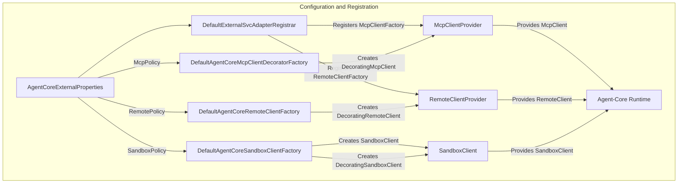

<!-- source: DeepWiki mcp.deepwiki.com · repo openJiuwen-ai/agent-runtime-java · page 6.4 External Services (MCP, Sandbox, Remote) · fetched 2026-11-02 -->

# External Services (MCP, Sandbox, Remote)

<details>
<summary>Relevant source files</summary>

The following files were used as context for generating this wiki page:

- [Third_Party_Open_Source_Software_Notice.txt](Third_Party_Open_Source_Software_Notice.txt)
- [service/agent-service-adapters/agent-service-adapters-agentcore/src/main/java/com/openjiuwen/service/adapters/agentcore/external/AgentCoreExternalProperties.java](service/agent-service-adapters/agent-service-adapters-agentcore/src/main/java/com/openjiuwen/service/adapters/agentcore/external/AgentCoreExternalProperties.java)
- [service/agent-service-adapters/agent-service-adapters-agentcore/src/main/java/com/openjiuwen/service/adapters/agentcore/external/DecoratingMcpClient.java](service/agent-service-adapters/agent-service-adapters-agentcore/src/main/java/com/openjiuwen/service/adapters/agentcore/external/DecoratingMcpClient.java)
- [service/agent-service-adapters/agent-service-adapters-agentcore/src/main/java/com/openjiuwen/service/adapters/agentcore/external/DecoratingSandboxClient.java](service/agent-service-adapters/agent-service-adapters-agentcore/src/main/java/com/openjiuwen/service/adapters/agentcore/external/DecoratingSandboxClient.java)
- [service/agent-service-adapters/agent-service-adapters-agentcore/src/main/java/com/openjiuwen/service/adapters/agentcore/external/DefaultAgentCoreSandboxClientFactory.java](service/agent-service-adapters/agent-service-adapters-agentcore/src/main/java/com/openjiuwen/service/adapters/agentcore/external/DefaultAgentCoreSandboxClientFactory.java)
- [service/agent-service-adapters/agent-service-adapters-agentcore/src/test/java/com/openjiuwen/service/adapters/agentcore/autoconfigure/AgentCoreAdaptersAutoConfigurationTest.java](service/agent-service-adapters/agent-service-adapters-agentcore/src/test/java/com/openjiuwen/service/adapters/agentcore/autoconfigure/AgentCoreAdaptersAutoConfigurationTest.java)
- [service/agent-service-adapters/agent-service-adapters-agentcore/src/test/java/com/openjiuwen/service/adapters/agentcore/external/DecoratingMcpClientTest.java](service/agent-service-adapters/agent-service-adapters-agentcore/src/test/java/com/openjiuwen/service/adapters/agentcore/external/DecoratingMcpClientTest.java)
- [service/agent-service-adapters/agent-service-adapters-agentcore/src/test/java/com/openjiuwen/service/adapters/agentcore/external/DecoratingRemoteClientTest.java](service/agent-service-adapters/agent-service-adapters-agentcore/src/test/java/com/openjiuwen/service/adapters/agentcore/external/DecoratingRemoteClientTest.java)
- [service/agent-service-adapters/agent-service-adapters-agentcore/src/test/java/com/openjiuwen/service/adapters/agentcore/external/DecoratingSandboxClientTest.java](service/agent-service-adapters/agent-service-adapters-agentcore/src/test/java/com/openjiuwen/service/adapters/agentcore/external/DecoratingSandboxClientTest.java)
- [service/agent-service-adapters/agent-service-adapters-agentcore/src/test/java/com/openjiuwen/service/adapters/agentcore/external/DefaultAgentCoreRemoteClientFactoryTest.java](service/agent-service-adapters/agent-service-adapters-agentcore/src/test/java/com/openjiuwen/service/adapters/agentcore/external/DefaultAgentCoreRemoteClientFactoryTest.java)
- [service/agent-service-adapters/agent-service-adapters-agentcore/src/test/java/com/openjiuwen/service/adapters/agentcore/external/DefaultAgentCoreSandboxClientFactoryTest.java](service/agent-service-adapters/agent-service-adapters-agentcore/src/test/java/com/openjiuwen/service/adapters/agentcore/external/DefaultAgentCoreSandboxClientFactoryTest.java)
- [service/agent-service-adapters/agent-service-adapters-agentcore/src/test/java/com/openjiuwen/service/adapters/agentcore/external/DefaultExternalSvcAdapterRegistrarTest.java](service/agent-service-adapters/agent-service-adapters-agentcore/src/test/java/com/openjiuwen/service/adapters/agentcore/external/DefaultExternalSvcAdapterRegistrarTest.java)
- [service/agent-service-adapters/agent-service-adapters-common/src/main/java/com/openjiuwen/service/adapters/common/external/ExternalCircuitBreakerPolicy.java](service/agent-service-adapters/agent-service-adapters-common/src/main/java/com/openjiuwen/service/adapters/common/external/ExternalCircuitBreakerPolicy.java)
- [service/agent-service-adapters/agent-service-adapters-common/src/main/java/com/openjiuwen/service/adapters/common/external/ExternalRetryPolicy.java](service/agent-service-adapters/agent-service-adapters-common/src/main/java/com/openjiuwen/service/adapters/common/external/ExternalRetryPolicy.java)
- [service/agent-service-adapters/agent-service-adapters-common/src/test/java/com/openjiuwen/service/adapters/common/external/ExternalCallExecutorTest.java](service/agent-service-adapters/agent-service-adapters-common/src/test/java/com/openjiuwen/service/adapters/common/external/ExternalCallExecutorTest.java)

</details>


This page details how `agent-runtime-java` interacts with external services such as the Multi-Capability Platform (MCP), Sandbox environments, and remote agents. It focuses on the `ExternalCallExecutor` and its associated policies (retry, timeout, circuit breaker, audit), how these policies decorate client implementations for MCP, Sandbox, and remote calls, and the registrars responsible for integrating these decorated clients into the agent runtime.

## ExternalCallExecutor and Policies

The `ExternalCallExecutor` [service/agent-service-adapters/agent-service-adapters-common/src/test/java/com/openjiuwen/service/adapters/common/external/ExternalCallExecutorTest.java:25-29]() is a core component that wraps calls to external services, applying various resilience and observability policies. These policies are configured via `ExternalCallPolicy` implementations, which include `ExternalRetryPolicy`, `ExternalCircuitBreakerPolicy`, and `ExternalAuditPolicy`.

### Policies

*   **Timeout**: Configured via `timeoutMs` [service/agent-service-adapters/agent-service-adapters-agentcore/src/main/java/com/openjiuwen/service/adapters/agentcore/external/AgentCoreExternalProperties.java:137](), this policy sets a maximum duration for an external call. If the call exceeds this duration, it is interrupted, and an `ExternalSvcAdapterException` with a specific timeout error code is thrown [service/agent-service-adapters/agent-service-adapters-common/src/test/java/com/openjiuwen/service/adapters/common/external/ExternalCallExecutorTest.java:28-29]().
*   **Retry**: Defined by `ExternalRetryPolicy` [service/agent-service-adapters/agent-service-adapters-common/src/main/java/com/openjiuwen/service/adapters/common/external/ExternalRetryPolicy.java](), this policy specifies the maximum number of retries (`max`) and the backoff duration (`backoffMs`) between retries. Retries are typically applied to idempotent operations to handle transient failures [service/agent-service-adapters/agent-service-adapters-agentcore/src/test/java/com/openjiuwen/service/adapters/agentcore/external/DecoratingMcpClientTest.java:34-38](). Non-idempotent operations, like `callTool` for MCP or `writeFile` for Sandbox, generally do not retry by default to avoid unintended side effects [service/agent-service-adapters/agent-service-adapters-agentcore/src/test/java/com/openjiuwen/service/adapters/agentcore/external/DecoratingMcpClientTest.java:163-165](), [service/agent-service-adapters/agent-service-adapters-agentcore/src/test/java/com/openjiuwen/service/adapters/agentcore/external/DecoratingSandboxClientTest.java:67-81]().
*   **Circuit Breaker**: Implemented by `ExternalCircuitBreakerPolicy` [service/agent-service-adapters/agent-service-adapters-common/src/main/java/com/openjiuwen/service/adapters/common/external/ExternalCircuitBreakerPolicy.java](), this policy prevents repeated calls to a failing service. It tracks failures and, if a `failureThreshold` is reached, "opens" the circuit, causing subsequent calls to fail fast without attempting to reach the external service. After a `resetTimeoutMs`, it allows a single "probe" call to determine if the service has recovered [service/agent-service-adapters/agent-service-adapters-common/src/test/java/com/openjiuwen/service/adapters/common/external/ExternalCallExecutorTest.java:67-87]().
*   **Audit**: Configured via `ExternalAuditPolicy` [service/agent-service-adapters/agent-service-adapters-agentcore/src/main/java/com/openjiuwen/service/adapters/agentcore/external/AgentCoreExternalProperties.java:143](), this policy logs details about external calls, including success/failure status, target service, method, and redacted request parameters. This is crucial for observability and debugging [service/agent-service-adapters/agent-service-adapters-agentcore/src/test/java/com/openjiuwen/service/adapters/agentcore/external/DecoratingMcpClientTest.java:76-96]().

### `ExternalCallExecutor` Workflow

The `ExternalCallExecutor` [service/agent-service-adapters/agent-service-adapters-common/src/test/java/com/openjiuwen/service/adapters/common/external/ExternalCallExecutorTest.java:25-29]() orchestrates these policies. When an external call is made through the executor:
1.  It first checks the circuit breaker state. If open, it fails fast.
2.  It attempts the call, applying the configured timeout.
3.  If the call fails and retry is enabled for the operation, it retries according to the `ExternalRetryPolicy`.
4.  Upon success or final failure, it updates the circuit breaker state.
5.  If auditing is enabled, it logs the call details.

```mermaid
graph TD
    A[ExternalCallExecutor.execute()] --> B{Is Circuit Open?};
    B -- Yes --> C[Fail Fast: ExternalSvcAdapterErrorCode.CIRCUIT_OPEN];
    B -- No --> D{Attempt Call};
    D --> E[Apply Timeout];
    E --> F[Execute Delegate Call];
    F -- Success --> G[Update Circuit Breaker: Success];
    F -- Failure --> H{Is Retry Enabled and Attempts Left?};
    H -- Yes --> I[Apply Backoff];
    I --> D;
    H -- No --> J[Update Circuit Breaker: Failure];
    J --> K[Throw ExternalSvcAdapterException];
    G --> L{Is Audit Enabled?};
    K --> L;
    L -- Yes --> M[Log Audit Entry];
    L -- No --> N[Return Result / Throw Exception];
    M --> N;
```
**Diagram: ExternalCallExecutor Workflow**
Sources: [service/agent-service-adapters/agent-service-adapters-common/src/test/java/com/openjiuwen/service/adapters/common/external/ExternalCallExecutorTest.java:25-29]()

## Decorating External Clients

The `agent-runtime-java` uses decorator patterns to apply these `ExternalCallExecutor` policies to the core client implementations for MCP, Sandbox, and remote agents. This ensures that all interactions with these external services benefit from consistent resilience and observability features.

### MCP Client Decoration

The `DecoratingMcpClient` [service/agent-service-adapters/agent-service-adapters-agentcore/src/main/java/com/openjiuwen/service/adapters/agentcore/external/DecoratingMcpClient.java:25]() wraps a base `McpClient` [service/agent-service-adapters/agent-service-adapters-agentcore/src/main/java/com/openjiuwen/service/adapters/agentcore/external/DecoratingMcpClient.java:34]() and applies the `AgentCoreExternalProperties.McpPolicy` [service/agent-service-adapters/agent-service-adapters-agentcore/src/main/java/com/openjiuwen/service/adapters/agentcore/external/DecoratingMcpClient.java:36]().
*   **Configuration**: MCP policies are defined in `AgentCoreExternalProperties.McpPolicy` [service/agent-service-adapters/agent-service-adapters-agentcore/src/main/java/com/openjiuwen/service/adapters/agentcore/external/AgentCoreExternalProperties.java:132](), which includes `timeoutMs`, `retry` settings, `circuitBreaker` settings, and `audit` settings.
*   **Retry Behavior**: Operations like `listTools` [service/agent-service-adapters/agent-service-adapters-agentcore/src/main/java/com/openjiuwen/service/adapters/agentcore/external/DecoratingMcpClient.java:62]() and `listResources` are typically retried, while `callTool` [service/agent-service-adapters/agent-service-adapters-agentcore/src/main/java/com/openjiuwen/service/adapters/agentcore/external/DecoratingMcpClient.java:78]() retries only if `shouldRetryToolCalls` is enabled in the policy [service/agent-service-adapters/agent-service-adapters-agentcore/src/main/java/com/openjiuwen/service/adapters/agentcore/external/AgentCoreExternalProperties.java:146]().
*   **Timeout Resolution**: The `resolveTimeout` method [service/agent-service-adapters/agent-service-adapters-agentcore/src/main/java/com/openjiuwen/service/adapters/agentcore/external/DecoratingMcpClient.java:94]() determines the effective timeout, prioritizing a caller-provided timeout over the policy's configured `timeoutMs`.

```mermaid
graph TD
    subgraph "MCP Client Decoration"
        A[McpClient (Core)] --> B[DecoratingMcpClient];
        B --> C[ExternalCallExecutor];
        C --> D[AgentCoreExternalProperties.McpPolicy];
        D -- Configures --> C;
        B -- Delegates Calls --> A;
    end
    subgraph "McpPolicy Details"
        D --> D1[timeoutMs];
        D --> D2[ExternalRetryPolicy];
        D --> D3[ExternalCircuitBreakerPolicy];
        D --> D4[ExternalAuditPolicy];
        D --> D5[shouldRetryToolCalls];
    end
```
**Diagram: MCP Client Decoration**
Sources: [service/agent-service-adapters/agent-service-adapters-agentcore/src/main/java/com/openjiuwen/service/adapters/agentcore/external/DecoratingMcpClient.java:25](), [service/agent-service-adapters/agent-service-adapters-agentcore/src/main/java/com/openjiuwen/service/adapters/agentcore/external/AgentCoreExternalProperties.java:132]()

### Sandbox Client Decoration

The `DecoratingSandboxClient` [service/agent-service-adapters/agent-service-adapters-agentcore/src/main/java/com/openjiuwen/service/adapters/agentcore/external/DecoratingSandboxClient.java:40]() extends `SandboxClient` and wraps its `fs()`, `shell()`, and `code()` operations with `ExternalCallExecutor` instances, each configured with the `AgentCoreExternalProperties.SandboxPolicy` [service/agent-service-adapters/agent-service-adapters-agentcore/src/main/java/com/openjiuwen/service/adapters/agentcore/external/DecoratingSandboxClient.java:50-56]().
*   **Configuration**: Sandbox policies are defined in `AgentCoreExternalProperties.SandboxPolicy` [service/agent-service-adapters/agent-service-adapters-agentcore/src/main/java/com/openjiuwen/service/adapters/agentcore/external/AgentCoreExternalProperties.java:296]().
*   **Retry Behavior**: Read-only file system operations like `readFile` [service/agent-service-adapters/agent-service-adapters-agentcore/src/main/java/com/openjiuwen/service/adapters/agentcore/external/DecoratingSandboxClient.java:93]() are typically retried, as they are idempotent. Operations with potential side effects, such as `writeFile` [service/agent-service-adapters/agent-service-adapters-agentcore/src/main/java/com/openjiuwen/service/adapters/agentcore/external/DecoratingSandboxClient.java:110](), `executeCmd` [service/agent-service-adapters/agent-service-adapters-agentcore/src/main/java/com/openjiuwen/service/adapters/agentcore/external/DecoratingSandboxClient.java:170](), and `executeCode` [service/agent-service-adapters/agent-service-adapters-agentcore/src/main/java/com/openjiuwen/service/adapters/agentcore/external/DecoratingSandboxClient.java:206](), are generally not retried by default [service/agent-service-adapters/agent-service-adapters-agentcore/src/test/java/com/openjiuwen/service/adapters/agentcore/external/DecoratingSandboxClientTest.java:67-81]().
*   **Timeout Resolution**: Sandbox operations use the policy's `timeoutMs` if no specific timeout is provided by the caller [service/agent-service-adapters/agent-service-adapters-agentcore/src/test/java/com/openjiuwen/service/adapters/agentcore/external/DecoratingSandboxClientTest.java:107-120]().

```mermaid
graph TD
    subgraph "Sandbox Client Decoration"
        A[SandboxClient (Core)] --> B[DecoratingSandboxClient];
        B -- Delegates fs() --> B1[DecoratingSandboxFsOperation];
        B -- Delegates shell() --> B2[DecoratingSandboxShellOperation];
        B -- Delegates code() --> B3[DecoratingSandboxCodeOperation];
        B1 --> C[ExternalCallExecutor];
        B2 --> C;
        B3 --> C;
        C --> D[AgentCoreExternalProperties.SandboxPolicy];
        D -- Configures --> C;
    end
    subgraph "SandboxPolicy Details"
        D --> D1[timeoutMs];
        D --> D2[ExternalRetryPolicy];
        D --> D3[ExternalCircuitBreakerPolicy];
        D --> D4[ExternalAuditPolicy];
    end
```
**Diagram: Sandbox Client Decoration**
Sources: [service/agent-service-adapters/agent-service-adapters-agentcore/src/main/java/com/openjiuwen/service/adapters/agentcore/external/DecoratingSandboxClient.java:40](), [service/agent-service-adapters/agent-service-adapters-agentcore/src/main/java/com/openjiuwen/service/adapters/agentcore/external/AgentCoreExternalProperties.java:296]()

### Remote Client Decoration

The `DecoratingRemoteClient` [service/agent-service-adapters/agent-service-adapters-agentcore/src/main/java/com/openjiuwen/service/adapters/agentcore/external/DecoratingRemoteClient.java:25]() wraps a base `RemoteClient` [service/agent-service-adapters/agent-service-adapters-agentcore/src/main/java/com/openjiuwen/service/adapters/agentcore/external/DecoratingRemoteClient.java:34]() and applies the `AgentCoreExternalProperties.RemotePolicy` [service/agent-service-adapters/agent-service-adapters-agentcore/src/main/java/com/openjiuwen/service/adapters/agentcore/external/DecoratingRemoteClient.java:36]().
*   **Configuration**: Remote policies are defined in `AgentCoreExternalProperties.RemotePolicy` [service/agent-service-adapters/agent-service-adapters-agentcore/src/main/java/com/openjiuwen/service/adapters/agentcore/external/AgentCoreExternalProperties.java:210]().
*   **Retry Behavior**: The `invoke` operation [service/agent-service-adapters/agent-service-adapters-agentcore/src/main/java/com/openjiuwen/service/adapters/agentcore/external/DecoratingRemoteClient.java:50]() retries only if `retryInvoke` is enabled in the policy [service/agent-service-adapters/agent-service-adapters-agentcore/src/main/java/com/openjiuwen/service/adapters/agentcore/external/AgentCoreExternalProperties.java:219](). By default, it does not retry due to potential side effects [service/agent-service-adapters/agent-service-adapters-agentcore/src/test/java/com/openjiuwen/service/adapters/agentcore/external/DecoratingRemoteClientTest.java:86-98]().
*   **Timeout Resolution**: Similar to MCP, the `resolveTimeout` method [service/agent-service-adapters/agent-service-adapters-agentcore/src/main/java/com/openjiuwen/service/adapters/agentcore/external/DecoratingRemoteClient.java:62]() prioritizes caller-provided timeouts.

```mermaid
graph TD
    subgraph "Remote Client Decoration"
        A[RemoteClient (Core)] --> B[DecoratingRemoteClient];
        B --> C[ExternalCallExecutor];
        C --> D[AgentCoreExternalProperties.RemotePolicy];
        D -- Configures --> C;
        B -- Delegates Calls --> A;
    end
    subgraph "RemotePolicy Details"
        D --> D1[timeoutMs];
        D --> D2[ExternalRetryPolicy];
        D --> D3[ExternalCircuitBreakerPolicy];
        D --> D4[ExternalAuditPolicy];
        D --> D5[retryInvoke];
    end
```
**Diagram: Remote Client Decoration**
Sources: [service/agent-service-adapters/agent-service-adapters-agentcore/src/main/java/com/openjiuwen/service/adapters/agentcore/external/DecoratingRemoteClient.java:25](), [service/agent-service-adapters/agent-service-adapters-agentcore/src/main/java/com/openjiuwen/service/adapters/agentcore/external/AgentCoreExternalProperties.java:210]()

## Registrars and Factories

The `agent-runtime-java` uses registrars and factories to integrate these decorated clients into the `agent-core` framework.

### `AgentCoreExternalProperties`

This class [service/agent-service-adapters/agent-service-adapters-agentcore/src/main/java/com/openjiuwen/service/adapters/agentcore/external/AgentCoreExternalProperties.java:33]() is a Spring `@ConfigurationProperties` bean that holds all external service configurations, including MCP, Remote, and Sandbox. It allows for global policy settings and server-specific overrides [service/agent-service-adapters/agent-service-adapters-agentcore/src/main/java/com/openjiuwen/service/adapters/agentcore/external/AgentCoreExternalProperties.java:75-108]().

### `DefaultExternalSvcAdapterRegistrar`

This registrar [service/agent-service-adapters/agent-service-adapters-agentcore/src/test/java/com/openjiuwen/service/adapters/agentcore/external/DefaultExternalSvcAdapterRegistrarTest.java:33]() is responsible for taking the configured external services from `AgentCoreExternalProperties` and registering them with the `agent-core`'s `RunnerConfig`.
*   It maps `McpServer` configurations to `McpServerConfig` objects [service/agent-service-adapters/agent-service-adapters-agentcore/src/test/java/com/openjiuwen/service/adapters/agentcore/external/DefaultExternalSvcAdapterRegistrarTest.java:34-59]().
*   It registers `McpClientFactory` and `RemoteClientFactory` instances that produce the decorated clients [service/agent-service-adapters/agent-service-adapters-agentcore/src/main/java/com/openjiuwen/service/adapters/agentcore/autoconfigure/AgentCoreAdaptersAutoConfiguration.java:100-101]().

### Client Factories

*   **`DefaultAgentCoreMcpClientDecoratorFactory`**: Creates `DecoratingMcpClient` instances based on `McpServerConfig` and `AgentCoreExternalProperties.McpPolicy`.
*   **`DefaultAgentCoreSandboxClientFactory`**: Creates `DecoratingSandboxClient` instances. It also handles the mapping of `AgentCoreExternalProperties.SandboxServer` to `SandboxGatewayConfig` for the underlying `SandboxClient` [service/agent-service-adapters/agent-service-adapters-agentcore/src/main/java/com/openjiuwen/service/adapters/agentcore/external/DefaultAgentCoreSandboxClientFactory.java:62-70]().
*   **`DefaultAgentCoreRemoteClientFactory`**: Creates `DecoratingRemoteClient` instances. It maps `AgentCoreExternalProperties.RemoteClientEndpoint` to `RemoteClientConfig` for the underlying `RemoteClient`.


**Diagram: External Service Client Registration**
Sources: [service/agent-service-adapters/agent-service-adapters-agentcore/src/main/java/com/openjiuwen/service/adapters/agentcore/external/AgentCoreExternalProperties.java:33](), [service/agent-service-adapters/agent-service-adapters-agentcore/src/test/java/com/openjiuwen/service/adapters/agentcore/external/DefaultExternalSvcAdapterRegistrarTest.java:33](), [service/agent-service-adapters/agent-service-adapters-agentcore/src/main/java/com/openjiuwen/service/adapters/agentcore/external/DefaultAgentCoreSandboxClientFactory.java:30]()

---

