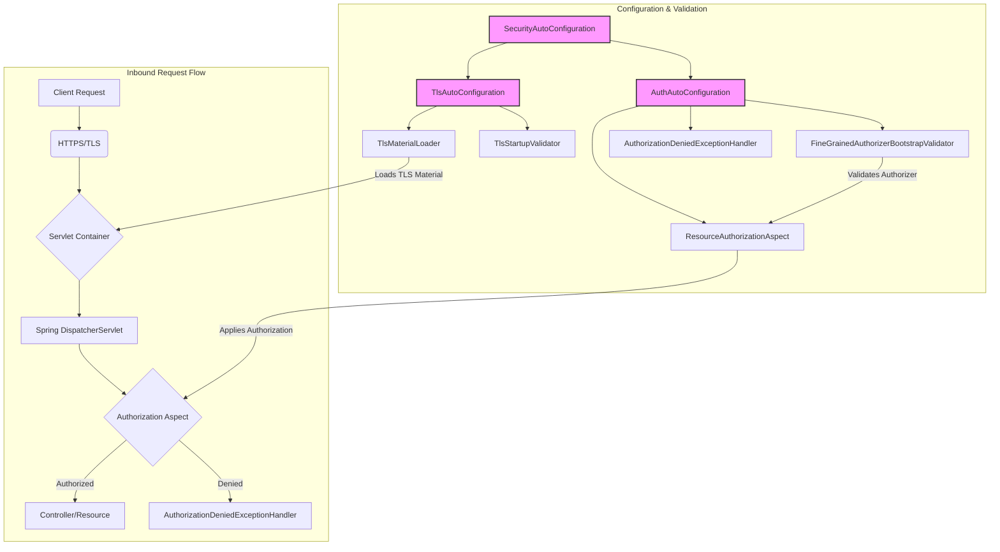
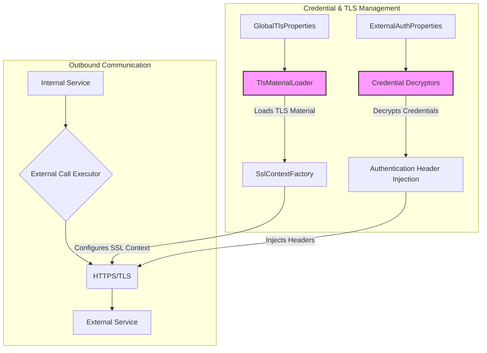

<!-- source: DeepWiki mcp.deepwiki.com · repo openJiuwen-ai/agent-runtime-java · page 7 Security · fetched 2026-11-02 -->

# Security

Relevant source files

The following files were used as context for generating this wiki page:

- [service/agent-service-adapters/agent-service-adapters-common/src/main/java/com/openjiuwen/service/adapters/common/security/TlsMaterialLoader.java](service/agent-service-adapters/agent-service-adapters-common/src/main/java/com/openjiuwen/service/adapters/common/security/TlsMaterialLoader.java)
- [service/agent-service-adapters/agent-service-adapters-common/src/main/java/com/openjiuwen/service/adapters/common/security/package-info.java](service/agent-service-adapters/agent-service-adapters-common/src/main/java/com/openjiuwen/service/adapters/common/security/package-info.java)
- [service/agent-service-adapters/agent-service-adapters-common/src/test/java/com/openjiuwen/service/adapters/common/security/TlsMaterialLoaderTest.java](service/agent-service-adapters/agent-service-adapters-common/src/test/java/com/openjiuwen/service/adapters/common/security/TlsMaterialLoaderTest.java)
- [service/agent-service-app/src/main/java/com/openjiuwen/service/app/autoconfigure/AuthAutoConfiguration.java](service/agent-service-app/src/main/java/com/openjiuwen/service/app/autoconfigure/AuthAutoConfiguration.java)
- [service/agent-service-app/src/main/java/com/openjiuwen/service/app/autoconfigure/SecurityAutoConfiguration.java](service/agent-service-app/src/main/java/com/openjiuwen/service/app/autoconfigure/SecurityAutoConfiguration.java)
- [service/agent-service-app/src/main/java/com/openjiuwen/service/app/autoconfigure/TlsAutoConfiguration.java](service/agent-service-app/src/main/java/com/openjiuwen/service/app/autoconfigure/TlsAutoConfiguration.java)

This page provides a high-level overview of security mechanisms within the `agent-runtime-java` codebase. It covers both inbound security, focusing on authorization and TLS for incoming requests, and outbound security, which deals with TLS, authentication, and credential handling for external communications. Detailed explanations and implementation specifics for each area are delegated to dedicated child pages.

## Inbound Authorization and TLS

The `agent-runtime-java` handles inbound security through a combination of TLS for secure communication and fine-grained authorization for access control. Ingress TLS configuration is managed by `TlsAutoConfiguration` [service/agent-service-app/src/main/java/com/openjiuwen/service/app/autoconfigure/TlsAutoConfiguration.java:29-84](), which integrates with Spring Boot's embedded servlet container SSL settings. This auto-configuration loads TLS material, including keystores and truststores, and applies client authentication policies.

Authorization is enabled via `AuthAutoConfiguration` [service/agent-service-app/src/main/java/com/openjiuwen/service/app/autoconfigure/AuthAutoConfiguration.java:23-60](), which sets up an Aspect-Oriented Programming (AOP) based authorization mechanism. This allows for fine-grained control over resource access using a `FineGrainedAuthorizer` and includes an exception handler for authorization denials. A `TlsStartupValidator` [service/agent-service-app/src/main/java/com/openjiuwen/service/app/security/TlsStartupValidator.java:10]() ensures that TLS configurations are valid at startup.

For details on how inbound authorization and TLS are configured and implemented, including the `SecurityAutoConfiguration`, `AuthorizationRequestBuilder`/`Resolver`, fine-grained authorizer validation, `TlsStartupValidator`, and denial handling, see [Inbound Authorization and TLS](#7.1).

### Inbound Security Overview

Sources:
- [service/agent-service-app/src/main/java/com/openjiuwen/service/app/autoconfigure/TlsAutoConfiguration.java:29-84]()
- [service/agent-service-app/src/main/java/com/openjiuwen/service/app/autoconfigure/SecurityAutoConfiguration.java:26-30]()
- [service/agent-service-app/src/main/java/com/openjiuwen/service/app/autoconfigure/AuthAutoConfiguration.java:23-60]()
- [service/agent-service-adapters/agent-service-adapters-common/src/main/java/com/openjiuwen/service/adapters/common/security/TlsMaterialLoader.java:18-59]()

## Outbound Security and Credentials

Outbound security focuses on securing communications with external services and managing credentials. This includes configuring TLS for client-side connections and handling authentication details. The `TlsMaterialLoader` [service/agent-service-adapters/agent-service-adapters-common/src/main/java/com/openjiuwen/service/adapters/common/security/TlsMaterialLoader.java:18-59]() is a shared utility used for both inbound and outbound TLS, responsible for loading TLS material and decrypting passwords using a `CredentialDecryptor` [service/agent-service-adapters/agent-service-adapters-common/src/test/java/com/openjiuwen/service/adapters/common/security/TlsMaterialLoaderTest.java:9-42](). This ensures that sensitive information like keystore and truststore passwords can be stored encrypted and decrypted at runtime.

The system supports various credential decryptors and mechanisms for injecting authentication headers into outbound requests, ensuring secure communication with external APIs and services.

For a detailed understanding of `GlobalTlsProperties`/`ExternalTlsConfig`, `ExternalAuthProperties`, `SslContextFactory`, credential decryptors, and header injection, refer to [Outbound Security and Credentials](#7.2).

### Outbound Security Overview

Sources:
- [service/agent-service-adapters/agent-service-adapters-common/src/main/java/com/openjiuwen/service/adapters/common/security/TlsMaterialLoader.java:18-59]()
- [service/agent-service-adapters/agent-service-adapters-common/src/test/java/com/openjiuwen/service/adapters/common/security/TlsMaterialLoaderTest.java:9-42]()

---

