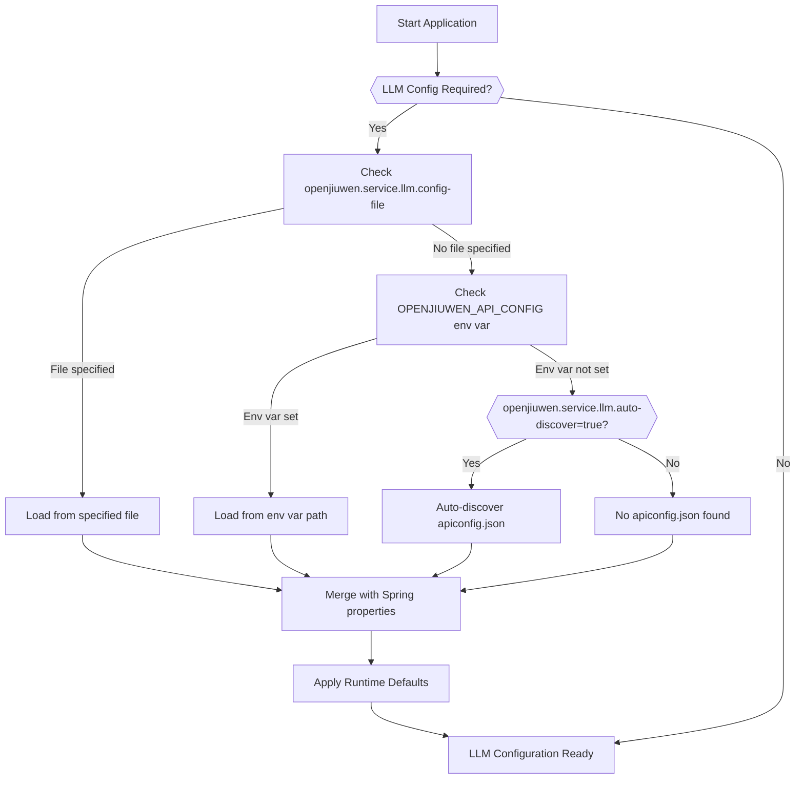

<!-- source: DeepWiki mcp.deepwiki.com · repo openJiuwen-ai/agent-runtime-java · page 8 Demos and Examples · fetched 2026-11-02 -->

# Demos and Examples

Relevant source files

The following files were used as context for generating this wiki page:

- [service/agent-service-demo/README.md](service/agent-service-demo/README.md)
- [service/agent-service-demo/example/config/application-base.yml](service/agent-service-demo/example/config/application-base.yml)
- [service/agent-service-demo/example/redis/README.md](service/agent-service-demo/example/redis/README.md)
- [service/agent-service-demo/src/main/resources/application.yml](service/agent-service-demo/src/main/resources/application.yml)
- [service/agent-service-demo/src/test/java/com/openjiuwen/service/demo/DemoAgentApplicationTest.java](service/agent-service-demo/src/test/java/com/openjiuwen/service/demo/DemoAgentApplicationTest.java)

This page provides a high-level overview of the `agent-service-demo` module, which contains runnable examples and smoke scripts for various features of the `agent-runtime-java` codebase. The purpose of these demos is to showcase the functionality of the agent runtime and provide developers with practical examples for integration and testing.

The `agent-service-demo` module serves as a comprehensive testing ground, demonstrating how different components of the `agent-runtime-java` interact. It includes examples for core functionalities like the Query API, Middleware Checkpointer, and AgentCore Handler, as well as more advanced features such as multi-agent A2A communication, external service integrations (MCP, Sandbox), Redis for session management, and security configurations.

This page is a parent page, offering a brief introduction to each demo area. For detailed explanations, configuration instructions, and specific smoke scripts, please refer to the linked child pages.

## Multi-Agent A2A Demo (Agents A–D)

This section introduces the multi-agent A2A (Agent-to-Agent) demo, which illustrates a complex delegation topology involving four agents (A, B, C, and D). It highlights the A2A protocol's capabilities, including interrupt rails and the handling of an expense review workflow. This demo is crucial for understanding how agents can collaborate and delegate tasks within the `agent-runtime-java` ecosystem.

For details, see [Multi-Agent A2A Demo (Agents A–D)](#8.1).

Sources:
- `service/agent-service-demo/README.md`

## Feature Demos: MCP, Sandbox, Redis, DeepAgent, Security

This section covers various feature-specific examples within the `agent-service-demo` module. Each example focuses on a particular aspect of the `agent-runtime-java`, such as integration with external services like MCP (Multi-Cloud Platform) and Sandbox, utilizing Redis for session management and checkpointing, demonstrating DeepAgent capabilities, and showcasing security configurations (TLS, authorization). These demos often come with their own YAML profiles and smoke scripts for easy execution and verification.

The main `DemoAgentApplication` [service/agent-service-demo/src/test/java/com/openjiuwen/service/demo/DemoAgentApplicationTest.java:54-54]() provides an end-to-end smoke test for the basic service surface, including `/health`, `/v1/query`, and `/v1/reset_conversation`. It uses a deterministic in-memory model to ensure stable assertions [service/agent-service-demo/src/test/java/com/openjiuwen/service/demo/DemoAgentApplicationTest.java:51-53]().

### Demo Application Flow

The core demo application follows a specific flow:
`Query API -> ServeOrchestrator -> JiuwenCoreAgentHandler -> Runner -> ReActAgent` [service/agent-service-demo/README.md:20-21]().
It requires LLM configuration (e.g., `api-key`, `api-base`, `model-name`) to start [service/agent-service-demo/README.md:23-25](). These can be provided via `application-base_local.yml` or `apiconfig.json` [service/agent-service-demo/README.md:26-26]().

### LLM Configuration

The demo applications retrieve LLM configurations from `apiconfig.json` or Spring properties. The `ApiConfigLoader` prioritizes configuration sources:
1. `openjiuwen.service.llm.config-file` [service/agent-service-demo/README.md:133-133]()
2. `OPENJIUWEN_API_CONFIG` environment variable [service/agent-service-demo/README.md:134-134]()
3. `apiconfig.json` discovered automatically if `openjiuwen.service.llm.auto-discover=true` [service/agent-service-demo/README.md:135-137]()

Spring properties like `openjiuwen.service.llm.api-base`, `openjiuwen.service.llm.api-key`, `openjiuwen.service.llm.model-name`, and `openjiuwen.service.llm.provider` can also directly configure the model parameters [service/agent-service-demo/README.md:177-182]().

### Diagram: LLM Configuration Resolution

Sources:
- `service/agent-service-demo/README.md`
- `service/agent-service-demo/src/test/java/com/openjiuwen/service/demo/DemoAgentApplicationTest.java`
- `service/agent-service-demo/example/config/application-base.yml`

### Example: Redis Checkpointer

The Redis Checkpointer example, located in `example/redis/`, demonstrates how to use Redis for persistent session management and cross-process recovery of conversation context [service/agent-service-demo/example/redis/README.md:3-3](). By default, the main demo uses an in-memory checkpointer, losing session data upon process exit [service/agent-service-demo/example/redis/README.md:15-15](). This example configures `checkpointer.type: redis` [service/agent-service-demo/example/redis/README.md:10-10]() to store session checkpoints in Redis, enabling multi-turn conversations and recovery even after service restarts [service/agent-service-demo/example/redis/README.md:17-18]().

The Redis example runs on port `8091` [service/agent-service-demo/example/redis/README.md:8-8]() to allow concurrent execution with the main demo on `8090` [service/agent-service-demo/example/redis/README.md:8-8](). It uses `ReActAgent` and `JiuwenCoreAgentHandler` [service/agent-service-demo/example/redis/README.md:9-10]().

To run the Redis demo:
1. Ensure Redis is running and accessible (default `127.0.0.1:6379`, database `0`) [service/agent-service-demo/example/redis/README.md:28-36]().
2. Configure LLM API keys as described above [service/agent-service-demo/example/redis/README.md:45-69]().
3. Start the service: `mvn -pl agent-service-demo/example/redis -am spring-boot:run` [service/agent-service-demo/example/redis/README.md:73-73]().
4. Execute smoke scripts like `smoke-redis.ps1` (Windows) or `smoke-redis.sh` (Linux/Git Bash) [service/agent-service-demo/example/redis/README.md:84-95]().

For details, see [Feature Demos: MCP, Sandbox, Redis, DeepAgent, Security](#8.2).

Sources:
- `service/agent-service-demo/README.md`
- `service/agent-service-demo/example/redis/README.md`
- `service/agent-service-demo/src/main/resources/application.yml`
- `service/agent-service-demo/example/config/application-base.yml`

## Concurrency Load Harness

This section introduces the concurrency load harness, a set of tools designed for performance and reliability testing. It includes `ConcurrentLoadHarness`, `ConcurrentLoadRunner`, and `ConcurrentLoadMetrics` to simulate concurrent client requests. The harness supports both direct query clients and A2A concurrent clients, and can interact with mock LLM/model clients for controlled testing environments. This is essential for conducting end-to-end load integration tests and ensuring the system's stability under heavy traffic.

For details, see [Concurrency Load Harness](#8.3).

Sources:
- `service/agent-service-demo/README.md`

---

