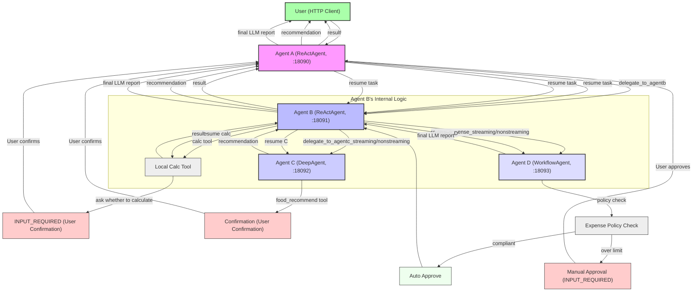

<!-- source: DeepWiki mcp.deepwiki.com · repo openJiuwen-ai/agent-runtime-java · page 8.1 Multi-Agent A2A Demo (Agents A–D) · fetched 2026-11-02 -->

# Multi-Agent A2A Demo (Agents A–D)

<details>
<summary>Relevant source files</summary>

The following files were used as context for generating this wiki page:

- [service/agent-service-app/src/test/java/com/openjiuwen/service/app/autoconfigure/LlmAutoConfigurationTest.java](service/agent-service-app/src/test/java/com/openjiuwen/service/app/autoconfigure/LlmAutoConfigurationTest.java)
- [service/agent-service-app/src/test/java/com/openjiuwen/service/app/config/llm/ApiConfigLoaderTest.java](service/agent-service-app/src/test/java/com/openjiuwen/service/app/config/llm/ApiConfigLoaderTest.java)
- [service/agent-service-app/src/test/java/com/openjiuwen/service/app/config/llm/LlmConfigResolverTest.java](service/agent-service-app/src/test/java/com/openjiuwen/service/app/config/llm/LlmConfigResolverTest.java)
- [service/agent-service-demo/example/a2a/README.md](service/agent-service-demo/example/a2a/README.md)
- [service/agent-service-demo/example/a2a/application-a2a-agent-a.yml](service/agent-service-demo/example/a2a/application-a2a-agent-a.yml)
- [service/agent-service-demo/example/a2a/application-a2a-agent-b.yml](service/agent-service-demo/example/a2a/application-a2a-agent-b.yml)
- [service/agent-service-demo/example/a2a/application-a2a-agent-c.yml](service/agent-service-demo/example/a2a/application-a2a-agent-c.yml)
- [service/agent-service-demo/example/a2a/application-a2a-redis.example.yml](service/agent-service-demo/example/a2a/application-a2a-redis.example.yml)
- [service/agent-service-demo/example/a2a/pom.xml](service/agent-service-demo/example/a2a/pom.xml)
- [service/agent-service-demo/example/a2a/smoke-a2a.ps1](service/agent-service-demo/example/a2a/smoke-a2a.ps1)
- [service/agent-service-demo/example/a2a/smoke-a2a.sh](service/agent-service-demo/example/a2a/smoke-a2a.sh)
- [service/agent-service-demo/example/a2a/src/main/java/com/openjiuwen/service/demo/example/a2a/A2aAgentADemoApplication.java](service/agent-service-demo/example/a2a/src/main/java/com/openjiuwen/service/demo/example/a2a/A2aAgentADemoApplication.java)
- [service/agent-service-demo/example/a2a/src/main/java/com/openjiuwen/service/demo/example/a2a/A2aAgentBDemoApplication.java](service/agent-service-demo/example/a2a/src/main/java/com/openjiuwen/service/demo/example/a2a/A2aAgentBDemoApplication.java)
- [service/agent-service-demo/example/a2a/src/main/java/com/openjiuwen/service/demo/example/a2a/A2aAgentCDemoApplication.java](service/agent-service-demo/example/a2a/src/main/java/com/openjiuwen/service/demo/example/a2a/A2aAgentCDemoApplication.java)
- [service/agent-service-demo/example/a2a/src/main/java/com/openjiuwen/service/demo/example/a2a/A2aDelegateRail.java](service/agent-service-demo/example/a2a/src/main/java/com/openjiuwen/service/demo/example/a2a/A2aDelegateRail.java)
- [service/agent-service-demo/example/a2a/src/main/java/com/openjiuwen/service/demo/example/a2a/BToCDelegateRail.java](service/agent-service-demo/example/a2a/src/main/java/com/openjiuwen/service/demo/example/a2a/BToCDelegateRail.java)
- [service/agent-service-demo/example/a2a/src/main/java/com/openjiuwen/service/demo/example/a2a/CalcInterruptRail.java](service/agent-service-demo/example/a2a/src/main/java/com/openjiuwen/service/demo/example/a2a/CalcInterruptRail.java)
- [service/agent-service-demo/example/a2a/src/main/java/com/openjiuwen/service/demo/example/a2a/ExpensePolicyTool.java](service/agent-service-demo/example/a2a/src/main/java/com/openjiuwen/service/demo/example/a2a/ExpensePolicyTool.java)
- [service/agent-service-demo/example/a2a/src/main/java/com/openjiuwen/service/demo/example/a2a/ExpenseReviewWorkflow.java](service/agent-service-demo/example/a2a/src/main/java/com/openjiuwen/service/demo/example/a2a/ExpenseReviewWorkflow.java)
- [service/agent-service-demo/example/a2a/src/main/java/com/openjiuwen/service/demo/example/a2a/FoodRecommendInterruptRail.java](service/agent-service-demo/example/a2a/src/main/java/com/openjiuwen/service/demo/example/a2a/FoodRecommendInterruptRail.java)
- [service/agent-service-demo/example/a2a/src/test/java/com/openjiuwen/service/demo/example/a2a/A2aRoutingConfigurationTest.java](service/agent-service-demo/example/a2a/src/test/java/com/openjiuwen/service/demo/example/a2a/A2aRoutingConfigurationTest.java)
- [service/agent-service-demo/example/a2a/src/test/java/com/openjiuwen/service/demo/example/a2a/BToCDelegateRailTest.java](service/agent-service-demo/example/a2a/src/test/java/com/openjiuwen/service/demo/example/a2a/BToCDelegateRailTest.java)
- [service/agent-service-demo/example/a2a/src/test/java/com/openjiuwen/service/demo/example/a2a/CalcInterruptRailTest.java](service/agent-service-demo/example/a2a/src/test/java/com/openjiuwen/service/demo/example/a2a/CalcInterruptRailTest.java)
- [service/agent-service-demo/example/a2a/src/test/java/com/openjiuwen/service/demo/example/a2a/ExpenseReviewWorkflowTest.java](service/agent-service-demo/example/a2a/src/test/java/com/openjiuwen/service/demo/example/a2a/ExpenseReviewWorkflowTest.java)
- [service/agent-service-demo/example/a2a/src/test/java/com/openjiuwen/service/demo/example/a2a/FoodRecommendInterruptRailTest.java](service/agent-service-demo/example/a2a/src/test/java/com/openjiuwen/service/demo/example/a2a/FoodRecommendInterruptRailTest.java)
- [service/agent-service-demo/example/support/src/test/java/com/openjiuwen/service/demo/example/support/ExampleDeepAgentFactoryTest.java](service/agent-service-demo/example/support/src/test/java/com/openjiuwen/service/demo/example/support/ExampleDeepAgentFactoryTest.java)
- [service/agent-service-demo/example/support/src/test/java/com/openjiuwen/service/demo/example/support/ExampleReActAgentFactoryTest.java](service/agent-service-demo/example/support/src/test/java/com/openjiuwen/service/demo/example/support/ExampleReActAgentFactoryTest.java)

</details>


This page details a multi-agent A2A (Agent-to-Agent) demonstration involving four distinct agents (A, B, C, and D) collaborating to handle user requests. The demo showcases delegation, interrupt-and-resume capabilities, and an expense review workflow. It includes configuration details and smoke scripts for quick validation. All business requests are initiated through Agent A's `/a2a/` endpoint.

## Demo Overview and Architecture

The demonstration features a four-agent delegation topology. User requests are always sent to Agent A, which then delegates to Agent B. Agent B acts as a router, delegating to either Agent C for dining recommendations or Agent D for expense reviews, or handling local calculations. Interrupts are used for user confirmation or approval, allowing tasks to be paused and resumed.

The agents involved are:
*   **Agent A (Port 18090)**: A `ReActAgent` [service/agent-service-demo/example/a2a/application-a2a-agent-a.yml:1-45]() that serves as the entry point for user requests and delegates to Agent B.
*   **Agent B (Port 18091)**: A `ReActAgent` [service/agent-service-demo/example/a2a/application-a2a-agent-b.yml:1-89]() that handles local calculations or delegates to Agent C or Agent D based on the request.
*   **Agent C (Port 18092)**: A `DeepAgent` [service/agent-service-demo/example/a2a/application-a2a-agent-c.yml:1-38]() that provides dining recommendations and requires user confirmation.
*   **Agent D (Port 18093)**: A `WorkflowAgent` [service/agent-service-demo/example/a2a/application-a2a-agent-d.yml:1-27]() that performs expense policy checks and handles approvals, potentially involving an LLM for final reports.

The communication between agents leverages the A2A protocol, supporting both streaming and non-streaming interactions. Interrupts are a key feature, allowing agents to pause execution and await external input (e.g., user confirmation) before resuming.

### Agent Topology and Data Flow

The following diagram illustrates the delegation paths and interrupt points within the demo.


Title: Multi-Agent A2A Demo Delegation Flow
Sources:
- [service/agent-service-demo/example/a2a/README.md:69-90]()

### Agent Configuration and Roles

Each agent is a Spring Boot application with its own configuration, primarily defined in YAML files and Java application classes.

#### Agent A
*   **Application Class**: `A2aAgentADemoApplication` [service/agent-service-demo/example/a2a/src/main/java/com/openjiuwen/service/demo/example/a2a/A2aAgentADemoApplication.java:28-47]()
*   **Port**: 18090 [service/agent-service-demo/example/a2a/application-a2a-agent-a.yml:9]()
*   **Role**: Entry point, delegates all user requests to Agent B using the `delegate_to_agentb` tool.
*   **System Prompt**: Instructs the agent to immediately call `delegate_to_agentb` and return Agent B's result verbatim [service/agent-service-demo/example/a2a/application-a2a-agent-a.yml:14-15]().
*   **Remote Agents**: Configures `agentb` at `http://localhost:18091/` for streaming delegation [service/agent-service-demo/example/a2a/application-a2a-agent-a.yml:18-25]().
*   **Rails**: Registers `A2aDelegateRail` [service/agent-service-demo/example/a2a/src/main/java/com/openjiuwen/service/demo/example/a2a/A2aAgentADemoApplication.java:44]().

#### Agent B
*   **Application Class**: `A2aAgentBDemoApplication` [service/agent-service-demo/example/a2a/src/main/java/com/openjiuwen/service/demo/example/a2a/A2aAgentBDemoApplication.java:28-49]()
*   **Port**: 18091 [service/agent-service-demo/example/a2a/application-a2a-agent-b.yml:9]()
*   **Role**: Router agent. Calls a local `calc` tool for math, delegates to Agent C for dining, and Agent D for expenses.
*   **System Prompt**: Guides the agent to select the appropriate tool (`calc`, `delegate_to_agentc_streaming/nonstreaming`, `review_expense_streaming/nonstreaming`) [service/agent-service-demo/example/a2a/application-a2a-agent-b.yml:14-16]().
*   **Remote Agents**: Configures `agentc-streaming`, `agentc-nonstreaming`, `agentd-streaming`, and `agentd-nonstreaming` [service/agent-service-demo/example/a2a/application-a2a-agent-b.yml:21-37]().
*   **Rails**: Registers `CalcInterruptRail`, `BToCDelegateRail`, and `BToDDelegateRail` [service/agent-service-demo/example/a2a/src/main/java/com/openjiuwen/service/demo/example/a2a/A2aAgentBDemoApplication.java:45-47]().

#### Agent C
*   **Application Class**: `A2aAgentCDemoApplication` [service/agent-service-demo/example/a2a/src/main/java/com/openjiuwen/service/demo/example/a2a/A2aAgentCDemoApplication.java:28-44]()
*   **Port**: 18092 [service/agent-service-demo/example/a2a/application-a2a-agent-c.yml:9]()
*   **Role**: DeepAgent for dining recommendations. Interrupts for user confirmation before providing a recommendation.
*   **Rails**: Registers `FoodRecommendInterruptRail` [service/agent-service-demo/example/a2a/src/main/java/com/openjiuwen/service/demo/example/a2a/A2aAgentCDemoApplication.java:41]().

#### Agent D
*   **Application Class**: `A2aAgentDDemoApplication` [service/agent-service-demo/example/a2a/src/main/java/com/openjiuwen/service/demo/example/a2a/A2aAgentDDemoApplication.java:28-44]()
*   **Port**: 18093 [service/agent-service-demo/example/a2a/application-a2a-agent-d.yml:9]()
*   **Role**: WorkflowAgent for expense review. Checks policy, auto-approves compliant expenses, or interrupts for manual approval if over limit. Generates an LLM report after approval.
*   **Rails**: Registers `ExpenseReviewWorkflow` [service/agent-service-demo/example/a2a/src/main/java/com/openjiuwen/service/demo/example/a2a/A2aAgentDDemoApplication.java:41]().

### Interrupt Rails

Interrupt rails are crucial for the demo's interactive nature. They allow agents to pause execution and request external input, typically from the user, before resuming.

*   **`CalcInterruptRail`**: Used by Agent B. When the `calc` tool is invoked, this rail interrupts to ask the user for confirmation before performing the calculation.
    *   Definition: [service/agent-service-demo/example/a2a/src/main/java/com/openjiuwen/service/demo/example/a2a/CalcInterruptRail.java:1-59]()
*   **`BToCDelegateRail`**: Used by Agent B. Delegates dining requests to Agent C. It sets up the `InterruptRequest` with `_interrupt_kind: a2a_delegate` to signal an A2A delegation.
    *   Definition: [service/agent-service-demo/example/a2a/src/main/java/com/openjiuwen/service/demo/example/a2a/BToCDelegateRail.java:1-84]()
*   **`BToDDelegateRail`**: Used by Agent B. Delegates expense review requests to Agent D, similar to `BToCDelegateRail`.
    *   Definition: [service/agent-service-demo/example/a2a/src/main/java/com/openjiuwen/service/demo/example/a2a/BToDDelegateRail.java:1-85]()
*   **`FoodRecommendInterruptRail`**: Used by Agent C. When the `food_recommend` tool is invoked, this rail interrupts to ask the user for confirmation before providing a recommendation.
    *   Definition: [service/agent-service-demo/example/a2a/src/main/java/com/openjiuwen/service/demo/example/a2a/FoodRecommendInterruptRail.java:1-59]()
*   **`ExpenseReviewWorkflow`**: Used by Agent D. This workflow orchestrates the expense review process. It includes an `ExpensePolicyTool` to check policy and can trigger an `INPUT_REQUIRED` interrupt for manual approval if an expense is over the limit.
    *   Definition: [service/agent-service-demo/example/a2a/src/main/java/com/openjiuwen/service/demo/example/a2a/ExpenseReviewWorkflow.java:1-120]()

### Streaming vs. Non-Streaming Delegation

Agent B is configured with both streaming and non-streaming remote routes for Agent C and Agent D [service/agent-service-demo/example/a2a/application-a2a-agent-b.yml:21-37]().
*   **Streaming**: If the user request is `SendStreamingMessage` and the remote route is configured with `streaming: true`, the delegation will be streaming. This allows intermediate progress and artifacts from downstream agents to be streamed back to the user as SSE events.
*   **Non-Streaming**: If either the user request is `SendMessage` or the remote route has `streaming: false`, the delegation will be non-streaming. In this case, only the final task snapshot from the downstream agent is used for result aggregation; intermediate artifacts, states, or delegations are not replayed.

This rule propagates downstream: a non-streaming user request will not re-enable streaming calls further down the chain.

Sources:
- [service/agent-service-demo/example/a2a/README.md:63-68]()

## Running the Demo

The demo can be run using a smoke script for quick validation or by manually starting each agent.

### Prerequisites
*   JDK 17
*   Maven
*   `curl` and Python 3 (for Bash script) or PowerShell 7 (for PowerShell script)
*   An accessible LLM configuration. This can be provided via `apiconfig.json` or Spring properties.

To set up the LLM configuration:
1.  Copy the example API config:
    ```bash
    cp service/agent-service-demo/apiconfig_example.json \
       service/agent-service-demo/apiconfig.json
    ```
2.  Fill in `API_KEY`, `API_BASE`, and `MODEL_NAME` in `apiconfig.json`.
3.  Alternatively, set the `OPENJIUWEN_API_CONFIG` environment variable to point to your config file [service/agent-service-demo/example/a2a/README.md:19-22]().
4.  Or, configure LLM properties directly in Spring's `application-base_local.yml` or via environment variables like `OPENJIUWEN_SERVICE_LLM_API_KEY` [service/agent-service-demo/example/a2a/README.md:100-112]().

The `ApiConfigLoader` [service/agent-service-app/src/test/java/com/openjiuwen/service/app/config/llm/ApiConfigLoaderTest.java:23-39]() and `LlmConfigResolver` [service/agent-service-app/src/test/java/com/openjiuwen/service/app/config/llm/LlmConfigResolverTest.java:49-61]() handle the loading and resolution of LLM configurations, prioritizing explicit paths, then environment variables, then auto-discovery.

### Using the Smoke Script

The `smoke-a2a.sh` (Bash) or `smoke-a2a.ps1` (PowerShell) script automates the entire demo:
1.  Starts Agent D, C, B, and A in the correct order.
2.  Checks the health and Agent Cards of all services.
3.  Executes all end-to-end scenarios.
4.  Shuts down services upon completion.

To run the Bash script:
```bash
bash /path/to/agent-runtime-java/service/agent-service-demo/example/a2a/smoke-a2a.sh
```
To run the PowerShell script:
```powershell
& "C:\path\to\agent-runtime-java\service\agent-service-demo\example\a2a\smoke-a2a.ps1"
```
Sources:
- [service/agent-service-demo/example/a2a/README.md:5-39]()
- [service/agent-service-demo/example/a2a/smoke-a2a.sh:1-543]()
- [service/agent-service-demo/example/a2a/smoke-a2a.ps1:1-649]()

### Manual Service Startup

For step-by-step validation, you can manually start each agent in separate terminals. The order is crucial: D, then C, then B, then A.

1.  **Agent D**:
    ```bash
    mvn -pl agent-service-demo/example/a2a -am spring-boot:run \
      -Dspring-boot.run.main-class=com.openjiuwen.service.demo.example.a2a.A2aAgentDDemoApplication
    ```
2.  **Agent C**:
    ```bash
    mvn -pl agent-service-demo/example/a2a -am spring-boot:run \
      -Dspring-boot.run.main-class=com.openjiuwen.service.demo.example.a2a.A2aAgentCDemoApplication
    ```
3.  **Agent B**:
    ```bash
    mvn -pl agent-service-demo/example/a2a -am spring-boot:run \
      -Dspring-boot.run.main-class=com.openjiuwen.service.demo.example.a2a.A2aAgentBDemoApplication
    ```
4.  **Agent A**:
    ```bash
    mvn -pl agent-service-demo/example/a2a -am spring-boot:run \
      -Dspring-boot.run.main-class=com.openjiuwen.service.demo.example.a2a.A2aAgentADemoApplication
    ```
Sources:
- [service/agent-service-demo/example/a2a/README.md:118-149]()

After starting, verify health and Agent Cards:
```bash
curl -sS http://localhost:18090/health | python3 -m json.tool
curl -sS http://localhost:18091/health | python3 -m json.tool
curl -sS http://localhost:18092/health | python3 -m json.tool
curl -sS http://localhost:18093/health | python3 -m json.tool

curl -sS http://localhost:18090/.well-known/agent-card.json | python3 -m json.tool
curl -sS http://localhost:18091/.well-known/agent-card.json | python3 -m json.tool
curl -sS http://localhost:18092/.well-known/agent-card.json | python3 -m json.tool
curl -sS http://localhost:18093/.well-known/agent-card.json | python3 -m json.tool
```
Sources:
- [service/agent-service-demo/example/a2a/README.md:151-161]()

### Manual A2A Request Examples

The `README.md` provides detailed `curl` commands for each scenario, demonstrating how to initiate requests to Agent A, handle `INPUT_REQUIRED` states, and resume tasks using the `taskId` from the initial response.

Key aspects of manual requests:
*   All business messages are sent to Agent A's `/a2a/` endpoint.
*   Non-streaming responses provide the `taskId` in `result.task.id` and state in `result.task.status.state`.
*   Streaming responses consist of `data:` events, with `taskId` in `result.statusUpdate.taskId` and state in `result.statusUpdate.status.state`.
*   To resume an interrupted task, the `taskId` from the first response must be included in the subsequent request.

#### Scenario 1: A -> B Calculation Confirmation and Resume
This scenario demonstrates Agent A delegating to Agent B, which uses a local `calc` tool. The `calc` tool interrupts for user confirmation.

1.  **Initial Request (non-streaming)**:
    ```bash
    curl -sS -X POST http://localhost:18090/a2a/ \
      -H 'Content-Type: application/json' \
      --data-binary @- <<'JSON' | tee /tmp/a2a-calc-1.json | python3 -m json.tool
    {
      "jsonrpc": "2.0",
      "id": "calc-1",
      "method": "SendMessage",
      "params": {
        "message": {
          "role": "ROLE_USER",
          "contextId": "manual-calc-001",
          "parts": [
            {"text": "Please calculate 1+1 through Agent B."}
          ]
        }
      }
    }
    ```
    This request will result in an `INPUT_REQUIRED` state, and you'll need to extract the `taskId`.
2.  **Resume Request**:
    ```bash
    curl -sS -X POST http://localhost:18090/a2a/ \
      -H 'Content-Type: application/json' \
      --data-binary @- <<'JSON' | tee /tmp/a2a-calc-2.json | python3 -m json.tool
    {
      "jsonrpc": "2.0",
      "id": "calc-2",
      "method": "SendMessage",
      "params": {
        "message": {
          "role": "ROLE_USER",
          "contextId": "manual-calc-001",
          "taskId": "TASK_ID_FROM_FIRST_RESPONSE",
          "parts": [
            {"text": "Yes, please calculate."}
          ]
        }
      }
    }
    ```
    Replace `TASK_ID_FROM_FIRST_RESPONSE` with the actual `taskId`. This will complete the calculation.

Similar detailed `curl` examples are provided in the `README.md` for:
*   `A -> B -> C` Streaming/Non-streaming Dining Recommendation with Confirmation
*   `A -> B -> D` Streaming/Non-streaming Expense Review with Approval

Sources:
- [service/agent-service-demo/example/a2a/README.md:164-170]()
- [service/agent-service-demo/example/a2a/README.md:173-192]()

### Redis Checkpointing

The demo agents can be configured to use Redis for checkpointing and A2A task storage. This is enabled by including `application-a2a-redis.local.yml` in the Spring config import chain. This file defines the `openjiuwen.service.middleware.checkpointer` and `openjiuwen.service.middleware.redis` properties.
*   `checkpointer.type: redis`
*   `redis-ref: default`
*   `ttl-seconds`: 604800 (1 week)
*   `redis.default`: Configures a standalone Redis instance (e.g., `host: 127.0.0.1`, `port: 6379`, `database: 0`).
Sources:
- [service/agent-service-demo/example/a2a/application-a2a-redis.example.yml:1-36]()

This setup ensures that task states, including those for interrupted A2A delegations, are persisted and can be recovered.

## Code Entities and Their Roles

The following diagram maps the conceptual agents and their interactions to the key Java classes and configuration files that implement them.

```mermaid
graph TD
    subgraph "Natural Language Space"
        NL_User["User Request"]
        NL_AgentA["Agent A (Entry Point)"]
        NL_AgentB["Agent B (Router)"]
        NL_AgentC["Agent C (Dining Recs)"]
        NL_AgentD["Agent D (Expense Review)"]
        NL_CalcTool["Local Calc Tool"]
        NL_FoodRecTool["Food Recommend Tool"]
        NL_ExpensePolicyTool["Expense Policy Tool"]
        NL_LLMReport["LLM Report Generation"]
        NL_UserConfirm["User Confirmation"]
        NL_ManualApprove["Manual Approval"]
    end

    subgraph "Code Entity Space"
        CE_A_App["A2aAgentADemoApplication"]
        CE_A_YML["application-a2a-agent-a.yml"]
        CE_A_Rail["A2aDelegateRail"]

        CE_B_App["A2aAgentBDemoApplication"]
        CE_B_YML["application-a2a-agent-b.yml"]
        CE_B_CalcRail["CalcInterruptRail"]
        CE_B_ToCRail["BToCDelegateRail"]
        CE_B_ToDRail["BToDDelegateRail"]

        CE_C_App["A2aAgentCDemoApplication"]
        CE_C_YML["application-a2a-agent-c.yml"]
        CE_C_FoodRail["FoodRecommendInterruptRail"]

        CE_D_App["A2aAgentDDemoApplication"]
        CE_D_YML["application-a2a-agent-d.yml"]
        CE_D_ExpenseWorkflow["ExpenseReviewWorkflow"]
        CE_D_PolicyTool["ExpensePolicyTool"]

        CE_JiuwenCoreAgentHandler["JiuwenCoreAgentHandler"]
        CE_ReActAgent["ReActAgent"]
        CE_DeepAgent["DeepAgent"]
        CE_WorkflowAgent["WorkflowAgent"]
        CE_LlmConfigResolver["LlmConfigResolver"]
        CE_ApiConfigLoader["ApiConfigLoader"]
        CE_RedisConfig["application-a2a-redis.example.yml"]
        CE_SmokeScript["smoke-a2a.sh / .ps1"]
    end

    NL_User --> NL_AgentA;
    NL_AgentA --> NL_AgentB;
    NL_AgentB --> NL_CalcTool;
    NL_CalcTool --> NL_UserConfirm;
    NL_UserConfirm --> NL_AgentA;
    NL_AgentB --> NL_FoodRecTool;
    NL_FoodRecTool --> NL_UserConfirm;
    NL_UserConfirm --> NL_AgentA;
    NL_AgentB --> NL_ExpensePolicyTool;
    NL_ExpensePolicyTool --> NL_ManualApprove;
    NL_ManualApprove --> NL_AgentA;
    NL_ExpensePolicyTool --> NL_LLMReport;
    NL_LLMReport --> NL_AgentB;

    CE_A_App -- "configures" --> CE_A_YML;
    CE_A_App -- "registers" --> CE_A_Rail;
    CE_A_App -- "uses" --> CE_JiuwenCoreAgentHandler;
    CE_A_App -- "creates" --> CE_ReActAgent;
    CE_A_App -- "resolves LLM config" --> CE_LlmConfigResolver;

    CE_B_App -- "configures" --> CE_B_YML;
    CE_B_App -- "registers" --> CE_B_CalcRail;
    CE_B_App -- "registers" --> CE_B_ToCRail;
    CE_B_App -- "registers" --> CE_B_ToDRail;
    CE_B_App -- "uses" --> CE_JiuwenCoreAgentHandler;
    CE_B_App -- "creates" --> CE_ReActAgent;
    CE_B_App -- "resolves LLM config" --> CE_LlmConfigResolver;

    CE_C_App -- "configures" --> CE_C_YML;
    CE_C_App -- "registers" --> CE_C_FoodRail;
    CE_C_App -- "uses" --> CE_JiuwenCoreAgentHandler;
    CE_C_App -- "creates" --> CE_DeepAgent;
    CE_C_App -- "resolves LLM config" --> CE_LlmConfigResolver;

    CE_D_App -- "configures" --> CE_D_YML;
    CE_D_App -- "registers" --> CE_D_ExpenseWorkflow;
    CE_D_ExpenseWorkflow -- "uses" --> CE_D_PolicyTool;
    CE_D_App -- "uses" --> CE_JiuwenCoreAgentHandler;
    CE_D_App -- "creates" --> CE_WorkflowAgent;
    CE_D_App -- "resolves LLM config" --> CE_LlmConfigResolver;

    CE_LlmConfigResolver -- "loads from" --> CE_ApiConfigLoader;
    CE_ApiConfigLoader -- "reads" --> CE_A_YML;
    CE_ApiConfigLoader -- "reads" --> CE_B_YML;
    CE_ApiConfigLoader -- "reads" --> CE_C_YML;
    CE_ApiConfigLoader -- "reads" --> CE_D_YML;

    CE_A_App -- "imports" --> CE_RedisConfig;
    CE_B_App -- "imports" --> CE_RedisConfig;
    CE_C_App -- "imports" --> CE_RedisConfig;
    CE_D_App -- "imports" --> CE_RedisConfig;

    CE_SmokeScript -- "starts" --> CE_D_App;
    CE_SmokeScript -- "starts" --> CE_C_App;
    CE_SmokeScript -- "starts" --> CE_B_App;
    CE_SmokeScript -- "starts" --> CE_A_App;
    CE_SmokeScript -- "sends requests to" --> CE_A_App;

    NL_AgentA -- "implemented by" --> CE_A_App;
    NL_AgentB -- "implemented by" --> CE_B_App;
    NL_AgentC -- "implemented by" --> CE_C_App;
    NL_AgentD -- "implemented by" --> CE_D_App;
    NL_CalcTool -- "implemented by" --> CE_B_CalcRail;
    NL_FoodRecTool -- "implemented by" --> CE_C_FoodRail;
    NL_ExpensePolicyTool -- "implemented by" --> CE_D_PolicyTool;
    NL_UserConfirm -- "handled by" --> CE_A_App;
    NL_ManualApprove -- "handled by" --> CE_A_App;
```


Title: Natural Language to Code Entity Mapping for A2A Demo
Sources:
- [service/agent-service-demo/example/a2a/src/main/java/com/openjiuwen/service/demo/example/a2a/A2aAgentADemoApplication.java:28-47]()
- [service/agent-service-demo/example/a2a/application-a2a-agent-a.yml:1-45]()
- [service/agent-service-demo/example/a2a/src/main/java/com/openjiuwen/service/demo/example/a2a/A2aDelegateRail.java:1-59]()
- [service/agent-service-demo/example/a2a/src/main/java/com/openjiuwen/service/demo/example/a2a/A2aAgentBDemoApplication.java:28-49]()
- [service/agent-service-demo/example/a2a/application-a2a-agent-b.yml:1-89]()
- [service/agent-service-demo/example/a2a/src/main/java/com/openjiuwen/service/demo/example/a2a/CalcInterruptRail.java:1-59]()
- [service/agent-service-demo/example/a2a/src/main/java/com/openjiuwen/service/demo/example/a2a/BToCDelegateRail.java:1-84]()
- [service/agent-service-demo/example/a2a/src/main/java/com/openjiuwen/service/demo/example/a2a/BToDDelegateRail.java:1-85]()
- [service/agent-service-demo/example/a2a/src/main/java/com/openjiuwen/service/demo/example/a2a/A2aAgentCDemoApplication.java:28-44]()
- [service/agent-service-demo/example/a2a/application-a2a-agent-c.yml:1-38]()
- [service/agent-service-demo/example/a2a/src/main/java/com/openjiuwen/service/demo/example/a2a/FoodRecommendInterruptRail.java:1-59]()
- [service/agent-service-demo/example/a2a/src/main/java/com/openjiuwen/service/demo/example/a2a/A2aAgentDDemoApplication.java:28-44]()
- [service/agent-service-demo/example/a2a/application-a2a-agent-d.yml:1-27]()
- [service/agent-service-demo/example/a2a/src/main/java/com/openjiuwen/service/demo/example/a2a/ExpenseReviewWorkflow.java:1-120]()
- [service/agent-service-demo/example/a2a/src/main/java/com/openjiuwen/service/demo/example/a2a/ExpensePolicyTool.java:1-95]()
- [service/agent-service-app/src/main/java/com/openjiuwen/service/app/config/llm/LlmConfigResolver.java:1-100]()
- [service/agent-service-app/src/main/java/com/openjiuwen/service/app/config/llm/ApiConfigLoader.java:1-100]()
- [service/agent-service-demo/example/a2a/application-a2a-redis.example.yml:1-36]()
- [service/agent-service-demo/example/a2a/smoke-a2a.sh:1-543]()
- [service/agent-service-demo/example/a2a/smoke-a2a.ps1:1-649]()
- [service/agent-service-adapters/agentcore/src/main/java/com/openjiuwen/service/adapters/agentcore/agentfw/JiuwenCoreAgentHandler.java:1-100]()
- [com.openjiuwen.core.singleagent.agents.ReActAgent]() (conceptual, not directly provided in snippets)
- [com.openjiuwen.core.singleagent.agents.DeepAgent]() (conceptual, not directly provided in snippets)
- [com.openjiuwen.core.singleagent.agents.WorkflowAgent]() (conceptual, not directly provided in snippets)

---

