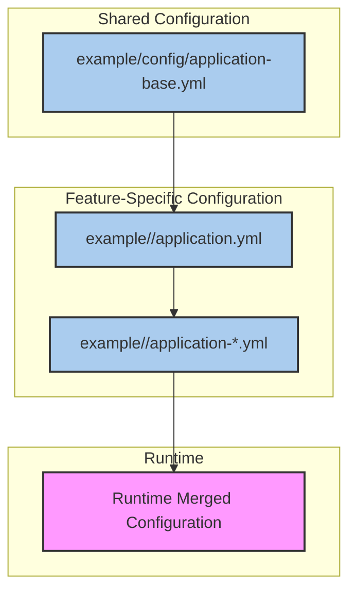
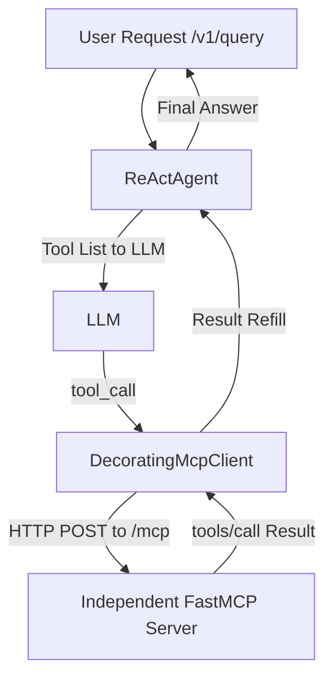
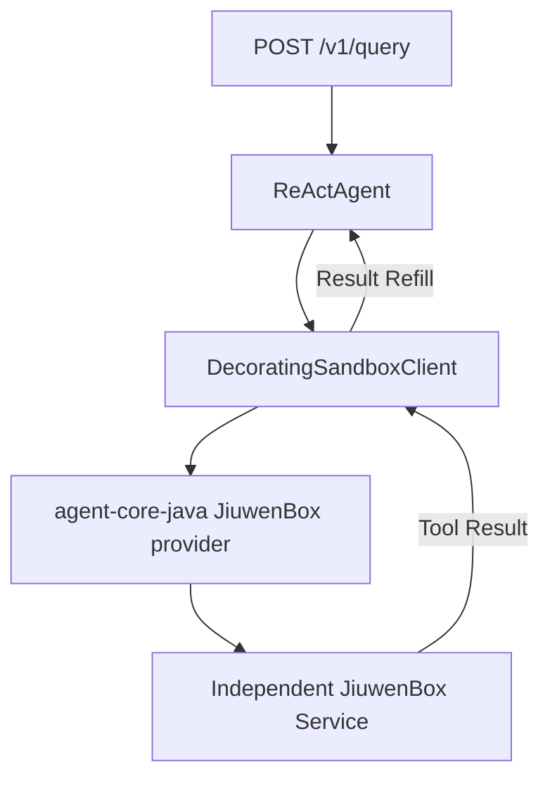

<!-- source: DeepWiki mcp.deepwiki.com · repo openJiuwen-ai/agent-runtime-java · page 8.2 Feature Demos: MCP, Sandbox, Redis, DeepAgent, Security · fetched 2026-11-02 -->

# Feature Demos: MCP, Sandbox, Redis, DeepAgent, Security

<details>
<summary>Relevant source files</summary>

The following files were used as context for generating this wiki page:

- [service/agent-service-adapters/agent-service-adapters-agentcore/src/test/java/com/openjiuwen/service/adapters/agentcore/external/McpGovernanceIntegrationTest.java](service/agent-service-adapters/agent-service-adapters-agentcore/src/test/java/com/openjiuwen/service/adapters/agentcore/external/McpGovernanceIntegrationTest.java)
- [service/agent-service-demo/example/README.md](service/agent-service-demo/example/README.md)
- [service/agent-service-demo/example/deepagent/application-deepagent.yml](service/agent-service-demo/example/deepagent/application-deepagent.yml)
- [service/agent-service-demo/example/deepagent/application.yml](service/agent-service-demo/example/deepagent/application.yml)
- [service/agent-service-demo/example/deepagent/pom.xml](service/agent-service-demo/example/deepagent/pom.xml)
- [service/agent-service-demo/example/deepagent/src/main/java/com/openjiuwen/service/demo/example/deepagent/DeepAgentDemoApplication.java](service/agent-service-demo/example/deepagent/src/main/java/com/openjiuwen/service/demo/example/deepagent/DeepAgentDemoApplication.java)
- [service/agent-service-demo/example/mcp/README.md](service/agent-service-demo/example/mcp/README.md)
- [service/agent-service-demo/example/mcp/application-mcp.yml](service/agent-service-demo/example/mcp/application-mcp.yml)
- [service/agent-service-demo/example/mcp/pom.xml](service/agent-service-demo/example/mcp/pom.xml)
- [service/agent-service-demo/example/mcp/server/fastmcp_server.py](service/agent-service-demo/example/mcp/server/fastmcp_server.py)
- [service/agent-service-demo/example/mcp/server/requirements.txt](service/agent-service-demo/example/mcp/server/requirements.txt)
- [service/agent-service-demo/example/mcp/smoke-mcp-sec.sh](service/agent-service-demo/example/mcp/smoke-mcp-sec.sh)
- [service/agent-service-demo/example/mcp/smoke-mcp.sh](service/agent-service-demo/example/mcp/smoke-mcp.sh)
- [service/agent-service-demo/example/mcp/src/main/java/com/openjiuwen/service/demo/example/mcp/McpDemoApplication.java](service/agent-service-demo/example/mcp/src/main/java/com/openjiuwen/service/demo/example/mcp/McpDemoApplication.java)
- [service/agent-service-demo/example/query/README.md](service/agent-service-demo/example/query/README.md)
- [service/agent-service-demo/example/redis/application-redis-checkpointer.yml](service/agent-service-demo/example/redis/application-redis-checkpointer.yml)
- [service/agent-service-demo/example/redis/pom.xml](service/agent-service-demo/example/redis/pom.xml)
- [service/agent-service-demo/example/redis/src/main/java/com/openjiuwen/service/demo/example/redis/RedisDemoApplication.java](service/agent-service-demo/example/redis/src/main/java/com/openjiuwen/service/demo/example/redis/RedisDemoApplication.java)
- [service/agent-service-demo/example/sandbox/README.md](service/agent-service-demo/example/sandbox/README.md)
- [service/agent-service-demo/example/sandbox/application-sandbox.yml](service/agent-service-demo/example/sandbox/application-sandbox.yml)
- [service/agent-service-demo/example/sandbox/pom.xml](service/agent-service-demo/example/sandbox/pom.xml)
- [service/agent-service-demo/example/sandbox/src/main/java/com/openjiuwen/service/demo/example/sandbox/SandboxDemoApplication.java](service/agent-service-demo/example/sandbox/src/main/java/com/openjiuwen/service/demo/example/sandbox/SandboxDemoApplication.java)
- [service/agent-service-demo/example/support/pom.xml](service/agent-service-demo/example/support/pom.xml)
- [service/agent-service-demo/example/support/src/main/java/com/openjiuwen/service/demo/example/support/DecoratedSandboxToolRegistrar.java](service/agent-service-demo/example/support/src/main/java/com/openjiuwen/service/demo/example/support/DecoratedSandboxToolRegistrar.java)
- [service/agent-service-demo/example/support/src/main/java/com/openjiuwen/service/demo/example/support/ExampleReActAgentFactory.java](service/agent-service-demo/example/support/src/main/java/com/openjiuwen/service/demo/example/support/ExampleReActAgentFactory.java)

</details>


This page details the per-example applications, YAML profiles, smoke scripts, and factories found in the `example/` and `example/support` directories of the `agent-service-demo` module. These examples serve to demonstrate specific features of the `agent-runtime-java` codebase, providing runnable instances and end-to-end verification for various functionalities.

## 8.2.1. Feature Demo Structure

The `agent-service-demo` module contains several independent, runnable Maven submodules, each demonstrating a specific feature. These demos share a common base configuration located in `example/config/application-base.yml` [service/agent-service-demo/example/README.md:27-27] and utilize factories from `example/support/` for agent assembly [service/agent-service-demo/example/README.md:28-28].

Each feature demo typically includes:
*   A dedicated Spring Boot application (`*.java` file).
*   Specific YAML configuration files (`application-*.yml`) that extend or override the base configuration.
*   Shell scripts (`smoke-*.sh`) for automated end-to-end testing and environment setup.
*   Integration tests (`*IntegrationTest.java` or `*EndToEndTest.java`) for deeper verification.

The configuration layering ensures that each demo can run independently and concurrently with other demos or the main `agent-service-demo` [service/agent-service-demo/example/README.md:22-23].

### Configuration Layering

Sources:
- [service/agent-service-demo/example/README.md:27-31]()

## 8.2.2. MCP Demo

The MCP (Model-Controller-Provider) demo (`agent-service-demo-mcp`) validates the full lifecycle of a user interacting with an MCP-enabled agent. This involves configuring the LLM and MCP address, starting the Java Agent Service, and using `/v1/query` to trigger tool calls to an independently running Python FastMCP Server [service/agent-service-demo/example/mcp/README.md:3-5]().

### Implementation Components
*   `McpDemoApplication` [service/agent-service-demo/example/mcp/src/main/java/com/openjiuwen/service/demo/example/mcp/McpDemoApplication.java](): The Spring Boot application that provides the `/v1/query` endpoint, creates the agent, binds MCP tools, and registers the decorated client [service/agent-service-demo/example/mcp/README.md:18-18]().
*   `server/fastmcp_server.py` [service/agent-service-demo/example/mcp/server/fastmcp_server.py](): A Python server using the official MCP Python SDK's `FastMCP` [service/agent-service-demo/example/mcp/README.md:19-19](). It runs in `stateless_http=True` and `json_response=True` mode, responding with plain JSON [service/agent-service-demo/example/mcp/README.md:27-31]().
*   `server/requirements.txt` [service/agent-service-demo/example/mcp/server/requirements.txt](): Specifies the pinned version of the official MCP Python SDK [service/agent-service-demo/example/mcp/README.md:20-20]().
*   `smoke-mcp.sh` [service/agent-service-demo/example/mcp/smoke-mcp.sh](): A shell script to start the independent FastMCP process and verify the protocol, agent, and governance [service/agent-service-demo/example/mcp/README.md:21-21]().
*   `smoke-mcp-sec.sh` [service/agent-service-demo/example/mcp/smoke-mcp-sec.sh](): Verifies the public SEC Filing MCP using the same Java Agent [service/agent-service-demo/example/mcp/README.md:22-22]().

The `FastMCP` server provides three tools:
*   `demo_echo(text)`: Returns `demo_echo:<text>`, used to verify tool invocation and result refilling [service/agent-service-demo/example/mcp/README.md:37-37]().
*   `demo_delay(delay_ms)`: Delays the response, used to verify timeouts and circuit breakers [service/agent-service-demo/example/mcp/README.md:38-38]().
*   `demo_fail()`: Throws a tool exception, demonstrating the `isError=true` boundary of FastMCP [service/agent-service-demo/example/mcp/README.md:39-39]().

### Data Flow for MCP Demo

Sources:
- [service/agent-service-demo/example/mcp/README.md:7-15]()

### Running the MCP Demo
The `smoke-mcp.sh` script automates the entire verification process [service/agent-service-demo/example/mcp/README.md:45-46](). It sets up a Python virtual environment, installs dependencies, starts the FastMCP server, performs protocol checks, and runs Java E2E tests [service/agent-service-demo/example/mcp/README.md:50-60]().

The Java E2E tests, specifically `McpGovernanceIntegrationTest` [service/agent-service-adapters/agent-service-adapters-agentcore/src/test/java/com/openjiuwen/service/adapters/agentcore/external/McpGovernanceIntegrationTest.java](), verify MCP timeout and circuit-breaker governance against the FastMCP server. These tests are enabled by the `demo.mcp.integration.server-path` system property [service/agent-service-adapters/agent-service-adapters-agentcore/src/test/java/com/openjiuwen/service/adapters/agentcore/external/McpGovernanceIntegrationTest.java:31-32]().

MCP configuration is defined in `application-mcp.yml` [service/agent-service-demo/example/mcp/application-mcp.yml](), specifying timeouts, retries, circuit breaker settings, and audit options for external MCP servers [service/agent-service-demo/example/mcp/README.md:182-205]().

## 8.2.3. Sandbox Demo

The Sandbox demo (`agent-service-demo-sandbox`) demonstrates how an agent calls `executeCmd`, `readFile`, and `executeCode` tools within a real JiuwenBox environment after processing by an LLM [service/agent-service-demo/example/sandbox/README.md:3-5](). The runtime handles external service configuration, client creation, and applies policies like timeout, retry, circuit breaker, and auditing [service/agent-service-demo/example/sandbox/README.md:6-8]().

### Implementation Components
*   `SandboxDemoApplication` [service/agent-service-demo/example/sandbox/src/main/java/com/openjiuwen/service/demo/example/sandbox/SandboxDemoApplication.java](): The Spring Boot application that starts the Agent Service and creates a `ReActAgent` [service/agent-service-demo/example/sandbox/README.md:15-15]().
*   `DecoratedSandboxToolRegistrar` [service/agent-service-demo/example/support/src/main/java/com/openjiuwen/service/demo/example/support/DecoratedSandboxToolRegistrar.java](): Registers `readFile`, `executeCmd`, and `executeCode` as agent tools [service/agent-service-demo/example/sandbox/README.md:16-16]().
*   `AgentCoreSandboxClientFactory`: Creates the Core `SandboxClient` based on runtime configuration [service/agent-service-demo/example/sandbox/README.md:17-17]().
*   `DecoratingSandboxClient`: Applies unified timeout, retry, circuit breaker, and audit policies [service/agent-service-demo/example/sandbox/README.md:18-18]().
*   `SandboxAgentExternalEndToEndTest`: Uses a deterministic mock LLM to validate the full chain against a real JiuwenBox [service/agent-service-demo/example/sandbox/README.md:19-19]().

### Data Flow for Sandbox Demo

Sources:
- [service/agent-service-demo/example/sandbox/README.md:42-48]()

### Running the Sandbox Demo
The `smoke-sandbox.sh` script automates the end-to-end testing for the Sandbox demo. It uses a deterministic in-memory mock LLM but performs all Sandbox operations through a real network and an independent JiuwenBox [service/agent-service-demo/example/sandbox/README.md:128-131](). It verifies tool visibility, file operations, code execution, timeout/circuit breaker behavior, and audit logging [service/agent-service-demo/example/sandbox/README.md:132-135]().

Sandbox configuration is primarily located in `application-sandbox.yml` [service/agent-service-demo/example/sandbox/application-sandbox.yml](), enabling the sandbox, setting timeouts, and defining server details [service/agent-service-demo/example/sandbox/README.md:155-162]().

## 8.2.4. Redis Demo

The Redis demo (`agent-service-demo-redis`) showcases the integration of Redis for checkpointer and Core Session management. It uses `application-redis-checkpointer.yml` [service/agent-service-demo/example/redis/application-redis-checkpointer.yml]() to configure Redis as the checkpointer type.

### Implementation Details
The `RedisDemoApplication` [service/agent-service-demo/example/redis/src/main/java/com/openjiuwen/service/demo/example/redis/RedisDemoApplication.java]() is the main Spring Boot application for this demo. It leverages the `agent-service-app` and `agent-service-adapters-redis` modules.

The `application-redis-checkpointer.yml` file configures the `openjiuwen.service.middleware.checkpointer.type` property to `redis`, enabling Redis for checkpointing. This allows the agent to persist conversation state and other relevant data in a Redis instance.

### Running the Redis Demo
To run the Redis demo, navigate to the `agent-runtime-java/service` directory and execute:
```bash
mvn -pl agent-service-demo/example/redis -am spring-boot:run
```
This will start the Redis demo application, typically on port 8091 [service/agent-service-demo/example/README.md:13-13]().

## 8.2.5. DeepAgent Demo

The DeepAgent demo (`agent-service-demo-deepagent`) provides a minimal HTTP demo for multi-turn context validation using a DeepAgent. Unlike other demos, this module exposes a plain DeepAgent with a task-loop and an in-memory checkpointer [service/agent-service-demo/example/deepagent/src/main/java/com/openjiuwen/service/demo/example/deepagent/DeepAgentDemoApplication.java:26-29]().

### Implementation Details
The `DeepAgentDemoApplication` [service/agent-service-demo/example/deepagent/src/main/java/com/openjiuwen/service/demo/example/deepagent/DeepAgentDemoApplication.java]() is the main entry point. It configures a `DeepAgent` using `ExampleDeepAgentFactory.build` [service/agent-service-demo/example/deepagent/src/main/java/com/openjiuwen/service/demo/example/deepagent/DeepAgentDemoApplication.java:66-68]() with task-loop enabled and an in-memory checkpointer.

The `application-deepagent.yml` [service/agent-service-demo/example/deepagent/application-deepagent.yml]() defines the specific configurations for this demo, including:
*   `server.port`: Set to 8097 [service/agent-service-demo/example/deepagent/application-deepagent.yml:2-3]().
*   `openjiuwen.service.llm.system-prompt`: A system prompt for the DeepAgent assistant [service/agent-service-demo/example/deepagent/application-deepagent.yml:8-12]().
*   `openjiuwen.service.llm.temperature`, `context-window-limit`, `max-iterations` [service/agent-service-demo/example/deepagent/application-deepagent.yml:13-15]().
*   `openjiuwen.service.middleware.checkpointer.type`: Set to `in_memory` [service/agent-service-demo/example/deepagent/application-deepagent.yml:17]().

### Running the DeepAgent Demo
To run the DeepAgent demo, navigate to the `agent-runtime-java/service` directory and execute:
```bash
mvn -pl agent-service-demo/example/deepagent -am spring-boot:run
```
This will start the DeepAgent demo application on port 8097 [service/agent-service-demo/example/deepagent/src/main/java/com/openjiuwen/service/demo/example/deepagent/DeepAgentDemoApplication.java:34-34]().

## 8.2.6. Security Demo

The Security demo (`agent-service-demo-security`) provides examples for configuring TLS and fine-grained authorization. This demo focuses on inbound authorization and outbound TLS/authentication/credential handling.

### Implementation Details
The security demo typically involves:
*   `SecurityAutoConfiguration`: Auto-configuration for security features.
*   `AuthorizationRequestBuilder`/`Resolver`: Components for building and resolving authorization requests.
*   Fine-grained authorizer validation.
*   `TlsStartupValidator`: Validates TLS configurations at startup.
*   `GlobalTlsProperties`/`ExternalTlsConfig`: Properties for global and external TLS settings.
*   `ExternalAuthProperties`: Properties for external authentication.
*   `SslContextFactory`: Factory for SSL contexts.
*   Credential decryptors and header injection mechanisms.

The `outbound-security` example [service/agent-service-demo/example/README.md:19-19]() specifically demonstrates MCP and Sandbox outbound HTTPS with Bearer token E2E.

### Running the Security Demo
The `security/README.md` provides detailed instructions for running the security demo, which typically involves specific YAML profiles to enable and configure TLS and authorization settings. The `outbound-security` example can be run without an LLM or Spring Boot for client connectivity verification.

## 8.2.7. Example Support Factories

The `agent-service-demo/example/support` directory contains factories and registrars used across various demos to simplify agent creation and tool registration.

*   `ExampleReActAgentFactory` [service/agent-service-demo/example/support/src/main/java/com/openjiuwen/service/demo/example/support/ExampleReActAgentFactory.java](): A factory for building `ReActAgent` instances, used in demos like MCP and Sandbox [service/agent-service-demo/example/README.md:28-28]().
*   `ExampleDeepAgentFactory`: A factory for building `DeepAgent` instances, used in the DeepAgent demo [service/agent-service-demo/example/deepagent/src/main/java/com/openjiuwen/service/demo/example/deepagent/DeepAgentDemoApplication.java:66-66]().
*   `DecoratedSandboxToolRegistrar` [service/agent-service-demo/example/support/src/main/java/com/openjiuwen/service/demo/example/support/DecoratedSandboxToolRegistrar.java](): Registers sandbox tools (`readFile`, `executeCmd`, `executeCode`) to an agent, wrapping them with a `DecoratingSandboxClient` [service/agent-service-demo/example/sandbox/src/main/java/com/openjiuwen/service/demo/example/sandbox/SandboxDemoApplication.java:42-42]().

These factories abstract away the complexities of agent and tool setup, allowing demo applications to focus on demonstrating specific features.

### Agent and Tool Registration Flow
```mermaid
graph TD
    A[DemoApplication] --> B{AgentFactory.build()}
    B --> C[Agent Instance (e.g., ReActAgent, DeepAgent)]
    C --> D{ToolRegistrar.register(agent, clientFactory)}
    D --> E[DecoratingClient (e.g., DecoratingMcpClient, DecoratingSandboxClient)]
    E --> F[Core Client (e.g., StreamableHttpClient, SandboxClient)]
    F --> G[External Service (e.g., FastMCP Server, JiuwenBox)]
```
Sources:
- [service/agent-service-demo/example/sandbox/src/main/java/com/openjiuwen/service/demo/example/sandbox/SandboxDemoApplication.java:42-42]()
- [service/agent-service-demo/example/mcp/README.md:18-18]()
- [service/agent-service-demo/example/sandbox/README.md:33-38]()
- [service/agent-service-demo/example/deepagent/src/main/java/com/openjiuwen/service/demo/example/deepagent/DeepAgentDemoApplication.java:66-68]()

---

