<!-- source: DeepWiki mcp.deepwiki.com · repo openJiuwen-ai/agent-runtime-java · page 8.3 Concurrency Load Harness · fetched 2026-11-02 -->

# Concurrency Load Harness

Relevant source files

The following files were used as context for generating this wiki page:

- [service/agent-service-demo/example/concurrency/src/main/java/com/openjiuwen/service/demo/example/concurrency/ConcurrencyDemoApplication.java](service/agent-service-demo/example/concurrency/src/main/java/com/openjiuwen/service/demo/example/concurrency/ConcurrencyDemoApplication.java)
- [service/agent-service-demo/example/concurrency/src/main/java/com/openjiuwen/service/demo/example/concurrency/ConcurrentLookupRail.java](service/agent-service-demo/example/concurrency/src/main/java/com/openjiuwen/service/demo/example/concurrency/ConcurrentLookupRail.java)
- [service/agent-service-demo/example/concurrency/src/main/java/com/openjiuwen/service/demo/example/concurrency/SkillEchoRail.java](service/agent-service-demo/example/concurrency/src/main/java/com/openjiuwen/service/demo/example/concurrency/SkillEchoRail.java)
- [service/agent-service-demo/example/concurrency/src/main/java/com/openjiuwen/service/demo/example/concurrency/load/A2aConcurrentClient.java](service/agent-service-demo/example/concurrency/src/main/java/com/openjiuwen/service/demo/example/concurrency/load/A2aConcurrentClient.java)
- [service/agent-service-demo/example/concurrency/src/main/java/com/openjiuwen/service/demo/example/concurrency/load/ConcurrentLoadConfig.java](service/agent-service-demo/example/concurrency/src/main/java/com/openjiuwen/service/demo/example/concurrency/load/ConcurrentLoadConfig.java)
- [service/agent-service-demo/example/concurrency/src/main/java/com/openjiuwen/service/demo/example/concurrency/load/ConcurrentLoadHarness.java](service/agent-service-demo/example/concurrency/src/main/java/com/openjiuwen/service/demo/example/concurrency/load/ConcurrentLoadHarness.java)
- [service/agent-service-demo/example/concurrency/src/main/java/com/openjiuwen/service/demo/example/concurrency/load/ConcurrentLoadMetrics.java](service/agent-service-demo/example/concurrency/src/main/java/com/openjiuwen/service/demo/example/concurrency/load/ConcurrentLoadMetrics.java)
- [service/agent-service-demo/example/concurrency/src/main/java/com/openjiuwen/service/demo/example/concurrency/load/ConcurrentLoadRunner.java](service/agent-service-demo/example/concurrency/src/main/java/com/openjiuwen/service/demo/example/concurrency/load/ConcurrentLoadRunner.java)
- [service/agent-service-demo/example/concurrency/src/main/java/com/openjiuwen/service/demo/example/concurrency/load/QueryConcurrentClient.java](service/agent-service-demo/example/concurrency/src/main/java/com/openjiuwen/service/demo/example/concurrency/load/QueryConcurrentClient.java)
- [service/agent-service-demo/example/concurrency/src/main/java/com/openjiuwen/service/demo/example/concurrency/mock/ConcurrencyDemoLlmSupport.java](service/agent-service-demo/example/concurrency/src/main/java/com/openjiuwen/service/demo/example/concurrency/mock/ConcurrencyDemoLlmSupport.java)
- [service/agent-service-demo/example/concurrency/src/main/java/com/openjiuwen/service/demo/example/concurrency/mock/ConcurrencyMockModelClient.java](service/agent-service-demo/example/concurrency/src/main/java/com/openjiuwen/service/demo/example/concurrency/mock/ConcurrencyMockModelClient.java)
- [service/agent-service-demo/example/concurrency/src/main/java/com/openjiuwen/service/demo/example/concurrency/mock/ConcurrencyMockResponsePlanner.java](service/agent-service-demo/example/concurrency/src/main/java/com/openjiuwen/service/demo/example/concurrency/mock/ConcurrencyMockResponsePlanner.java)
- [service/agent-service-demo/example/concurrency/src/test/java/com/openjiuwen/service/demo/example/concurrency/load/A2aConcurrentE2EIT.java](service/agent-service-demo/example/concurrency/src/test/java/com/openjiuwen/service/demo/example/concurrency/load/A2aConcurrentE2EIT.java)
- [service/agent-service-demo/example/concurrency/src/test/java/com/openjiuwen/service/demo/example/concurrency/load/DeepAgentRedisConcurrentE2EIT.java](service/agent-service-demo/example/concurrency/src/test/java/com/openjiuwen/service/demo/example/concurrency/load/DeepAgentRedisConcurrentE2EIT.java)
- [service/agent-service-demo/example/support/src/main/java/com/openjiuwen/service/demo/example/support/ExampleDeepAgentFactory.java](service/agent-service-demo/example/support/src/main/java/com/openjiuwen/service/demo/example/support/ExampleDeepAgentFactory.java)

The Concurrency Load Harness provides tools and infrastructure within the `agent-service-demo` module to perform concurrent load testing against the agent runtime. This includes clients for both `/v1/query` and A2A endpoints, mock LLM/model clients for controlled testing, and end-to-end (E2E) integration tests to validate the system under load. The primary goal is to ensure the stability and performance of the agent runtime when handling multiple concurrent sessions and requests.

## Concurrency Demo Application

The `ConcurrencyDemoApplication` [service/agent-service-demo/example/concurrency/src/main/java/com/openjiuwen/service/demo/example/concurrency/ConcurrencyDemoApplication.java:30]() is a Spring Boot application designed for concurrency validation. It hosts a `DeepAgent` configured with specific "rails" to simulate skill-like tools and utilizes Redis for checkpointing.

The application registers a `DeepAgent` named `demo-concurrency-agent` [service/agent-service-demo/example/concurrency/src/main/java/com/openjiuwen/service/demo/example/concurrency/ConcurrencyDemoApplication.java:38]() as its `AgentHandler` [service/agent-service-demo/example/concurrency/src/main/java/com/openjiuwen/service/demo/example/concurrency/ConcurrencyDemoApplication.java:73-83](). This agent is built using `ExampleDeepAgentFactory` [service/agent-service-demo/example/concurrency/src/main/java/com/openjiuwen/service/demo/example/concurrency/ConcurrencyDemoApplication.java:78]() and includes two custom rails:
*   `SkillEchoRail`: A simple tool that echoes a provided token, useful for verifying session integrity and basic skill invocation [service/agent-service-demo/example/concurrency/src/main/java/com/openjiuwen/service/demo/example/concurrency/SkillEchoRail.java:25]().
*   `ConcurrentLookupRail`: Simulates a lookup operation with configurable latency, designed to test concurrent tool execution [service/agent-service-demo/example/concurrency/src/main/java/com/openjiuwen/service/demo/example/concurrency/ConcurrentLookupRail.java:25]().

The `DeepAgent` can be configured to enable or disable its task-loop orchestration via the `demo.concurrency.enable-task-loop` system property or environment variable [service/agent-service-demo/example/concurrency/src/main/java/com/openjiuwen/service/demo/example/concurrency/ConcurrencyDemoApplication.java:36, 56-62]().

Sources:
*   [service/agent-service-demo/example/concurrency/src/main/java/com/openjiuwen/service/demo/example/concurrency/ConcurrencyDemoApplication.java]()
*   [service/agent-service-demo/example/concurrency/src/main/java/com/openjiuwen/service/demo/example/concurrency/SkillEchoRail.java]()
*   [service/agent-service-demo/example/concurrency/src/main/java/com/openjiuwen/service/demo/example/concurrency/ConcurrentLookupRail.java]()

## Mock LLM/Model Clients

To enable controlled and reproducible load testing, the concurrency demo supports a mock LLM client.

### `ConcurrencyMockModelClient`

The `ConcurrencyMockModelClient` [service/agent-service-demo/example/concurrency/src/main/java/com/openjiuwen/service/demo/example/concurrency/mock/ConcurrencyMockModelClient.java:30]() extends `BaseModelClient` and simulates LLM interactions with a fixed delay. This client allows testing the agent runtime's concurrency without relying on external LLM services or incurring their costs.

Key characteristics:
*   **Fixed Delay**: On each `invoke` [service/agent-service-demo/example/concurrency/src/main/java/com/openjiuwen/service/demo/example/concurrency/mock/ConcurrencyMockModelClient.java:63-68]() or `stream` [service/agent-service-demo/example/concurrency/src/main/java/com/openjiuwen/service/demo/example/concurrency/mock/ConcurrencyMockModelClient.java:87-95]() call, it introduces a configurable delay (`delayMs`) [service/agent-service-demo/example/concurrency/src/main/java/com/openjiuwen/service/demo/example/concurrency/mock/ConcurrencyMockModelClient.java:43-44]().
*   **Deterministic Responses**: Instead of actual LLM generation, it uses `ConcurrencyMockResponsePlanner` [service/agent-service-demo/example/concurrency/src/main/java/com/openjiuwen/service/demo/example/concurrency/mock/ConcurrencyMockModelClient.java:68, 93]() to produce predictable tool calls or text responses based on the input message.
*   **Limited Functionality**: It explicitly does not support image, speech, or video generation [service/agent-service-demo/example/concurrency/src/main/java/com/openjiuwen/service/demo/example/concurrency/mock/ConcurrencyMockModelClient.java:110-154]().

### `ConcurrencyMockResponsePlanner`

The `ConcurrencyMockResponsePlanner` [service/agent-service-demo/example/concurrency/src/main/java/com/openjiuwen/service/demo/example/concurrency/mock/ConcurrencyMockResponsePlanner.java:24]() is responsible for generating deterministic `AssistantMessage` responses for the mock LLM. It analyzes the latest user message and decides whether to issue a tool call or a simple text response.

*   **Skill Echo**: If the user message starts with "skill_echo:", it generates a tool call to `SkillEchoRail.TOOL_NAME` with the extracted token [service/agent-service-demo/example/concurrency/src/main/java/com/openjiuwen/service/demo/example/concurrency/mock/ConcurrencyMockResponsePlanner.java:45-47]().
*   **Concurrent Lookup**: If the user message starts with "lookup:", it parses the key and optional delay to generate a tool call to `ConcurrentLookupRail.TOOL_NAME` [service/agent-service-demo/example/concurrency/src/main/java/com/openjiuwen/service/demo/example/concurrency/mock/ConcurrencyMockResponsePlanner.java:49-55]().
*   **Default Response**: For other messages, it returns a simple text response echoing the user's input [service/agent-service-demo/example/concurrency/src/main/java/com/openjiuwen/service/demo/example/concurrency/mock/ConcurrencyMockResponsePlanner.java:57-59]().

### `ConcurrencyDemoLlmSupport`

This component [service/agent-service-demo/example/concurrency/src/main/java/com/openjiuwen/service/demo/example/concurrency/mock/ConcurrencyDemoLlmSupport.java:21]() manages the LLM mode for the concurrency demo. It determines whether to use a real LLM or the mock LLM based on system properties or environment variables (`demo.concurrency.llm.mode`). If mock mode is enabled, it registers the `ConcurrencyMockModelClient` and configures the `DeepAgent` to use it [service/agent-service-demo/example/concurrency/src/main/java/com/openjiuwen/service/demo/example/concurrency/mock/ConcurrencyDemoLlmSupport.java:73-95]().

Sources:
*   [service/agent-service-demo/example/concurrency/src/main/java/com/openjiuwen/service/demo/example/concurrency/mock/ConcurrencyMockModelClient.java]()
*   [service/agent-service-demo/example/concurrency/src/main/java/com/openjiuwen/service/demo/example/concurrency/mock/ConcurrencyMockResponsePlanner.java]()
*   [service/agent-service-demo/example/concurrency/src/main/java/com/openjiuwen/service/demo/example/concurrency/mock/ConcurrencyDemoLlmSupport.java]()

## Concurrent Load Harness Components

The core of the load harness is composed of `ConcurrentLoadHarness`, `ConcurrentLoadConfig`, `ConcurrentLoadMetrics`, and various client implementations.

### `ConcurrentLoadConfig`

The `ConcurrentLoadConfig` record [service/agent-service-demo/example/concurrency/src/main/java/com/openjiuwen/service/demo/example/concurrency/load/ConcurrentLoadConfig.java:15]() defines the parameters for a load test run. It can be populated from system properties (`demo.concurrency.*`) or environment variables (`DEMO_CONCURRENCY_*`) [service/agent-service-demo/example/concurrency/src/main/java/com/openjiuwen/service/demo/example/concurrency/load/ConcurrentLoadConfig.java:29-33]().

Key configuration parameters include:
*   `mode`: "query", "a2a", or "both" [service/agent-service-demo/example/concurrency/src/main/java/com/openjiuwen/service/demo/example/concurrency/load/ConcurrentLoadConfig.java:41-51]().
*   `baseUrl`: Base URL for `/v1/query` endpoint.
*   `a2aBaseUrl`: Base URL for A2A endpoint.
*   `sessions`: Total number of sessions to run.
*   `concurrency`: Number of concurrent sessions.
*   `isStream`: Whether to use SSE streaming.
*   `warmupSessions`: Number of warmup sessions.
*   `requestTimeout`: Timeout for individual HTTP requests.
*   `minSuccessRate`: Minimum acceptable success rate for the test to pass.
*   `lookupDelayMs`: Simulated delay for lookup operations.
*   `roundsPerSession`: Number of requests per session.

### `ConcurrentLoadMetrics`

The `ConcurrentLoadMetrics` class [service/agent-service-demo/example/concurrency/src/main/java/com/openjiuwen/service/demo/example/concurrency/load/ConcurrentLoadMetrics.java:19]() collects and reports performance metrics during a load test. It is thread-safe and tracks:
*   `successCount` and `failureCount` [service/agent-service-demo/example/concurrency/src/main/java/com/openjiuwen/service/demo/example/concurrency/load/ConcurrentLoadMetrics.java:20-21]().
*   `latenciesMs` for all requests [service/agent-service-demo/example/concurrency/src/main/java/com/openjiuwen/service/demo/example/concurrency/load/ConcurrentLoadMetrics.java:24]().
*   Start and finish timestamps for overall duration and QPS calculation [service/agent-service-demo/example/concurrency/src/main/java/com/openjiuwen/service/demo/example/concurrency/load/ConcurrentLoadMetrics.java:26-28]().

It provides methods to record success/failure [service/agent-service-demo/example/concurrency/src/main/java/com/openjiuwen/service/demo/example/concurrency/load/ConcurrentLoadMetrics.java:49-62](), calculate total requests, success rate [service/agent-service-demo/example/concurrency/src/main/java/com/openjiuwen/service/demo/example/concurrency/load/ConcurrentLoadMetrics.java:91-99](), duration [service/agent-service-demo/example/concurrency/src/main/java/com/openjiuwen/service/demo/example/concurrency/load/ConcurrentLoadMetrics.java:106-113](), QPS [service/agent-service-demo/example/concurrency/src/main/java/com/openjiuwen/service/demo/example/concurrency/load/ConcurrentLoadMetrics.java:120-123](), and latency percentiles (p50, p95, p99) [service/agent-service-demo/example/concurrency/src/main/java/com/openjiuwen/service/demo/example/concurrency/load/ConcurrentLoadMetrics.java:131-140](). A `summary()` method provides a concise report [service/agent-service-demo/example/concurrency/src/main/java/com/openjiuwen/service/demo/example/concurrency/load/ConcurrentLoadMetrics.java:147-152]().

### `ConcurrentLoadHarness`

The `ConcurrentLoadHarness` [service/agent-service-demo/example/concurrency/src/main/java/com/openjiuwen/service/demo/example/concurrency/load/ConcurrentLoadHarness.java:26]() orchestrates the execution of concurrent load tests. It provides static methods to run load against `/v1/query` (`runQueryLoad`) [service/agent-service-demo/example/concurrency/src/main/java/com/openjiuwen/service/demo/example/concurrency/load/ConcurrentLoadHarness.java:38-77]() and A2A endpoints (`runA2aLoad`) [service/agent-service-demo/example/concurrency/src/main/java/com/openjiuwen/service/demo/example/concurrency/load/ConcurrentLoadHarness.java:85-114]().

The harness performs the following steps:
1.  **Health Check**: Probes the target service's `/health` endpoint to ensure readiness [service/agent-service-demo/example/concurrency/src/main/java/com/openjiuwen/service/demo/example/concurrency/load/ConcurrentLoadHarness.java:39-42, 86-90]().
2.  **Warmup**: Executes a configurable number of warmup sessions to prime the system [service/agent-service-demo/example/concurrency/src/main/java/com/openjiuwen/service/demo/example/concurrency/load/ConcurrentLoadHarness.java:43-51, 91-99, 116-122]().
3.  **Session Execution**: Uses a `ThreadPoolExecutor` to run multiple sessions concurrently [service/agent-service-demo/example/concurrency/src/main/java/com/openjiuwen/service/demo/example/concurrency/load/ConcurrentLoadHarness.java:126-128](). Each session performs a series of requests (e.g., `skillEcho` and `lookup` for query load) [service/agent-service-demo/example/concurrency/src/main/java/com/openjiuwen/service/demo/example/concurrency/load/ConcurrentLoadHarness.java:61-66]().
4.  **Metrics Collection**: Records the success/failure and latency of each request using `ConcurrentLoadMetrics` [service/agent-service-demo/example/concurrency/src/main/java/com/openjiuwen/service/demo/example/concurrency/load/ConcurrentLoadHarness.java:67, 109, 154-159]().
5.  **Error Reporting**: Logs sample errors encountered during the run [service/agent-service-demo/example/concurrency/src/main/java/com/openjiuwen/service/demo/example/concurrency/load/ConcurrentLoadHarness.java:138-142]().

### `QueryConcurrentClient`

The `QueryConcurrentClient` [service/agent-service-demo/example/concurrency/src/main/java/com/openjiuwen/service/demo/example/concurrency/load/QueryConcurrentClient.java:31]() is an HTTP client specifically designed to send concurrent requests to the `/v1/query` endpoint. It uses `java.net.http.HttpClient` with a bounded `ThreadPoolExecutor` for asynchronous calls [service/agent-service-demo/example/concurrency/src/main/java/com/openjiuwen/service/demo/example/concurrency/load/QueryConcurrentClient.java:51-56]().

It provides methods for:
*   `skillEcho`: Invokes the `skill_echo` scenario [service/agent-service-demo/example/concurrency/src/main/java/com/openjiuwen/service/demo/example/concurrency/load/QueryConcurrentClient.java:67-69]().
*   `lookup`: Invokes the `concurrent_lookup` scenario [service/agent-service-demo/example/concurrency/src/main/java/com/openjiuwen/service/demo/example/concurrency/load/QueryConcurrentClient.java:80-82]().
*   `query`: A generic method to send a query request, supporting both non-streaming and SSE streaming responses [service/agent-service-demo/example/concurrency/src/main/java/com/openjiuwen/service/demo/example/concurrency/load/QueryConcurrentClient.java:93-120](). It also validates an `expectedMarker` in the response content [service/agent-service-demo/example/concurrency/src/main/java/com/openjiuwen/service/demo/example/concurrency/load/QueryConcurrentClient.java:112-115]().
*   `healthReady`: Probes the `/health` endpoint [service/agent-service-demo/example/concurrency/src/main/java/com/openjiuwen/service/demo/example/concurrency/load/QueryConcurrentClient.java:127-136]().

Response content for streaming calls is aggregated from SSE `data:` lines [service/agent-service-demo/example/concurrency/src/main/java/com/openjiuwen/service/demo/example/concurrency/load/QueryConcurrentClient.java:144-163]().

### `A2aConcurrentClient`

The `A2aConcurrentClient` [service/agent-service-demo/example/concurrency/src/main/java/com/openjiuwen/service/demo/example/concurrency/load/A2aConcurrentClient.java:20]() is an HTTP client for sending concurrent JSON-RPC requests to A2A endpoints.

It supports:
*   `sendMessage`: Sends a non-streaming `SendMessage` JSON-RPC request [service/agent-service-demo/example/concurrency/src/main/java/com/openjiuwen/service/demo/example/concurrency/load/A2aConcurrentClient.java:52-54]().
*   `sendStreamingMessage`: Sends a streaming `SendStreamingMessage` JSON-RPC request [service/agent-service-demo/example/concurrency/src/main/java/com/openjiuwen/service/demo/example/concurrency/load/A2aConcurrentClient.java:61-63]().
*   `healthReady`: Probes the `/health` endpoint [service/agent-service-demo/example/concurrency/src/main/java/com/openjiuwen/service/demo/example/concurrency/load/A2aConcurrentClient.java:70-79]().

For streaming A2A calls, it aggregates SSE payloads [service/agent-service-demo/example/concurrency/src/main/java/com/openjiuwen/service/demo/example/concurrency/load/A2aConcurrentClient.java:115-124]().

### Load Harness Data Flow

The following diagram illustrates the data flow and interactions between the main components of the concurrency load harness.

```mermaid
graph TD
    subgraph "Load Runner Process"
        LR["ConcurrentLoadRunner.main()"] --> CLC["ConcurrentLoadConfig.fromEnvironment()"]
        CLC --> CLH["ConcurrentLoadHarness"]
        CLH -- "runQueryLoad(config)" --> QCC["QueryConcurrentClient"]
        CLH -- "runA2aLoad(config)" --> A2ACC["A2aConcurrentClient"]
        CLH --> CLM["ConcurrentLoadMetrics"]
        QCC -- "HTTP /v1/query" --> CDemoApp["ConcurrencyDemoApplication"]
        A2ACC -- "HTTP /a2a/" --> CDemoApp
        CDemoApp -- "LLM Calls" --> MCM["ConcurrencyMockModelClient"]
        MCM -- "Plan Response" --> CMRP["ConcurrencyMockResponsePlanner"]
        CDemoApp -- "Tool Calls" --> SER["SkillEchoRail"]
        CDemoApp -- "Tool Calls" --> CRL["ConcurrentLookupRail"]
        QCC -- "QueryResult" --> CLM
        A2ACC -- "A2aResult" --> CLM
        CLM -- "Summary" --> LR
    end

    subgraph "ConcurrencyDemoApplication (Target)"
        CDemoApp
        MCM
        CMRP
        SER
        CRL
    end

    style LR fill:#ace,stroke:#333,stroke-width:2px
    style CLC fill:#ace,stroke:#333,stroke-width:2px
    style CLH fill:#ace,stroke:#333,stroke-width:2px
    style QCC fill:#ace,stroke:#333,stroke-width:2px
    style A2ACC fill:#ace,stroke:#333,stroke-width:2px
    style CLM fill:#ace,stroke:#333,stroke-width:2px
    style CDemoApp fill:#f9f,stroke:#333,stroke-width:2px
    style MCM fill:#f9f,stroke:#333,stroke-width:2px
    style CMRP fill:#f9f,stroke:#333,stroke-width:2px
    style SER fill:#f9f,stroke:#333,stroke-width:2px
    style CRL fill:#f9f,stroke:#333,stroke-width:2px
```

Title: Concurrency Load Harness Data Flow
Sources:
*   [service/agent-service-demo/example/concurrency/src/main/java/com/openjiuwen/service/demo/example/concurrency/load/ConcurrentLoadConfig.java]()
*   [service/agent-service-demo/example/concurrency/src/main/java/com/openjiuwen/service/demo/example/concurrency/load/ConcurrentLoadHarness.java]()
*   [service/agent-service-demo/example/concurrency/src/main/java/com/openjiuwen/service/demo/example/concurrency/load/ConcurrentLoadMetrics.java]()
*   [service/agent-service-demo/example/concurrency/src/main/java/com/openjiuwen/service/demo/example/concurrency/load/QueryConcurrentClient.java]()
*   [service/agent-service-demo/example/concurrency/src/main/java/com/openjiuwen/service/demo/example/concurrency/load/A2aConcurrentClient.java]()
*   [service/agent-service-demo/example/concurrency/src/main/java/com/openjiuwen/service/demo/example/concurrency/ConcurrencyDemoApplication.java]()
*   [service/agent-service-demo/example/concurrency/src/main/java/com/openjiuwen/service/demo/example/concurrency/mock/ConcurrencyMockModelClient.java]()
*   [service/agent-service-demo/example/concurrency/src/main/java/com/openjiuwen/service/demo/example/concurrency/mock/ConcurrencyMockResponsePlanner.java]()
*   [service/agent-service-demo/example/concurrency/src/main/java/com/openjiuwen/service/demo/example/concurrency/SkillEchoRail.java]()
*   [service/agent-service-demo/example/concurrency/src/main/java/com/openjiuwen/service/demo/example/concurrency/ConcurrentLookupRail.java]()

## End-to-End Load Integration Tests

The `agent-service-demo` module includes E2E integration tests to validate the concurrency features. These tests typically start the `ConcurrencyDemoApplication` and then use the load harness components to simulate concurrent traffic.

*   `DeepAgentRedisConcurrentE2EIT`: This test focuses on concurrent load against the `/v1/query` endpoint, specifically validating the `DeepAgent` with Redis checkpointing under load. It uses `QueryConcurrentClient` to send requests.
*   `A2aConcurrentE2EIT`: This test focuses on concurrent load against the A2A endpoint, validating the A2A protocol handling under load. It uses `A2aConcurrentClient` to send requests.

These tests are configured via `ConcurrentLoadConfig` and assert that the `minSuccessRate` is met, ensuring the system remains stable and responsive under the specified load conditions.

Sources:
*   [service/agent-service-demo/example/concurrency/src/test/java/com/openjiuwen/service/demo/example/concurrency/load/DeepAgentRedisConcurrentE2EIT.java]()
*   [service/agent-service-demo/example/concurrency/src/test/java/com/openjiuwen/service/demo/example/concurrency/load/A2aConcurrentE2EIT.java]()

---

