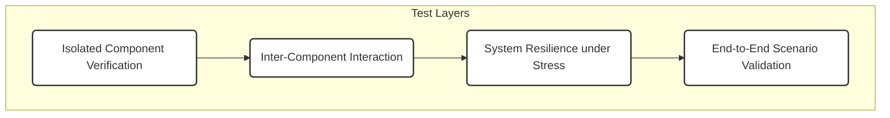
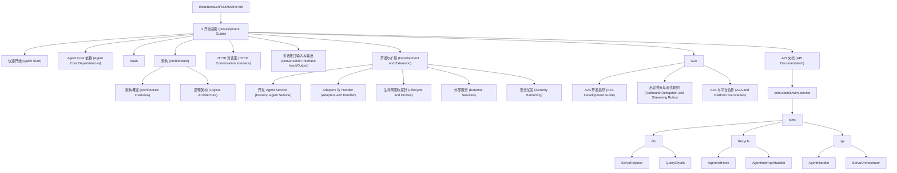

<!-- source: DeepWiki mcp.deepwiki.com · repo openJiuwen-ai/agent-runtime-java · page 9 Testing and Documentation Assets · fetched 2026-11-02 -->

# Testing and Documentation Assets

Relevant source files

The following files were used as context for generating this wiki page:

- [documents/zh/SUMMARY.md](documents/zh/SUMMARY.md)
- [service/agent-service-adapters/agent-service-adapters-common/src/test/java/com/openjiuwen/service/adapters/common/security/SslContextFactoryTest.java](service/agent-service-adapters/agent-service-adapters-common/src/test/java/com/openjiuwen/service/adapters/common/security/SslContextFactoryTest.java)
- [service/agent-service-app/src/main/java/com/openjiuwen/service/app/controller/a2a/A2aJsonRpcProtocol.java](service/agent-service-app/src/main/java/com/openjiuwen/service/app/controller/a2a/A2aJsonRpcProtocol.java)
- [service/agent-service-app/src/test/java/com/openjiuwen/service/app/it/A2aIntegrationTest.java](service/agent-service-app/src/test/java/com/openjiuwen/service/app/it/A2aIntegrationTest.java)
- [service/agent-service-app/src/test/java/com/openjiuwen/service/app/it/SecurityAuthorizationConcurrencyIntegrationTest.java](service/agent-service-app/src/test/java/com/openjiuwen/service/app/it/SecurityAuthorizationConcurrencyIntegrationTest.java)
- [service/agent-service-app/src/test/java/com/openjiuwen/service/app/it/SecurityAuthorizationHeaderBoundaryIntegrationTest.java](service/agent-service-app/src/test/java/com/openjiuwen/service/app/it/SecurityAuthorizationHeaderBoundaryIntegrationTest.java)
- [service/agent-service-app/src/test/java/com/openjiuwen/service/app/it/support/AgentReadinessTestSupport.java](service/agent-service-app/src/test/java/com/openjiuwen/service/app/it/support/AgentReadinessTestSupport.java)

This page provides a high-level overview of the testing strategy employed in the `agent-runtime-java` codebase and introduces the Chinese documentation set located under `documents/zh`. The testing strategy encompasses various layers, from isolated unit tests to comprehensive integration and reliability tests. The documentation aims to provide a complete guide for developers, covering architecture, A2A protocol, API specifications, and contribution guidelines.

## Test Layers: Unit, Integration, Reliability

The `agent-runtime-java` project utilizes a multi-layered testing approach to ensure robustness and correctness. This includes:

*   **Unit Tests**: These tests focus on individual components or methods in isolation, verifying their behavior without external dependencies. They are typically fast-executing and reside alongside the code they test. An example of a unit test for security-related functionality can be found in `SslContextFactoryTest` [service/agent-service-adapters/agent-service-adapters-common/src/test/java/com/openjiuwen/service/adapters/common/security/SslContextFactoryTest.java:23-40]().
*   **Integration Tests (`it/`)**: These tests verify the interaction between multiple components or modules. They often involve Spring's testing utilities to set up a partial or full application context. For instance, `A2aIntegrationTest` [service/agent-service-app/src/test/java/com/openjiuwen/service/app/it/A2aIntegrationTest.java:29-31]() tests the A2A JSON-RPC endpoints and Query REST endpoints, including scenarios like `sendMessageReturnsCompletedTaskWithAgentOutput` [service/agent-service-app/src/test/java/com/openjiuwen/service/app/it/A2aIntegrationTest.java:103-115]() and `multiTurnRetainsContextAcrossSendMessage` [service/agent-service-app/src/test/java/com/openjiuwen/service/app/it/A2aIntegrationTest.java:117-124](). Other integration tests cover security aspects, such as `SecurityAuthorizationHeaderBoundaryIntegrationTest` [service/agent-service-app/src/test/java/com/openjiuwen/service/app/it/SecurityAuthorizationHeaderBoundaryIntegrationTest.java:36-66]() which checks authorization header handling, and `SecurityAuthorizationConcurrencyIntegrationTest` [service/agent-service-app/src/test/java/com/openjiuwen/service/app/it/SecurityAuthorizationConcurrencyIntegrationTest.java:68-81]() for concurrent authorization requests.
*   **Reliability Tests**: These are specialized integration tests designed to assess the system's resilience under adverse conditions, such as tampering with Redis, memory, or LLM configurations. These tests ensure the system can gracefully handle failures and maintain stability.

For details, see [Test Layers: Unit, Integration, Reliability](#9.1).

### Test Strategy Overview

The testing strategy ensures that the `agent-runtime-java` application is robust and reliable.

Sources:
- [service/agent-service-app/src/test/java/com/openjiuwen/service/app/it/A2aIntegrationTest.java:29-31]()
- [service/agent-service-app/src/test/java/com/openjiuwen/service/app/it/A2aIntegrationTest.java:103-115]()
- [service/agent-service-app/src/test/java/com/openjiuwen/service/app/it/A2aIntegrationTest.java:117-124]()
- [service/agent-service-app/src/test/java/com/openjiuwen/service/app/it/SecurityAuthorizationHeaderBoundaryIntegrationTest.java:36-66]()
- [service/agent-service-app/src/test/java/com/openjiuwen/service/app/it/SecurityAuthorizationConcurrencyIntegrationTest.java:68-81]()
- [service/agent-service-adapters/agent-service-adapters-common/src/test/java/com/openjiuwen/service/adapters/common/security/SslContextFactoryTest.java:23-40]()

## Documentation Set (documents/zh)

The `documents/zh` directory contains the comprehensive Chinese developer guide for the `agent-runtime-java` codebase. This documentation is structured to provide clear and detailed information across various aspects of the system.

The main entry point is `SUMMARY.md` [documents/zh/SUMMARY.md:1-74](), which outlines the entire structure. Key sections include:

*   **开发指南 (Development Guide)**: Covers quick start instructions, `Agent Core` dependencies, and `AaaS` (Agent as a Service) concepts [documents/zh/SUMMARY.md:3-6]().
*   **架构 (Architecture)**: Provides an overview of the system's architecture, including logical architecture diagrams [documents/zh/SUMMARY.md:7-9]().
*   **HTTP 对话面 (HTTP Conversation Interface)**: Details the HTTP interfaces for interaction [documents/zh/SUMMARY.md:10-11]().
*   **开发与扩展 (Development and Extension)**: Guides on developing `Agent Service`, `Adapters` and `Handler` implementations, lifecycle management, probes, external services, and security hardening [documents/zh/SUMMARY.md:12-17]().
*   **A2A**: Dedicated sections for A2A development guidelines, outbound delegation, streaming rules, and platform boundaries [documents/zh/SUMMARY.md:18-21]().
*   **API 文档 (API Documentation)**: Detailed API documentation for various packages, including DTOs like `ServeRequest` [documents/zh/SUMMARY.md:32]() and `QueryChunk` [documents/zh/SUMMARY.md:27](), lifecycle interfaces such as `AgentInitHook` [documents/zh/SUMMARY.md:34]() and `AgentInterruptHandler` [documents/zh/SUMMARY.md:35](), and SPIs like `AgentHandler` [documents/zh/SUMMARY.md:45]() and `ServeOrchestrator` [documents/zh/SUMMARY.md:47]().

For details, see [Documentation Set (documents/zh)](#9.2).

### Documentation Structure

Sources:
- [documents/zh/SUMMARY.md:1-74]()

---

