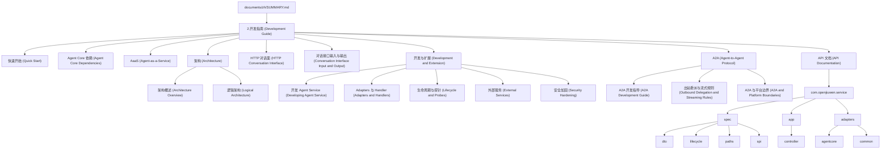

<!-- source: DeepWiki mcp.deepwiki.com · repo openJiuwen-ai/agent-runtime-java · page 9.2 Documentation Set (documents/zh) · fetched 2026-11-02 -->

# Documentation Set (documents/zh)

Relevant source files

The following files were used as context for generating this wiki page:

- [CONTRIBUTING.md](CONTRIBUTING.md)
- [LICENSE](LICENSE)
- [documents/zh/SUMMARY.md](documents/zh/SUMMARY.md)

This page details the structure and content of the Chinese developer guide located under the `documents/zh/` directory. This documentation set serves as the primary resource for developers working with the `agent-runtime-java` codebase, covering architecture, A2A protocol usage, API specifications, Agent-as-a-Service (AaaS) concepts, and guidelines for contributing to the project.

## Structure of the Chinese Developer Guide

The Chinese developer guide is organized into several key sections, as outlined in `documents/zh/SUMMARY.md` [documents/zh/SUMMARY.md:1-74](). Each section addresses a specific aspect of the `agent-runtime-java` project, providing detailed explanations and examples.

### 2.开发指南 (Development Guide)

This is the main entry point for developers, covering fundamental aspects of using and extending the `agent-runtime-java`.

#### 快速开始 (Quick Start)
This section provides instructions for quickly setting up and running the `agent-runtime-java` project.

#### Agent Core 依赖 (Agent Core Dependencies)
Details how `agent-runtime-java` integrates with and depends on `agent-core-java`. This is crucial for understanding the division of responsibilities between the two projects.
Sources:
- [CONTRIBUTING.md:12]()

#### AaaS (Agent-as-a-Service)
Explains the concept of Agent-as-a-Service within the context of `agent-runtime-java`, describing how agents are hosted and exposed as services.

#### 架构 (Architecture)
This section delves into the architectural design of the `agent-runtime-java`.
Sources:
- [documents/zh/SUMMARY.md:7-9]()

##### 架构概述 (Architecture Overview)
Provides a high-level overview of the system's architecture.

##### 逻辑架构 (Logical Architecture)
Details the logical components and their interactions within the system.

#### HTTP 对话面 (HTTP Conversation Interface)
Describes the HTTP endpoints available for interacting with the agent runtime.

#### 对话接口输入与输出 (Conversation Interface Input and Output)
Explains the data formats and structures used for input and output when interacting with the conversation interfaces.

#### 开发与扩展 (Development and Extension)
This section focuses on how developers can extend and customize the `agent-runtime-java`.
Sources:
- [documents/zh/SUMMARY.md:12-17]()

##### 开发 Agent Service (Developing Agent Service)
Guides developers through the process of creating and integrating new agent services.

##### Adapters 与 Handler (Adapters and Handlers)
Explains the role of adapters and handlers in bridging `agent-runtime-java` with `agent-core-java` and other external services. For example, `JiuwenCoreAgentHandler` [documents/zh/SUMMARY.md:62]() is a key component in this area.

##### 生命周期与探针 (Lifecycle and Probes)
Covers the lifecycle management of agents and the use of probes for monitoring their status. This includes concepts like `AgentInitHook` [documents/zh/SUMMARY.md:34]() and `AgentShutdownHook` [documents/zh/SUMMARY.md:39]().

##### 外部服务 (External Services)
Details how to integrate and manage external services, such as those handled by `ExternalCallExecutor` [documents/zh/SUMMARY.md:71]().

##### 安全加固 (Security Hardening)
Provides guidelines and best practices for securing the agent runtime.

### A2A (Agent-to-Agent Protocol)

This section is dedicated to the Agent-to-Agent (A2A) communication protocol, a core feature of `agent-runtime-java`.
Sources:
- [documents/zh/SUMMARY.md:18-21]()

#### A2A 开发指导 (A2A Development Guide)
Offers guidance on developing agents that communicate using the A2A protocol.

#### 出站委派与流式规则 (Outbound Delegation and Streaming Rules)
Explains how outbound delegation works and the rules governing streaming data over A2A.

#### A2A 与平台边界 (A2A and Platform Boundaries)
Discusses the implications of A2A communication across different platform boundaries.

### API 文档 (API Documentation)

This comprehensive section provides detailed documentation for the various APIs within the `agent-runtime-java` project. It is structured by package, reflecting the codebase's organization.
Sources:
- [documents/zh/SUMMARY.md:22-74]()

#### `com.openjiuwen.service`
The root package for the core service components.
Sources:
- [documents/zh/SUMMARY.md:23]()

##### `spec`
Contains the specifications, including Data Transfer Objects (DTOs), lifecycle interfaces, paths, and Service Provider Interfaces (SPIs).
Sources:
- [documents/zh/SUMMARY.md:24]()

###### `dto`
Defines the DTOs used for communication, such as `QueryChunk` [documents/zh/SUMMARY.md:27](), `QueryRequest` [documents/zh/SUMMARY.md:28](), `QueryResponse` [documents/zh/SUMMARY.md:29](), and `ServeRequest` [documents/zh/SUMMARY.md:32]().

###### `lifecycle`
Includes interfaces and classes related to the agent lifecycle, such as `AgentInitHook` [documents/zh/SUMMARY.md:34]() and `AgentInterruptHandler` [documents/zh/SUMMARY.md:35]().

###### `paths`
Defines service paths, including `A2AServicePaths` [documents/zh/SUMMARY.md:42]() and `AgentServicePaths` [documents/zh/SUMMARY.md:43]().

###### `spi`
Contains Service Provider Interfaces like `AgentHandler` [documents/zh/SUMMARY.md:45](), `QueryStreamObserver` [documents/zh/SUMMARY.md:46](), and `ServeOrchestrator` [documents/zh/SUMMARY.md:47]().

##### `app`
Houses the application-specific components, including auto-configuration, configuration, controllers, lifecycle management, and orchestrators.
Sources:
- [documents/zh/SUMMARY.md:48]()

###### `controller`
Contains the various controllers for handling requests, including A2A, probe, query, and reset functionalities.
Sources:
- [documents/zh/SUMMARY.md:51-56]()

##### `adapters`
This package contains implementations for various adapters, bridging the core service with external systems or specific functionalities.
Sources:
- [documents/zh/SUMMARY.md:59]()

###### `agentcore`
Adapters specifically for integrating with `agent-core-java`.
Sources:
- [documents/zh/SUMMARY.md:60]()

####### `agentfw`
Contains the `JiuwenCoreAgentHandler` [documents/zh/SUMMARY.md:62](), which is a key component for handling agent framework interactions.

####### `external`
Includes properties and registrars for external services, such as `AgentCoreExternalProperties` [documents/zh/SUMMARY.md:65]() and `ExternalSvcAdapterRegistrar` [documents/zh/SUMMARY.md:66]().

###### `common`
Common adapters and utilities.
Sources:
- [documents/zh/SUMMARY.md:68]()

####### `external`
Contains the `ExternalCallExecutor` [documents/zh/SUMMARY.md:71](), which is responsible for executing external calls with policies like retry and timeout.

####### `middleware`
Includes middleware-related components, such as `MiddlewareProperties` [documents/zh/SUMMARY.md:73]() and Redis-specific configurations.

### Contributing and Licensing Notices

The `CONTRIBUTING.md` file [CONTRIBUTING.md:1-77]() provides guidelines for contributing to the `openJiuwen Agent Runtime Java` project. It covers development setup, testing, code guidelines, documentation requirements, pull request procedures, and issue reporting. The `LICENSE` file [LICENSE:1-201]() specifies that contributions are licensed under the Apache License 2.0.
Sources:
- [CONTRIBUTING.md:1-77]()
- [LICENSE:1-201]()

## Documentation Flow and Relationships

The following diagram illustrates the high-level structure and relationships between the main documentation sections within `documents/zh/`.

Sources:
- [documents/zh/SUMMARY.md:1-74]()

## Bridging Natural Language to Code Entities

The documentation aims to connect high-level concepts with their concrete implementations in the codebase. The following diagram illustrates how some key natural language concepts from the documentation map to specific code entities.

```mermaid
graph TD
    subgraph "Natural Language Space (documents/zh)"
        NL_AaaS["AaaS (Agent-as-a-Service)"]
        NL_Arch["架构 (Architecture)"]
        NL_A2A["A2A (Agent-to-Agent Protocol)"]
        NL_DevExt["开发与扩展 (Development and Extension)"]
        NL_APIDoc["API 文档 (API Documentation)"]
        NL_AdaptersHandlers["Adapters 与 Handler"]
        NL_LifecycleProbes["生命周期与探针"]
        NL_ExternalServices["外部服务"]
    end

    subgraph "Code Entity Space (agent-runtime-java)"
        CE_HostedRuntime["HostedRuntimeAssembler"]
        CE_A2AJsonRpcController["A2aJsonRpcController"]
        CE_A2ARemoteAgentClient["A2ARemoteAgentClient"]
        CE_AgentHandler["AgentHandler (SPI)"]
        CE_ServeOrchestrator["ServeOrchestrator (SPI)"]
        CE_JiuwenCoreAgentHandler["JiuwenCoreAgentHandler"]
        CE_AgentInitHook["AgentInitHook"]
        CE_AgentShutdownHook["AgentShutdownHook"]
        CE_ExternalCallExecutor["ExternalCallExecutor"]
        CE_A2AServicePaths["A2AServicePaths"]
        CE_QueryChunk["QueryChunk (DTO)"]
        CE_ServeRequest["ServeRequest (DTO)"]
    end

    NL_AaaS --> CE_HostedRuntime
    NL_Arch --> CE_HostedRuntime
    NL_A2A --> CE_A2AJsonRpcController
    NL_A2A --> CE_A2ARemoteAgentClient
    NL_A2A --> CE_A2AServicePaths
    NL_DevExt --> CE_AgentHandler
    NL_DevExt --> CE_ServeOrchestrator
    NL_AdaptersHandlers --> CE_JiuwenCoreAgentHandler
    NL_LifecycleProbes --> CE_AgentInitHook
    NL_LifecycleProbes --> CE_AgentShutdownHook
    NL_ExternalServices --> CE_ExternalCallExecutor
    NL_APIDoc --> CE_QueryChunk
    NL_APIDoc --> CE_ServeRequest
    NL_APIDoc --> CE_AgentHandler
    NL_APIDoc --> CE_ServeOrchestrator
    NL_APIDoc --> CE_A2AServicePaths
```

Sources:
- [documents/zh/SUMMARY.md:3-74]()

## Detailed API Documentation Mapping

The `API 文档` section [documents/zh/SUMMARY.md:22-74]() provides a direct mapping from documentation entries to specific Java classes and interfaces. This allows developers to quickly find the relevant code for a given API.

```mermaid
graph TD
    subgraph "API 文档 (documents/zh/API文档)"
        API_Root["API 文档/README.md"]
        API_Service["com.openjiuwen.service.README.md"]
        API_Spec["spec.README.md"]
        API_DTO["dto.README.md"]
        API_QueryChunk["QueryChunk.md"]
        API_ServeRequest["ServeRequest.md"]
        API_Lifecycle["lifecycle.README.md"]
        API_AgentInitHook["AgentInitHook.md"]
        API_Paths["paths.README.md"]
        API_A2AServicePaths["A2AServicePaths.md"]
        API_SPI["spi.README.md"]
        API_AgentHandler["AgentHandler.md"]
        API_ServeOrchestrator["ServeOrchestrator.md"]
        API_Adapters["adapters.README.md"]
        API_AgentCore["agentcore.README.md"]
        API_JiuwenCoreAgentHandler["JiuwenCoreAgentHandler.md"]
        API_Common["common.README.md"]
        API_ExternalCallExecutor["ExternalCallExecutor.md"]
    end

    subgraph "Code Entities (Java Classes/Interfaces)"
        Code_QueryChunk["com.openjiuwen.service.spec.dto.QueryChunk"]
        Code_ServeRequest["com.openjiuwen.service.spec.dto.ServeRequest"]
        Code_AgentInitHook["com.openjiuwen.service.spec.lifecycle.AgentInitHook"]
        Code_A2AServicePaths["com.openjiuwen.service.spec.paths.A2AServicePaths"]
        Code_AgentHandler["com.openjiuwen.service.spec.spi.AgentHandler"]
        Code_ServeOrchestrator["com.openjiuwen.service.spec.spi.ServeOrchestrator"]
        Code_JiuwenCoreAgentHandler["com.openjiuwen.service.adapters.agentcore.agentfw.JiuwenCoreAgentHandler"]
        Code_ExternalCallExecutor["com.openjiuwen.service.adapters.common.external.ExternalCallExecutor"]
    end

    API_Root --> API_Service
    API_Service --> API_Spec
    API_Spec --> API_DTO
    API_DTO --> API_QueryChunk
    API_DTO --> API_ServeRequest
    API_Spec --> API_Lifecycle
    API_Lifecycle --> API_AgentInitHook
    API_Spec --> API_Paths
    API_Paths --> API_A2AServicePaths
    API_Spec --> API_SPI
    API_SPI --> API_AgentHandler
    API_SPI --> API_ServeOrchestrator
    API_Service --> API_Adapters
    API_Adapters --> API_AgentCore
    API_AgentCore --> API_JiuwenCoreAgentHandler
    API_Adapters --> API_Common
    API_Common --> API_ExternalCallExecutor

    API_QueryChunk --> Code_QueryChunk
    API_ServeRequest --> Code_ServeRequest
    API_AgentInitHook --> Code_AgentInitHook
    API_A2AServicePaths --> Code_A2AServicePaths
    API_AgentHandler --> Code_AgentHandler
    API_ServeOrchestrator --> Code_ServeOrchestrator
    API_JiuwenCoreAgentHandler --> Code_JiuwenCoreAgentHandler
    API_ExternalCallExecutor --> Code_ExternalCallExecutor
```

Sources:
- [documents/zh/SUMMARY.md:22-74]()

---

