# Page: Overview

# Overview

<details>
<summary>Relevant source files</summary>

The following files were used as context for generating this wiki page:

- [README.md](README.md)
- [README.zh.md](README.zh.md)
- [documents/zh/SUMMARY.md](documents/zh/SUMMARY.md)
- [pom.xml](pom.xml)
- [service/README.md](service/README.md)
- [service/agent-service-adapters/agent-service-adapters-common/pom.xml](service/agent-service-adapters/agent-service-adapters-common/pom.xml)
- [service/agent-service-adapters/agent-service-adapters-common/src/main/java/com/openjiuwen/service/adapters/common/security/ExternalAuthProperties.java](service/agent-service-adapters/agent-service-adapters-common/src/main/java/com/openjiuwen/service/adapters/common/security/ExternalAuthProperties.java)
- [service/agent-service-adapters/agent-service-adapters-common/src/main/java/com/openjiuwen/service/adapters/common/security/ExternalTlsConfig.java](service/agent-service-adapters/agent-service-adapters-common/src/main/java/com/openjiuwen/service/adapters/common/security/ExternalTlsConfig.java)
- [service/agent-service-adapters/agent-service-adapters-common/src/main/java/com/openjiuwen/service/adapters/common/security/GlobalTlsProperties.java](service/agent-service-adapters/agent-service-adapters-common/src/main/java/com/openjiuwen/service/adapters/common/security/GlobalTlsProperties.java)
- [service/agent-service-adapters/agent-service-adapters-common/src/main/resources/META-INF/spring/org.springframework.boot.autoconfigure.AutoConfiguration.imports](service/agent-service-adapters/agent-service-adapters-common/src/main/resources/META-INF/spring/org.springframework.boot.autoconfigure.AutoConfiguration.imports)

</details>


## Purpose and Scope

**openJiuwen Agent Runtime Java** (`agent-runtime-java`) is the Java implementation repository for the **Agent Distributed Runtime**, acting as a Spring Boot runtime that hosts OpenJiuwen agents over HTTP and the Agent-to-Agent (A2A) protocol [README.md:5-10](). The core runtime logic is organized under the `service/` directory as the **Agent Server** data plane, bridging inbound HTTP and JSON-RPC requests to the execution engine [README.md:5-10](), [service/README.md:1-5]().

This parent page provides a high-level summary of the repository architecture, module layout, and key runtime concepts. For concrete setup instructions or fine-grained API specifications, refer to the child pages:
- [Getting Started and Build](#1.1)
- [Module Layout and Spec Contracts](#1.2)

Sources: [README.md:5-10](), [service/README.md:1-5]()

---

## Module Map and Architecture

The codebase is structured into a multi-module Maven project rooted at `pom.xml` [pom.xml:23-25](). The primary delivery slice resides inside the `service/` aggregator module, separating contracts, adapters, application ingress, and runnable demonstrations [service/README.md:8-18]().

### System Architecture to Code Entities

The following diagram bridges high-level natural language runtime concepts to their respective Java packages and classes within the codebase:

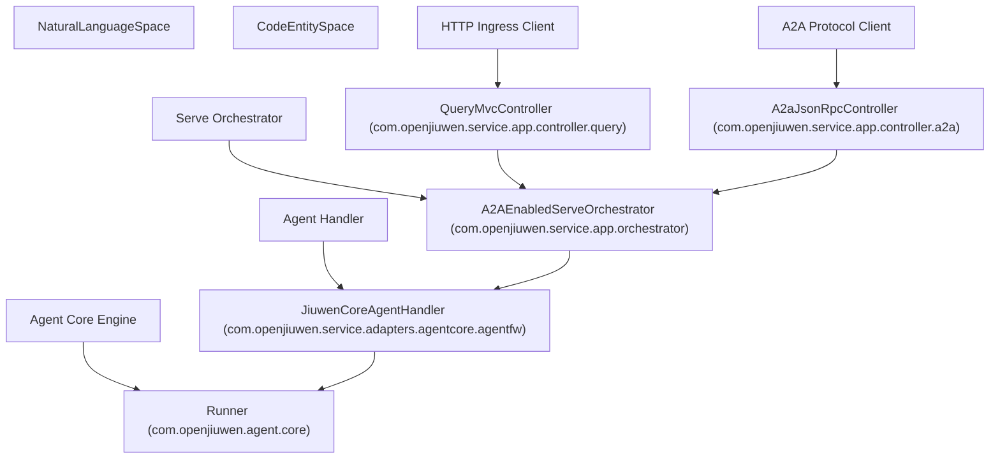
Sources: [README.md:120-131](), [service/README.md:8-18]()

### Module Dependency Hierarchy

The runtime enforces strict, one-way dependency boundaries between modules: application ingress depends on adapters, which in turn depend solely on core specifications [README.md:21]().

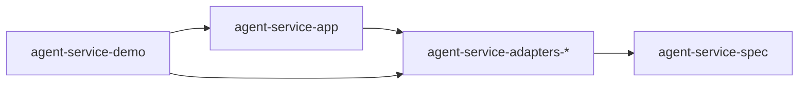
Sources: [README.md:21](), [service/README.md:20-28]()

| Module Name | Packaging | Primary Responsibility | Cited Source |
| :--- | :--- | :--- | :--- |
| `agent-service-spec` | `jar` | Pure Java Data Transfer Objects (DTOs), SPI interfaces, and endpoint path constants. | [service/README.md:12]() |
| `agent-service-adapters-common` | `jar` | Engine-agnostic middleware clients (Redis), credential decryptors, and external call DFX. | [README.md:156](), [service/README.md:14]() |
| `agent-service-adapters-agentcore` | `jar` | `JiuwenCoreAgentHandler` bridge binding execution engines, Checkpointers, MCP, and Sandbox SPIs. | [README.md:157](), [service/README.md:15]() |
| `agent-service-app` | `jar` | Spring Boot auto-configurations, MVC/WebFlux controllers, orchestrators, and lifecycle handlers. | [service/README.md:16]() |
| `agent-service-demo` | `jar` (Spring Boot) | Runnable examples, YAML configurations, and smoke testing scripts. | [service/README.md:17]() |

Sources: [README.md:156-157](), [service/README.md:12-17]()

---

## Key Concepts

- **AgentHandler**: The primary Service Provider Interface (SPI) abstracting agent invocation, allowing integration with the OpenJiuwen Agent Core engine or custom execution proxies [README.md:161-162]().
- **ServeOrchestrator**: Coordinates incoming request lifecycles, streaming chunk dispatching (`QueryStreamObserver`), and remote A2A delegation [README.md:123]().
- **In-Process A2A**: Native support for Agent Cards (`/.well-known/agent-card.json`) and JSON-RPC message passing (`SendMessage`, `SendStreamingMessage`) without requiring an external sidecar process [README.md:19](), [READMEvmd:145-146]().
- **Adapters Layer**: Decouples business logic from middleware (Redis checkpointers) and external egress boundaries (MCP, Sandboxes, LLM APIs) [README.md:150-158]().

Sources: [README.md:19](), [README.md:123](), [README.md:150-162]()

---

## Child Pages

For comprehensive technical documentation, refer to the child pages:
- [Getting Started and Build](#1.1) — Details Maven multi-module builds, versioning constraints, dependency pinning, and running local demos [README.md:23-82]().
- [Module Layout and Spec Contracts](#1.2) — Covers `agent-service-spec` DTO definitions (`ServeRequest`, `QueryChunk`, `QueryRequest`/`Response`), SPI contracts (`AgentHandler`, `ServeOrchestrator`), and route paths [service/README.md:47-49]().

Sources: [README.md:23-82](), [service/README.md:47-49]()

---

# Page: Getting Started and Build

# Getting Started and Build

<details>
<summary>Relevant source files</summary>

The following files were used as context for generating this wiki page:

- [pom.xml](pom.xml)
- [service/agent-service-adapters/agent-service-adapters-agentcore/pom.xml](service/agent-service-adapters/agent-service-adapters-agentcore/pom.xml)
- [service/agent-service-adapters/agent-service-adapters-common/pom.xml](service/agent-service-adapters/agent-service-adapters-common/pom.xml)
- [service/agent-service-adapters/agent-service-adapters-common/src/main/java/com/openjiuwen/service/adapters/common/security/ExternalAuthProperties.java](service/agent-service-adapters/agent-service-adapters-common/src/main/java/com/openjiuwen/service/adapters/common/security/ExternalAuthProperties.java)
- [service/agent-service-adapters/agent-service-adapters-common/src/main/java/com/openjiuwen/service/adapters/common/security/ExternalTlsConfig.java](service/agent-service-adapters/agent-service-adapters-common/src/main/java/com/openjiuwen/service/adapters/common/security/ExternalTlsConfig.java)
- [service/agent-service-adapters/agent-service-adapters-common/src/main/java/com/openjiuwen/service/adapters/common/security/GlobalTlsProperties.java](service/agent-service-adapters/agent-service-adapters-common/src/main/java/com/openjiuwen/service/adapters/common/security/GlobalTlsProperties.java)
- [service/agent-service-adapters/agent-service-adapters-common/src/main/resources/META-INF/spring/org.springframework.boot.autoconfigure.AutoConfiguration.imports](service/agent-service-adapters/agent-service-adapters-common/src/main/resources/META-INF/spring/org.springframework.boot.autoconfigure.AutoConfiguration.imports)
- [service/agent-service-adapters/pom.xml](service/agent-service-adapters/pom.xml)
- [service/agent-service-app/pom.xml](service/agent-service-app/pom.xml)
- [service/agent-service-demo/README.md](service/agent-service-demo/README.md)
- [service/agent-service-demo/example/config/application-base.yml](service/agent-service-demo/example/config/application-base.yml)
- [service/agent-service-demo/example/redis/README.md](service/agent-service-demo/example/redis/README.md)
- [service/agent-service-demo/pom.xml](service/agent-service-demo/pom.xml)
- [service/agent-service-demo/src/main/resources/application.yml](service/agent-service-demo/src/main/resources/application.yml)
- [service/agent-service-demo/src/test/java/com/openjiuwen/service/demo/DemoAgentApplicationTest.java](service/agent-service-demo/src/test/java/com/openjiuwen/service/demo/DemoAgentApplicationTest.java)
- [service/agent-service-spec/pom.xml](service/agent-service-spec/pom.xml)
- [service/pom.xml](service/pom.xml)

</details>


## Purpose and Scope
This page details the Maven multi-module build layout, CI-friendly versioning strategy, strict dependency pinning rules, and procedures for running the `agent-service-demo` application locally. The repository `agent-runtime-java` hosts OpenJiuwen agents over the A2A protocol using Spring Boot `[pom.xml:8-14]`, `[service/agent-service-demo/README.md:1-6]()`.

Sources: `[pom.xml:8-14]()`, `[service/agent-service-demo/README.md:1-6]()`

---

## Maven Multi-Module Architecture
The codebase is structured as a Maven multi-module project rooted at `pom.xml`, delegating service aggregation to `service/pom.xml`. The leaf modules isolate specifications, adapters, application controllers, and runnable demos.

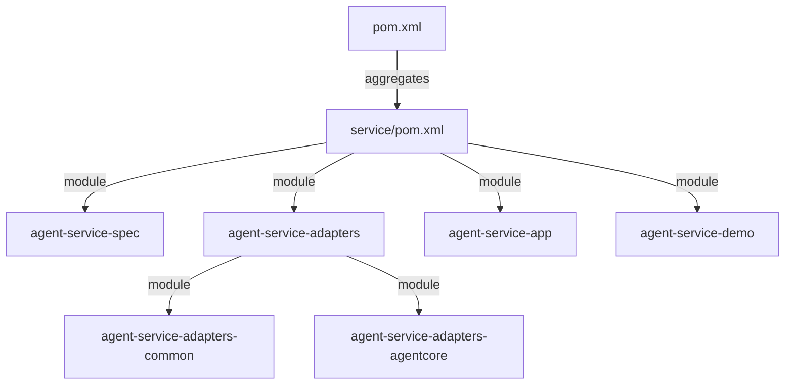
*Figure 1: Maven Multi-Module Build Dependency and Aggregation Topology.*

Sources: `[pom.xml:23-25]()`, `[service/pom.xml:57-72]()`, `[service/agent-service-adapters/pom.xml:21-25]()`

---

## CI-Friendly Versioning and Dependency Pinning
To support continuous integration and strict binary compatibility with `agent-core-java`, the project uses a Maven CI-friendly versioning property `${revision}` defined in `pom.xml` `[pom.xml:10-28]()`. 

Key runtime dependencies and BOM overrides are explicitly pinned in the root `dependencyManagement` block to avoid transitive version drift from `spring-boot-starter-parent` `[pom.xml:40-121]()`:
- `agent-core-java`: pinned to version `0.1.16` `[pom.xml:36-36]()`, `[pom.xml:116-120]()`.
- A2A Java SDK modules (`a2a-java-sdk-spec`, `a2a-java-sdk-server-common`, `a2a-java-sdk-jsonrpc-common`, `a2a-java-sdk-client`): pinned to `1.0.0.Final` `[pom.xml:34-34]`, `[pom.xml:93-113]()`.
- `opentelemetry.version`: overridden to `1.64.0` to match `agent-core-java` and prevent `NoSuchMethodError` `[pom.xml:63-65]()`.
- `gson`: pinned to `2.11.0` required by A2A SDK `JSONRPCUtils` `[pom.xml:55-56]`, `[pom.xml:152-156]()`.

Sources: `[pom.xml:10-121]()`

---

## Running the Demo App Locally
The `agent-service-demo` module provides a runnable Spring Boot application demonstrating the core query APIs, LLM integration, and middleware configurations `[service/agent-service-demo/README.md:1-27]`, `[service/agent-service-demo/pom.xml:15-19]()`.

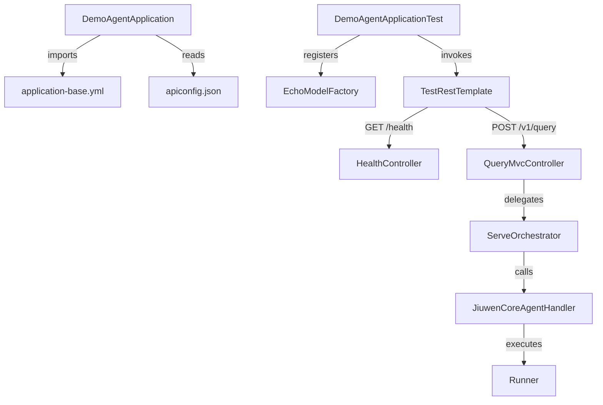
*Figure 2: Demo Application Execution Flow and Component Integration.*

### Local Startup Procedure
1. Navigate to the service directory:
   ```bash
   cd agent-runtime-java/service
   ```
2. Configure LLM credentials by providing `apiconfig.json` or setting environment variables as specified in `[service/agent-service-demo/README.md:126-183]()`.
3. Start the demo application via Maven `[service/agent-service-demo/README.md:9-16]()`:
   ```bash
   mvn -pl agent-service-demo -am spring-boot:run
   ```
4. The service listens on port `8090` by default `[service/agent-service-demo/README.md:15-15]`, `[service/agent-service-demo/example/config/application-base.yml:4-5]()`.

Sources: `[service/agent-service-demo/README.md:1-183]`, `[service/agent-service-demo/pom.xml:15-19]`, `[service/agent-service-demo/src/test/java/com/openjiuwen/service/demo/DemoAgentApplicationTest.java:54-94]`, `[service/agent-service-demo/example/config/application-base.yml:1-46]()`

---

# Page: Module Layout and Spec Contracts

# Module Layout and Spec Contracts

<details>
<summary>Relevant source files</summary>

The following files were used as context for generating this wiki page:

- [service/agent-service-app/src/main/java/com/openjiuwen/service/app/config/LifecycleProperties.java](service/agent-service-app/src/main/java/com/openjiuwen/service/app/config/LifecycleProperties.java)
- [service/agent-service-app/src/main/java/com/openjiuwen/service/app/config/QueryProperties.java](service/agent-service-app/src/main/java/com/openjiuwen/service/app/config/QueryProperties.java)
- [service/agent-service-app/src/main/java/com/openjiuwen/service/app/config/ServiceProperties.java](service/agent-service-app/src/main/java/com/openjiuwen/service/app/config/ServiceProperties.java)
- [service/agent-service-app/src/main/java/com/openjiuwen/service/app/controller/a2a/client/A2AAgentCardDiscovery.java](service/agent-service-app/src/main/java/com/openjiuwen/service/app/controller/a2a/client/A2AAgentCardDiscovery.java)
- [service/agent-service-app/src/main/java/com/openjiuwen/service/app/controller/reset/ResetIngressSupport.java](service/agent-service-app/src/main/java/com/openjiuwen/service/app/controller/reset/ResetIngressSupport.java)
- [service/agent-service-app/src/main/java/com/openjiuwen/service/app/orchestrator/DefaultServeOrchestrator.java](service/agent-service-app/src/main/java/com/openjiuwen/service/app/orchestrator/DefaultServeOrchestrator.java)
- [service/agent-service-app/src/test/java/com/openjiuwen/service/app/controller/a2a/A2AAgentExecutorCancelTest.java](service/agent-service-app/src/test/java/com/openjiuwen/service/app/controller/a2a/A2AAgentExecutorCancelTest.java)
- [service/agent-service-app/src/test/java/com/openjiuwen/service/app/controller/a2a/A2AProtocolAdapterTest.java](service/agent-service-app/src/test/java/com/openjiuwen/service/app/controller/a2a/A2AProtocolAdapterTest.java)
- [service/agent-service-app/src/test/java/com/openjiuwen/service/app/controller/a2a/client/A2AAgentCardDiscoveryTest.java](service/agent-service-app/src/test/java/com/openjiuwen/service/app/controller/a2a/client/A2AAgentCardDiscoveryTest.java)
- [service/agent-service-app/src/test/java/com/openjiuwen/service/app/it/MultiTurnEchoHandler.java](service/agent-service-app/src/test/java/com/openjiuwen/service/app/it/MultiTurnEchoHandler.java)
- [service/agent-service-spec/src/main/java/com/openjiuwen/service/spec/dto/HealthResponse.java](service/agent-service-spec/src/main/java/com/openjiuwen/service/spec/dto/HealthResponse.java)
- [service/agent-service-spec/src/main/java/com/openjiuwen/service/spec/dto/QueryChunk.java](service/agent-service-spec/src/main/java/com/openjiuwen/service/spec/dto/QueryChunk.java)
- [service/agent-service-spec/src/main/java/com/openjiuwen/service/spec/dto/QueryRequest.java](service/agent-service-spec/src/main/java/com/openjiuwen/service/spec/dto/QueryRequest.java)
- [service/agent-service-spec/src/main/java/com/openjiuwen/service/spec/dto/QueryResponse.java](service/agent-service-spec/src/main/java/com/openjiuwen/service/spec/dto/QueryResponse.java)
- [service/agent-service-spec/src/main/java/com/openjiuwen/service/spec/dto/ResetConversationRequest.java](service/agent-service-spec/src/main/java/com/openjiuwen/service/spec/dto/ResetConversationRequest.java)
- [service/agent-service-spec/src/main/java/com/openjiuwen/service/spec/dto/ResetConversationResponse.java](service/agent-service-spec/src/main/java/com/openjiuwen/service/spec/dto/ResetConversationResponse.java)
- [service/agent-service-spec/src/main/java/com/openjiuwen/service/spec/dto/ServeRequest.java](service/agent-service-spec/src/main/java/com/openjiuwen/service/spec/dto/ServeRequest.java)
- [service/agent-service-spec/src/main/java/com/openjiuwen/service/spec/exception/AgentExecutionException.java](service/agent-service-spec/src/main/java/com/openjiuwen/service/spec/exception/AgentExecutionException.java)
- [service/agent-service-spec/src/main/java/com/openjiuwen/service/spec/paths/AgentServicePaths.java](service/agent-service-spec/src/main/java/com/openjiuwen/service/spec/paths/AgentServicePaths.java)
- [service/agent-service-spec/src/main/java/com/openjiuwen/service/spec/spi/ServeOrchestrator.java](service/agent-service-spec/src/main/java/com/openjiuwen/service/spec/spi/ServeOrchestrator.java)
- [service/agent-service-spec/src/test/java/com/openjiuwen/service/spec/dto/ServeRequestTest.java](service/agent-service-spec/src/test/java/com/openjiuwen/service/spec/dto/ServeRequestTest.java)

</details>


This page details the `agent-service-spec` module, which defines the core Data Transfer Objects (DTOs), Service Provider Interfaces (SPIs), HTTP paths, and exceptions used throughout the `agent-runtime-java` codebase. It serves as the contract between different modules and external clients, ensuring a consistent interaction model.

## Data Transfer Objects (DTOs)

The `agent-service-spec` module defines several key DTOs for communication within the system and with external clients.

### ServeRequest

The `ServeRequest` class [service/agent-service-spec/src/main/java/com/openjiuwen/service/spec/dto/ServeRequest.java:20-126]() is a protocol-neutral DTO that represents an orchestration request. It is typically built from an external `QueryRequest` [service/agent-service-spec/src/main/java/com/openjiuwen/service/spec/dto/ServeRequest.java:42-51]() and contains information necessary for an agent to process a user's query.

Key fields include:
*   `conversationId`: A unique identifier for the conversation.
*   `messages`: A list of message maps, representing the conversation history.
*   `userId`, `spaceId`, `tenantId`: Identifiers for the user, space, and tenant.
*   `stream`: A boolean indicating whether the response should be streamed.
*   `metadata`: A map for additional, arbitrary metadata.

The `ServeRequest` also provides utility methods like `lastUserQuery()` [service/agent-service-spec/src/main/java/com/openjiuwen/service/spec/dto/ServeRequest.java:59-61]() to extract the content of the latest user message and `lastUserMessageMetadata()` [service/agent-service-spec/src/main/java/com/openjiuwen/service/spec/dto/ServeRequest.java:83-95]() to retrieve metadata associated with it.

Sources:
*   [service/agent-service-spec/src/main/java/com/openjiuwen/service/spec/dto/ServeRequest.java]()
*   [service/agent-service-spec/src/test/java/com/openjiuwen/service/spec/dto/ServeRequestTest.java]()

### QueryRequest and QueryResponse

The `QueryRequest` class [service/agent-service-spec/src/main/java/com/openjiuwen/service/spec/dto/QueryRequest.java:24-110]() is the external API request body for querying an agent. It aligns with the Python AgentApp's `QueryRequest`. It includes fields similar to `ServeRequest` but also handles a shorthand `message` field [service/agent-service-spec/src/main/java/com/openjiuwen/service/spec/dto/QueryRequest.java:48-51]() which is normalized into the `messages` list via `normalizeMessages()` [service/agent-service-spec/src/main/java/com/openjiuwen/service/spec/dto/QueryRequest.java:71-82]().

The `QueryResponse` class [service/agent-service-spec/src/main/java/com/openjiuwen/service/spec/dto/QueryResponse.java:12-24]() encapsulates the response from a query operation, containing the result data and the conversation ID.

Sources:
*   [service/agent-service-spec/src/main/java/com/openjiuwen/service/spec/dto/QueryRequest.java]()
*   [service/agent-service-spec/src/main/java/com/openjiuwen/service/spec/dto/QueryResponse.java]()

### QueryChunk

The `QueryChunk` class [service/agent-service-spec/src/main/java/com/openjiuwen/service/spec/dto/QueryChunk.java:14-59]() represents a single chunk of data in a streaming response (Server-Sent Events - SSE). It defines various types of chunks to convey different kinds of information during an agent's execution:
*   `TYPE_INTERRUPT`: Used for signals requiring input from the user [service/agent-service-spec/src/main/java/com/openjiuwen/service/spec/dto/QueryChunk.java:17]().
*   `TYPE_CHUNK`: For intermediate streaming content [service/agent-service-spec/src/main/java/com/openjiuwen/service/spec/dto/QueryChunk.java:20]().
*   `TYPE_REMOTE_AGENT_OUTPUT`: Carries business output from remote agents, including source provenance [service/agent-service-spec/src/main/java/com/openjiuwen/service/spec/dto/QueryChunk.java:23]().
*   `TYPE_CANCEL`: Indicates that the execution side requests the task to end in a canceled state [service/agent-service-spec/src/main/java/com/openjiuwen/service/spec/dto/QueryChunk.java:26-34]().
*   `TYPE_ERROR`: For error messages during streaming [service/agent-service-spec/src/main/java/com/openjiuwen/service/spec/dto/QueryChunk.java:37]().

Each chunk contains a `type` and `data` field [service/agent-service-spec/src/main/java/com/openjiuwen/service/spec/dto/QueryChunk.java:39-40](). The `TYPE_CANCEL` is distinct from other types and its presence leads to the task transitioning to a `TASK_STATE_CANCELED` state, overriding other potential terminal states [service/agent-service-app/src/test/java/com/openjiuwen/service/app/controller/a2a/A2AAgentExecutorCancelTest.java:45-49]().

Sources:
*   [service/agent-service-spec/src/main/java/com/openjiuwen/service/spec/dto/QueryChunk.java]()
*   [service/agent-service-app/src/test/java/com/openjiuwen/service/app/controller/a2a/A2AAgentExecutorCancelTest.java:45-49]()

### Other DTOs

*   `ResetConversationRequest` [service/agent-service-spec/src/main/java/com/openjiuwen/service/spec/dto/ResetConversationRequest.java:20-45]() and `ResetConversationResponse` [service/agent-service-spec/src/main/java/com/openjiuwen/service/spec/dto/ResetConversationResponse.java:12-23]() are used for resetting conversation states.
*   `HealthResponse` [service/agent-service-spec/src/main/java/com/openjiuwen/service/spec/dto/HealthResponse.java:17-51]() provides health status information for the service.

Sources:
*   [service/agent-service-spec/src/main/java/com/openjiuwen/service/spec/dto/ResetConversationRequest.java]()
*   [service/agent-service-spec/src/main/java/com/openjiuwen/service/spec/dto/ResetConversationResponse.java]()
*   [service/agent-service-spec/src/main/java/com/openjiuwen/service/spec/dto/HealthResponse.java]()

## Service Provider Interfaces (SPIs)

The `agent-service-spec` module defines key SPIs that allow different implementations of agent logic and orchestration to be plugged into the runtime.

### AgentHandler

The `AgentHandler` interface [service/agent-service-spec/src/main/java/com/openjiuwen/service/spec/spi/AgentHandler.java:12-29]() is the core interface for an agent's business logic. It defines methods for handling queries:
*   `streamQuery(ServeRequest request, QueryStreamObserver observer)`: For streaming responses, where chunks are sent to the `QueryStreamObserver`.
*   `query(ServeRequest request)`: For non-streaming, synchronous responses.
*   `clearSession(String conversationId)`: To clear the session state for a given conversation.

An example implementation, `MultiTurnEchoHandler` [service/agent-service-app/src/test/java/com/openjiuwen/service/app/it/MultiTurnEchoHandler.java:22-83](), demonstrates how an agent might build a reply and send it as a `QueryChunk`.

Sources:
*   [service/agent-service-spec/src/main/java/com/openjiuwen/service/spec/spi/AgentHandler.java]()
*   [service/agent-service-app/src/test/java/com/openjiuwen/service/app/it/MultiTurnEchoHandler.java]()

### ServeOrchestrator

The `ServeOrchestrator` interface [service/agent-service-spec/src/main/java/com/openjiuwen/service/spec/spi/ServeOrchestrator.java:12-27]() is responsible for orchestrating the execution of agent requests. It acts as a facade to the underlying `AgentHandler` and can manage aspects like conversation state, delegation, and error handling.
*   `streamQuery(ServeRequest request, QueryStreamObserver observer)`: Orchestrates a streaming query.
*   `query(ServeRequest request)`: Orchestrates a synchronous query.
*   `cancelActive(String conversationId)`: Cancels an active conversation.
*   `clearSession(String conversationId)`: Clears the session for a conversation.

The `DefaultServeOrchestrator` [service/agent-service-app/src/main/java/com/openjiuwen/service/app/orchestrator/DefaultServeOrchestrator.java:24-100]() is a basic implementation that directly delegates to an `AgentHandler`.

Sources:
*   [service/agent-service-spec/src/main/java/com/openjiuwen/service/spec/spi/ServeOrchestrator.java]()
*   [service/agent-service-app/src/main/java/com/openjiuwen/service/app/orchestrator/DefaultServeOrchestrator.java]()

### QueryStreamObserver

The `QueryStreamObserver` interface [service/agent-service-spec/src/main/java/com/openjiuwen/service/spec/spi/QueryStreamObserver.java:12-22]() is a callback interface used by `AgentHandler` and `ServeOrchestrator` to send streaming `QueryChunk`s back to the client.
*   `onNext(QueryChunk chunk)`: Called when a new chunk of data is available.
*   `onError(Throwable t)`: Called when an error occurs during streaming.
*   `onComplete()`: Called when the stream has finished successfully.

Sources:
*   [service/agent-service-spec/src/main/java/com/openjiuwen/service/spec/spi/QueryStreamObserver.java]()

## HTTP Paths

The `AgentServicePaths` class [service/agent-service-spec/src/main/java/com/openjiuwen/service/spec/paths/AgentServicePaths.java:12-35]() defines constant strings for various HTTP endpoints exposed by the agent service. This centralizes path definitions and ensures consistency.

Key paths include:
*   `/health`: For health probes [service/agent-service-spec/src/main/java/com/openjiuwen/service/spec/paths/AgentServicePaths.java:14]().
*   `/v1/query` and `/query`: For query operations, including a legacy path [service/agent-service-spec/src/main/java/com/openjiuwen/service/spec/paths/AgentServicePaths.java:17-20]().
*   `/v1/query/reactive`: For reactive query endpoints [service/agent-service-spec/src/main/java/com/openjiuwen/service/spec/paths/AgentServicePaths.java:23]().
*   `/v1/reset_conversation` and `/reset_conversation`: For resetting conversations, including a legacy path [service/agent-service-spec/src/main/java/com/openjiuwen/service/spec/paths/AgentServicePaths.java:26-29]().
*   `/v1/current_active_tasks`: For querying active tasks [service/agent-service-spec/src/main/java/com/openjiuwen/service/spec/paths/AgentServicePaths.java:32]().

Sources:
*   [service/agent-service-spec/src/main/java/com/openjiuwen/service/spec/paths/AgentServicePaths.java]()

## Exceptions

The `agent-service-spec` module defines custom exceptions for specific error conditions.
*   `AgentExecutionException` [service/agent-service-spec/src/main/java/com/openjiuwen/service/spec/exception/AgentExecutionException.java:12-24]() is a general exception for errors during agent execution.

Sources:
*   [service/agent-service-spec/src/main/java/com/openjiuwen/service/spec/exception/AgentExecutionException.java]()

## Module Layout Diagram

The following diagram illustrates the relationships between the `agent-service-spec` module and other key modules, highlighting how DTOs and SPIs define the contracts.

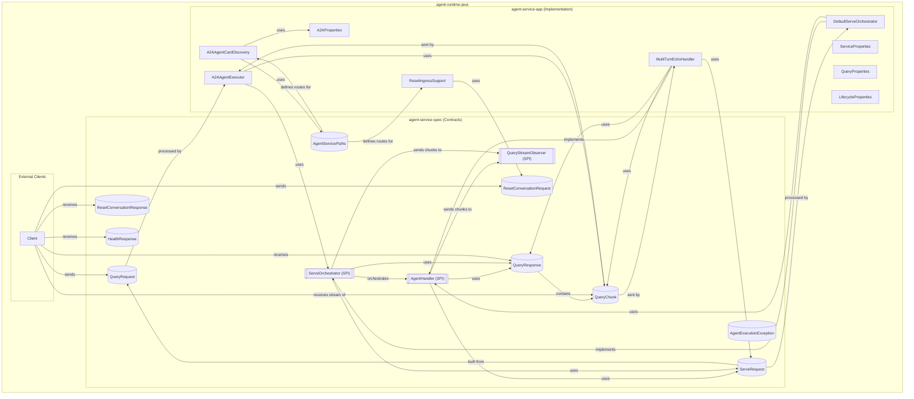

Sources:
*   [service/agent-service-spec/src/main/java/com/openjiuwen/service/spec/dto/ServeRequest.java]()
*   [service/agent-service-spec/src/main/java/com/openjiuwen/service/spec/dto/QueryRequest.java]()
*   [service/agent-service-spec/src/main/java/com/openjiuwen/service/spec/dto/QueryResponse.java]()
*   [service/agent-service-spec/src/main/java/com/openjiuwen/service/spec/dto/QueryChunk.java]()
*   [service/agent-service-spec/src/main/java/com/openjiuwen/service/spec/dto/ResetConversationRequest.java]()
*   [service/agent-service-spec/src/main/java/com/openjiuwen/service/spec/dto/ResetConversationResponse.java]()
*   [service/agent-service-spec/src/main/java/com/openjiuwen/service/spec/dto/HealthResponse.java]()
*   [service/agent-service-spec/src/main/java/com/openjiuwen/service/spec/spi/AgentHandler.java]()
*   [service/agent-service-spec/src/main/java/com/openjiuwen/service/spec/spi/ServeOrchestrator.java]()
*   [service/agent-service-spec/src/main/java/com/openjiuwen/service/spec/spi/QueryStreamObserver.java]()
*   [service/agent-service-spec/src/main/java/com/openjiuwen/service/spec/paths/AgentServicePaths.java]()
*   [service/agent-service-spec/src/main/java/com/openjiuwen/service/spec/exception/AgentExecutionException.java]()
*   [service/agent-service-app/src/main/java/com/openjiuwen/service/app/controller/a2a/client/A2AAgentCardDiscovery.java]()
*   [service/agent-service-app/src/main/java/com/openjiuwen/service/app/config/A2AProperties.java]()
*   [service/agent-service-app/src/main/java/com/openjiuwen/service/app/config/ServiceProperties.java]()
*   [service/agent-service-app/src/main/java/com/openjiuwen/service/app/config/QueryProperties.java]()
*   [service/agent-service-app/src/main/java/com/openjiuwen/service/app/config/LifecycleProperties.java]()
*   [service/agent-service-app/src/main/java/com/openjiuwen/service/app/orchestrator/DefaultServeOrchestrator.java]()
*   [service/agent-service-app/src/test/java/com/openjiuwen/service/app/it/MultiTurnEchoHandler.java]()
*   [service/agent-service-app/src/main/java/com/openjiuwen/service/app/controller/reset/ResetIngressSupport.java]()

## Configuration Properties

The `agent-service-app` module uses several configuration properties to customize behavior, many of which are related to the contracts defined in `agent-service-spec`.

*   `ServiceProperties` [service/agent-service-app/src/main/java/com/openjiuwen/service/app/config/ServiceProperties.java:17-29]() defines general service properties like `agentId` and `version`.
*   `QueryProperties` [service/agent-service-app/src/main/java/com/openjiuwen/service/app/config/QueryProperties.java:17-31]() configures the query endpoints, including enabling WebFlux endpoints and legacy paths.
*   `A2AProperties` [service/agent-service-app/src/main/java/com/openjiuwen/service/app/config/A2AProperties.java:20-100]() (not fully shown in provided content, but referenced) contains properties related to A2A communication, including remote agent configurations. For example, `A2AAgentCardDiscovery` [service/agent-service-app/src/main/java/com/openjiuwen/service/app/controller/a2a/client/A2AAgentCardDiscovery.java:59-60]() uses `A2AProperties` to discover remote agents. Validation of these properties is crucial, as seen in `A2AAgentCardDiscoveryTest` [service/agent-service-app/src/test/java/com/openjiuwen/service/app/controller/a2a/client/A2AAgentCardDiscoveryTest.java:36-76]().

Sources:
*   [service/agent-service-app/src/main/java/com/openjiuwen/service/app/config/ServiceProperties.java]()
*   [service/agent-service-app/src/main/java/com/openjiuwen/service/app/config/QueryProperties.java]()
*   [service/agent-service-app/src/main/java/com/openjiuwen/service/app/controller/a2a/client/A2AAgentCardDiscovery.java:59-60]()
*   [service/agent-service-app/src/test/java/com/openjiuwen/service/app/controller/a2a/client/A2AAgentCardDiscoveryTest.java:36-76]()

## Data Flow and Key Interactions

The following diagram illustrates a typical data flow for a query request, showing how the DTOs and SPIs interact.

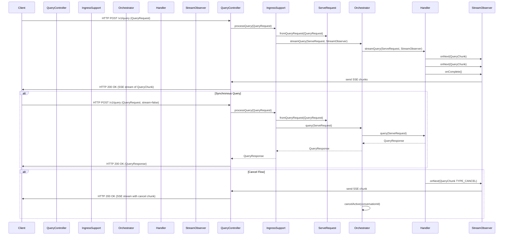

Sources:
*   [service/agent-service-spec/src/main/java/com/openjiuwen/service/spec/dto/ServeRequest.java:42-51]()
*   [service/agent-service-spec/src/main/java/com/openjiuwen/service/spec/spi/ServeOrchestrator.java:18-21]()
*   [service/agent-service-spec/src/main/java/com/openjiuwen/service/spec/spi/AgentHandler.java:18-21]()
*   [service/agent-service-spec/src/main/java/com/openjiuwen/service/spec/spi/QueryStreamObserver.java:18-20]()
*   [service/agent-service-spec/src/main/java/com/openjiuwen/service/spec/dto/QueryChunk.java:17-37]()
*   [service/agent-service-app/src/test/java/com/openjiuwen/service/app/controller/a2a/A2AAgentExecutorCancelTest.java:54-57]()

---

# Page: A2A Protocol Layer

# A2A Protocol Layer

<details>
<summary>Relevant source files</summary>

The following files were used as context for generating this wiki page:

- [service/agent-service-adapters/agent-service-adapters-common/src/test/java/com/openjiuwen/service/adapters/common/security/SslContextFactoryTest.java](service/agent-service-adapters/agent-service-adapters-common/src/test/java/com/openjiuwen/service/adapters/common/security/SslContextFactoryTest.java)
- [service/agent-service-app/src/main/java/com/openjiuwen/service/app/controller/a2a/A2aJsonRpcController.java](service/agent-service-app/src/main/java/com/openjiuwen/service/app/controller/a2a/A2aJsonRpcController.java)
- [service/agent-service-app/src/main/java/com/openjiuwen/service/app/controller/a2a/A2aJsonRpcProtocol.java](service/agent-service-app/src/main/java/com/openjiuwen/service/app/controller/a2a/A2aJsonRpcProtocol.java)
- [service/agent-service-app/src/main/java/com/openjiuwen/service/app/controller/a2a/A2aPushNotificationCallbackUrlPolicy.java](service/agent-service-app/src/main/java/com/openjiuwen/service/app/controller/a2a/A2aPushNotificationCallbackUrlPolicy.java)
- [service/agent-service-app/src/test/java/com/openjiuwen/service/app/controller/a2a/A2aJsonRpcControllerTest.java](service/agent-service-app/src/test/java/com/openjiuwen/service/app/controller/a2a/A2aJsonRpcControllerTest.java)
- [service/agent-service-app/src/test/java/com/openjiuwen/service/app/controller/a2a/CallbackDestinationSecurityTest.java](service/agent-service-app/src/test/java/com/openjiuwen/service/app/controller/a2a/CallbackDestinationSecurityTest.java)
- [service/agent-service-app/src/test/java/com/openjiuwen/service/app/it/A2aIntegrationTest.java](service/agent-service-app/src/test/java/com/openjiuwen/service/app/it/A2aIntegrationTest.java)
- [service/agent-service-app/src/test/java/com/openjiuwen/service/app/it/SecurityAuthorizationConcurrencyIntegrationTest.java](service/agent-service-app/src/test/java/com/openjiuwen/service/app/it/SecurityAuthorizationConcurrencyIntegrationTest.java)
- [service/agent-service-app/src/test/java/com/openjiuwen/service/app/it/SecurityAuthorizationHeaderBoundaryIntegrationTest.java](service/agent-service-app/src/test/java/com/openjiuwen/service/app/it/SecurityAuthorizationHeaderBoundaryIntegrationTest.java)
- [service/agent-service-app/src/test/java/com/openjiuwen/service/app/it/support/AgentReadinessTestSupport.java](service/agent-service-app/src/test/java/com/openjiuwen/service/app/it/support/AgentReadinessTestSupport.java)

</details>


## Purpose and Scope

The A2A Protocol Layer serves as the inbound communication and synchronization boundary for the `agent-runtime-java` codebase. It exposes standard A2A (Agent-to-Agent) endpoints, manages JSON-RPC ingress parsing, handles Server-Sent Events (SSE) streaming, hosts agent capability cards, coordinates push notifications with strict SSRF policies, and delegates task execution via the underlying A2A SDK and orchestrators. 

As a parent page, this section provides a high-level architectural overview of the protocol stack. For comprehensive low-level details, refer to the child sections linked below.

---

## 2.1. JSON-RPC Ingress and SSE Streaming

The entry point for all A2A interactions is `A2aJsonRpcController`, which maps POST requests onto standard and custom routes such as `A2AServicePaths.A2A_JSONRPC` [service/agent-service-app/src/main/java/com/openjiuwen/service/app/controller/a2a/A2aJsonRpcController.java:111-115](). Before parsing JSON payloads, the controller enforces pre-admission boundaries using `Content-Length` checks against `maxMessageBytes` to reject oversized or malformed payloads with HTTP 413 [service/agent-service-app/src/main/java/com/openjiuwen/service/app/controller/a2a/A2aJsonRpcController.java:116-123](). 

Incoming raw requests are translated via `A2aJsonRpcProtocol` to validate JSON-RPC 2.0 conformance, method strings, and request IDs [service/agent-service-app/src/main/java/com/openjiuwen/service/app/controller/a2a/A2aJsonRpcProtocol.java:37-59](). Streaming subscriptions utilize dedicated execution pools (`SSE_EXECUTOR`) to keep long-lived SSE emitters off shared common thread pools [service/agent-service-app/src/main/java/com/openjiuwen/service/app/controller/a2a/A2aJsonRpcController.java:69-74]().

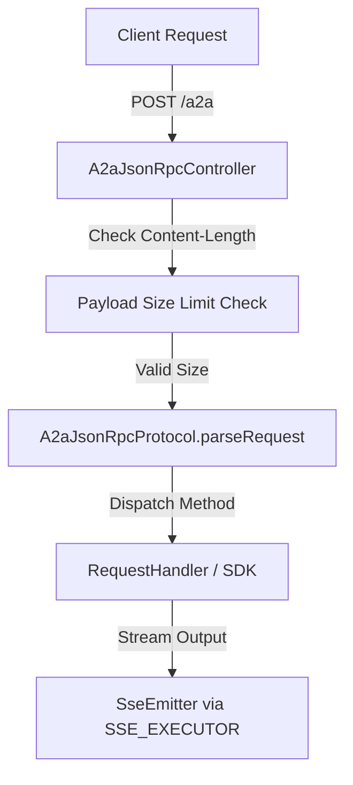
*Figure 1: JSON-RPC Ingress and SSE Dispatch Flow.*

> **Sources:**
> - [service/agent-service-app/src/main/java/com/openjiuwen/service/app/controller/a2a/A2aJsonRpcController.java:111-150]()
> - [service/agent-service-app/src/main/java/com/openjiuwen/service/app/controller/a2a/A2aJsonRpcProtocol.java:37-59]()

For deep configuration, params parsing logic, and SSE emitter lifecycle rules, see [JSON-RPC Ingress and SSE Streaming](#2.1).

---

## 2.2. A2AAgentExecutor and Execution Bridging

Once JSON-RPC requests are parsed and admitted, execution is handed off to the A2A SDK execution components and underlying orchestrators. The execution bridge maps incoming A2A `MessageSendParams` and task lifecycle commands into core execution events, converting agent interactions into structured query chunks and artifacts. It manages task states (such as `TASK_STATE_COMPLETED`), context propagation across multi-turn exchanges, and asynchronous interruption or cancellation signals.

> **Sources:**
> - [service/agent-service-app/src/test/java/com/openjiuwen/service/app/it/A2aIntegrationTest.java:103-125]()

For details on admission handoff, mapping rules, and interruption handlers, see [A2AAgentExecutor and Execution Bridging](#2.2).

---

## 2.3. Agent Cards and Capability Gating

Agent discovery and introspection are facilitated by controllers exposing well-known metadata paths (`A2AServicePaths`). The runtime publishes agent cards containing supported interfaces, skills, and authentication requirements. Capability gating ensures that advanced features like push notifications or specialized RPC extensions are exposed only when properly configured and authorized.

> **Sources:**
> - [service/agent-service-app/src/test/java/com/openjiuwen/service/app/it/A2aIntegrationTest.java:86-92]()

For controller implementation details and dynamic card generation factories, see [Agent Cards and Capability Gating](#2.3).

---

## 2.4. Push Notifications and Callbacks

Asynchronous task updates can be pushed to remote callback URLs. To prevent Server-Side Request Forgery (SSRF) and security bypasses, all callback configurations are validated at ingress and re-checked immediately before delivery using `A2aPushNotificationCallbackUrlPolicy` [service/agent-service-app/src/main/java/com/openjiuwen/service/app/controller/a2a/A2aPushNotificationCallbackUrlPolicy.java:20-61](). The policy enforces strict scheme checks (HTTP/https only), rejects non-public IP ranges (loopback, link-local, site-local, and reserved ranges), and verifies DNS entries against allowed hosts [service/agent-service-app/src/main/java/com/openjiuwen/service/app/controller/a2a/A2aPushNotificationCallbackUrlPolicy.java:33-89]().

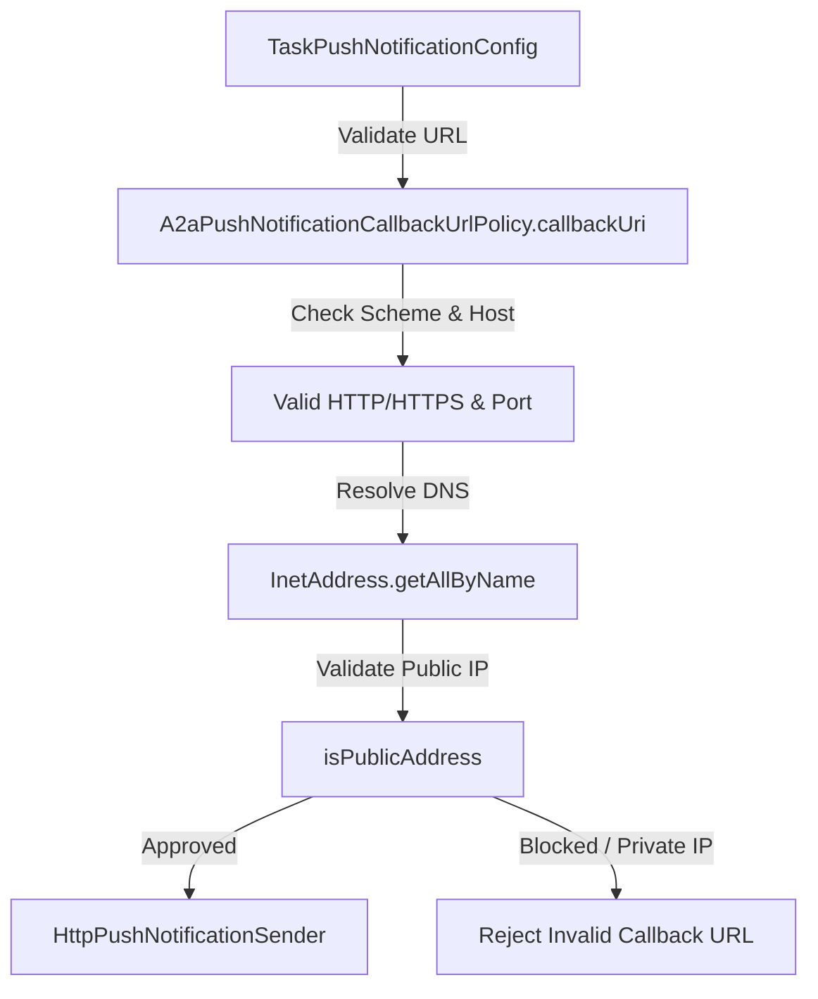
*Figure 2: Push Notification SSRF Policy Validation Pipeline.*

> **Sources:**
> - [service/agent-service-app/src/main/java/com/openjiuwen/service/app/controller/a2a/A2aPushNotificationCallbackUrlPolicy.java:20-90]()
> - [service/agent-service-app/src/test/java/com/openjiuwen/service/app/controller/a2a/CallbackDestinationSecurityTest.java:38-78]()

For retry logic, idempotency, and task continuation recovery, see [Push Notifications and Callbacks](#2.4).

---

## 2.5. Task Stores and Event Bus Resilience

To maintain durability across restarts and scale across distributed nodes, A2A tasks and push notification configs rely on robust persistence and event propagation layers. Components such as `RedisTaskStore` and `WriteThrottlingTaskStore` buffer and persist task state, while `ResilientMainEventBusProcessor` ensures that event bus disruptions do not drop critical task transition notifications.

For implementation specifications and queue manager cleanup mechanisms, see [Task Stores and Event Bus Resilience](#2.5).

---

# Page: JSON-RPC Ingress and SSE Streaming

# JSON-RPC Ingress and SSE Streaming

<details>
<summary>Relevant source files</summary>

The following files were used as context for generating this wiki page:

- [service/agent-service-adapters/agent-service-adapters-common/src/main/java/com/openjiuwen/service/adapters/common/security/ExternalHttpClientFactory.java](service/agent-service-adapters/agent-service-adapters-common/src/main/java/com/openjiuwen/service/adapters/common/security/ExternalHttpClientFactory.java)
- [service/agent-service-adapters/agent-service-adapters-common/src/test/java/com/openjiuwen/service/adapters/common/security/ExternalHttpClientFactoryTest.java](service/agent-service-adapters/agent-service-adapters-common/src/test/java/com/openjiuwen/service/adapters/common/security/ExternalHttpClientFactoryTest.java)
- [service/agent-service-app/src/main/java/com/openjiuwen/service/app/controller/a2a/A2AMessageContext.java](service/agent-service-app/src/main/java/com/openjiuwen/service/app/controller/a2a/A2AMessageContext.java)
- [service/agent-service-app/src/main/java/com/openjiuwen/service/app/controller/a2a/A2AProtocolAdapter.java](service/agent-service-app/src/main/java/com/openjiuwen/service/app/controller/a2a/A2AProtocolAdapter.java)
- [service/agent-service-app/src/main/java/com/openjiuwen/service/app/controller/a2a/A2aJsonRpcController.java](service/agent-service-app/src/main/java/com/openjiuwen/service/app/controller/a2a/A2aJsonRpcController.java)
- [service/agent-service-app/src/main/java/com/openjiuwen/service/app/controller/a2a/A2aJsonRpcParamsParser.java](service/agent-service-app/src/main/java/com/openjiuwen/service/app/controller/a2a/A2aJsonRpcParamsParser.java)
- [service/agent-service-app/src/main/java/com/openjiuwen/service/app/controller/a2a/A2aPushNotificationCallbackUrlPolicy.java](service/agent-service-app/src/main/java/com/openjiuwen/service/app/controller/a2a/A2aPushNotificationCallbackUrlPolicy.java)
- [service/agent-service-app/src/test/java/com/openjiuwen/service/app/controller/a2a/A2aJsonRpcControllerAdmissionTest.java](service/agent-service-app/src/test/java/com/openjiuwen/service/app/controller/a2a/A2aJsonRpcControllerAdmissionTest.java)
- [service/agent-service-app/src/test/java/com/openjiuwen/service/app/controller/a2a/A2aJsonRpcControllerTest.java](service/agent-service-app/src/test/java/com/openjiuwen/service/app/controller/a2a/A2aJsonRpcControllerTest.java)
- [service/agent-service-app/src/test/java/com/openjiuwen/service/app/controller/a2a/CallbackDestinationSecurityTest.java](service/agent-service-app/src/test/java/com/openjiuwen/service/app/controller/a2a/CallbackDestinationSecurityTest.java)
- [service/agent-service-app/src/test/java/com/openjiuwen/service/app/controller/a2a/client/A2ARemoteAgentClientSecurityTest.java](service/agent-service-app/src/test/java/com/openjiuwen/service/app/controller/a2a/client/A2ARemoteAgentClientSecurityTest.java)
- [service/agent-service-app/src/test/java/com/openjiuwen/service/app/controller/a2a/client/A2ARemoteAgentClientTlsTest.java](service/agent-service-app/src/test/java/com/openjiuwen/service/app/controller/a2a/client/A2ARemoteAgentClientTlsTest.java)
- [service/agent-service-app/src/test/java/com/openjiuwen/service/app/it/ConcurrencyAdmissionIntegrationTest.java](service/agent-service-app/src/test/java/com/openjiuwen/service/app/it/ConcurrencyAdmissionIntegrationTest.java)
- [service/agent-service-spec/src/main/java/com/openjiuwen/service/spec/concurrency/TaskAdmissionListener.java](service/agent-service-spec/src/main/java/com/openjiuwen/service/spec/concurrency/TaskAdmissionListener.java)

</details>


### Purpose and Scope
This document details the inbound Agent-to-Agent (A2A) protocol entry point in `agent-runtime-java`. It covers how raw HTTP requests are routed, pre-screened for payload size limits, governed by admission control gates, parsed via JSON-RPC protocol helpers, adapted into internal `ServeRequest` structures, and streamed via Server-Sent Events (SSE) using dedicated virtual-thread executors.

---

## 1. Routing and Ingress Boundary (`A2aJsonRpcController`)

The `A2aJsonRpcController` serves as the primary REST controller for inbound A2A methods (`SendMessage`, `SendStreamingMessage`, `GetTask`, and `SubscribeToTask`). It maps HTTP `POST` requests to standard and hosted paths defined in `A2AServicePaths` [service/agent-service-app/src/main/java/com/openjiuwen/service/app/controller/a2a/A2aJsonRpcController.java:111-113]().

### Content-Length Pre-Check and Admission Control
Before parsing JSON bodies, the controller enforces payload size limits and concurrency admission control:
1. **Payload Size Pre-Check**: The servlet request `Content-Length` header is evaluated against `A2AProperties.getMaxMessageBytes()` (defaulting to `A2aPartLimits.DEFAULT_MAX_REQUEST_BODY_BYTES`) [service/agent-service-app/src/main/java/com/openjiuwen/service/app/controller/a2a/A2aJsonRpcController.java:116-123](). If the body exceeds the limit or is chunked/missing where prohibited, HTTP `413 Payload Too Large` is returned immediately without parsing overhead [service/agent-service-app/src/main/java/com/openjiuwen/service/app/controller/a2a/A2aJsonRpcController.java:121-123]().
2. **Admission Gate**: Through `TaskAdmissionGate`, permits are acquired synchronously prior to request dispatch [service/agent-service-app/src/test/java/com/openjiuwen/service/app/controller/a2a/A2aJsonRpcControllerAdmissionTest.java:47-60](). If capacity is exhausted, the controller returns HTTP `503 Service Unavailable`. Acquired permits are embedded into the `ServerCallContext` state for downstream handover to `A2AAgentExecutor`; if a synchronous failure occurs before adoption, the controller releases the permit [service/agent-service-app/src/test/java/com/openjiuwen/service/app/controller/a2a/A2aJsonRpcControllerAdmissionTest.java:115-146]().

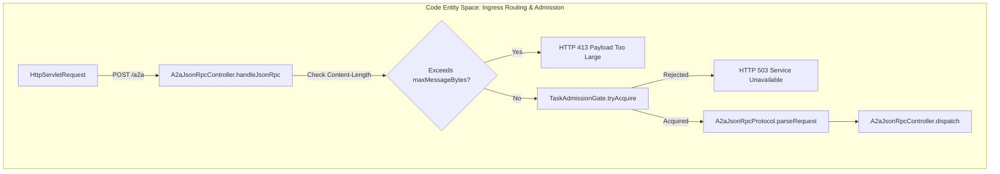
*Sources: [service/agent-service-app/src/main/java/com/openjiuwen/service/app/controller/a2a/A2aJsonRpcController.java:111-149](), [service/agent-service-app/src/test/java/com/openjiuwen/service/app/controller/a2a/A2aJsonRpcControllerAdmissionTest.java:47-146]()*

---

## 2. Parameter Parsing and Protocol Adapter

Once a JSON-RPC request is validated at the boundary, method-specific parameters and message payloads are parsed and translated into internal domain models.

### Parameter Parsing (`A2aJsonRpcParamsParser`)
`A2aJsonRpcParamsParser` extracts and validates JSON objects such as `MessageSendParams`, `TaskIdParams`, and configuration objects [service/agent-service-app/src/main/java/com/openjiuwen/service/app/controller/a2a/A2aJsonRpcParamsParser.java:61-80](). It guarantees strict typing for metadata maps and validates task push notification configurations [service/agent-service-app/src/main/java/com/openjiuwen/service/app/controller/a2a/A2aJsonRpcParamsParser.java:118-134]().

### Callback URL and SSRF Protection (`A2aPushNotificationCallbackUrlPolicy`)
Push notification URLs provided in request configurations are validated against SSRF vulnerabilities via `A2aPushNotificationCallbackUrlPolicy`. The policy rejects non-absolute schemes, loopback/private IP spaces, link-local addresses, and dynamic DNS rebinding vectors before any outgoing connections are attempted [service/agent-service-app/src/main/java/com/openjiuwen/service/app/controller/a2a/A2aPushNotificationCallbackUrlPolicy.java:33-90]().

### Protocol Adaptation (`A2AProtocolAdapter`)
The `A2AProtocolAdapter` translates SDK-parsed `A2AMessageContext` instances into internal `ServeRequest` objects [service/agent-service-app/src/main/java/com/openjiuwen/service/app/controller/a2a/A2AProtocolAdapter.java:56-94]():
* Extracts tenant routing headers (`x-user-id`, `x-space-id`, `x-tenant-id`) from `ServerCallContext` state [service/agent-service-app/src/main/java/com/openjiuwen/service/app/controller/a2a/A2AProtocolAdapter.java:63-68](), [service/agent-service-app/src/main/java/com/openjiuwen/service/app/controller/a2a/A2AMessageContext.java:71-89]().
* Normalizes SDK message parts (`TextPart`, `FilePart` with bytes or URIs, and `DataPart`) into unified map representations while preserving inbound wire order [service/agent-service-app/src/main/java/com/openjiuwen/service/app/controller/a2a/A2AProtocolAdapter.java:103-141]().
* Strips server-owned reserved metadata keys (`runtime.parentTaskId`, `runtime.remoteToolInputs`, etc.) to prevent client-side spoofing [service/agent-service-app/src/main/java/com/openjiuwen/service/app/controller/a2a/A2AProtocolAdapter.java:47-48]().

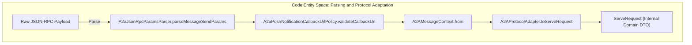
*Sources: [service/agent-service-app/src/main/java/com/openjiuwen/service/app/controller/a2a/A2aJsonRpcParamsParser.java:61-134](), [service/agent-service-app/src/main/java/com/openjiuwen/service/app/controller/a2a/A2aPushNotificationCallbackUrlPolicy.java:24-61](), [service/agent-service-app/src/main/java/com/openjiuwen/service/app/controller/a2a/A2AProtocolAdapter.java:56-94](), [service/agent-service-app/src/main/java/com/openjiuwen/service/app/controller/a2a/A2AMessageContext.java:50-89]()*

---

## 3. SSE Streaming and Concurrency Execution

For streaming RPC methods (`SendStreamingMessage` and `SubscribeToTask`), `A2aJsonRpcController` delegates execution management to reactive flows and dedicated streaming executors.

### Streaming Executor (`SSE_EXECUTOR`)
To prevent long-lived streaming connections and subscriptions from starving `ForkJoinPool.commonPool()`, the controller initializes a specialized `SSE_EXECUTOR` [service/agent-service-app/src/main/java/com/openjiuwen/service/app/controller/a2a/A2aJsonRpcController.java:69-74]():
* On JDK 21+, each subscription runs on dedicated virtual threads (`VirtualThreadSupport`).
* On JDK 17, a small daemon platform thread pool is utilized.

### SseEmitter Lifecycle
Streaming responses produce Spring `SseEmitter` instances that pump reactive streams (`Flow.Publisher`) emitted by the agent execution pipeline. Errors encountered during dispatch or execution are caught, mapped to standard JSON-RPC error payloads, and safely emitted or returned as appropriate protocol error responses [service/agent-service-app/src/main/java/com/openjiuwen/service/app/controller/a2a/A2aJsonRpcController.java:133-148]().

| Method Name | Inbound Transport | Concurrency Mechanism | Error Handling / Fallback |
| :--- | :--- | :--- | :--- |
| `SendMessage` | HTTP POST (JSON-RPC) | `TaskAdmissionGate` permit | HTTP 503 on rejection, JSON-RPC error on execution failure |
| `SendStreamingMessage` | HTTP POST (JSON-RPC + SSE) | `TaskAdmissionGate` + `SSE_EXECUTOR` | `SseEmitter` timeout/completion hooks, virtual thread isolation |
| `GetTask` / `SubscribeToTask` | HTTP POST / SSE | `SSE_EXECUTOR` | Standard `TaskNotFoundError` / `InvalidParamsError` mapping |

*Sources: [service/agent-service-app/src/main/java/com/openjiuwen/service/app/controller/a2a/A2aJsonRpcController.java:69-149]()*, [service/agent-service-adapters/agent-service-adapters-common/src/main/java/com/openjiuwen/service/adapters/common/concurrent/VirtualThreadSupport.java]()

---

# Page: A2AAgentExecutor and Execution Bridging

# A2AAgentExecutor and Execution Bridging

<details>
<summary>Relevant source files</summary>

The following files were used as context for generating this wiki page:

- [service/agent-service-adapters/agent-service-adapters-agentcore/src/main/java/com/openjiuwen/service/adapters/agentcore/agentfw/JiuwenCoreAgentHandler.java](service/agent-service-adapters/agent-service-adapters-agentcore/src/main/java/com/openjiuwen/service/adapters/agentcore/agentfw/JiuwenCoreAgentHandler.java)
- [service/agent-service-adapters/agent-service-adapters-agentcore/src/test/java/com/openjiuwen/service/adapters/agentcore/agentfw/CoreRunnerLifecycleCoordinatorTest.java](service/agent-service-adapters/agent-service-adapters-agentcore/src/test/java/com/openjiuwen/service/adapters/agentcore/agentfw/CoreRunnerLifecycleCoordinatorTest.java)
- [service/agent-service-adapters/agent-service-adapters-agentcore/src/test/java/com/openjiuwen/service/adapters/agentcore/agentfw/JiuwenCoreAgentHandlerTest.java](service/agent-service-adapters/agent-service-adapters-agentcore/src/test/java/com/openjiuwen/service/adapters/agentcore/agentfw/JiuwenCoreAgentHandlerTest.java)
- [service/agent-service-app/src/main/java/com/openjiuwen/service/app/config/SpringEnvironmentConfigProvider.java](service/agent-service-app/src/main/java/com/openjiuwen/service/app/config/SpringEnvironmentConfigProvider.java)
- [service/agent-service-app/src/main/java/com/openjiuwen/service/app/controller/a2a/A2AAgentExecutor.java](service/agent-service-app/src/main/java/com/openjiuwen/service/app/controller/a2a/A2AAgentExecutor.java)
- [service/agent-service-app/src/main/java/com/openjiuwen/service/app/controller/a2a/A2aErrorMetadata.java](service/agent-service-app/src/main/java/com/openjiuwen/service/app/controller/a2a/A2aErrorMetadata.java)
- [service/agent-service-app/src/main/java/com/openjiuwen/service/app/controller/a2a/A2aPartContent.java](service/agent-service-app/src/main/java/com/openjiuwen/service/app/controller/a2a/A2aPartContent.java)
- [service/agent-service-app/src/main/java/com/openjiuwen/service/app/controller/a2a/ChunkMapper.java](service/agent-service-app/src/main/java/com/openjiuwen/service/app/controller/a2a/ChunkMapper.java)
- [service/agent-service-app/src/main/java/com/openjiuwen/service/app/controller/a2a/client/RemoteAgentCaller.java](service/agent-service-app/src/main/java/com/openjiuwen/service/app/controller/a2a/client/RemoteAgentCaller.java)
- [service/agent-service-app/src/main/java/com/openjiuwen/service/app/controller/query/QuerySseSupport.java](service/agent-service-app/src/main/java/com/openjiuwen/service/app/controller/query/QuerySseSupport.java)
- [service/agent-service-app/src/test/java/com/openjiuwen/service/app/autoconfigure/A2AAutoConfigurationTest.java](service/agent-service-app/src/test/java/com/openjiuwen/service/app/autoconfigure/A2AAutoConfigurationTest.java)
- [service/agent-service-app/src/test/java/com/openjiuwen/service/app/controller/a2a/A2AAgentExecutorTest.java](service/agent-service-app/src/test/java/com/openjiuwen/service/app/controller/a2a/A2AAgentExecutorTest.java)
- [service/agent-service-app/src/test/java/com/openjiuwen/service/app/controller/a2a/ChunkMapperTest.java](service/agent-service-app/src/test/java/com/openjiuwen/service/app/controller/a2a/ChunkMapperTest.java)
- [service/agent-service-app/src/test/java/com/openjiuwen/service/app/controller/a2a/client/A2ARemoteAgentClientResultTest.java](service/agent-service-app/src/test/java/com/openjiuwen/service/app/controller/a2a/client/A2ARemoteAgentClientResultTest.java)
- [service/agent-service-spec/src/main/java/com/openjiuwen/service/spec/dto/AgentFailureDescriptor.java](service/agent-service-spec/src/main/java/com/openjiuwen/service/spec/dto/AgentFailureDescriptor.java)

</details>


## Purpose and Scope
This document covers the internal design and implementation of inbound A2A SDK execution requests within the `agent-runtime-java` module. It focuses on `A2AAgentExecutor`, authoritative admission control, the translation between A2A protocol payloads and internal `ServeOrchestrator` requests, chunk-to-artifact mapping via `ChunkMapper`, and the handling of task interruptions and cancellations.

---

## 1. Admission Control and Lifecycle Bridging (`A2AAgentExecutor`)

`A2AAgentExecutor` implements the A2A SDK `AgentExecutor` interface [service/agent-service-app/src/main/java/com/openjiuwen/service/app/controller/a2a/A2AAgentExecutor.java:17](). It serves as the bridge between the A2A SDK's asynchronous event pipeline and the internal `ServeOrchestrator` -> `AgentHandler` execution chain [service/agent-service-app/src/main/java/com/openjiuwen.service.app.controller.a2a/A2AAgentExecutor.java:42-44]().

### Permit Pre-Acquisition and Quota Management
To prevent redundant admission checks when a request enters through the HTTP/JSON-RPC boundary, the transport layer can pre-acquire an admission permit [service/agent-service-app/src/main/java/com/openjiuwen/service/app/controller/a2a/A2AAgentExecutor.java:52-64](). 

- **Pre-Acquired Permits**: When a request sets `PRE_ACQUIRED_ADMISSION_KEY` (`_a2a_admission_preacquired`) in the `ServerCallContext`, the executor consumes and adopts the permit rather than acquiring a new one [service/agent-service-app/src/main/java/com/openjiuwen/service/app/controller/a2a/A2AAgentExecutor.java:78-85]().
- **Direct Execution / Continuations**: Requests without the marker (such as callback continuations) acquire a permit directly from the `TaskAdmissionGate` [service/agent-service-app/src/main/java/com/openjiuwen/service/app/controller/a2a/A2AAgentExecutor.java:82-83]().
- **Guaranteed Release**: Quota occupancy is bracketed using a `try-finally` block. When `TaskAdmissionListener` is configured, `onAdmitted` and `onReleased` lifecycle callbacks precisely mirror the permit lifecycle [service/agent-service-app/src/main/java/com/openjiuwen/service/app/controller/a2a/A2AAgentExecutor.java:60-64]().

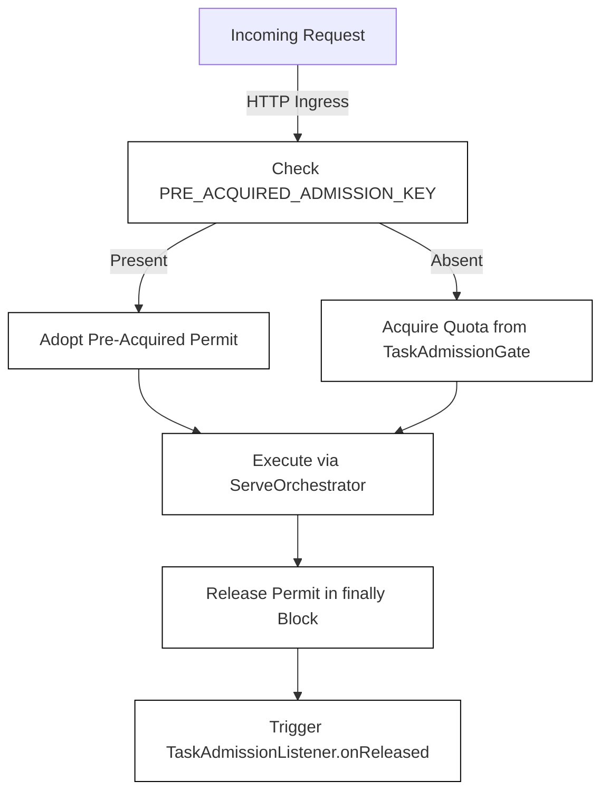
*Figure 1: Admission Control and Permit Bridging Flow.*

Sources: `service/agent-service-app/src/main/java/com/openjiuwen/service/app/controller/a2a/A2AAgentExecutor.java`

---

## 2. Execution and Streaming Pipeline

When `execute(RequestContext ctx, AgentEmitter emitter)` is invoked by the A2A SDK, `A2AAgentExecutor` parses the request parameters, maps conversation identifiers, and determines whether to invoke blocking or streaming orchestrator methods [service/agent-service-app/src/main/java/com/openjiuwen/service/app/controller/a2a/A2AAgentExecutor.java:156-157]().

- **Blocking vs. Streaming**: The execution path honors both the adapter configuration and stream flags present in the `RequestContext` [service/agent-service-app/src/test/java/com/openjiuwen/service/app/controller/a2a/A2AAgentExecutorTest.java:59-90]().
- **Stream Pump & Emitter**: For streaming executions, `QueryStreamObserver` callbacks receive `QueryChunk` events from `ServeOrchestrator.streamQuery`, projecting them immediately into A2A SDK `TaskArtifactUpdateEvent` items via `AgentEmitter`.
- **Drain Timeout**: Before closing streams, a grace period bounded by `CLOSE_DRAIN_TIMEOUT_MS` (60,000 ms) ensures that in-flight backlogged events dispatched via Redis or event buses finish processing without abrupt truncation [service/agent-service-app/src/main/java/com/openjiuwen/service/app/controller/a2a/A2AAgentExecutor.java:98-104]().

Sources: `service/agent-service-app/src/main/java/com/openjiuwen/service/app/controller/a2a/A2AAgentExecutor.java`, `service/agent-service-app/src/test/java/com/openjiuwen/service/app/controller/a2a/A2AAgentExecutorTest.java`

---

## 3. Chunk and Artifact Mapping (`ChunkMapper` & `A2aPartContent`)

The translation of internal runtime events into A2A-compliant structures is managed by `ChunkMapper` and `A2aPartContent` [service/agent-service-app/src/main/java/com/openjiuwen/service/app/controller/a2a/ChunkMapper.java:25-85](), [service/agent-service-app/src/main/java/com/openjiuwen/service/app/controller/a2a/A2aPartContent.java:25-104]().

### Chunk-to-Part Translation (`ChunkMapper`)
`ChunkMapper` converts a `QueryChunk` into a list of A2A SDK `Part<?>` objects based on its type and envelope structure:
- **Terminal Envelopes**: AgentCore terminal envelopes (such as `answer` or `workflow_final`) are unwrapped and projected as business text or structured data parts [service/agent-service-app/src/main/java/com/openjiuwen/service/app/controller/a2a/ChunkMapper.java:55-67]().
- **Structured Intermediate Chunks**: JSON objects and intermediate maps are encapsulated within `DataPart` instances [service/agent-service-app/src/main/java/com/openjiuwen/service/app/controller/a2a/ChunkMapper.java:60-64]().
- **Terminal Detection**: `isTerminalResult(QueryChunk)` identifies whether a chunk represents the final completion state of an execution stream [service/agent-service-app/src/main/java/com/openjiuwen/service/app/controller/a2a/ChunkMapper.java:50-53]().

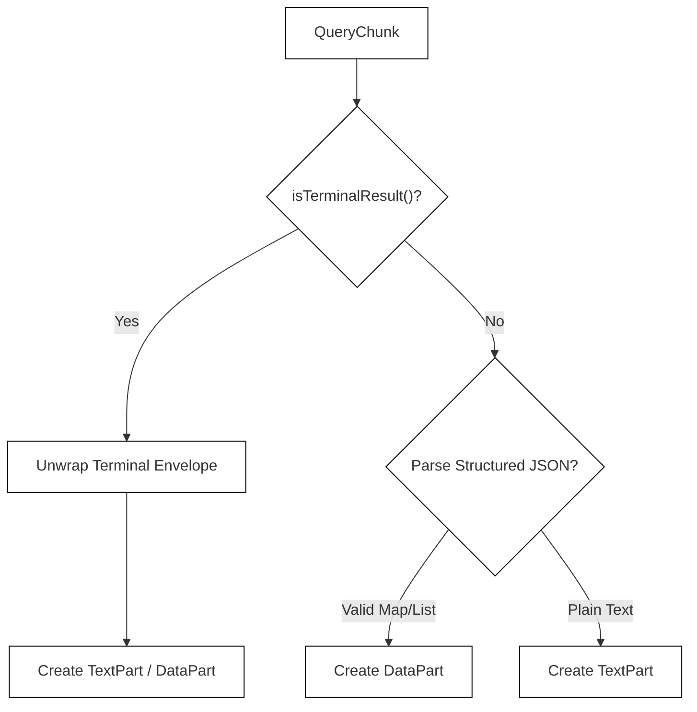
*Figure 2: ChunkMapper Translation Pipeline.*

Sources: `service/agent-service-app/src/main/java/com/openjiuwen/service/app/controller/a2a/ChunkMapper.java`, `service/agent-service-app/src/main/java/com/openjiuwen/service/app/controller/a2a/A2aPartContent.java`

---

## 4. Interrupt and Cancellation Management

`A2AAgentExecutor` coordinates runtime interruptions and request cancellations through specific control tokens and task metadata states.

- **Interrupts (`_interrupt`)**: When an execution hits an `INPUT_REQUIRED` state or tool invocation barrier, interrupt context details are persisted into the task's status metadata. Upon subsequent task resumption, these metadata fields are restored to reconstruct the interaction session.
- **Cancellations (`_cancel`)**: Active executions maintain a thread-safe map (`activeCancellations`) mapping task IDs to `AtomicBoolean` cancellation flags [service/agent-service-app/src/main/java/com/openjiuwen/service/app/controller/a2a/A2AAgentExecutor.java:119-120](). When a cancellation signal arrives, the flag is flipped, prompting downstream stream observers to abort iteration and release resources.

Sources: `service/agent-service-app/src/main/java/com/openjiuwen/service/app/controller/a2a/A2AAgentExecutor.java`

---

# Page: Agent Cards and Capability Gating

# Agent Cards and Capability Gating

<details>
<summary>Relevant source files</summary>

The following files were used as context for generating this wiki page:

- [service/agent-service-app/src/main/java/com/openjiuwen/service/app/controller/a2a/A2aPushNotificationCapabilityGate.java](service/agent-service-app/src/main/java/com/openjiuwen/service/app/controller/a2a/A2aPushNotificationCapabilityGate.java)
- [service/agent-service-app/src/main/java/com/openjiuwen/service/app/controller/a2a/AgentCardController.java](service/agent-service-app/src/main/java/com/openjiuwen/service/app/controller/a2a/AgentCardController.java)
- [service/agent-service-app/src/main/java/com/openjiuwen/service/app/controller/a2a/NoOpA2aPushNotificationCallbackHandler.java](service/agent-service-app/src/main/java/com/openjiuwen/service/app/controller/a2a/NoOpA2aPushNotificationCallbackHandler.java)
- [service/agent-service-app/src/main/java/com/openjiuwen/service/app/hosting/HostedAgentCardFactory.java](service/agent-service-app/src/main/java/com/openjiuwen/service/app/hosting/HostedAgentCardFactory.java)
- [service/agent-service-app/src/test/java/com/openjiuwen/service/app/controller/a2a/AgentCardCapabilityGatingTest.java](service/agent-service-app/src/test/java/com/openjiuwen/service/app/controller/a2a/AgentCardCapabilityGatingTest.java)
- [service/agent-service-spec/src/main/java/com/openjiuwen/service/spec/paths/A2AServicePaths.java](service/agent-service-spec/src/main/java/com/openjiuwen/service/spec/paths/A2AServicePaths.java)

</details>


## Purpose and Scope
This page details the implementation of Agent Cards and capability gating within `agent-runtime-java`. It covers how agent metadata, skills, capabilities, and interface definitions are exposed according to the A2A (Agent-to-Agent) protocol spec. Key components include `AgentCardController`, `HostedAgentCardFactory`, `A2aPushNotificationCapabilityGate`, and `A2AServicePaths`.

---

## 1. A2A Service Paths and Well-Known Endpoints

The runtime exposes standard and compatible paths for publishing agent cards and managing multi-tenant hosted registrations [service/agent-service-spec/src/main/java/com/openjiuwen/service/spec/paths/A2AServicePaths.java:12-45](). These paths are consumed by remote agent clients and catalog discovery mechanisms.

| Constant Name | Path Value | Description |
| :--- | :--- | :--- |
| `WELL_KNOWN_AGENT_CARD` | `/.well-known/agent-card.json` | A2A standard Agent Card path [service/agent-service-spec/src/main/java/com/openjiuwen/service/spec/paths/A2AServicePaths.java:14-14]() |
| `WELL_KNOWN_AGENT_JSON` | `/.well-known/agent.json` | Compatible AgentScope / partial SDK path [service/agent-service-spec/src/main/java/com/openjiuwen/service/spec/paths/A2AServicePaths.java:17-17]() |
| `A2A_PREFIX` | `/a2a` | JSON-RPC mount prefix [service/agent-service-spec/src/main/java/com/openjiuwen/service/spec/paths/A2AServicePaths.java:20-20]() |
| `HOSTED_AGENTS` | `/a2a/agents` | Hosted agent discovery list [service/agent-service-spec/src/main/java/com/openjiuwen/service/spec/paths/A2AServicePaths.java:32-32]() |
| `HOSTED_AGENT_CARD` | `/a2a/agents/{agentId}/.well-known/agent-card.json` | Card for one registered hosted agent [service/agent-service-spec/src/main/java/com/openjiuwen/service/spec/paths/A2AServicePaths.java:38-38]() |
| `A2A_PUSH_NOTIFICATION_CALLBACK` | `/a2a/push-notifications/callback` | Fixed A2A push notification callback receiver path [service/agent-service-spec/src/main/java/com/openjiuwen/service/spec/paths/A2AServicePaths.java:29-29]() |

### Diagram: Agent Card Discovery and Routing Flow (Natural Language to Code Entity Space)
```mermaid
graph TD
    Client["Client Request"] -->|GET /.well-known/agent-card.json| StandardRoute["AgentCardController.getStandardCard"]
    Client -->|GET /.well-known/agent.json| CompatRoute["AgentCardController.getCompatCard"]
    Client -->|GET /a2a/agents/{agentId}/.well-known/agent-card.json| HostedCardRoute["AgentCardController.getHostedCard"]
    Client -->|GET /a2a/agents| HostedListRoute["AgentCardController.getHostedAgents"]

    StandardRoute -->|Calls| BuildCard["AgentCardController.buildCard"]
    CompatRoute -->|Calls| BuildCard
    HostedCardRoute -->|Delegates to| HostedCards["HostedAgentCardFactory.card"]
    HostedListRoute -->|Queries| HostedCatalog["HostedRuntimeCatalog.instances"]

    sub5["A2AServicePaths Constants"]
    A2AServicePathsWELL_KNOWN_AGENT_CARD["A2AServicePaths.WELL_KNOWN_AGENT_CARD"] -.-> StandardRoute
    A2AServicePathsHOSTED_AGENT_CARD["A2AServicePaths.HOSTED_AGENT_CARD"] -.-> HostedCardRoute
```
Sources: [service/agent-service-app/src/main/java/com/openjiuwen/service/app/controller/a2a/AgentCardController.java:38-155](), [service/agent-service-spec/src/main/java/com/openjiuwen/service/spec/paths/A2AServicePaths.java:12-45]()

---

## 2. Agent Card Generation and Data Model

`AgentCardController` handles single-tenant deployments or proxies multi-tenant views through `HostedAgentCardFactory` [service/agent-service-app/src/main/java/com/openjiuwen/service/app/controller/a2a/AgentCardController.java:97-141]().

### Single-Tenant Card Construction
When `HostedIngressResolver` is absent, `AgentCardController.buildCard()` constructs an `AgentCard` directly from `A2AProperties` and `ServiceProperties` [service/agent-service-app/src/main/java/com/openjiuwen/service/app/controller/a2a/AgentCardController.java:97-127](). It reads:
- Public URL or resolves base URL from `HttpServletRequest` [service/agent-service-app/src/main/java/com/openjiuwen/service/app/controller/a2a/AgentCardController.java:101-103]().
- Configured skills mapped into SDK `AgentSkill` DTOs [service/agent-service-app/src/main/java/com/openjiuwen/service/app/controller/a2a/AgentCardController.java:107-111]().
- Provider organization, version, documentation URL, and capabilities [service/agent-service-app/src/main/java/com/openjiuwen/service/app/controller/a2a/AgentCardController.java:112-126]().

### Hosted Card Freezing
`HostedAgentCardFactory` freezes card content at startup for each registered hosted agent ID [service/agent-service-app/src/main/java/com/openjiuwen/service/app/hosting/HostedAgentCardFactory.java:31-63](). 
- Validates that `a2a.json-rpc-path` is set to `/a2a` [service/agent-service-app/src/main/java/com/openjiuwen/service/app/hosting/HostedAgentCardFactory.java:45-47]().
- Overrides global defaults with agent-specific `HostedCardProperties` [service/agent-service-app/src/main/java/com/openjiuwen/service/app/hosting/HostedAgentCardFactory.java:50-55]().
- Generates dynamic request-scoped address views via `HostedAgentCardFactory.card(...)` [service/agent-service-app/src/main/java/com/openjiuwen/service/app/hosting/HostedAgentCardFactory.java:73-84]().

Sources: [service/agent-service-app/src/main/java/com/openjiuwen/service/app/controller/a2a/AgentCardController.java:81-127](), [service/agent-service-app/src/main/java/com/openjiuwen/service/app/hosting/HostedAgentCardFactory.java:31-100]()

---

## 3. Capability Gating for Push Notifications

Push notification advertising in the Agent Card is governed by `A2aPushNotificationCapabilityGate` [service/agent-service-app/src/main/java/com/openjiuwen/service/app/controller/a2a/A2aPushNotificationCapabilityGate.java:16-45](). An agent card will only advertise `pushNotifications = true` if all prerequisites are fulfilled.

### Evaluation Criteria
`A2aPushNotificationCapabilityGate.isPushNotificationsEnabled()` evaluates:
1. `properties.isPushNotifications()`: Operator switch is enabled in `A2AProperties` [service/agent-service-app/src/main/java/com/openjiuwen/service/app/controller/a2a/A2aPushNotificationCapabilityGate.java:39-39]().
2. `sender instanceof HttpPushNotificationSender`: The configured push notification sender is HTTP-based [service/agent-service-app/src/main/java/com/openjiuwen/service/app/controller/a2a/A2aPushNotificationCapabilityGate.java:40-40]().
3. `callbackStore != null`: A valid callback store is present [service/agent-service-app/src/main/java/com/openjiuwen/service/app/controller/a2a/A2aPushNotificationCapabilityGate.java:41-41]().
4. `callbackHandler != null && !(callbackHandler instanceof NoOpA2aPushNotificationCallbackHandler)`: A concrete recovery handler is registered [service/agent-service-app/src/main/java/com/openjiuwen/service/app/controller/a2a/A2aPushNotificationCapabilityGate.java:42-43]().

### Diagram: Capability Gating Decision Flow (Natural Language to Code Entity Space)
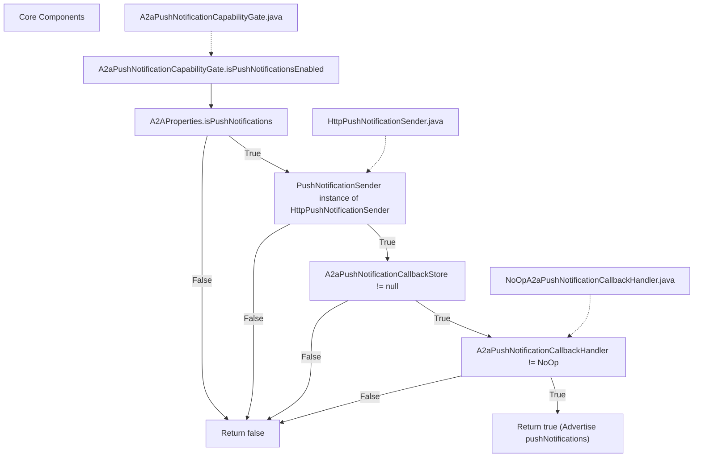
Sources: [service/agent-service-app/src/main/java/com/openjiuwen/service/app/controller/a2a/A2aPushNotificationCapabilityGate.java:16-45](), [service/agent-service-app/src/test/java/com/openjiuwen/service/app/controller/a2a/AgentCardCapabilityGatingTest.java:23-72]()

---

## 4. Hosted Agent Catalog and Discovery

In multi-tenant hosted environments, `AgentCardController` interacts with `HostedRuntimeCatalog` to publish discovery endpoints [service/agent-service-app/src/main/java/com/openjiuwen/service/app/controller/a2a/AgentCardController.java:148-155]().

- `getHostedAgents()`: Returns a `HostedAgentsResponse` containing the list of all registered agent identifiers (`agentId()`) and the designated default agent ID [service/agent-service-app/src/main/java/com/openjiuwen/service/app/controller/a2a/AgentCardController.java:148-155]().
- `getHostedCard(String agentId, HttpServletRequest request)`: Resolves the card for a specific hosted agent via `HostedAgentCardFactory`, throwing `HostedIngressResolver.SelectionException` if selection fails [service/agent-service-app/src/main/java/com/openjiuwen/service/app/controller/a2a/AgentCardController.java:136-164]().

Sources: [service/agent-service-app/src/main/java/com/openjiuwen/service/app/controller/a2a/AgentCardController.java:136-164]()

---

# Page: Push Notifications and Callbacks

# Push Notifications and Callbacks

<details>
<summary>Relevant source files</summary>

The following files were used as context for generating this wiki page:

- [service/agent-service-adapters/agent-service-adapters-agentcore/src/test/java/com/openjiuwen/service/adapters/agentcore/agentfw/HostedDeepAgentIntegrationTest.java](service/agent-service-adapters/agent-service-adapters-agentcore/src/test/java/com/openjiuwen/service/adapters/agentcore/agentfw/HostedDeepAgentIntegrationTest.java)
- [service/agent-service-app/src/main/java/com/openjiuwen/service/app/controller/a2a/A2aPushNotificationCallback.java](service/agent-service-app/src/main/java/com/openjiuwen/service/app/controller/a2a/A2aPushNotificationCallback.java)
- [service/agent-service-app/src/main/java/com/openjiuwen/service/app/controller/a2a/A2aPushNotificationCallbackController.java](service/agent-service-app/src/main/java/com/openjiuwen/service/app/controller/a2a/A2aPushNotificationCallbackController.java)
- [service/agent-service-app/src/main/java/com/openjiuwen/service/app/controller/a2a/A2aPushNotificationCallbackHandler.java](service/agent-service-app/src/main/java/com/openjiuwen/service/app/controller/a2a/A2aPushNotificationCallbackHandler.java)
- [service/agent-service-app/src/main/java/com/openjiuwen/service/app/controller/a2a/A2aPushNotificationCallbackStore.java](service/agent-service-app/src/main/java/com/openjiuwen/service/app/controller/a2a/A2aPushNotificationCallbackStore.java)
- [service/agent-service-app/src/main/java/com/openjiuwen/service/app/controller/a2a/HttpPushNotificationSender.java](service/agent-service-app/src/main/java/com/openjiuwen/service/app/controller/a2a/HttpPushNotificationSender.java)
- [service/agent-service-app/src/main/java/com/openjiuwen/service/app/controller/a2a/InMemoryA2aPushNotificationCallbackStore.java](service/agent-service-app/src/main/java/com/openjiuwen/service/app/controller/a2a/InMemoryA2aPushNotificationCallbackStore.java)
- [service/agent-service-app/src/test/java/com/openjiuwen/service/app/controller/a2a/A2aPushNotificationCallbackControllerTest.java](service/agent-service-app/src/test/java/com/openjiuwen/service/app/controller/a2a/A2aPushNotificationCallbackControllerTest.java)
- [service/agent-service-app/src/test/java/com/openjiuwen/service/app/controller/a2a/PushNotificationSenderTest.java](service/agent-service-app/src/test/java/com/openjiuwen/service/app/controller/a2a/PushNotificationSenderTest.java)
- [service/agent-service-app/src/test/java/com/openjiuwen/service/app/hosting/HostedIngressContractTest.java](service/agent-service-app/src/test/java/com/openjiuwen/service/app/hosting/HostedIngressContractTest.java)
- [service/agent-service-app/src/test/java/com/openjiuwen/service/app/hosting/HostedRedisIsolationTest.java](service/agent-service-app/src/test/java/com/openjiuwen/service/app/hosting/HostedRedisIsolationTest.java)
- [service/agent-service-app/src/test/java/com/openjiuwen/service/app/it/AgentCardCapabilityIntegrationTest.java](service/agent-service-app/src/test/java/com/openjiuwen/service/app/it/AgentCardCapabilityIntegrationTest.java)
- [service/agent-service-app/src/test/java/com/openjiuwen/service/app/it/CallbackRecoveryIntegrationTest.java](service/agent-service-app/src/test/java/com/openjiuwen/service/app/it/CallbackRecoveryIntegrationTest.java)
- [service/agent-service-app/src/test/java/com/openjiuwen/service/app/it/DualRuntimeCallbackIntegrationTest.java](service/agent-service-app/src/test/java/com/openjiuwen/service/app/it/DualRuntimeCallbackIntegrationTest.java)
- [service/agent-service-app/src/test/java/com/openjiuwen/service/app/it/DualRuntimeFailureIntegrationTest.java](service/agent-service-app/src/test/java/com/openjiuwen/service/app/it/DualRuntimeFailureIntegrationTest.java)
- [service/agent-service-app/src/test/java/com/openjiuwen/service/app/it/PushNotificationCallbackIntegrationTest.java](service/agent-service-app/src/test/java/com/openjiuwen/service/app/it/PushNotificationCallbackIntegrationTest.java)
- [service/agent-service-app/src/test/java/com/openjiuwen/service/app/it/PushNotificationSenderIntegrationTest.java](service/agent-service-app/src/test/java/com/openjiuwen/service/app/it/PushNotificationSenderIntegrationTest.java)
- [service/agent-service-app/src/test/java/com/openjiuwen/service/app/it/SendMessageCallbackIntegrationTest.java](service/agent-service-app/src/test/java/com/openjiuwen/service/app/it/SendMessageCallbackIntegrationTest.java)
- [service/agent-service-app/src/test/java/com/openjiuwen/service/app/it/TaskStoreCallbackBindingTest.java](service/agent-service-app/src/test/java/com/openjiuwen/service/app/it/TaskStoreCallbackBindingTest.java)
- [service/agent-service-app/src/test/java/com/openjiuwen/service/app/orchestrator/A2AEnabledServeOrchestratorCallbackRecoveryTest.java](service/agent-service-app/src/test/java/com/openjiuwen/service/app/orchestrator/A2AEnabledServeOrchestratorCallbackRecoveryTest.java)
- [service/agent-service-app/src/test/java/com/openjiuwen/service/app/orchestrator/HostedRemoteInvocationDispatcherTest.java](service/agent-service-app/src/test/java/com/openjiuwen/service/app/orchestrator/HostedRemoteInvocationDispatcherTest.java)

</details>


## Purpose and Scope

This page documents the A2A (Agent-to-Agent) push notification and callback architecture within `agent-runtime-java`. It covers outbound terminal notification delivery via `HttpPushNotificationSender`, inbound callback ingestion through `A2aPushNotificationCallbackController`, idempotency deduplication with `InMemoryA2aPushNotificationCallbackStore`, SSRF protection policies, and multi-runtime task continuation recovery.

---

## 1. Push Notification Delivery and Idempotency (`HttpPushNotificationSender`)

When an A2A task reaches a terminal state (`TASK_STATE_COMPLETED` or `TASK_STATE_FAILED`), the runtime dispatches a push notification to configured callback endpoints. This delivery is managed by `HttpPushNotificationSender`, which implements the SDK's `PushNotificationSender` interface [service/agent-service-app/src/main/java/com/openjiuwen/service/app/controller/a2a/HttpPushNotificationSender.java:40-45]().

### Key Delivery Mechanics

- **State Gating**: `sendNotification(StreamingEventKind event, Task task)` checks if the task is in a callback-eligible terminal state (`service/agent-service-app/src/main/java/com/openjiuwen/service/app/controller/a2a/HttpPushNotificationSender.java:116-121`).
- **Configuration Resolution**: Queries the underlying `PushNotificationConfigStore` for task-specific notification targets [service/agent-service-app/src/main/java/com/openjiuwen/service/app/controller/a2a/HttpPushNotificationSender.java:124-130]. If missing, an asynchronous recheck is scheduled using `scheduleConfigRecheck(Task task)` [service/agent-service-app/src/main/java/com/openjiuwen/service/app/controller/a2a/HttpPushNotificationSender.java:148-161].
- **Idempotency & TTL**: Tracks delivery attempts using `DeliveryRecord` entries stored in a `ConcurrentMap` (`deliveryRecords`) [service/agent-service-app/src/main/java/com/openjiuwen/service/app/controller/a2a/HttpPushNotificationSender.java:71-74]. Successful deliveries are short-circuited within `SUCCESS_RECORD_TTL` (10 minutes) to prevent duplicate posts, while failed records are retained for `FAILURE_RECORD_TTL` (1 hour) [service/agent-service-app/src/main/java/com/openjiuwen/service/app/controller/a2a/HttpPushNotificationSender.java:58-64].
- **HTTP Client Security**: Configures strict timeouts (`CONNECT_TIMEOUT` = 30s, `REQUEST_TIMEOUT` = 10m) and explicitly disables HTTP redirects (`HttpClient.Redirect.NEVER`) to mitigate SSRF and redirection-based attacks [service/agent-service-app/src/main/java/com/openjiuwen/service/app/controller/a2a/HttpPushNotificationSender.java:48-51, 110-112].

```mermaid
title "Push Notification Delivery Flow"
graph TD
    A["sendNotification"] --> B{"isCallbackState"}
    B -- "No" --> C["IgnoreEvent"]
    B -- "Yes" --> D["sendTerminalTask"]
    D --> E["firstConfig"]
    E --> F{"Config Found?"}
    F -- "No & Recheck" --> G["scheduleConfigRecheck"]
    F -- "Yes" --> H["sweepExpiredRecords"]
    H --> I["Check deliveryRecords Idempotency"]
    I -- "Already Success" --> J["ShortCircuitExit"]
    I -- "Pending/New" --> K["A2aPushNotificationCallbackUrlPolicy.callbackUri"]
    K --> L["HttpClient.send"]
    L --> M["Record Delivery Status"]
```
Sources: [service/agent-service-app/src/main/java/com/openjiuwen/service/app/controller/a2a/HttpPushNotificationSender.java:45-174]()

---

## 2. Callback Ingress and Idempotent Storage

Inbound callbacks from remote runtimes are ingested by `A2aPushNotificationCallbackController` [service/agent-service-app/src/main/java/com/openjiuwen/service/app/controller/a2a/A2aPushNotificationCallbackController.java:39-40]. 

### Endpoint Mapping and Validation

The controller listens on standard A2A callback paths (`A2AServicePaths.A2A_PUSH_NOTIFICATION_CALLBACK` and `A2AServicePaths.HOSTED_AGENT_CALLBACK`) [service/agent-service-app/src/main/java/com/openjiuwen/service/app/controller/a2a/A2aPushNotificationCallbackController.java:70-75]:
1. **Capability Check**: Verifies that push notification callbacks are enabled via `A2aPushNotificationCapabilityGate` [service/agent-service-app/src/main/java/com/openjiuwen/service/app/controller/a2a/A2aPushNotificationCallbackController.java:76-78].
2. **Notification ID Extraction**: Extracts and reconciles the `X-A2A-Notification-Id` header with the JSON body's `notificationId` field [service/agent-service-app/src/main/java/com/openjiuwen/service/app/controller/a2a/A2aPushNotificationCallbackController.java:85-97].
3. **JSON-RPC Validation**: Ensures the payload contains a valid JSON-RPC result structure enclosing a task object [service/agent-service-app/src/main/java/com/openjiuwen/service/app/controller/a2a/A2aPushNotificationCallbackController.java:98-106].

### Idempotent Storage (`InMemoryA2aPushNotificationCallbackStore`)

To handle duplicate network deliveries gracefully, `InMemoryA2aPushNotificationCallbackStore` maintains an LRU-bounded map (default capacity: 4,096 entries) of payload hashes keyed by `notificationId` [service/agent-service-app/src/main/java/com/openjiuwen/service/app/controller/a2a/InMemoryA2aPushNotificationCallbackStore.java:20-36]:
- `SaveResult.CREATED`: First time seeing the notification ID.
- `SaveResult.DUPLICATE`: Same ID and identical payload hash (returns HTTP 200 OK accepted).
- `SaveResult.CONFLICT`: Same ID but mismatched payload hash (returns HTTP 409 Conflict).

```mermaid
title "Callback Ingress and Storage Architecture"
graph TD
    A["HttpServletRequest"] --> B["A2aPushNotificationCallbackController.handleCallback"]
    B --> C["A2aPushNotificationCapabilityGate.isPushNotificationsEnabled"]
    C -- "Disabled" --> D["HttpStatus.NOT_IMPLEMENTED"]
    C -- "Enabled" --> E["Extract notificationId & Validate JSON-RPC"]
    E --> F["HostedIngressResolver.resolveOrDefault"]
    F --> G["InMemoryA2aPushNotificationCallbackStore.saveIfAbsent"]
    G -- "CREATED" --> H["A2aPushNotificationCallbackHandler.handle"]
    G -- "DUPLICATE" --> I["HttpStatus.OK (Accepted)"]
    G -- "CONFLICT" --> J["HttpStatus.CONFLICT"]
```
Sources: [service/agent-service-app/src/main/java/com/openjiuwen/service/app/controller/a2a/A2aPushNotificationCallbackController.java:39-148](), [service/agent-service-app/src/main/java/com/openjiuwen/service/app/controller/a2a/InMemoryA2aPushNotificationCallbackStore.java:20-56]()

---

## 3. SSRF URL Policy and Host Validation

To prevent Server-Side Request Forgery (SSRF) when outbound notifications are triggered, `HttpPushNotificationSender` relies on `A2aPushNotificationCallbackUrlPolicy` to evaluate target URLs against a whitelist of allowed hosts (`allowedHosts`) [service/agent-service-app/src/main/java/com/openjiuwen/service/app/controller/a2a/HttpPushNotificationSender.java:141-144].

| Validation Rule | Behavior |
| :--- | :--- |
| **Scheme Restriction** | Only `http` and `https` URIs are permitted. |
| **Host Whitelisting** | If `allowedHosts` is configured, target host/IP must match an entry in the whitelist. |
| **Redirect Blocking** | `HttpClient` explicitly disables redirect following (`HttpClient.Redirect.NEVER`) to prevent open-redirect SSRF bypasses [service/agent-service-app/src/main/java/com/openjiuwen/service/app/controller/a2a/HttpPushNotificationSender.java:111-112]. |

Sources: [service/agent-service-app/src/main/java/com/openjiuwen/service/app/controller/a2a/HttpPushNotificationSender.java:102-144](), [service/agent-service-app/src/test/java/com/openjiuwen/service/app/it/PushNotificationSenderIntegrationTest.java:86-110]()

---

## 4. Task Continuation Recovery and Dual-Runtime Integration

In dual-runtime or multi-agent delegation topologies (such as Caller-Callee orchestration), task continuation recovery bridges asynchronous remote execution with local state machine resumption.

1. **Delegation**: The caller runtime delegates a task to the callee runtime and suspends the parent task (`TASK_STATE_INPUT_REQUIRED`) [service/agent-service-app/src/test/java/com/openjiuwen/service/app/it/DualRuntimeCallbackIntegrationTest.java:102-110].
2. **Callback Notification**: Upon completion, the callee pushes the terminal task payload back to the caller's `/a2a/push-notifications/callback` endpoint [service/agent-service-app/src/test/java/com/openjiuwen/service/app/it/DualRuntimeCallbackIntegrationTest.java:103-107].
3. **Resumption**: `A2aPushNotificationCallbackController` routes the payload to the appropriate handler, completing the pending parent task and resuming execution with structured results [service/agent-service-app/src/test/java/com/openjiuwen/service/app/it/DualRuntimeCallbackIntegrationTest.java:111-119].

```mermaid
title "Dual-Runtime Task Continuation Recovery"
sequenceDiagram
    participant Caller as "CallerRuntimeApplication"
    participant Callee as "CalleeRuntimeApplication"
    participant Sender as "HttpPushNotificationSender"
    participant Controller as "A2aPushNotificationCallbackController"

    Caller->>Callee: "A2A SendMessage (Delegate)"
    Note over Callee: "Processing Task..."
    Callee->>Sender: "Task Reaches Terminal State"
    Sender->>Controller: "HTTP POST /a2a/push-notifications/callback"
    Note over Controller: "Verify ID & Store Deduplication"
    Controller->>Caller: "Invoke Callback Handler & Resume Task"
```
Sources: [service/agent-service-app/src/test/java/com/openjiuwen/service/app/it/DualRuntimeCallbackIntegrationTest.java:59-144](), [service/agent-service-app/src/test/java/com/openjiuwen/service/app/it/DualRuntimeFailureIntegrationTest.java:59-134]()

---

# Page: Task Stores and Event Bus Resilience

# Task Stores and Event Bus Resilience

<details>
<summary>Relevant source files</summary>

The following files were used as context for generating this wiki page:

- [service/agent-service-adapters/agent-service-adapters-agentcore/src/test/java/com/openjiuwen/service/adapters/agentcore/middleware/DefaultMiddlewareAdapterRegistrarTest.java](service/agent-service-adapters/agent-service-adapters-agentcore/src/test/java/com/openjiuwen/service/adapters/agentcore/middleware/DefaultMiddlewareAdapterRegistrarTest.java)
- [service/agent-service-adapters/agent-service-adapters-common/src/main/java/com/openjiuwen/service/adapters/common/middleware/redis/JedisPooledRuntimeRedisClient.java](service/agent-service-adapters/agent-service-adapters-common/src/main/java/com/openjiuwen/service/adapters/common/middleware/redis/JedisPooledRuntimeRedisClient.java)
- [service/agent-service-adapters/agent-service-adapters-common/src/test/java/com/openjiuwen/service/adapters/common/middleware/redis/RedisMiddlewareAutoConfigurationTest.java](service/agent-service-adapters/agent-service-adapters-common/src/test/java/com/openjiuwen/service/adapters/common/middleware/redis/RedisMiddlewareAutoConfigurationTest.java)
- [service/agent-service-app/src/main/java/com/openjiuwen/service/app/controller/a2a/RedisTaskStore.java](service/agent-service-app/src/main/java/com/openjiuwen/service/app/controller/a2a/RedisTaskStore.java)
- [service/agent-service-app/src/main/java/com/openjiuwen/service/app/controller/a2a/ResilientMainEventBusProcessor.java](service/agent-service-app/src/main/java/com/openjiuwen/service/app/controller/a2a/ResilientMainEventBusProcessor.java)
- [service/agent-service-app/src/main/java/com/openjiuwen/service/app/controller/a2a/WriteThrottlingTaskStore.java](service/agent-service-app/src/main/java/com/openjiuwen/service/app/controller/a2a/WriteThrottlingTaskStore.java)
- [service/agent-service-app/src/test/java/com/openjiuwen/service/app/controller/a2a/A2AQueueManagerCleanupWiringTest.java](service/agent-service-app/src/test/java/com/openjiuwen/service/app/controller/a2a/A2AQueueManagerCleanupWiringTest.java)
- [service/agent-service-app/src/test/java/com/openjiuwen/service/app/controller/a2a/RedisTaskStoreTest.java](service/agent-service-app/src/test/java/com/openjiuwen/service/app/controller/a2a/RedisTaskStoreTest.java)
- [service/agent-service-app/src/test/java/com/openjiuwen/service/app/controller/a2a/ResilientMainEventBusProcessorTest.java](service/agent-service-app/src/test/java/com/openjiuwen/service/app/controller/a2a/ResilientMainEventBusProcessorTest.java)
- [service/agent-service-app/src/test/java/com/openjiuwen/service/app/controller/a2a/WriteThrottlingTaskStoreTest.java](service/agent-service-app/src/test/java/com/openjiuwen/service/app/controller/a2a/WriteThrottlingTaskStoreTest.java)
- [service/agent-service-app/src/test/java/org/a2aproject/sdk/server/events/FlakyMainEventBus.java](service/agent-service-app/src/test/java/org/a2aproject/sdk/server/events/FlakyMainEventBus.java)

</details>


## Purpose and Scope

This page details the persistence and event bus resilience mechanisms used by the agent runtime's A2A (Agent-to-Agent) protocol integration. Specifically, it covers `RedisTaskStore` for distributed state, `WriteThrottlingTaskStore` for mitigating write amplification during high-speed token streaming, `ResilientMainEventBusProcessor` for supervisory error recovery on the event consumption thread, and the queue manager cleanup wiring tied to `TaskStateProvider`.

Sources: `service/agent-service-app/src/main/java/com/openjiuwen/service/app/controller/a2a/RedisTaskStore.java:50-50]`, `service/agent-service-app/src/main/java/com/openjiuwen/service/app/controller/a2a/WriteThrottlingTaskStore.java:74-74]`, `service/agent-service-app/src/main/java/com/openjiuwen/service/app/controller/a2a/ResilientMainEventBusProcessor.java:36-36]()`

---

## 1. RedisTaskStore Persistence and Indexing

The `RedisTaskStore` implements the A2A SDK's `TaskStore` interface using a shared `RuntimeRedisClient` instance [service/agent-service-app/src/main/java/com/openjiuwen/service/app/controller/a2a/RedisTaskStore.java:50-76](). It serializes tasks using the SDK's configured `Gson` instance to handle polymorphic types (`Part`) and Java time representations [service/agent-service-app/src/main/java/com/openjiuwen/service/app/controller/a2a/RedisTaskStore.java:66-71]().

### Key Mechanisms
* **Key Structure**: Task snapshots are stored under `a2a:task:<taskId>` with a configurable time-to-live (`ttlSeconds`) [service/agent-service-app/src/main/java/com/openjiuwen/service/app/controller/a2a/RedisTaskStore.java:53-76]().
* **Context Indexing**: To optimize task listings by context without full scans, context index keys (`a2a:task-context:v1:<contextId>:<taskId>`) are maintained [service/agent-service-app/src/main/java/com/openjiuwen/service/app/controller/a2a/RedisTaskStore.java:55-102]().
* **Exception Translation**: Driver-level exceptions (such as `JedisException`) are caught and rethrown as `TaskPersistenceException` to honor the A2A SPI contract [service/agent-service-app/src/main/java/com/openjiuwen/service/app/controller/a2a/RedisTaskStore.java:158-165]().

Sources: `service/agent-service-app/src/main/java/com/openjiuwen/service/app/controller/a2a/RedisTaskStore.java:50-165]()`

---

## 2. WriteThrottlingTaskStore (Read-Through / Write-Behind Cache)

During high-speed LLM streaming, the A2A SDK's `MainEventBusProcessor` invokes `taskStore.save()` on every generated chunk/event. With remote stores like Redis, this introduces severe write amplification and serialization overhead on the critical path. `WriteThrottlingTaskStore` decorates a backing `TaskStore` (such as `RedisTaskStore`) to resolve this bottleneck [service/agent-service-app/src/main/java/com/openjiuwen/service/app/controller/a2a/WriteThrottlingTaskStore.java:26-74]().

### Architecture and Data Flow

```mermaid
graph TD
    A["MainEventBusProcessor"] -->| "save(Task)" | B[WriteThrottlingTaskStore]
    B -->| "Always update cache" | C["latest (ConcurrentMap)"]
    B -->| "Check State & Interval" | D{"Is Critical or Due?"}
    D -- "Yes (Final/Interrupted/Window Elapsed)" | E["delegate.save(Task)"]
    E --> F["RedisTaskStore"]
    D -- "No (Throttled WORKING/SUBMITTED)" | G["Skip Backing Write"]
    H["get(taskId)"] --> I{"Cache Hit?"}
    I -- "Yes" | C
    I -- "No" | F
```
*Figure 1: Write-Throttling and Read-Through Data Flow in `WriteThrottlingTaskStore`*

Sources: `service/agent-service-app/src/main/java/com/openjiuwen/service/app/controller/a2a/WriteThrottlingTaskStore.java:74-156]()`

### Throttling Policy
* **Read-Through Cache (`latest`)**: `get(String taskId)` checks an in-memory `ConcurrentHashMap` first, ensuring that throttled intermediate artifacts are never lost to readers [service/agent-service-app/src/main/java/com/openjiuwen/service/app/controller/a2a/WriteThrottlingTaskStore.java:89-160]().
* **Write Coalescing**: Non-terminal states (`WORKING`, `SUBMITTED`) are written to the delegate at most once per `minWriteIntervalMs` (default `200L` ms) [service/agent-service-app/src/main/java/com/openjiuwen/service/app/controller/a2a/WriteThrottlingTaskStore.java:77-136]().
* **Immediate Write-Through**: Terminal (`TaskState.isFinal()`) or interrupted (`TaskState.isInterrupted()`, e.g., `INPUT_REQUIRED`) states bypass throttling, write to the delegate immediately, and trigger cache eviction to prevent memory leaks [service/agent-service-app/src/main/java/com/openjiuwen.service.app.controller.a2a/WriteThrottlingTaskStore.java:138-146]().

Sources: `service/agent-service-app/src/main/java/com/openjiuwen/service/app/controller/a2a/WriteThrottlingTaskStore.java:74-160]()`

---

## 3. ResilientMainEventBusProcessor

The A2A SDK's event consumer loop catches `Exception` instances internally but allows unchecked `Error` instances (such as `OutOfMemoryError` under heap pressure) to terminate the processing thread permanently. `ResilientMainEventBusProcessor` wraps the execution loop in a supervisor pattern [service/agent-service-app/src/main/java/com/openjiuwen/service/app/controller/a2a/ResilientMainEventBusProcessor.java:17-36]().

```mermaid
graph TD
    A["ResilientMainEventBusProcessor.run()"] --> B["super.run()"]
    B -->| "Normal Return (Shutdown)" | C["Exit Loop"]
    B -->| "Escaped Error (OOM / AssertionError)" | D["Log Error & Increment restarts"]
    D --> E["Thread.sleep(restartBackoffMs)"]
    E --> B
    E -->| "InterruptedException" | F["Terminate Gracefully"]
```
*Figure 2: Supervisor Lifecycle in `ResilientMainEventBusProcessor`*

Sources: `service/agent-service-app/src/main/java/com/openjiuwen/service/app/controller/a2a/ResilientMainEventBusProcessor.java:36-96]()`

### Supervisor Behavior
* **Error Recovery**: When an `Error` escapes `super.run()`, the supervisor catches it, logs the failure, increments `restarts`, waits for `restartBackoffMs` (default `5000L` ms), and restarts the loop [service/agent-service-app/src/main/java/com/openjiuwen/service/app/controller/a2a/ResilientMainEventBusProcessor.java:82-94]().
* **Graceful Interruption**: Interrupted exceptions during backoff sleep terminate the supervisor thread cleanly without preserving stale interrupt states [service/agent-service-app/src/main/java/com/openjiuwen/service/app/controller/a2a/ResilientMainEventBusProcessor.java:86-93]().

Sources: `service/agent-service-app/src/main/java/com/openjiuwen/service/app/controller/a2a/ResilientMainEventBusProcessor.java:36-96]()`

---

## 4. Queue Manager Cleanup Integration

`WriteThrottlingTaskStore` implements the `TaskStateProvider` SPI alongside `TaskStore` [service/agent-service-app/src/main/java/com/openjiuwen/service/app/controller/a2a/WriteThrottlingTaskStore.java:74-74](). This integration enables the A2A queue manager to inspect whether a task has reached a final state:

* **Conditional Queue Removal**: Once a task transitions to a final state and is persisted, the per-task `EventQueue` is automatically evicted from the manager's internal map during cleanup callbacks [service/agent-service-app/src/test/java/com/openjiuwen/service/app/controller/a2a/A2AQueueManagerCleanupWiringTest.java:36-53]().
* **Fallback Behavior**: Stores that do not implement `TaskStateProvider` retain legacy behavior where queues are never automatically removed [service/agent-service-app/src/test/java/com/openjiuwen/service/app/controller/a2a/A2AQueueManagerCleanupWiringTest.java:55-67]().

Sources: `service/agent-service-app/src/test/java/com/openjiuwen/service/app/controller/a2a/A2AQueueManagerCleanupWiringTest.java:34-67]()`

---

# Page: Orchestration and Remote Delegation

# Orchestration and Remote Delegation

<details>
<summary>Relevant source files</summary>

The following files were used as context for generating this wiki page:

- [service/agent-service-app/src/main/java/com/openjiuwen/service/app/controller/a2a/client/A2ARemoteAgentClient.java](service/agent-service-app/src/main/java/com/openjiuwen/service/app/controller/a2a/client/A2ARemoteAgentClient.java)
- [service/agent-service-app/src/main/java/com/openjiuwen/service/app/controller/reset/ResetIngressSupport.java](service/agent-service-app/src/main/java/com/openjiuwen/service/app/controller/reset/ResetIngressSupport.java)
- [service/agent-service-app/src/main/java/com/openjiuwen/service/app/orchestrator/A2AEnabledServeOrchestrator.java](service/agent-service-app/src/main/java/com/openjiuwen/service/app/orchestrator/A2AEnabledServeOrchestrator.java)
- [service/agent-service-app/src/main/java/com/openjiuwen/service/app/orchestrator/DefaultServeOrchestrator.java](service/agent-service-app/src/main/java/com/openjiuwen/service/app/orchestrator/DefaultServeOrchestrator.java)
- [service/agent-service-app/src/main/java/com/openjiuwen/service/app/orchestrator/RemoteInvocationBatchCoordinator.java](service/agent-service-app/src/main/java/com/openjiuwen/service/app/orchestrator/RemoteInvocationBatchCoordinator.java)
- [service/agent-service-app/src/test/java/com/openjiuwen/service/app/controller/a2a/client/A2ARemoteAgentClientClassLoaderTest.java](service/agent-service-app/src/test/java/com/openjiuwen/service/app/controller/a2a/client/A2ARemoteAgentClientClassLoaderTest.java)
- [service/agent-service-app/src/test/java/com/openjiuwen/service/app/controller/a2a/client/A2ARemoteAgentClientStreamingLifecycleTest.java](service/agent-service-app/src/test/java/com/openjiuwen/service/app/controller/a2a/client/A2ARemoteAgentClientStreamingLifecycleTest.java)
- [service/agent-service-app/src/test/java/com/openjiuwen/service/app/it/MultiTurnEchoHandler.java](service/agent-service-app/src/test/java/com/openjiuwen/service/app/it/MultiTurnEchoHandler.java)
- [service/agent-service-app/src/test/java/com/openjiuwen/service/app/orchestrator/A2AEnabledServeOrchestratorTest.java](service/agent-service-app/src/test/java/com/openjiuwen/service/app/orchestrator/A2AEnabledServeOrchestratorTest.java)
- [service/agent-service-app/src/test/java/com/openjiuwen/service/app/orchestrator/RemoteInvocationBatchCoordinatorTest.java](service/agent-service-app/src/test/java/com/openjiuwen/service/app/orchestrator/RemoteInvocationBatchCoordinatorTest.java)
- [service/agent-service-spec/src/main/java/com/openjiuwen/service/spec/paths/AgentServicePaths.java](service/agent-service-spec/src/main/java/com/openjiuwen/service/spec/paths/AgentServicePaths.java)
- [service/agent-service-spec/src/main/java/com/openjiuwen/service/spec/spi/ServeOrchestrator.java](service/agent-service-spec/src/main/java/com/openjiuwen/service/spec/spi/ServeOrchestrator.java)

</details>


The orchestration layer acts as the core coordination engine of `agent-runtime-java`, bridging local agent execution with distributed Agent-to-Agent (A2A) protocol delegations. It handles ingress request lifecycles, manages task continuation loops, fans out parallel remote tool invocations, and maps execution states back to the unified `ServeOrchestrator` interface.

For full technical details, refer to the child pages:
- [A2AEnabledServeOrchestrator and Interrupt/Resume](#3.1)
- [Remote Invocation Batch Coordination](#3.2)
- [Remote Agent Client, Catalog and Discovery](#3.3)

Sources: [service/agent-service-app/src/main/java/com/openjiuwen/service/app/orchestrator/A2AEnabledServeOrchestrator.java:32-51](), [service/agent-service-spec/src/main/java/com/openjiuwen/service/spec/spi/ServeOrchestrator.java:10-15]()

---

## 3.1 A2AEnabledServeOrchestrator and Interrupt/Resume

The `A2AEnabledServeOrchestrator` implements `ServeOrchestrator` to provide an interrupt-resume execution loop [service/agent-service-app/src/main/java/com/openjiuwen.service.app.orchestrator.A2AEnabledServeOrchestrator.java:32-52](). When an agent encounter an `a2a_delegate` interrupt, the orchestrator suspends local execution, delegates the batch to remote agents via the batch coordinator, and drives conversation continuation upon receiving responses.

Task-scoped resources managed by `AgentHandler#prepareTask` and `AgentHandler#completeTask` span across multiple iteration loops in this orchestrator, ensuring thread-local and session state consistency across remote roundtrips.

For details, see [A2AEnabledServeOrchestrator and Interrupt/Resume](#3.1).

Sources: [service/agent-service-app/src/main/java/com/openjiuwen.service.app.orchestrator.A2AEnabledServeOrchestrator.java:32-52]()

---

## 3.2 Remote Invocation Batch Coordination

The `RemoteInvocationBatchCoordinator` manages fan-out and fan-in workflows for parallel tool-call batches directed at remote agents [service/agent-service-app/src/main/java/com/openjiuwen.service.app.orchestrator.RemoteInvocationBatchCoordinator.java:50-58](). It coordinates shadow tasks persisted in an A2A `TaskStore`, enforces global concurrency limits via a bounded dispatcher, and utilizes `RemoteInvocationBatchMapper` to translate Core tool payloads into remote agent execution structures.

Completed tool results are aggregated into a single batch resolution structure, feeding back into the orchestrator's resume cycle via a serial stream observer.

For details, see [Remote Invocation Batch Coordination](#3.2).

Sources: [service/agent-service-app/src/main/java/com/openjiuwen.service.app.orchestrator.RemoteInvocationBatchCoordinator.java:50-58]()

---

## 3.3 Remote Agent Client, Catalog and Discovery

The `A2ARemoteAgentClient` serves as the primary implementation of `RemoteAgentCaller`, leveraging the official A2A SDK client builder and JSON-RPC transport layers [service/agent-service-app/src/main/java/com/openjiuwen.service.app.controller.a2a.client.A2ARemoteAgentClient.java:74-91](). It handles outbound retry logic with exponential backoffs, transport mapping, and asynchronous outcome observation.

Discovery and routing are supported by agent card registries, allowing runtime lookup of remote targets, capability gating, and context header propagation across network boundaries.

For details, see [Remote Agent Client, Catalog and Discovery](#3.3).

Sources: [service/agent-service-app/src/main/java/com/openjiuwen.service.app.controller.a2a.client.A2ARemoteAgentClient.java:74-91]()

---

## Orchestration Architecture Overview

The following diagram bridges the natural language conceptual space to the actual code entities involved in orchestration and remote delegation.

```mermaid
graph TD
    sub0["Natural Language Space"] --> |"Inbound Routing"| sub1["Code Entity Space"]
    
    sub "Code Entity Space" {
        SO["ServeOrchestrator"] --> AO["A2AEnabledServeOrchestrator"]
        AO --> BC["RemoteInvocationBatchCoordinator"]
        BC --> RAC["A2ARemoteAgentClient"]
        RAC --> SDK["org.a2aproject.sdk.client.Client"]
    }

    sub "Natural Language Space Description" {
        NL1["Inbound Query Handling"]
        NL2["Interrupt/Resume Loop"]
        NL3["Batch Fan-Out/Fan-In"]
        NL4["JSON-RPC Transport"]
    }
```
Sources: [service/agent-service-spec/src/main/java/com/openjiuwen/service/spec/spi/ServeOrchestrator.java:15-45](), [service/agent-service-app/src/main/java/com/openjiuwen/service/app/orchestrator/A2AEnabledServeOrchestrator.java:52-150](), [service/agent-service-app/src/main/java/com/openjiuwen/service/app/orchestrator/RemoteInvocationBatchCoordinator.java:59-140](), [service/agent-service-app/src/main/java/com/openjiuwen.service.app.controller.a2a.client.A2ARemoteAgentClient.java:74-95]()

---

# Page: A2AEnabledServeOrchestrator and Interrupt/Resume

# 3.1 A2AEnabledServeOrchestrator and Interrupt/Resume

<details>
<summary>Relevant source files</summary>

The following files were used as context for generating this wiki page:

- [service/agent-service-app/src/main/java/com/openjiuwen/service/app/controller/a2a/client/A2ARemoteAgentClient.java](service/agent-service-app/src/main/java/com/openjiuwen/service/app/controller/a2a/client/A2ARemoteAgentClient.java)
- [service/agent-service-app/src/main/java/com/openjiuwen/service/app/lifecycle/AgentLifecycleManager.java](service/agent-service-app/src/main/java/com/openjiuwen/service/app/lifecycle/AgentLifecycleManager.java)
- [service/agent-service-app/src/main/java/com/openjiuwen/service/app/orchestrator/A2AEnabledServeOrchestrator.java](service/agent-service-app/src/main/java/com/openjiuwen/service/app/orchestrator/A2AEnabledServeOrchestrator.java)
- [service/agent-service-app/src/main/java/com/openjiuwen/service/app/orchestrator/RemoteInvocationBatchCoordinator.java](service/agent-service-app/src/main/java/com/openjiuwen/service/app/orchestrator/RemoteInvocationBatchCoordinator.java)
- [service/agent-service-app/src/test/java/com/openjiuwen/service/app/controller/a2a/client/A2ARemoteAgentClientClassLoaderTest.java](service/agent-service-app/src/test/java/com/openjiuwen/service/app/controller/a2a/client/A2ARemoteAgentClientClassLoaderTest.java)
- [service/agent-service-app/src/test/java/com/openjiuwen/service/app/controller/a2a/client/A2ARemoteAgentClientStreamingLifecycleTest.java](service/agent-service-app/src/test/java/com/openjiuwen/service/app/controller/a2a/client/A2ARemoteAgentClientStreamingLifecycleTest.java)
- [service/agent-service-app/src/test/java/com/openjiuwen/service/app/it/LifecycleIntegrationTest.java](service/agent-service-app/src/test/java/com/openjiuwen/service/app/it/LifecycleIntegrationTest.java)
- [service/agent-service-app/src/test/java/com/openjiuwen/service/app/lifecycle/ActiveStreamInterruptorTest.java](service/agent-service-app/src/test/java/com/openjiuwen/service/app/lifecycle/ActiveStreamInterruptorTest.java)
- [service/agent-service-app/src/test/java/com/openjiuwen/service/app/lifecycle/ActiveStreamRegistryTest.java](service/agent-service-app/src/test/java/com/openjiuwen/service/app/lifecycle/ActiveStreamRegistryTest.java)
- [service/agent-service-app/src/test/java/com/openjiuwen/service/app/lifecycle/AgentHandlerHolderTest.java](service/agent-service-app/src/test/java/com/openjiuwen/service/app/lifecycle/AgentHandlerHolderTest.java)
- [service/agent-service-app/src/test/java/com/openjiuwen/service/app/lifecycle/ShutdownPhaseExecutorTest.java](service/agent-service-app/src/test/java/com/openjiuwen/service/app/lifecycle/ShutdownPhaseExecutorTest.java)
- [service/agent-service-app/src/test/java/com/openjiuwen/service/app/orchestrator/A2AEnabledServeOrchestratorTest.java](service/agent-service-app/src/test/java/com/openjiuwen/service/app/orchestrator/A2AEnabledServeOrchestratorTest.java)
- [service/agent-service-app/src/test/java/com/openjiuwen/service/app/orchestrator/DefaultServeOrchestratorInterruptTest.java](service/agent-service-app/src/test/java/com/openjiuwen/service/app/orchestrator/DefaultServeOrchestratorInterruptTest.java)
- [service/agent-service-app/src/test/java/com/openjiuwen/service/app/orchestrator/RemoteInvocationBatchCoordinatorTest.java](service/agent-service-app/src/test/java/com/openjiuwen/service/app/orchestrator/RemoteInvocationBatchCoordinatorTest.java)
- [service/agent-service-demo/src/test/java/com/openjiuwen/service/demo/RemoteExampleLocalServerTest.java](service/agent-service-demo/src/test/java/com/openjiuwen/service/demo/RemoteExampleLocalServerTest.java)
- [service/agent-service-demo/src/test/java/com/openjiuwen/service/demol1test/health/HealthL1ProbeExample.java](service/agent-service-demo/src/test/java/com/openjiuwen/service/demol1test/health/HealthL1ProbeExample.java)

</details>


## Purpose and Scope

This page provides an in-depth technical explanation of the `A2AEnabledServeOrchestrator` class and its handling of interrupt and resume functionality in the OpenJiuwen agent runtime Java implementation. It details the orchestrator's role in managing query and streamQuery flows with support for the A2A protocol, including delegation of interrupts via `a2a_delegate`, conversation reset, and acceptance of push notification callbacks. The page also bridges concepts expressed in natural language (such as remote agent calls and interrupt semantics) to their corresponding code entities and data flows.

---

## Overview of `A2AEnabledServeOrchestrator`

The `A2AEnabledServeOrchestrator` is a specialized implementation of the `ServeOrchestrator` interface that understands and manages A2A-specific remote delegation flows using a cooperative interrupt-resume loop. It delegates interrupts marked with the kind `"a2a_delegate"` to a `RemoteInvocationBatchCoordinator`, which fans out calls to remote agents via the `RemoteAgentCaller` SPI interface, aggregates service outcomes, and manages lifecycle resumption or input-required signals.

Key features include:

- Handling both synchronous `query` requests and asynchronous `streamQuery` requests with automatic interruption and resume cycles.
- Integrating tightly with the local `AgentHandler` for task lifecycle hooks (`prepareTask` and `completeTask`).
- Using the `RemoteInvocationBatchCoordinator` for parallel or single-agent remote delegation.
- Supporting conversation reset logic through handling metadata and session clearing.
- Implementing the `A2aPushNotificationCallbackHandler` interface for processing inbound push callbacks.

### Primary Classes and Interfaces

| Name                             | Role                                                                                   |
|---------------------------------|----------------------------------------------------------------------------------------|
| `A2AEnabledServeOrchestrator`   | Orchestrates local and remote A2A-based serve requests, manages interrupts and resumes |
| `RemoteInvocationBatchCoordinator` | Coordinates batch remote agent calls and manages dispatch concurrency and queuing     |
| `RemoteAgentCaller`             | SPI interface for making remote agent calls (implemented by `A2ARemoteAgentClient`)   |
| `AgentHandler`                  | Local agent handler interface serving actual agent logic for queries and streaming    |
| `QueryStreamObserver`           | Interface for streaming query results chunk-by-chunk                                  |
| `A2aPushNotificationCallbackHandler` | Handles inbound push notifications and callback messages                              |

The orchestrator maintains a strict lifecycle: a request may undergo multiple interrupt-driven redelegations before completion, while the local agent handler is prepared once per entire conversation loop.

Sources:  
`service/agent-service-app/src/main/java/com/openjiuwen/service/app/orchestrator/A2AEnabledServeOrchestrator.java:32-163`  
`service/agent-service-app/src/main/java/com/openjiuwen/service/app/orchestrator/RemoteInvocationBatchCoordinator.java:1-169`  
`service/agent-service-app/src/main/java/com/openjiuwen/service/app/controller/a2a/client/A2ARemoteAgentClient.java:1-155`  

---

## Query and streamQuery Flows

### Query Flow

The `query(ServeRequest request)` method handles synchronous queries. Its core workflow is:

1. **Conversation Identification**: Uses conversation ID from the request to either resume or start fresh.
2. **Task Preparation**: Invokes `agentHandler.prepareTask(conversationId)` before the main loop.
3. **Interrupt-Resume Loop**: If the request metadata indicates an A2A delegate interrupt (`"_interrupt"` key with kind `"a2a_delegate"`), delegates to `RemoteInvocationBatchCoordinator.execute()` which fans out remote batch calls and waits for completion or input-required responses. Non-A2A interrupts are handled locally as input-required.
4. **Final Task Completion**: Calls `agentHandler.completeTask(conversationId)` after all remote rounds conclude or normal query processing.
5. **Conversation Reset**: If the request metadata contains a reset flag, invokes `agentHandler.clearSession(conversationId)` and clears internal task store state.
6. **Result Construction**: Returns final `QueryResponse` to the caller.

If no interrupt is detected, it directly delegates to the local handler's `query()`.

### streamQuery Flow

The `streamQuery(ServeRequest request, QueryStreamObserver observer)` method processes asynchronous streaming queries:

1. **Cancellation Registration**: Registers the stream with `ActiveStreamRegistry` to allow external cancellation.
2. **Conversation Reset**: Resets conversation state if indicated in metadata.
3. **Preparation**: Calls `agentHandler.prepareTask(conversationId)`.
4. **Interrupt-Resume Loop**: Similar to `query()`, repeatedly calls the batch coordinator if the interrupt kind is `"a2a_delegate"`, forwarding chunks as they arrive.
5. **Local Pass-through**: If no interrupt or non-A2A client tool interrupt, passes directly to `agentHandler.streamQuery()` to stream local responses.
6. **Completion and Cleanup**: Ensures to complete or error the observer and unregister the stream from the registry.
7. **Lifecycle Hooks**: Calls `agentHandler.completeTask(conversationId)` on loop exit.

This model supports long-lived streaming interactions with phased interruptions and task resumption.

Sources:  
`service/agent-service-app/src/main/java/com/openjiuwen/service/app/orchestrator/A2AEnabledServeOrchestrator.java:160-163` (query method start snippet shown)  
`service/agent-service-app/src/main/java/com/openjiuwen/service/app/orchestrator/A2AEnabledServeOrchestrator.java:50-150` (class level overview and constructor)

---

## Interrupt Handling and Delegation

### Interrupt Detection and Classification

The orchestrator uses the request metadata key `"_interrupt"` to detect interrupts. The value can be:

- A single interrupt map.
- A list of interrupt maps.

Each interrupt has a `"kind"` property. If **all** interrupts have the kind `"client_tool"`, the orchestrator treats these as client-local interrupts and bypasses remote delegation, forwarding them directly to the local client tool handlers in `AgentHandler`.

If **any** interrupt has kind `"a2a_delegate"`, the orchestrator delegates the handling **exclusively** via `RemoteInvocationBatchCoordinator` for remote dispatching. Mixed kinds result in an error.

### Use of `RemoteInvocationBatchCoordinator`

This coordinator fans out remote calls to multiple agent members efficiently with concurrency and queue limits. It manages:

- Batch metadata including shadow task keys.
- Remote invocation lifecycle with retries.
- Collection and merging of streamed outputs (`QueryChunk`) and final task states.
- Return of a single aggregated `BatchResolution` indicating whether the batch is completed, input-required, or errored.

The orchestrator invokes `batchCoordinator.execute()` asynchronously within the interrupt-resume loop, streaming partial outputs to the observer, and resuming until remote tasks complete or input is required.

### Conversation Reset

When a reset request is identified via metadata (e.g., a reset flag set), the orchestrator clears the session state and removes any associated shadow tasks from the local `TaskStore`. It invokes `agentHandler.clearSession(conversationId)` to clear local caches and context.

### Push Notification Callbacks

The orchestrator implements `A2aPushNotificationCallbackHandler` to accept inbound push notifications/callbacks from remote agents. Callback handlers integrate with internal task state and support continuation of waiting remote batches or local conversations.

---

## Callback Acceptance and Stream Cancellation

The integration with `ActiveStreamRegistry` enables the orchestrator to:

- Register active streaming observers keyed by conversation ID.
- Support cancellation of long-running streams from external signals, notifying the `QueryStreamObserver` accordingly.
  
This is crucial for user interruption or system shutdown scenarios. When stream cancellation is detected, the observer's `isCancelled()` returns true, and the stream loop terminates gracefully.

---

## Key Methods Summary

| Method                     | Description                                                                              |
|----------------------------|------------------------------------------------------------------------------------------|
| `query(ServeRequest)`      | Executes synchronous query with interrupt-resume handling and conversation reset.        |
| `streamQuery(ServeRequest, QueryStreamObserver)` | Executes asynchronous streaming query with interrupt-resume and backpressure handling. |
| `stopDispatching()`         | Stops the `RemoteInvocationBatchCoordinator` dispatches related to this orchestrator.   |
| `acceptCallback(A2aPushNotificationCallback)` | Processes incoming push notification callbacks from remote agents.                     |
| Internal `resumeQueryLoop()` | Handles the interrupt-driven delegation loop, delegating A2A interrupts remotely and local fallback. |

---

## Data Flow Diagram: Natural Language to Code Entities

```mermaid
flowchart TD
  NLQuery["User Query: ServeRequest (contains '_interrupt' metadata)"]
  NLRemoteDelegate["Interrupt with kind 'a2a_delegate'?"]
  NLLocalDelegate["Interrupt with kind 'client_tool'?"]
  NLReset["Conversation Reset Flag in Metadata?"]

  NLQuery -->|sent to| Orchestrator["A2AEnabledServeOrchestrator"]
  Orchestrator -->|Detects Interrupt Kind| InterruptKindCheck["Is interrupt A2A delegate or client_tool?"]
  InterruptKindCheck -->|a2a_delegate| RemoteBatchCoordinator["RemoteInvocationBatchCoordinator.execute()"]
  InterruptKindCheck -->|client_tool| LocalAgentHandler["AgentHandler.query()/streamQuery()"]
  InterruptKindCheck -->|mixed| Error["Throw mixed interrupt error"]

  NLReset -->|Yes| SessionClear["agentHandler.clearSession() & taskStore remove shadow tasks"]
  Orchestrator -->|On Reset| SessionClear

  RemoteBatchCoordinator -->|Fans out remote calls| RemoteAgentCaller["RemoteAgentCaller.callOutcome()"]
  RemoteAgentCaller -->|Uses| A2ARemoteAgentClient["A2ARemoteAgentClient (SDK Client)"]

  RemoteBatchCoordinator -->|Aggregates| BatchResolution["BatchResolution{results, input-required?}"]
  Orchestrator -->|Repeat loop until complete| BatchResolution

  LocalAgentHandler -->|Processes local client tool interrupt| Response["QueryResponse / QueryChunk(s)"]

  Orchestrator -->|Returns final| QueryResponseOrStream["QueryResponse / Streamed QueryChunk(s)"]

  %% Styling connections
  classDef codeEntity fill:#fff,stroke:#000,stroke-width:1px,font-family:monospace;
  class Orchestrator,RemoteBatchCoordinator,RemoteAgentCaller,A2ARemoteAgentClient,LocalAgentHandler,SessionClear,BatchResolution,InterruptKindCheck codeEntity;
```

Sources:  
`service/agent-service-app/src/main/java/com/openjiuwen/service/app/orchestrator/A2AEnabledServeOrchestrator.java:33-150`  
`service/agent-service-app/src/main/java/com/openjiuwen/service/app/orchestrator/RemoteInvocationBatchCoordinator.java:59-159`  
`service/agent-service-app/src/main/java/com/openjiuwen/service/app/controller/a2a/client/A2ARemoteAgentClient.java:91-155`  

---

## Sequence Diagram: Interrupt-Resume Loop for `streamQuery`

```mermaid
sequenceDiagram
  participant Client as ServeClient
  participant Orchestrator as A2AEnabledServeOrchestrator
  participant BatchCoord as RemoteInvocationBatchCoordinator
  participant RemoteClient as RemoteAgentCaller
  participant AgentHandler as Local AgentHandler
  participant StreamReg as ActiveStreamRegistry
  participant Observer as QueryStreamObserver

  Client->>Orchestrator: streamQuery(ServeRequest, Observer)
  Orchestrator->>StreamReg: register(conversationId)
  alt Reset Flag in metadata
    Orchestrator->>AgentHandler: clearSession(conversationId)
    Orchestrator->>TaskStore: removeShadowTasks(conversationId)
  end
  Orchestrator->>AgentHandler: prepareTask(conversationId)
  loop Interrupt-Resume Loop
    alt Interrupt kind == "a2a_delegate"
      Orchestrator->>BatchCoord: execute(interrupt batch, request, forwarding observer)
      BatchCoord->>RemoteClient: callOutcome(remoteCall, EventObserver)
      RemoteClient-->>BatchCoord: async streamed results + terminal state
      BatchCoord-->>Orchestrator: BatchResolution(results, resume, input-required)
      Orchestrator->>Observer: onNext(QueryChunk) [partial results]
      alt input-required result
        Orchestrator-xClient: return input-required QueryResponse
        break
      end
    else Interrupt kind == "client_tool"
      Orchestrator->>AgentHandler: streamQuery(request, observer)
      break
    end
  end
  Orchestrator->>AgentHandler: completeTask(conversationId)
  Orchestrator->>Observer: onComplete()
  Orchestrator->>StreamReg: unregister(conversationId)
```

This sequence shows the cooperative multi-round loop for streaming queries that involve remote A2A delegation interruptions. The batch coordinator manages concurrent calls and aggregates their outcomes iteratively.

Sources:  
`service/agent-service-app/src/main/java/com/openjiuwen/service/app/orchestrator/A2AEnabledServeOrchestrator.java:50-150`  
`service/agent-service-app/src/main/java/com/openjiuwen/service/app/orchestrator/RemoteInvocationBatchCoordinator.java:59-169`  
`service/agent-service-app/src/main/java/com/openjiuwen/service/app/controller/a2a/client/A2ARemoteAgentClient.java:91-155`  

---

## Implementation Details and Key Components

### `A2AEnabledServeOrchestrator` (Lines 33–163)

- **Fields**: Holds references to the local `AgentHandler`, `TaskStore`, `ActiveStreamRegistry`, and `RemoteInvocationBatchCoordinator`.
- **Constructors**: Supports different configurations for maximum concurrency, queue size, and queue timeout. Also supports injecting a continuation hook (`A2ATaskContinuation`) for additional task submission.
- **`query()` method**:
  - Initiates the query lifecycle.
  - Calls `prepareTask()` once per conversation.
  - Enters an interrupt-driven loop handling `_interrupt` metadata.
  - Delegates A2A interrupts via batch coordinator.
  - Handles reset by clearing session and shadow tasks.
  - Calls `completeTask()` after processing.
- **`streamQuery()` method** (not fully shown but implied similarly):
  - Registers stream cancellation handle.
  - Applies lifecycle hooks and interrupt-resume loop.
  - Passes straight through for client tool interrupts.
- **Interrupt Resolution**:
  - Differentiates interrupt kinds.
  - Ensures no mixed kinds in a batch.
  - For client tool kind, bypasses remote delegation.
  - For a2a delegate kind, invokes remote batch dispatch.
- **Callback Acceptance**:
  - Implements callback handler interface to accept asynchronous callbacks (push notifications) for remote tasks.
- **Dispatch Stop**:
  - Method to stop ongoing dispatch from the batch coordinator.

### `RemoteInvocationBatchCoordinator` (Lines 59–169)

- Manages fan-out and fan-in of remote agent invocations.
- Maintains queue and concurrency limits.
- Maps batch members and shadow tasks for persistence.
- Return a `BatchResolution` containing results and flags for continuation.
- Uses a `RemoteAgentCaller` to invoke remote calls, typically the `A2ARemoteAgentClient`.
- Provides error handling and orderly completion.
- Relays streamed outputs back to orchestrator's observer in source order.

### `A2ARemoteAgentClient` (Lines 91–155)

- Implements `RemoteAgentCaller` SPI.
- Uses the official A2A SDK client to send requests.
- Manages asynchronous, streaming task outcomes.
- Includes retry and backoff policies.
- Wraps SDK exceptions and lifecycle.
- Handles callback metadata for runtime correlation.
- Uses thread pools or virtual threads for I/O concurrency.

---

## Summary

The `A2AEnabledServeOrchestrator` is a core runtime component implementing the orchestration logic of A2A protocol-aware serve requests. It supports:

- Multi-round interrupt and resume flows by delegating `a2a_delegate` interrupts remotely via the batch coordinator and client.
- Local handling of client tool interrupts directly on the hosted agent.
- Handling of conversation reset and session clearing.
- Integration with the task lifecycle (`prepareTask`, `completeTask`).
- Support for push notification callbacks from remote agents.
- Stream cancellation management with `ActiveStreamRegistry`.

Together with `RemoteInvocationBatchCoordinator` and `A2ARemoteAgentClient`, it forms a resilient and extensible mechanism for managing remote delegation, concurrency, and partial streaming in the OpenJiuwen agent runtime.

---

## References

- `A2AEnabledServeOrchestrator.java:33-163`  
- `RemoteInvocationBatchCoordinator.java:59-169`  
- `A2ARemoteAgentClient.java:91-155`  

---

# End of 3.1 A2AEnabledServeOrchestrator and Interrupt/Resume

---

# Page: Remote Invocation Batch Coordination

# Remote Invocation Batch Coordination

<details>
<summary>Relevant source files</summary>

The following files were used as context for generating this wiki page:

- [service/agent-service-app/src/main/java/com/openjiuwen/service/app/controller/a2a/client/A2ARemoteAgentClient.java](service/agent-service-app/src/main/java/com/openjiuwen/service/app/controller/a2a/client/A2ARemoteAgentClient.java)
- [service/agent-service-app/src/main/java/com/openjiuwen/service/app/controller/a2a/client/RemoteCallOutcome.java](service/agent-service-app/src/main/java/com/openjiuwen/service/app/controller/a2a/client/RemoteCallOutcome.java)
- [service/agent-service-app/src/main/java/com/openjiuwen/service/app/orchestrator/A2AEnabledServeOrchestrator.java](service/agent-service-app/src/main/java/com/openjiuwen/service/app/orchestrator/A2AEnabledServeOrchestrator.java)
- [service/agent-service-app/src/main/java/com/openjiuwen/service/app/orchestrator/RemoteInvocationBatch.java](service/agent-service-app/src/main/java/com/openjiuwen/service/app/orchestrator/RemoteInvocationBatch.java)
- [service/agent-service-app/src/main/java/com/openjiuwen/service/app/orchestrator/RemoteInvocationBatchCoordinator.java](service/agent-service-app/src/main/java/com/openjiuwen/service/app/orchestrator/RemoteInvocationBatchCoordinator.java)
- [service/agent-service-app/src/main/java/com/openjiuwen/service/app/orchestrator/RemoteInvocationBatchMapper.java](service/agent-service-app/src/main/java/com/openjiuwen/service/app/orchestrator/RemoteInvocationBatchMapper.java)
- [service/agent-service-app/src/test/java/com/openjiuwen/service/app/controller/a2a/client/A2ARemoteAgentClientClassLoaderTest.java](service/agent-service-app/src/test/java/com/openjiuwen/service/app/controller/a2a/client/A2ARemoteAgentClientClassLoaderTest.java)
- [service/agent-service-app/src/test/java/com/openjiuwen/service/app/controller/a2a/client/A2ARemoteAgentClientStreamingLifecycleTest.java](service/agent-service-app/src/test/java/com/openjiuwen/service/app/controller/a2a/client/A2ARemoteAgentClientStreamingLifecycleTest.java)
- [service/agent-service-app/src/test/java/com/openjiuwen/service/app/orchestrator/A2AEnabledServeOrchestratorTest.java](service/agent-service-app/src/test/java/com/openjiuwen/service/app/orchestrator/A2AEnabledServeOrchestratorTest.java)
- [service/agent-service-app/src/test/java/com/openjiuwen/service/app/orchestrator/RemoteInvocationBatchCoordinatorTest.java](service/agent-service-app/src/test/java/com/openjiuwen/service/app/orchestrator/RemoteInvocationBatchCoordinatorTest.java)
- [service/agent-service-app/src/test/java/com/openjiuwen/service/app/orchestrator/RemoteInvocationBatchMapperTest.java](service/agent-service-app/src/test/java/com/openjiuwen/service/app/orchestrator/RemoteInvocationBatchMapperTest.java)

</details>


This page details the `RemoteInvocationBatchCoordinator`, a central component for managing remote agent invocations, particularly in batch scenarios. It covers its role in coordinating calls to remote agents, mapping batch requests, handling shadow tasks, managing coordinator state, and observing serial streams of responses.

The `RemoteInvocationBatchCoordinator` is responsible for fanning out requests to multiple remote agents and fanning in their responses, aggregating them into a single outcome. This is crucial for handling `a2a_delegate` interrupts, which can involve single or parallel batch invocations to remote tools.

## RemoteInvocationBatchCoordinator Overview

The `RemoteInvocationBatchCoordinator` orchestrates remote agent tool-call batches. It is instantiated by the `A2AEnabledServeOrchestrator` [service/agent-service-app/src/main/java/com/openjiuwen/service/app/orchestrator/A2AEnabledServeOrchestrator.java:126-129]() and manages the lifecycle of remote invocations, including dispatching calls, handling concurrency, and processing results.

The coordinator uses a `RemoteInvocationDispatcher` to manage concurrency and queueing of remote calls [service/agent-service-app/src/main/java/com/openjiuwen/service/app/orchestrator/RemoteInvocationBatchCoordinator.java:138-139](). It also interacts with a `TaskStore` for managing shadow tasks and a `RemoteAgentCaller` (typically `A2ARemoteAgentClient`) to perform the actual remote invocations [service/agent-service-app/src/main/java/com/openjiuwen/service/app/orchestrator/RemoteInvocationBatchCoordinator.java:94-97]().

### Key Responsibilities:
*   **Batch Execution**: Executes normalized Core interrupt batches, which can be single or multi-member interrupts [service/agent-service-app/src/main/java/com/openjiuwen/service/app/orchestrator/RemoteInvocationBatchCoordinator.java:161-169]().
*   **Concurrency Management**: Utilizes a dispatcher to control the number of concurrent remote calls and manage a queue of pending invocations [service/agent-service-app/src/main/java/com/openjiuwen/service/app/orchestrator/RemoteInvocationBatchCoordinator.java:108-109]().
*   **Shadow Tasks**: Creates and manages "shadow tasks" in the `TaskStore` to track the state of remote invocations. These shadow tasks are prefixed with `shadow:` and include the local agent ID and parent task ID [service/agent-service-app/src/main/java/com/openjiuwen/service/app/orchestrator/RemoteInvocationBatchCoordinator.java:62-72]().
*   **Result Aggregation**: Aggregates outcomes from individual remote calls into a single `BatchResolution` [service/agent-service-app/src/main/java/com/openjiuwen/service/app/orchestrator/RemoteInvocationBatchCoordinator.java:167-168]().
*   **Stream Observation**: Forwards streaming events from remote agents to a `SerialQueryStreamObserver` [service/agent-service-app/src/main/java/com/openjiuwen/service/app/orchestrator/RemoteInvocationBatchCoordinator.java:168-169]().

```mermaid
graph TD
    subgraph "Local Agent Runtime"
        A[A2AEnabledServeOrchestrator] --> B{RemoteInvocationBatchCoordinator};
        B -- "Dispatches Remote Calls" --> C[RemoteInvocationDispatcher];
        B -- "Manages Shadow Tasks" --> D[TaskStore];
        B -- "Performs Remote Invocations" --> E[RemoteAgentCaller (A2ARemoteAgentClient)];
        E -- "Sends Events" --> F[SerialQueryStreamObserver];
        B -- "Maps Batch Requests" --> G[RemoteInvocationBatchMapper];
    end

    subgraph "Remote Agent"
        H[Remote Agent Service]
    end

    E -- "A2A Protocol" --> H;
    H -- "A2A Protocol Responses/Events" --> E;

    style A fill:#ace,stroke:#333,stroke-width:2px
    style B fill:#bcf,stroke:#333,stroke-width:2px
    style C fill:#cde,stroke:#333,stroke-width:2px
    style D fill:#def,stroke:#333,stroke-width:2px
    style E fill:#efg,stroke:#333,stroke-width:2px
    style F fill:#fgh,stroke:#333,stroke-width:2px
    style G fill:#ghi,stroke:#333,stroke-width:2px
    style H fill:#hij,stroke:#333,stroke-width:2px
```
**Diagram: Remote Invocation Batch Coordination Flow**

Sources:
*   [service/agent-service-app/src/main/java/com/openjiuwen/service/app/orchestrator/A2AEnabledServeOrchestrator.java:126-129]()
*   [service/agent-service-app/src/main/java/com/openjiuwen/service/app/orchestrator/RemoteInvocationBatchCoordinator.java:62-72]()
*   [service/agent-service-app/src/main/java/com/openjiuwen/service/app/orchestrator/RemoteInvocationBatchCoordinator.java:94-97]()
*   [service/agent-service-app/src/main/java/com/openjiuwen/service/app/orchestrator/RemoteInvocationBatchCoordinator.java:108-109]()
*   [service/agent-service-app/src/main/java/com/openjiuwen/service/app/orchestrator/RemoteInvocationBatchCoordinator.java:161-169]()
*   [service/agent-service-app/src/main/java/com/openjiuwen/service/app/orchestrator/RemoteInvocationBatchCoordinator.java:167-168]()
*   [service/agent-service-app/src/main/java/com/openjiuwen/service/app/orchestrator/RemoteInvocationBatchCoordinator.java:168-169]()

## Batch Mapper

The `RemoteInvocationBatchMapper` is responsible for translating Core interrupts and A2A task outcomes into the coordinator's batch model [service/agent-service-app/src/main/java/com/openjiuwen/service/app/orchestrator/RemoteInvocationBatchMapper.java:39-42](). It handles the parsing of incoming interrupt payloads and the restoration of batch states from persisted snapshots.

### Key Functions:
*   `parse(Map<String, Object> interrupt, ServeRequest request, String parentTaskId, SerialQueryStreamObserver observer)`: This method takes a Core interrupt (which can represent a single or multi-member invocation) and converts it into a `RemoteInvocationBatch` object [service/agent-service-app/src/main/java/com/openjiuwen/service/app/orchestrator/RemoteInvocationBatchMapper.java:55-95](). It validates the interrupt structure, ensures unique `toolCallId`s, and handles mixed resume modes. It also parses `Part` objects associated with each member [service/agent-service-app/src/test/java/com/openjiuwen/service/app/orchestrator/RemoteInvocationBatchMapperTest.java:46-137]().
*   `restore(Map<?, ?> rawBatch, ServeRequest request, String parentTaskId, SerialQueryStreamObserver observer)`: This method reconstructs a `RemoteInvocationBatch` from a raw, persisted batch snapshot [service/agent-service-app/src/main/java/com/openjiuwen/service/app/orchestrator/RemoteInvocationBatchMapper.java:97-124]().
*   `applyOutcome(Member member, RemoteCallOutcome outcome, Throwable error)`: This method updates the state of a `Member` within a batch based on the outcome of a remote call, including handling various failure types like timeouts, rejections, and protocol errors [service/agent-service-app/src/main/java/com/openjiuwen/service/app/orchestrator/RemoteInvocationBatchMapper.java:126-136]().

The `RemoteInvocationBatch` class [service/agent-service-app/src/main/java/com/openjiuwen/service/app/orchestrator/RemoteInvocationBatch.java:15-41]() represents the mutable state of a remote invocation batch, containing its ID, parent task ID, the original `ServeRequest`, the `SerialQueryStreamObserver`, a list of `Member` objects, and a flag indicating whether it should resume. Each `Member` [service/agent-service-app/src/main/java/com/openjiuwen/service/app/orchestrator/RemoteInvocationBatch.java:48-97]() holds the state for a single remote call within the batch, including its `toolCallId`, `agentName`, current `MemberState`, and the `RemoteCallOutcome`.

```mermaid
classDiagram
    class RemoteInvocationBatchMapper {
        +RemoteInvocationBatch parse(interrupt, request, parentTaskId, observer)
        +RemoteInvocationBatch restore(rawBatch, request, parentTaskId, observer)
        +void applyOutcome(member, outcome, error)
    }

    class RemoteInvocationBatch {
        +String batchId
        +String parentTaskId
        +ServeRequest request
        +SerialQueryStreamObserver observer
        +List~Member~ members
        +boolean shouldResume
        +CompletableFuture~BatchResolution~ completion
        +boolean isResolved
    }

    class Member {
        +int index
        +String toolCallId
        +String toolName
        +String agentName
        +String message
        +List~Map~ parts
        +MemberState state
        +String remoteTaskId
        +Object result
        +String resultCategory
        +String inputPrompt
        +String errorMessage
        +AgentFailureDescriptor remoteFailure
        +Instant queuedAt
        +Instant startedAt
        +Instant completedAt
        +void fail(failedState, category, failureMessage)
    }

    enum MemberState {
        QUEUED
        RUNNING
        COMPLETED
        INPUT_REQUIRED
        FAILED
        TIMED_OUT
    }

    RemoteInvocationBatchMapper ..> RemoteInvocationBatch : "creates/restores"
    RemoteInvocationBatch "1" *-- "N" Member : "contains"
    Member ..> MemberState : "has state"
```
**Diagram: Remote Invocation Batch Mapper and Data Structures**

Sources:
*   [service/agent-service-app/src/main/java/com/openjiuwen/service/app/orchestrator/RemoteInvocationBatch.java:15-41]()
*   [service/agent-service-app/src/main/java/com/openjiuwen/service/app/orchestrator/RemoteInvocationBatch.java:48-97]()
*   [service/agent-service-app/src/main/java/com/openjiuwen/service/app/orchestrator/RemoteInvocationBatchMapper.java:39-42]()
*   [service/agent-service-app/src/main/java/com/openjiuwen/service/app/orchestrator/RemoteInvocationBatchMapper.java:55-95]()
*   [service/agent-service-app/src/main/java/com/openjiuwen/service/app/orchestrator/RemoteInvocationBatchMapper.java:97-124]()
*   [service/agent-service-app/src/main/java/com/openjiuwen/service/app/orchestrator/RemoteInvocationBatchMapper.java:126-136]()
*   [service/agent-service-app/src/test/java/com/openjiuwen/service/app/orchestrator/RemoteInvocationBatchMapperTest.java:46-137]()

## Shadow Tasks

Shadow tasks are temporary tasks created in the `TaskStore` by the `RemoteInvocationBatchCoordinator` to track the progress and state of remote agent invocations. They serve as a local representation of the remote task, allowing the coordinator to manage the overall batch execution and recover from failures.

The `RemoteInvocationBatchCoordinator` uses a specific naming convention for shadow tasks: `shadow:<agentId>:<parentTaskId>` [service/agent-service-app/src/main/java/com/openjiuwen/service/app/orchestrator/RemoteInvocationBatchCoordinator.java:62-63](). This ensures that shadow tasks are uniquely identified and associated with their originating local agent and parent task.

When a remote invocation is initiated, a shadow task is created. Its metadata includes information about the remote batch, such as `runtime.remoteBatchId`, `runtime.parentTaskId`, and `runtime.remoteToolInputs` [service/agent-service-app/src/main/java/com/openjiuwen/service/app/orchestrator/RemoteInvocationBatchCoordinator.java:66-71](). This metadata is crucial for restoring the batch state if the local runtime restarts or the task needs to be resumed.

The `TaskStore` is responsible for persisting these shadow tasks. The `RemoteInvocationBatchCoordinator` retrieves and updates these tasks as remote calls progress or complete.

Sources:
*   [service/agent-service-app/src/main/java/com/openjiuwen/service/app/orchestrator/RemoteInvocationBatchCoordinator.java:62-63]()
*   [service/agent-service-app/src/main/java/com/openjiuwen/service/app/orchestrator/RemoteInvocationBatchCoordinator.java:66-71]()

## Coordinator State

The `RemoteInvocationCoordinatorState` class manages the internal state of the `RemoteInvocationBatchCoordinator`. It tracks pending invocations, dispatched calls, and their completion status. This state is crucial for ensuring correct concurrency control and for handling task continuations.

The `RemoteInvocationCoordinatorState` works closely with the `RemoteInvocationDispatcher` to manage the lifecycle of remote calls. It maintains a mapping of `batchId` to `PendingInvocation` objects, which encapsulate the `RemoteInvocationBatch` and its completion future [service/agent-service-app/src/main/java/com/openjiuwen/service/app/orchestrator/RemoteInvocationCoordinatorState.java:100-101]().

### Key State Components:
*   `PendingInvocation`: Represents a batch that is either queued or currently being processed. It holds the `RemoteInvocationBatch` and a `CompletableFuture` for its resolution [service/agent-service-app/src/main/java/com/openjiuwen/service/app/orchestrator/RemoteInvocationCoordinatorState.java:15-16]().
*   `Dispatch`: Records when a remote call for a specific batch member has been dispatched, including the `RemoteCall` and its `CompletableFuture` outcome [service/agent-service-app/src/main/java/com/openjiuwen/service/app/orchestrator/RemoteInvocationCoordinatorState.java:13-14]().
*   `InvocationCompletion`: Stores the final outcome of a remote invocation for a batch member [service/agent-service-app/src/main/java/com/openjiuwen/service/app/orchestrator/RemoteInvocationCoordinatorState.java:14-15]().
*   `Submission`: Represents a request to execute a remote batch, including the batch itself and its completion future [service/agent-service-app/src/main/java/com/openjiuwen/service/app/orchestrator/RemoteInvocationCoordinatorState.java:16-17]().

The coordinator's state allows it to:
*   **Track progress**: Monitor which members of a batch are running, completed, or have failed.
*   **Handle continuations**: When a remote agent requires further input, the coordinator's state helps in resuming the conversation.
*   **Manage concurrency**: The dispatcher uses the state to ensure that the maximum concurrency limits are respected.

Sources:
*   [service/agent-service-app/src/main/java/com/openjiuwen/service/app/orchestrator/RemoteInvocationCoordinatorState.java:13-14]()
*   [service/agent-service-app/src/main/java/com/openjiuwen/service/app/orchestrator/RemoteInvocationCoordinatorState.java:14-15]()
*   [service/agent-service-app/src/main/java/com/openjiuwen/service/app/orchestrator/RemoteInvocationCoordinatorState.java:15-16]()
*   [service/agent-service-app/src/main/java/com/openjiuwen/service/app/orchestrator/RemoteInvocationCoordinatorState.java:16-17]()
*   [service/agent-service-app/src/main/java/com/openjiuwen/service/app/orchestrator/RemoteInvocationCoordinatorState.java:100-101]()

## Serial Stream Observer

The `SerialQueryStreamObserver` is a specialized `QueryStreamObserver` used by the `RemoteInvocationBatchCoordinator` to ensure that streaming events from remote agents are processed in a serial, ordered manner. This is particularly important when multiple remote calls within a batch might be streaming data concurrently.

While the `RemoteAgentCaller` (e.g., `A2ARemoteAgentClient`) can receive events from remote agents in an asynchronous fashion, the `SerialQueryStreamObserver` acts as a bottleneck to serialize these events before forwarding them to the parent `QueryStreamObserver` associated with the original `ServeRequest`. This prevents interleaving of chunks from different remote calls and maintains the logical order of the overall conversation.

The `RemoteInvocationBatchCoordinator` wraps the original `QueryStreamObserver` with a `SerialQueryStreamObserver` when executing a batch [service/agent-service-app/src/main/java/com/openjiuwen/service/app/orchestrator/RemoteInvocationBatchCoordinator.java:168-169](). This ensures that any `QueryChunk`s emitted by remote agents are delivered to the orchestrator in a predictable sequence.

Sources:
*   [service/agent-service-app/src/main/java/com/openjiuwen/service/app/orchestrator/RemoteInvocationBatchCoordinator.java:168-169]()

---

# Page: Remote Agent Client, Catalog and Discovery

# Remote Agent Client, Catalog and Discovery

<details>
<summary>Relevant source files</summary>

The following files were used as context for generating this wiki page:

- [service/agent-service-app/src/main/java/com/openjiuwen/service/app/a2a/catalog/A2ARemoteAgentCardRegistry.java](service/agent-service-app/src/main/java/com/openjiuwen/service/app/a2a/catalog/A2ARemoteAgentCardRegistry.java)
- [service/agent-service-app/src/main/java/com/openjiuwen/service/app/a2a/catalog/RemoteAgentCatalogChangedEvent.java](service/agent-service-app/src/main/java/com/openjiuwen/service/app/a2a/catalog/RemoteAgentCatalogChangedEvent.java)
- [service/agent-service-app/src/main/java/com/openjiuwen/service/app/a2a/catalog/RemoteAgentCatalogSnapshot.java](service/agent-service-app/src/main/java/com/openjiuwen/service/app/a2a/catalog/RemoteAgentCatalogSnapshot.java)
- [service/agent-service-app/src/main/java/com/openjiuwen/service/app/a2a/catalog/RemoteAgentEntry.java](service/agent-service-app/src/main/java/com/openjiuwen/service/app/a2a/catalog/RemoteAgentEntry.java)
- [service/agent-service-app/src/main/java/com/openjiuwen/service/app/controller/a2a/client/A2AAgentCardDiscovery.java](service/agent-service-app/src/main/java/com/openjiuwen/service/app/controller/a2a/client/A2AAgentCardDiscovery.java)
- [service/agent-service-app/src/main/java/com/openjiuwen/service/app/controller/a2a/client/A2AOutboundRequest.java](service/agent-service-app/src/main/java/com/openjiuwen/service/app/controller/a2a/client/A2AOutboundRequest.java)
- [service/agent-service-app/src/main/java/com/openjiuwen/service/app/controller/a2a/client/A2APropagationHeaderProvider.java](service/agent-service-app/src/main/java/com/openjiuwen/service/app/controller/a2a/client/A2APropagationHeaderProvider.java)
- [service/agent-service-app/src/main/java/com/openjiuwen/service/app/controller/a2a/client/A2APropagationHeaderRegistry.java](service/agent-service-app/src/main/java/com/openjiuwen/service/app/controller/a2a/client/A2APropagationHeaderRegistry.java)
- [service/agent-service-app/src/main/java/com/openjiuwen/service/app/controller/a2a/client/HeaderInjectingA2AHttpClient.java](service/agent-service-app/src/main/java/com/openjiuwen/service/app/controller/a2a/client/HeaderInjectingA2AHttpClient.java)
- [service/agent-service-app/src/main/java/com/openjiuwen/service/app/controller/a2a/client/RemoteAgentCardResolver.java](service/agent-service-app/src/main/java/com/openjiuwen/service/app/controller/a2a/client/RemoteAgentCardResolver.java)
- [service/agent-service-app/src/main/java/com/openjiuwen/service/app/controller/a2a/client/RemoteCall.java](service/agent-service-app/src/main/java/com/openjiuwen/service/app/controller/a2a/client/RemoteCall.java)
- [service/agent-service-app/src/test/java/com/openjiuwen/service/app/a2a/catalog/A2ARemoteAgentCardRegistryTest.java](service/agent-service-app/src/test/java/com/openjiuwen/service/app/a2a/catalog/A2ARemoteAgentCardRegistryTest.java)
- [service/agent-service-app/src/test/java/com/openjiuwen/service/app/controller/a2a/A2AAgentExecutorCancelTest.java](service/agent-service-app/src/test/java/com/openjiuwen/service/app/controller/a2a/A2AAgentExecutorCancelTest.java)
- [service/agent-service-app/src/test/java/com/openjiuwen/service/app/controller/a2a/A2AProtocolAdapterTest.java](service/agent-service-app/src/test/java/com/openjiuwen/service/app/controller/a2a/A2AProtocolAdapterTest.java)
- [service/agent-service-app/src/test/java/com/openjiuwen/service/app/controller/a2a/client/A2AAgentCardDiscoveryTest.java](service/agent-service-app/src/test/java/com/openjiuwen/service/app/controller/a2a/client/A2AAgentCardDiscoveryTest.java)
- [service/agent-service-app/src/test/java/com/openjiuwen/service/app/controller/a2a/client/A2ARemoteAgentClientMetadataTest.java](service/agent-service-app/src/test/java/com/openjiuwen/service/app/controller/a2a/client/A2ARemoteAgentClientMetadataTest.java)
- [service/agent-service-app/src/test/java/com/openjiuwen/service/app/controller/a2a/client/HeaderInjectingA2AHttpClientTest.java](service/agent-service-app/src/test/java/com/openjiuwen/service/app/controller/a2a/client/HeaderInjectingA2AHttpClientTest.java)
- [service/agent-service-app/src/test/java/com/openjiuwen/service/app/controller/a2a/client/TestTaggingA2AHttpClientProvider.java](service/agent-service-app/src/test/java/com/openjiuwen/service/app/controller/a2a/client/TestTaggingA2AHttpClientProvider.java)
- [service/agent-service-app/src/test/resources/META-INF/services/org.a2aproject.sdk.client.http.A2AHttpClientProvider](service/agent-service-app/src/test/resources/META-INF/services/org.a2aproject.sdk.client.http.A2AHttpClientProvider)
- [service/agent-service-spec/src/main/java/com/openjiuwen/service/spec/dto/QueryChunk.java](service/agent-service-spec/src/main/java/com/openjiuwen/service/spec/dto/QueryChunk.java)
- [service/agent-service-spec/src/main/java/com/openjiuwen/service/spec/dto/ServeRequest.java](service/agent-service-spec/src/main/java/com/openjiuwen/service/spec/dto/ServeRequest.java)
- [service/agent-service-spec/src/test/java/com/openjiuwen/service/spec/dto/ServeRequestTest.java](service/agent-service-spec/src/test/java/com/openjiuwen/service/spec/dto/ServeRequestTest.java)

</details>


This page details the mechanisms for remote agent interaction within the `agent-runtime-java` codebase. It covers the `A2ARemoteAgentClient` for transport and retry logic, the mapping of `RemoteCall` payloads, the discovery of remote agent cards, the `A2ARemoteAgentCardRegistry` for catalog management and event publication, and the propagation of HTTP headers for distributed tracing and security.

## Remote Agent Client Transport and Retry

The `A2ARemoteAgentClient` is responsible for making outbound A2A calls to remote agents. It handles the underlying HTTP transport and incorporates retry mechanisms for transient failures.

### `A2ARemoteAgentClient` Payload Mapping

The `A2ARemoteAgentClient` translates internal `RemoteCall` objects into the `MessageSendParams` format expected by the A2A SDK. This involves mapping various fields and handling different types of message parts.

The `RemoteCall` record [service/agent-service-app/src/main/java/com/openjiuwen/service/app/controller/a2a/client/RemoteCall.java:29-31]() encapsulates the necessary information for a remote agent invocation, including the agent name, message content, context ID, task ID, and metadata.

The `buildSendParams` method [service/agent-service-app/src/test/java/com/openjiuwen/service/app/controller/a2a/client/A2ARemoteAgentClientMetadataTest.java:36]() in `A2ARemoteAgentClient` performs the conversion. It ensures that:
*   `tenant` information is not set directly from the `RemoteCall` [service/agent-service-app/src/test/java/com/openjiuwen/service/app/controller/a2a/client/A2ARemoteAgentClientMetadataTest.java:38]().
*   Message parts are correctly mapped. For example, `FilePart` objects are preserved [service/agent-service-app/src/test/java/com/openjiuwen/service/app/controller/a2a/client/A2ARemoteAgentClientMetadataTest.java:39-43]().
*   `paramsMetadata` and `messageMetadata` are handled independently, with `messageMetadata` being copied to prevent external modification [service/agent-service-app/src/test/java/com/openjiuwen/service/app/controller/a2a/client/A2ARemoteAgentClientMetadataTest.java:61-76]().
*   Callback-related metadata (`CALLBACK_URL_METADATA`, `CALLBACK_TOKEN_METADATA`, `CALLBACK_ID_METADATA`) is extracted from `paramsMetadata` and used to construct a `TaskPushNotificationConfig` within the `MessageSendParams` configuration [service/agent-service-app/src/test/java/com/openjiuwen/service/app/controller/a2a/client/A2ARemoteAgentClientMetadataTest.java:95-109](). This ensures that push notifications are correctly configured for remote tasks.
*   Various types of message parts (e.g., `url`, `raw`, `data`, `text`) are normalized and appended to the message [service/agent-service-app/src/test/java/com/openjiuwen/service/app/controller/a2a/client/A2ARemoteAgentClientMetadataTest.java:113-124]().

```mermaid
graph TD
    A[ServeRequest] --> B{A2AEnabledServeOrchestrator};
    B --> C[RemoteCall];
    C --> D[A2ARemoteAgentClient.buildSendParams];
    D --> E[MessageSendParams];
    E --> F[A2AHttpClient.post];

    subgraph RemoteCall Payload Mapping
        C -- "agentName, message, contextId, taskId" --> D;
        C -- "metadata (params-level)" --> D;
        C -- "messageMetadata (message-level)" --> D;
        C -- "isCallerStreaming" --> D;
        C -- "parts (normalized)" --> D;
        D -- "Extract CALLBACK_URL_METADATA, CALLBACK_TOKEN_METADATA, CALLBACK_ID_METADATA" --> G[TaskPushNotificationConfig];
        D -- "Map parts to SDK spec.Part" --> H[Message.parts];
        D -- "Copy messageMetadata" --> I[Message.metadata];
        D -- "Copy metadata" --> J[MessageSendParams.metadata];
        E -- "Includes G, H, I, J" --> F;
    end
```
Sources:
- [service/agent-service-app/src/main/java/com/openjiuwen/service/app/controller/a2a/client/RemoteCall.java:29-31]()
- [service/agent-service-app/src/test/java/com/openjiuwen/service/app/controller/a2a/client/A2ARemoteAgentClientMetadataTest.java:36]()
- [service/agent-service-app/src/test/java/com/openjiuwen/service/app/controller/a2a/client/A2ARemoteAgentClientMetadataTest.java:38]()
- [service/agent-service-app/src/test/java/com/openjiuwen/service/app/controller/a2a/client/A2ARemoteAgentClientMetadataTest.java:39-43]()
- [service/agent-service-app/src/test/java/com/openjiuwen/service/app/controller/a2a/client/A2ARemoteAgentClientMetadataTest.java:61-76]()
- [service/agent-service-app/src/test/java/com/openjiuwen/service/app/controller/a2a/client/A2ARemoteAgentClientMetadataTest.java:95-109]()
- [service/agent-service-app/src/test/java/com/openjiuwen/service/app/controller/a2a/client/A2ARemoteAgentClientMetadataTest.java:113-124]()

## Agent Card Discovery

Remote agent cards are discovered by the `A2AAgentCardDiscovery` class [service/agent-service-app/src/main/java/com/openjiuwen/service/app/controller/a2a/client/A2AAgentCardDiscovery.java:49](). This component is responsible for fetching `AgentCard` information from configured remote A2A servers.

### Discovery Process

1.  **Configuration**: At application startup, `A2AAgentCardDiscovery` listens for `ApplicationReadyEvent` [service/agent-service-app/src/main/java/com/openjiuwen/service/app/controller/a2a/client/A2AAgentCardDiscovery.java:92]() and retrieves a list of remote agents from `A2AProperties` [service/agent-service-app/src/main/java/com/openjiuwen/service/app/controller/a2a/client/A2AAgentCardDiscovery.java:93-99]().
2.  **Validation**: Before discovery, the configured remote agents are validated to ensure `name` and `url` properties are not null or blank [service/agent-service-app/src/main/java/com/openjiuwen/service/app/controller/a2a/client/A2AAgentCardDiscovery.java:104-118]().
3.  **Fetching Agent Cards**: For each configured remote agent, `tryDiscover` [service/agent-service-app/src/main/java/com/openjiuwen/service/app/controller/a2a/client/A2AAgentCardDiscovery.java:120]() attempts to fetch its `AgentCard`.
    *   The `fetchCardInternal` method [service/agent-service-app/src/main/java/com/openjiuwen/service/app/controller/a2a/client/A2AAgentCardDiscovery.java:153]() constructs the agent card URL by appending `/.well-known/agent-card.json` to the base URL [service/agent-service-app/src/main/java/com/openjiuwen/service/app/controller/a2a/client/A2AAgentCardDiscovery.java:157]().
    *   It uses a `RestClient` to perform an HTTP GET request to this URL, expecting a JSON `AgentCard` in response [service/agent-service-app/src/main/java/com/openjiuwen/service/app/controller/a2a/client/A2AAgentCardDiscovery.java:158-159]().
4.  **Retry Mechanism**: If a discovery attempt fails due to a `RestClientException`, the system logs a warning and schedules a retry for that specific remote agent every 30 seconds using a `ScheduledExecutorService` [service/agent-service-app/src/main/java/com/openjiuwen/service/app/controller/a2a/client/A2AAgentCardDiscovery.java:123-137](). Once successful, the retry is canceled [service/agent-service-app/src/main/java/com/openjiuwen/service/app/controller/a2a/client/A2AAgentCardDiscovery.java:129-130]().
5.  **Registration**: Upon successful discovery, the `AgentCard` is registered with the `A2ARemoteAgentCardRegistry` [service/agent-service-app/src/main/java/com/openjiuwen/service/app/controller/a2a/client/A2AAgentCardDiscovery.java:148-149]().

### `RemoteAgentCardResolver` SPI

`A2AAgentCardDiscovery` implements the `RemoteAgentCardResolver` interface [service/agent-service-app/src/main/java/com/openjiuwen/service/app/controller/a2a/client/A2AAgentCardDiscovery.java:49](), which defines methods for resolving agent card URLs and JSON-RPC URLs.
*   `resolveCardUrl(String agentId)`: Derives the agent card fetch URL [service/agent-service-app/src/main/java/com/openjiuwen/service/app/controller/a2a/client/A2AAgentCardDiscovery.java:162-163]().
*   `resolveJsonRpcUrl(String agentId)`: Reads the cached card's first interface URL from `A2ARemoteAgentCardRegistry` [service/agent-service-app/src/main/java/com/openjiuwen/service/app/controller/a2a/client/A2AAgentCardDiscovery.java:162]().

```mermaid
graph TD
    A[ApplicationReadyEvent] --> B{A2AAgentCardDiscovery.discoverAll};
    B --> C{Validate Remote Agents};
    C -- "Valid" --> D{For each RemoteAgentProperties};
    D --> E[tryDiscover(remote)];
    E -- "Success" --> F[discoverAndRegister(remote)];
    F --> G[fetchCardInternal(baseUrl)];
    G -- "GET /.well-known/agent-card.json" --> H[RestClient];
    H --> I[AgentCard];
    I --> J[A2ARemoteAgentCardRegistry.register];
    E -- "Failure (RestClientException)" --> K[Schedule Retry (30s)];
    K --> E;
    J --> L[RemoteAgentCatalogChangedEvent];
    L --> M[Event Listeners];
```
Sources:
- [service/agent-service-app/src/main/java/com/openjiuwen/service/app/controller/a2a/client/A2AAgentCardDiscovery.java:49]()
- [service/agent-service-app/src/main/java/com/openjiuwen/service/app/controller/a2a/client/A2AAgentCardDiscovery.java:92]()
- [service/agent-service-app/src/main/java/com/openjiuwen/service/app/controller/a2a/client/A2AAgentCardDiscovery.java:93-99]()
- [service/agent-service-app/src/main/java/com/openjiuwen/service/app/controller/a2a/client/A2AAgentCardDiscovery.java:104-118]()
- [service/agent-service-app/src/main/java/com/openjiuwen/service/app/controller/a2a/client/A2AAgentCardDiscovery.java:120]()
- [service/agent-service-app/src/main/java/com/openjiuwen/service/app/controller/a2a/client/A2AAgentCardDiscovery.java:153]()
- [service/agent-service-app/src/main/java/com/openjiuwen/service/app/controller/a2a/client/A2AAgentCardDiscovery.java:157]()
- [service/agent-service-app/src/main/java/com/openjiuwen/service/app/controller/a2a/client/A2AAgentCardDiscovery.java:158-159]()
- [service/agent-service-app/src/main/java/com/openjiuwen/service/app/controller/a2a/client/A2AAgentCardDiscovery.java:123-137]()
- [service/agent-service-app/src/main/java/com/openjiuwen/service/app/controller/a2a/client/A2AAgentCardDiscovery.java:129-130]()
- [service/agent-service-app/src/main/java/com/openjiuwen/service/app/controller/a2a/client/A2AAgentCardDiscovery.java:148-149]()
- [service/agent-service-app/src/main/java/com/openjiuwen/service/app/controller/a2a/client/A2AAgentCardDiscovery.java:162-163]()
- [service/agent-service-app/src/main/java/com/openjiuwen/service/app/controller/a2a/client/A2AAgentCardDiscovery.java:162]()
- [service/agent-service-app/src/main/java/com/openjiuwen/service/app/controller/a2a/client/RemoteAgentCardResolver.java:47]()

## Catalog Registry and Events

The `A2ARemoteAgentCardRegistry` [service/agent-service-app/src/main/java/com/openjiuwen/service/app/a2a/catalog/A2ARemoteAgentCardRegistry.java:27]() acts as a thread-safe, in-memory catalog for discovered remote A2A `AgentCard`s.

### Registry Functionality

*   **Registration**: Agent cards are registered using the `register` methods [service/agent-service-app/src/main/java/com/openjiuwen/service/app/a2a/catalog/A2ARemoteAgentCardRegistry.java:67-68](), [service/agent-service-app/src/main/java/com/openjiuwen/service/app/a2a/catalog/A2ARemoteAgentCardRegistry.java:129-130](), [service/agent-service-app/src/main/java/com/openjiuwen/service/app/a2a/catalog/A2ARemoteAgentCardRegistry.java:141-142](), [service/agent-service-app/src/main/java/com/openjiuwen/service/app/a2a/catalog/A2ARemoteAgentCardRegistry.java:154-156](). These methods store `RemoteAgentEntry` objects, which include the agent name, `AgentCard`, timeout, streaming preference, and optional TLS configuration [service/agent-service-app/src/main/java/com/openjiuwen/service/app/a2a/catalog/RemoteAgentEntry.java:21-22]().
*   **Lookup**: Agents can be looked up by name using `get(String name)` [service/agent-service-app/src/main/java/com/openjiuwen/service/app/a2a/catalog/A2ARemoteAgentCardRegistry.java:86]() or `resolveUrl(String name)` [service/agent-service-app/src/main/java/com/openjiuwen/service/app/a2a/catalog/A2ARemoteAgentCardRegistry.java:96](). The `resolveUrl` method returns the JSON-RPC URL from the first supported interface of the `AgentCard` [service/agent-service-app/src/main/java/com/openjiuwen/service/app/a2a/catalog/A2ARemoteAgentCardRegistry.java:101-105]().
*   **Snapshotting**: The `snapshot()` method [service/agent-service-app/src/main/java/com/openjiuwen/service/app/a2a/catalog/A2ARemoteAgentCardRegistry.java:113]() provides an immutable, name-sorted `RemoteAgentCatalogSnapshot` [service/agent-service-app/src/main/java/com/openjiuwen/service/app/a2a/catalog/RemoteAgentCatalogSnapshot.java](). This snapshot includes a version number and a list of `RemoteAgentEntry` objects.
*   **Concurrency**: The registry uses a `ReentrantLock` to ensure thread-safe updates during registration [service/agent-service-app/src/main/java/com/openjiuwen/service/app/a2a/catalog/A2ARemoteAgentCardRegistry.java:37](), [service/agent-service-app/src/main/java/com/openjiuwen/service/app/a2a/catalog/A2ARemoteAgentCardRegistry.java:114](), [service/agent-service-app/src/main/java/com/openjiuwen/service/app/a2a/catalog/A2ARemoteAgentCardRegistry.java:158](). Concurrent registrations produce unique, complete versions of the catalog [service/agent-service-app/src/test/java/com/openjiuwen/service/app/a2a/catalog/A2ARemoteAgentCardRegistryTest.java:70-84]().

### Event Publication

The `A2ARemoteAgentCardRegistry` publishes `RemoteAgentCatalogChangedEvent` [service/agent-service-app/src/main/java/com/openjiuwen/service/app/a2a/catalog/RemoteAgentCatalogChangedEvent.java]() whenever the catalog is updated (e.g., an agent is registered or updated) [service/agent-service-app/src/main/java/com/openjiuwen/service/app/a2a/catalog/A2ARemoteAgentCardRegistry.java:167]().
*   These events contain the `RemoteAgentCatalogSnapshot` [service/agent-service-app/src/main/java/com/openjiuwen/service/app/a2a/catalog/RemoteAgentCatalogChangedEvent.java](), allowing other components to react to changes in the available remote agents.
*   Event publication is handled asynchronously using a `FutureTask` to prevent listener failures from blocking the registry update [service/agent-service-app/src/main/java/com/openjiuwen/service/app/a2a/catalog/A2ARemoteAgentCardRegistry.java:177-181](). Errors during publication are logged but do not prevent the registry from updating [service/agent-service-app/src/test/java/com/openjiuwen/service/app/a2a/catalog/A2ARemoteAgentCardRegistryTest.java:87-109]().

```mermaid
graph TD
    A[A2ARemoteAgentCardRegistry] --> B{register(name, card, timeout, streaming, tls)};
    B -- "Acquire updateLock" --> C[entries.put(name, RemoteAgentEntry)];
    C --> D[version++];
    D --> E[createSnapshot()];
    E --> F[publishCatalogChanged(snapshot)];
    F -- "Release updateLock" --> A;
    F --> G[FutureTask for eventPublisher.publishEvent];
    G --> H[RemoteAgentCatalogChangedEvent];
    H --> I[Event Listeners];

    subgraph RemoteAgentEntry
        J[name]
        K[card: AgentCard]
        L[timeoutSeconds]
        M[isStreaming]
        N[tls: ExternalTlsConfig]
    end
    C -- "Stores" --> J;
    C -- "Stores" --> K;
    C -- "Stores" --> L;
    C -- "Stores" --> M;
    C -- "Stores" --> N;
```
Sources:
- [service/agent-service-app/src/main/java/com/openjiuwen/service/app/a2a/catalog/A2ARemoteAgentCardRegistry.java:27]()
- [service/agent-service-app/src/main/java/com/openjiuwen/service/app/a2a/catalog/A2ARemoteAgentCardRegistry.java:67-68]()
- [service/agent-service-app/src/main/java/com/openjiuwen/service/app/a2a/catalog/A2ARemoteAgentCardRegistry.java:129-130]()
- [service/agent-service-app/src/main/java/com/openjiuwen/service/app/a2a/catalog/A2ARemoteAgentCardRegistry.java:141-142]()
- [service/agent-service-app/src/main/java/com/openjiuwen/service/app/a2a/catalog/A2ARemoteAgentCardRegistry.java:154-156]()
- [service/agent-service-app/src/main/java/com/openjiuwen/service/app/a2a/catalog/RemoteAgentEntry.java:21-22]()
- [service/agent-service-app/src/main/java/com/openjiuwen/service/app/a2a/catalog/A2ARemoteAgentCardRegistry.java:86]()
- [service/agent-service-app/src/main/java/com/openjiuwen/service/app/a2a/catalog/A2ARemoteAgentCardRegistry.java:96]()
- [service/agent-service-app/src/main/java/com/openjiuwen/service/app/a2a/catalog/A2ARemoteAgentCardRegistry.java:101-105]()
- [service/agent-service-app/src/main/java/com/openjiuwen/service/app/a2a/catalog/A2ARemoteAgentCardRegistry.java:113]()
- [service/agent-service-app/src/main/java/com/openjiuwen/service/app/a2a/catalog/RemoteAgentCatalogSnapshot.java]()
- [service/agent-service-app/src/main/java/com/openjiuwen/service/app/a2a/catalog/A2ARemoteAgentCardRegistry.java:37]()
- [service/agent-service-app/src/main/java/com/openjiuwen/service/app/a2a/catalog/A2ARemoteAgentCardRegistry.java:114]()
- [service/agent-service-app/src/main/java/com/openjiuwen/service/app/a2a/catalog/A2ARemoteAgentCardRegistry.java:158]()
- [service/agent-service-app/src/test/java/com/openjiuwen/service/app/a2a/catalog/A2ARemoteAgentCardRegistryTest.java:70-84]()
- [service/agent-service-app/src/main/java/com/openjiuwen/service/app/a2a/catalog/RemoteAgentCatalogChangedEvent.java]()
- [service/agent-service-app/src/main/java/com/openjiuwen/service/app/a2a/catalog/A2ARemoteAgentCardRegistry.java:167]()
- [service/agent-service-app/src/main/java/com/openjiuwen/service/app/a2a/catalog/RemoteAgentCatalogChangedEvent.java]()
- [service/agent-service-app/src/main/java/com/openjiuwen/service/app/a2a/catalog/A2ARemoteAgentCardRegistry.java:177-181]()
- [service/agent-service-app/src/test/java/com/openjiuwen/service/app/a2a/catalog/A2ARemoteAgentCardRegistryTest.java:87-109]()

## Header Propagation

The `HeaderInjectingA2AHttpClient` [service/agent-service-app/src/main/java/com/openjiuwen/service/app/controller/a2a/client/HeaderInjectingA2AHttpClient.java:26]() is a decorator for `A2AHttpClient` that injects propagation headers into outbound A2A requests. This is crucial for distributed tracing, security, and other cross-cutting concerns.

### Mechanism

1.  **Decoration**: `HeaderInjectingA2AHttpClient` wraps an existing `A2AHttpClient` instance [service/agent-service-app/src/main/java/com/openjiuwen/service/app/controller/a2a/client/HeaderInjectingA2AHttpClient.java:28]().
2.  **Header Resolution**: Before an HTTP request is sent, the `inject` method [service/agent-service-app/src/main/java/com/openjiuwen/service/app/controller/a2a/client/HeaderInjectingA2AHttpClient.java:117]() is called.
    *   It creates an `A2AOutboundRequest` [service/agent-service-app/src/main/java/com/openjiuwen/service/app/controller/a2a/client/A2AOutboundRequest.java]() object containing the current URL, HTTP method, and request body.
    *   It then queries the `A2APropagationHeaderRegistry` [service/agent-service-app/src/main/java/com/openjiuwen/service/app/controller/a2a/client/A2APropagationHeaderRegistry.java]() to obtain a map of headers to be injected [service/agent-service-app/src/main/java/com/openjiuwen/service/app/controller/a2a/client/HeaderInjectingA2AHttpClient.java:123-124]().
    *   Additionally, any `fixedHeaders` configured during the client's construction are also added [service/agent-service-app/src/main/java/com/openjiuwen/service/app/controller/a2a/client/HeaderInjectingA2AHttpClient.java:125]().
3.  **Injection**: The resolved headers are added to the underlying `A2AHttpClient.Builder` [service/agent-service-app/src/main/java/com/openjiuwen/service/app/controller/a2a/client/HeaderInjectingA2AHttpClient.java:124-125]().
4.  **Idempotency**: The `isInjected` flag ensures that headers are injected only once per request builder instance [service/agent-service-app/src/main/java/com/openjiuwen/service/app/controller/a2a/client/HeaderInjectingA2AHttpClient.java:118-120](). If a `A2APropagationHeaderProvider` throws an exception, the injection can be retried.

### `A2APropagationHeaderRegistry`

The `A2APropagationHeaderRegistry` [service/agent-service-app/src/main/java/com/openjiuwen/service/app/controller/a2a/client/A2APropagationHeaderRegistry.java]() is a static registry that holds `A2APropagationHeaderProvider` instances [service/agent-service-app/src/main/java/com/openjiuwen/service/app/controller/a2a/client/A2APropagationHeaderProvider.java](). These providers are responsible for generating the actual headers based on the `A2AOutboundRequest`. This design allows for flexible and pluggable header injection logic.

```mermaid
graph TD
    A[A2AHttpClient] --> B[HeaderInjectingA2AHttpClient];
    B --> C[createGet() / createPost() / createDelete()];
    C --> D[BaseWrapper (internal)];
    D --> E[inject(body)];
    E --> F[A2AOutboundRequest];
    F --> G[A2APropagationHeaderRegistry.provide(request)];
    G --> H[A2APropagationHeaderProvider (SPI)];
    H -- "Returns headers" --> E;
    E -- "Add fixedHeaders" --> I[Delegate Builder.addHeader];
    I --> J[Delegate A2AHttpClient];
    J --> K[HTTP Request];
```
Sources:
- [service/agent-service-app/src/main/java/com/openjiuwen/service/app/controller/a2a/client/HeaderInjectingA2AHttpClient.java:26]()
- [service/agent-service-app/src/main/java/com/openjiuwen/service/app/controller/a2a/client/HeaderInjectingA2AHttpClient.java:28]()
- [service/agent-service-app/src/main/java/com/openjiuwen/service/app/controller/a2a/client/HeaderInjectingA2AHttpClient.java:117]()
- [service/agent-service-app/src/main/java/com/openjiuwen/service/app/controller/a2a/client/A2AOutboundRequest.java]()
- [service/agent-service-app/src/main/java/com/openjiuwen/service/app/controller/a2a/client/A2APropagationHeaderRegistry.java]()
- [service/agent-service-app/src/main/java/com/openjiuwen/service/app/controller/a2a/client/HeaderInjectingA2AHttpClient.java:123-124]()
- [service/agent-service-app/src/main/java/com/openjiuwen/service/app/controller/a2a/client/HeaderInjectingA2AHttpClient.java:125]()
- [service/agent-service-app/src/main/java/com/openjiuwen/service/app/controller/a2a/client/HeaderInjectingA2AHttpClient.java:124-125]()
- [service/agent-service-app/src/main/java/com/openjiuwen/service/app/controller/a2a/client/HeaderInjectingA2AHttpClient.java:118-120]()
- [service/agent-service-app/src/main/java/com/openjiuwen/service/app/controller/a2a/client/A2APropagationHeaderRegistry.java]()
- [service/agent-service-app/src/main/java/com/openjiuwen/service/app/controller/a2a/client/A2APropagationHeaderProvider.java]()

---

# Page: Hosting, Lifecycle and Concurrency

# Hosting, Lifecycle and Concurrency

<details>
<summary>Relevant source files</summary>

The following files were used as context for generating this wiki page:

- [service/agent-service-app/src/main/java/com/openjiuwen/service/app/autoconfigure/HostedRuntimeAutoConfiguration.java](service/agent-service-app/src/main/java/com/openjiuwen/service/app/autoconfigure/HostedRuntimeAutoConfiguration.java)
- [service/agent-service-app/src/main/java/com/openjiuwen/service/app/controller/a2a/A2ATaskContinuation.java](service/agent-service-app/src/main/java/com/openjiuwen/service/app/controller/a2a/A2ATaskContinuation.java)
- [service/agent-service-app/src/main/java/com/openjiuwen/service/app/hosting/HostedAgentRuntime.java](service/agent-service-app/src/main/java/com/openjiuwen/service/app/hosting/HostedAgentRuntime.java)
- [service/agent-service-app/src/main/java/com/openjiuwen/service/app/hosting/HostedLifecycleCoordinator.java](service/agent-service-app/src/main/java/com/openjiuwen/service/app/hosting/HostedLifecycleCoordinator.java)
- [service/agent-service-app/src/main/java/com/openjiuwen/service/app/hosting/HostedRuntimeAssembler.java](service/agent-service-app/src/main/java/com/openjiuwen/service/app/hosting/HostedRuntimeAssembler.java)
- [service/agent-service-app/src/main/java/com/openjiuwen/service/app/orchestrator/RemoteInvocationCoordinatorState.java](service/agent-service-app/src/main/java/com/openjiuwen/service/app/orchestrator/RemoteInvocationCoordinatorState.java)
- [service/agent-service-app/src/main/java/com/openjiuwen/service/app/orchestrator/SerialQueryStreamObserver.java](service/agent-service-app/src/main/java/com/openjiuwen/service/app/orchestrator/SerialQueryStreamObserver.java)
- [service/agent-service-app/src/test/java/com/openjiuwen/service/app/controller/a2a/A2ATaskContinuationTest.java](service/agent-service-app/src/test/java/com/openjiuwen/service/app/controller/a2a/A2ATaskContinuationTest.java)
- [service/agent-service-app/src/test/java/com/openjiuwen/service/app/hosting/HostedAssemblyTest.java](service/agent-service-app/src/test/java/com/openjiuwen/service/app/hosting/HostedAssemblyTest.java)
- [service/agent-service-app/src/test/java/com/openjiuwen/service/app/hosting/HostedCallbackContractTest.java](service/agent-service-app/src/test/java/com/openjiuwen/service/app/hosting/HostedCallbackContractTest.java)
- [service/agent-service-app/src/test/java/com/openjiuwen/service/app/hosting/HostedLifecycleTest.java](service/agent-service-app/src/test/java/com/openjiuwen/service/app/hosting/HostedLifecycleTest.java)
- [service/agent-service-app/src/test/java/com/openjiuwen/service/app/hosting/HostedPushJourneyTest.java](service/agent-service-app/src/test/java/com/openjiuwen/service/app/hosting/HostedPushJourneyTest.java)

</details>


This page provides a high-level overview of how `agent-runtime-java` manages multi-tenant hosted agent runtimes, their lifecycle phases, and the concurrency/admission control mechanisms in place. It serves as a parent page, linking to more detailed child pages for each topic.

## Hosted Multi-Agent Runtimes

The `agent-runtime-java` can host multiple agent instances within a single application. This multi-tenancy is managed by components like `HostedRuntimeAssembler` and `HostedAgentRuntime`. Each hosted agent operates with its own isolated set of resources, including a dedicated `TaskStore` [service/agent-service-app/src/test/java/com/openjiuwen/service/app/hosting/HostedAssemblyTest.java:101-101] and SDK request handler [service/agent-service-app/src/test/java/com/openjiuwen/service/app/hosting/HostedAssemblyTest.java:102-102]. The `HostedRuntimeCatalog` acts as a registry for these active agent runtimes, allowing for dynamic resolution of agent instances via `HostedIngressResolver` [service/agent-service-app/src/main/java/com/openjiuwen/service/app/autoconfigure/HostedRuntimeAutoConfiguration.java:118-121] based on incoming requests. Per-agent Redis isolation is achieved through `ScopedRuntimeRedisClient` [service/agent-service-app/src/main/java/com/openjiuwen/service/app/hosting/HostedRuntimeAssembler.java:68-70], ensuring data separation. Legacy facades are provided for compatibility, but the core assembly process directly uses the specific agent's dependencies.

For details, see [Hosted Multi-Agent Runtimes](#4.1).

### Hosted Runtime Assembly Diagram

```mermaid
graph TD
    A[HostedAgentDefinitions] --> B{HostedRuntimeAssembler.assemble()};
    B --> C{ScopedRuntimeRedisClient};
    C --> D[TaskStore (per-agent)];
    D --> E[MainEventBus (per-agent)];
    E --> F[A2AAgentExecutor (per-agent)];
    F --> G[A2AEnabledServeOrchestrator (per-agent)];
    G --> H[RequestHandler (SDK, per-agent)];
    H --> I[HostedAgentRuntime];
    I --> J[HostedRuntimeCatalog.publish()];
    J --> K[HostedIngressResolver];

    subgraph "Per-Agent Isolated Components"
        D
        E
        F
        G
        H
    end

    subgraph "Shared Components"
        A
        B
        C
        J
        K
    end
```
Sources:
- [service/agent-service-app/src/main/java/com/openjiuwen/service/app/hosting/HostedRuntimeAssembler.java:67-85]()
- [service/agent-service-app/src/main/java/com/openjiuwen/service/app/hosting/HostedRuntimeAssembler.java:92-130]()
- [service/agent-service-app/src/main/java/com/openjiuwen/service/app/autoconfigure/HostedRuntimeAutoConfiguration.java:118-121]()
- [service/agent-service-app/src/test/java/com/openjiuwen/service/app/hosting/HostedAssemblyTest.java:101-102]()

## Agent Lifecycle Management

The lifecycle of hosted agents is managed through distinct phases: initialization and shutdown. The `HostedLifecycleCoordinator` orchestrates these phases [service/agent-service-app/src/main/java/com/openjiuwen/service/app/hosting/HostedLifecycleCoordinator.java:63-99] for all registered agents. During initialization, `AgentHandler` instances are started [service/agent-service-app/src/main/java/com/openjiuwen/service/app/hosting/HostedLifecycleCoordinator.java:101-111], and `init hooks` are executed [service/agent-service-app/src/main/java/com/openjiuwen/service/app/hosting/HostedLifecycleCoordinator.java:84-86]. The system tracks agent readiness via `DefaultAgentReadiness` [service/agent-service-app/src/main/java/com/openjiuwen/service/app/hosting/HostedLifecycleCoordinator.java:92-92]. During shutdown, active streams are cancelled by `ActiveStreamRegistry` [service/agent-service-app/src/main/java/com/openjiuwen/service/app/hosting/HostedLifecycleCoordinator.java:130-130], interrupt handlers are invoked, and resources are cleaned up in a controlled manner [service/agent-service-app/src/main/java/com/openjiuwen/service/app/hosting/HostedLifecycleCoordinator.java:118-159].

For details, see [Agent Lifecycle Management](#4.2).

### Agent Lifecycle Flow

```mermaid
graph TD
    A[Application Startup] --> B{HostedLifecycleCoordinator.runInitPhase()};
    B --> C[Shared Lifecycles Prepare/Start];
    C --> D[HostedRuntimeAssembler.assemble() for each agent];
    D --> E[AgentLifecycleHooks.onInit()];
    E --> F[Start AgentHandler.start() for each agent];
    F --> G[HostedRuntimeCatalog.publish()];
    G --> H[DefaultAgentReadiness.markAgentLoaded(true)];
    H --> I[Application Running];
    I --> J{HostedLifecycleCoordinator.runShutdownPhase()};
    J --> K[HostedRuntimeCatalog.close()];
    K --> L[DefaultAgentReadiness.markShuttingDown()];
    L --> M[A2ATaskContinuation.shutdown() for each agent];
    M --> N[A2AEnabledServeOrchestrator.stopDispatching() for each agent];
    N --> O[ActiveStreamRegistry.cancelAll() for each agent];
    O --> P[Wait for ActiveStreamRegistry.awaitDrain()];
    P --> Q[AgentLifecycleHooks.onShutdown()];
    Q --> R[Stop AgentHandler.stop() for each agent];
    R --> S[Cleanup HostedRuntimeAssembler resources];
    S --> T[Shared Lifecycles Stop];
    T --> U[HostedResources.close()];
    U --> V[DefaultAgentReadiness.markProcessDown()];
    V --> W[Application Shutdown];
```
Sources:
- [service/agent-service-app/src/main/java/com/openjiuwen/service/app/hosting/HostedLifecycleCoordinator.java:63-99]()
- [service/agent-service-app/src/main/java/com/openjiuwen/service/app/hosting/HostedLifecycleCoordinator.java:101-111]()
- [service/agent-service-app/src/main/java/com/openjiuwen/service/app/hosting/HostedLifecycleCoordinator.java:118-159]()
- [service/agent-service-app/src/main/java/com/openjiuwen/service/app/hosting/HostedLifecycleCoordinator.java:130-130]()
- [service/agent-service-app/src/main/java/com/openjiuwen/service/app/hosting/HostedLifecycleCoordinator.java:92-92]()
- [service/agent-service-app/src/main/java/com/openjiuwen/service/app/hosting/HostedLifecycleCoordinator.java:84-86]()

## Concurrency, Thread Pools and Admission

Concurrency within the runtime is managed by dedicated thread pools and admission control mechanisms. `A2AExecutionResources` provides shared executors for various tasks, including agent execution and event processing [service/agent-service-app/src/main/java/com/openjiuwen/service/app/autoconfigure/A2AAutoConfiguration.java:9-9]. `VirtualThreadSupport` can be leveraged for efficient task handling. The `QuerySsePumpExecutor` is responsible for streaming query results. `TaskAdmissionGate` and `TaskAdmissionListener` control the flow of incoming tasks, preventing system overload [service/agent-service-app/src/main/java/com/openjiuwen/service/app/hosting/HostedRuntimeAssembler.java:117-118]. The `A2ATaskContinuation` component handles retries with exponential backoff for tasks that are temporarily rejected by the admission gate [service/agent-service-app/src/main/java/com/openjiuwen/service/app/controller/a2a/A2ATaskContinuation.java:40-46]. `ActiveTaskQuery` provides insights into currently running tasks.

For details, see [Concurrency, Thread Pools and Admission](#4.3).

### Task Admission and Execution Flow

```mermaid
graph TD
    A[Incoming ServeRequest] --> B{A2AAgentExecutor.execute()};
    B --> C{TaskAdmissionGate.tryAdmit()};
    C -- Admitted --> D[Agent Execution Thread Pool];
    C -- Rejected (Transient) --> E[A2ATaskContinuation.submit()];
    E -- Retries with Backoff --> C;
    C -- Rejected (Persistent) --> F[Error Response];
    D --> G[AgentHandler.serve() / query()];
    G --> H[QuerySsePumpExecutor (for streaming)];
    H --> I[QueryChunk Stream];
    D --> J[TaskAdmissionListener.onAdmitted() / onRejected()];
    J --> K[Metrics / Logging];
    subgraph "Concurrency Control"
        C
        E
        J
    end
    subgraph "Execution Resources"
        D
        H
    end
```
Sources:
- [service/agent-service-app/src/main/java/com/openjiuwen/service/app/hosting/HostedRuntimeAssembler.java:117-118]()
- [service/agent-service-app/src/main/java/com/openjiuwen/service/app/controller/a2a/A2ATaskContinuation.java:40-46]()
- [service/agent-service-app/src/main/java/com/openjiuwen/service/app/autoconfigure/A2AAutoConfiguration.java:9-9]()

## Auto-Configuration and Properties

The `agent-runtime-java` leverages Spring Boot's auto-configuration to simplify setup. `A2AAutoConfiguration` and `HostedRuntimeAutoConfiguration` are key auto-configuration classes that define and configure the necessary beans for A2A protocol handling and multi-agent hosting [service/agent-service-app/src/main/java/com/openjiuwen/service/app/autoconfigure/HostedRuntimeAutoConfiguration.java:73-76]. Configuration properties are managed through `A2AProperties`, `ServiceProperties`, `QueryProperties`, and `LifecycleProperties`, allowing fine-grained control over various aspects of the runtime, such as push notifications, callback hosts, and shutdown timeouts [service/agent-service-app/src/main/java/com/openjiuwen/service/app/autoconfigure/HostedRuntimeAutoConfiguration.java:131-133]. These properties are bound from `application.properties` or `application.yml` files.

For details, see [Auto-Configuration and Properties](#4.4).

Sources:
- [service/agent-service-app/src/main/java/com/openjiuwen/service/app/autoconfigure/HostedRuntimeAutoConfiguration.java:73-76]()
- [service/agent-service-app/src/main/java/com/openjiuwen/service/app/autoconfigure/HostedRuntimeAutoConfiguration.java:131-133]()

---

# Page: Hosted Multi-Agent Runtimes

# Hosted Multi-Agent Runtimes

<details>
<summary>Relevant source files</summary>

The following files were used as context for generating this wiki page:

- [service/agent-service-app/src/main/java/com/openjiuwen/service/app/autoconfigure/HostedRuntimeAutoConfiguration.java](service/agent-service-app/src/main/java/com/openjiuwen/service/app/autoconfigure/HostedRuntimeAutoConfiguration.java)
- [service/agent-service-app/src/main/java/com/openjiuwen/service/app/controller/a2a/A2ATaskContinuation.java](service/agent-service-app/src/main/java/com/openjiuwen/service/app/controller/a2a/A2ATaskContinuation.java)
- [service/agent-service-app/src/main/java/com/openjiuwen/service/app/hosting/HostedAgentRuntime.java](service/agent-service-app/src/main/java/com/openjiuwen/service/app/hosting/HostedAgentRuntime.java)
- [service/agent-service-app/src/main/java/com/openjiuwen/service/app/hosting/HostedIngressResolver.java](service/agent-service-app/src/main/java/com/openjiuwen/service/app/hosting/HostedIngressResolver.java)
- [service/agent-service-app/src/main/java/com/openjiuwen/service/app/hosting/HostedLifecycleCoordinator.java](service/agent-service-app/src/main/java/com/openjiuwen/service/app/hosting/HostedLifecycleCoordinator.java)
- [service/agent-service-app/src/main/java/com/openjiuwen/service/app/hosting/HostedRuntimeAssembler.java](service/agent-service-app/src/main/java/com/openjiuwen/service/app/hosting/HostedRuntimeAssembler.java)
- [service/agent-service-app/src/main/java/com/openjiuwen/service/app/hosting/HostedRuntimeCatalog.java](service/agent-service-app/src/main/java/com/openjiuwen/service/app/hosting/HostedRuntimeCatalog.java)
- [service/agent-service-app/src/main/java/com/openjiuwen/service/app/orchestrator/RemoteInvocationCoordinatorState.java](service/agent-service-app/src/main/java/com/openjiuwen/service/app/orchestrator/RemoteInvocationCoordinatorState.java)
- [service/agent-service-app/src/main/java/com/openjiuwen/service/app/orchestrator/SerialQueryStreamObserver.java](service/agent-service-app/src/main/java/com/openjiuwen/service/app/orchestrator/SerialQueryStreamObserver.java)
- [service/agent-service-app/src/test/java/com/openjiuwen/service/app/controller/a2a/A2ATaskContinuationTest.java](service/agent-service-app/src/test/java/com/openjiuwen/service/app/controller/a2a/A2ATaskContinuationTest.java)
- [service/agent-service-app/src/test/java/com/openjiuwen/service/app/hosting/HostedAssemblyTest.java](service/agent-service-app/src/test/java/com/openjiuwen/service/app/hosting/HostedAssemblyTest.java)
- [service/agent-service-app/src/test/java/com/openjiuwen/service/app/hosting/HostedCallbackContractTest.java](service/agent-service-app/src/test/java/com/openjiuwen/service/app/hosting/HostedCallbackContractTest.java)
- [service/agent-service-app/src/test/java/com/openjiuwen/service/app/hosting/HostedDeploymentContractTest.java](service/agent-service-app/src/test/java/com/openjiuwen/service/app/hosting/HostedDeploymentContractTest.java)
- [service/agent-service-app/src/test/java/com/openjiuwen/service/app/hosting/HostedLifecycleTest.java](service/agent-service-app/src/test/java/com/openjiuwen/service/app/hosting/HostedLifecycleTest.java)
- [service/agent-service-app/src/test/java/com/openjiuwen/service/app/hosting/HostedPushJourneyTest.java](service/agent-service-app/src/test/java/com/openjiuwen/service/app/hosting/HostedPushJourneyTest.java)

</details>


This page details the architecture and implementation of hosted multi-agent runtimes within the `agent-runtime-java` codebase. It covers the `HostedRuntimeAssembler`, `HostedAgentRuntime`, the `HostedRuntimeCatalog`, ingress resolution, per-agent Redis isolation, and legacy facades. The core idea is to allow multiple `AgentHandler` instances to run within a single Spring Boot application, each with its own isolated execution environment and resources.

## HostedRuntimeAssembler

The `HostedRuntimeAssembler` [service/agent-service-app/src/main/java/com/openjiuwen/service/app/hosting/HostedRuntimeAssembler.java:55-65]() is responsible for parameterizing the execution graph for each registered agent. It takes `Dependencies` and a list of `Extension` objects during construction. Its primary method, `assemble(String applicationName, HostedAgentDefinitions.Entry entry)` [service/agent-service-app/src/main/java/com/openjiuwen/service/app/hosting/HostedRuntimeAssembler.java:67-90](), creates a `HostedAgentRuntime` instance for a given agent ID and its `AgentHandler`.

The assembly process involves several key steps:
1.  **Redis Isolation**: If a global `RuntimeRedisClient` is available, it creates a `ScopedRuntimeRedisClient` [service/agent-service-app/src/main/java/com/openjiuwen/service/app/hosting/HostedRuntimeAssembler.java:68-70]() for the specific agent, namespacing its keys with the application name and agent ID. This ensures per-agent Redis isolation.
2.  **TaskStore Creation**: An agent-specific `TaskStore` is created, potentially using the scoped Redis client [service/agent-service-app/src/main/java/com/openjiuwen/service/app/hosting/HostedRuntimeAssembler.java:73-74](). Extensions can then decorate this `TaskStore` [service/agent-service-app/src/main/java/com/openjiuwen/service/app/hosting/HostedRuntimeAssembler.java:76-78]().
3.  **Execution Graph Construction**: The `buildExecution` method [service/agent-service-app/src/main/java/com/openjiuwen/service/app/hosting/HostedRuntimeAssembler.java:92-130]() constructs the core execution components for the agent, including:
    *   `MainEventBus` and `InMemoryQueueManager` [service/agent-service-app/src/main/java/com/openjiuwen/service/app/hosting/HostedRuntimeAssembler.java:94-97]().
    *   `A2ATaskContinuation` [service/agent-service-app/src/main/java/com/openjiuwen/service/app/hosting/HostedRuntimeAssembler.java:105-106]() for handling task continuations and retries.
    *   `RemoteAgentCaller` [service/agent-service-app/src/main/java/com/openjiuwen/service/app/hosting/HostedRuntimeAssembler.java:108-111]() for remote agent invocations.
    *   `ActiveStreamRegistry` [service/agent-service-app/src/main/java/com/openjiuwen/service/app/hosting/HostedRuntimeAssembler.java:112]() to manage active streams.
    *   `A2AEnabledServeOrchestrator` [service/agent-service-app/src/main/java/com/openjiuwen/service/app/hosting/HostedRuntimeAssembler.java:113-114]() for orchestrating serve requests.
    *   `A2AAgentExecutor` [service/agent-service-app/src/main/java/com/openjiuwen/service/app/hosting/HostedRuntimeAssembler.java:117-118]() which executes agent requests.
    *   `HttpPushNotificationSender` [service/agent-service-app/src/main/java/com/openjiuwen/service/app/hosting/HostedRuntimeAssembler.java:120-122]() for sending push notifications.
    *   `DefaultRequestHandler` [service/agent-service-app/src/main/java/com/openjiuwen/service/app/hosting/HostedRuntimeAssembler.java:124-125]() from the A2A SDK.
4.  **Handler Configuration**: Extensions can further configure the `AgentHandler` [service/agent-service-app/src/main/java/com/openjiuwen/service/app/hosting/HostedRuntimeAssembler.java:81-83]().
5.  **Cleanup**: A list of `Runnable` tasks is maintained for proper shutdown and resource release [service/agent-service-app/src/main/java/com/openjiuwen/service/app/hosting/HostedRuntimeAssembler.java:84]().

### HostedRuntimeAssembler Dependencies

```mermaid
graph TD
    subgraph "HostedRuntimeAssembler"
        HRA[HostedRuntimeAssembler] --> HR[HostedAgentRuntime]
        HRA --> D[Dependencies]
        HRA --> E[Extension]
        HRA --> HAD[HostedAgentDefinitions.Entry]
        HRA --> SRC[ScopedRuntimeRedisClient]
        HRA --> TS[TaskStore]
        HRA --> TSP[TaskStateProvider]
        HRA --> MEB[MainEventBus]
        HRA --> IQM[InMemoryQueueManager]
        HRA --> ATC[A2ATaskContinuation]
        HRA --> RAC[RemoteAgentCaller]
        HRA --> ASR[ActiveStreamRegistry]
        HRA --> AESO[A2AEnabledServeOrchestrator]
        HRA --> TAL[TaskAdmissionListener]
        HRA --> AAE[A2AAgentExecutor]
        HRA --> IPNCS[InMemoryPushNotificationConfigStore]
        HRA --> HPNS[HttpPushNotificationSender]
        HRA --> AEP[A2AAutoConfiguration.createEventProcessor]
        HRA --> DRH[DefaultRequestHandler]
        HRA --> BF[AutowireCapableBeanFactory]
    end

    subgraph "Dependencies"
        D --> RC[RuntimeRedisClient]
        D --> MWP[MiddlewareProperties]
        D --> AP[A2AProperties]
        D --> HR_RES[A2AAutoConfiguration.HostedResources]
        D --> RIDS[RemoteInvocationDispatcher]
        D --> TAG[TaskAdmissionGate]
        D --> AP_AD[A2AProtocolAdapter]
        D --> HC[HttpClient]
        D --> BF_DEP[AutowireCapableBeanFactory]
    end

    subgraph "HostedAgentRuntime"
        HR --> AH[AgentHandler]
        HR --> HR_EXEC[HostedAgentRuntime.Execution]
        HR_EXEC --> AESO
        HR_EXEC --> DRH
        HR_EXEC --> TS
        HR_EXEC --> ASR
        HR_EXEC --> ATC
        HR_EXEC --> MEBP[MainEventBusProcessor]
        HR_EXEC --> IPNCS
    end
```
Sources:
- [service/agent-service-app/src/main/java/com/openjiuwen/service/app/hosting/HostedRuntimeAssembler.java:55-130]()
- [service/agent-service-app/src/main/java/com/openjiuwen/service/app/hosting/HostedAgentRuntime.java:116-121]()

## HostedAgentRuntime

The `HostedAgentRuntime` [service/agent-service-app/src/main/java/com/openjiuwen/service/app/hosting/HostedAgentRuntime.java:27-45]() class encapsulates the fixed dependencies of a single hosted agent. It is the result of the `HostedRuntimeAssembler`'s work and is not intended to be a request context or a separate execution framework. Each `HostedAgentRuntime` instance holds:
*   `agentId`: The unique identifier for the agent [service/agent-service-app/src/main/java/com/openjiuwen/service/app/hosting/HostedAgentRuntime.java:48]().
*   `handler`: The `AgentHandler` implementation for this agent [service/agent-service-app/src/main/java/com/openjiuwen/service/app/hosting/HostedAgentRuntime.java:51]().
*   `execution`: An `Execution` record [service/agent-service-app/src/main/java/com/openjiuwen/service/app/hosting/HostedAgentRuntime.java:96-97]() containing references to the agent's `A2AEnabledServeOrchestrator`, `RequestHandler`, `TaskStore`, `ActiveStreamRegistry`, `A2ATaskContinuation`, `MainEventBusProcessor`, and `A2aPushNotificationCallbackStore`.
*   `extensions`: A map of additional extension components [service/agent-service-app/src/main/java/com/openjiuwen/service/app/hosting/HostedAgentRuntime.java:107-109]().
*   `cleanup`: A list of `Runnable` tasks to be executed during shutdown [service/agent-service-app/src/main/java/com/openjiuwen/service/app/hosting/HostedAgentRuntime.java:111-112]().

This structure ensures that each hosted agent operates with its own isolated set of core components, preventing interference between different agents running in the same process.

Sources:
- [service/agent-service-app/src/main/java/com/openjiuwen/service/app/hosting/HostedAgentRuntime.java:27-121]()

## HostedRuntimeCatalog

The `HostedRuntimeCatalog` [service/agent-service-app/src/main/java/com/openjiuwen/service/app/hosting/HostedRuntimeCatalog.java]() acts as a registry for all `HostedAgentRuntime` instances. It is responsible for:
*   **Publication**: `publish(List<HostedAgentRuntime> instances)` [service/agent-service-app/src/main/java/com/openjiuwen/service/app/hosting/HostedRuntimeCatalog.java:40-42]() makes the assembled `HostedAgentRuntime` instances available.
*   **Resolution**: `resolve(String agentId)` [service/agent-service-app/src/main/java/com/openjiuwen/service/app/hosting/HostedRuntimeCatalog.java:44-46]() allows retrieving a specific `HostedAgentRuntime` by its `agentId`.
*   **Listing**: `instances()` [service/agent-service-app/src/main/java/com/openjiuwen/service/app/hosting/HostedRuntimeCatalog.java:50-52]() returns an immutable list of all currently hosted agent runtimes.
*   **Lifecycle**: It implements `DisposableBean` [service/agent-service-app/src/main/java/com/openjiuwen/service/app/hosting/HostedRuntimeCatalog.java:24]() to clear the catalog during application shutdown.

The `HostedRuntimeCatalog` is typically created by `HostedRuntimeAutoConfiguration` [service/agent-service-app/src/main/java/com/openjiuwen/service/app/autoconfigure/HostedRuntimeAutoConfiguration.java:104-109]() after checking that only one `HostedAgentDefinitions` bean is present.

Sources:
- [service/agent-service-app/src/main/java/com/openjiuwen/service/app/hosting/HostedRuntimeCatalog.java]()
- [service/agent-service-app/src/main/java/com/openjiuwen/service/app/autoconfigure/HostedRuntimeAutoConfiguration.java:104-109]()

## Ingress Resolver

The `HostedIngressResolver` [service/agent-service-app/src/main/java/com/openjiuwen/service/app/hosting/HostedIngressResolver.java]() is a component that uses the `HostedRuntimeCatalog` to resolve incoming requests to the correct `HostedAgentRuntime`. It provides methods to:
*   `resolve(String agentId)`: Returns the `HostedAgentRuntime` for a given `agentId`. If the agent is not found, it throws a `SelectionException` [service/agent-service-app/src/main/java/com/openjiuwen/service/app/hosting/HostedIngressResolver.java:34-36]().
*   `resolve(String agentId, Function<HostedAgentRuntime, T> mapper)`: Allows mapping the resolved runtime to a specific component, such as its `RequestHandler` or `ServeOrchestrator` [service/agent-service-app/src/main/java/com/openjiuwen/service/app/hosting/HostedIngressResolver.java:38-40]().

This resolver is crucial for routing requests in a multi-agent hosting environment, ensuring that each request is handled by the appropriate agent's execution context. It is also created by `HostedRuntimeAutoConfiguration` [service/agent-service-app/src/main/java/com/openjiuwen/service/app/autoconfigure/HostedRuntimeAutoConfiguration.java:117-120]().

Sources:
- [service/agent-service-app/src/main/java/com/openjiuwen/service/app/hosting/HostedIngressResolver.java]()
- [service/agent-service-app/src/main/java/com/openjiuwen/service/app/autoconfigure/HostedRuntimeAutoConfiguration.java:117-120]()

## Per-Agent Redis Isolation

Per-agent Redis isolation is a key feature of the hosted runtime, ensuring that each agent's data in Redis is logically separated from others, even when sharing the same Redis instance. This is achieved through the `ScopedRuntimeRedisClient` [service/agent-service-app/src/main/java/com/openjiuwen/service/app/hosting/ScopedRuntimeRedisClient.java]() class.

When a `HostedRuntimeAssembler` [service/agent-service-app/src/main/java/com/openjiuwen/service/app/hosting/HostedRuntimeAssembler.java:67-71]() assembles a `HostedAgentRuntime`, it checks if a global `RuntimeRedisClient` is available. If so, it wraps it with a `ScopedRuntimeRedisClient`. This scoped client prefixes all Redis keys with a namespace derived from the application name and the agent ID using `ScopedRuntimeRedisClient.namespace(applicationName, entry.agentId())` [service/agent-service-app/src/main/java/com/openjiuwen/service/app/hosting/ScopedRuntimeRedisClient.java:30-32]().

This mechanism ensures that:
*   **Data Separation**: Keys for `TaskStore` [service/agent-service-app/src/main/java/com/openjiuwen/service/app/hosting/HostedRuntimeAssembler.java:73-74]() and other Redis-backed components are unique to each agent.
*   **Resource Sharing**: Agents can share a single Redis instance without data collisions.
*   **Simplified Management**: The application administrator only needs to manage one Redis connection, while the runtime handles the logical isolation.

Sources:
- [service/agent-service-app/src/main/java/com/openjiuwen/service/app/hosting/HostedRuntimeAssembler.java:67-71]()
- [service/agent-service-app/src/main/java/com/openjiuwen/service/app/hosting/ScopedRuntimeRedisClient.java]()

## Legacy Facades

The `HostedRuntimeAutoConfiguration` [service/agent-service-app/src/main/java/com/openjiuwen/service/app/autoconfigure/HostedRuntimeAutoConfiguration.java]() provides compatibility facades for single-agent deployments when running in a hosted environment. These facades allow existing code that expects a single, globally available instance of certain components (like `AgentHandler`, `TaskStore`, `RequestHandler`, `ServeOrchestrator`, etc.) to continue functioning.

The key aspect of these facades is that they are **lazy** and **only select the default target** [service/agent-service-app/src/main/java/com/openjiuwen/service/app/autoconfigure/HostedRuntimeAutoConfiguration.java:70-71](). This means:
*   If there is only one hosted agent, these facades will transparently delegate to that agent's specific component.
*   If there are multiple hosted agents, and a component is requested via a facade, it will typically resolve to the "default" agent (often the first one registered or a specifically configured one).
*   The `HostedRuntimeAssembler` itself never consumes these facades; it always works with the explicitly scoped components.

This approach helps in migrating existing single-agent applications to a multi-agent hosted environment without requiring extensive refactoring of the agent's internal logic. The facades are implemented using `Proxy` objects [service/agent-service-app/src/main/java/com/openjiuwen/service/app/autoconfigure/HostedRuntimeAutoConfiguration.java:300-301]() that delegate to the `HostedIngressResolver` [service/agent-service-app/src/main/java/com/openjiuwen/service/app/autoconfigure/HostedRuntimeAutoConfiguration.java:302-303]() to find the appropriate agent's component.

```mermaid
graph TD
    subgraph "Legacy Facades"
        LF[Legacy Facade (e.g., TaskStore)] --> HIR[HostedIngressResolver]
        HIR --> HRC[HostedRuntimeCatalog]
        HRC --> HR[HostedAgentRuntime]
        HR --> TS[Agent-specific TaskStore]
    end

    subgraph "Hosted Runtime"
        HRA[HostedRuntimeAssembler] --> HR
        HR --> TS
    end

    style LF fill:#f9f,stroke:#333,stroke-width:2px
    style HRA fill:#ccf,stroke:#333,stroke-width:2px
```
Sources:
- [service/agent-service-app/src/main/java/com/openjiuwen/service/app/autoconfigure/HostedRuntimeAutoConfiguration.java:70-71]()
- [service/agent-service-app/src/main/java/com/openjiuwen/service/app/autoconfigure/HostedRuntimeAutoConfiguration.java:300-303]()

---

# Page: Agent Lifecycle Management

# Agent Lifecycle Management

<details>
<summary>Relevant source files</summary>

The following files were used as context for generating this wiki page:

- [service/agent-service-app/src/main/java/com/openjiuwen/service/app/autoconfigure/AgentServiceAutoConfiguration.java](service/agent-service-app/src/main/java/com/openjiuwen/service/app/autoconfigure/AgentServiceAutoConfiguration.java)
- [service/agent-service-app/src/main/java/com/openjiuwen/service/app/config/DefaultAgentServiceIdentity.java](service/agent-service-app/src/main/java/com/openjiuwen/service/app/config/DefaultAgentServiceIdentity.java)
- [service/agent-service-app/src/main/java/com/openjiuwen/service/app/lifecycle/ActiveStreamInterruptor.java](service/agent-service-app/src/main/java/com/openjiuwen/service/app/lifecycle/ActiveStreamInterruptor.java)
- [service/agent-service-app/src/main/java/com/openjiuwen/service/app/lifecycle/ActiveStreamRegistry.java](service/agent-service-app/src/main/java/com/openjiuwen/service/app/lifecycle/ActiveStreamRegistry.java)
- [service/agent-service-app/src/main/java/com/openjiuwen/service/app/lifecycle/AgentHandlerHolder.java](service/agent-service-app/src/main/java/com/openjiuwen/service/app/lifecycle/AgentHandlerHolder.java)
- [service/agent-service-app/src/main/java/com/openjiuwen/service/app/lifecycle/AgentLifecycleBootstrap.java](service/agent-service-app/src/main/java/com/openjiuwen/service/app/lifecycle/AgentLifecycleBootstrap.java)
- [service/agent-service-app/src/main/java/com/openjiuwen/service/app/lifecycle/AgentLifecycleHooks.java](service/agent-service-app/src/main/java/com/openjiuwen/service/app/lifecycle/AgentLifecycleHooks.java)
- [service/agent-service-app/src/main/java/com/openjiuwen/service/app/lifecycle/DefaultAgentLifecycleManager.java](service/agent-service-app/src/main/java/com/openjiuwen/service/app/lifecycle/DefaultAgentLifecycleManager.java)
- [service/agent-service-app/src/main/java/com/openjiuwen/service/app/lifecycle/DefaultAgentReadiness.java](service/agent-service-app/src/main/java/com/openjiuwen/service/app/lifecycle/DefaultAgentReadiness.java)
- [service/agent-service-app/src/main/java/com/openjiuwen/service/app/lifecycle/InitPhaseExecutor.java](service/agent-service-app/src/main/java/com/openjiuwen/service/app/lifecycle/InitPhaseExecutor.java)
- [service/agent-service-app/src/main/java/com/openjiuwen/service/app/lifecycle/ShutdownPhaseExecutor.java](service/agent-service-app/src/main/java/com/openjiuwen/service/app/lifecycle/ShutdownPhaseExecutor.java)
- [service/agent-service-app/src/main/java/com/openjiuwen/service/app/lifecycle/StreamCancellationHandle.java](service/agent-service-app/src/main/java/com/openjiuwen/service/app/lifecycle/StreamCancellationHandle.java)
- [service/agent-service-app/src/test/java/com/openjiuwen/service/app/lifecycle/DefaultAgentLifecycleManagerTest.java](service/agent-service-app/src/test/java/com/openjiuwen/service/app/lifecycle/DefaultAgentLifecycleManagerTest.java)
- [service/agent-service-demo/src/main/java/com/openjiuwen/service/demo/DemoAgentApplication.java](service/agent-service-demo/src/main/java/com/openjiuwen/service/demo/DemoAgentApplication.java)
- [service/agent-service-spec/src/main/java/com/openjiuwen/service/spec/lifecycle/AgentInitHook.java](service/agent-service-spec/src/main/java/com/openjiuwen/service/spec/lifecycle/AgentInitHook.java)
- [service/agent-service-spec/src/main/java/com/openjiuwen/service/spec/lifecycle/AgentInterruptHandler.java](service/agent-service-spec/src/main/java/com/openjiuwen/service/spec/lifecycle/AgentInterruptHandler.java)
- [service/agent-service-spec/src/main/java/com/openjiuwen/service/spec/lifecycle/AgentLifecycleContext.java](service/agent-service-spec/src/main/java/com/openjiuwen/service/spec/lifecycle/AgentLifecycleContext.java)
- [service/agent-service-spec/src/main/java/com/openjiuwen/service/spec/lifecycle/AgentReadiness.java](service/agent-service-spec/src/main/java/com/openjiuwen/service/spec/lifecycle/AgentReadiness.java)
- [service/agent-service-spec/src/main/java/com/openjiuwen/service/spec/lifecycle/AgentServiceIdentity.java](service/agent-service-spec/src/main/java/com/openjiuwen/service/spec/lifecycle/AgentServiceIdentity.java)
- [service/agent-service-spec/src/main/java/com/openjiuwen/service/spec/spi/AgentHandler.java](service/agent-service-spec/src/main/java/com/openjiuwen/service/spec/spi/AgentHandler.java)
- [service/agent-service-spec/src/main/java/com/openjiuwen/service/spec/spi/QueryStreamObserver.java](service/agent-service-spec/src/main/java/com/openjiuwen/service/spec/spi/QueryStreamObserver.java)

</details>


This page details how agents within the `agent-runtime-java` system are initialized, managed during their operational lifetime, and shut down. It covers the core components responsible for these phases, including phase executors, the `AgentHandlerHolder` for dynamic agent loading, readiness tracking, various lifecycle hooks, interrupt handlers, and the registry for active streaming operations.

## Agent Initialization and Shutdown Phases

The lifecycle of an agent is managed through distinct initialization and shutdown phases, orchestrated by `InitPhaseExecutor` and `ShutdownPhaseExecutor` respectively. These executors ensure that agents are brought online and taken offline gracefully, executing predefined hooks and managing the `AgentHandler` instance.

### Initialization Phase

The `InitPhaseExecutor` [service/agent-service-app/src/main/java/com/openjiuwen/service/app/lifecycle/InitPhaseExecutor.java:22-83]() is responsible for the agent's startup sequence. It performs the following steps:
1.  **Logging**: Logs the start of the init phase, including the application name and the number of `AgentInitHook` instances [service/agent-service-app/src/main/java/com/openjiuwen/service/app/lifecycle/InitPhaseExecutor.java:48-49]().
2.  **AgentHandler Retrieval**: Attempts to retrieve an `AgentHandler` bean using an `ObjectProvider` [service/agent-service-app/src/main/java/com/openjiuwen/service/app/lifecycle/InitPhaseExecutor.java:52]().
    *   If no `AgentHandler` is available, the agent is marked as not loaded, and a warning is logged [service/agent-service-app/src/main/java/com/openjiuwen/service/app/lifecycle/InitPhaseExecutor.java:53-57]().
3.  **Init Hooks Execution**: Iterates through all registered `AgentInitHook` instances and executes their `onInit` method [service/agent-service-app/src/main/java/com/openjiuwen/service/app/lifecycle/InitPhaseExecutor.java:59-61](). These hooks allow for custom initialization logic.
4.  **AgentHandler Start**: If an `AgentHandler` is present and `isAgentLoaded()` returns true, its `start()` method is invoked [service/agent-service-app/src/main/java/com/openjiuwen/service/app/lifecycle/InitPhaseExecutor.java:63-65]().
5.  **Readiness Update**: Updates the `DefaultAgentReadiness` status based on whether the agent is successfully loaded [service/agent-service-app/src/main/java/com/openjiuwen/service/app/lifecycle/InitPhaseExecutor.java:67-73]().
6.  **Error Handling**: If any exception occurs during the init phase:
    *   The agent is marked as not loaded [service/agent-service-app/src/main/java/com/openjiuwen/service/app/lifecycle/InitPhaseExecutor.java:75]().
    *   If `initFailFast` property is enabled, an `IllegalStateException` is thrown, causing the application to fail startup [service/agent-service-app/src/main/java/com/openjiuwen/service/app/lifecycle/InitPhaseExecutor.java:76-79]().
    *   Otherwise, the error is logged, and the process continues, but the agent remains unloaded [service/agent-service-app/src/main/java/com/openjiuwen/service/app/lifecycle/InitPhaseExecutor.java:80-82]().

The `isAgentLoaded` check [service/agent-service-app/src/main/java/com/openjiuwen/service/app/lifecycle/InitPhaseExecutor.java:85-90]() specifically checks if the `AgentHandler` is an instance of `AgentHandlerHolder` and delegates the `isLoaded()` call to it.

### Shutdown Phase

The `ShutdownPhaseExecutor` [service/agent-service-app/src/main/java/com/openjiuwen/service/app/lifecycle/ShutdownPhaseExecutor.java:26-82]() handles the graceful shutdown of an agent:
1.  **Logging**: Logs the start of the shutdown phase, including the application name and the number of active streams [service/agent-service-app/src/main/java/com/openjiuwen/service/app/lifecycle/ShutdownPhaseExecutor.java:56-58]().
2.  **Marking Shutdown**: Sets the `DefaultAgentReadiness` to indicate that the process is shutting down [service/agent-service-app/src/main/java/com/openjiuwen/service/app/lifecycle/ShutdownPhaseExecutor.java:59]().
3.  **Drain Active Streams**: Calls `drainActiveStreams()` to cancel and wait for active streaming queries to complete [service/agent-service-app/src/main/java/com/openjiuwen/service/app/lifecycle/ShutdownPhaseExecutor.java:60]().
4.  **Shutdown Hooks Execution**: Executes all registered `AgentShutdownHook` instances in reverse order [service/agent-service-app/src/main/java/com/openjiuwen/service/app/lifecycle/ShutdownPhaseExecutor.java:62-71](). Exceptions during hook execution are logged but do not prevent other hooks from running.
5.  **AgentHandler Stop**: If an `AgentHandler` is available, its `stop()` method is invoked [service/agent-service-app/src/main/java/com/openjiuwen/service/app/lifecycle/ShutdownPhaseExecutor.java:72-79]().
6.  **Marking Process Down**: Sets the `DefaultAgentReadiness` to indicate that the process is down [service/agent-service-app/src/main/java/com/openjiuwen/service/app/lifecycle/ShutdownPhaseExecutor.java:80]().

The `drainActiveStreams` method [service/agent-service-app/src/main/java/com/openjiuwen/service/app/lifecycle/ShutdownPhaseExecutor.java:84-93]() uses the `ActiveStreamRegistry` to cancel all active streams and then waits for them to drain within a configured timeout. If streams do not drain in time, a warning is logged, and a forced cancellation is attempted.

### Diagram: Agent Lifecycle Flow

```mermaid
graph TD
    A[Application Start] --> B{Spring Context Ready?};
    B -- Yes --> C[AgentServiceAutoConfiguration];
    C --> D[InitPhaseExecutor Created];
    D --> E[Run Init Phase];
    E --> F{AgentHandler Present?};
    F -- Yes --> G[Execute AgentInitHooks];
    G --> H[AgentHandler.start()];
    H --> I[DefaultAgentReadiness.markAgentLoaded(true)];
    F -- No --> J[DefaultAgentReadiness.markAgentLoaded(false)];
    E -- Failure (initFailFast=true) --> K[Throw IllegalStateException];
    E -- Failure (initFailFast=false) --> L[Log Error, Agent Not Loaded];
    I --> M[Agent Operational];
    J --> M;
    L --> M;

    M --> N[Application Shutdown];
    N --> O[ShutdownPhaseExecutor Created];
    O --> P[Run Shutdown Phase];
    P --> Q[DefaultAgentReadiness.markShuttingDown()];
    Q --> R[Drain Active Streams];
    R --> S[Execute AgentShutdownHooks (reverse order)];
    S --> T[AgentHandler.stop()];
    T --> U[DefaultAgentReadiness.markProcessDown()];
    U --> V[Application Terminated];
```
Sources:
- [service/agent-service-app/src/main/java/com/openjiuwen/service/app/lifecycle/InitPhaseExecutor.java:22-83]()
- [service/agent-service-app/src/main/java/com/openjiuwen/service/app/lifecycle/ShutdownPhaseExecutor.java:26-82]()
- [service/agent-service-app/src/main/java/com/openjiuwen/service/app/lifecycle/InitPhaseExecutor.java:48-49]()
- [service/agent-service-app/src/main/java/com/openjiuwen/service/app/lifecycle/InitPhaseExecutor.java:52]()
- [service/agent-service-app/src/main/java/com/openjiuwen/service/app/lifecycle/InitPhaseExecutor.java:53-57]()
- [service/agent-service-app/src/main/java/com/openjiuwen/service/app/lifecycle/InitPhaseExecutor.java:59-61]()
- [service/agent-service-app/src/main/java/com/openjiuwen/service/app/lifecycle/InitPhaseExecutor.java:63-65]()
- [service/agent-service-app/src/main/java/com/openjiuwen/service/app/lifecycle/InitPhaseExecutor.java:67-73]()
- [service/agent-service-app/src/main/java/com/openjiuwen/service/app/lifecycle/InitPhaseExecutor.java:75]()
- [service/agent-service-app/src/main/java/com/openjiuwen/service/app/lifecycle/InitPhaseExecutor.java:76-79]()
- [service/agent-service-app/src/main/java/com/openjiuwen/service/app/lifecycle/InitPhaseExecutor.java:80-82]()
- [service/agent-service-app/src/main/java/com/openjiuwen/service/app/lifecycle/InitPhaseExecutor.java:85-90]()
- [service/agent-service-app/src/main/java/com/openjiuwen/service/app/lifecycle/ShutdownPhaseExecutor.java:56-58]()
- [service/agent-service-app/src/main/java/com/openjiuwen/service/app/lifecycle/ShutdownPhaseExecutor.java:59]()
- [service/agent-service-app/src/main/java/com/openjiuwen/service/app/lifecycle/ShutdownPhaseExecutor.java:60]()
- [service/agent-service-app/src/main/java/com/openjiuwen/service/app/lifecycle/ShutdownPhaseExecutor.java:62-71]()
- [service/agent-service-app/src/main/java/com/openjiuwen/service/app/lifecycle/ShutdownPhaseExecutor.java:72-79]()
- [service/agent-service-app/src/main/java/com/openjiuwen/service/app/lifecycle/ShutdownPhaseExecutor.java:80]()
- [service/agent-service-app/src/main/java/com/openjiuwen/service/app/lifecycle/ShutdownPhaseExecutor.java:84-93]()

## AgentHandlerHolder

The `AgentHandlerHolder` [service/agent-service-app/src/main/java/com/openjiuwen/service/app/lifecycle/AgentHandlerHolder.java:18-84]() acts as a placeholder `AgentHandler` when no custom `AgentHandler` bean is explicitly configured. It allows the application to start even without a concrete agent implementation, and then dynamically sets a delegate `AgentHandler` once it becomes available.

Key aspects:
*   **Placeholder**: It implements the `AgentHandler` interface [service/agent-service-app/src/main/java/com/openjiuwen/service/app/lifecycle/AgentHandlerHolder.java:18](), providing default no-op implementations for `start()`, `stop()`, and `clearSession()` if no delegate is set [service/agent-service-app/src/main/java/com/openjiuwen/service/app/lifecycle/AgentHandlerHolder.java:53-75]().
*   **Dynamic Delegation**: The `setHandler(AgentHandler handler)` method allows setting the actual `AgentHandler` instance after the init phase completes [service/agent-service-app/src/main/java/com/openjiuwen/service/app/lifecycle/AgentHandlerHolder.java:26-28]().
*   **Readiness Check**: The `isLoaded()` method indicates whether a delegate handler has been set [service/agent-service-app/src/main/java/com/openjiuwen/service/app/lifecycle/AgentHandlerHolder.java:35-37](). This is crucial for the `InitPhaseExecutor` to determine if an agent is ready.
*   **Runtime Enforcement**: Methods like `query()` and `streamQuery()` throw an `IllegalStateException` if called before a delegate handler is loaded, ensuring that agent operations are only performed when an agent is active [service/agent-service-app/src/main/java/com/openjiuwen/service/app/lifecycle/AgentHandlerHolder.java:77-83]().

The `AgentServiceAutoConfiguration` [service/agent-service-app/src/main/java/com/openjiuwen/service/app/autoconfigure/AgentServiceAutoConfiguration.java:56-60]() automatically provides an `AgentHandlerHolder` bean if no other `AgentHandler` bean is found and no specific `agent-id` is configured.

Sources:
- [service/agent-service-app/src/main/java/com/openjiuwen/service/app/lifecycle/AgentHandlerHolder.java:18-84]()
- [service/agent-service-app/src/main/java/com/openjiuwen/service/app/lifecycle/AgentHandlerHolder.java:18]()
- [service/agent-service-app/src/main/java/com/openjiuwen/service/app/lifecycle/AgentHandlerHolder.java:53-75]()
- [service/agent-service-app/src/main/java/com/openjiuwen/service/app/lifecycle/AgentHandlerHolder.java:26-28]()
- [service/agent-service-app/src/main/java/com/openjiuwen/service/app/lifecycle/AgentHandlerHolder.java:35-37]()
- [service/agent-service-app/src/main/java/com/openjiuwen/service/app/lifecycle/AgentHandlerHolder.java:77-83]()
- [service/agent-service-app/src/main/java/com/openjiuwen/service/app/autoconfigure/AgentServiceAutoConfiguration.java:56-60]()

## Readiness Management

The `DefaultAgentReadiness` class tracks the operational status of the agent and the overall process. It implements the `AgentReadiness` interface.

Key states and methods:
*   `isAgentLoaded()`: Indicates whether an `AgentHandler` has been successfully loaded and initialized [service/agent-service-app/src/test/java/com/openjiuwen/service/app/lifecycle/DefaultAgentLifecycleManagerTest.java:45]().
*   `isProcessUp()`: Indicates whether the application process is generally up and running [service/agent-service-app/src/test/java/com/openjiuwen/service/app/lifecycle/DefaultAgentLifecycleManagerTest.java:69]().
*   `markAgentLoaded(boolean loaded)`: Updates the `agentLoaded` status [service/agent-service-app/src/main/java/com/openjiuwen/service/app/lifecycle/InitPhaseExecutor.java:67]().
*   `markShuttingDown()`: Sets the process state to `shuttingDown` [service/agent-service-app/src/main/java/com/openjiuwen/service/app/lifecycle/ShutdownPhaseExecutor.java:59]().
*   `markProcessDown()`: Sets the process state to `processDown` [service/agent-service-app/src/main/java/com/openjiuwen/service/app/lifecycle/ShutdownPhaseExecutor.java:80]().

This readiness information is used by health probes and other components to determine the service's availability.

Sources:
- [service/agent-service-app/src/test/java/com/openjiuwen/service/app/lifecycle/DefaultAgentLifecycleManagerTest.java:45]()
- [service/agent-service-app/src/test/java/com/openjiuwen/service/app/lifecycle/DefaultAgentLifecycleManagerTest.java:69]()
- [service/agent-service-app/src/main/java/com/openjiuwen/service/app/lifecycle/InitPhaseExecutor.java:67]()
- [service/agent-service-app/src/main/java/com/openjiuwen/service/app/lifecycle/ShutdownPhaseExecutor.java:59]()
- [service/agent-service-app/src/main/java/com/openjiuwen/service/app/lifecycle/ShutdownPhaseExecutor.java:80]()

## Init Hooks and Shutdown Hooks

The system provides extension points for custom logic during agent initialization and shutdown through `AgentInitHook` and `AgentShutdownHook` interfaces.

*   **`AgentInitHook`**: Implementations of this interface are executed during the `InitPhaseExecutor`'s run. They receive an `AgentLifecycleContext` [service/agent-service-spec/src/main/java/com/openjiuwen/service/spec/lifecycle/AgentInitHook.java:16-24](). These hooks are useful for tasks like warming up caches, performing initial data loads, or setting up auxiliary services that depend on the `AgentHandler` being available. The order of execution is determined by the Spring container's ordering of beans.
    *   The `DefaultAgentLifecycleManagerTest` includes tests for ordered execution and fail-fast behavior of init hooks [service/agent-service-app/src/test/java/com/openjiuwen/service/app/lifecycle/DefaultAgentLifecycleManagerTest.java:107-120]().
*   **`AgentShutdownHook`**: Implementations are executed by the `ShutdownPhaseExecutor` in reverse order of their registration [service/agent-service-app/src/main/java/com/openjiuwen/service/app/lifecycle/ShutdownPhaseExecutor.java:62-63](). They also receive an `AgentLifecycleContext`. These hooks are suitable for releasing resources, flushing data, or performing cleanup operations.
    *   The `DefaultAgentLifecycleManagerTest` verifies the reverse order execution of shutdown hooks [service/agent-service-app/src/test/java/com/openjiuwen/service/app/lifecycle/DefaultAgentLifecycleManagerTest.java:158-173]().

All registered hooks are aggregated into an `AgentLifecycleHooks` bean [service/agent-service-app/src/main/java/com/openjiuwen/service/app/autoconfigure/AgentServiceAutoConfiguration.java:111-115]().

Sources:
- [service/agent-service-spec/src/main/java/com/openjiuwen/service/spec/lifecycle/AgentInitHook.java:16-24]()
- [service/agent-service-app/src/test/java/com/openjiuwen/service/app/lifecycle/DefaultAgentLifecycleManagerTest.java:107-120]()
- [service/agent-service-app/src/main/java/com/openjiuwen/service/app/lifecycle/ShutdownPhaseExecutor.java:62-63]()
- [service/agent-service-app/src/test/java/com/openjiuwen/service/app/lifecycle/DefaultAgentLifecycleManagerTest.java:158-173]()
- [service/agent-service-app/src/main/java/com/openjiuwen/service/app/autoconfigure/AgentServiceAutoConfiguration.java:111-115]()

## Interrupt Handlers

`AgentInterruptHandler` instances are invoked when an active streaming query needs to be interrupted, typically during a conversation reset or application shutdown.

The `ActiveStreamInterruptor` [service/agent-service-app/src/main/java/com/openjiuwen/service/app/lifecycle/ActiveStreamInterruptor.java:22-61]() is responsible for coordinating interruptions:
1.  It attempts to cancel active streams via the `ServeOrchestrator` [service/agent-service-app/src/main/java/com/openjiuwen/service/app/lifecycle/ActiveStreamInterruptor.java:46-48]().
2.  It then iterates through all registered `AgentInterruptHandler` instances and calls their `interrupt()` method, passing the `conversationId` and an `InterruptReason` (e.g., `LIFECYCLE_INTERRUPT`) [service/agent-service-app/src/main/java/com/openjiuwen/service/app/lifecycle/ActiveStreamInterruptor.java:52-55](). This allows agents to perform custom cleanup or state management upon interruption.

Sources:
- [service/agent-service-app/src/main/java/com/openjiuwen/service/app/lifecycle/ActiveStreamInterruptor.java:22-61]()
- [service/agent-service-app/src/main/java/com/openjiuwen/service/app/lifecycle/ActiveStreamInterruptor.java:46-48]()
- [service/agent-service-app/src/main/java/com/openjiuwen/service/app/lifecycle/ActiveStreamInterruptor.java:52-55]()

## Active Stream Registry

The `ActiveStreamRegistry` [service/agent-service-app/src/main/java/com/openjiuwen/service/app/lifecycle/ActiveStreamRegistry.java:17-101]() tracks all currently active streaming queries, identified by their `conversationId`. This is crucial for managing interruptions and ensuring graceful shutdown.

Key functionalities:
*   **Registration**: The `register(String conversationId)` method creates and stores a `StreamCancellationHandle` for a given conversation [service/agent-service-app/src/main/java/com/openjiuwen/service/app/lifecycle/ActiveStreamRegistry.java:26-29]().
*   **Unregistration**: `unregister(String conversationId, StreamCancellationHandle handle)` removes a handle when a stream completes or is explicitly cancelled [service/agent-service-app/src/main/java/com/openjiuwen/service/app/lifecycle/ActiveStreamRegistry.java:34-46]().
*   **Cancellation**:
    *   `cancel(String conversationId)`: Cancels all active streams associated with a specific `conversationId` [service/agent-service-app/src/main/java/com/openjiuwen/service/app/lifecycle/ActiveStreamRegistry.java:50-61]().
    *   `cancelAll()`: Cancels all active streams across all conversations, typically used during application shutdown [service/agent-service-app/src/main/java/com/openjiuwen/service/app/lifecycle/ActiveStreamRegistry.java:65-69]().
*   **Drainage**: `awaitDrain(long timeoutMs)` blocks until all active streams are unregistered or a timeout occurs [service/agent-service-app/src/main/java/com/openjiuwen/service/app/lifecycle/ActiveStreamRegistry.java:87-100](). This is used by the `ShutdownPhaseExecutor` to ensure all streams are gracefully terminated.
*   **`StreamCancellationHandle`**: A simple object that holds a `conversationId` and an `AtomicBoolean` to track its cancellation status [service/agent-service-app/src/main/java/com/openjiuwen/service/app/lifecycle/StreamCancellationHandle.java:14-42](). The `QueryStreamObserver` can check `isCancelled()` [service/agent-service-spec/src/main/java/com/openjiuwen/service/spec/spi/QueryStreamObserver.java:41-44]() to react to external cancellation requests.

### Diagram: Active Stream Management

```mermaid
graph TD
    A[Client Initiates StreamQuery] --> B[ServeOrchestrator.streamQuery()];
    B --> C[ActiveStreamRegistry.register(conversationId)];
    C --> D[StreamCancellationHandle Created];
    D --> E[QueryStreamObserver Receives Handle];
    E --> F{Stream Active};
    F -- Client Cancels / Timeout / Shutdown --> G[ActiveStreamRegistry.cancel(conversationId) / cancelAll()];
    G --> H[StreamCancellationHandle.cancel()];
    H --> I{QueryStreamObserver.isCancelled()};
    I -- True --> J[Stop Sending Chunks];
    F -- Stream Completes --> K[ActiveStreamRegistry.unregister(conversationId, handle)];
    J --> K;
    K --> L[Stream Removed from Registry];
```
Sources:
- [service/agent-service-app/src/main/java/com/openjiuwen/service/app/lifecycle/ActiveStreamRegistry.java:17-101]()
- [service/agent-service-app/src/main/java/com/openjiuwen/service/app/lifecycle/ActiveStreamRegistry.java:26-29]()
- [service/agent-service-app/src/main/java/com/openjiuwen/service/app/lifecycle/ActiveStreamRegistry.java:34-46]()
- [service/agent-service-app/src/main/java/com/openjiuwen/service/app/lifecycle/ActiveStreamRegistry.java:50-61]()
- [service/agent-service-app/src/main/java/com/openjiuwen/service/app/lifecycle/ActiveStreamRegistry.java:65-69]()
- [service/agent-service-app/src/main/java/com/openjiuwen/service/app/lifecycle/ActiveStreamRegistry.java:87-100]()
- [service/agent-service-app/src/main/java/com/openjiuwen/service/app/lifecycle/StreamCancellationHandle.java:14-42]()
- [service/agent-service-spec/src/main/java/com/openjiuwen/service/spec/spi/QueryStreamObserver.java:41-44]()

## Auto-Configuration

The `AgentServiceAutoConfiguration` [service/agent-service-app/src/main/java/com/openjiuwen/service/app/autoconfigure/AgentServiceAutoConfiguration.java:46-164]() class is responsible for automatically configuring the core lifecycle management beans:
*   `AgentHandlerHolder` [service/agent-service-app/src/main/java/com/openjiuwen/service/app/autoconfigure/AgentServiceAutoConfiguration.java:56-60]()
*   `AgentServiceIdentity` [service/agent-service-app/src/main/java/com/openjiuwen/service/app/autoconfigure/AgentServiceAutoConfiguration.java:67-71]()
*   `ActiveStreamRegistry` [service/agent-service-app/src/main/java/com/openjiuwen/service/app/autoconfigure/AgentServiceAutoConfiguration.java:78-82]()
*   `DefaultAgentReadiness` and `AgentReadiness` [service/agent-service-app/src/main/java/com/openjiuwen/service/app/autoconfigure/AgentServiceAutoConfiguration.java:89-100]()
*   `AgentLifecycleHooks` (collecting all `AgentInitHook`, `AgentShutdownHook`, and `AgentInterruptHandler` beans) [service/agent-service-app/src/main/java/com/openjiuwen/service/app/autoconfigure/AgentServiceAutoConfiguration.java:111-115]()
*   `InitPhaseExecutor` [service/agent-service-app/src/main/java/com/openjiuwen/service/app/autoconfigure/AgentServiceAutoConfiguration.java:128-134]()
*   `ShutdownPhaseExecutor` [service/agent-service-app/src/main/java/com/openjiuwen/service/app/autoconfigure/AgentServiceAutoConfiguration.java:147-154]()
*   `ActiveStreamInterruptor` [service/agent-service-app/src/main/java/com/openjiuwen/service/app/autoconfigure/AgentServiceAutoConfiguration.java:161-164]()

This auto-configuration simplifies the setup for developers, allowing them to focus on implementing their `AgentHandler` and custom hooks without manually wiring these core components.

Sources:
- [service/agent-service-app/src/main/java/com/openjiuwen/service/app/autoconfigure/AgentServiceAutoConfiguration.java:46-164]()
- [service/agent-service-app/src/main/java/com/openjiuwen/service/app/autoconfigure/AgentServiceAutoConfiguration.java:56-60]()
- [service/agent-service-app/src/main/java/com/openjiuwen/service/app/autoconfigure/AgentServiceAutoConfiguration.java:67-71]()
- [service/agent-service-app/src/main/java/com/openjiuwen/service/app/autoconfigure/AgentServiceAutoConfiguration.java:78-82]()
- [service/agent-service-app/src/main/java/com/openjiuwen/service/app/autoconfigure/AgentServiceAutoConfiguration.java:89-100]()
- [service/agent-service-app/src/main/java/com/openjiuwen/service/app/autoconfigure/AgentServiceAutoConfiguration.java:111-115]()
- [service/agent-service-app/src/main/java/com/openjiuwen/service/app/autoconfigure/AgentServiceAutoConfiguration.java:128-134]()
- [service/agent-service-app/src/main/java/com/openjiuwen/service/app/autoconfigure/AgentServiceAutoConfiguration.java:147-154]()
- [service/agent-service-app/src/main/java/com/openjiuwen/service/app/autoconfigure/AgentServiceAutoConfiguration.java:161-164]()

---

# Page: Concurrency, Thread Pools and Admission

# Concurrency, Thread Pools and Admission

<details>
<summary>Relevant source files</summary>

The following files were used as context for generating this wiki page:

- [service/agent-service-adapters/agent-service-adapters-agentcore/src/test/java/com/openjiuwen/service/adapters/agentcore/agentfw/JiuwenCoreAgentHandlerProtectedMethodTest.java](service/agent-service-adapters/agent-service-adapters-agentcore/src/test/java/com/openjiuwen/service/adapters/agentcore/agentfw/JiuwenCoreAgentHandlerProtectedMethodTest.java)
- [service/agent-service-adapters/agent-service-adapters-common/src/main/java/com/openjiuwen/service/adapters/common/concurrent/VirtualThreadSupport.java](service/agent-service-adapters/agent-service-adapters-common/src/main/java/com/openjiuwen/service/adapters/common/concurrent/VirtualThreadSupport.java)
- [service/agent-service-adapters/agent-service-adapters-common/src/main/java/com/openjiuwen/service/adapters/common/external/ExternalCallExecutor.java](service/agent-service-adapters/agent-service-adapters-common/src/main/java/com/openjiuwen/service/adapters/common/external/ExternalCallExecutor.java)
- [service/agent-service-adapters/agent-service-adapters-common/src/test/java/com/openjiuwen/service/adapters/common/concurrent/VirtualThreadSupportTest.java](service/agent-service-adapters/agent-service-adapters-common/src/test/java/com/openjiuwen/service/adapters/common/concurrent/VirtualThreadSupportTest.java)
- [service/agent-service-app/src/main/java/com/openjiuwen/service/app/autoconfigure/A2AAutoConfiguration.java](service/agent-service-app/src/main/java/com/openjiuwen/service/app/autoconfigure/A2AAutoConfiguration.java)
- [service/agent-service-app/src/main/java/com/openjiuwen/service/app/config/A2AProperties.java](service/agent-service-app/src/main/java/com/openjiuwen/service/app/config/A2AProperties.java)
- [service/agent-service-app/src/main/java/com/openjiuwen/service/app/controller/probe/ActiveTaskController.java](service/agent-service-app/src/main/java/com/openjiuwen/service/app/controller/probe/ActiveTaskController.java)
- [service/agent-service-app/src/main/java/com/openjiuwen/service/app/controller/query/QuerySsePumpExecutor.java](service/agent-service-app/src/main/java/com/openjiuwen/service/app/controller/query/QuerySsePumpExecutor.java)
- [service/agent-service-app/src/test/java/com/openjiuwen/service/app/autoconfigure/A2AExecutionResourcesCapacityTest.java](service/agent-service-app/src/test/java/com/openjiuwen/service/app/autoconfigure/A2AExecutionResourcesCapacityTest.java)
- [service/agent-service-app/src/test/java/com/openjiuwen/service/app/controller/a2a/A2aJsonRpcControllerAdmissionTest.java](service/agent-service-app/src/test/java/com/openjiuwen/service/app/controller/a2a/A2aJsonRpcControllerAdmissionTest.java)
- [service/agent-service-app/src/test/java/com/openjiuwen/service/app/controller/probe/ActiveTaskControllerTest.java](service/agent-service-app/src/test/java/com/openjiuwen/service/app/controller/probe/ActiveTaskControllerTest.java)
- [service/agent-service-app/src/test/java/com/openjiuwen/service/app/controller/query/QuerySsePumpExecutorTest.java](service/agent-service-app/src/test/java/com/openjiuwen/service/app/controller/query/QuerySsePumpExecutorTest.java)
- [service/agent-service-app/src/test/java/com/openjiuwen/service/app/it/ActiveTaskQueryDegradedIntegrationTest.java](service/agent-service-app/src/test/java/com/openjiuwen/service/app/it/ActiveTaskQueryDegradedIntegrationTest.java)
- [service/agent-service-app/src/test/java/com/openjiuwen/service/app/it/ActiveTaskQueryIntegrationTest.java](service/agent-service-app/src/test/java/com/openjiuwen/service/app/it/ActiveTaskQueryIntegrationTest.java)
- [service/agent-service-app/src/test/java/com/openjiuwen/service/app/it/ConcurrencyAdmissionIntegrationTest.java](service/agent-service-app/src/test/java/com/openjiuwen/service/app/it/ConcurrencyAdmissionIntegrationTest.java)
- [service/agent-service-spec/src/main/java/com/openjiuwen/service/spec/concurrency/ActiveTaskQuery.java](service/agent-service-spec/src/main/java/com/openjiuwen/service/spec/concurrency/ActiveTaskQuery.java)
- [service/agent-service-spec/src/main/java/com/openjiuwen/service/spec/concurrency/TaskAdmissionListener.java](service/agent-service-spec/src/main/java/com/openjiuwen/service/spec/concurrency/TaskAdmissionListener.java)

</details>


This page details the concurrency model, thread pool configurations, and admission control mechanisms within the `agent-runtime-java` codebase. It covers key components like `A2AExecutionResources`, `VirtualThreadSupport`, `QuerySsePumpExecutor`, `TaskAdmissionGate`, `TaskAdmissionListener`, and `ActiveTaskQuery`, explaining their roles in managing task execution and system load.

## A2AExecutionResources

The `A2AExecutionResources` class [service/agent-service-app/src/main/java/com/openjiuwen/service/app/autoconfigure/A2AAutoConfiguration.java:600-600]() is a central component for managing the `Executor` instances used by the A2A runtime. It provides dedicated thread pools for different types of tasks, ensuring proper resource isolation and preventing resource exhaustion.

The primary executors managed by `A2AExecutionResources` are:
*   **Agent Executor**: Used for executing agent tasks. Its size is configurable via `openjiuwen.service.a2a.agent-threads` [service/agent-service-app/src/main/java/com/openjiuwen/service/app/config/A2AProperties.java:104-104](). If not specified, it defaults to `max(40, availableProcessors * 8)` [service/agent-service-app/src/test/java/com/openjiuwen/service/app/autoconfigure/A2AExecutionResourcesCapacityTest.java:51-51].
*   **Event Consumer Executor**: Handles the processing of events from the `MainEventBus`.
*   **Remote Invocation Executor**: Manages concurrent remote agent calls.

### Virtual Thread Support

`A2AExecutionResources` leverages `VirtualThreadSupport` [service/agent-service-app/src/main/java/com/openjiuwen/service/app/autoconfigure/A2AAutoConfiguration.java:600-600]() to dynamically adapt its thread pool strategy based on JDK version.

*   **JDK 21+ (Virtual Threads)**: If `VirtualThreadSupport.isSupported()` [service/agent-service-adapters/agent-service-adapters-common/src/main/java/com/openjiuwen/service/adapters/common/concurrent/VirtualThreadSupport.java:29-29]() returns `true`, the agent executor and event consumer executor are backed by virtual threads. In this scenario, the `agentConcurrencyCapacity()` [service/agent-service-app/src/test/java/com/openjiuwen/service/app/autoconfigure/A2AExecutionResourcesCapacityTest.java:111-112]() effectively becomes `Integer.MAX_VALUE`, as virtual threads do not have a fixed pool size. This allows for a very high number of concurrent I/O-bound tasks without exhausting platform threads.
*   **JDK 17 (Platform Threads)**: If virtual threads are not supported, traditional `ThreadPoolExecutor` instances are used. The `agent-threads` configuration directly controls the maximum pool size for the agent executor.

#### `VirtualThreadSupport`

The `VirtualThreadSupport` class [service/agent-service-adapters/agent-service-adapters-common/src/main/java/com/openjiuwen/service/adapters/common/concurrent/VirtualThreadSupport.java:19-19]() provides utility methods for creating virtual thread-backed executors.

```java
// service/agent-service-adapters/agent-service-adapters-common/src/main/java/com/openjiuwen/service/adapters/common/concurrent/VirtualThreadSupport.java
public final class VirtualThreadSupport {
    // ...
    public static boolean isSupported() {
        return IS_VIRTUAL_THREAD_SUPPORTED;
    }

    public static ExecutorService newVirtualExecutor(String namePrefix, Thread.UncaughtExceptionHandler handler) {
        // ...
    }
    // ...
}
```
The `isSupported()` method [service/agent-service-adapters/agent-service-adapters-common/src/main/java/com/openjiuwen/service/adapters/common/concurrent/VirtualThreadSupport.java:29-29]() checks for the availability of virtual threads. `newVirtualExecutor()` [service/agent-service-adapters/agent-service-adapters-common/src/main/java/com/openjiuwen/service/adapters/common/concurrent/VirtualThreadSupport.java:33-33]() creates an `ExecutorService` that uses virtual threads, with a customizable name prefix and uncaught exception handler.

### Diagram: A2AExecutionResources and VirtualThreadSupport

```mermaid
graph TD
    subgraph "A2A Runtime"
        A2AExecutionResources["A2AExecutionResources"] --> AgentExecutor["Agent Executor (ExecutorService)"]
        A2AExecutionResources --> EventConsumerExecutor["Event Consumer Executor (ExecutorService)"]
        A2AExecutionResources --> RemoteInvocationExecutor["Remote Invocation Executor (ExecutorService)"]
    end

    subgraph "JDK Environment"
        VirtualThreadSupport["VirtualThreadSupport"]
        JDK21["JDK 21+"]
        JDK17["JDK 17"]
    end

    VirtualThreadSupport -- "isSupported()" --> JDK21
    VirtualThreadSupport -- "not supported" --> JDK17

    JDK21 -- "newVirtualExecutor()" --> AgentExecutor
    JDK21 -- "newVirtualExecutor()" --> EventConsumerExecutor

    JDK17 -- "newFixedThreadPool()" --> AgentExecutor
    JDK17 -- "newCachedThreadPool()" --> EventConsumerExecutor

    AgentExecutor -- "Config: openjiuwen.service.a2a.agent-threads" --> A2AProperties["A2AProperties"]
    EventConsumerExecutor -- "Scales per active stream" --> ActiveStreamRegistry["ActiveStreamRegistry"]
    RemoteInvocationExecutor -- "Config: openjiuwen.service.a2a.remoteInvocation" --> A2AProperties

    style AgentExecutor fill:#f9f,stroke:#333,stroke-width:2px
    style EventConsumerExecutor fill:#f9f,stroke:#333,stroke-width:2px
    style RemoteInvocationExecutor fill:#f9f,stroke:#333,stroke-width:2px
    style VirtualThreadSupport fill:#ccf,stroke:#333,stroke-width:2px
    style JDK21 fill:#ccf,stroke:#333,stroke-width:2px
    style JDK17 fill:#ccf,stroke:#333,stroke-width:2px
```
Sources:
* `service/agent-service-app/src/main/java/com/openjiuwen/service/app/autoconfigure/A2AAutoConfiguration.java`
* `service/agent-service-app/src/main/java/com/openjiuwen/service/app/config/A2AProperties.java`
* `service/agent-service-app/src/test/java/com/openjiuwen/service/app/autoconfigure/A2AExecutionResourcesCapacityTest.java`
* `service/agent-service-adapters/agent-service-adapters-common/src/main/java/com/openjiuwen/service/adapters/common/concurrent/VirtualThreadSupport.java`

## QuerySsePumpExecutor

The `QuerySsePumpExecutor` [service/agent-service-app/src/main/java/com/openjiuwen/service/app/controller/query/QuerySsePumpExecutor.java:38-38]() is a specialized `ExecutorService` dedicated to pumping agent stream chunks to Server-Sent Events (SSE) emitters. This executor is crucial for handling streaming responses efficiently.

Similar to `A2AExecutionResources`, `QuerySsePumpExecutor` adapts its implementation based on `VirtualThreadSupport`:

*   **JDK 21+ (Virtual Threads)**: Each active SSE connection runs on its own virtual thread. This eliminates the need for executor-level concurrency or queue limits, as virtual threads are lightweight and numerous. The executor is created using `VirtualThreadSupport.newVirtualExecutor()` [service/agent-service-app/src/main/java/com/openjiuwen/service/app/controller/query/QuerySsePumpExecutor.java:108-111]().
*   **JDK 17 (Platform Threads)**: A bounded platform thread pool is used. The default size is `max(40, CPU * 8)` worker threads, with an `ArrayBlockingQueue` of default capacity 128 [service/agent-service-app/src/main/java/com/openjiuwen/service/app/controller/query/QuerySsePumpExecutor.java:45-48](). If this pool is saturated, `execute()` [service/agent-service-app/src/main/java/com/openjiuwen/service/app/controller/query/QuerySsePumpExecutor.java:71-73]() throws a `RejectedExecutionException`, leading to an HTTP 503 error.

Configuration for JDK 17 can be adjusted via system properties or environment variables:
*   `openjiuwen.service.query.sse-pump.max-size` / `OPENJIUWEN_SERVICE_QUERY_SSE_PUMP_MAX_SIZE`
*   `openjiuwen.service.query.sse-pump.queue-size` / `OPENJIUWEN_SERVICE_QUERY_SSE_PUMP_QUEUE_SIZE`

Sources:
* `service/agent-service-app/src/main/java/com/openjiuwen/service/app/controller/query/QuerySsePumpExecutor.java`
* `service/agent-service-app/src/test/java/com/openjiuwen/service/app/controller/query/QuerySsePumpExecutorTest.java`
* `service/agent-service-adapters/agent-service-adapters-common/src/main/java/com/openjiuwen/service/adapters/common/concurrent/VirtualThreadSupport.java`

## Task Admission Gate and Listener

The system implements an admission control mechanism to prevent overload, primarily through `TaskAdmissionGate` [service/agent-service-spec/src/main/java/com/openjiuwen/service/spec/concurrency/TaskAdmissionGate.java:19-19]() and `TaskAdmissionListener` [service/agent-service-spec/src/main/java/com/openjiuwen/service/spec/concurrency/TaskAdmissionListener.java:19-19]().

### `TaskAdmissionGate`

The `TaskAdmissionGate` interface [service/agent-service-spec/src/main/java/com/openjiuwen/service/spec/concurrency/TaskAdmissionGate.java:19-19]() defines the contract for acquiring and releasing permits for concurrent tasks.

```java
// service/agent-service-spec/src/main/java/com/openjiuwen/service/spec/concurrency/TaskAdmissionGate.java
public interface TaskAdmissionGate {
    boolean tryAcquire();
    void release();
    int limit();
    int current();
}
```
*   `tryAcquire()`: Attempts to acquire a permit. Returns `true` if successful, `false` otherwise.
*   `release()`: Releases a previously acquired permit.
*   `limit()`: Returns the maximum number of concurrent tasks allowed.
*   `current()`: Returns the current number of active tasks.

The `A2aJsonRpcController` [service/agent-service-app/src/test/java/com/openjiuwen/service/app/controller/a2a/A2aJsonRpcControllerAdmissionTest.java:45-45]() uses `TaskAdmissionGate` to control the admission of incoming A2A requests.
*   When a request arrives, `tryAcquire()` is called [service/agent-service-app/src/test/java/com/openjiuwen/service/app/controller/a2a/A2aJsonRpcControllerAdmissionTest.java:80-80]().
*   If admission is rejected, an HTTP 503 response is returned [service/agent-service-app/src/test/java/com/openjiuwen/service/app/controller/a2a/A2aJsonRpcControllerAdmissionTest.java:53-53]().
*   If admitted, a permit is marked for handover to the `A2AAgentExecutor` [service/agent-service-app/src/test/java/com/openjiuwen/service/app/controller/a2a/A2aJsonRpcControllerAdmissionTest.java:88-89]().
*   If a synchronous failure occurs before the executor adopts the permit, the controller releases it [service/agent-service-app/src/test/java/com/openjiuwen/service/app/controller/a2a/A2aJsonRpcControllerAdmissionTest.java:128-128]().

The `A2AAutoConfiguration` [service/agent-service-app/src/main/java/com/openjiuwen/service/app/autoconfigure/A2AAutoConfiguration.java:102-103]() can optionally inject a `TaskAdmissionGate` bean. If the admission limit exceeds the configured `agent-threads` capacity (on platform thread environments), the application startup will fail [service/agent-service-app/src/test/java/com/openjiuwen/service/app/autoconfigure/A2AExecutionResourcesCapacityTest.java:80-89]().

### `TaskAdmissionListener`

The `TaskAdmissionListener` interface [service/agent-service-spec/src/main/java/com/openjiuwen/service/spec/concurrency/TaskAdmissionListener.java:19-19]() allows components to react to changes in the admission state.

```java
// service/agent-service-spec/src/main/java/com/openjiuwen/service/spec/concurrency/TaskAdmissionListener.java
public interface TaskAdmissionListener {
    void onAdmissionGranted(String taskId, String conversationId);
    void onAdmissionReleased(String taskId, String conversationId);
}
```
Implementations of this interface can perform actions such as logging, metrics collection, or updating internal state when a task is admitted or released.

### Diagram: Task Admission Flow

```mermaid
sequenceDiagram
    participant Client
    participant A2aJsonRpcController
    participant TaskAdmissionGate
    participant A2AAgentExecutor
    participant AgentExecutor

    Client->>A2aJsonRpcController: JSON-RPC Request (e.g., sendMessage)
    A2aJsonRpcController->>TaskAdmissionGate: tryAcquire()
    alt Admission Granted (true)
        TaskAdmissionGate-->>A2aJsonRpcController: true
        A2aJsonRpcController->>A2AAgentExecutor: Handover permit (PRE_ACQUIRED_ADMISSION_KEY)
        A2AAgentExecutor->>AgentExecutor: Submit task
        AgentExecutor-->>A2AAgentExecutor: Task execution completes
        A2AAgentExecutor->>TaskAdmissionGate: release()
        TaskAdmissionGate-->>A2AAgentExecutor: Permit released
        A2AAgentExecutor-->>A2aJsonRpcController: Task result
        A2aJsonRpcController-->>Client: JSON-RPC Response (200 OK)
    else Admission Rejected (false)
        TaskAdmissionGate-->>A2aJsonRpcController: false
        A2aJsonRpcController-->>Client: HTTP 503 Service Unavailable
    end
    alt Synchronous Handler Failure (before executor adopts permit)
        A2aJsonRpcController->>TaskAdmissionGate: release()
        TaskAdmissionGate-->>A2aJsonRpcController: Permit released
        A2aJsonRpcController-->>Client: JSON-RPC Error Response (200 OK with A2AError)
    end
```
Sources:
* `service/agent-service-spec/src/main/java/com/openjiuwen/service/spec/concurrency/TaskAdmissionGate.java`
* `service/agent-service-spec/src/main/java/com/openjiuwen/service/spec/concurrency/TaskAdmissionListener.java`
* `service/agent-service-app/src/test/java/com/openjiuwen/service/app/controller/a2a/A2aJsonRpcControllerAdmissionTest.java`
* `service/agent-service-app/src/main/java/com/openjiuwen/service/app/autoconfigure/A2AAutoConfiguration.java`
* `service/agent-service-app/src/test/java/com/openjiuwen/service/app/autoconfigure/A2AExecutionResourcesCapacityTest.java`

## ActiveTaskQuery

The `ActiveTaskQuery` interface [service/agent-service-spec/src/main/java/com/openjiuwen/service/spec/concurrency/ActiveTaskQuery.java:18-18]() provides a way to query the current concurrency load and active tasks within the system. This is primarily used for diagnostic and monitoring purposes, exposed via the `/v1/current_active_tasks` endpoint [service/agent-service-app/src/main/java/com/openjiuwen/service/app/controller/probe/ActiveTaskController.java:61-62]().

```java
// service/agent-service-spec/src/main/java/com/openjiuwen/service/spec/concurrency/ActiveTaskQuery.java
public interface ActiveTaskQuery {
    ConcurrencyLoadSnapshot snapshot();
    Optional<ConcurrencyLoadSnapshot> snapshot(String agentId);
}
```
*   `snapshot()`: Returns a `ConcurrencyLoadSnapshot` for the entire process, including the configured maximum concurrent tasks, current active count, and a list of `ActiveTaskInfo` objects.
*   `snapshot(String agentId)`: Returns an optional `ConcurrencyLoadSnapshot` filtered for a specific hosted agent. If per-agent querying is not supported or the agent is not found, it returns `Optional.empty()`.

The `ActiveTaskController` [service/agent-service-app/src/main/java/com/openjiuwen/service/app/controller/probe/ActiveTaskController.java:33-34]() uses `ObjectProvider<ActiveTaskQuery>` to conditionally provide this functionality.
*   If an `ActiveTaskQuery` bean is present (typically from an "ext" module like `TaskQuotaTracker`), it returns a real snapshot [service/agent-service-app/src/test/java/com/openjiuwen/service/app/controller/probe/ActiveTaskControllerTest.java:31-47]().
*   If no `ActiveTaskQuery` bean is available, it returns a degraded response with zero active tasks and a `maxConcurrentTasks` of -1 (unlimited) [service/agent-service-app/src/main/java/com/openjiuwen/service/app/controller/probe/ActiveTaskController.java:72-73]().

Sources:
* `service/agent-service-spec/src/main/java/com/openjiuwen/service/spec/concurrency/ActiveTaskQuery.java`
* `service/agent-service-app/src/main/java/com/openjiuwen/service/app/controller/probe/ActiveTaskController.java`
* `service/agent-service-app/src/test/java/com/openjiuwen/service/app/controller/probe/ActiveTaskControllerTest.java`
* `service/agent-service-app/src/test/java/com/openjiuwen/service/app/it/ActiveTaskQueryDegradedIntegrationTest.java`
* `service/agent-service-app/src/test/java/com/openjiuwen/service/app/it/ActiveTaskQueryIntegrationTest.java`

---

# Page: Auto-Configuration and Properties

# Auto-Configuration and Properties

<details>
<summary>Relevant source files</summary>

The following files were used as context for generating this wiki page:

- [service/agent-service-adapters/agent-service-adapters-common/src/main/java/com/openjiuwen/service/adapters/common/concurrent/VirtualThreadSupport.java](service/agent-service-adapters/agent-service-adapters-common/src/main/java/com/openjiuwen/service/adapters/common/concurrent/VirtualThreadSupport.java)
- [service/agent-service-adapters/agent-service-adapters-common/src/main/java/com/openjiuwen/service/adapters/common/external/ExternalCallExecutor.java](service/agent-service-adapters/agent-service-adapters-common/src/main/java/com/openjiuwen/service/adapters/common/external/ExternalCallExecutor.java)
- [service/agent-service-adapters/agent-service-adapters-common/src/test/java/com/openjiuwen/service/adapters/common/concurrent/VirtualThreadSupportTest.java](service/agent-service-adapters/agent-service-adapters-common/src/test/java/com/openjiuwen/service/adapters/common/concurrent/VirtualThreadSupportTest.java)
- [service/agent-service-app/src/main/java/com/openjiuwen/service/app/autoconfigure/A2AAutoConfiguration.java](service/agent-service-app/src/main/java/com/openjiuwen/service/app/autoconfigure/A2AAutoConfiguration.java)
- [service/agent-service-app/src/main/java/com/openjiuwen/service/app/config/A2AProperties.java](service/agent-service-app/src/main/java/com/openjiuwen/service/app/config/A2AProperties.java)
- [service/agent-service-app/src/main/java/com/openjiuwen/service/app/config/LifecycleProperties.java](service/agent-service-app/src/main/java/com/openjiuwen/service/app/config/LifecycleProperties.java)
- [service/agent-service-app/src/main/java/com/openjiuwen/service/app/config/QueryProperties.java](service/agent-service-app/src/main/java/com/openjiuwen/service/app/config/QueryProperties.java)
- [service/agent-service-app/src/main/java/com/openjiuwen/service/app/config/ServiceProperties.java](service/agent-service-app/src/main/java/com/openjiuwen/service/app/config/ServiceProperties.java)
- [service/agent-service-app/src/main/java/com/openjiuwen/service/app/controller/query/QuerySsePumpExecutor.java](service/agent-service-app/src/main/java/com/openjiuwen/service/app/controller/query/QuerySsePumpExecutor.java)
- [service/agent-service-app/src/main/resources/META-INF/spring/org.springframework.boot.autoconfigure.AutoConfiguration.imports](service/agent-service-app/src/main/resources/META-INF/spring/org.springframework.boot.autoconfigure.AutoConfiguration.imports)
- [service/agent-service-app/src/test/java/com/openjiuwen/service/app/autoconfigure/A2AExecutionResourcesCapacityTest.java](service/agent-service-app/src/test/java/com/openjiuwen/service/app/autoconfigure/A2AExecutionResourcesCapacityTest.java)
- [service/agent-service-app/src/test/java/com/openjiuwen/service/app/controller/query/QuerySsePumpExecutorTest.java](service/agent-service-app/src/test/java/com/openjiuwen/service/app/controller/query/QuerySsePumpExecutorTest.java)
- [service/agent-service-spec/src/main/java/com/openjiuwen/service/spec/dto/HealthResponse.java](service/agent-service-spec/src/main/java/com/openjiuwen/service/spec/dto/HealthResponse.java)
- [service/agent-service-spec/src/main/java/com/openjiuwen/service/spec/dto/QueryRequest.java](service/agent-service-spec/src/main/java/com/openjiuwen/service/spec/dto/QueryRequest.java)
- [service/agent-service-spec/src/main/java/com/openjiuwen/service/spec/dto/QueryResponse.java](service/agent-service-spec/src/main/java/com/openjiuwen/service/spec/dto/QueryResponse.java)
- [service/agent-service-spec/src/main/java/com/openjiuwen/service/spec/dto/ResetConversationRequest.java](service/agent-service-spec/src/main/java/com/openjiuwen/service/spec/dto/ResetConversationRequest.java)
- [service/agent-service-spec/src/main/java/com/openjiuwen/service/spec/dto/ResetConversationResponse.java](service/agent-service-spec/src/main/java/com/openjiuwen/service/spec/dto/ResetConversationResponse.java)

</details>


This page details the Spring auto-configuration mechanisms and property classes used within the `agent-runtime-java` codebase. It covers how various components are automatically configured, the properties that control their behavior, and the relationship between these configurations and the overall system.

## Spring Auto-Configuration Imports

The `agent-runtime-java` project leverages Spring Boot's auto-configuration feature to simplify the setup and deployment of its services. Auto-configuration classes are registered via the `META-INF/spring/org.springframework.boot.autoconfigure.AutoConfiguration.imports` file. This file lists the fully qualified names of auto-configuration classes that Spring Boot should consider during application startup.

For this project, the primary auto-configuration classes are `A2AAutoConfiguration` and `HostedRuntimeAutoConfiguration`.

Sources:
- [service/agent-service-app/src/main/resources/META-INF/spring/org.springframework.boot.autoconfigure.AutoConfiguration.imports]()

## A2AAutoConfiguration

The `A2AAutoConfiguration` class [service/agent-service-app/src/main/java/com/openjiuwen/service/app/autoconfigure/A2AAutoConfiguration.java:89]() is responsible for automatically configuring beans related to the A2A (Agent-to-Agent) protocol server and client. This auto-configuration is activated only when `org.a2aproject.sdk.server.agentexecution.AgentExecutor` is present on the classpath [service/agent-service-app/src/main/java/com/openjiuwen/service/app/autoconfigure/A2AAutoConfiguration.java:90](). It also runs after `AgentServiceAutoConfiguration` and `RedisMiddlewareAutoConfiguration` [service/agent-service-app/src/main/java/com/openjiuwen/service/app/autoconfigure/A2AAutoConfiguration.java:89](), ensuring that foundational services are already configured.

This class enables the binding of properties defined in `A2AProperties` [service/agent-service-app/src/main/java/com/openjiuwen/service/app/autoconfigure/A2AAutoConfiguration.java:91]().

Key beans configured by `A2AAutoConfiguration` include:
*   **`MainEventBus`**: The SDK's main event bus, created if no other `MainEventBus` or `HostedAgentDefinitions` bean is present [service/agent-service-app/src/main/java/com/openjiuwen/service/app/autoconfigure/A2AAutoConfiguration.java:110-113]().
*   **`TaskStore`**: Configures a task store, defaulting to an in-memory store or using Redis if `MiddlewareProperties` and `RuntimeRedisClient` are available and configured for Redis [service/agent-service-app/src/main/java/com/openjiuwen/service/app/autoconfigure/A2AAutoConfiguration.java:124-132]().
*   **`QueueManager`**: Manages task queues, defaulting to `InMemoryQueueManager` [service/agent-service-app/src/main/java/com/openjiuwen/service/app/autoconfigure/A2AAutoConfiguration.java:139-142]().
*   **`PushNotificationConfigStore`**: Configures a push notification configuration store, defaulting to `InMemoryPushNotificationConfigStore` [service/agent-service-app/src/main/java/com/openjiuwen/service/app/autoconfigure/A2AAutoConfiguration.java:149-152]().
*   **`A2AConfigProvider`**: Provides A2A configuration, using `SpringEnvironmentConfigProvider` [service/agent-service-app/src/main/java/com/openjiuwen/service/app/autoconfigure/A2AAutoConfiguration.java:159-162]().
*   **`A2AAgentExecutor`**: The core A2A agent executor [service/agent-service-app/src/main/java/com/openjiuwen/service/app/autoconfigure/A2AAutoConfiguration.java:169-172]().
*   **`A2AProtocolAdapter`**: Adapts A2A requests [service/agent-service-app/src/main/java/com/openjiuwen/service/app/autoconfigure/A2AAutoConfiguration.java:179-182]().
*   **`ServeOrchestrator`**: Configures `A2AEnabledServeOrchestrator` for serving requests [service/agent-service-app/src/main/java/com/openjiuwen/service/app/autoconfigure/A2AAutoConfiguration.java:189-192]().
*   **`A2ARemoteAgentCardRegistry`**: Manages remote agent cards [service/agent-service-app/src/main/java/com/openjiuwen/service/app/autoconfigure/A2AAutoConfiguration.java:200-203]().
*   **`A2ARemoteAgentClient`**: Client for remote A2A agents [service/agent-service-app/src/main/java/com/openjiuwen/service/app/autoconfigure/A2AAutoConfiguration.java:210-213]().
*   **`A2AExecutionResources`**: Manages execution resources for A2A tasks, including thread pools [service/agent-service-app/src/main/java/com/openjiuwen/service/app/autoconfigure/A2AAutoConfiguration.java:220-223]().
*   **`HttpPushNotificationSender`**: Sends HTTP push notifications [service/agent-service-app/src/main/java/com/openjiuwen/service/app/autoconfigure/A2AAutoConfiguration.java:230-233]().
*   **`A2aPushNotificationCallbackStore`**: Stores push notification callbacks [service/agent-service-app/src/main/java/com/openjiuwen/service/app/autoconfigure/A2AAutoConfiguration.java:240-243]().
*   **`A2aPushNotificationCallbackHandler`**: Handles push notification callbacks [service/agent-service-app/src/main/java/com/openjiuwen/service/app/autoconfigure/A2AAutoConfiguration.java:250-253]().
*   **`A2aPushNotificationCapabilityGate`**: Gates push notification capabilities [service/agent-service-app/src/main/java/com/openjiuwen/service/app/autoconfigure/A2AAutoConfiguration.java:260-263]().
*   **`A2ATaskContinuation`**: Manages task continuations [service/agent-service-app/src/main/java/com/openjiuwen/service/app/autoconfigure/A2AAutoConfiguration.java:270-273]().
*   **`ResilientMainEventBusProcessor`**: Processes events from the main event bus resiliently [service/agent-service-app/src/main/java/com/openjiuwen/service/app/autoconfigure/A2AAutoConfiguration.java:280-283]().

```mermaid
graph TD
    subgraph "Spring Boot Application Context"
        A2AAutoConfiguration["A2AAutoConfiguration (ConditionalOnClass: AgentExecutor)"]
        A2AProperties["A2AProperties (ConfigurationProperties: openjiuwen.service.a2a)"]
        MiddlewareProperties["MiddlewareProperties"]
        RuntimeRedisClient["RuntimeRedisClient"]
        TaskAdmissionGate["TaskAdmissionGate"]
        ServeOrchestrator["ServeOrchestrator"]
        HostedAgentDefinitions["HostedAgentDefinitions"]

        A2AAutoConfiguration -- "Enables binding" --> A2AProperties
        A2AAutoConfiguration -- "Requires" --> MiddlewareProperties
        A2AAutoConfiguration -- "Requires" --> RuntimeRedisClient
        A2AAutoConfiguration -- "Optional" --> TaskAdmissionGate
        A2AAutoConfiguration -- "ConditionalOnMissingBean" --> MainEventBus["MainEventBus"]
        A2AAutoConfiguration -- "ConditionalOnMissingBean" --> TaskStore["TaskStore (Redis or InMemory)"]
        A2AAutoConfiguration --> QueueManager["QueueManager (InMemoryQueueManager)"]
        A2AAutoConfiguration --> PushNotificationConfigStore["PushNotificationConfigStore (InMemoryPushNotificationConfigStore)"]
        A2AAutoConfiguration --> A2AConfigProvider["A2AConfigProvider (SpringEnvironmentConfigProvider)"]
        A2AAutoConfiguration --> A2AAgentExecutor["A2AAgentExecutor"]
        A2AAutoConfiguration --> A2AProtocolAdapter["A2AProtocolAdapter"]
        A2AAutoConfiguration --> A2AEnabledServeOrchestrator["A2AEnabledServeOrchestrator"]
        A2AAutoConfiguration --> A2ARemoteAgentCardRegistry["A2ARemoteAgentCardRegistry"]
        A2AAutoConfiguration --> A2ARemoteAgentClient["A2ARemoteAgentClient"]
        A2AAutoConfiguration --> A2AExecutionResources["A2AExecutionResources"]
        A2AAutoConfiguration --> HttpPushNotificationSender["HttpPushNotificationSender"]
        A2AAutoConfiguration --> A2aPushNotificationCallbackStore["A2aPushNotificationCallbackStore"]
        A2AAutoConfiguration --> A2aPushNotificationCallbackHandler["A2aPushNotificationCallbackHandler"]
        A2AAutoConfiguration --> A2aPushNotificationCapabilityGate["A2aPushNotificationCapabilityGate"]
        A2AAutoConfiguration --> A2ATaskContinuation["A2ATaskContinuation"]
        A2AAutoConfiguration --> ResilientMainEventBusProcessor["ResilientMainEventBusProcessor"]

        TaskStore -- "Uses" --> MiddlewareProperties
        TaskStore -- "Uses" --> RuntimeRedisClient
        TaskStore -- "Uses" --> A2AProperties
    end
```
**Diagram: A2AAutoConfiguration Bean Creation Flow**

Sources:
- [service/agent-service-app/src/main/java/com/openjiuwen/service/app/autoconfigure/A2AAutoConfiguration.java:89-283]()

## HostedRuntimeAutoConfiguration

(This section is not explicitly detailed in the provided code snippets, but its existence is implied by `A2AAutoConfiguration`'s `after` attribute. It would typically configure components specific to hosting multiple agent runtimes.)

## A2AProperties

The `A2AProperties` class [service/agent-service-app/src/main/java/com/openjiuwen/service/app/config/A2AProperties.java:29]() binds configuration properties prefixed with `openjiuwen.service.a2a.*`. These properties control various aspects of the A2A server and client, including AgentCard content, remote agent discovery, JSON-RPC endpoints, and task management.

Key properties include:
*   **`publicUrl`**: Public base URL for AgentCard `supportedInterfaces[].url` [service/agent-service-app/src/main/java/com/openjiuwen/service/app/config/A2AProperties.java:35]().
*   **`agentDescription`**: Description of the agent service [service/agent-service-app/src/main/java/com/openjiuwen/service/app/config/A2AProperties.java:37]().
*   **`isStreaming`**: Whether streaming is enabled [service/agent-service-app/src/main/java/com/openjiuwen/service/app/config/A2AProperties.java:43]().
*   **`isPushNotifications`**: Whether push notifications are enabled [service/agent-service-app/src/main/java/com/openjiuwen/service/app/config/A2AProperties.java:45]().
*   **`callbackAllowedHosts`**: List of trusted callback hosts [service/agent-service-app/src/main/java/com/openjiuwen/service/app/config/A2AProperties.java:52]().
*   **`jsonRpcPath`**: The path for JSON-RPC endpoints, defaulting to `/a2a` [service/agent-service-app/src/main/java/com/openjiuwen/service/app/config/A2AProperties.java:71]().
*   **`taskCompletionTimeoutSeconds`**: Timeout for task completion [service/agent-service-app/src/main/java/com/openjiuwen/service/app/config/A2AProperties.java:73]().
*   **`taskStoreWriteThrottleMs`**: Minimum interval for durable writes of A2A task snapshots to Redis [service/agent-service-app/src/main/java/com/openjiuwen/service/app/config/A2AProperties.java:86]().
*   **`maxMessageBytes`**: Maximum JSON-RPC request body size for `/a2a` [service/agent-service-app/src/main/java/com/openjiuwen/service/app/config/A2AProperties.java:94]().
*   **`agentThreads`**: A2A platform agent execution pool size. A value of `0` means auto-sizing to `max(40, availableProcessors * 8)` [service/agent-service-app/src/main/java/com/openjiuwen/service/app/config/A2AProperties.java:104](). This setting is crucial for concurrency and admission control. If virtual threads are supported, this setting does not limit the per-task executor [service/agent-service-app/src/main/java/com/openjiuwen/service/app/config/A2AProperties.java:102-104]().
*   **`remoteInvocation`**: Nested properties for remote invocation concurrency and queueing [service/agent-service-app/src/main/java/com/openjiuwen/service/app/config/A2AProperties.java:106-116]().
*   **`agents`**: Card-only overrides for hosted agents, keyed by identifier [service/agent-service-app/src/main/java/com/openjiuwen/service/app/config/A2AProperties.java:69]().
*   **`skills`**: List of `SkillProperties` defining skills for the AgentCard [service/agent-service-app/src/main/java/com/openjiuwen/service/app/config/A2AProperties.java:64, 189]().
*   **`remoteAgents`**: List of `RemoteAgentProperties` for remote agent discovery [service/agent-service-app/src/main/java/com/openjiuwen/service/app/config/A2AProperties.java:66, 210]().

The `agentThreads` property directly influences the `A2AExecutionResources` [service/agent-service-app/src/test/java/com/openjiuwen/service/app/autoconfigure/A2AExecutionResourcesCapacityTest.java:39](). If virtual threads are not supported, the `agentConcurrencyCapacity` is determined by `agentThreads` or an auto-sized default [service/agent-service-app/src/test/java/com/openjiuwen/service/app/autoconfigure/A2AExecutionResourcesCapacityTest.java:56-63, 70-75](). Startup fails if the `TaskAdmissionGate` limit exceeds this capacity [service/agent-service-app/src/test/java/com/openjiuwen/service/app/autoconfigure/A2AExecutionResourcesCapacityTest.java:79-89](). With virtual threads, the capacity is effectively `Integer.MAX_VALUE` [service/agent-service-app/src/test/java/com/openjiuwen/service/app/autoconfigure/A2AExecutionResourcesCapacityTest.java:107-113]().

```mermaid
classDiagram
    direction LR
    class A2AProperties {
        +String publicUrl
        +String agentDescription
        +boolean isStreaming
        +boolean isPushNotifications
        +List~String~ callbackAllowedHosts
        +String jsonRpcPath
        +int taskCompletionTimeoutSeconds
        +long taskStoreWriteThrottleMs
        +long maxMessageBytes
        +int agentThreads
        +RemoteInvocationProperties remoteInvocation
        +Map~String, HostedCardProperties~ agents
        +List~SkillProperties~ skills
        +List~RemoteAgentProperties~ remoteAgents
    }
    class RemoteInvocationProperties {
        +int maxConcurrency
        +int maxQueueSize
        +long queueTimeoutSeconds
    }
    class HostedCardProperties {
        +String agentName
        +String agentDescription
        +Boolean isStreaming
        +Boolean isPushNotifications
        // ... other card fields
    }
    class SkillProperties {
        +String id
        +String name
        +String description
        // ... other skill fields
    }
    class RemoteAgentProperties {
        // ... remote agent discovery fields
    }

    A2AProperties "1" *-- "1" RemoteInvocationProperties : "has"
    A2AProperties "1" *-- "0..N" HostedCardProperties : "configures"
    A2AProperties "1" *-- "0..N" SkillProperties : "defines"
    A2AProperties "1" *-- "0..N" RemoteAgentProperties : "discovers"
```
**Diagram: A2AProperties Structure**

Sources:
- [service/agent-service-app/src/main/java/com/openjiuwen/service/app/config/A2AProperties.java:28-210]()
- [service/agent-service-app/src/test/java/com/openjiuwen/service/app/autoconfigure/A2AExecutionResourcesCapacityTest.java:39-138]()

## ServiceProperties

The `ServiceProperties` class [service/agent-service-app/src/main/java/com/openjiuwen/service/app/config/ServiceProperties.java:17]() binds configuration properties prefixed with `openjiuwen.service.*`. These properties define general runtime settings for the agent service.

Key properties include:
*   **`agentId`**: The agent ID registered in `Runner.resourceMgr()` for the default `JiuwenCoreAgentHandler` [service/agent-service-app/src/main/java/com/openjiuwen/service/app/config/ServiceProperties.java:23]().
*   **`version`**: The version reported by the Agent Service health probe [service/agent-service-app/src/main/java/com/openjiuwen/service/app/config/ServiceProperties.java:28](). This version is used in the `HealthResponse` DTO [service/agent-service-spec/src/main/java/com/openjiuwen/service/spec/dto/HealthResponse.java:23]().

Sources:
- [service/agent-service-app/src/main/java/com/openjiuwen/service/app/config/ServiceProperties.java:17-29]()
- [service/agent-service-spec/src/main/java/com/openjiuwen/service/spec/dto/HealthResponse.java:23]()

## Query Properties

The `QueryProperties` class [service/agent-service-app/src/main/java/com/openjiuwen/service/app/config/QueryProperties.java:18]() binds configuration properties prefixed with `openjiuwen.service.query.*`. These properties control the behavior of the external Query API endpoints.

Key properties include:
*   **`webflux.enabled`**: A boolean flag to enable or disable the WebFlux query endpoint [service/agent-service-app/src/main/java/com/openjiuwen/service/app/config/QueryProperties.java:20, 30]().
*   **`legacyPathEnabled`**: A boolean flag to enable or disable legacy query paths [service/agent-service-app/src/main/java/com/openjiuwen/service/app/config/QueryProperties.java:22]().

The `QuerySsePumpExecutor` also uses system properties or environment variables to configure its thread pool size for JDK 17 environments:
*   `openjiuwen.service.query.sse-pump.max-size` / `OPENJIUWEN_SERVICE_QUERY_SSE_PUMP_MAX_SIZE` [service/agent-service-app/src/main/java/com/openjiuwen/service/app/controller/query/QuerySsePumpExecutor.java:31, 41]().
*   `openjiuwen.service.query.sse-pump.queue-size` / `OPENJIUWEN_SERVICE_QUERY_SSE_PUMP_QUEUE_SIZE` [service/agent-service-app/src/main/java/com/openjiuwen/service/app/controller/query/QuerySsePumpExecutor.java:32, 43]().

These properties determine the maximum worker threads and the bounded overflow queue capacity for pumping agent stream chunks to `SseEmitter` [service/agent-service-app/src/main/java/com/openjiuwen/service/app/controller/query/QuerySsePumpExecutor.java:20-26](). If virtual threads are supported (JDK 21+), a virtual thread executor is used, and these properties do not apply [service/agent-service-app/src/main/java/com/openjiuwen/service/app/controller/query/QuerySsePumpExecutor.java:107-111]().

```mermaid
graph TD
    subgraph "Query Configuration"
        QueryProperties["QueryProperties (openjiuwen.service.query.*)"]
        QuerySsePumpExecutor["QuerySsePumpExecutor"]
    end

    subgraph "System/Environment Properties"
        PropMaxSize["openjiuwen.service.query.sse-pump.max-size"]
        PropQueueSize["openjiuwen.service.query.sse-pump.queue-size"]
    end

    QueryProperties -- "Controls" --> Endpoint["QueryProperties.Endpoint"]
    Endpoint -- "Enabled/Disabled" --> WebFluxController["QueryWebFluxController"]
    QueryProperties -- "Enables/Disables" --> LegacyPaths["Legacy Query Paths"]

    QuerySsePumpExecutor -- "Reads from" --> PropMaxSize
    QuerySsePumpExecutor -- "Reads from" --> PropQueueSize
    QuerySsePumpExecutor -- "Uses VirtualThreadSupport" --> VirtualThreadSupport["VirtualThreadSupport"]

    VirtualThreadSupport -- "Checks JDK version" --> JDKVersion["JDK 17 vs JDK 21+"]
    JDKVersion -- "JDK 17" --> BoundedThreadPoolExecutor["ThreadPoolExecutor (Bounded)"]
    JDKVersion -- "JDK 21+" --> VirtualThreadExecutor["ExecutorService (Virtual Threads)"]

    QuerySsePumpExecutor -- "Provides" --> BoundedThreadPoolExecutor
    QuerySsePumpExecutor -- "Provides" --> VirtualThreadExecutor

    BoundedThreadPoolExecutor -- "Rejects tasks if full" --> RejectedExecutionException["RejectedExecutionException"]
```
**Diagram: Query Configuration and SSE Pump Executor**

Sources:
- [service/agent-service-app/src/main/java/com/openjiuwen/service/app/config/QueryProperties.java:18-32]()
- [service/agent-service-app/src/main/java/com/openjiuwen/service/app/controller/query/QuerySsePumpExecutor.java:20-135]()
- [service/agent-service-app/src/test/java/com/openjiuwen/service/app/controller/query/QuerySsePumpExecutorTest.java:34-65]()
- [service/agent-service-adapters/agent-service-adapters-common/src/main/java/com/openjiuwen/service/adapters/common/concurrent/VirtualThreadSupport.java:33-35]()

## Lifecycle Properties

The `LifecycleProperties` class [service/agent-service-app/src/main/java/com/openjiuwen/service/app/config/LifecycleProperties.java]() (not fully shown in provided snippets, but its existence is implied by the naming convention) would typically bind configuration properties prefixed with `openjiuwen.service.lifecycle.*`. These properties would control aspects of the agent runtime's lifecycle, such as shutdown timeouts, initialization phases, or readiness checks.

Sources:
- [service/agent-service-app/src/main/java/com/openjiuwen/service/app/config/LifecycleProperties.java]()

---

# Page: HTTP Query and Probe APIs

# HTTP Query and Probe APIs

<details>
<summary>Relevant source files</summary>

The following files were used as context for generating this wiki page:

- [service/agent-service-app/src/main/java/com/openjiuwen/service/app/controller/query/QueryIngressSupport.java](service/agent-service-app/src/main/java/com/openjiuwen/service/app/controller/query/QueryIngressSupport.java)
- [service/agent-service-app/src/main/java/com/openjiuwen/service/app/controller/query/QueryMvcController.java](service/agent-service-app/src/main/java/com/openjiuwen/service/app/controller/query/QueryMvcController.java)
- [service/agent-service-app/src/main/java/com/openjiuwen/service/app/controller/query/QueryWebFluxController.java](service/agent-service-app/src/main/java/com/openjiuwen/service/app/controller/query/QueryWebFluxController.java)
- [service/agent-service-app/src/main/java/com/openjiuwen/service/app/security/AuthorizationDeniedExceptionHandler.java](service/agent-service-app/src/main/java/com/openjiuwen/service/app/security/AuthorizationDeniedExceptionHandler.java)
- [service/agent-service-app/src/test/java/com/openjiuwen/service/app/controller/query/QueryMvcControllerTest.java](service/agent-service-app/src/test/java/com/openjiuwen/service/app/controller/query/QueryMvcControllerTest.java)
- [service/agent-service-app/src/test/java/com/openjiuwen/service/app/controller/query/QueryWebFluxControllerTest.java](service/agent-service-app/src/test/java/com/openjiuwen/service/app/controller/query/QueryWebFluxControllerTest.java)

</details>


This page provides a high-level overview of the non-A2A HTTP endpoints exposed by the `agent-runtime-java` application. These APIs are primarily used for direct interaction with agents, managing conversations, and monitoring the application's health and active tasks.

The HTTP surface includes:
*   `/v1/query` and `/v1/query/reactive` for querying agents, supporting both synchronous and Server-Sent Events (SSE) streaming responses.
*   `/v1/reset` for resetting agent conversations.
*   `/health` and `/readiness` for application health and readiness checks.
*   `/active-tasks` for probing currently active agent tasks.

For detailed information on each of these topics, please refer to their respective child pages.

## Query Endpoints (MVC and WebFlux)

The `agent-runtime-java` provides HTTP endpoints for querying agents, supporting both traditional Spring MVC and reactive WebFlux paradigms. These endpoints handle incoming `QueryRequest` objects, validate them, and orchestrate the agent's response, which can be either a single `QueryResponse` or a stream of `QueryChunk` objects via Server-Sent Events (SSE).

The primary entry points are `QueryMvcController` for the MVC stack and `QueryWebFluxController` for the WebFlux stack. Both controllers leverage `QueryIngressSupport` for common logic such as request validation, header binding, and error handling. They also integrate with `HostedIngressResolver` to support multi-tenant agent hosting.

For details on how these controllers process requests, handle streaming, and map `QueryChunk` objects, see [Query Endpoints (MVC and WebFlux)](#5.1).

```mermaid
graph TD
    subgraph "HTTP Query Endpoints"
        Client[("HTTP Client")] -->|POST /v1/query| QueryMvcController
        Client -->|POST /v1/query/reactive| QueryWebFluxController
    end

    QueryMvcController --> QueryIngressSupport
    QueryWebFluxController --> QueryIngressSupport

    QueryIngressSupport -->|Validates & Builds| ServeRequest[("ServeRequest (DTO)")]
    QueryIngressSupport -->|Error Responses| ErrorBody[("JSON Error Body")]

    QueryMvcController -->|Uses| ServeOrchestrator[("ServeOrchestrator (SPI)")]
    QueryWebFluxController -->|Uses| ServeOrchestrator

    ServeOrchestrator -->|query() or streamQuery()| AgentHandler[("AgentHandler (SPI)")]

    AgentHandler -->|Returns| QueryResponse[("QueryResponse (DTO)")]
    AgentHandler -->|Streams| QueryChunk[("QueryChunk (DTO)")]

    QueryMvcController -->|Synchronous| QueryResponse
    QueryMvcController -->|Streaming (SSE)| SseEmitter[("SseEmitter")]
    QueryWebFluxController -->|Synchronous (Mono)| QueryResponse
    QueryWebFluxController -->|Streaming (Flux)| ServerSentEvent[("Flux<ServerSentEvent<String>>")]

    QueryMvcController -- "ConditionalOnWebApplication(SERVLET)"
    QueryWebFluxController -- "ConditionalOnClass(reactor.core.publisher.Flux)"

    style QueryMvcController fill:#ace,stroke:#333,stroke-width:2px
    style QueryWebFluxController fill:#ace,stroke:#333,stroke-width:2px
    style QueryIngressSupport fill:#f9f,stroke:#333,stroke-width:2px
    style ServeOrchestrator fill:#afa,stroke:#333,stroke-width:2px
    style AgentHandler fill:#afa,stroke:#333,stroke-width:2px
    style ServeRequest fill:#fcc,stroke:#333,stroke-width:2px
    style QueryResponse fill:#fcc,stroke:#333,stroke-width:2px
    style QueryChunk fill:#fcc,stroke:#333,stroke-width:2px
```
Sources:
- [service/agent-service-app/src/main/java/com/openjiuwen/service/app/controller/query/QueryMvcController.java:52-55]()
- [service/agent-service-app/src/main/java/com/openjiuwen/service/app/controller/query/QueryMvcController.java:104-140]()
- [service/agent-service-app/src/main/java/com/openjiuwen/service/app/controller/query/QueryWebFluxController.java:41-44]()
- [service/agent-service-app/src/main/java/com/openjiuwen/service/app/controller/query/QueryWebFluxController.java:77-124]()
- [service/agent-service-app/src/main/java/com/openjiuwen/service/app/controller/query/QueryIngressSupport.java:43-57]()

## Reset Conversation and Health Probes

Beyond querying, the application exposes endpoints for managing conversation state and monitoring its operational status. The `ResetConversationMvcController` provides an API to reset the state of a specific conversation, which is crucial for managing agent interactions and resource cleanup. This controller also uses `HostedIngressResolver` for multi-tenant environments.

For operational monitoring, the `HealthController` provides standard Spring Boot health and readiness endpoints. These endpoints indicate the application's ability to serve requests and its current operational state, which is vital for deployment and scaling in containerized environments. Additionally, the `ActiveTaskController` allows for probing currently active agent tasks, providing insights into ongoing operations.

For a deeper dive into conversation reset mechanisms, health checks, readiness states, and active task monitoring, refer to [Reset Conversation and Health Probes](#5.2).

```mermaid
graph TD
    subgraph "Management & Monitoring Endpoints"
        User[("User/System")] -->|POST /v1/reset| ResetConversationMvcController
        MonitoringSystem[("Monitoring System")] -->|GET /health| HealthController
        MonitoringSystem -->|GET /readiness| HealthController
        MonitoringSystem -->|GET /active-tasks| ActiveTaskController
    end

    ResetConversationMvcController -->|Calls| ServeOrchestrator[("ServeOrchestrator.resetConversation()")]
    ResetConversationMvcController -- "ConditionalOnWebApplication(SERVLET)"

    HealthController -->|Checks| AgentReadiness[("AgentReadiness (SPI)")]
    HealthController -->|Checks| InternalComponents[("Internal Components")]

    ActiveTaskController -->|Queries| ActiveTaskRegistry[("ActiveTaskRegistry")]

    style ResetConversationMvcController fill:#ace,stroke:#333,stroke-width:2px
    style HealthController fill:#ace,stroke:#333,stroke-width:2px
    style ActiveTaskController fill:#ace,stroke:#333,stroke-width:2px
    style ServeOrchestrator fill:#afa,stroke:#333,stroke-width:2px
    style AgentReadiness fill:#afa,stroke:#333,stroke-width:2px
```
Sources:
- [service/agent-service-app/src/main/java/com/openjiuwen/service/app/controller/query/QueryMvcController.java:101-104]()
- [service/agent-service-app/src/main/java/com/openjiuwen/service/app/controller/query/QueryWebFluxController.java:84-87]()

---

# Page: Query Endpoints (MVC and WebFlux)

# Query Endpoints (MVC and WebFlux)

<details>
<summary>Relevant source files</summary>

The following files were used as context for generating this wiki page:

- [service/agent-service-app/src/main/java/com/openjiuwen/service/app/controller/query/QueryIngressSupport.java](service/agent-service-app/src/main/java/com/openjiuwen/service/app/controller/query/QueryIngressSupport.java)
- [service/agent-service-app/src/main/java/com/openjiuwen/service/app/controller/query/QueryMvcController.java](service/agent-service-app/src/main/java/com/openjiuwen/service/app/controller/query/QueryMvcController.java)
- [service/agent-service-app/src/main/java/com/openjiuwen/service/app/controller/query/QueryWebFluxController.java](service/agent-service-app/src/main/java/com/openjiuwen/service/app/controller/query/QueryWebFluxController.java)
- [service/agent-service-app/src/main/java/com/openjiuwen/service/app/controller/reset/ResetConversationMvcController.java](service/agent-service-app/src/main/java/com/openjiuwen/service/app/controller/reset/ResetConversationMvcController.java)
- [service/agent-service-app/src/main/java/com/openjiuwen/service/app/security/AuthorizationDeniedExceptionHandler.java](service/agent-service-app/src/main/java/com/openjiuwen/service/app/security/AuthorizationDeniedExceptionHandler.java)
- [service/agent-service-app/src/test/java/com/openjiuwen/service/app/controller/query/QueryMvcControllerTest.java](service/agent-service-app/src/test/java/com/openjiuwen/service/app/controller/query/QueryMvcControllerTest.java)
- [service/agent-service-app/src/test/java/com/openjiuwen/service/app/controller/query/QueryWebFluxControllerTest.java](service/agent-service-app/src/test/java/com/openjiuwen/service/app/controller/query/QueryWebFluxControllerTest.java)
- [service/agent-service-app/src/test/java/com/openjiuwen/service/app/it/QueryMvcIntegrationTest.java](service/agent-service-app/src/test/java/com/openjiuwen/service/app/it/QueryMvcIntegrationTest.java)
- [service/agent-service-app/src/test/java/com/openjiuwen/service/app/it/QueryMvcNoOrchestratorIntegrationTest.java](service/agent-service-app/src/test/java/com/openjiuwen/service/app/it/QueryMvcNoOrchestratorIntegrationTest.java)
- [service/agent-service-app/src/test/java/com/openjiuwen/service/app/it/QueryMvcUnavailableIntegrationTest.java](service/agent-service-app/src/test/java/com/openjiuwen/service/app/it/QueryMvcUnavailableIntegrationTest.java)
- [service/agent-service-app/src/test/java/com/openjiuwen/service/app/it/QueryWebFluxIntegrationTest.java](service/agent-service-app/src/test/java/com/openjiuwen/service/app/it/QueryWebFluxIntegrationTest.java)
- [service/agent-service-app/src/test/java/com/openjiuwen/service/app/it/QueryWebFluxUnavailableIntegrationTest.java](service/agent-service-app/src/test/java/com/openjiuwen/service/app/it/QueryWebFluxUnavailableIntegrationTest.java)
- [service/agent-service-app/src/test/java/com/openjiuwen/service/app/it/ResetConversationMvcIntegrationTest.java](service/agent-service-app/src/test/java/com/openjiuwen/service/app/it/ResetConversationMvcIntegrationTest.java)
- [service/agent-service-app/src/test/java/com/openjiuwen/service/app/it/TestServiceApplication.java](service/agent-service-app/src/test/java/com/openjiuwen/service/app/it/TestServiceApplication.java)
- [service/agent-service-app/src/test/java/com/openjiuwen/service/app/orchestrator/DefaultServeOrchestratorResetTest.java](service/agent-service-app/src/test/java/com/openjiuwen/service/app/orchestrator/DefaultServeOrchestratorResetTest.java)
- [service/agent-service-app/src/test/java/com/openjiuwen/service/app/orchestrator/DefaultServeOrchestratorTest.java](service/agent-service-app/src/test/java/com/openjiuwen/service/app/orchestrator/DefaultServeOrchestratorTest.java)
- [service/agent-service-app/src/test/java/com/openjiuwen/service/probe/HealthReadinessStateIntegrationTest.java](service/agent-service-app/src/test/java/com/openjiuwen/service/probe/HealthReadinessStateIntegrationTest.java)
- [service/agent-service-spec/src/test/java/com/openjiuwen/service/spec/dto/QueryRequestTest.java](service/agent-service-spec/src/test/java/com/openjiuwen/service/spec/dto/QueryRequestTest.java)

</details>


This page details the HTTP query endpoints provided by `agent-runtime-java`, focusing on the `QueryMvcController` and `QueryWebFluxController`. These controllers expose the `/v1/query` and `/v1/query/reactive` endpoints, respectively, allowing external clients to interact with hosted agents. The `QueryIngressSupport` class provides common validation and request processing logic. Both MVC and WebFlux controllers support Server-Sent Events (SSE) for streaming responses and handle chunk mapping for various `QueryChunk` types.

## QueryMvcController

The `QueryMvcController` [service/agent-service-app/src/main/java/com/openjiuwen/service/app/controller/query/QueryMvcController.java:52-55]() handles synchronous and streaming query requests using the Spring MVC stack. It is conditionally enabled when `org.springframework.web.servlet.DispatcherServlet` is present and the application is a `SERVLET` web application [service/agent-service-app/src/main/java/com/openjiuwen/service/app/controller/query/QueryMvcController.java:53-55]().

### Endpoints

*   `POST /v1/query`: The primary endpoint for querying agents [service/agent-service-app/src/main/java/com/openjiuwen/service/app/controller/query/QueryMvcController.java:84-90](). It supports both synchronous JSON responses and SSE streaming based on the `stream` field in the `QueryRequest`.
*   Legacy `POST /query`: This endpoint is also supported, enabled by the `openjiuwen.service.query.legacy-path-enabled` property [service/agent-service-app/src/main/java/com/openjiuwen/service/app/controller/query/QueryIngressSupport.java:31]().

### Request Handling Flow

The `handleQuery` method [service/agent-service-app/src/main/java/com/openjiuwen/service/app/controller/query/QueryMvcController.java:102-141]() orchestrates the request processing:

1.  **Parse Request**: The raw request body is parsed into a `QueryRequest` object using `objectMapper.readValue()` [service/agent-service-app/src/main/java/com/openjiuwen/service/app/controller/query/QueryMvcController.java:143-147]().
2.  **Validation**: `QueryIngressSupport.validateAndBuild()` [service/agent-service-app/src/main/java/com/openjiuwen/service/app/controller/query/QueryMvcController.java:105]() validates the `QueryRequest` and constructs a `ServeRequest`. If validation fails, an error response is written [service/agent-service-app/src/main/java/com/openjiuwen/service/app/controller/query/QueryMvcController.java:107-108]().
3.  **Metadata**: Request metadata is built for telemetry/audit purposes [service/agent-service-app/src/main/java/com/openjiuwen/service/app/controller/query/QueryMvcController.java:110]().
4.  **Agent Readiness Check**: Verifies if the agent is loaded and ready using `AgentReadiness` [service/agent-service-app/src/main/java/com/openjiuwen/service/app/controller/query/QueryMvcController.java:114-116](). If not, a `503 Service Unavailable` response is returned.
5.  **Orchestrator Resolution**: The appropriate `ServeOrchestrator` instance is resolved. For multi-tenant deployments, `HostedIngressResolver` [service/agent-service-app/src/main/java/com/openjiuwen/service/app/controller/query/QueryMvcController.java:119-125]() determines the target orchestrator based on the `agentId` in the request.
6.  **Execution**:
    *   **Streaming**: If `request.isStream()` is true, `streamResponse()` [service/agent-service-app/src/main/java/com/openjiuwen/service/app/controller/query/QueryMvcController.java:136]() is called to initiate an SSE stream.
    *   **Synchronous**: Otherwise, `orchestrator.query()` [service/agent-service-app/src/main/java/com/openjiuwen/service/app/controller/query/QueryMvcController.java:137]() is invoked, and the `QueryResponse` is written as JSON [service/agent-service-app/src/main/java/com/openjiuwen/service/app/controller/query/QueryMvcController.java:138]().

### SSE Support

For streaming responses, `streamResponse()` [service/agent-service-app/src/main/java/com/openjiuwen/service/app/controller/query/QueryMvcController.java:159-209]() creates an `SseEmitter`. It then executes the `streamQuery` operation on a dedicated `QuerySsePumpExecutor` [service/agent-service-app/src/main/java/com/openjiuwen/service/app/controller/query/QueryMvcController.java:169](). A `QueryStreamObserver` is implemented to send `QueryChunk` objects as SSE events. Error handling includes sending an error chunk and logging the failure [service/agent-service-app/src/main/java/com/openjiuwen/service/app/controller/query/QueryMvcController.java:190-194]().

#### Diagram: MVC Query Request Flow

```mermaid
graph TD
    A[Client POST /v1/query] --> B{QueryMvcController.queryV1};
    B --> C{QueryMvcController.handleQuery};
    C --> D[Parse QueryRequest];
    C --> E{QueryIngressSupport.validateAndBuild};
    E -- Invalid --> F[Write Error JSON Response];
    E -- Valid --> G[Build Metadata];
    G --> H{Is Agent Ready?};
    H -- No --> I[Write 503 Service Unavailable];
    H -- Yes --> J{Resolve ServeOrchestrator};
    J -- Error --> K[Write Error JSON Response];
    J -- Success --> L{Is Stream Request?};
    L -- Yes --> M[QueryMvcController.streamResponse];
    M --> N[Create SseEmitter];
    N --> O[Execute streamQuery on QuerySsePumpExecutor];
    O --> P[QueryStreamObserver.onNext (Send SSE Chunk)];
    O --> Q[QueryStreamObserver.onError (Send SSE Error)];
    O --> R[QueryStreamObserver.onComplete (Complete SseEmitter)];
    L -- No --> S[ServeOrchestrator.query];
    S --> T[Write QueryResponse JSON];
```
Sources:
- service/agent-service-app/src/main/java/com/openjiuwen/service/app/controller/query/QueryMvcController.java
- service/agent-service-app/src/main/java/com/openjiuwen/service/app/controller/query/QueryIngressSupport.java

## QueryWebFluxController

The `QueryWebFluxController` [service/agent-service-app/src/main/java/com/openjiuwen/service/app/controller/query/QueryWebFluxController.java:41-44]() provides reactive query endpoints using Spring WebFlux. It is conditionally enabled when `reactor.core.publisher.Flux` is on the classpath and the `openjiuwen.service.query.webflux.enabled` property is set to `true` [service/agent-service-app/src/main/java/com/openjiuwen/service/app/controller/query/QueryWebFluxController.java:42-44]().

### Endpoints

*   `POST /v1/query/reactive`: The reactive endpoint for querying agents [service/agent-service-app/src/main/java/com/openjiuwen/service/app/controller/query/QueryWebFluxController.java:70-75](). It returns a `Mono<ResponseEntity<?>>` which can contain a synchronous JSON response or a `Flux<ServerSentEvent<String>>` for streaming.

### Request Handling Flow

The `handleQuery` method [service/agent-service-app/src/main/java/com/openjiuwen/service/app/controller/query/QueryWebFluxController.java:77-125]() mirrors the MVC controller's logic but uses reactive types:

1.  **Validation**: `QueryIngressSupport.validateAndBuild()` [service/agent-service-app/src/main/java/com/openjiuwen/service/app/controller/query/QueryWebFluxController.java:78]() validates the `QueryRequest`.
2.  **Metadata**: Request metadata is built [service/agent-service-app/src/main/java/com/openjiuwen/service/app/controller/query/QueryWebFluxController.java:83]().
3.  **Agent Readiness Check**: Checks agent readiness [service/agent-service-app/src/main/java/com/openjiuwen/service/app/controller/query/QueryWebFluxController.java:84-86]().
4.  **Orchestrator Resolution**: Resolves the `ServeOrchestrator` [service/agent-service-app/src/main/java/com/openjiuwen/service/app/controller/query/QueryWebFluxController.java:89-99]().
5.  **Execution**:
    *   **Streaming**: If `request.isStream()` is true, a `Flux<ServerSentEvent<String>>` is created using `Flux.create()` [service/agent-service-app/src/main/java/com/openjiuwen/service/app/controller/query/QueryWebFluxController.java:109-110]() and returned with `TEXT_EVENT_STREAM` content type. The `streamQuery` operation is performed within the `Flux.create` block [service/agent-service-app/src/main/java/com/openjiuwen/service/app/controller/query/QueryWebFluxController.java:132-137]().
    *   **Synchronous**: Otherwise, `orchestrator.query()` is called via `Mono.fromSupplier()` [service/agent-service-app/src/main/java/com/openjiuwen/service/app/controller/query/QueryWebFluxController.java:116]() and the result is mapped to a JSON `ResponseEntity`. Error handling is done via `onErrorResume` [service/agent-service-app/src/main/java/com/openjiuwen/service/app/controller/query/QueryWebFluxController.java:119-124]().

#### Diagram: WebFlux Query Request Flow

```mermaid
graph TD
    A[Client POST /v1/query/reactive] --> B{QueryWebFluxController.queryReactive};
    B --> C{QueryWebFluxController.handleQuery};
    C --> D{QueryIngressSupport.validateAndBuild};
    D -- Invalid --> E[Return Mono<ResponseEntity<Error>>];
    D -- Valid --> F[Build Metadata];
    F --> G{Is Agent Ready?};
    G -- No --> H[Return Mono<ResponseEntity<503>>];
    G -- Yes --> I{Resolve ServeOrchestrator};
    I -- Error --> J[Return Mono<ResponseEntity<Error>>];
    I -- Success --> K{Is Stream Request?};
    K -- Yes --> L[Create Flux<ServerSentEvent<String>>];
    L --> M[ServeOrchestrator.streamQuery];
    M --> N[QueryStreamObserver.onNext (Emit ServerSentEvent)];
    M --> O[QueryStreamObserver.onError (Emit Error Signal)];
    M --> P[QueryStreamObserver.onComplete (Emit Complete Signal)];
    K -- No --> Q[Mono.fromSupplier(ServeOrchestrator.query)];
    Q --> R[Map to ResponseEntity<QueryResponse>];
    Q --> S[onErrorResume (Handle Sync Error)];
```
Sources:
- service/agent-service-app/src/main/java/com/openjiuwen/service/app/controller/query/QueryWebFluxController.java
- service/agent-service-app/src/main/java/com/openjiuwen/service/app/controller/query/QueryIngressSupport.java

## QueryIngressSupport

The `QueryIngressSupport` class [service/agent-service-app/src/main/java/com/openjiuwen/service/app/controller/query/QueryIngressSupport.java:21]() provides shared logic for both MVC and WebFlux query controllers.

### Key Responsibilities

*   **Request Validation**: The `validateAndBuild` method [service/agent-service-app/src/main/java/com/openjiuwen/service/app/controller/query/QueryIngressSupport.java:50-57]() validates the incoming `QueryRequest`, ensuring `conversationId` is present and not blank. It normalizes messages within the request [service/agent-service-app/src/main/java/com/openjiuwen/service/app/controller/query/QueryIngressSupport.java:51]().
*   **Header Binding**: It applies tenant-specific headers (`X-User-ID`, `X-Space-ID`, `X-Tenant-ID`) from the HTTP request to the `QueryRequest` [service/agent-service-app/src/main/java/com/openjiuwen/service/app/controller/query/QueryIngressSupport.java:55]().
*   **`ServeRequest` Construction**: Converts a validated `QueryRequest` into a `ServeRequest` [service/agent-service-app/src/main/java/com/openjiuwen/service/app/controller/query/QueryIngressSupport.java:56](), which is the internal DTO used by the `ServeOrchestrator`.
*   **Metadata Building**: `buildMetadata` [service/agent-service-app/src/main/java/com/openjiuwen/service/app/controller/query/QueryIngressSupport.java:100-117]() collects and filters HTTP headers, query parameters, path, and request body into a metadata map for logging and auditing. Sensitive headers like `authorization` and `cookie` are excluded [service/agent-service-app/src/main/java/com/openjiuwen/service/app/controller/query/QueryIngressSupport.java:37-38]().
*   **Standard Error Bodies**: Provides utility methods for generating consistent error response bodies, such as `serviceUnavailable()` [service/agent-service-app/src/main/java/com/openjiuwen/service/app/controller/query/QueryIngressSupport.java:124-129](), `agentNotReady()` [service/agent-service-app/src/main/java/com/openjiuwen/service/app/controller/query/QueryIngressSupport.java:136-141](), and `agentExecutionFailed()` [service/agent-service-app/src/main/java/com/openjiuwen/service/app/controller/query/QueryIngressSupport.java:158-169]().

### Chunk Mapping for SSE

When streaming, `QueryChunk` objects are mapped to SSE events. The `QuerySseSupport.toJson()` method [service/agent-service-app/src/test/java/com/openjiuwen/service/app/controller/query/QueryMvcControllerTest.java:75]() handles the serialization of `QueryChunk` instances. Notably, `QueryChunk.TYPE_REMOTE_AGENT_OUTPUT` chunks, which contain `TaskArtifactUpdateEvent` with `Artifact` data, are mapped to a specific JSON structure that includes the artifact's content and metadata [service/agent-service-app/src/test/java/com/openjiuwen/service/app/controller/query/QueryMvcControllerTest.java:67-79](). Other chunk types are serialized directly.

## Orchestration and Agent Interaction

Both `QueryMvcController` and `QueryWebFluxController` delegate the actual agent interaction to a `ServeOrchestrator` instance. The `ServeOrchestrator` (e.g., `DefaultServeOrchestrator`) is responsible for:

*   **`query(ServeRequest)`**: For synchronous queries, it calls the `AgentHandler.query()` method [service/agent-service-app/src/test/java/com/openjiuwen/service/app/orchestrator/DefaultServeOrchestratorTest.java:39-42]().
*   **`streamQuery(ServeRequest, QueryStreamObserver)`**: For streaming queries, it calls the `AgentHandler.streamQuery()` method [service/agent-service-app/src/test/java/com/openjiuwen/service/app/orchestrator/DefaultServeOrchestratorTest.java:58-61](), passing a `QueryStreamObserver` to receive chunks.
*   **Lifecycle Hooks**: The orchestrator ensures `AgentHandler.prepareTask()` and `AgentHandler.completeTask()` lifecycle hooks are invoked around the query execution [service/agent-service-app/src/test/java/com/openjiuwen/service/app/orchestrator/DefaultServeOrchestratorTest.java:141-166]().
*   **Error Handling**: Exceptions during `streamQuery` are caught and propagated to the `QueryStreamObserver.onError()` method [service/agent-service-app/src/test/java/com/openjiuwen/service/app/orchestrator/DefaultServeOrchestratorTest.java:117-118](), which then sends an error chunk to the client.

## SSE Stream Pump Executor

For MVC streaming, the `QuerySsePumpExecutor` is used to execute the `streamQuery` operation asynchronously. This prevents blocking the main request handling thread and allows for efficient streaming. If this executor's thread pool is saturated, a `STREAM_PUMP_SATURATED` error is returned [service/agent-service-app/src/main/java/com/openjiuwen/service/app/controller/query/QueryIngressSupport.java:148-153]().

## Integration Tests

Integration tests for these controllers can be found in:

*   `QueryMvcIntegrationTest` [service/agent-service-app/src/test/java/com/openjiuwen/service/app/it/QueryMvcIntegrationTest.java]() verifies MVC endpoint behavior, including streaming SSE responses [service/agent-service-app/src/test/java/com/openjiuwen/service/app/it/QueryMvcIntegrationTest.java:110-125]() and synchronous JSON responses [service/agent-service-app/src/test/java/com/openjiuwen/service/app/it/QueryMvcIntegrationTest.java:143-160]().
*   `QueryWebFluxIntegrationTest` [service/agent-service-app/src/test/java/com/openjiuwen/service/app/it/QueryWebFluxIntegrationTest.java]() tests the reactive WebFlux endpoint, confirming SSE streaming [service/agent-service-app/src/test/java/com/openjiuwen/service/app/it/QueryWebFluxIntegrationTest.java:69-81]() and synchronous JSON responses [service/agent-service-app/src/test/java/com/openjiuwen/service/app/it/QueryWebFluxIntegrationTest.java:136-148]().
*   `QueryMvcControllerTest` [service/agent-service-app/src/test/java/com/openjiuwen/service/app/controller/query/QueryMvcControllerTest.java]() and `QueryWebFluxControllerTest` [service/agent-service-app/src/test/java/com/openjiuwen/service/app/controller/query/QueryWebFluxControllerTest.java]() provide unit-level tests for specific controller behaviors, such as error propagation during streaming.

Sources:
- service/agent-service-app/src/main/java/com/openjiuwen/service/app/controller/query/QueryMvcController.java
- service/agent-service-app/src/main/java/com/openjiuwen/service/app/controller/query/QueryWebFluxController.java
- service/agent-service-app/src/main/java/com/openjiuwen/service/app/controller/query/QueryIngressSupport.java
- service/agent-service-app/src/test/java/com/openjiuwen/service/app/it/QueryMvcIntegrationTest.java
- service/agent-service-app/src/test/java/com/openjiuwen/service/app/it/QueryWebFluxIntegrationTest.java
- service/agent-service-app/src/test/java/com/openjiuwen/service/app/controller/query/QueryMvcControllerTest.java
- service/agent-service-app/src/test/java/com/openjiuwen/service/app/controller/query/QueryWebFluxControllerTest.java
- service/agent-service-app/src/test/java/com/openjiuwen/service/app/orchestrator/DefaultServeOrchestratorTest.java

---

# Page: Reset Conversation and Health Probes

# Reset Conversation and Health Probes

<details>
<summary>Relevant source files</summary>

The following files were used as context for generating this wiki page:

- [service/agent-service-adapters/agent-service-adapters-agentcore/src/test/java/com/openjiuwen/service/adapters/agentcore/agentfw/JiuwenCoreAgentHandlerProtectedMethodTest.java](service/agent-service-adapters/agent-service-adapters-agentcore/src/test/java/com/openjiuwen/service/adapters/agentcore/agentfw/JiuwenCoreAgentHandlerProtectedMethodTest.java)
- [service/agent-service-app/src/main/java/com/openjiuwen/service/app/controller/probe/ActiveTaskController.java](service/agent-service-app/src/main/java/com/openjiuwen/service/app/controller/probe/ActiveTaskController.java)
- [service/agent-service-app/src/main/java/com/openjiuwen/service/app/controller/probe/HealthController.java](service/agent-service-app/src/main/java/com/openjiuwen/service/app/controller/probe/HealthController.java)
- [service/agent-service-app/src/test/java/com/openjiuwen/service/app/controller/probe/ActiveTaskControllerTest.java](service/agent-service-app/src/test/java/com/openjiuwen/service/app/controller/probe/ActiveTaskControllerTest.java)
- [service/agent-service-app/src/test/java/com/openjiuwen/service/app/controller/reset/ResetIngressSupportTest.java](service/agent-service-app/src/test/java/com/openjiuwen/service/app/controller/reset/ResetIngressSupportTest.java)
- [service/agent-service-app/src/test/java/com/openjiuwen/service/app/it/ActiveTaskQueryDegradedIntegrationTest.java](service/agent-service-app/src/test/java/com/openjiuwen/service/app/it/ActiveTaskQueryDegradedIntegrationTest.java)
- [service/agent-service-app/src/test/java/com/openjiuwen/service/app/it/ActiveTaskQueryIntegrationTest.java](service/agent-service-app/src/test/java/com/openjiuwen/service/app/it/ActiveTaskQueryIntegrationTest.java)
- [service/agent-service-app/src/test/java/com/openjiuwen/service/probe/DefaultAgentReadinessIntegrationTest.java](service/agent-service-app/src/test/java/com/openjiuwen/service/probe/DefaultAgentReadinessIntegrationTest.java)
- [service/agent-service-app/src/test/java/com/openjiuwen/service/probe/HealthAutoConfigurationIntegrationTest.java](service/agent-service-app/src/test/java/com/openjiuwen/service/probe/HealthAutoConfigurationIntegrationTest.java)
- [service/agent-service-app/src/test/java/com/openjiuwen/service/probe/HealthControllerTest.java](service/agent-service-app/src/test/java/com/openjiuwen/service/probe/HealthControllerTest.java)
- [service/agent-service-spec/src/main/java/com/openjiuwen/service/spec/concurrency/ActiveTaskQuery.java](service/agent-service-spec/src/main/java/com/openjiuwen/service/spec/concurrency/ActiveTaskQuery.java)
- [service/agent-service-spec/src/test/java/com/openjiuwen/service/spec/dto/HealthResponseTest.java](service/agent-service-spec/src/test/java/com/openjiuwen/service/spec/dto/HealthResponseTest.java)
- [service/agent-service-spec/src/test/java/com/openjiuwen/service/spec/dto/ResetConversationResponseTest.java](service/agent-service-spec/src/test/java/com/openjiuwen/service/spec/dto/ResetConversationResponseTest.java)

</details>


This page details the implementation of the `/reset_conversation` endpoint, which allows for the termination of ongoing conversations, and the health and readiness probes (`/health`, `/v1/current_active_tasks`) that provide insights into the application's operational status and concurrency load. It covers the `ResetConversationMvcController`, `HealthController`, and `ActiveTaskController`, along with their supporting classes and ingress mechanisms.

## Reset Conversation Endpoint

The `ResetConversationMvcController` handles requests to reset a conversation. This is crucial for managing agent state and freeing up resources associated with a particular conversation.

### Implementation Details

The `ResetConversationMvcController` exposes two endpoints for resetting conversations: `/v1/reset_conversation` and a legacy endpoint `/reset_conversation` [service/agent-service-spec/src/test/java/com/openjiuwen/service/spec/dto/ResetConversationResponseTest.java:40-41](). Both endpoints accept a `ResetConversationRequest` which must contain a `conversationId`.

The `ResetIngressSupport` class is responsible for validating the incoming `ResetConversationRequest`. It ensures that the `conversationId` is present and not blank [service/agent-service-app/src/test/java/com/openjiuwen/service/app/controller/reset/ResetIngressSupportTest.java:31-38](). If the validation fails, it returns a `400 Bad Request` with an appropriate error message [service/agent-service-app/src/test/java/com/openjiuwen/service/app/controller/reset/ResetIngressSupportTest.java:42-45]().

Upon successful validation, the controller delegates the actual conversation reset logic to an `A2AEnabledServeOrchestrator` instance. The orchestrator's `resetConversation` method is invoked with the validated `conversationId`.

The response is a `ResetConversationResponse` indicating success or failure. A successful response will have a status of "ok" and a message confirming the conversation reset [service/agent-service-spec/src/test/java/com/openjiuwen/service/spec/dto/ResetConversationResponseTest.java:28-31]().

### Reset Conversation Flow

```mermaid
sequenceDiagram
    participant Client
    participant ResetConversationMvcController
    participant ResetIngressSupport
    participant A2AEnabledServeOrchestrator
    participant AgentHandler

    Client->>ResetConversationMvcController: POST /v1/reset_conversation (ResetConversationRequest)
    ResetConversationMvcController->>ResetIngressSupport: Validate request
    alt Invalid conversationId
        ResetIngressSupport-->>ResetConversationMvcController: ValidationResult (invalid)
        ResetConversationMvcController-->>Client: 400 Bad Request
    else Valid conversationId
        ResetIngressSupport-->>ResetConversationMvcController: ValidationResult (valid)
        ResetConversationMvcController->>A2AEnabledServeOrchestrator: resetConversation(conversationId)
        A2AEnabledServeOrchestrator->>AgentHandler: resetConversation(conversationId)
        AgentHandler-->>A2AEnabledServeOrchestrator: Conversation reset confirmation
        A2AEnabledServeOrchestrator-->>ResetConversationMvcController: Success
        ResetConversationMvcController-->>Client: 200 OK (ResetConversationResponse)
    end
```
Sources:
- [service/agent-service-app/src/test/java/com/openjiuwen/service/app/controller/reset/ResetIngressSupportTest.java:31-38]()
- [service/agent-service-app/src/test/java/com/openjiuwen/service/app/controller/reset/ResetIngressSupportTest.java:42-45]()
- [service/agent-service-spec/src/test/java/com/openjiuwen/service/spec/dto/ResetConversationResponseTest.java:28-31]()
- [service/agent-service-spec/src/test/java/com/openjiuwen/service/spec/dto/ResetConversationResponseTest.java:40-41]()

## Health Probes

The application provides a health endpoint (`/health`) to report its operational status and readiness.

### HealthController

The `HealthController` exposes the `/health` endpoint [service/agent-service-app/src/main/java/com/openjiuwen/service/app/controller/probe/HealthController.java:47](). This endpoint returns a `HealthResponse` DTO [service/agent-service-app/src/main/java/com/openjiuwen/service/app/controller/probe/HealthController.java:48-49]() containing information about the application's health, including:
*   `status`: Always "healthy" if the endpoint is reachable [service/agent-service-app/src/main/java/com/openjiuwen/service/app/controller/probe/HealthController.java:26]().
*   `app`: The application name, defaulting to "agent-service" if not configured [service/agent-service-app/src/main/java/com/openjiuwen/service/app/controller/probe/HealthController.java:28,52-58]().
*   `version`: The application version, retrieved from `ServiceProperties` [service/agent-service-app/src/main/java/com/openjiuwen/service/app/controller/probe/HealthController.java:60-62]().
*   `process_up`: Indicates if the overall process is up, determined by `AgentReadiness.isProcessUp()` [service/agent-service-app/src/main/java/com/openjiuwen/service/app/controller/probe/HealthController.java:49]().
*   `agent_loaded`: Indicates if an agent handler has been successfully loaded, determined by `AgentReadiness.isAgentLoaded()` [service/agent-service-app/src/main/java/com/openjiuwen/service/app/controller/probe/HealthController.java:49]().

The `HealthController` is conditionally enabled for web applications via `@ConditionalOnWebApplication` [service/agent-service-app/src/main/java/com/openjiuwen/service/app/controller/probe/HealthController.java:23]().

### AgentReadiness

The `AgentReadiness` interface [service/agent-service-app/src/main/java/com/openjiuwen/service/app/controller/probe/HealthController.java:9]() provides methods to check the readiness state of the agent runtime.
*   `isProcessUp()`: Returns `true` if the Spring application context is fully initialized and the process is generally operational [service/agent-service-app/src/test/java/com/openjiuwen/service/probe/HealthControllerTest.java:38-40]().
*   `isAgentLoaded()`: Returns `true` if an `AgentHandler` bean is present, indicating that an agent is ready to process requests [service/agent-service-app/src/test/java/com/openjiuwen/service/probe/HealthControllerTest.java:42-44]().

The `DefaultAgentReadiness` implementation manages these states. For example, if no `AgentHandler` is present, `isAgentLoaded()` will return `false` [service/agent-service-app/src/test/java/com/openjiuwen/service/probe/DefaultAgentReadinessIntegrationTest.java:53-54](). If an `AgentHandler` is present, it returns `true` [service/agent-service-app/src/test/java/com/openjiuwen/service/probe/DefaultAgentReadinessIntegrationTest.java:74-75](). Importantly, the health probe does not invoke `query` or `streamQuery` methods on the `AgentHandler` to determine readiness [service/agent-service-app/src/test/java/com/openjiuwen/service/probe/DefaultAgentReadinessIntegrationTest.java:94-95,101-102]().

### Health Probe Data Flow

```mermaid
graph TD
    A[HTTP GET /health] --> B{HealthController}
    B --> C[AgentReadiness.isProcessUp()]
    B --> D[AgentReadiness.isAgentLoaded()]
    B --> E[AgentServiceIdentity.getAppName()]
    B --> F[ServiceProperties.getVersion()]
    C -- isProcessUp --> G[HealthResponse]
    D -- isAgentLoaded --> G
    E -- appName --> G
    F -- version --> G
    G --> H[JSON Response to Client]
```
Sources:
- [service/agent-service-app/src/main/java/com/openjiuwen/service/app/controller/probe/HealthController.java:9]()
- [service/agent-service-app/src/main/java/com/openjiuwen/service/app/controller/probe/HealthController.java:23]()
- [service/agent-service-app/src/main/java/com/openjiuwen/service/app/controller/probe/HealthController.java:26]()
- [service/agent-service-app/src/main/java/com/openjiuwen/service/app/controller/probe/HealthController.java:28,52-58]()
- [service/agent-service-app/src/main/java/com/openjiuwen/service/app/controller/probe/HealthController.java:47]()
- [service/agent-service-app/src/main/java/com/openjiuwen/service/app/controller/probe/HealthController.java:48-49]()
- [service/agent-service-app/src/main/java/com/openjiuwen/service/app/controller/probe/HealthController.java:60-62]()
- [service/agent-service-app/src/test/java/com/openjiuwen/service/probe/DefaultAgentReadinessIntegrationTest.java:53-54]()
- [service/agent-service-app/src/test/java/com/openjiuwen/service/probe/DefaultAgentReadinessIntegrationTest.java:74-75]()
- [service/agent-service-app/src/test/java/com/openjiuwen/service/probe/DefaultAgentReadinessIntegrationTest.java:94-95,101-102]()
- [service/agent-service-app/src/test/java/com/openjiuwen/service/probe/HealthControllerTest.java:38-40]()
- [service/agent-service-app/src/test/java/com/openjiuwen/service/probe/HealthControllerTest.java:42-44]()

## Active Task Controller

The `ActiveTaskController` provides an endpoint to query the current concurrency load and active tasks within the system. This is useful for monitoring and debugging.

### Implementation Details

The `ActiveTaskController` exposes the `/v1/current_active_tasks` endpoint [service/agent-service-app/src/main/java/com/openjiuwen/service/app/controller/probe/ActiveTaskController.java:61](). It can return a snapshot of all active tasks or filter them by a specific `agentId` using a request parameter [service/agent-service-app/src/main/java/com/openjiuwen/service/app/controller/probe/ActiveTaskController.java:63-64]().

The controller relies on an `ActiveTaskQuery` bean to retrieve the concurrency load snapshot [service/agent-service-app/src/main/java/com/openjiuwen/service/app/controller/probe/ActiveTaskController.java:35-36](). This bean is injected via `ObjectProvider<ActiveTaskQuery>` [service/agent-service-app/src/main/java/com/openjiuwen/service/app/controller/probe/ActiveTaskController.java:42](), allowing for graceful degradation if the `ActiveTaskQuery` bean is not available (e.g., if the `ext` module is not loaded) [service/agent-service-app/src/main/java/com/openjiuwen/service/app/controller/probe/ActiveTaskController.java:27-30]().

### Degraded Mode

If no `ActiveTaskQuery` bean is present, the controller returns a degraded response for the process-level query, indicating `-1` for `maxConcurrentTasks`, `0` for `currentActiveTasks`, and an empty list of tasks [service/agent-service-app/src/main/java/com/openjiuwen/service/app/controller/probe/ActiveTaskController.java:68-72,83-87](). For agent-specific queries in degraded mode, it returns a `404 Not Found` [service/agent-service-app/src/main/java/com/openjiuwen/service/app/controller/probe/ActiveTaskController.java:69-70]().

### ActiveTaskQuery Interface

The `ActiveTaskQuery` interface [service/agent-service-spec/src/main/java/com/openjiuwen/service/spec/concurrency/ActiveTaskQuery.java:18]() defines the contract for querying active tasks:
*   `snapshot()`: Returns a `ConcurrencyLoadSnapshot` for the entire process, including the configured maximum concurrent tasks, current active task count, and a list of `ActiveTaskInfo` objects [service/agent-service-spec/src/main/java/com/openjiuwen/service/spec/concurrency/ActiveTaskQuery.java:25-27]().
*   `snapshot(String agentId)`: Returns an `Optional<ConcurrencyLoadSnapshot>` for a specific hosted agent. The default implementation returns `Optional.empty()`, meaning per-agent querying is not available by default [service/agent-service-spec/src/main/java/com/openjiuwen/service/spec/concurrency/ActiveTaskQuery.java:39-41]().

### ConcurrencyLoadSnapshot and ActiveTaskInfo

*   `ConcurrencyLoadSnapshot`: Contains `maxConcurrentTasks`, `currentActiveTasks`, and a list of `ActiveTaskInfo` [service/agent-service-spec/src/main/java/com/openjiuwen/service/spec/concurrency/ActiveTaskQuery.java:25-27]().
*   `ActiveTaskInfo`: Represents a single active task with `taskId`, `conversationId`, `status`, and `startedAt` [service/agent-service-app/src/main/java/com/openjiuwen/service/app/controller/probe/ActiveTaskController.java:103-107]().

### Active Task Query Flow

```mermaid
sequenceDiagram
    participant Client
    participant ActiveTaskController
    participant ObjectProvider_ActiveTaskQuery as "ObjectProvider<ActiveTaskQuery>"
    participant ActiveTaskQuery_Impl as "ActiveTaskQuery (e.g., TaskQuotaTracker)"

    Client->>ActiveTaskController: GET /v1/current_active_tasks?agentId=X (optional)
    ActiveTaskController->>ObjectProvider_ActiveTaskQuery: getIfAvailable()
    alt ActiveTaskQuery bean is present
        ObjectProvider_ActiveTaskQuery-->>ActiveTaskController: ActiveTaskQuery_Impl
        alt agentId is null
            ActiveTaskController->>ActiveTaskQuery_Impl: snapshot()
        else agentId is provided
            ActiveTaskController->>ActiveTaskQuery_Impl: snapshot(agentId)
            alt ActiveTaskQuery_Impl returns Optional.empty()
                ActiveTaskQuery_Impl-->>ActiveTaskController: Optional.empty()
                ActiveTaskController-->>Client: 404 Not Found
            end
        end
        ActiveTaskQuery_Impl-->>ActiveTaskController: ConcurrencyLoadSnapshot
        ActiveTaskController-->>Client: 200 OK (JSON snapshot)
    else ActiveTaskQuery bean is absent
        ObjectProvider_ActiveTaskQuery-->>ActiveTaskController: null
        alt agentId is null
            ActiveTaskController-->>Client: 200 OK (Degraded JSON snapshot)
        else agentId is provided
            ActiveTaskController-->>Client: 404 Not Found
        end
    end
```
Sources:
- [service/agent-service-app/src/main/java/com/openjiuwen/service/app/controller/probe/ActiveTaskController.java:27-30]()
- [service/agent-service-app/src/main/java/com/openjiuwen/service/app/controller/probe/ActiveTaskController.java:35-36]()
- [service/agent-service-app/src/main/java/com/openjiuwen/service/app/controller/probe/ActiveTaskController.java:42]()
- [service/agent-service-app/src/main/java/com/openjiuwen/service/app/controller/probe/ActiveTaskController.java:61]()
- [service/agent-service-app/src/main/java/com/openjiuwen/service/app/controller/probe/ActiveTaskController.java:63-64]()
- [service/agent-service-app/src/main/java/com/openjiuwen/service/app/controller/probe/ActiveTaskController.java:68-72,83-87]()
- [service/agent-service-app/src/main/java/com/openjiuwen/service/app/controller/probe/ActiveTaskController.java:69-70]()
- [service/agent-service-app/src/main/java/com/openjiuwen/service/app/controller/probe/ActiveTaskController.java:103-107]()
- [service/agent-service-spec/src/main/java/com/openjiuwen/service/spec/concurrency/ActiveTaskQuery.java:18]()
- [service/agent-service-spec/src/main/java/com/openjiuwen/service/spec/concurrency/ActiveTaskQuery.java:25-27]()
- [service/agent-service-spec/src/main/java/com/openjiuwen/service/spec/concurrency/ActiveTaskQuery.java:39-41]()

---

# Page: Adapters Layer

# Adapters Layer

<details>
<summary>Relevant source files</summary>

The following files were used as context for generating this wiki page:

- [service/agent-service-adapters/agent-service-adapters-agentcore/src/main/java/com/openjiuwen/service/adapters/agentcore/autoconfigure/AgentCoreAdaptersAutoConfiguration.java](service/agent-service-adapters/agent-service-adapters-agentcore/src/main/java/com/openjiuwen/service/adapters/agentcore/autoconfigure/AgentCoreAdaptersAutoConfiguration.java)
- [service/agent-service-adapters/agent-service-adapters-agentcore/src/main/java/com/openjiuwen/service/adapters/agentcore/external/DefaultExternalSvcAdapterRegistrar.java](service/agent-service-adapters/agent-service-adapters-agentcore/src/main/java/com/openjiuwen/service/adapters/agentcore/external/DefaultExternalSvcAdapterRegistrar.java)
- [service/agent-service-adapters/agent-service-adapters-common/src/main/java/com/openjiuwen/service/adapters/common/security/ExternalOutboundSecuritySupport.java](service/agent-service-adapters/agent-service-adapters-common/src/main/java/com/openjiuwen/service/adapters/common/security/ExternalOutboundSecuritySupport.java)
- [service/agent-service-demo/example/outbound-security/src/main/java/com/openjiuwen/service/demo/example/outboundsecurity/MockOutboundSecureJiuwenBoxServer.java](service/agent-service-demo/example/outbound-security/src/main/java/com/openjiuwen/service/demo/example/outboundsecurity/MockOutboundSecureJiuwenBoxServer.java)
- [service/agent-service-demo/example/outbound-security/src/main/java/com/openjiuwen/service/demo/example/outboundsecurity/OutboundSecurityMcpClientExample.java](service/agent-service-demo/example/outbound-security/src/main/java/com/openjiuwen/service/demo/example/outboundsecurity/OutboundSecurityMcpClientExample.java)
- [service/agent-service-demo/example/outbound-security/src/main/java/com/openjiuwen/service/demo/example/outboundsecurity/OutboundSecuritySandboxClientExample.java](service/agent-service-demo/example/outbound-security/src/main/java/com/openjiuwen/service/demo/example/outboundsecurity/OutboundSecuritySandboxClientExample.java)
- [service/agent-service-demo/example/outbound-security/src/test/java/com/openjiuwen/service/demo/example/outboundsecurity/OutboundSecurityMcpE2EIT.java](service/agent-service-demo/example/outbound-security/src/test/java/com/openjiuwen/service/demo/example/outboundsecurity/OutboundSecurityMcpE2EIT.java)
- [service/agent-service-demo/example/outbound-security/src/test/java/com/openjiuwen/service/demo/example/outboundsecurity/OutboundSecuritySandboxE2EIT.java](service/agent-service-demo/example/outbound-security/src/test/java/com/openjiuwen/service/demo/example/outboundsecurity/OutboundSecuritySandboxE2EIT.java)
- [service/agent-service-spec/src/main/java/com/openjiuwen/service/spec/security/AuthMaterial.java](service/agent-service-spec/src/main/java/com/openjiuwen/service/spec/security/AuthMaterial.java)
- [service/agent-service-spec/src/main/java/com/openjiuwen/service/spec/security/ExternalAuthConfig.java](service/agent-service-spec/src/main/java/com/openjiuwen/service/spec/security/ExternalAuthConfig.java)

</details>


The `agent-service-adapters` module provides the crucial integration points between the `agent-runtime-java` and the core agent framework (`agent-core`), as well as various external services and infrastructure components. This layer is responsible for bridging the `agent-runtime-java`'s service-oriented architecture with the underlying agent execution environment and external dependencies. It encompasses the agent-core handler bridge, Redis middleware for caching and checkpointing, memory store abstractions, and external service integrations for components like MCP (Model Control Plane), Sandbox, and remote agents.

This page offers a high-level overview of the `agent-service-adapters` module. For detailed information on each sub-topic, please refer to the linked child pages.

## Agent-Core Handler Bridge

The Agent-Core Handler Bridge facilitates the interaction between the `agent-runtime-java`'s service layer and the `agent-core` framework. It primarily involves the `JiuwenCoreAgentHandler` [service/agent-service-adapters/agent-service-adapters-agentcore/src/main/java/com/openjiuwen/service/adapters/agentcore/autoconfigure/AgentCoreAdaptersAutoConfiguration.java:10]() which implements the `AgentHandler` [service/agent-service-adapters/agent-service-adapters-agentcore/src/main/java/com/openjiuwen/service/adapters/agentcore/autoconfigure/AgentCoreAdaptersAutoConfiguration.java:26]() interface, acting as the main entry point for `agent-core` execution. The `CoreRunnerLifecycleCoordinator` [service/agent-service-adapters/agent-service-adapters-agentcore/src/main/java/com/openjiuwen/service/adapters/agentcore/autoconfigure/AgentCoreAdaptersAutoConfiguration.java:9]() manages the lifecycle of `agent-core` runners and sessions, handling interactions and interruptions. This bridge ensures that requests from the `agent-runtime-java` are correctly mapped to `agent-core` operations and that responses are processed appropriately.

For details, see [Agent-Core Handler Bridge](#6.1).

Sources:
- [service/agent-service-adapters/agent-service-adapters-agentcore/src/main/java/com/openjiuwen/service/adapters/agentcore/autoconfigure/AgentCoreAdaptersAutoConfiguration.java:9-10]()
- [service/agent-service-adapters/agent-service-adapters-agentcore/src/main/java/com/openjiuwen/service/adapters/agentcore/autoconfigure/AgentCoreAdaptersAutoConfiguration.java:26]()

## Redis Middleware and Checkpointing

The `agent-service-adapters` module integrates with Redis to provide middleware functionalities such as caching and checkpointing. This involves a `Jedis` client factory for creating pooled or clustered runtime clients. Configuration for Redis is managed through `MiddlewareProperties`, and specialized assemblers are used for connection setup and checkpointer configuration. This middleware is crucial for maintaining state, improving performance, and enabling fault tolerance within the agent runtime.

For details, see [Redis Middleware and Checkpointing](#6.2).

Sources:

## Memory Stores (Mem0, Jiuwen)

The system provides an abstraction for memory stores through the `MemoryStoreFactory` and `MemoryStoreProvider` interfaces. This allows for flexible integration of different memory solutions. Currently, two primary memory stores are supported: `Mem0` and `Jiuwen` memory stores. These memory stores offer governed APIs to manage agent memory, and their configuration is handled through an auto-configuration mechanism.

For details, see [Memory Stores (Mem0, Jiuwen)](#6.3).

Sources:

## External Services (MCP, Sandbox, Remote)

The `agent-service-adapters` module is responsible for integrating with various external services, including the Model Control Plane (MCP), Sandbox environments, and remote agents. This integration is managed through `ExternalCallExecutor` policies, which define retry mechanisms, timeouts, circuit breakers, and auditing for external calls. Client factories and decorators, such as `AgentCoreMcpClientDecoratorFactory` [service/agent-service-adapters/agent-service-adapters-agentcore/src/main/java/com/openjiuwen/service/adapters/agentcore/autoconfigure/AgentCoreAdaptersAutoConfiguration.java:12]() and `AgentCoreSandboxClientFactory` [service/agent-service-adapters/agent-service-adapters-agentcore/src/main/java/com/openjiuwen/service/adapters/agentcore/autoconfigure/AgentCoreAdaptersAutoConfiguration.java:15](), are used to configure and decorate clients for these services. The `ExternalSvcAdapterRegistrar` [service/agent-service-adapters/agent-service-adapters-agentcore/src/main/java/com/openjiuwen/service/adapters/agentcore/autoconfigure/AgentCoreAdaptersAutoConfiguration.java:21]() is responsible for registering these external service adapters with the `agent-core` framework.

The `DefaultExternalSvcAdapterRegistrar` [service/agent-service-adapters/agent-service-adapters-agentcore/src/main/java/com/openjiuwen/service/adapters/agentcore/external/DefaultExternalSvcAdapterRegistrar.java:50]() plays a key role in wiring external service adapters into `agent-core` providers. It handles the configuration of `McpClientProvider` [service/agent-service-adapters/agent-service-adapters-agentcore/src/main/java/com/openjiuwen/service/adapters/agentcore/external/DefaultExternalSvcAdapterRegistrar.java:9]() and `RemoteClientProvider` [service/agent-service-adapters/agent-service-adapters-agentcore/src/main/java/com/openjiuwen/service/adapters/agentcore/external/DefaultExternalSvcAdapterRegistrar.java:21]() instances, ensuring that `agent-core` can interact with external MCP servers and remote agents. Outbound security, including TLS and authentication, is handled by `ExternalOutboundSecuritySupport` [service/agent-service-adapters/agent-service-adapters-common/src/main/java/com/openjiuwen/service/adapters/common/security/ExternalOutboundSecuritySupport.java:24](), which prepares `TlsMaterial` [service/agent-service-adapters/agent-service-adapters-common/src/main/java/com/openjiuwen/service/adapters/common/security/ExternalOutboundSecuritySupport.java:9]() and `AuthMaterial` [service/agent-service-adapters/agent-service-adapters-common/src/main/java/com/openjiuwen/service/adapters/common/security/ExternalOutboundSecuritySupport.java:8]() for secure communication.

### External Service Integration Flow

```mermaid
graph TD
    A[Agent-Runtime-Java] --> B{ExternalSvcAdapterRegistrar};
    B --> C[AgentCoreExternalProperties];
    C --> D[AgentCoreMcpClientDecoratorFactory];
    C --> E[AgentCoreRemoteClientDecoratorFactory];
    C --> F[AgentCoreSandboxClientFactory];
    B --> G[McpClientProvider];
    B --> H[RemoteClientProvider];
    B --> I[ExternalOutboundSecuritySupport];
    I --> J[ExternalTlsConfigResolver];
    I --> K[ExternalAuthMaterialMerger];
    I --> L[ExternalHttpClientFactory];
    J --> M[GlobalTlsProperties];
    K --> N[NoOpExternalAuthenticator];
    K --> O[CredentialDecryptor];
    L --> P[ResourceLoader];
    G --> Q[McpClient];
    H --> R[RemoteClient];
    F --> S[SandboxClient];
    Q --> T[External MCP Server];
    R --> U[Remote Agent];
    S --> V[Sandbox Environment];

    subgraph "agent-service-adapters-agentcore"
        B
        C
        D
        E
        F
        G
        H
    end

    subgraph "agent-service-adapters-common"
        I
        J
        K
        L
        M
        N
        O
        P
    end

    subgraph "agent-core"
        Q
        R
        S
    end

    subgraph "External Services"
        T
        U
        V
    end

    style A fill:#ace,stroke:#333,stroke-width:2px
    style B fill:#f9f,stroke:#333,stroke-width:2px
    style C fill:#f9f,stroke:#333,stroke-width:2px
    style D fill:#f9f,stroke:#333,stroke-width:2px
    style E fill:#f9f,stroke:#333,stroke-width:2px
    style F fill:#f9f,stroke:#333,stroke-width:2px
    style G fill:#f9f,stroke:#333,stroke-width:2px
    style H fill:#f9f,stroke:#333,stroke-width:2px
    style I fill:#f9f,stroke:#333,stroke-width:2px
    style J fill:#f9f,stroke:#333,stroke-width:2px
    style K fill:#f9f,stroke:#333,stroke-width:2px
    style L fill:#f9f,stroke:#333,stroke-width:2px
    style M fill:#f9f,stroke:#333,stroke-width:2px
    style N fill:#f9f,stroke:#333,stroke-width:2px
    style O fill:#f9f,stroke:#333,stroke-width:2px
    style P fill:#f9f,stroke:#333,stroke-width:2px
    style Q fill:#ace,stroke:#333,stroke-width:2px
    style R fill:#ace,stroke:#333,stroke-width:2px
    style S fill:#ace,stroke:#333,stroke-width:2px
    style T fill:#afa,stroke:#333,stroke-width:2px
    style U fill:#afa,stroke:#333,stroke-width:2px
    style V fill:#afa,stroke:#333,stroke-width:2px
```
**Diagram: External Service Integration Flow**

For details, see [External Services (MCP, Sandbox, Remote)](#6.4).

Sources:
- [service/agent-service-adapters/agent-service-adapters-agentcore/src/main/java/com/openjiuwen/service/adapters/agentcore/autoconfigure/AgentCoreAdaptersAutoConfiguration.java:12]()
- [service/agent-service-adapters/agent-service-adapters-agentcore/src/main/java/com/openjiuwen/service/adapters/agentcore/autoconfigure/AgentCoreAdaptersAutoConfiguration.java:15]()
- [service/agent-service-adapters/agent-service-adapters-agentcore/src/main/java/com/openjiuwen/service/adapters/agentcore/autoconfigure/AgentCoreAdaptersAutoConfiguration.java:21]()
- [service/agent-service-adapters/agent-service-adapters-agentcore/src/main/java/com/openjiuwen/service/adapters/agentcore/external/DefaultExternalSvcAdapterRegistrar.java:50]()
- [service/agent-service-adapters/agent-service-adapters-agentcore/src/main/java/com/openjiuwen/service/adapters/agentcore/external/DefaultExternalSvcAdapterRegistrar.java:9]()
- [service/agent-service-adapters/agent-service-adapters-agentcore/src/main/java/com/openjiuwen/service/adapters/agentcore/external/DefaultExternalSvcAdapterRegistrar.java:21]()
- [service/agent-service-adapters/agent-service-adapters-common/src/main/java/com/openjiuwen/service/adapters/common/security/ExternalOutboundSecuritySupport.java:24]()
- [service/agent-service-adapters/agent-service-adapters-common/src/main/java/com/openjiuwen/service/adapters/common/security/ExternalOutboundSecuritySupport.java:9]()
- [service/agent-service-adapters/agent-service-adapters-common/src/main/java/com/openjiuwen/service/adapters/common/security/ExternalOutboundSecuritySupport.java:8]()

---

# Page: Agent-Core Handler Bridge

# Agent-Core Handler Bridge

<details>
<summary>Relevant source files</summary>

The following files were used as context for generating this wiki page:

- [service/agent-service-adapters/agent-service-adapters-agentcore/src/main/java/com/openjiuwen/service/adapters/agentcore/agentfw/CoreRunnerLifecycleCoordinator.java](service/agent-service-adapters/agent-service-adapters-agentcore/src/main/java/com/openjiuwen/service/adapters/agentcore/agentfw/CoreRunnerLifecycleCoordinator.java)
- [service/agent-service-adapters/agent-service-adapters-agentcore/src/main/java/com/openjiuwen/service/adapters/agentcore/agentfw/JiuwenCoreAgentHandler.java](service/agent-service-adapters/agent-service-adapters-agentcore/src/main/java/com/openjiuwen/service/adapters/agentcore/agentfw/JiuwenCoreAgentHandler.java)
- [service/agent-service-adapters/agent-service-adapters-agentcore/src/test/java/com/openjiuwen/service/adapters/agentcore/agentfw/CoreRunnerLifecycleCoordinatorTest.java](service/agent-service-adapters/agent-service-adapters-agentcore/src/test/java/com/openjiuwen/service/adapters/agentcore/agentfw/CoreRunnerLifecycleCoordinatorTest.java)
- [service/agent-service-adapters/agent-service-adapters-agentcore/src/test/java/com/openjiuwen/service/adapters/agentcore/agentfw/JiuwenCoreAgentHandlerTest.java](service/agent-service-adapters/agent-service-adapters-agentcore/src/test/java/com/openjiuwen/service/adapters/agentcore/agentfw/JiuwenCoreAgentHandlerTest.java)
- [service/agent-service-app/src/main/java/com/openjiuwen/service/app/controller/a2a/A2AAgentExecutor.java](service/agent-service-app/src/main/java/com/openjiuwen/service/app/controller/a2a/A2AAgentExecutor.java)
- [service/agent-service-app/src/main/java/com/openjiuwen/service/app/controller/a2a/AgentCoreEnvelopeText.java](service/agent-service-app/src/main/java/com/openjiuwen/service/app/controller/a2a/AgentCoreEnvelopeText.java)
- [service/agent-service-app/src/test/java/com/openjiuwen/service/app/controller/a2a/A2AAgentExecutorTest.java](service/agent-service-app/src/test/java/com/openjiuwen/service/app/controller/a2a/A2AAgentExecutorTest.java)

</details>


This page details the integration between the `agent-runtime-java` and the `agent-core-java` framework, specifically focusing on the `JiuwenCoreAgentHandler` and `CoreRunnerLifecycleCoordinator`. It explains how `agent-core-java` agents are hosted, how runner sessions are managed, and how interactions and interrupts are mapped between the two systems. It also covers the extraction of user-facing text from `agent-core-java` output envelopes.

## JiuwenCoreAgentHandler

The `JiuwenCoreAgentHandler` [service/agent-service-adapters/agent-service-adapters-agentcore/src/main/java/com/openjiuwen/service/adapters/agentcore/agentfw/JiuwenCoreAgentHandler.java:57-57]() serves as the primary bridge between the `agent-runtime-java`'s `AgentHandler` SPI and the `agent-core-java`'s `Runner` framework. It enables the `agent-runtime-java` to host and execute agents developed using `agent-core-java`.

### Agent Initialization and Lifecycle

The `JiuwenCoreAgentHandler` is constructed with an `agent` instance, which can be either an `Object` representing the agent itself or an agent-id string [service/agent-service-adapters/agent-service-adapters-agentcore/src/main/java/com/openjiuwen/service/adapters/agentcore/agentfw/JiuwenCoreAgentHandler.java:140-147](). It can also be configured with `MiddlewareAdapterRegistrar` and `ExternalSvcAdapterRegistrar` instances to integrate `agent-core-java` with external services and middleware provided by `agent-runtime-java` [service/agent-service-adapters/agent-service-adapters-agentcore/src/main/java/com/openjiuwen/service/adapters/agentcore/agentfw/JiuwenCoreAgentHandler.java:140-149]().

The `start()` and `stop()` methods manage the lifecycle of the `agent-core-java` agent. When `start()` is called, it ensures that the `Runner` is initialized and configured with the necessary adapters [service/agent-service-adapters/agent-service-adapters-agentcore/src/main/java/com/openjiuwen/service/adapters/agentcore/agentfw/JiuwenCoreAgentHandler.java:174-174](). The `stop()` method handles the shutdown of the agent and its associated resources [service/agent-service-adapters/agent-service-adapters-agentcore/src/main/java/com/openjiuwen/service/adapters/agentcore/agentfw/JiuwenCoreAgentHandler.java:190-190]().

### Query Execution and Session Management

The `query()` method handles synchronous requests, while `streamQuery()` handles streaming requests [service/agent-service-adapters/agent-service-adapters-agentcore/src/main/java/com/openjiuwen/service/adapters/agentcore/agentfw/JiuwenCoreAgentHandler.java:206-206](). Both methods translate `ServeRequest` objects from `agent-runtime-java` into the input format expected by `agent-core-java`'s `Runner`. This includes mapping conversation IDs, user IDs, space IDs, and tenant IDs [service/agent-service-adapters/agent-service-adapters-agentcore/src/main/java/com/openjiuwen/service/adapters/agentcore/agentfw/JiuwenCoreAgentHandler.java:220-220]().

For `streamQuery()`, the `JiuwenCoreAgentHandler` creates an `AgentSessionApi` to manage the interaction with the `agent-core-java` `Runner` [service/agent-service-adapters/agent-service-adapters-agentcore/src/main/java/com/openjiuwen/service/adapters/agentcore/agentfw/JiuwenCoreAgentHandler.java:300-300](). It then iterates through the `Runner`'s output, converting `InteractionOutput` and `WorkflowOutput` into `QueryChunk` objects and sending them to the `QueryStreamObserver` [service/agent-service-adapters/agent-service-adapters-agentcore/src/main/java/com/openjiuwen/service/adapters/agentcore/agentfw/JiuwenCoreAgentHandler.java:320-320]().

A key aspect of session management is the handling of `conversation_id`. The `JiuwenCoreAgentHandler` ensures that subsequent requests with the same `conversation_id` continue the same `agent-core-java` session, allowing for conversational context to be maintained [service/agent-service-adapters/agent-service-adapters-agentcore/src/test/java/com/openjiuwen/service/adapters/agentcore/agentfw/JiuwenCoreAgentHandlerTest.java:137-144]().

#### Diagram: Query Execution Flow

```mermaid
graph TD
    A[ServeRequest] --> B{JiuwenCoreAgentHandler.query/streamQuery};
    B --> C{Map ServeRequest to Runner Inputs};
    C --> D[Runner.run/stream];
    D -- InteractionOutput/WorkflowOutput --> E{Map Runner Output to QueryChunk};
    E --> F[QueryStreamObserver.onNext];
    F --> G[QueryStreamObserver.onComplete/onError];
    B -- QueryResponse --> H[Return QueryResponse];

    subgraph agent-runtime-java
        A
        B
        F
        G
        H
    end

    subgraph agent-core-java
        D
        E
    end
```
Sources:
- [service/agent-service-adapters/agent-service-adapters-agentcore/src/main/java/com/openjiuwen/service/adapters/agentcore/agentfw/JiuwenCoreAgentHandler.java:206-206]()
- [service/agent-service-adapters/agent-service-adapters-agentcore/src/main/java/com/openjiuwen/service/adapters/agentcore/agentfw/JiuwenCoreAgentHandler.java:300-300]()
- [service/agent-service-adapters/agent-service-adapters-agentcore/src/main/java/com/openjiuwen/service/adapters/agentcore/agentfw/JiuwenCoreAgentHandler.java:320-320]()
- [service/agent-service-adapters/agent-service-adapters-agentcore/src/test/java/com/openjiuwen/service/adapters/agentcore/agentfw/JiuwenCoreAgentHandlerTest.java:137-144]()

### Interaction and Interrupt Mapping

The `JiuwenCoreAgentHandler` handles `agent-core-java`'s `InteractionOutput` by converting it into `QueryChunk` objects. Specifically, `ToolCallInterruptRequest` from `agent-core-java` is mapped to a `QueryChunk` with type `__interaction__` [service/agent-service-adapters/agent-service-adapters-agentcore/src/main/java/com/openjiuwen/service/adapters/agentcore/agentfw/JiuwenCoreAgentHandler.java:63-63](). This allows the `agent-runtime-java` to recognize and handle tool call interruptions.

When an `InteractiveInput` is received (e.g., from a delegated call), it is passed back to the `agent-core-java` `Runner` to continue the interrupted session [service/agent-service-adapters/agent-service-adapters-agentcore/src/main/java/com/openjiuwen/service/adapters/agentcore/agentfw/JiuwenCoreAgentHandler.java:400-400](). The `REMOTE_TOOL_RESULTS` key is used to pass the results of remote tool calls back to the `agent-core-java` `Runner` [service/agent-service-adapters/agent-service-adapters-agentcore/src/main/java/com/openjiuwen/service/adapters/agentcore/agentfw/JiuwenCoreAgentHandler.java:87-87]().

#### Diagram: Interaction/Interrupt Flow

```mermaid
graph TD
    A[Agent-Core Runner] -- ToolCallInterruptRequest --> B{JiuwenCoreAgentHandler};
    B -- Map to QueryChunk (type: "__interaction__") --> C[QueryStreamObserver.onNext];
    C -- User/System Response --> D[ServeRequest with InteractiveInput];
    D --> B;
    B -- Map to InteractiveInput --> E[Agent-Core Runner.continueSession];
```
Sources:
- [service/agent-service-adapters/agent-service-adapters-agentcore/src/main/java/com/openjiuwen/service/adapters/agentcore/agentfw/JiuwenCoreAgentHandler.java:63-63]()
- [service/agent-service-adapters/agent-service-adapters-agentcore/src/main/java/com/openjiuwen/service/adapters/agentcore/agentfw/JiuwenCoreAgentHandler.java:400-400]()
- [service/agent-service-adapters/agent-service-adapters-agentcore/src/main/java/com/openjiuwen/service/adapters/agentcore/agentfw/JiuwenCoreAgentHandler.java:87-87]()

### Envelope Text Extraction

The `AgentCoreEnvelopeText` utility class [service/agent-service-app/src/main/java/com/openjiuwen/service/app/controller/a2a/AgentCoreEnvelopeText.java:23-23]() is responsible for extracting user-facing text from `agent-core-java`'s output envelopes. It identifies "terminal" envelopes (e.g., `answer`, `workflow_final`) and extracts the business value, preferring nested `payload` maps and common content keys like `content`, `delta`, `output`, and `response` [service/agent-service-app/src/main/java/com/openjiuwen/service/app/controller/a2a/AgentCoreEnvelopeText.java:30-30](), [service/agent-service-app/src/main/java/com/openjiuwen/service/app/controller/a2a/AgentCoreEnvelopeText.java:78-82](), [service/agent-service-app/src/main/java/com/openjiuwen/service/app/controller/a2a/AgentCoreEnvelopeText.java:102-103](). This ensures that the `agent-runtime-java` can present meaningful output to the user.

Sources:
- [service/agent-service-app/src/main/java/com/openjiuwen/service/app/controller/a2a/AgentCoreEnvelopeText.java:23-23]()
- [service/agent-service-app/src/main/java/com/openjiuwen/service/app/controller/a2a/AgentCoreEnvelopeText.java:30-30]()
- [service/agent-service-app/src/main/java/com/openjiuwen/service/app/controller/a2a/AgentCoreEnvelopeText.java:78-82]()
- [service/agent-service-app/src/main/java/com/openjiuwen/service/app/controller/a2a/AgentCoreEnvelopeText.java:102-103]()

## CoreRunnerLifecycleCoordinator

The `CoreRunnerLifecycleCoordinator` [service/agent-service-adapters/agent-service-adapters-agentcore/src/main/java/com/openjiuwen/service/adapters/agentcore/agentfw/CoreRunnerLifecycleCoordinator.java:27-27]() is a shared lifecycle component responsible for managing the `agent-core-java` `Runner` instance across multiple `JiuwenCoreAgentHandler` instances within a hosted runtime.

### Shared Runner Ownership

This coordinator ensures that the `agent-core-java` `Runner` is started and stopped only once, even if multiple `JiuwenCoreAgentHandler` instances are present [service/agent-service-adapters/agent-service-adapters-agentcore/src/test/java/com/openjiuwen/service/adapters/agentcore/agentfw/CoreRunnerLifecycleCoordinatorTest.java:27-47](). It implements the `HostedSharedLifecycle` interface, providing `prepare()`, `start()`, and `stop()` methods for managing the shared `Runner` [service/agent-service-adapters/agent-service-adapters-agentcore/src/main/java/com/openjiuwen/service/adapters/agentcore/agentfw/CoreRunnerLifecycleCoordinator.java:46-46]().

During the `prepare()` phase, it validates that each `JiuwenCoreAgentHandler` is properly configured and that no agent object is hosted more than once [service/agent-service-adapters/agent-service-adapters-agentcore/src/main/java/com/openjiuwen/service/adapters/agentcore/agentfw/CoreRunnerLifecycleCoordinator.java:54-64](). It also ensures that all handlers use the same `MiddlewareAdapterRegistrar` and `ExternalSvcAdapterRegistrar` instances to maintain consistency [service/agent-service-adapters/agent-service-adapters-agentcore/src/test/java/com/openjiuwen/service/adapters/agentcore/agentcore/agentfw/CoreRunnerLifecycleCoordinatorTest.java:64-69]().

When `start()` is called, if there are `JiuwenCoreAgentHandler` instances, it applies the middleware and external service configurations to the `RunnerConfig` and then calls `Runner.start()` [service/agent-service-adapters/agent-service-adapters-agentcore/src/main/java/com/openjiuwen/service/adapters/agentcore/agentfw/CoreRunnerLifecycleCoordinator.java:85-91](). Similarly, `stop()` calls `Runner.stop()` if the `Runner` was started [service/agent-service-adapters/agent-service-adapters-agentcore/src/main/java/com/openjiuwen/service/adapters/agentcore/agentfw/CoreRunnerLifecycleCoordinator.java:100-102]().

Sources:
- [service/agent-service-adapters/agent-service-adapters-agentcore/src/main/java/com/openjiuwen/service/adapters/agentcore/agentfw/CoreRunnerLifecycleCoordinator.java:27-27]()
- [service/agent-service-adapters/agent-service-adapters-agentcore/src/test/java/com/openjiuwen/service/adapters/agentcore/agentfw/CoreRunnerLifecycleCoordinatorTest.java:27-47]()
- [service/agent-service-adapters/agent-service-adapters-agentcore/src/main/java/com/openjiuwen/service/adapters/agentcore/agentfw/CoreRunnerLifecycleCoordinator.java:46-46]()
- [service/agent-service-adapters/agent-service-adapters-agentcore/src/main/java/com/openjiuwen/service/adapters/agentcore/agentfw/CoreRunnerLifecycleCoordinator.java:54-64]()
- [service/agent-service-adapters/agent-service-adapters-agentcore/src/test/java/com/openjiuwen/service/adapters/agentcore/agentfw/CoreRunnerLifecycleCoordinatorTest.java:64-69]()
- [service/agent-service-adapters/agent-service-adapters-agentcore/src/main/java/com/openjiuwen/service/adapters/agentcore/agentfw/CoreRunnerLifecycleCoordinator.java:85-91]()
- [service/agent-service-adapters/agent-service-adapters-agentcore/src/main/java/com/openjiuwen/service/adapters/agentcore/agentfw/CoreRunnerLifecycleCoordinator.java:100-102]()

---

# Page: Redis Middleware and Checkpointing

# Redis Middleware and Checkpointing

<details>
<summary>Relevant source files</summary>

The following files were used as context for generating this wiki page:

- [service/agent-service-adapters/agent-service-adapters-agentcore/src/main/java/com/openjiuwen/service/adapters/agentcore/autoconfigure/MiddlewareAdaptersAutoConfiguration.java](service/agent-service-adapters/agent-service-adapters-agentcore/src/main/java/com/openjiuwen/service/adapters/agentcore/autoconfigure/MiddlewareAdaptersAutoConfiguration.java)
- [service/agent-service-adapters/agent-service-adapters-agentcore/src/main/java/com/openjiuwen/service/adapters/agentcore/middleware/AgentCoreCheckpointerConfigAssembler.java](service/agent-service-adapters/agent-service-adapters-agentcore/src/main/java/com/openjiuwen/service/adapters/agentcore/middleware/AgentCoreCheckpointerConfigAssembler.java)
- [service/agent-service-adapters/agent-service-adapters-agentcore/src/main/java/com/openjiuwen/service/adapters/agentcore/middleware/DefaultMiddlewareAdapterRegistrar.java](service/agent-service-adapters/agent-service-adapters-agentcore/src/main/java/com/openjiuwen/service/adapters/agentcore/middleware/DefaultMiddlewareAdapterRegistrar.java)
- [service/agent-service-adapters/agent-service-adapters-agentcore/src/main/java/com/openjiuwen/service/adapters/agentcore/middleware/MiddlewareAdapterRegistrar.java](service/agent-service-adapters/agent-service-adapters-agentcore/src/main/java/com/openjiuwen/service/adapters/agentcore/middleware/MiddlewareAdapterRegistrar.java)
- [service/agent-service-adapters/agent-service-adapters-agentcore/src/test/java/com/openjiuwen/service/adapters/agentcore/agentfw/RedisCheckpointerMiddlewareIT.java](service/agent-service-adapters/agent-service-adapters-agentcore/src/test/java/com/openjiuwen/service/adapters/agentcore/agentfw/RedisCheckpointerMiddlewareIT.java)
- [service/agent-service-adapters/agent-service-adapters-agentcore/src/test/java/com/openjiuwen/service/adapters/agentcore/autoconfigure/MiddlewareAdaptersAutoConfigurationTest.java](service/agent-service-adapters/agent-service-adapters-agentcore/src/test/java/com/openjiuwen/service/adapters/agentcore/autoconfigure/MiddlewareAdaptersAutoConfigurationTest.java)
- [service/agent-service-adapters/agent-service-adapters-agentcore/src/test/java/com/openjiuwen/service/adapters/agentcore/autoconfigure/MiddlewareRedisSpringIT.java](service/agent-service-adapters/agent-service-adapters-agentcore/src/test/java/com/openjiuwen/service/adapters/agentcore/autoconfigure/MiddlewareRedisSpringIT.java)
- [service/agent-service-adapters/agent-service-adapters-agentcore/src/test/java/com/openjiuwen/service/adapters/agentcore/autoconfigure/RedisClusterMiddlewareSpringIT.java](service/agent-service-adapters/agent-service-adapters-agentcore/src/test/java/com/openjiuwen/service/adapters/agentcore/autoconfigure/RedisClusterMiddlewareSpringIT.java)
- [service/agent-service-adapters/agent-service-adapters-agentcore/src/test/java/com/openjiuwen/service/adapters/agentcore/middleware/AgentCoreCheckpointerConfigAssemblerTest.java](service/agent-service-adapters/agent-service-adapters-agentcore/src/test/java/com/openjiuwen/service/adapters/agentcore/middleware/AgentCoreCheckpointerConfigAssemblerTest.java)
- [service/agent-service-adapters/agent-service-adapters-common/src/main/java/com/openjiuwen/service/adapters/common/credential/CredentialDecryptor.java](service/agent-service-adapters/agent-service-adapters-common/src/main/java/com/openjiuwen/service/adapters/common/credential/CredentialDecryptor.java)
- [service/agent-service-adapters/agent-service-adapters-common/src/main/java/com/openjiuwen/service/adapters/common/credential/CredentialDecryptorAutoConfiguration.java](service/agent-service-adapters/agent-service-adapters-common/src/main/java/com/openjiuwen/service/adapters/common/credential/CredentialDecryptorAutoConfiguration.java)
- [service/agent-service-adapters/agent-service-adapters-common/src/main/java/com/openjiuwen/service/adapters/common/credential/PassthroughCredentialDecryptor.java](service/agent-service-adapters/agent-service-adapters-common/src/main/java/com/openjiuwen/service/adapters/common/credential/PassthroughCredentialDecryptor.java)
- [service/agent-service-adapters/agent-service-adapters-common/src/main/java/com/openjiuwen/service/adapters/common/middleware/MiddlewareProperties.java](service/agent-service-adapters/agent-service-adapters-common/src/main/java/com/openjiuwen/service/adapters/common/middleware/MiddlewareProperties.java)
- [service/agent-service-adapters/agent-service-adapters-common/src/main/java/com/openjiuwen/service/adapters/common/middleware/redis/JedisClusterRuntimeRedisClient.java](service/agent-service-adapters/agent-service-adapters-common/src/main/java/com/openjiuwen/service/adapters/common/middleware/redis/JedisClusterRuntimeRedisClient.java)
- [service/agent-service-adapters/agent-service-adapters-common/src/main/java/com/openjiuwen/service/adapters/common/middleware/redis/RedisConnectionAssembler.java](service/agent-service-adapters/agent-service-adapters-common/src/main/java/com/openjiuwen/service/adapters/common/middleware/redis/RedisConnectionAssembler.java)
- [service/agent-service-adapters/agent-service-adapters-common/src/main/java/com/openjiuwen/service/adapters/common/middleware/redis/RedisDatasourceDiagnostics.java](service/agent-service-adapters/agent-service-adapters-common/src/main/java/com/openjiuwen/service/adapters/common/middleware/redis/RedisDatasourceDiagnostics.java)
- [service/agent-service-adapters/agent-service-adapters-common/src/main/java/com/openjiuwen/service/adapters/common/middleware/redis/RedisJedisClientFactory.java](service/agent-service-adapters/agent-service-adapters-common/src/main/java/com/openjiuwen/service/adapters/common/middleware/redis/RedisJedisClientFactory.java)
- [service/agent-service-adapters/agent-service-adapters-common/src/main/java/com/openjiuwen/service/adapters/common/middleware/redis/RedisMiddlewareAutoConfiguration.java](service/agent-service-adapters/agent-service-adapters-common/src/main/java/com/openjiuwen/service/adapters/common/middleware/redis/RedisMiddlewareAutoConfiguration.java)
- [service/agent-service-adapters/agent-service-adapters-common/src/main/java/com/openjiuwen/service/adapters/common/middleware/redis/ResolvedRedisEndpoint.java](service/agent-service-adapters/agent-service-adapters-common/src/main/java/com/openjiuwen/service/adapters/common/middleware/redis/ResolvedRedisEndpoint.java)
- [service/agent-service-adapters/agent-service-adapters-common/src/main/java/com/openjiuwen/service/adapters/common/middleware/redis/UnifiedJedisRuntimeRedisClient.java](service/agent-service-adapters/agent-service-adapters-common/src/main/java/com/openjiuwen/service/adapters/common/middleware/redis/UnifiedJedisRuntimeRedisClient.java)
- [service/agent-service-adapters/agent-service-adapters-common/src/test/java/com/openjiuwen/service/adapters/common/middleware/MiddlewarePropertiesTest.java](service/agent-service-adapters/agent-service-adapters-common/src/test/java/com/openjiuwen/service/adapters/common/middleware/MiddlewarePropertiesTest.java)
- [service/agent-service-adapters/agent-service-adapters-common/src/test/java/com/openjiuwen/service/adapters/common/middleware/redis/JedisClusterRuntimeRedisClientTest.java](service/agent-service-adapters/agent-service-adapters-common/src/test/java/com/openjiuwen/service/adapters/common/middleware/redis/JedisClusterRuntimeRedisClientTest.java)
- [service/agent-service-adapters/agent-service-adapters-common/src/test/java/com/openjiuwen/service/adapters/common/middleware/redis/RedisConnectionAssemblerTest.java](service/agent-service-adapters/agent-service-adapters-common/src/test/java/com/openjiuwen/service/adapters/common/middleware/redis/RedisConnectionAssemblerTest.java)
- [service/agent-service-adapters/agent-service-adapters-common/src/test/java/com/openjiuwen/service/adapters/common/middleware/redis/RedisJedisClientFactoryTest.java](service/agent-service-adapters/agent-service-adapters-common/src/test/java/com/openjiuwen/service/adapters/common/middleware/redis/RedisJedisClientFactoryTest.java)

</details>


This page details the Redis middleware integration within the `agent-runtime-java` project, focusing on how Redis clients are created and managed, and how Redis is used for checkpointing agent states. It covers the `RedisJedisClientFactory` for creating various Jedis clients, the `MiddlewareProperties` for configuration, the `RedisConnectionAssembler` for resolving connection details, and the `AgentCoreCheckpointerConfigAssembler` for configuring agent checkpointing.

## Jedis Client Factory

The `RedisJedisClientFactory` [service/agent-service-adapters/agent-service-adapters-common/src/main/java/com/openjiuwen/service/adapters/common/middleware/redis/RedisJedisClientFactory.java:32-32]() is responsible for creating different types of Jedis clients based on the provided Redis endpoint configuration. It supports standalone, pooled, and cluster configurations.

### Standalone Client

The `createClient` methods [service/agent-service-adapters/agent-service-adapters-common/src/main/java/com/openjiuwen/service/adapters/common/middleware/redis/RedisJedisClientFactory.java:48-65]() build a single, non-thread-safe `Jedis` client. This is suitable for single-threaded access.

### Pooled Client

For concurrent access, `createPooled` methods [service/agent-service-adapters/agent-service-adapters-common/src/main/java/com/openjiuwen/service/adapters/common/middleware/redis/RedisJedisClientFactory.java:78-92]() create a thread-safe `JedisPooled` client. This client internally manages a connection pool, exposing the same command API as `Jedis`. Similarly, `createPool` [service/agent-service-adapters/agent-service-adapters-common/src/main/java/com/openjiuwen/service/adapters/common/middleware/redis/RedisJedisClientFactory.java:141-155]() creates a `JedisPool` where connections must be explicitly borrowed and returned.

### Cluster Client

The `createCluster` methods [service/agent-service-adapters/agent-service-adapters-common/src/main/java/com/openjiuwen/service/adapters/common/middleware/redis/RedisJedisClientFactory.java:101-129]() are used to build a thread-safe `JedisCluster` client for Redis cluster deployments. This method handles the parsing of cluster node addresses and configures the client for cluster operations.

### Client Configuration

All client creation methods rely on `clientConfig` [service/agent-service-adapters/agent-service-adapters-common/src/main/java/com/openjiuwen/service/adapters/common/middleware/redis/RedisJedisClientFactory.java:162-200]() to build a `JedisClientConfig` and `pooledConnectionConfig` [service/agent-service-adapters/agent-service-adapters-common/src/main/java/com/openjiuwen/service/adapters/common/middleware/redis/RedisJedisClientFactory.java:202-210]() for `GenericObjectPoolConfig` to manage connection pooling parameters like timeouts and maximum connections.

```mermaid
graph TD
    A[RedisJedisClientFactory] --> B{createClient};
    A --> C{createPooled};
    A --> D{createCluster};
    A --> E{createPool};

    B -- "Single-threaded" --> F[Jedis];
    C -- "Thread-safe, pooled" --> G[JedisPooled];
    D -- "Thread-safe, cluster" --> H[JedisCluster];
    E -- "Thread-safe, pool" --> I[JedisPool];

    B,C,D,E -- "Uses" --> J[ResolvedRedisEndpoint];
    B,C,D,E -- "Uses" --> K[JedisClientConfig];
    C,D,E -- "Uses" --> L[GenericObjectPoolConfig];

    J -- "Resolved from" --> M[MiddlewareProperties.RedisEndpoint];
    K -- "Built by" --> N[clientConfig];
    L -- "Built by" --> O[pooledConnectionConfig];
```
**Figure 1: Jedis Client Factory Overview**

Sources:
- [service/agent-service-adapters/agent-service-adapters-common/src/main/java/com/openjiuwen/service/adapters/common/middleware/redis/RedisJedisClientFactory.java:32-32]()
- [service/agent-service-adapters/agent-service-adapters-common/src/main/java/com/openjiuwen/service/adapters/common/middleware/redis/RedisJedisClientFactory.java:48-65]()
- [service/agent-service-adapters/agent-service-adapters-common/src/main/java/com/openjiuwen/service/adapters/common/middleware/redis/RedisJedisClientFactory.java:78-92]()
- [service/agent-service-adapters/agent-service-adapters-common/src/main/java/com/openjiuwen/service/adapters/common/middleware/redis/RedisJedisClientFactory.java:101-129]()
- [service/agent-service-adapters/agent-service-adapters-common/src/main/java/com/openjiuwen/service/adapters/common/middleware/redis/RedisJedisClientFactory.java:141-155]()
- [service/agent-service-adapters/agent-service-adapters-common/src/main/java/com/openjiuwen/service/adapters/common/middleware/redis/RedisJedisClientFactory.java:162-200]()
- [service/agent-service-adapters/agent-service-adapters-common/src/main/java/com.openjiuwen/service/adapters/common/middleware/redis/RedisJedisClientFactory.java:202-210]()

## MiddlewareProperties

The `MiddlewareProperties` class [service/agent-service-adapters/agent-service-adapters-common/src/main/java/com/openjiuwen/service/adapters/common/middleware/MiddlewareProperties.java:26-39]() binds configuration properties prefixed with `openjiuwen.service.middleware.*`. This includes settings for checkpointers, session stores, object storage, vector stores, memory, and Redis endpoints.

### Redis Endpoint Configuration

The `redis` property [service/agent-service-adapters/agent-service-adapters-common/src/main/java/com/openjiuwen/service/adapters/common/middleware/MiddlewareProperties.java:37-37]() is a map of named `RedisEndpoint` configurations. Each `RedisEndpoint` [service/agent-service-adapters/agent-service-adapters-common/src/main/java/com/openjiuwen/service/adapters/common/middleware/MiddlewareProperties.java:141-210]() can specify its `type` (standalone or cluster), `host`, `port`, `nodes` (for clusters), `database`, `timeoutMs`, and `encryptedPassword`.

### Checkpointer Configuration

The `checkpointer` property [service/agent-service-adapters/agent-service-adapters-common/src/main/java/com/openjiuwen/service/adapters/common/middleware/MiddlewareProperties.java:88-124]() defines the type of checkpointer to use (`in_memory` or `redis`), a `redisRef` to point to a specific Redis endpoint configuration, and a `ttlSeconds` for state expiration.

Sources:
- [service/agent-service-adapters/agent-service-adapters-common/src/main/java/com/openjiuwen/service/adapters/common/middleware/MiddlewareProperties.java:26-39]()
- [service/agent-service-adapters/agent-service-adapters-common/src/main/java/com/openjiuwen/service/adapters/common/middleware/MiddlewareProperties.java:37-37]()
- [service/agent-service-adapters/agent-service-adapters-common/src/main/java/com/openjiuwen/service/adapters/common/middleware/MiddlewareProperties.java:88-124]()
- [service/agent-service-adapters/agent-service-adapters-common/src/main/java/com/openjiuwen/service/adapters/common/middleware/MiddlewareProperties.java:141-210]()

## Redis Connection Assembler

The `RedisConnectionAssembler` [service/agent-service-adapters/agent-service-adapters-common/src/main/java/com/openjiuwen/service/adapters/common/middleware/redis/RedisConnectionAssembler.java:23-23]() is responsible for resolving and validating raw `MiddlewareProperties.RedisEndpoint` configurations into `ResolvedRedisEndpoint` objects. This ensures that all necessary connection details are present and correctly formatted before client creation.

### Resolution Process

The `resolve` method [service/agent-service-adapters/agent-service-adapters-common/src/main/java/com/openjiuwen/service/adapters/common/middleware/redis/RedisConnectionAssembler.java:44-51]() takes `MiddlewareProperties` and a `redisRef` to find and validate the corresponding Redis endpoint. It handles default values for port, database, and timeout, and validates host presence for standalone types or node list for cluster types.

### Connection Map and URL Building

The `buildConnectionMap` method [service/agent-service-adapters/agent-service-adapters-common/src/main/java/com/openjiuwen/service/adapters/common/middleware/redis/RedisConnectionAssembler.java:134-137]() creates a map containing connection details, including a Redis URL constructed by `buildRedisUrl` [service/agent-service-adapters/agent-service-adapters-common/src/main/java/com/openjiuwen/service/adapters/common/middleware/redis/RedisConnectionAssembler.java:220-220](). This URL includes host, port, database, and optionally the decrypted password.

```mermaid
graph TD
    A[MiddlewareProperties] --> B{getRedis};
    B --> C[Map<String, RedisEndpoint>];
    C --> D[RedisEndpoint "default"];
    C --> E[RedisEndpoint "cluster"];

    F[RedisConnectionAssembler] --> G{resolve(properties, redisRef)};
    G --> H[ResolvedRedisEndpoint];

    H -- "Used by" --> I[RedisJedisClientFactory];
    H -- "Used by" --> J[AgentCoreCheckpointerConfigAssembler];

    G -- "Validates and populates" --> H;
    H -- "Contains" --> K[type];
    H -- "Contains" --> L[host];
    H -- "Contains" --> M[port];
    H -- "Contains" --> N[nodes];
    H -- "Contains" --> O[database];
    H -- "Contains" --> P[timeoutMs];
    H -- "Contains" --> Q[encryptedPassword];

    F --> R{buildConnectionMap(ResolvedRedisEndpoint, decryptedPassword)};
    R --> S[Map<String, Object> "connection"];
    S -- "Includes" --> T[url];
```
**Figure 2: Redis Connection Assembly Flow**

Sources:
- [service/agent-service-adapters/agent-service-adapters-common/src/main/java/com/openjiuwen/service/adapters/common/middleware/redis/RedisConnectionAssembler.java:23-23]()
- [service/agent-service-adapters/agent-service-adapters-common/src/main/java/com/openjiuwen/service/adapters/common/middleware/redis/RedisConnectionAssembler.java:44-51]()
- [service/agent-service-adapters/agent-service-adapters-common/src/main/java/com/openjiuwen/service/adapters/common/middleware/redis/RedisConnectionAssembler.java:134-137]()
- [service/agent-service-adapters/agent-service-adapters-common/src/main/java/com/openjiuwen/service/adapters/common/middleware/redis/RedisConnectionAssembler.java:220-220]()

## Runtime Redis Clients

The `RedisMiddlewareAutoConfiguration` [service/agent-service-adapters/agent-service-adapters-common/src/main/java/com/openjiuwen/service/adapters/common/middleware/redis/RedisMiddlewareAutoConfiguration.java:28-31]() auto-configures `RuntimeRedisClient` beans. This client acts as an SPI (Service Provider Interface) for Redis operations, abstracting the underlying Jedis implementation.

### `UnifiedJedisRuntimeRedisClient`

This class [service/agent-service-adapters/agent-service-adapters-common/src/main/java/com/openjiuwen/service/adapters/common/middleware/redis/UnifiedJedisRuntimeRedisClient.java:22-22]() serves as a shared base for Jedis-backed `RuntimeRedisClient` implementations. It wraps a `UnifiedJedis` instance and provides common Redis commands. A key feature is `jedisDelegate()` [service/agent-service-adapters/agent-service-adapters-common/src/main/java/com/openjiuwen/service/adapters/common/middleware/redis/UnifiedJedisRuntimeRedisClient.java:38-40](), which exposes the native Jedis client for consumers needing advanced Jedis-specific capabilities like pipelining.

### `JedisPooledRuntimeRedisClient` and `JedisClusterRuntimeRedisClient`

These are concrete implementations of `RuntimeRedisClient` that wrap `JedisPooled` and `JedisCluster` respectively. They are created by `RedisJedisClientFactory` [service/agent-service-adapters/agent-service-adapters-common/src/main/java/com/openjiuwen/service/adapters/common/middleware/redis/RedisMiddlewareAutoConfiguration.java:47-49]() based on the resolved Redis endpoint type.

```mermaid
graph TD
    A[RedisMiddlewareAutoConfiguration] --> B{runtimeRedisClient Bean};
    B -- "ConditionalOnMissingBean(RuntimeRedisClient)" --> C[RuntimeRedisClient];

    C -- "If endpoint is cluster" --> D[JedisClusterRuntimeRedisClient];
    C -- "If endpoint is standalone" --> E[JedisPooledRuntimeRedisClient];

    D -- "Wraps" --> F[JedisCluster];
    E -- "Wraps" --> G[JedisPooled];

    F,G -- "Created by" --> H[RedisJedisClientFactory];
    H -- "Uses" --> I[ResolvedRedisEndpoint];
    I -- "Resolved by" --> J[RedisConnectionAssembler];

    D,E -- "Extends" --> K[UnifiedJedisRuntimeRedisClient];
    K -- "Exposes native client via" --> L[jedisDelegate()];
```
**Figure 3: Runtime Redis Client Auto-Configuration**

Sources:
- [service/agent-service-adapters/agent-service-adapters-common/src/main/java/com/openjiuwen/service/adapters/common/middleware/redis/RedisMiddlewareAutoConfiguration.java:28-31]()
- [service/agent-service-adapters/agent-service-adapters-common/src/main/java/com/openjiuwen/service/adapters/common/middleware/redis/RedisMiddlewareAutoConfiguration.java:47-49]()
- [service/agent-service-adapters/agent-service-adapters-common/src/main/java/com/openjiuwen/service/adapters/common/middleware/redis/UnifiedJedisRuntimeRedisClient.java:22-22]()
- [service/agent-service-adapters/agent-service-adapters-common/src/main/java/com/openjiuwen/service/adapters/common/middleware/redis/UnifiedJedisRuntimeRedisClient.java:38-40]()

## Checkpointer Configuration Assembler

The `AgentCoreCheckpointerConfigAssembler` [service/agent-service-adapters/agent-service-adapters-agentcore/src/main/java/com/openjiuwen/service/adapters/agentcore/middleware/AgentCoreCheckpointerConfigAssembler.java:24-24]() is responsible for building the `RunnerConfig.checkpointerConfig` map for the AgentCore. This configuration determines how agent session states are persisted.

### Building Checkpointer Configuration

The `build` method [service/agent-service-adapters/agent-service-adapters-agentcore/src/main/java/com/openjiuwen/service/adapters/agentcore/middleware/AgentCoreCheckpointerConfigAssembler.java:42-53]() takes `MiddlewareProperties`, a `CredentialDecryptor`, and a `RuntimeRedisClient` to construct the checkpointer configuration.

- **In-memory Checkpointer**: If `openjiuwen.service.middleware.checkpointer.type` is `in_memory` (or not specified), an in-memory configuration is returned [service/agent-service-adapters/agent-service-adapters-agentcore/src/main/java/com/openjiuwen/service/adapters/agentcore/middleware/AgentCoreCheckpointerConfigAssembler.java:45-46]().
- **Redis Checkpointer**: If the type is `redis`, it calls `buildRedisConf` [service/agent-service-adapters/agent-service-adapters-agentcore/src/main/java/com/openjiuwen/service/adapters/agentcore/middleware/AgentCoreCheckpointerConfigAssembler.java:49-49]() to create the Redis-specific configuration.

### Redis Configuration Details

The `buildRedisConf` method [service/agent-service-adapters/agent-service-adapters-agentcore/src/main/java/com/openjiuwen/service/adapters/agentcore/middleware/AgentCoreCheckpointerConfigAssembler.java:78-95]() performs the following:
1. **Validates `RuntimeRedisClient`**: Ensures a `RuntimeRedisClient` is provided [service/agent-service-adapters/agent-service-adapters-agentcore/src/main/java/com/openjiuwen/service/adapters/agentcore/middleware/AgentCoreCheckpointerConfigAssembler.java:80-82]().
2. **Resolves Redis Endpoint**: Uses `RedisConnectionAssembler.resolve` [service/agent-service-adapters/agent-service-adapters-agentcore/src/main/java/com/openjiuwen/service/adapters/agentcore/middleware/AgentCoreCheckpointerConfigAssembler.java:83-84]() to get the `ResolvedRedisEndpoint` based on `redisRef`.
3. **Decrypts Password**: Decrypts the Redis password using the provided `CredentialDecryptor` [service/agent-service-adapters/agent-service-adapters-agentcore/src/main/java/com/openjiuwen/service/adapters/agentcore/middleware/AgentCoreCheckpointerConfigAssembler.java:85-85]().
4. **Builds Connection Map**: Creates a connection map using `RedisConnectionAssembler.buildConnectionMap` [service/agent-service-adapters/agent-service-adapters-agentcore/src/main/java/com/openjiuwen/service/adapters/agentcore/middleware/AgentCoreCheckpointerConfigAssembler.java:87-87]().
5. **Unwraps Jedis Client**: Calls `unwrapJedis` [service/agent-service-adapters/agent-service-adapters-agentcore/src/main/java/com/openjiuwen/service/adapters/agentcore/middleware/AgentCoreCheckpointerConfigAssembler.java:64-69]() to extract the native Jedis client from `UnifiedJedisRuntimeRedisClient` if applicable, ensuring AgentCore receives the raw Jedis instance for optimized operations [service/agent-service-adapters/agent-service-adapters-agentcore/src/main/java/com/openjiuwen/service/adapters/agentcore/middleware/AgentCoreCheckpointerConfigAssembler.java:88-88]().
6. **Configures TTL**: Sets the `default_ttl` for the checkpointer, converting `ttlSeconds` from `MiddlewareProperties` to minutes [service/agent-service-adapters/agent-service-adapters-agentcore/src/main/java/com/openjiuwen/service/adapters/agentcore/middleware/AgentCoreCheckpointerConfigAssembler.java:91-93]().

```mermaid
graph TD
    A[MiddlewareAdaptersAutoConfiguration] --> B{middlewareAdapterRegistrar Bean};
    B -- "Calls" --> C[DefaultMiddlewareAdapterRegistrar];
    C -- "Calls" --> D[AgentCoreCheckpointerConfigAssembler.build];

    D -- "Input: MiddlewareProperties" --> E[MiddlewareProperties.Checkpointer];
    D -- "Input: CredentialDecryptor" --> F[CredentialDecryptor];
    D -- "Input: RuntimeRedisClient" --> G[RuntimeRedisClient];

    E -- "checkpointer.type" --> H{Checkpointer Type?};
    H -- "in_memory" --> I[Return Map("type": "in_memory", "conf": {})];
    H -- "redis" --> J[Call buildRedisConf];

    J --> K[RedisConnectionAssembler.resolve];
    J --> L[F.decrypt(password)];
    J --> M[RedisConnectionAssembler.buildConnectionMap];
    J --> N[unwrapJedis(G)];
    J --> O[Convert ttlSeconds to minutes];

    N -- "If G is UnifiedJedisRuntimeRedisClient" --> P[G.jedisDelegate()];
    N -- "Else" --> Q[G];

    J --> R[Return Map("type": "redis", "conf": {connection: ..., ttl: ...})];

    R --> S[RunnerConfig.setCheckpointerConfig];
```
**Figure 4: AgentCore Checkpointer Configuration Assembly**

Sources:
- [service/agent-service-adapters/agent-service-adapters-agentcore/src/main/java/com/openjiuwen/service/adapters/agentcore/middleware/AgentCoreCheckpointerConfigAssembler.java:24-24]()
- [service/agent-service-adapters/agent-service-adapters-agentcore/src/main/java/com/openjiuwen/service/adapters/agentcore/middleware/AgentCoreCheckpointerConfigAssembler.java:42-53]()
- [service/agent-service-adapters/agent-service-adapters-agentcore/src/main/java/com/openjiuwen/service/adapters/agentcore/middleware/AgentCoreCheckpointerConfigAssembler.java:45-46]()
- [service/agent-service-adapters/agent-service-adapters-agentcore/src/main/java/com/openjiuwen/service/adapters/agentcore/middleware/AgentCoreCheckpointerConfigAssembler.java:49-49]()
- [service/agent-service-adapters/agent-service-adapters-agentcore/src/main/java/com/openjiuwen/service/adapters/agentcore/middleware/AgentCoreCheckpointerConfigAssembler.java:64-69]()
- [service/agent-service-adapters/agent-service-adapters-agentcore/src/main/java/com/openjiuwen/service/adapters/agentcore/middleware/AgentCoreCheckpointerConfigAssembler.java:78-95]()
- [service/agent-service-adapters/agent-service-adapters-agentcore/src/main/java/com/openjiuwen/service/adapters/agentcore/middleware/AgentCoreCheckpointerConfigAssembler.java:80-82]()
- [service/agent-service-adapters/agent-service-adapters-agentcore/src/main/java/com/openjiuwen/service/adapters/agentcore/middleware/AgentCoreCheckpointerConfigAssembler.java:83-84]()
- [service/agent-service-adapters/agent-service-adapters-agentcore/src/main/java/com/openjiuwen/service/adapters/agentcore/middleware/AgentCoreCheckpointerConfigAssembler.java:85-85]()
- [service/agent-service-adapters/agent-service-adapters-agentcore/src/main/java/com/openjiuwen/service/adapters/agentcore/middleware/AgentCoreCheckpointerConfigAssembler.java:87-87]()
- [service/agent-service-adapters/agent-service-adapters-agentcore/src/main/java/com/openjiuwen/service/adapters/agentcore/middleware/AgentCoreCheckpointerConfigAssembler.java:88-88]()
- [service/agent-service-adapters/agent-service-adapters-agentcore/src/main/java/com/openjiuwen/service/adapters/agentcore/middleware/AgentCoreCheckpointerConfigAssembler.java:91-93]()

---

# Page: Memory Stores (Mem0, Jiuwen)

# Memory Stores (Mem0, Jiuwen)

<details>
<summary>Relevant source files</summary>

The following files were used as context for generating this wiki page:

- [service/agent-service-adapters/agent-service-adapters-agentcore/src/main/java/com/openjiuwen/service/adapters/agentcore/autoconfigure/MemoryAdaptersAutoConfiguration.java](service/agent-service-adapters/agent-service-adapters-agentcore/src/main/java/com/openjiuwen/service/adapters/agentcore/autoconfigure/MemoryAdaptersAutoConfiguration.java)
- [service/agent-service-adapters/agent-service-adapters-agentcore/src/main/java/com/openjiuwen/service/adapters/agentcore/memory/MemoryStoreFactory.java](service/agent-service-adapters/agent-service-adapters-agentcore/src/main/java/com/openjiuwen/service/adapters/agentcore/memory/MemoryStoreFactory.java)
- [service/agent-service-adapters/agent-service-adapters-agentcore/src/main/java/com/openjiuwen/service/adapters/agentcore/memory/MemoryStoreMemoryProvider.java](service/agent-service-adapters/agent-service-adapters-agentcore/src/main/java/com/openjiuwen/service/adapters/agentcore/memory/MemoryStoreMemoryProvider.java)
- [service/agent-service-adapters/agent-service-adapters-agentcore/src/main/java/com/openjiuwen/service/adapters/agentcore/memory/MemoryStoreProvider.java](service/agent-service-adapters/agent-service-adapters-agentcore/src/main/java/com/openjiuwen/service/adapters/agentcore/memory/MemoryStoreProvider.java)
- [service/agent-service-adapters/agent-service-adapters-agentcore/src/main/java/com/openjiuwen/service/adapters/agentcore/memory/jiuwen/JiuwenMemoryApi.java](service/agent-service-adapters/agent-service-adapters-agentcore/src/main/java/com/openjiuwen/service/adapters/agentcore/memory/jiuwen/JiuwenMemoryApi.java)
- [service/agent-service-adapters/agent-service-adapters-agentcore/src/main/java/com/openjiuwen/service/adapters/agentcore/memory/jiuwen/JiuwenMemoryStore.java](service/agent-service-adapters/agent-service-adapters-agentcore/src/main/java/com/openjiuwen/service/adapters/agentcore/memory/jiuwen/JiuwenMemoryStore.java)
- [service/agent-service-adapters/agent-service-adapters-agentcore/src/main/java/com/openjiuwen/service/adapters/agentcore/memory/jiuwen/JiuwenMemoryStoreProvider.java](service/agent-service-adapters/agent-service-adapters-agentcore/src/main/java/com/openjiuwen/service/adapters/agentcore/memory/jiuwen/JiuwenMemoryStoreProvider.java)
- [service/agent-service-adapters/agent-service-adapters-agentcore/src/main/java/com/openjiuwen/service/adapters/agentcore/memory/mem0/GovernedMem0Api.java](service/agent-service-adapters/agent-service-adapters-agentcore/src/main/java/com/openjiuwen/service/adapters/agentcore/memory/mem0/GovernedMem0Api.java)
- [service/agent-service-adapters/agent-service-adapters-agentcore/src/main/java/com/openjiuwen/service/adapters/agentcore/memory/mem0/Mem0MemoryStore.java](service/agent-service-adapters/agent-service-adapters-agentcore/src/main/java/com/openjiuwen/service/adapters/agentcore/memory/mem0/Mem0MemoryStore.java)
- [service/agent-service-adapters/agent-service-adapters-agentcore/src/main/java/com/openjiuwen/service/adapters/agentcore/memory/mem0/Mem0MemoryStoreProvider.java](service/agent-service-adapters/agent-service-adapters-agentcore/src/main/java/com/openjiuwen/service/adapters/agentcore/memory/mem0/Mem0MemoryStoreProvider.java)
- [service/agent-service-adapters/agent-service-adapters-agentcore/src/test/java/com/openjiuwen/service/adapters/agentcore/autoconfigure/MemoryAdaptersAutoConfigurationTest.java](service/agent-service-adapters/agent-service-adapters-agentcore/src/test/java/com/openjiuwen/service/adapters/agentcore/autoconfigure/MemoryAdaptersAutoConfigurationTest.java)
- [service/agent-service-adapters/agent-service-adapters-agentcore/src/test/java/com/openjiuwen/service/adapters/agentcore/memory/MemoryStoreMemoryProviderTest.java](service/agent-service-adapters/agent-service-adapters-agentcore/src/test/java/com/openjiuwen/service/adapters/agentcore/memory/MemoryStoreMemoryProviderTest.java)
- [service/agent-service-adapters/agent-service-adapters-agentcore/src/test/java/com/openjiuwen/service/adapters/agentcore/memory/mem0/Mem0MemoryStoreTest.java](service/agent-service-adapters/agent-service-adapters-agentcore/src/test/java/com/openjiuwen/service/adapters/agentcore/memory/mem0/Mem0MemoryStoreTest.java)
- [service/agent-service-demo/example/memory/README.md](service/agent-service-demo/example/memory/README.md)
- [service/agent-service-demo/example/memory/application-jiuwen.yml](service/agent-service-demo/example/memory/application-jiuwen.yml)
- [service/agent-service-demo/example/memory/application-mem0.yml](service/agent-service-demo/example/memory/application-mem0.yml)
- [service/agent-service-demo/example/memory/application-memory.yml](service/agent-service-demo/example/memory/application-memory.yml)
- [service/agent-service-demo/example/memory/src/main/java/com/openjiuwen/service/demo/example/memory/MemoryDemoApplication.java](service/agent-service-demo/example/memory/src/main/java/com/openjiuwen/service/demo/example/memory/MemoryDemoApplication.java)
- [service/agent-service-demo/example/memory/src/main/java/com/openjiuwen/service/demo/example/memory/MemoryLifecycleAgentHandler.java](service/agent-service-demo/example/memory/src/main/java/com/openjiuwen/service/demo/example/memory/MemoryLifecycleAgentHandler.java)
- [service/agent-service-demo/example/memory/src/test/java/com/openjiuwen/service/demo/example/memory/JiuwenMemoryAgentEndToEndTest.java](service/agent-service-demo/example/memory/src/test/java/com/openjiuwen/service/demo/example/memory/JiuwenMemoryAgentEndToEndTest.java)
- [service/agent-service-demo/example/memory/src/test/java/com/openjiuwen/service/demo/example/memory/MemoryAgentEndToEndTest.java](service/agent-service-demo/example/memory/src/test/java/com/openjiuwen/service/demo/example/memory/MemoryAgentEndToEndTest.java)
- [service/agent-service-demo/example/security/src/test/java/com/openjiuwen/service/demo/example/security/SecurityDemoApplicationTest.java](service/agent-service-demo/example/security/src/test/java/com/openjiuwen/service/demo/example/security/SecurityDemoApplicationTest.java)
- [service/agent-service-demo/src/test/resources/application.yml](service/agent-service-demo/src/test/resources/application.yml)

</details>


This page details the memory store abstraction within the `agent-runtime-java` codebase, focusing on the `MemoryStoreFactory`/`MemoryStoreProvider` pattern, the concrete implementations for Mem0 and Jiuwen memory services, the governed APIs used for external calls, and the auto-configuration mechanisms.

## Memory Store Abstraction

The `agent-runtime-java` provides an abstraction for interacting with various memory services through the `MemoryStore` interface [service/agent-service-adapters/agent-service-adapters-agentcore/src/main/java/com/openjiuwen/service/adapters/common/memory/MemoryStore.java](). This interface defines core operations for managing agent memory: adding, searching, retrieving, and deleting memory records.

The `MemoryStoreFactory` [service/agent-service-adapters/agent-service-adapters-agentcore/src/main/java/com/openjiuwen/service/adapters/agentcore/memory/MemoryStoreFactory.java:26-67]() is responsible for creating provider-specific `MemoryStore` implementations based on the configured memory provider. It uses a collection of `MemoryStoreProvider` instances to achieve this.

### MemoryStoreProvider Interface

The `MemoryStoreProvider` [service/agent-service-adapters/agent-service-adapters-agentcore/src/main/java/com/openjiuwen/service/adapters/agentcore/memory/MemoryStoreProvider.java]() is a Service Provider Interface (SPI) that allows for the registration of new memory store implementations. To add a new memory provider, one needs to implement this interface and register it as a Spring Bean.

```java
public interface MemoryStoreProvider {
    String providerName();
    MemoryStore create(String apiKey, MiddlewareProperties.Memory memory);
}
```
Sources:
- [service/agent-service-adapters/agent-service-adapters-agentcore/src/main/java/com/openjiuwen/service/adapters/agentcore/memory/MemoryStoreFactory.java:26-67]()
- [service/agent-service-adapters/agent-service-adapters-agentcore/src/main/java/com/openjiuwen/service/adapters/agentcore/memory/MemoryStoreProvider.java]()

### MemoryStoreFactory

The `MemoryStoreFactory` [service/agent-service-adapters/agent-service-adapters-agentcore/src/main/java/com/openjiuwen/service/adapters/agentcore/memory/MemoryStoreFactory.java]() collects all available `MemoryStoreProvider` beans and maps them by their `providerName()`. When `create(String apiKey, MiddlewareProperties.Memory memory)` [service/agent-service-adapters/agent-service-adapters-agentcore/src/main/java/com/openjiuwen/service/adapters/agentcore/memory/MemoryStoreFactory.java:45-67]() is called, it looks up the appropriate provider based on the `openjiuwen.service.middleware.memory.provider` configuration property and delegates the creation of the `MemoryStore` instance to it.

```mermaid
graph TD
    A[MemoryStoreFactory] --> B{providerList: List<MemoryStoreProvider>};
    B --> C{create(apiKey, memoryConfig)};
    C --> D{Lookup MemoryStoreProvider by memoryConfig.provider};
    D -- "If found" --> E[MemoryStoreProvider.create(apiKey, memoryConfig)];
    E --> F[Return MemoryStore instance];
    D -- "If not found" --> G[Throw IllegalStateException];
```
**Diagram: MemoryStoreFactory Workflow**

Sources:
- [service/agent-service-adapters/agent-service-adapters-agentcore/src/main/java/com/openjiuwen/service/adapters/agentcore/memory/MemoryStoreFactory.java:26-67]()

## Mem0 Memory Store

The `Mem0MemoryStore` [service/agent-service-adapters/agent-service-adapters-agentcore/src/main/java/com/openjiuwen/service/adapters/agentcore/memory/mem0/Mem0MemoryStore.java]() provides an implementation of the `MemoryStore` interface backed by the Mem0 service. It uses `GovernedMem0Api` [service/agent-service-adapters/agent-service-adapters-agentcore/src/main/java/com/openjiuwen/service/adapters/agentcore/memory/mem0/GovernedMem0Api.java]() for all its external HTTP calls, ensuring that runtime governance policies (timeout, retry, circuit breaker, audit) are applied.

### Configuration

The Mem0 memory store is configured via properties under `openjiuwen.service.middleware.memory` [service/agent-service-demo/example/memory/application-mem0.yml:6-13](). Key configuration options include:
- `provider`: Set to `mem0` [service/agent-service-demo/example/memory/application-mem0.yml:10]().
- `endpoint`: The base URL of the Mem0 service (e.g., `https://api.mem0.ai`) [service/agent-service-demo/example/memory/application-mem0.yml:11]().
- `encrypted-api-key`: The API key for authentication [service/agent-service-demo/example/memory/application-mem0.yml:12]().
- `rerank`: Whether to enable reranking for search queries [service/agent-service-demo/example/memory/application-mem0.yml:13]().
- `auth-header-mode`: Authentication header mode (`token`, `x_api_key`, `bearer`) [service/agent-service-adapters/agent-service-adapters-agentcore/src/main/java/com/openjiuwen/service/adapters/agentcore/memory/mem0/GovernedMem0Api.java:44-49]().
- `path-style`: API path style (`v3` for Mem0 Cloud, `open` for self-hosted Mem0 OSS) [service/agent-service-adapters/agent-service-adapters-agentcore/src/main/java/com/openjiuwen/service/adapters/agentcore/memory/mem0/GovernedMem0Api.java:50-53]().

### GovernedMem0Api

The `GovernedMem0Api` [service/agent-service-adapters/agent-service-adapters-agentcore/src/main/java/com/openjiuwen/service/adapters/agentcore/memory/mem0/GovernedMem0Api.java]() class handles HTTP communication with the Mem0 service. It wraps all external calls with an `ExternalCallExecutor` [service/agent-service-adapters/agent-service-adapters-agentcore/src/main/java/com/openjiuwen/service/adapters/agentcore/memory/mem0/GovernedMem0Api.java:104](), which applies configured `ExternalCallPolicy` (timeout, retry, circuit breaker, audit) [service/agent-service-adapters/agent-service-adapters-agentcore/src/main/java/com/openjiuwen/service/adapters/agentcore/memory/mem0/GovernedMem0Api.java:105-108]().

The `Mem0MemoryStore` maps `MemoryStore` operations to `GovernedMem0Api` methods:
- `add(MemoryAddRequest)` [service/agent-service-adapters/agent-service-adapters-agentcore/src/main/java/com/openjiuwen/service/adapters/agentcore/memory/mem0/Mem0MemoryStore.java:75-89]() calls `GovernedMem0Api.addMemoryRecords()` [service/agent-service-adapters/agent-service-adapters-agentcore/src/main/java/com/openjiuwen/service/adapters/agentcore/memory/mem0/GovernedMem0Api.java:170-184]().
- `search(MemorySearchRequest)` [service/agent-service-adapters/agent-service-adapters-agentcore/src/main/java/com/openjiuwen/service/adapters/agentcore/memory/mem0/Mem0MemoryStore.java:92-106]() calls `GovernedMem0Api.searchMemories()` [service/agent-service-adapters/agent-service-adapters-agentcore/src/main/java/com/openjiuwen/service/adapters/agentcore/memory/mem0/GovernedMem0Api.java:200-214]().
- `get(MemoryGetRequest)` [service/agent-service-adapters/agent-service-adapters-agentcore/src/main/java/com/openjiuwen/service/adapters/agentcore/memory/mem0/Mem0MemoryStore.java:109-120]() calls `GovernedMem0Api.getMemory()` [service/agent-service-adapters/agent-service-adapters-agentcore/src/main/java/com/openjiuwen/service/adapters/agentcore/memory/mem0/GovernedMem0Api.java:229-240]().
- `delete(MemoryDeleteRequest)` [service/agent-service-adapters/agent-service-adapters-agentcore/src/main/java/com/openjiuwen/service/adapters/agentcore/memory/mem0/Mem0MemoryStore.java:123-132]() calls `GovernedMem0Api.deleteMemory()` [service/agent-service-adapters/agent-service-adapters-agentcore/src/main/java/com/openjiuwen/service/adapters/agentcore/memory/mem0/GovernedMem0Api.java:255-266]().

```mermaid
graph TD
    A[Mem0MemoryStore] --> B{GovernedMem0Api};
    B --> C[ExternalCallExecutor];
    C --> D[HttpClient];
    D --> E[Mem0 Service];

    subgraph "Mem0MemoryStore Operations"
        add_op[add(MemoryAddRequest)] --> B;
        search_op[search(MemorySearchRequest)] --> B;
        get_op[get(MemoryGetRequest)] --> B;
        delete_op[delete(MemoryDeleteRequest)] --> B;
    end

    subgraph "GovernedMem0Api Methods"
        add_mem[addMemoryRecords] --> C;
        search_mem[searchMemories] --> C;
        get_mem[getMemory] --> C;
        delete_mem[deleteMemory] --> C;
    end

    add_op --> add_mem;
    search_op --> search_mem;
    get_op --> get_mem;
    delete_op --> delete_mem;
```
**Diagram: Mem0MemoryStore Data Flow**

Sources:
- [service/agent-service-adapters/agent-service-adapters-agentcore/src/main/java/com/openjiuwen/service/adapters/agentcore/memory/mem0/Mem0MemoryStore.java]()
- [service/agent-service-adapters/agent-service-adapters-agentcore/src/main/java/com/openjiuwen/service/adapters/agentcore/memory/mem0/GovernedMem0Api.java]()
- [service/agent-service-demo/example/memory/application-mem0.yml:6-13]()
- [service/agent-service-adapters/agent-service-adapters-agentcore/src/test/java/com/openjiuwen/service/adapters/agentcore/memory/mem0/Mem0MemoryStoreTest.java:54-101]()

## Jiuwen Memory Store

The `JiuwenMemoryStore` [service/agent-service-adapters/agent-service-adapters-agentcore/src/main/java/com/openjiuwen/service/adapters/agentcore/memory/jiuwen/JiuwenMemoryStore.java]() implements the `MemoryStore` interface for the Jiuwen Memory Engine. Similar to Mem0, it uses a governed API client, `JiuwenMemoryApi` [service/agent-service-adapters/agent-service-adapters-agentcore/src/main/java/com/openjiuwen/service/adapters/agentcore/memory/jiuwen/JiuwenMemoryApi.java](), to interact with the external service.

### Configuration

Jiuwen memory store is configured via properties under `openjiuwen.service.middleware.memory` [service/agent-service-demo/example/memory/application-jiuwen.yml:1-8]().
- `provider`: Set to `jiuwen` [service/agent-service-demo/example/memory/application-jiuwen.yml:5]().
- `endpoint`: The base URL of the Jiuwen Memory Engine (e.g., `http://localhost:8516`) [service/agent-service-demo/example/memory/application-jiuwen.yml:6]().
- `encrypted-api-key`: The API key for authentication [service/agent-service-demo/example/memory/application-jiuwen.yml:7]().

### JiuwenMemoryApi

The `JiuwenMemoryApi` [service/agent-service-adapters/agent-service-adapters-agentcore/src/main/java/com/openjiuwen/service/adapters/agentcore/memory/jiuwen/JiuwenMemoryApi.java]() is a governance-decorated HTTP client for the Jiuwen Memory Engine. It also uses `ExternalCallExecutor` [service/agent-service-adapters/agent-service-adapters-agentcore/src/main/java/com/openjiuwen/service/adapters/agentcore/memory/jiuwen/JiuwenMemoryApi.java:55]() to apply runtime policies.

The `JiuwenMemoryStore` maps `MemoryStore` operations to `JiuwenMemoryApi` methods:
- `add(MemoryAddRequest)` [service/agent-service-adapters/agent-service-adapters-agentcore/src/main/java/com/openjiuwen/service/adapters/agentcore/memory/jiuwen/JiuwenMemoryStore.java:67-80]() calls `JiuwenMemoryApi.addMessages()` [service/agent-service-adapters/agent-service-adapters-agentcore/src/main/java/com/openjiuwen/service/adapters/agentcore/memory/jiuwen/JiuwenMemoryApi.java:78-90]().
- `search(MemorySearchRequest)` [service/agent-service-adapters/agent-service-adapters-agentcore/src/main/java/com/openjiuwen/service/adapters/agentcore/memory/jiuwen/JiuwenMemoryStore.java:83-96]() calls `JiuwenMemoryApi.searchMemory()` [service/agent-service-adapters/agent-service-adapters-agentcore/src/main/java/com/openjiuwen/service/adapters/agentcore/memory/jiuwen/JiuwenMemoryApi.java:114-116]().
- `get(MemoryGetRequest)` [service/agent-service-adapters/agent-service-adapters-agentcore/src/main/java/com/openjiuwen/service/adapters/agentcore/memory/jiuwen/JiuwenMemoryStore.java:99-121]() iterates through pages using `JiuwenMemoryApi.getUserMemByPage()` [service/agent-service-adapters/agent-service-adapters-agentcore/src/main/java/com/openjiuwen/service/adapters/agentcore/memory/jiuwen/JiuwenMemoryApi.java:140-141]() to find the record, as the Jiuwen API does not support direct get-by-ID.
- `delete(MemoryDeleteRequest)` [service/agent-service-adapters/agent-service-adapters-agentcore/src/main/java/com/openjiuwen/service/adapters/agentcore/memory/jiuwen/JiuwenMemoryStore.java:124-127]() is not supported by the Jiuwen Memory Engine API for deletion by memory ID.

```mermaid
graph TD
    A[JiuwenMemoryStore] --> B{JiuwenMemoryApi};
    B --> C[ExternalCallExecutor];
    C --> D[HttpClient];
    D --> E[Jiuwen Memory Engine];

    subgraph "JiuwenMemoryStore Operations"
        add_op[add(MemoryAddRequest)] --> B;
        search_op[search(MemorySearchRequest)] --> B;
        get_op[get(MemoryGetRequest)] --> B;
        delete_op[delete(MemoryDeleteRequest)] --> B;
    end

    subgraph "JiuwenMemoryApi Methods"
        add_msg[addMessages] --> C;
        search_mem[searchMemory] --> C;
        get_user_mem[getUserMemByPage] --> C;
        delete_unsupported[UnsupportedOperationException];
    end

    add_op --> add_msg;
    search_op --> search_mem;
    get_op --> get_user_mem;
    delete_op --> delete_unsupported;
```
**Diagram: JiuwenMemoryStore Data Flow**

Sources:
- [service/agent-service-adapters/agent-service-adapters-agentcore/src/main/java/com/openjiuwen/service/adapters/agentcore/memory/jiuwen/JiuwenMemoryStore.java]()
- [service/agent-service-adapters/agent-service-adapters-agentcore/src/main/java/com/openjiuwen/service/adapters/agentcore/memory/jiuwen/JiuwenMemoryApi.java]()
- [service/agent-service-demo/example/memory/application-jiuwen.yml:1-8]()
- [service/agent-service-demo/example/memory/src/test/java/com/openjiuwen/service/demo/example/memory/JiuwenMemoryAgentEndToEndTest.java:156-164]()

## Memory Auto-Configuration

The `MemoryAdaptersAutoConfiguration` class [service/agent-service-adapters/agent-service-adapters-agentcore/src/main/java/com/openjiuwen/service/adapters/agentcore/autoconfigure/MemoryAdaptersAutoConfiguration.java]() handles the automatic configuration of memory-related components.

When `openjiuwen.service.middleware.memory.enabled` is `true` [service/agent-service-demo/example/memory/application-memory.yml:14]():
1. A `MemoryStoreFactory` bean is created, collecting all `MemoryStoreProvider` implementations [service/agent-service-adapters/agent-service-adapters-agentcore/src/main/java/com/openjiuwen/service/adapters/agentcore/autoconfigure/MemoryAdaptersAutoConfiguration.java:50-54]().
2. A `MemoryStore` bean is created using the `MemoryStoreFactory` and the configured `MiddlewareProperties.Memory` [service/agent-service-adapters/agent-service-adapters-agentcore/src/main/java/com/openjiuwen/service/adapters/agentcore/autoconfigure/MemoryAdaptersAutoConfiguration.java:57-62](). The API key is decrypted using `CredentialDecryptor`.
3. If no other `MemoryProvider` bean is present, a `MemoryStoreMemoryProvider` bean is created [service/agent-service-adapters/agent-service-adapters-agentcore/src/main/java/com/openjiuwen/service/adapters/agentcore/autoconfigure/MemoryAdaptersAutoConfiguration.java:65-70](). This provider is responsible for prefetching memory before a request and syncing the turn after a request [service/agent-service-demo/example/memory/README.md:12-17]().

The `MiddlewareProperties.Memory` [service/agent-service-demo/example/memory/README.md:113-133]() class binds configuration properties related to memory middleware, including endpoint, API key, retry policies, circuit breaker settings, and audit options.

```mermaid
graph TD
    A[Spring Application Context] --> B{MemoryAdaptersAutoConfiguration};

    subgraph "Conditional Bean Creation"
        B -- "If openjiuwen.service.middleware.memory.enabled=true" --> C[MemoryStoreFactory Bean];
        C --> D[MemoryStore Bean];
        D -- "If no other MemoryProvider bean" --> E[MemoryStoreMemoryProvider Bean];
    end

    subgraph "MemoryStore Creation Details"
        D --> F[CredentialDecryptor];
        F --> G[MiddlewareProperties.Memory];
        G --> C;
    end

    H[Mem0MemoryStoreProvider] -- "Registers with" --> C;
    I[JiuwenMemoryStoreProvider] -- "Registers with" --> C;
```
**Diagram: Memory Auto-Configuration**

Sources:
- [service/agent-service-adapters/agent-service-adapters-agentcore/src/main/java/com/openjiuwen/service/adapters/agentcore/autoconfigure/MemoryAdaptersAutoConfiguration.java]()
- [service/agent-service-demo/example/memory/application-memory.yml:14]()
- [service/agent-service-demo/example/memory/README.md:12-17]()
- [service/agent-service-demo/example/memory/README.md:113-133]()

---

# Page: External Services (MCP, Sandbox, Remote)

# External Services (MCP, Sandbox, Remote)

<details>
<summary>Relevant source files</summary>

The following files were used as context for generating this wiki page:

- [Third_Party_Open_Source_Software_Notice.txt](Third_Party_Open_Source_Software_Notice.txt)
- [service/agent-service-adapters/agent-service-adapters-agentcore/src/main/java/com/openjiuwen/service/adapters/agentcore/external/AgentCoreExternalProperties.java](service/agent-service-adapters/agent-service-adapters-agentcore/src/main/java/com/openjiuwen/service/adapters/agentcore/external/AgentCoreExternalProperties.java)
- [service/agent-service-adapters/agent-service-adapters-agentcore/src/main/java/com/openjiuwen/service/adapters/agentcore/external/DecoratingMcpClient.java](service/agent-service-adapters/agent-service-adapters-agentcore/src/main/java/com/openjiuwen/service/adapters/agentcore/external/DecoratingMcpClient.java)
- [service/agent-service-adapters/agent-service-adapters-agentcore/src/main/java/com/openjiuwen/service/adapters/agentcore/external/DecoratingSandboxClient.java](service/agent-service-adapters/agent-service-adapters-agentcore/src/main/java/com/openjiuwen/service/adapters/agentcore/external/DecoratingSandboxClient.java)
- [service/agent-service-adapters/agent-service-adapters-agentcore/src/main/java/com/openjiuwen/service/adapters/agentcore/external/DefaultAgentCoreSandboxClientFactory.java](service/agent-service-adapters/agent-service-adapters-agentcore/src/main/java/com/openjiuwen/service/adapters/agentcore/external/DefaultAgentCoreSandboxClientFactory.java)
- [service/agent-service-adapters/agent-service-adapters-agentcore/src/test/java/com/openjiuwen/service/adapters/agentcore/autoconfigure/AgentCoreAdaptersAutoConfigurationTest.java](service/agent-service-adapters/agent-service-adapters-agentcore/src/test/java/com/openjiuwen/service/adapters/agentcore/autoconfigure/AgentCoreAdaptersAutoConfigurationTest.java)
- [service/agent-service-adapters/agent-service-adapters-agentcore/src/test/java/com/openjiuwen/service/adapters/agentcore/external/DecoratingMcpClientTest.java](service/agent-service-adapters/agent-service-adapters-agentcore/src/test/java/com/openjiuwen/service/adapters/agentcore/external/DecoratingMcpClientTest.java)
- [service/agent-service-adapters/agent-service-adapters-agentcore/src/test/java/com/openjiuwen/service/adapters/agentcore/external/DecoratingRemoteClientTest.java](service/agent-service-adapters/agent-service-adapters-agentcore/src/test/java/com/openjiuwen/service/adapters/agentcore/external/DecoratingRemoteClientTest.java)
- [service/agent-service-adapters/agent-service-adapters-agentcore/src/test/java/com/openjiuwen/service/adapters/agentcore/external/DecoratingSandboxClientTest.java](service/agent-service-adapters/agent-service-adapters-agentcore/src/test/java/com/openjiuwen/service/adapters/agentcore/external/DecoratingSandboxClientTest.java)
- [service/agent-service-adapters/agent-service-adapters-agentcore/src/test/java/com/openjiuwen/service/adapters/agentcore/external/DefaultAgentCoreRemoteClientFactoryTest.java](service/agent-service-adapters/agent-service-adapters-agentcore/src/test/java/com/openjiuwen/service/adapters/agentcore/external/DefaultAgentCoreRemoteClientFactoryTest.java)
- [service/agent-service-adapters/agent-service-adapters-agentcore/src/test/java/com/openjiuwen/service/adapters/agentcore/external/DefaultAgentCoreSandboxClientFactoryTest.java](service/agent-service-adapters/agent-service-adapters-agentcore/src/test/java/com/openjiuwen/service/adapters/agentcore/external/DefaultAgentCoreSandboxClientFactoryTest.java)
- [service/agent-service-adapters/agent-service-adapters-agentcore/src/test/java/com/openjiuwen/service/adapters/agentcore/external/DefaultExternalSvcAdapterRegistrarTest.java](service/agent-service-adapters/agent-service-adapters-agentcore/src/test/java/com/openjiuwen/service/adapters/agentcore/external/DefaultExternalSvcAdapterRegistrarTest.java)
- [service/agent-service-adapters/agent-service-adapters-common/src/main/java/com/openjiuwen/service/adapters/common/external/ExternalCircuitBreakerPolicy.java](service/agent-service-adapters/agent-service-adapters-common/src/main/java/com/openjiuwen/service/adapters/common/external/ExternalCircuitBreakerPolicy.java)
- [service/agent-service-adapters/agent-service-adapters-common/src/main/java/com/openjiuwen/service/adapters/common/external/ExternalRetryPolicy.java](service/agent-service-adapters/agent-service-adapters-common/src/main/java/com/openjiuwen/service/adapters/common/external/ExternalRetryPolicy.java)
- [service/agent-service-adapters/agent-service-adapters-common/src/test/java/com/openjiuwen/service/adapters/common/external/ExternalCallExecutorTest.java](service/agent-service-adapters/agent-service-adapters-common/src/test/java/com/openjiuwen/service/adapters/common/external/ExternalCallExecutorTest.java)

</details>


This page details how `agent-runtime-java` interacts with external services such as the Multi-Capability Platform (MCP), Sandbox environments, and remote agents. It focuses on the `ExternalCallExecutor` and its associated policies (retry, timeout, circuit breaker, audit), how these policies decorate client implementations for MCP, Sandbox, and remote calls, and the registrars responsible for integrating these decorated clients into the agent runtime.

## ExternalCallExecutor and Policies

The `ExternalCallExecutor` [service/agent-service-adapters/agent-service-adapters-common/src/test/java/com/openjiuwen/service/adapters/common/external/ExternalCallExecutorTest.java:25-29]() is a core component that wraps calls to external services, applying various resilience and observability policies. These policies are configured via `ExternalCallPolicy` implementations, which include `ExternalRetryPolicy`, `ExternalCircuitBreakerPolicy`, and `ExternalAuditPolicy`.

### Policies

*   **Timeout**: Configured via `timeoutMs` [service/agent-service-adapters/agent-service-adapters-agentcore/src/main/java/com/openjiuwen/service/adapters/agentcore/external/AgentCoreExternalProperties.java:137](), this policy sets a maximum duration for an external call. If the call exceeds this duration, it is interrupted, and an `ExternalSvcAdapterException` with a specific timeout error code is thrown [service/agent-service-adapters/agent-service-adapters-common/src/test/java/com/openjiuwen/service/adapters/common/external/ExternalCallExecutorTest.java:28-29]().
*   **Retry**: Defined by `ExternalRetryPolicy` [service/agent-service-adapters/agent-service-adapters-common/src/main/java/com/openjiuwen/service/adapters/common/external/ExternalRetryPolicy.java](), this policy specifies the maximum number of retries (`max`) and the backoff duration (`backoffMs`) between retries. Retries are typically applied to idempotent operations to handle transient failures [service/agent-service-adapters/agent-service-adapters-agentcore/src/test/java/com/openjiuwen/service/adapters/agentcore/external/DecoratingMcpClientTest.java:34-38](). Non-idempotent operations, like `callTool` for MCP or `writeFile` for Sandbox, generally do not retry by default to avoid unintended side effects [service/agent-service-adapters/agent-service-adapters-agentcore/src/test/java/com/openjiuwen/service/adapters/agentcore/external/DecoratingMcpClientTest.java:163-165](), [service/agent-service-adapters/agent-service-adapters-agentcore/src/test/java/com/openjiuwen/service/adapters/agentcore/external/DecoratingSandboxClientTest.java:67-81]().
*   **Circuit Breaker**: Implemented by `ExternalCircuitBreakerPolicy` [service/agent-service-adapters/agent-service-adapters-common/src/main/java/com/openjiuwen/service/adapters/common/external/ExternalCircuitBreakerPolicy.java](), this policy prevents repeated calls to a failing service. It tracks failures and, if a `failureThreshold` is reached, "opens" the circuit, causing subsequent calls to fail fast without attempting to reach the external service. After a `resetTimeoutMs`, it allows a single "probe" call to determine if the service has recovered [service/agent-service-adapters/agent-service-adapters-common/src/test/java/com/openjiuwen/service/adapters/common/external/ExternalCallExecutorTest.java:67-87]().
*   **Audit**: Configured via `ExternalAuditPolicy` [service/agent-service-adapters/agent-service-adapters-agentcore/src/main/java/com/openjiuwen/service/adapters/agentcore/external/AgentCoreExternalProperties.java:143](), this policy logs details about external calls, including success/failure status, target service, method, and redacted request parameters. This is crucial for observability and debugging [service/agent-service-adapters/agent-service-adapters-agentcore/src/test/java/com/openjiuwen/service/adapters/agentcore/external/DecoratingMcpClientTest.java:76-96]().

### `ExternalCallExecutor` Workflow

The `ExternalCallExecutor` [service/agent-service-adapters/agent-service-adapters-common/src/test/java/com/openjiuwen/service/adapters/common/external/ExternalCallExecutorTest.java:25-29]() orchestrates these policies. When an external call is made through the executor:
1.  It first checks the circuit breaker state. If open, it fails fast.
2.  It attempts the call, applying the configured timeout.
3.  If the call fails and retry is enabled for the operation, it retries according to the `ExternalRetryPolicy`.
4.  Upon success or final failure, it updates the circuit breaker state.
5.  If auditing is enabled, it logs the call details.

```mermaid
graph TD
    A[ExternalCallExecutor.execute()] --> B{Is Circuit Open?};
    B -- Yes --> C[Fail Fast: ExternalSvcAdapterErrorCode.CIRCUIT_OPEN];
    B -- No --> D{Attempt Call};
    D --> E[Apply Timeout];
    E --> F[Execute Delegate Call];
    F -- Success --> G[Update Circuit Breaker: Success];
    F -- Failure --> H{Is Retry Enabled and Attempts Left?};
    H -- Yes --> I[Apply Backoff];
    I --> D;
    H -- No --> J[Update Circuit Breaker: Failure];
    J --> K[Throw ExternalSvcAdapterException];
    G --> L{Is Audit Enabled?};
    K --> L;
    L -- Yes --> M[Log Audit Entry];
    L -- No --> N[Return Result / Throw Exception];
    M --> N;
```
**Diagram: ExternalCallExecutor Workflow**
Sources: [service/agent-service-adapters/agent-service-adapters-common/src/test/java/com/openjiuwen/service/adapters/common/external/ExternalCallExecutorTest.java:25-29]()

## Decorating External Clients

The `agent-runtime-java` uses decorator patterns to apply these `ExternalCallExecutor` policies to the core client implementations for MCP, Sandbox, and remote agents. This ensures that all interactions with these external services benefit from consistent resilience and observability features.

### MCP Client Decoration

The `DecoratingMcpClient` [service/agent-service-adapters/agent-service-adapters-agentcore/src/main/java/com/openjiuwen/service/adapters/agentcore/external/DecoratingMcpClient.java:25]() wraps a base `McpClient` [service/agent-service-adapters/agent-service-adapters-agentcore/src/main/java/com/openjiuwen/service/adapters/agentcore/external/DecoratingMcpClient.java:34]() and applies the `AgentCoreExternalProperties.McpPolicy` [service/agent-service-adapters/agent-service-adapters-agentcore/src/main/java/com/openjiuwen/service/adapters/agentcore/external/DecoratingMcpClient.java:36]().
*   **Configuration**: MCP policies are defined in `AgentCoreExternalProperties.McpPolicy` [service/agent-service-adapters/agent-service-adapters-agentcore/src/main/java/com/openjiuwen/service/adapters/agentcore/external/AgentCoreExternalProperties.java:132](), which includes `timeoutMs`, `retry` settings, `circuitBreaker` settings, and `audit` settings.
*   **Retry Behavior**: Operations like `listTools` [service/agent-service-adapters/agent-service-adapters-agentcore/src/main/java/com/openjiuwen/service/adapters/agentcore/external/DecoratingMcpClient.java:62]() and `listResources` are typically retried, while `callTool` [service/agent-service-adapters/agent-service-adapters-agentcore/src/main/java/com/openjiuwen/service/adapters/agentcore/external/DecoratingMcpClient.java:78]() retries only if `shouldRetryToolCalls` is enabled in the policy [service/agent-service-adapters/agent-service-adapters-agentcore/src/main/java/com/openjiuwen/service/adapters/agentcore/external/AgentCoreExternalProperties.java:146]().
*   **Timeout Resolution**: The `resolveTimeout` method [service/agent-service-adapters/agent-service-adapters-agentcore/src/main/java/com/openjiuwen/service/adapters/agentcore/external/DecoratingMcpClient.java:94]() determines the effective timeout, prioritizing a caller-provided timeout over the policy's configured `timeoutMs`.

```mermaid
graph TD
    subgraph "MCP Client Decoration"
        A[McpClient (Core)] --> B[DecoratingMcpClient];
        B --> C[ExternalCallExecutor];
        C --> D[AgentCoreExternalProperties.McpPolicy];
        D -- Configures --> C;
        B -- Delegates Calls --> A;
    end
    subgraph "McpPolicy Details"
        D --> D1[timeoutMs];
        D --> D2[ExternalRetryPolicy];
        D --> D3[ExternalCircuitBreakerPolicy];
        D --> D4[ExternalAuditPolicy];
        D --> D5[shouldRetryToolCalls];
    end
```
**Diagram: MCP Client Decoration**
Sources: [service/agent-service-adapters/agent-service-adapters-agentcore/src/main/java/com/openjiuwen/service/adapters/agentcore/external/DecoratingMcpClient.java:25](), [service/agent-service-adapters/agent-service-adapters-agentcore/src/main/java/com/openjiuwen/service/adapters/agentcore/external/AgentCoreExternalProperties.java:132]()

### Sandbox Client Decoration

The `DecoratingSandboxClient` [service/agent-service-adapters/agent-service-adapters-agentcore/src/main/java/com/openjiuwen/service/adapters/agentcore/external/DecoratingSandboxClient.java:40]() extends `SandboxClient` and wraps its `fs()`, `shell()`, and `code()` operations with `ExternalCallExecutor` instances, each configured with the `AgentCoreExternalProperties.SandboxPolicy` [service/agent-service-adapters/agent-service-adapters-agentcore/src/main/java/com/openjiuwen/service/adapters/agentcore/external/DecoratingSandboxClient.java:50-56]().
*   **Configuration**: Sandbox policies are defined in `AgentCoreExternalProperties.SandboxPolicy` [service/agent-service-adapters/agent-service-adapters-agentcore/src/main/java/com/openjiuwen/service/adapters/agentcore/external/AgentCoreExternalProperties.java:296]().
*   **Retry Behavior**: Read-only file system operations like `readFile` [service/agent-service-adapters/agent-service-adapters-agentcore/src/main/java/com/openjiuwen/service/adapters/agentcore/external/DecoratingSandboxClient.java:93]() are typically retried, as they are idempotent. Operations with potential side effects, such as `writeFile` [service/agent-service-adapters/agent-service-adapters-agentcore/src/main/java/com/openjiuwen/service/adapters/agentcore/external/DecoratingSandboxClient.java:110](), `executeCmd` [service/agent-service-adapters/agent-service-adapters-agentcore/src/main/java/com/openjiuwen/service/adapters/agentcore/external/DecoratingSandboxClient.java:170](), and `executeCode` [service/agent-service-adapters/agent-service-adapters-agentcore/src/main/java/com/openjiuwen/service/adapters/agentcore/external/DecoratingSandboxClient.java:206](), are generally not retried by default [service/agent-service-adapters/agent-service-adapters-agentcore/src/test/java/com/openjiuwen/service/adapters/agentcore/external/DecoratingSandboxClientTest.java:67-81]().
*   **Timeout Resolution**: Sandbox operations use the policy's `timeoutMs` if no specific timeout is provided by the caller [service/agent-service-adapters/agent-service-adapters-agentcore/src/test/java/com/openjiuwen/service/adapters/agentcore/external/DecoratingSandboxClientTest.java:107-120]().

```mermaid
graph TD
    subgraph "Sandbox Client Decoration"
        A[SandboxClient (Core)] --> B[DecoratingSandboxClient];
        B -- Delegates fs() --> B1[DecoratingSandboxFsOperation];
        B -- Delegates shell() --> B2[DecoratingSandboxShellOperation];
        B -- Delegates code() --> B3[DecoratingSandboxCodeOperation];
        B1 --> C[ExternalCallExecutor];
        B2 --> C;
        B3 --> C;
        C --> D[AgentCoreExternalProperties.SandboxPolicy];
        D -- Configures --> C;
    end
    subgraph "SandboxPolicy Details"
        D --> D1[timeoutMs];
        D --> D2[ExternalRetryPolicy];
        D --> D3[ExternalCircuitBreakerPolicy];
        D --> D4[ExternalAuditPolicy];
    end
```
**Diagram: Sandbox Client Decoration**
Sources: [service/agent-service-adapters/agent-service-adapters-agentcore/src/main/java/com/openjiuwen/service/adapters/agentcore/external/DecoratingSandboxClient.java:40](), [service/agent-service-adapters/agent-service-adapters-agentcore/src/main/java/com/openjiuwen/service/adapters/agentcore/external/AgentCoreExternalProperties.java:296]()

### Remote Client Decoration

The `DecoratingRemoteClient` [service/agent-service-adapters/agent-service-adapters-agentcore/src/main/java/com/openjiuwen/service/adapters/agentcore/external/DecoratingRemoteClient.java:25]() wraps a base `RemoteClient` [service/agent-service-adapters/agent-service-adapters-agentcore/src/main/java/com/openjiuwen/service/adapters/agentcore/external/DecoratingRemoteClient.java:34]() and applies the `AgentCoreExternalProperties.RemotePolicy` [service/agent-service-adapters/agent-service-adapters-agentcore/src/main/java/com/openjiuwen/service/adapters/agentcore/external/DecoratingRemoteClient.java:36]().
*   **Configuration**: Remote policies are defined in `AgentCoreExternalProperties.RemotePolicy` [service/agent-service-adapters/agent-service-adapters-agentcore/src/main/java/com/openjiuwen/service/adapters/agentcore/external/AgentCoreExternalProperties.java:210]().
*   **Retry Behavior**: The `invoke` operation [service/agent-service-adapters/agent-service-adapters-agentcore/src/main/java/com/openjiuwen/service/adapters/agentcore/external/DecoratingRemoteClient.java:50]() retries only if `retryInvoke` is enabled in the policy [service/agent-service-adapters/agent-service-adapters-agentcore/src/main/java/com/openjiuwen/service/adapters/agentcore/external/AgentCoreExternalProperties.java:219](). By default, it does not retry due to potential side effects [service/agent-service-adapters/agent-service-adapters-agentcore/src/test/java/com/openjiuwen/service/adapters/agentcore/external/DecoratingRemoteClientTest.java:86-98]().
*   **Timeout Resolution**: Similar to MCP, the `resolveTimeout` method [service/agent-service-adapters/agent-service-adapters-agentcore/src/main/java/com/openjiuwen/service/adapters/agentcore/external/DecoratingRemoteClient.java:62]() prioritizes caller-provided timeouts.

```mermaid
graph TD
    subgraph "Remote Client Decoration"
        A[RemoteClient (Core)] --> B[DecoratingRemoteClient];
        B --> C[ExternalCallExecutor];
        C --> D[AgentCoreExternalProperties.RemotePolicy];
        D -- Configures --> C;
        B -- Delegates Calls --> A;
    end
    subgraph "RemotePolicy Details"
        D --> D1[timeoutMs];
        D --> D2[ExternalRetryPolicy];
        D --> D3[ExternalCircuitBreakerPolicy];
        D --> D4[ExternalAuditPolicy];
        D --> D5[retryInvoke];
    end
```
**Diagram: Remote Client Decoration**
Sources: [service/agent-service-adapters/agent-service-adapters-agentcore/src/main/java/com/openjiuwen/service/adapters/agentcore/external/DecoratingRemoteClient.java:25](), [service/agent-service-adapters/agent-service-adapters-agentcore/src/main/java/com/openjiuwen/service/adapters/agentcore/external/AgentCoreExternalProperties.java:210]()

## Registrars and Factories

The `agent-runtime-java` uses registrars and factories to integrate these decorated clients into the `agent-core` framework.

### `AgentCoreExternalProperties`

This class [service/agent-service-adapters/agent-service-adapters-agentcore/src/main/java/com/openjiuwen/service/adapters/agentcore/external/AgentCoreExternalProperties.java:33]() is a Spring `@ConfigurationProperties` bean that holds all external service configurations, including MCP, Remote, and Sandbox. It allows for global policy settings and server-specific overrides [service/agent-service-adapters/agent-service-adapters-agentcore/src/main/java/com/openjiuwen/service/adapters/agentcore/external/AgentCoreExternalProperties.java:75-108]().

### `DefaultExternalSvcAdapterRegistrar`

This registrar [service/agent-service-adapters/agent-service-adapters-agentcore/src/test/java/com/openjiuwen/service/adapters/agentcore/external/DefaultExternalSvcAdapterRegistrarTest.java:33]() is responsible for taking the configured external services from `AgentCoreExternalProperties` and registering them with the `agent-core`'s `RunnerConfig`.
*   It maps `McpServer` configurations to `McpServerConfig` objects [service/agent-service-adapters/agent-service-adapters-agentcore/src/test/java/com/openjiuwen/service/adapters/agentcore/external/DefaultExternalSvcAdapterRegistrarTest.java:34-59]().
*   It registers `McpClientFactory` and `RemoteClientFactory` instances that produce the decorated clients [service/agent-service-adapters/agent-service-adapters-agentcore/src/main/java/com/openjiuwen/service/adapters/agentcore/autoconfigure/AgentCoreAdaptersAutoConfiguration.java:100-101]().

### Client Factories

*   **`DefaultAgentCoreMcpClientDecoratorFactory`**: Creates `DecoratingMcpClient` instances based on `McpServerConfig` and `AgentCoreExternalProperties.McpPolicy`.
*   **`DefaultAgentCoreSandboxClientFactory`**: Creates `DecoratingSandboxClient` instances. It also handles the mapping of `AgentCoreExternalProperties.SandboxServer` to `SandboxGatewayConfig` for the underlying `SandboxClient` [service/agent-service-adapters/agent-service-adapters-agentcore/src/main/java/com/openjiuwen/service/adapters/agentcore/external/DefaultAgentCoreSandboxClientFactory.java:62-70]().
*   **`DefaultAgentCoreRemoteClientFactory`**: Creates `DecoratingRemoteClient` instances. It maps `AgentCoreExternalProperties.RemoteClientEndpoint` to `RemoteClientConfig` for the underlying `RemoteClient`.

```mermaid
graph TD
    subgraph "Configuration and Registration"
        A[AgentCoreExternalProperties] --> B[DefaultExternalSvcAdapterRegistrar];
        A -- "McpPolicy" --> C[DefaultAgentCoreMcpClientDecoratorFactory];
        A -- "SandboxPolicy" --> D[DefaultAgentCoreSandboxClientFactory];
        A -- "RemotePolicy" --> E[DefaultAgentCoreRemoteClientFactory];

        B -- "Registers McpClientFactory" --> F[McpClientProvider];
        B -- "Registers RemoteClientFactory" --> G[RemoteClientProvider];
        D -- "Creates SandboxClient" --> H[SandboxClient];

        C -- "Creates DecoratingMcpClient" --> F;
        E -- "Creates DecoratingRemoteClient" --> G;
        D -- "Creates DecoratingSandboxClient" --> H;

        F -- "Provides McpClient" --> I[Agent-Core Runtime];
        G -- "Provides RemoteClient" --> I;
        H -- "Provides SandboxClient" --> I;
    end
```
**Diagram: External Service Client Registration**
Sources: [service/agent-service-adapters/agent-service-adapters-agentcore/src/main/java/com/openjiuwen/service/adapters/agentcore/external/AgentCoreExternalProperties.java:33](), [service/agent-service-adapters/agent-service-adapters-agentcore/src/test/java/com/openjiuwen/service/adapters/agentcore/external/DefaultExternalSvcAdapterRegistrarTest.java:33](), [service/agent-service-adapters/agent-service-adapters-agentcore/src/main/java/com/openjiuwen/service/adapters/agentcore/external/DefaultAgentCoreSandboxClientFactory.java:30]()

---

# Page: Security

# Security

<details>
<summary>Relevant source files</summary>

The following files were used as context for generating this wiki page:

- [service/agent-service-adapters/agent-service-adapters-common/src/main/java/com/openjiuwen/service/adapters/common/security/TlsMaterialLoader.java](service/agent-service-adapters/agent-service-adapters-common/src/main/java/com/openjiuwen/service/adapters/common/security/TlsMaterialLoader.java)
- [service/agent-service-adapters/agent-service-adapters-common/src/main/java/com/openjiuwen/service/adapters/common/security/package-info.java](service/agent-service-adapters/agent-service-adapters-common/src/main/java/com/openjiuwen/service/adapters/common/security/package-info.java)
- [service/agent-service-adapters/agent-service-adapters-common/src/test/java/com/openjiuwen/service/adapters/common/security/TlsMaterialLoaderTest.java](service/agent-service-adapters/agent-service-adapters-common/src/test/java/com/openjiuwen/service/adapters/common/security/TlsMaterialLoaderTest.java)
- [service/agent-service-app/src/main/java/com/openjiuwen/service/app/autoconfigure/AuthAutoConfiguration.java](service/agent-service-app/src/main/java/com/openjiuwen/service/app/autoconfigure/AuthAutoConfiguration.java)
- [service/agent-service-app/src/main/java/com/openjiuwen/service/app/autoconfigure/SecurityAutoConfiguration.java](service/agent-service-app/src/main/java/com/openjiuwen/service/app/autoconfigure/SecurityAutoConfiguration.java)
- [service/agent-service-app/src/main/java/com/openjiuwen/service/app/autoconfigure/TlsAutoConfiguration.java](service/agent-service-app/src/main/java/com/openjiuwen/service/app/autoconfigure/TlsAutoConfiguration.java)

</details>


This page provides a high-level overview of security mechanisms within the `agent-runtime-java` codebase. It covers both inbound security, focusing on authorization and TLS for incoming requests, and outbound security, which deals with TLS, authentication, and credential handling for external communications. Detailed explanations and implementation specifics for each area are delegated to dedicated child pages.

## Inbound Authorization and TLS

The `agent-runtime-java` handles inbound security through a combination of TLS for secure communication and fine-grained authorization for access control. Ingress TLS configuration is managed by `TlsAutoConfiguration` [service/agent-service-app/src/main/java/com/openjiuwen/service/app/autoconfigure/TlsAutoConfiguration.java:29-84](), which integrates with Spring Boot's embedded servlet container SSL settings. This auto-configuration loads TLS material, including keystores and truststores, and applies client authentication policies.

Authorization is enabled via `AuthAutoConfiguration` [service/agent-service-app/src/main/java/com/openjiuwen/service/app/autoconfigure/AuthAutoConfiguration.java:23-60](), which sets up an Aspect-Oriented Programming (AOP) based authorization mechanism. This allows for fine-grained control over resource access using a `FineGrainedAuthorizer` and includes an exception handler for authorization denials. A `TlsStartupValidator` [service/agent-service-app/src/main/java/com/openjiuwen/service/app/security/TlsStartupValidator.java:10]() ensures that TLS configurations are valid at startup.

For details on how inbound authorization and TLS are configured and implemented, including the `SecurityAutoConfiguration`, `AuthorizationRequestBuilder`/`Resolver`, fine-grained authorizer validation, `TlsStartupValidator`, and denial handling, see [Inbound Authorization and TLS](#7.1).

### Inbound Security Overview

```mermaid
graph TD
    subgraph "Inbound Request Flow"
        A[Client Request] --> B(HTTPS/TLS)
        B --> C{Servlet Container}
        C --> D[Spring DispatcherServlet]
        D --> E{Authorization Aspect}
        E -- "Authorized" --> F[Controller/Resource]
        E -- "Denied" --> G[AuthorizationDeniedExceptionHandler]
    end

    subgraph "Configuration & Validation"
        H[SecurityAutoConfiguration] --> I[TlsAutoConfiguration]
        H --> J[AuthAutoConfiguration]
        I --> K[TlsMaterialLoader]
        I --> L[TlsStartupValidator]
        J --> M[FineGrainedAuthorizerBootstrapValidator]
        J --> N[ResourceAuthorizationAspect]
        J --> O[AuthorizationDeniedExceptionHandler]
    end

    K -- "Loads TLS Material" --> C
    N -- "Applies Authorization" --> E
    M -- "Validates Authorizer" --> N

    style H fill:#f9f,stroke:#333,stroke-width:2px
    style I fill:#f9f,stroke:#333,stroke-width:2px
    style J fill:#f9f,stroke:#333,stroke-width:2px
```
Sources:
- [service/agent-service-app/src/main/java/com/openjiuwen/service/app/autoconfigure/TlsAutoConfiguration.java:29-84]()
- [service/agent-service-app/src/main/java/com/openjiuwen/service/app/autoconfigure/SecurityAutoConfiguration.java:26-30]()
- [service/agent-service-app/src/main/java/com/openjiuwen/service/app/autoconfigure/AuthAutoConfiguration.java:23-60]()
- [service/agent-service-adapters/agent-service-adapters-common/src/main/java/com/openjiuwen/service/adapters/common/security/TlsMaterialLoader.java:18-59]()

## Outbound Security and Credentials

Outbound security focuses on securing communications with external services and managing credentials. This includes configuring TLS for client-side connections and handling authentication details. The `TlsMaterialLoader` [service/agent-service-adapters/agent-service-adapters-common/src/main/java/com/openjiuwen/service/adapters/common/security/TlsMaterialLoader.java:18-59]() is a shared utility used for both inbound and outbound TLS, responsible for loading TLS material and decrypting passwords using a `CredentialDecryptor` [service/agent-service-adapters/agent-service-adapters-common/src/test/java/com/openjiuwen/service/adapters/common/security/TlsMaterialLoaderTest.java:9-42](). This ensures that sensitive information like keystore and truststore passwords can be stored encrypted and decrypted at runtime.

The system supports various credential decryptors and mechanisms for injecting authentication headers into outbound requests, ensuring secure communication with external APIs and services.

For a detailed understanding of `GlobalTlsProperties`/`ExternalTlsConfig`, `ExternalAuthProperties`, `SslContextFactory`, credential decryptors, and header injection, refer to [Outbound Security and Credentials](#7.2).

### Outbound Security Overview

```mermaid
graph TD
    subgraph "Outbound Communication"
        A[Internal Service] --> B{External Call Executor}
        B --> C(HTTPS/TLS)
        C --> D[External Service]
    end

    subgraph "Credential & TLS Management"
        E[GlobalTlsProperties] --> F[TlsMaterialLoader]
        G[ExternalAuthProperties] --> H[Credential Decryptors]
        F -- "Loads TLS Material" --> I[SslContextFactory]
        H -- "Decrypts Credentials" --> J[Authentication Header Injection]
        I -- "Configures SSL Context" --> C
        J -- "Injects Headers" --> C
    end

    style F fill:#f9f,stroke:#333,stroke-width:2px
    style H fill:#f9f,stroke:#333,stroke-width:2px
```
Sources:
- [service/agent-service-adapters/agent-service-adapters-common/src/main/java/com/openjiuwen/service/adapters/common/security/TlsMaterialLoader.java:18-59]()
- [service/agent-service-adapters/agent-service-adapters-common/src/test/java/com/openjiuwen/service/adapters/common/security/TlsMaterialLoaderTest.java:9-42]()

---

# Page: Inbound Authorization and TLS

# Inbound Authorization and TLS

<details>
<summary>Relevant source files</summary>

The following files were used as context for generating this wiki page:

- [.gitignore](.gitignore)
- [service/agent-service-adapters/agent-service-adapters-common/src/test/java/com/openjiuwen/service/adapters/common/security/ExternalAuthMaterialMergerTest.java](service/agent-service-adapters/agent-service-adapters-common/src/test/java/com/openjiuwen/service/adapters/common/security/ExternalAuthMaterialMergerTest.java)
- [service/agent-service-adapters/agent-service-adapters-common/src/test/java/com/openjiuwen/service/adapters/common/security/ExternalTlsConfigResolverTest.java](service/agent-service-adapters/agent-service-adapters-common/src/test/java/com/openjiuwen/service/adapters/common/security/ExternalTlsConfigResolverTest.java)
- [service/agent-service-adapters/agent-service-adapters-common/src/test/java/com/openjiuwen/service/adapters/common/security/OutboundTlsTestCertificates.java](service/agent-service-adapters/agent-service-adapters-common/src/test/java/com/openjiuwen/service/adapters/common/security/OutboundTlsTestCertificates.java)
- [service/agent-service-app/src/main/java/com/openjiuwen/service/app/config/SecurityProperties.java](service/agent-service-app/src/main/java/com/openjiuwen/service/app/config/SecurityProperties.java)
- [service/agent-service-app/src/main/java/com/openjiuwen/service/app/security/AuthorizationRequestBuilder.java](service/agent-service-app/src/main/java/com/openjiuwen/service/app/security/AuthorizationRequestBuilder.java)
- [service/agent-service-app/src/main/java/com/openjiuwen/service/app/security/AuthorizationRequestResolver.java](service/agent-service-app/src/main/java/com/openjiuwen/service/app/security/AuthorizationRequestResolver.java)
- [service/agent-service-app/src/main/java/com/openjiuwen/service/app/security/FineGrainedAuthorizerBootstrapValidator.java](service/agent-service-app/src/main/java/com/openjiuwen/service/app/security/FineGrainedAuthorizerBootstrapValidator.java)
- [service/agent-service-app/src/main/java/com/openjiuwen/service/app/security/TlsStartupValidator.java](service/agent-service-app/src/main/java/com/openjiuwen/service/app/security/TlsStartupValidator.java)
- [service/agent-service-app/src/test/java/com/openjiuwen/service/app/autoconfigure/SecurityAutoConfigurationTest.java](service/agent-service-app/src/test/java/com/openjiuwen/service/app/autoconfigure/SecurityAutoConfigurationTest.java)
- [service/agent-service-app/src/test/java/com/openjiuwen/service/app/it/SecurityAuthorizationIntegrationTest.java](service/agent-service-app/src/test/java/com/openjiuwen/service/app/it/SecurityAuthorizationIntegrationTest.java)
- [service/agent-service-app/src/test/java/com/openjiuwen/service/app/it/SecurityHealthIntegrationTest.java](service/agent-service-app/src/test/java/com/openjiuwen/service/app/it/SecurityHealthIntegrationTest.java)
- [service/agent-service-app/src/test/java/com/openjiuwen/service/app/it/SecurityWebFluxAuthorizationIntegrationTest.java](service/agent-service-app/src/test/java/com/openjiuwen/service/app/it/SecurityWebFluxAuthorizationIntegrationTest.java)
- [service/agent-service-app/src/test/java/com/openjiuwen/service/app/it/support/IngressAuthorizationTestSupport.java](service/agent-service-app/src/test/java/com/openjiuwen/service/app/it/support/IngressAuthorizationTestSupport.java)
- [service/agent-service-app/src/test/java/com/openjiuwen/service/app/security/AuthorizationRequestBuilderTest.java](service/agent-service-app/src/test/java/com/openjiuwen/service/app/security/AuthorizationRequestBuilderTest.java)
- [service/agent-service-app/src/test/java/com/openjiuwen/service/app/security/AuthorizationRequestBuilderWebFluxTest.java](service/agent-service-app/src/test/java/com/openjiuwen/service/app/security/AuthorizationRequestBuilderWebFluxTest.java)
- [service/agent-service-app/src/test/java/com/openjiuwen/service/app/security/TlsStartupValidatorTest.java](service/agent-service-app/src/test/java/com/openjiuwen/service/app/security/TlsStartupValidatorTest.java)
- [service/agent-service-app/src/test/java/com/openjiuwen/service/app/security/tls/TlsTestCertificates.java](service/agent-service-app/src/test/java/com/openjiuwen/service/app/security/tls/TlsTestCertificates.java)
- [service/agent-service-app/src/test/java/com/openjiuwen/service/app/security/tls/TlsTestSslContextFactory.java](service/agent-service-app/src/test/java/com/openjiuwen/service/app/security/tls/TlsTestSslContextFactory.java)
- [service/agent-service-demo/example/security/README.md](service/agent-service-demo/example/security/README.md)
- [service/agent-service-demo/example/security/application.yml](service/agent-service-demo/example/security/application.yml)
- [service/agent-service-spec/src/main/java/com/openjiuwen/service/spec/security/AuthorizationRequest.java](service/agent-service-spec/src/main/java/com/openjiuwen/service/spec/security/AuthorizationRequest.java)

</details>


This page details the implementation of inbound security for the `agent-runtime-java` application, focusing on authorization and TLS configuration. It covers how incoming requests are authorized using fine-grained policies and how TLS is configured and validated at startup to secure communication. Key components include `SecurityAutoConfiguration`, `AuthorizationRequestBuilder`, `AuthorizationRequestResolver`, `FineGrainedAuthorizerBootstrapValidator`, `TlsStartupValidator`, and the handling of authorization denials.

## Inbound Authorization

The `agent-runtime-java` uses a fine-grained authorization mechanism to control access to its resources. This is primarily managed through an Aspect-Oriented Programming (AOP) approach, intercepting method calls annotated with `@AuthorizedResource`.

### Authorization Request Building and Resolution

When an incoming request targets a method annotated with `@AuthorizedResource`, an `AuthorizationRequest` is constructed. This request encapsulates details about the resource being accessed, the action being performed, and tenant-specific identifiers extracted from HTTP headers.

The `AuthorizationRequestBuilder` [service/agent-service-app/src/main/java/com/openjiuwen/service/app/security/AuthorizationRequestBuilder.java:22-51]() is responsible for creating `AuthorizationRequest` objects. It extracts the `resource` and `action` from the `@AuthorizedResource` annotation and `X-User-ID`, `X-Space-ID`, and `X-Tenant-ID` headers from the `HttpServletRequest` or `HttpHeaders` [service/agent-service-app/src/main/java/com/openjiuwen/service/app/security/AuthorizationRequestBuilder.java:48-50]().

The `AuthorizationRequestResolver` [service/agent-service-app/src/main/java/com/openjiuwen/service/app/security/AuthorizationRequestResolver.java:23-42]() acts as a bridge, resolving the `AuthorizationRequest` from the current `ProceedingJoinPoint` (for AOP) and the `AuthorizedResource` annotation. It supports both Servlet-based and WebFlux-based request contexts.

```mermaid
graph TD
    A[Incoming HTTP Request] --> B{Controller Method Annotated with @AuthorizedResource};
    B -- AOP Interception --> C[ResourceAuthorizationAspect];
    C --> D{AuthorizationRequestResolver.resolve()};
    D -- Extracts Headers/Annotation --> E[AuthorizationRequestBuilder.build()];
    E -- Creates AuthorizationRequest --> F[FineGrainedAuthorizer.authorize()];
    F -- Returns AuthorizationResult --> C;
    C -- If DENY --> G[AuthorizationDeniedExceptionHandler];
    C -- If ALLOW --> H[Proceed with method execution];

    classDef default fill:#ECEFF1,stroke:#333,stroke-width:2px;
    classDef annotation fill:#D1C4E9,stroke:#673AB7,stroke-width:1px;
    classDef class fill:#BBDEFB,stroke:#2196F3,stroke-width:1px;
    classDef interface fill:#C8E6C9,stroke:#4CAF50,stroke-width:1px;

    class B annotation;
    class C class;
    class D class;
    class E class;
    class F interface;
    class G class;
    class H class;
```
**Diagram: Inbound Authorization Flow**

Sources:
- [service/agent-service-app/src/main/java/com/openjiuwen/service/app/security/AuthorizationRequestBuilder.java]()
- [service/agent-service-app/src/main/java/com/openjiuwen/service/app/security/AuthorizationRequestResolver.java]()
- [service/agent-service-spec/src/main/java/com/openjiuwen/service/spec/security/AuthorizationRequest.java]()
- [service/agent-service-app/src/test/java/com/openjiuwen/service/app/security/AuthorizationRequestBuilderTest.java]()
- [service/agent-service-app/src/test/java/com/openjiuwen/service/app/security/AuthorizationRequestBuilderWebFluxTest.java]()

### Fine-Grained Authorizer Validation

The core of the authorization logic resides in the `FineGrainedAuthorizer` interface [service/agent-service-spec/src/main/java/com/openjiuwen/service/spec/security/FineGrainedAuthorizer.java](). Implementations of this interface receive an `AuthorizationRequest` and return an `AuthorizationResult` (either `ALLOW` or `DENY`).

The `SecurityAutoConfiguration` [service/agent-service-app/src/test/java/com/openjiuwen/service/app/autoconfigure/SecurityAutoConfigurationTest.java:28-36]() ensures that if authorization is enabled (`openjiuwen.service.security.auth.enabled=true`), a `FineGrainedAuthorizer` bean must be present in the application context. If no authorizer is found, or if multiple authorizers are defined, the application startup will fail [service/agent-service-app/src/test/java/com/openjiuwen/service/app/autoconfigure/SecurityAutoConfigurationTest.java:38-46](), [service/agent-service-app/src/test/java/com/openjiuwen/service/app/autoconfigure/SecurityAutoConfigurationTest.java:92-102](). This validation is performed by `FineGrainedAuthorizerBootstrapValidator` [service/agent-service-app/src/main/java/com/openjiuwen/service/app/security/FineGrainedAuthorizerBootstrapValidator.java]().

If an `AuthorizationResult.DENY` is returned, the `AuthorizationDeniedExceptionHandler` [service/agent-service-app/src/main/java/com/openjiuwen/service/app/security/AuthorizationDeniedExceptionHandler.java]() handles the denial, typically by returning an appropriate HTTP error response.

Sources:
- [service/agent-service-app/src/test/java/com/openjiuwen/service/app/autoconfigure/SecurityAutoConfigurationTest.java]()
- [service/agent-service-app/src/main/java/com/openjiuwen/service/app/security/FineGrainedAuthorizerBootstrapValidator.java]()
- [service/agent-service-spec/src/main/java/com/openjiuwen/service/spec/security/FineGrainedAuthorizer.java]()
- [service/agent-service-app/src/main/java/com/openjiuwen/service/app/security/AuthorizationDeniedExceptionHandler.java]()

## TLS Configuration and Validation

The application supports TLS for securing inbound HTTP communication. TLS configuration is managed through `SecurityProperties.Tls` [service/agent-service-app/src/main/java/com/openjiuwen/service/app/config/SecurityProperties.java:50-77]() and validated at startup.

### TlsStartupValidator

The `TlsStartupValidator` [service/agent-service-app/src/main/java/com/openjiuwen/service/app/security/TlsStartupValidator.java:25-46]() performs critical checks before the application fully starts:
*   **Key Store Presence**: It verifies that a `key-store` is configured when TLS is enabled [service/agent-service-app/src/main/java/com/openjiuwen/service/app/security/TlsStartupValidator.java:38]().
*   **Trust Store for Client Authentication**: If client authentication (`client-auth`) is set to `want` or `need`, it ensures that a `trust-store` is configured [service/agent-service-app/src/main/java/com/openjiuwen/service/app/security/TlsStartupValidator.java:41-43]().
*   **Resource Readability**: It checks if the configured key store and trust store files exist and are readable [service/agent-service-app/src/main/java/com/openjiuwen/service/app/security/TlsStartupValidator.java:54-59]().
*   **Certificate Expiry**: It inspects the certificates within the key store for expiry. The behavior on expired certificates is governed by the `certificate-expiry-policy` property. If set to `fail`, an expired certificate will cause startup failure [service/agent-service-app/src/main/java/com/openjiuwen/service/app/security/TlsStartupValidator.java:76-77](). If set to `warn`, it will log a warning but allow startup [service/agent-service-app/src/test/java/com/openjiuwen/service/app/security/TlsStartupValidatorTest.java:51-63]().

```mermaid
graph TD
    A[Application Startup] --> B{SecurityAutoConfiguration};
    B -- If TLS Enabled --> C[TlsStartupValidator.validate()];
    C -- Checks openjiuwen.service.security.tls.key-store --> D{Key Store Exists?};
    D -- No --> E[Fail Startup: Missing Key Store];
    D -- Yes --> F{Client Auth 'want' or 'need'?};
    F -- Yes --> G{Trust Store Exists?};
    G -- No --> H[Fail Startup: Missing Trust Store];
    G -- Yes --> I{Validate Certificate Expiry};
    I -- Expired & Policy 'fail' --> J[Fail Startup: Certificate Expired];
    I -- Expired & Policy 'warn' --> K[Log Warning];
    I -- Valid or Policy 'warn' --> L[Continue Startup];
    E,H,J --> M[Application Fails to Start];
    L --> N[Application Starts Successfully];

    classDef default fill:#ECEFF1,stroke:#333,stroke-width:2px;
    classDef config fill:#D1C4E9,stroke:#673AB7,stroke-width:1px;
    classDef class fill:#BBDEFB,stroke:#2196F3,stroke-width:1px;
    classDef decision fill:#FFCCBC,stroke:#FF5722,stroke-width:1px;
    classDef failure fill:#FFCDD2,stroke:#F44336,stroke-width:2px;
    classDef success fill:#DCEDC8,stroke:#8BC34A,stroke-width:2px;

    class B config;
    class C class;
    class D decision;
    class E failure;
    class F decision;
    class G decision;
    class H failure;
    class I class;
    class J failure;
    class K class;
    class L class;
    class M failure;
    class N success;
```
**Diagram: TLS Startup Validation Flow**

Sources:
- [service/agent-service-app/src/main/java/com/openjiuwen/service/app/security/TlsStartupValidator.java]()
- [service/agent-service-app/src/test/java/com/openjiuwen/service/app/security/TlsStartupValidatorTest.java]()
- [service/agent-service-app/src/main/java/com/openjiuwen/service/app/config/SecurityProperties.java]()
- [service/agent-service-app/src/test/java/com/openjiuwen/service/app/security/tls/TlsTestCertificates.java]()
- [service/agent-service-app/src/test/java/com/openjiuwen/service/app/security/tls/TlsTestSslContextFactory.java]()
- [service/agent-service-adapters/agent-service-adapters-common/src/test/java/com/openjiuwen/service/adapters/common/security/OutboundTlsTestCertificates.java]()
- [.gitignore:19-20]()
- [.gitignore:45]()

### Security Auto-Configuration

The `SecurityAutoConfiguration` [service/agent-service-app/src/main/java/com/openjiuwen/service/app/autoconfigure/SecurityAutoConfiguration.java]() class orchestrates the setup of security-related beans based on properties defined in `SecurityProperties` [service/agent-service-app/src/main/java/com/openjiuwen/service/app/config/SecurityProperties.java]().

It conditionally registers beans such as `ResourceAuthorizationAspect` [service/agent-service-app/src/main/java/com/openjiuwen/service/app/security/ResourceAuthorizationAspect.java]() and `AuthorizationDeniedExceptionHandler` [service/agent-service-app/src/main/java/com/openjiuwen/service/app/security/AuthorizationDeniedExceptionHandler.java]() only when `openjiuwen.service.security.enabled` and `openjiuwen.service.security.auth.enabled` are true [service/agent-service-app/src/test/java/com/openjiuwen/service/app/autoconfigure/SecurityAutoConfigurationTest.java:49-57](). If `openjiuwen.service.security.enabled` is false, all security features are disabled, regardless of sub-properties [service/agent-service-app/src/test/java/com/openjiuwen/service/app/autoconfigure/SecurityAutoConfigurationTest.java:71-79]().

Sources:
- [service/agent-service-app/src/main/java/com/openjiuwen/service/app/autoconfigure/SecurityAutoConfiguration.java]()
- [service/agent-service-app/src/main/java/com/openjiuwen/service/app/config/SecurityProperties.java]()
- [service/agent-service-app/src/test/java/com/openjiuwen/service/app/autoconfigure/SecurityAutoConfigurationTest.java]()
- [service/agent-service-app/src/main/java/com/openjiuwen/service/app/security/ResourceAuthorizationAspect.java]()
- [service/agent-service-app/src/main/java/com/openjiuwen/service/app/security/AuthorizationDeniedExceptionHandler.java]()

---

# Page: Outbound Security and Credentials

# 7.2 Outbound Security and Credentials

<details>
<summary>Relevant source files</summary>

The following files were used as context for generating this wiki page:

- [pom.xml](pom.xml)
- [service/agent-service-adapters/agent-service-adapters-agentcore/src/main/java/com/openjiuwen/service/adapters/agentcore/autoconfigure/AgentCoreAdaptersAutoConfiguration.java](service/agent-service-adapters/agent-service-adapters-agentcore/src/main/java/com/openjiuwen/service/adapters/agentcore/autoconfigure/AgentCoreAdaptersAutoConfiguration.java)
- [service/agent-service-adapters/agent-service-adapters-agentcore/src/main/java/com/openjiuwen/service/adapters/agentcore/external/DefaultExternalSvcAdapterRegistrar.java](service/agent-service-adapters/agent-service-adapters-agentcore/src/main/java/com/openjiuwen/service/adapters/agentcore/external/DefaultExternalSvcAdapterRegistrar.java)
- [service/agent-service-adapters/agent-service-adapters-agentcore/src/test/java/com/openjiuwen/service/adapters/agentcore/external/DefaultExternalSvcAdapterRegistrarSecurityTest.java](service/agent-service-adapters/agent-service-adapters-agentcore/src/test/java/com/openjiuwen/service/adapters/agentcore/external/DefaultExternalSvcAdapterRegistrarSecurityTest.java)
- [service/agent-service-adapters/agent-service-adapters-common/pom.xml](service/agent-service-adapters/agent-service-adapters-common/pom.xml)
- [service/agent-service-adapters/agent-service-adapters-common/src/main/java/com/openjiuwen/service/adapters/common/credential/CredentialSceneType.java](service/agent-service-adapters/agent-service-adapters-common/src/main/java/com/openjiuwen/service/adapters/common/credential/CredentialSceneType.java)
- [service/agent-service-adapters/agent-service-adapters-common/src/main/java/com/openjiuwen/service/adapters/common/security/ExternalAuthProperties.java](service/agent-service-adapters/agent-service-adapters-common/src/main/java/com/openjiuwen/service/adapters/common/security/ExternalAuthProperties.java)
- [service/agent-service-adapters/agent-service-adapters-common/src/main/java/com/openjiuwen/service/adapters/common/security/ExternalOutboundSecuritySupport.java](service/agent-service-adapters/agent-service-adapters-common/src/main/java/com/openjiuwen/service/adapters/common/security/ExternalOutboundSecuritySupport.java)
- [service/agent-service-adapters/agent-service-adapters-common/src/main/java/com/openjiuwen/service/adapters/common/security/ExternalTlsConfig.java](service/agent-service-adapters/agent-service-adapters-common/src/main/java/com/openjiuwen/service/adapters/common/security/ExternalTlsConfig.java)
- [service/agent-service-adapters/agent-service-adapters-common/src/main/java/com/openjiuwen/service/adapters/common/security/GlobalTlsProperties.java](service/agent-service-adapters/agent-service-adapters-common/src/main/java/com/openjiuwen/service/adapters/common/security/GlobalTlsProperties.java)
- [service/agent-service-adapters/agent-service-adapters-common/src/main/java/com/openjiuwen/service/adapters/common/security/SslContextFactory.java](service/agent-service-adapters/agent-service-adapters-common/src/main/java/com/openjiuwen/service/adapters/common/security/SslContextFactory.java)
- [service/agent-service-adapters/agent-service-adapters-common/src/main/resources/META-INF/spring/org.springframework.boot.autoconfigure.AutoConfiguration.imports](service/agent-service-adapters/agent-service-adapters-common/src/main/resources/META-INF/spring/org.springframework.boot.autoconfigure.AutoConfiguration.imports)
- [service/agent-service-adapters/agent-service-adapters-common/src/test/java/com/openjiuwen/service/adapters/common/credential/PassthroughCredentialDecryptorTest.java](service/agent-service-adapters/agent-service-adapters-common/src/test/java/com/openjiuwen/service/adapters/common/credential/PassthroughCredentialDecryptorTest.java)
- [service/agent-service-demo/example/mcp/application-mcp-outbound-security.example.yml](service/agent-service-demo/example/mcp/application-mcp-outbound-security.example.yml)
- [service/agent-service-demo/example/outbound-security/README.md](service/agent-service-demo/example/outbound-security/README.md)
- [service/agent-service-demo/example/outbound-security/application-outbound-security.example.yml](service/agent-service-demo/example/outbound-security/application-outbound-security.example.yml)
- [service/agent-service-demo/example/outbound-security/src/main/java/com/openjiuwen/service/demo/example/outboundsecurity/MockOutboundSecureJiuwenBoxServer.java](service/agent-service-demo/example/outbound-security/src/main/java/com/openjiuwen/service/demo/example/outboundsecurity/MockOutboundSecureJiuwenBoxServer.java)
- [service/agent-service-demo/example/outbound-security/src/main/java/com/openjiuwen/service/demo/example/outboundsecurity/OutboundSecurityMcpClientExample.java](service/agent-service-demo/example/outbound-security/src/main/java/com/openjiuwen/service/demo/example/outboundsecurity/OutboundSecurityMcpClientExample.java)
- [service/agent-service-demo/example/outbound-security/src/main/java/com/openjiuwen/service/demo/example/outboundsecurity/OutboundSecuritySandboxClientExample.java](service/agent-service-demo/example/outbound-security/src/main/java/com/openjiuwen/service/demo/example/outboundsecurity/OutboundSecuritySandboxClientExample.java)
- [service/agent-service-demo/example/outbound-security/src/main/java/com/openjiuwen/service/demo/example/outboundsecurity/support/OutboundTlsMaterialGenerator.java](service/agent-service-demo/example/outbound-security/src/main/java/com/openjiuwen/service/demo/example/outboundsecurity/support/OutboundTlsMaterialGenerator.java)
- [service/agent-service-demo/example/outbound-security/src/test/java/com/openjiuwen/service/demo/example/outboundsecurity/OutboundSecurityMcpE2EIT.java](service/agent-service-demo/example/outbound-security/src/test/java/com/openjiuwen/service/demo/example/outboundsecurity/OutboundSecurityMcpE2EIT.java)
- [service/agent-service-demo/example/outbound-security/src/test/java/com/openjiuwen/service/demo/example/outboundsecurity/OutboundSecuritySandboxE2EIT.java](service/agent-service-demo/example/outbound-security/src/test/java/com/openjiuwen/service/demo/example/outboundsecurity/OutboundSecuritySandboxE2EIT.java)
- [service/agent-service-spec/src/main/java/com/openjiuwen/service/spec/security/AuthMaterial.java](service/agent-service-spec/src/main/java/com/openjiuwen/service/spec/security/AuthMaterial.java)
- [service/agent-service-spec/src/main/java/com/openjiuwen/service/spec/security/ExternalAuthConfig.java](service/agent-service-spec/src/main/java/com/openjiuwen/service/spec/security/ExternalAuthConfig.java)

</details>


This section details the implementation and configuration of outbound security and credentials handling within the `agent-runtime-java` codebase. It covers the management of TLS configurations, authentication properties, credential decryption, and the injection of security headers for outbound external service calls such as MCP clients, remote clients, and sandbox clients. Key classes include `GlobalTlsProperties`, `ExternalTlsConfig`, `ExternalAuthProperties`, `SslContextFactory`, and the credential decryptor SPI. This comprehensive setup ensures that outbound communications are securely authenticated and encrypted according to runtime and external service YAML configurations.

---

## 1. Overview and Scope

Outbound security involves configuring Transport Layer Security (TLS) for encrypted connections and managing outbound authentication credentials (such as bearer tokens or API keys) to external services. It also includes the ability to decrypt encrypted credentials and inject appropriate authentication headers on outgoing requests.

The functionality is applicable globally via the `GlobalTlsProperties` or locally per external endpoint via `ExternalTlsConfig` and `ExternalAuthProperties`. Decryptors transform stored encrypted secrets into usable plaintext credentials. The runtime integrates these capabilities with client factories and decorators to consistently apply security settings.

---

## 2. TLS Configuration Properties

### 2.1 Global TLS Settings (`GlobalTlsProperties`)

The `GlobalTlsProperties` class holds global TLS settings sourced from Spring Boot configuration keys prefixed with `openjiuwen.service.security.tls.*`. This global profile can be used for outbound TLS when an external service binds its TLS config via the special `ref: global` marker.

#### Key Fields

- `enabled`: Boolean to enable or disable TLS globally.
- `keyStore`: File path for the TLS key store.
- `keyStorePassword`: Password for the key store (usually encrypted and decrypted at runtime).
- `keyStoreType`: Key store format/type (default `"PKCS12"`).
- `trustStore`: File path for the trust store (list of CA certificates).
- `trustStorePassword`: Password for the trust store.
- `trustStoreType`: Trust store format/type (default `"PKCS12"`).
- `enabledProtocols`: List of TLS protocols enabled, e.g., `["TLSv1.2", "TLSv1.3"]`.

The setter for `enabledProtocols` protects against null input by assigning an empty modifiable list, ensuring resilience in configuration parsing.

### 2.2 Per-Endpoint TLS Configuration (`ExternalTlsConfig`)

This class parallels `GlobalTlsProperties` but is scoped for specific external service endpoints parsed from their YAML configurations under `openjiuwen.service.external.*`. The `ref` attribute defines whether to use `"global"` or `"inline"` TLS configuration.

#### Key Differences vs Global

- Includes `verifyHostname`, a boolean indicating if hostname verification should be enforced.
- Fields such as key/trust stores and their passwords are optionally overridden inline for endpoint-specific needs.
- The default is `ref = "inline"`, meaning local TLS config is used unless overridden.

### Data Flow of TLS Config

1. At startup, YAML configs bind to beans of these types (global and per-endpoint).
2. When setting up an outbound client (e.g., MCP, remote, sandbox), the configured TLS properties are consulted.
3. Depending on `ref`, the client uses either the global TLS context or inline TLS parameters.
4. TLS contexts are constructed using the `SslContextFactory` making use of key/trust stores and passwords.

---

## 3. Authentication Properties and Credential Management

### 3.1 External Auth Configuration (`ExternalAuthProperties`)

This class represents the per-endpoint authentication settings from YAML:

- `type`: The auth scheme, e.g., `"none"`, `"bearer"`.
- `headerName`: The HTTP header to inject, e.g., `"Authorization"`.
- `token`: The plaintext token string.
- `encryptedToken`: An optional encrypted token that requires decrypting before use.
- `credentialsRef`: Reference to a named credential secret (possibly managed elsewhere).
- `extensions`: A map for additional SPI-specific extension parameters.

The class provides a convenient method `toSpecConfig()` that converts these properties to the immutable spec record `ExternalAuthConfig`, which is then used during security preparation.

### 3.2 Credential Decryptors and `CredentialSceneType`

The codebase supports a pluggable SPI for credential decryption represented by the interface `CredentialDecryptor`. Credentials stored as encrypted strings can be decrypted based on the usage context described by constant scene IDs in `CredentialSceneType`:

| Credential Scene              | Scene ID | Description                     |
|------------------------------|----------|--------------------------------|
| UNKNOWN                      | 0        | Legacy or generic usage        |
| REDIS_PASSWORD               | 1        | Redis authentication password  |
| LLM_API_KEY                  | 2        | Large Language Model API key   |
| MEMORY_API_KEY               | 3        | Memory provider API key        |
| MCP_AUTH_TOKEN               | 10       | MCP outbound auth token        |
| REMOTE_AUTH_TOKEN            | 11       | Remote A2A auth token          |
| SANDBOX_AUTH_TOKEN           | 12       | Sandbox auth token             |
| TLS_KEYSTORE_PASSWORD        | 13       | TLS keystore password          |
| TLS_TRUSTSTORE_PASSWORD      | 14       | TLS truststore password        |

A default no-op implementation `PassthroughCredentialDecryptor` returns credentials unmodified for development and testing. Production setups can provide more complex decryptors for secure handling.

---

## 4. TLS Context Construction (`SslContextFactory`)

The `SslContextFactory` is a crucial utility to produce SSL/TLS `SSLContext` instances from TLS configurations and decrypted passwords. It handles loading key stores and trust stores, initializing key/trust manager factories, and setting enabled protocols.

**Primary functions:**
- Load keystore using supplied path, password, and type.
- Load truststore similarly.
- Initialize an `SSLContext` accordingly.
- Optionally configure hostname verification and TLS protocols.

SSL contexts built here are injected into lower-level HTTP clients to enable secure outbound TLS connections.

---

## 5. External Outbound Security Integration (`ExternalOutboundSecuritySupport`)

This class is a top-level support helper implementing outbound security preparations:

- It encapsulates the TLS and Auth configuration parsing and validation.
- Applies credential decryption based on the type and `CredentialSceneType`.
- Prepares outbound security material (`PreparedOutboundSecurity`) that can:
  - Inject HTTP headers.
  - Inject query parameters.
  - Perform TLS context initialization.
- Facilitates consistent integration with MCP and other external adapter clients.

The `PreparedOutboundSecurity` API provides a structured way to apply authentication headers and TLS parameters to client configurations.

---

## 6. Concrete Usage in Adapters and Demo Examples

### 6.1 Adapter-Level Registration (`DefaultExternalSvcAdapterRegistrar`)

The `DefaultExternalSvcAdapterRegistrar` class binds security and client adapter configurations to the agent-core `RunnerConfig` and registers MCP and remote client providers. It uses the outbound security support module to:

- Validate configured TLS/auth properties.
- Register MCP remote clients with prepared security headers and TLS contexts.
- Seamlessly integrates with runtime's external client factories.

This registrar is configured via Spring Boot auto-configuration in `AgentCoreAdaptersAutoConfiguration`, enabling these security features across all external outbound clients within the hosted runtime.

### 6.2 Demo Example for MCP Outbound Security (`OutboundSecurityMcpClientExample`)

A detailed end-to-end outbound MCP client demo initiates a mock HTTPS MCP server with embedded TLS certificates and Bearer token validation. Then it:

- Configures `ExternalTlsConfig` with trust store and disables hostname verification for the demo.
- Configures `ExternalAuthProperties` with Bearer token.
- Uses `ExternalOutboundSecuritySupport` to prepare and apply these security settings on the MCP client config.
- Creates an `McpClient` and successfully lists MCP tools, validating outbound TLS auth.

This demo example evidences the practical application of the outbound security stack.

### 6.3 Demo Example for Sandbox Client Outbound Security (`OutboundSecuritySandboxClientExample`)

Similarly, this example:

- Runs a mock outbound JiuwenBox HTTPS sandbox server.
- Sets up sandbox server external properties including TLS and Bearer auth.
- Uses `DefaultAgentCoreSandboxClientFactory` to create a `SandboxClient` automatically populated with outbound security.
- Reads a file from the sandbox, demonstrating authentication and encryption in action.

---

## 7. Header Injection and Parameter Application

Outbound security material (`PreparedOutboundSecurity`) supports injecting authentication headers and query parameters according to the configured auth scheme (e.g., Bearer tokens):

- Header names like `Authorization` are injected with `Bearer <token>` or other formats depending on the type.
- Custom extension params can contribute additional headers or parameters.
- The prepared security material applies these to client config maps, ensuring all outbound requests are properly authenticated.

---

## 8. System Diagrams

### 8.1 Outbound Security Configuration to Runtime Flow

```mermaid
graph TD
    subgraph Natural Language Space
        A[Global TLS Config (openjiuwen.service.security.tls.*)]
        B[External Service TLS Config (ExternalTlsConfig)]
        C[External Service Auth Config (ExternalAuthProperties)]
        D[Credential Decryption (CredentialDecryptor & CredentialSceneType)]
        E[Outbound Client Requests (MCP, Remote, Sandbox)]
    end

    subgraph Code Entity Space
        GTP[GlobalTlsProperties]
        ETC[ExternalTlsConfig]
        EAP[ExternalAuthProperties]
        CDP[CredentialDecryptor<br/>(e.g. PassthroughCredentialDecryptor)]
        SSF[SslContextFactory]
        EOS[ExternalOutboundSecuritySupport]
        DESR[DefaultExternalSvcAdapterRegistrar]
        MCP[McpClient]
        REM[RemoteClient]
        SAND[SandboxClient]
    end

    A --> GTP
    B --> ETC
    C --> EAP
    D --> CDP

    GTP --> SSF
    ETC --> SSF

    SSF --> EOS
    EAP --> EOS
    CDP --> EOS

    EOS --> DESR

    DESR --> MCP
    DESR --> REM
    DESR --> SAND

    E --> MCP
    E --> REM
    E --> SAND
```

*This diagram maps how configuration inputs (TLS and Auth properties) and credential decryptors are translated into Java code properties and utilized by security support utilities to configure outbound clients.*

Sources:  
- `service/agent-service-adapters/agent-service-adapters-common/src/main/java/com/openjiuwen/service/adapters/common/security/GlobalTlsProperties.java` [24-49]()  
- `service/agent-service-adapters/agent-service-adapters-common/src/main/java/com/openjiuwen/service/adapters/common/security/ExternalTlsConfig.java` [20-51]()  
- `service/agent-service-adapters/agent-service-adapters-common/src/main/java/com/openjiuwen/service/adapters/common/security/ExternalAuthProperties.java` [22-53]()  
- `service/agent-service-adapters/agent-service-adapters-common/src/main/java/com/openjiuwen/service/adapters/common/credential/CredentialSceneType.java` [12-42]()  
- `service/agent-service-adapters/agent-service-adapters-common/src/main/java/com/openjiuwen/service/adapters/common/security/SslContextFactory.java` (not fully shown)  
- `service/agent-service-adapters/agent-service-adapters-common/src/main/java/com/openjiuwen/service/adapters/common/security/ExternalOutboundSecuritySupport.java` (not fully shown)  
- `service/agent-service-adapters/agent-service-adapters-agentcore/src/main/java/com/openjiuwen/service/adapters/agentcore/external/DefaultExternalSvcAdapterRegistrar.java` [50-147]()  

---

### 8.2 Example Demo Usage to Code Entity Bridging

```mermaid
graph TD
    subgraph Demo Layer (Natural Language)
        OSMCP[OutboundSecurityMcpClientExample]
        OSJB[MockOutboundSecureMcpServer]
        OSSB[OutboundSecuritySandboxClientExample]
        OSJBx[MockOutboundSecureJiuwenBoxServer]
    end

    subgraph Code Layer (Runtime Entities)
        ETP[ExternalTlsConfig]
        EAP[ExternalAuthProperties]
        EOS[ExternalOutboundSecuritySupport]
        MCP[McpClient (StreamableHttpClient)]
        SAND[SandboxClient]
    end

    OSJB --> ETP
    OSJB --> EAP
    OSJBx --> ETP
    OSJBx --> EAP

    OSMCP -->|uses| ETP
    OSMCP -->|uses| EAP
    OSMCP -->|calls| EOS
    OSMCP -->|creates| MCP

    OSSB -->|uses| ETP
    OSSB -->|uses| EAP
    OSSB -->|calls| EOS
    OSSB -->|creates| SAND
```

*This diagram relates demo example classes to their use of the security configuration classes and outbound security support for client creation and secure remote calls.*

Sources:  
- `service/agent-service-demo/example/outbound-security/src/main/java/com/openjiuwen/service/demo/example/outboundsecurity/OutboundSecurityMcpClientExample.java` [1-137]()  
- `service/agent-service-demo/example/outbound-security/src/main/java/com/openjiuwen/service/demo/example/outboundsecurity/MockOutboundSecureMcpServer.java` (not shown fully)  
- `service/agent-service-demo/example/outbound-security/src/main/java/com/openjiuwen/service/demo/example/outboundsecurity/OutboundSecuritySandboxClientExample.java` [1-124]()  
- `service/agent-service-demo/example/outbound-security/src/main/java/com/openjiuwen/service/demo/example/outboundsecurity/MockOutboundSecureJiuwenBoxServer.java` [1-178]()  

---

## 9. Summary Table of Key Classes

| Class Name                      | Purpose                                                                              | Location                                                                    |
|--------------------------------|--------------------------------------------------------------------------------------|-----------------------------------------------------------------------------|
| `GlobalTlsProperties`           | Holds global TLS settings bound from configuration properties for outbound TLS.      | `agent-service-adapters-common/src/main/java/.../GlobalTlsProperties.java`  |
| `ExternalTlsConfig`             | Holds per-external endpoint TLS configuration, supports inline or global ref.        | `agent-service-adapters-common/src/main/java/.../ExternalTlsConfig.java`    |
| `ExternalAuthProperties`        | Holds per-external endpoint authentication configuration including tokens, headers.  | `agent-service-adapters-common/src/main/java/.../ExternalAuthProperties.java`|
| `CredentialSceneType`           | Constants defining credential usage contexts for decryptors to adapt behavior.       | `agent-service-adapters-common/src/main/java/.../CredentialSceneType.java`  |
| `CredentialDecryptor`           | SPI interface for decrypting encrypted credentials; default passthrough implementation. | Not shown fully in snippet; `PassthroughCredentialDecryptor` included in tests. |
| `SslContextFactory`             | Utility for creating `SSLContext` objects from TLS config and decrypted credentials.  | `agent-service-adapters-common/src/main/java/.../SslContextFactory.java`    |
| `ExternalOutboundSecuritySupport` | Core support class that prepares outbound security materials (TLS, Auth) for clients. | Partially shown; integrates TLS/Auth and decryptors.                        |
| `DefaultExternalSvcAdapterRegistrar` | Registrar that installs outbound security and adapter config into core RunnerConfig. | `agent-service-adapters-agentcore/src/main/java/.../DefaultExternalSvcAdapterRegistrar.java` |
| `AgentCoreAdaptersAutoConfiguration` | Boot auto-configuration wiring default client decorator factories and registrar bean. | `agent-service-adapters-agentcore/src/main/java/.../AgentCoreAdaptersAutoConfiguration.java` |

---

## 10. Typical Data Flow on Outbound Call Setup

```mermaid
sequenceDiagram
    participant Config as YAML Configs
    participant Spring as Spring Boot Binder
    participant Prepare as ExternalOutboundSecuritySupport
    participant Decrypt as CredentialDecryptor SPI
    participant Factory as SslContextFactory
    participant Registrar as DefaultExternalSvcAdapterRegistrar
    participant Client as Outbound Client (MCP/Remote/Sandbox)
    
    Config->>Spring: Bind GlobalTlsProperties, ExternalTlsConfig, ExternalAuthProperties
    Spring->>Prepare: Provide bound TLS/Auth objects
    Prepare->>Decrypt: Decrypt encrypted tokens/passwords as needed
    Decrypt-->>Prepare: Return plaintext credentials
    Prepare->>Factory: Build SSLContext from TLS config and credentials
    Factory-->>Prepare: Return SSLContext
    Prepare->>Registrar: Inject TLS, Auth headers into client config
    Registrar->>Client: Provide fully configured client ready for secure outbound call
```

This sequence captures how configuration data is transformed through Spring binding, decryption, TLS context creation, and then applied to client configurations.

---

# Summary

The outbound security and credentials subsystem of `agent-runtime-java` manages comprehensive TLS and authentication configurations through global and per-endpoint properties classes, leverages SPI-based credential decryptors for secure secrets handling, builds TLS contexts with `SslContextFactory`, and applies authentication headers transparently via `ExternalOutboundSecuritySupport`. The `DefaultExternalSvcAdapterRegistrar` integrates all these capabilities with external client adapters. Demo examples illustrate practical usage patterns for MCP and Sandbox outbound clients with TLS and Bearer token authentication.

These mechanisms secure outbound communications from the runtime to external services, ensuring confidentiality, authenticity, and flexible credential management.

---

# Sources

- `service/agent-service-adapters/agent-service-adapters-common/src/main/java/com/openjiuwen/service/adapters/common/security/GlobalTlsProperties.java` [10-49]()  
- `service/agent-service-adapters/agent-service-adapters-common/src/main/java/com/openjiuwen/service/adapters/common/security/ExternalTlsConfig.java` [10-51]()  
- `service/agent-service-adapters/agent-service-adapters-common/src/main/java/com/openjiuwen/service/adapters/common/security/ExternalAuthProperties.java` [7-53]()  
- `service/agent-service-adapters/agent-service-adapters-common/src/main/java/com/openjiuwen/service/adapters/common/credential/CredentialSceneType.java` [5-42]()  
- `service/agent-service-adapters/agent-service-adapters-common/src/test/java/com/openjiuwen/service/adapters/common/credential/PassthroughCredentialDecryptorTest.java` [5-33]()  
- `service/agent-service-adapters/agent-service-adapters-common/src/main/java/com/openjiuwen/service/adapters/common/security/SslContextFactory.java` (partial, lines 1-100 approx.)  
- `service/agent-service-adapters/agent-service-adapters-common/src/main/java/com/openjiuwen/service/adapters/common/security/ExternalOutboundSecuritySupport.java` (partial)  
- `service/agent-service-adapters/agent-service-adapters-agentcore/src/main/java/com/openjiuwen/service/adapters/agentcore/external/DefaultExternalSvcAdapterRegistrar.java` [50-147]()  
- `service/agent-service-adapters/agent-service-adapters-agentcore/src/main/java/com/openjiuwen/service/adapters/agentcore/autoconfigure/AgentCoreAdaptersAutoConfiguration.java` [5-136]()  
- `service/agent-service-demo/example/outbound-security/src/main/java/com/openjiuwen/service/demo/example/outboundsecurity/OutboundSecurityMcpClientExample.java` [1-137]()  
- `service/agent-service-demo/example/outbound-security/src/main/java/com/openjiuwen/service/demo/example/outboundsecurity/OutboundSecuritySandboxClientExample.java` [1-124]()  
- `service/agent-service-demo/example/outbound-security/src/main/java/com/openjiuwen/service/demo/example/outboundsecurity/MockOutboundSecureJiuwenBoxServer.java` [1-178]()

---

# Page: Demos and Examples

# Demos and Examples

<details>
<summary>Relevant source files</summary>

The following files were used as context for generating this wiki page:

- [service/agent-service-demo/README.md](service/agent-service-demo/README.md)
- [service/agent-service-demo/example/config/application-base.yml](service/agent-service-demo/example/config/application-base.yml)
- [service/agent-service-demo/example/redis/README.md](service/agent-service-demo/example/redis/README.md)
- [service/agent-service-demo/src/main/resources/application.yml](service/agent-service-demo/src/main/resources/application.yml)
- [service/agent-service-demo/src/test/java/com/openjiuwen/service/demo/DemoAgentApplicationTest.java](service/agent-service-demo/src/test/java/com/openjiuwen/service/demo/DemoAgentApplicationTest.java)

</details>


This page provides a high-level overview of the `agent-service-demo` module, which contains runnable examples and smoke scripts for various features of the `agent-runtime-java` codebase. The purpose of these demos is to showcase the functionality of the agent runtime and provide developers with practical examples for integration and testing.

The `agent-service-demo` module serves as a comprehensive testing ground, demonstrating how different components of the `agent-runtime-java` interact. It includes examples for core functionalities like the Query API, Middleware Checkpointer, and AgentCore Handler, as well as more advanced features such as multi-agent A2A communication, external service integrations (MCP, Sandbox), Redis for session management, and security configurations.

This page is a parent page, offering a brief introduction to each demo area. For detailed explanations, configuration instructions, and specific smoke scripts, please refer to the linked child pages.

## Multi-Agent A2A Demo (Agents A–D)

This section introduces the multi-agent A2A (Agent-to-Agent) demo, which illustrates a complex delegation topology involving four agents (A, B, C, and D). It highlights the A2A protocol's capabilities, including interrupt rails and the handling of an expense review workflow. This demo is crucial for understanding how agents can collaborate and delegate tasks within the `agent-runtime-java` ecosystem.

For details, see [Multi-Agent A2A Demo (Agents A–D)](#8.1).

Sources:
- `service/agent-service-demo/README.md`

## Feature Demos: MCP, Sandbox, Redis, DeepAgent, Security

This section covers various feature-specific examples within the `agent-service-demo` module. Each example focuses on a particular aspect of the `agent-runtime-java`, such as integration with external services like MCP (Multi-Cloud Platform) and Sandbox, utilizing Redis for session management and checkpointing, demonstrating DeepAgent capabilities, and showcasing security configurations (TLS, authorization). These demos often come with their own YAML profiles and smoke scripts for easy execution and verification.

The main `DemoAgentApplication` [service/agent-service-demo/src/test/java/com/openjiuwen/service/demo/DemoAgentApplicationTest.java:54-54]() provides an end-to-end smoke test for the basic service surface, including `/health`, `/v1/query`, and `/v1/reset_conversation`. It uses a deterministic in-memory model to ensure stable assertions [service/agent-service-demo/src/test/java/com/openjiuwen/service/demo/DemoAgentApplicationTest.java:51-53]().

### Demo Application Flow

The core demo application follows a specific flow:
`Query API -> ServeOrchestrator -> JiuwenCoreAgentHandler -> Runner -> ReActAgent` [service/agent-service-demo/README.md:20-21]().
It requires LLM configuration (e.g., `api-key`, `api-base`, `model-name`) to start [service/agent-service-demo/README.md:23-25](). These can be provided via `application-base_local.yml` or `apiconfig.json` [service/agent-service-demo/README.md:26-26]().

### LLM Configuration

The demo applications retrieve LLM configurations from `apiconfig.json` or Spring properties. The `ApiConfigLoader` prioritizes configuration sources:
1. `openjiuwen.service.llm.config-file` [service/agent-service-demo/README.md:133-133]()
2. `OPENJIUWEN_API_CONFIG` environment variable [service/agent-service-demo/README.md:134-134]()
3. `apiconfig.json` discovered automatically if `openjiuwen.service.llm.auto-discover=true` [service/agent-service-demo/README.md:135-137]()

Spring properties like `openjiuwen.service.llm.api-base`, `openjiuwen.service.llm.api-key`, `openjiuwen.service.llm.model-name`, and `openjiuwen.service.llm.provider` can also directly configure the model parameters [service/agent-service-demo/README.md:177-182]().

### Diagram: LLM Configuration Resolution

```mermaid
graph TD
    A["Start Application"] --> B{{"LLM Config Required?"}};
    B -- "Yes" --> C["Check openjiuwen.service.llm.config-file"];
    C -- "File specified" --> D["Load from specified file"];
    C -- "No file specified" --> E["Check OPENJIUWEN_API_CONFIG env var"];
    E -- "Env var set" --> F["Load from env var path"];
    E -- "Env var not set" --> G{{"openjiuwen.service.llm.auto-discover=true?"}};
    G -- "Yes" --> H["Auto-discover apiconfig.json"];
    G -- "No" --> I["No apiconfig.json found"];
    D --> J["Merge with Spring properties"];
    F --> J;
    H --> J;
    I --> J;
    J --> K["Apply Runtime Defaults"];
    K --> L["LLM Configuration Ready"];
    B -- "No" --> L;
```
Sources:
- `service/agent-service-demo/README.md`
- `service/agent-service-demo/src/test/java/com/openjiuwen/service/demo/DemoAgentApplicationTest.java`
- `service/agent-service-demo/example/config/application-base.yml`

### Example: Redis Checkpointer

The Redis Checkpointer example, located in `example/redis/`, demonstrates how to use Redis for persistent session management and cross-process recovery of conversation context [service/agent-service-demo/example/redis/README.md:3-3](). By default, the main demo uses an in-memory checkpointer, losing session data upon process exit [service/agent-service-demo/example/redis/README.md:15-15](). This example configures `checkpointer.type: redis` [service/agent-service-demo/example/redis/README.md:10-10]() to store session checkpoints in Redis, enabling multi-turn conversations and recovery even after service restarts [service/agent-service-demo/example/redis/README.md:17-18]().

The Redis example runs on port `8091` [service/agent-service-demo/example/redis/README.md:8-8]() to allow concurrent execution with the main demo on `8090` [service/agent-service-demo/example/redis/README.md:8-8](). It uses `ReActAgent` and `JiuwenCoreAgentHandler` [service/agent-service-demo/example/redis/README.md:9-10]().

To run the Redis demo:
1. Ensure Redis is running and accessible (default `127.0.0.1:6379`, database `0`) [service/agent-service-demo/example/redis/README.md:28-36]().
2. Configure LLM API keys as described above [service/agent-service-demo/example/redis/README.md:45-69]().
3. Start the service: `mvn -pl agent-service-demo/example/redis -am spring-boot:run` [service/agent-service-demo/example/redis/README.md:73-73]().
4. Execute smoke scripts like `smoke-redis.ps1` (Windows) or `smoke-redis.sh` (Linux/Git Bash) [service/agent-service-demo/example/redis/README.md:84-95]().

For details, see [Feature Demos: MCP, Sandbox, Redis, DeepAgent, Security](#8.2).

Sources:
- `service/agent-service-demo/README.md`
- `service/agent-service-demo/example/redis/README.md`
- `service/agent-service-demo/src/main/resources/application.yml`
- `service/agent-service-demo/example/config/application-base.yml`

## Concurrency Load Harness

This section introduces the concurrency load harness, a set of tools designed for performance and reliability testing. It includes `ConcurrentLoadHarness`, `ConcurrentLoadRunner`, and `ConcurrentLoadMetrics` to simulate concurrent client requests. The harness supports both direct query clients and A2A concurrent clients, and can interact with mock LLM/model clients for controlled testing environments. This is essential for conducting end-to-end load integration tests and ensuring the system's stability under heavy traffic.

For details, see [Concurrency Load Harness](#8.3).

Sources:
- `service/agent-service-demo/README.md`

---

# Page: Multi-Agent A2A Demo (Agents A–D)

# Multi-Agent A2A Demo (Agents A–D)

<details>
<summary>Relevant source files</summary>

The following files were used as context for generating this wiki page:

- [service/agent-service-app/src/test/java/com/openjiuwen/service/app/autoconfigure/LlmAutoConfigurationTest.java](service/agent-service-app/src/test/java/com/openjiuwen/service/app/autoconfigure/LlmAutoConfigurationTest.java)
- [service/agent-service-app/src/test/java/com/openjiuwen/service/app/config/llm/ApiConfigLoaderTest.java](service/agent-service-app/src/test/java/com/openjiuwen/service/app/config/llm/ApiConfigLoaderTest.java)
- [service/agent-service-app/src/test/java/com/openjiuwen/service/app/config/llm/LlmConfigResolverTest.java](service/agent-service-app/src/test/java/com/openjiuwen/service/app/config/llm/LlmConfigResolverTest.java)
- [service/agent-service-demo/example/a2a/README.md](service/agent-service-demo/example/a2a/README.md)
- [service/agent-service-demo/example/a2a/application-a2a-agent-a.yml](service/agent-service-demo/example/a2a/application-a2a-agent-a.yml)
- [service/agent-service-demo/example/a2a/application-a2a-agent-b.yml](service/agent-service-demo/example/a2a/application-a2a-agent-b.yml)
- [service/agent-service-demo/example/a2a/application-a2a-agent-c.yml](service/agent-service-demo/example/a2a/application-a2a-agent-c.yml)
- [service/agent-service-demo/example/a2a/application-a2a-redis.example.yml](service/agent-service-demo/example/a2a/application-a2a-redis.example.yml)
- [service/agent-service-demo/example/a2a/pom.xml](service/agent-service-demo/example/a2a/pom.xml)
- [service/agent-service-demo/example/a2a/smoke-a2a.ps1](service/agent-service-demo/example/a2a/smoke-a2a.ps1)
- [service/agent-service-demo/example/a2a/smoke-a2a.sh](service/agent-service-demo/example/a2a/smoke-a2a.sh)
- [service/agent-service-demo/example/a2a/src/main/java/com/openjiuwen/service/demo/example/a2a/A2aAgentADemoApplication.java](service/agent-service-demo/example/a2a/src/main/java/com/openjiuwen/service/demo/example/a2a/A2aAgentADemoApplication.java)
- [service/agent-service-demo/example/a2a/src/main/java/com/openjiuwen/service/demo/example/a2a/A2aAgentBDemoApplication.java](service/agent-service-demo/example/a2a/src/main/java/com/openjiuwen/service/demo/example/a2a/A2aAgentBDemoApplication.java)
- [service/agent-service-demo/example/a2a/src/main/java/com/openjiuwen/service/demo/example/a2a/A2aAgentCDemoApplication.java](service/agent-service-demo/example/a2a/src/main/java/com/openjiuwen/service/demo/example/a2a/A2aAgentCDemoApplication.java)
- [service/agent-service-demo/example/a2a/src/main/java/com/openjiuwen/service/demo/example/a2a/A2aDelegateRail.java](service/agent-service-demo/example/a2a/src/main/java/com/openjiuwen/service/demo/example/a2a/A2aDelegateRail.java)
- [service/agent-service-demo/example/a2a/src/main/java/com/openjiuwen/service/demo/example/a2a/BToCDelegateRail.java](service/agent-service-demo/example/a2a/src/main/java/com/openjiuwen/service/demo/example/a2a/BToCDelegateRail.java)
- [service/agent-service-demo/example/a2a/src/main/java/com/openjiuwen/service/demo/example/a2a/CalcInterruptRail.java](service/agent-service-demo/example/a2a/src/main/java/com/openjiuwen/service/demo/example/a2a/CalcInterruptRail.java)
- [service/agent-service-demo/example/a2a/src/main/java/com/openjiuwen/service/demo/example/a2a/ExpensePolicyTool.java](service/agent-service-demo/example/a2a/src/main/java/com/openjiuwen/service/demo/example/a2a/ExpensePolicyTool.java)
- [service/agent-service-demo/example/a2a/src/main/java/com/openjiuwen/service/demo/example/a2a/ExpenseReviewWorkflow.java](service/agent-service-demo/example/a2a/src/main/java/com/openjiuwen/service/demo/example/a2a/ExpenseReviewWorkflow.java)
- [service/agent-service-demo/example/a2a/src/main/java/com/openjiuwen/service/demo/example/a2a/FoodRecommendInterruptRail.java](service/agent-service-demo/example/a2a/src/main/java/com/openjiuwen/service/demo/example/a2a/FoodRecommendInterruptRail.java)
- [service/agent-service-demo/example/a2a/src/test/java/com/openjiuwen/service/demo/example/a2a/A2aRoutingConfigurationTest.java](service/agent-service-demo/example/a2a/src/test/java/com/openjiuwen/service/demo/example/a2a/A2aRoutingConfigurationTest.java)
- [service/agent-service-demo/example/a2a/src/test/java/com/openjiuwen/service/demo/example/a2a/BToCDelegateRailTest.java](service/agent-service-demo/example/a2a/src/test/java/com/openjiuwen/service/demo/example/a2a/BToCDelegateRailTest.java)
- [service/agent-service-demo/example/a2a/src/test/java/com/openjiuwen/service/demo/example/a2a/CalcInterruptRailTest.java](service/agent-service-demo/example/a2a/src/test/java/com/openjiuwen/service/demo/example/a2a/CalcInterruptRailTest.java)
- [service/agent-service-demo/example/a2a/src/test/java/com/openjiuwen/service/demo/example/a2a/ExpenseReviewWorkflowTest.java](service/agent-service-demo/example/a2a/src/test/java/com/openjiuwen/service/demo/example/a2a/ExpenseReviewWorkflowTest.java)
- [service/agent-service-demo/example/a2a/src/test/java/com/openjiuwen/service/demo/example/a2a/FoodRecommendInterruptRailTest.java](service/agent-service-demo/example/a2a/src/test/java/com/openjiuwen/service/demo/example/a2a/FoodRecommendInterruptRailTest.java)
- [service/agent-service-demo/example/support/src/test/java/com/openjiuwen/service/demo/example/support/ExampleDeepAgentFactoryTest.java](service/agent-service-demo/example/support/src/test/java/com/openjiuwen/service/demo/example/support/ExampleDeepAgentFactoryTest.java)
- [service/agent-service-demo/example/support/src/test/java/com/openjiuwen/service/demo/example/support/ExampleReActAgentFactoryTest.java](service/agent-service-demo/example/support/src/test/java/com/openjiuwen/service/demo/example/support/ExampleReActAgentFactoryTest.java)

</details>


This page details a multi-agent A2A (Agent-to-Agent) demonstration involving four distinct agents (A, B, C, and D) collaborating to handle user requests. The demo showcases delegation, interrupt-and-resume capabilities, and an expense review workflow. It includes configuration details and smoke scripts for quick validation. All business requests are initiated through Agent A's `/a2a/` endpoint.

## Demo Overview and Architecture

The demonstration features a four-agent delegation topology. User requests are always sent to Agent A, which then delegates to Agent B. Agent B acts as a router, delegating to either Agent C for dining recommendations or Agent D for expense reviews, or handling local calculations. Interrupts are used for user confirmation or approval, allowing tasks to be paused and resumed.

The agents involved are:
*   **Agent A (Port 18090)**: A `ReActAgent` [service/agent-service-demo/example/a2a/application-a2a-agent-a.yml:1-45]() that serves as the entry point for user requests and delegates to Agent B.
*   **Agent B (Port 18091)**: A `ReActAgent` [service/agent-service-demo/example/a2a/application-a2a-agent-b.yml:1-89]() that handles local calculations or delegates to Agent C or Agent D based on the request.
*   **Agent C (Port 18092)**: A `DeepAgent` [service/agent-service-demo/example/a2a/application-a2a-agent-c.yml:1-38]() that provides dining recommendations and requires user confirmation.
*   **Agent D (Port 18093)**: A `WorkflowAgent` [service/agent-service-demo/example/a2a/application-a2a-agent-d.yml:1-27]() that performs expense policy checks and handles approvals, potentially involving an LLM for final reports.

The communication between agents leverages the A2A protocol, supporting both streaming and non-streaming interactions. Interrupts are a key feature, allowing agents to pause execution and await external input (e.g., user confirmation) before resuming.

### Agent Topology and Data Flow

The following diagram illustrates the delegation paths and interrupt points within the demo.

```mermaid
graph TD
    User["User (HTTP Client)"] --> A["Agent A (ReActAgent, :18090)"];
    A -- "delegate_to_agentb" --> B["Agent B (ReActAgent, :18091)"];

    subgraph Agent B's Internal Logic
        B -- "calc tool" --> Calc["Local Calc Tool"];
        B -- "delegate_to_agentc_streaming/nonstreaming" --> C["Agent C (DeepAgent, :18092)"];
        B -- "review_expense_streaming/nonstreaming" --> D["Agent D (WorkflowAgent, :18093)"];
    end

    Calc -- "ask whether to calculate" --> INPUT_REQUIRED_CALC["INPUT_REQUIRED (User Confirmation)"];
    INPUT_REQUIRED_CALC -- "User confirms" --> A;
    A -- "resume task" --> B;
    B -- "resume calc" --> Calc;
    Calc -- "result" --> B;
    B -- "result" --> A;
    A -- "result" --> User;

    C -- "food_recommend tool" --> CONFIRM_FOOD["Confirmation (User Confirmation)"];
    CONFIRM_FOOD -- "User confirms" --> A;
    A -- "resume task" --> B;
    B -- "resume C" --> C;
    C -- "recommendation" --> B;
    B -- "recommendation" --> A;
    A -- "recommendation" --> User;

    D -- "policy check" --> D_POLICY_CHECK["Expense Policy Check"];
    D_POLICY_CHECK -- "compliant" --> AUTO_APPROVE["Auto Approve"];
    AUTO_APPROVE --> B;
    D_POLICY_CHECK -- "over limit" --> MANUAL_APPROVE["Manual Approval (INPUT_REQUIRED)"];
    MANUAL_APPROVE -- "User approves" --> A;
    A -- "resume task" --> B;
    B -- "resume D" --> D;
    D -- "final LLM report" --> B;
    B -- "final LLM report" --> A;
    A -- "final LLM report" --> User;

    style A fill:#f9f,stroke:#333,stroke-width:2px
    style B fill:#bbf,stroke:#333,stroke-width:2px
    style C fill:#ccf,stroke:#333,stroke-width:2px
    style D fill:#ddf,stroke:#333,stroke-width:2px
    style User fill:#afa,stroke:#333,stroke-width:2px
    style Calc fill:#eee,stroke:#333,stroke-width:1px
    style INPUT_REQUIRED_CALC fill:#fcc,stroke:#333,stroke-width:1px
    style CONFIRM_FOOD fill:#fcc,stroke:#333,stroke-width:1px
    style D_POLICY_CHECK fill:#eee,stroke:#333,stroke-width:1px
    style AUTO_APPROVE fill:#efe,stroke:#333,stroke-width:1px
    style MANUAL_APPROVE fill:#fcc,stroke:#333,stroke-width:1px
```
Title: Multi-Agent A2A Demo Delegation Flow
Sources:
- [service/agent-service-demo/example/a2a/README.md:69-90]()

### Agent Configuration and Roles

Each agent is a Spring Boot application with its own configuration, primarily defined in YAML files and Java application classes.

#### Agent A
*   **Application Class**: `A2aAgentADemoApplication` [service/agent-service-demo/example/a2a/src/main/java/com/openjiuwen/service/demo/example/a2a/A2aAgentADemoApplication.java:28-47]()
*   **Port**: 18090 [service/agent-service-demo/example/a2a/application-a2a-agent-a.yml:9]()
*   **Role**: Entry point, delegates all user requests to Agent B using the `delegate_to_agentb` tool.
*   **System Prompt**: Instructs the agent to immediately call `delegate_to_agentb` and return Agent B's result verbatim [service/agent-service-demo/example/a2a/application-a2a-agent-a.yml:14-15]().
*   **Remote Agents**: Configures `agentb` at `http://localhost:18091/` for streaming delegation [service/agent-service-demo/example/a2a/application-a2a-agent-a.yml:18-25]().
*   **Rails**: Registers `A2aDelegateRail` [service/agent-service-demo/example/a2a/src/main/java/com/openjiuwen/service/demo/example/a2a/A2aAgentADemoApplication.java:44]().

#### Agent B
*   **Application Class**: `A2aAgentBDemoApplication` [service/agent-service-demo/example/a2a/src/main/java/com/openjiuwen/service/demo/example/a2a/A2aAgentBDemoApplication.java:28-49]()
*   **Port**: 18091 [service/agent-service-demo/example/a2a/application-a2a-agent-b.yml:9]()
*   **Role**: Router agent. Calls a local `calc` tool for math, delegates to Agent C for dining, and Agent D for expenses.
*   **System Prompt**: Guides the agent to select the appropriate tool (`calc`, `delegate_to_agentc_streaming/nonstreaming`, `review_expense_streaming/nonstreaming`) [service/agent-service-demo/example/a2a/application-a2a-agent-b.yml:14-16]().
*   **Remote Agents**: Configures `agentc-streaming`, `agentc-nonstreaming`, `agentd-streaming`, and `agentd-nonstreaming` [service/agent-service-demo/example/a2a/application-a2a-agent-b.yml:21-37]().
*   **Rails**: Registers `CalcInterruptRail`, `BToCDelegateRail`, and `BToDDelegateRail` [service/agent-service-demo/example/a2a/src/main/java/com/openjiuwen/service/demo/example/a2a/A2aAgentBDemoApplication.java:45-47]().

#### Agent C
*   **Application Class**: `A2aAgentCDemoApplication` [service/agent-service-demo/example/a2a/src/main/java/com/openjiuwen/service/demo/example/a2a/A2aAgentCDemoApplication.java:28-44]()
*   **Port**: 18092 [service/agent-service-demo/example/a2a/application-a2a-agent-c.yml:9]()
*   **Role**: DeepAgent for dining recommendations. Interrupts for user confirmation before providing a recommendation.
*   **Rails**: Registers `FoodRecommendInterruptRail` [service/agent-service-demo/example/a2a/src/main/java/com/openjiuwen/service/demo/example/a2a/A2aAgentCDemoApplication.java:41]().

#### Agent D
*   **Application Class**: `A2aAgentDDemoApplication` [service/agent-service-demo/example/a2a/src/main/java/com/openjiuwen/service/demo/example/a2a/A2aAgentDDemoApplication.java:28-44]()
*   **Port**: 18093 [service/agent-service-demo/example/a2a/application-a2a-agent-d.yml:9]()
*   **Role**: WorkflowAgent for expense review. Checks policy, auto-approves compliant expenses, or interrupts for manual approval if over limit. Generates an LLM report after approval.
*   **Rails**: Registers `ExpenseReviewWorkflow` [service/agent-service-demo/example/a2a/src/main/java/com/openjiuwen/service/demo/example/a2a/A2aAgentDDemoApplication.java:41]().

### Interrupt Rails

Interrupt rails are crucial for the demo's interactive nature. They allow agents to pause execution and request external input, typically from the user, before resuming.

*   **`CalcInterruptRail`**: Used by Agent B. When the `calc` tool is invoked, this rail interrupts to ask the user for confirmation before performing the calculation.
    *   Definition: [service/agent-service-demo/example/a2a/src/main/java/com/openjiuwen/service/demo/example/a2a/CalcInterruptRail.java:1-59]()
*   **`BToCDelegateRail`**: Used by Agent B. Delegates dining requests to Agent C. It sets up the `InterruptRequest` with `_interrupt_kind: a2a_delegate` to signal an A2A delegation.
    *   Definition: [service/agent-service-demo/example/a2a/src/main/java/com/openjiuwen/service/demo/example/a2a/BToCDelegateRail.java:1-84]()
*   **`BToDDelegateRail`**: Used by Agent B. Delegates expense review requests to Agent D, similar to `BToCDelegateRail`.
    *   Definition: [service/agent-service-demo/example/a2a/src/main/java/com/openjiuwen/service/demo/example/a2a/BToDDelegateRail.java:1-85]()
*   **`FoodRecommendInterruptRail`**: Used by Agent C. When the `food_recommend` tool is invoked, this rail interrupts to ask the user for confirmation before providing a recommendation.
    *   Definition: [service/agent-service-demo/example/a2a/src/main/java/com/openjiuwen/service/demo/example/a2a/FoodRecommendInterruptRail.java:1-59]()
*   **`ExpenseReviewWorkflow`**: Used by Agent D. This workflow orchestrates the expense review process. It includes an `ExpensePolicyTool` to check policy and can trigger an `INPUT_REQUIRED` interrupt for manual approval if an expense is over the limit.
    *   Definition: [service/agent-service-demo/example/a2a/src/main/java/com/openjiuwen/service/demo/example/a2a/ExpenseReviewWorkflow.java:1-120]()

### Streaming vs. Non-Streaming Delegation

Agent B is configured with both streaming and non-streaming remote routes for Agent C and Agent D [service/agent-service-demo/example/a2a/application-a2a-agent-b.yml:21-37]().
*   **Streaming**: If the user request is `SendStreamingMessage` and the remote route is configured with `streaming: true`, the delegation will be streaming. This allows intermediate progress and artifacts from downstream agents to be streamed back to the user as SSE events.
*   **Non-Streaming**: If either the user request is `SendMessage` or the remote route has `streaming: false`, the delegation will be non-streaming. In this case, only the final task snapshot from the downstream agent is used for result aggregation; intermediate artifacts, states, or delegations are not replayed.

This rule propagates downstream: a non-streaming user request will not re-enable streaming calls further down the chain.

Sources:
- [service/agent-service-demo/example/a2a/README.md:63-68]()

## Running the Demo

The demo can be run using a smoke script for quick validation or by manually starting each agent.

### Prerequisites
*   JDK 17
*   Maven
*   `curl` and Python 3 (for Bash script) or PowerShell 7 (for PowerShell script)
*   An accessible LLM configuration. This can be provided via `apiconfig.json` or Spring properties.

To set up the LLM configuration:
1.  Copy the example API config:
    ```bash
    cp service/agent-service-demo/apiconfig_example.json \
       service/agent-service-demo/apiconfig.json
    ```
2.  Fill in `API_KEY`, `API_BASE`, and `MODEL_NAME` in `apiconfig.json`.
3.  Alternatively, set the `OPENJIUWEN_API_CONFIG` environment variable to point to your config file [service/agent-service-demo/example/a2a/README.md:19-22]().
4.  Or, configure LLM properties directly in Spring's `application-base_local.yml` or via environment variables like `OPENJIUWEN_SERVICE_LLM_API_KEY` [service/agent-service-demo/example/a2a/README.md:100-112]().

The `ApiConfigLoader` [service/agent-service-app/src/test/java/com/openjiuwen/service/app/config/llm/ApiConfigLoaderTest.java:23-39]() and `LlmConfigResolver` [service/agent-service-app/src/test/java/com/openjiuwen/service/app/config/llm/LlmConfigResolverTest.java:49-61]() handle the loading and resolution of LLM configurations, prioritizing explicit paths, then environment variables, then auto-discovery.

### Using the Smoke Script

The `smoke-a2a.sh` (Bash) or `smoke-a2a.ps1` (PowerShell) script automates the entire demo:
1.  Starts Agent D, C, B, and A in the correct order.
2.  Checks the health and Agent Cards of all services.
3.  Executes all end-to-end scenarios.
4.  Shuts down services upon completion.

To run the Bash script:
```bash
bash /path/to/agent-runtime-java/service/agent-service-demo/example/a2a/smoke-a2a.sh
```
To run the PowerShell script:
```powershell
& "C:\path\to\agent-runtime-java\service\agent-service-demo\example\a2a\smoke-a2a.ps1"
```
Sources:
- [service/agent-service-demo/example/a2a/README.md:5-39]()
- [service/agent-service-demo/example/a2a/smoke-a2a.sh:1-543]()
- [service/agent-service-demo/example/a2a/smoke-a2a.ps1:1-649]()

### Manual Service Startup

For step-by-step validation, you can manually start each agent in separate terminals. The order is crucial: D, then C, then B, then A.

1.  **Agent D**:
    ```bash
    mvn -pl agent-service-demo/example/a2a -am spring-boot:run \
      -Dspring-boot.run.main-class=com.openjiuwen.service.demo.example.a2a.A2aAgentDDemoApplication
    ```
2.  **Agent C**:
    ```bash
    mvn -pl agent-service-demo/example/a2a -am spring-boot:run \
      -Dspring-boot.run.main-class=com.openjiuwen.service.demo.example.a2a.A2aAgentCDemoApplication
    ```
3.  **Agent B**:
    ```bash
    mvn -pl agent-service-demo/example/a2a -am spring-boot:run \
      -Dspring-boot.run.main-class=com.openjiuwen.service.demo.example.a2a.A2aAgentBDemoApplication
    ```
4.  **Agent A**:
    ```bash
    mvn -pl agent-service-demo/example/a2a -am spring-boot:run \
      -Dspring-boot.run.main-class=com.openjiuwen.service.demo.example.a2a.A2aAgentADemoApplication
    ```
Sources:
- [service/agent-service-demo/example/a2a/README.md:118-149]()

After starting, verify health and Agent Cards:
```bash
curl -sS http://localhost:18090/health | python3 -m json.tool
curl -sS http://localhost:18091/health | python3 -m json.tool
curl -sS http://localhost:18092/health | python3 -m json.tool
curl -sS http://localhost:18093/health | python3 -m json.tool

curl -sS http://localhost:18090/.well-known/agent-card.json | python3 -m json.tool
curl -sS http://localhost:18091/.well-known/agent-card.json | python3 -m json.tool
curl -sS http://localhost:18092/.well-known/agent-card.json | python3 -m json.tool
curl -sS http://localhost:18093/.well-known/agent-card.json | python3 -m json.tool
```
Sources:
- [service/agent-service-demo/example/a2a/README.md:151-161]()

### Manual A2A Request Examples

The `README.md` provides detailed `curl` commands for each scenario, demonstrating how to initiate requests to Agent A, handle `INPUT_REQUIRED` states, and resume tasks using the `taskId` from the initial response.

Key aspects of manual requests:
*   All business messages are sent to Agent A's `/a2a/` endpoint.
*   Non-streaming responses provide the `taskId` in `result.task.id` and state in `result.task.status.state`.
*   Streaming responses consist of `data:` events, with `taskId` in `result.statusUpdate.taskId` and state in `result.statusUpdate.status.state`.
*   To resume an interrupted task, the `taskId` from the first response must be included in the subsequent request.

#### Scenario 1: A -> B Calculation Confirmation and Resume
This scenario demonstrates Agent A delegating to Agent B, which uses a local `calc` tool. The `calc` tool interrupts for user confirmation.

1.  **Initial Request (non-streaming)**:
    ```bash
    curl -sS -X POST http://localhost:18090/a2a/ \
      -H 'Content-Type: application/json' \
      --data-binary @- <<'JSON' | tee /tmp/a2a-calc-1.json | python3 -m json.tool
    {
      "jsonrpc": "2.0",
      "id": "calc-1",
      "method": "SendMessage",
      "params": {
        "message": {
          "role": "ROLE_USER",
          "contextId": "manual-calc-001",
          "parts": [
            {"text": "Please calculate 1+1 through Agent B."}
          ]
        }
      }
    }
    ```
    This request will result in an `INPUT_REQUIRED` state, and you'll need to extract the `taskId`.
2.  **Resume Request**:
    ```bash
    curl -sS -X POST http://localhost:18090/a2a/ \
      -H 'Content-Type: application/json' \
      --data-binary @- <<'JSON' | tee /tmp/a2a-calc-2.json | python3 -m json.tool
    {
      "jsonrpc": "2.0",
      "id": "calc-2",
      "method": "SendMessage",
      "params": {
        "message": {
          "role": "ROLE_USER",
          "contextId": "manual-calc-001",
          "taskId": "TASK_ID_FROM_FIRST_RESPONSE",
          "parts": [
            {"text": "Yes, please calculate."}
          ]
        }
      }
    }
    ```
    Replace `TASK_ID_FROM_FIRST_RESPONSE` with the actual `taskId`. This will complete the calculation.

Similar detailed `curl` examples are provided in the `README.md` for:
*   `A -> B -> C` Streaming/Non-streaming Dining Recommendation with Confirmation
*   `A -> B -> D` Streaming/Non-streaming Expense Review with Approval

Sources:
- [service/agent-service-demo/example/a2a/README.md:164-170]()
- [service/agent-service-demo/example/a2a/README.md:173-192]()

### Redis Checkpointing

The demo agents can be configured to use Redis for checkpointing and A2A task storage. This is enabled by including `application-a2a-redis.local.yml` in the Spring config import chain. This file defines the `openjiuwen.service.middleware.checkpointer` and `openjiuwen.service.middleware.redis` properties.
*   `checkpointer.type: redis`
*   `redis-ref: default`
*   `ttl-seconds`: 604800 (1 week)
*   `redis.default`: Configures a standalone Redis instance (e.g., `host: 127.0.0.1`, `port: 6379`, `database: 0`).
Sources:
- [service/agent-service-demo/example/a2a/application-a2a-redis.example.yml:1-36]()

This setup ensures that task states, including those for interrupted A2A delegations, are persisted and can be recovered.

## Code Entities and Their Roles

The following diagram maps the conceptual agents and their interactions to the key Java classes and configuration files that implement them.

```mermaid
graph TD
    subgraph "Natural Language Space"
        NL_User["User Request"]
        NL_AgentA["Agent A (Entry Point)"]
        NL_AgentB["Agent B (Router)"]
        NL_AgentC["Agent C (Dining Recs)"]
        NL_AgentD["Agent D (Expense Review)"]
        NL_CalcTool["Local Calc Tool"]
        NL_FoodRecTool["Food Recommend Tool"]
        NL_ExpensePolicyTool["Expense Policy Tool"]
        NL_LLMReport["LLM Report Generation"]
        NL_UserConfirm["User Confirmation"]
        NL_ManualApprove["Manual Approval"]
    end

    subgraph "Code Entity Space"
        CE_A_App["A2aAgentADemoApplication"]
        CE_A_YML["application-a2a-agent-a.yml"]
        CE_A_Rail["A2aDelegateRail"]

        CE_B_App["A2aAgentBDemoApplication"]
        CE_B_YML["application-a2a-agent-b.yml"]
        CE_B_CalcRail["CalcInterruptRail"]
        CE_B_ToCRail["BToCDelegateRail"]
        CE_B_ToDRail["BToDDelegateRail"]

        CE_C_App["A2aAgentCDemoApplication"]
        CE_C_YML["application-a2a-agent-c.yml"]
        CE_C_FoodRail["FoodRecommendInterruptRail"]

        CE_D_App["A2aAgentDDemoApplication"]
        CE_D_YML["application-a2a-agent-d.yml"]
        CE_D_ExpenseWorkflow["ExpenseReviewWorkflow"]
        CE_D_PolicyTool["ExpensePolicyTool"]

        CE_JiuwenCoreAgentHandler["JiuwenCoreAgentHandler"]
        CE_ReActAgent["ReActAgent"]
        CE_DeepAgent["DeepAgent"]
        CE_WorkflowAgent["WorkflowAgent"]
        CE_LlmConfigResolver["LlmConfigResolver"]
        CE_ApiConfigLoader["ApiConfigLoader"]
        CE_RedisConfig["application-a2a-redis.example.yml"]
        CE_SmokeScript["smoke-a2a.sh / .ps1"]
    end

    NL_User --> NL_AgentA;
    NL_AgentA --> NL_AgentB;
    NL_AgentB --> NL_CalcTool;
    NL_CalcTool --> NL_UserConfirm;
    NL_UserConfirm --> NL_AgentA;
    NL_AgentB --> NL_FoodRecTool;
    NL_FoodRecTool --> NL_UserConfirm;
    NL_UserConfirm --> NL_AgentA;
    NL_AgentB --> NL_ExpensePolicyTool;
    NL_ExpensePolicyTool --> NL_ManualApprove;
    NL_ManualApprove --> NL_AgentA;
    NL_ExpensePolicyTool --> NL_LLMReport;
    NL_LLMReport --> NL_AgentB;

    CE_A_App -- "configures" --> CE_A_YML;
    CE_A_App -- "registers" --> CE_A_Rail;
    CE_A_App -- "uses" --> CE_JiuwenCoreAgentHandler;
    CE_A_App -- "creates" --> CE_ReActAgent;
    CE_A_App -- "resolves LLM config" --> CE_LlmConfigResolver;

    CE_B_App -- "configures" --> CE_B_YML;
    CE_B_App -- "registers" --> CE_B_CalcRail;
    CE_B_App -- "registers" --> CE_B_ToCRail;
    CE_B_App -- "registers" --> CE_B_ToDRail;
    CE_B_App -- "uses" --> CE_JiuwenCoreAgentHandler;
    CE_B_App -- "creates" --> CE_ReActAgent;
    CE_B_App -- "resolves LLM config" --> CE_LlmConfigResolver;

    CE_C_App -- "configures" --> CE_C_YML;
    CE_C_App -- "registers" --> CE_C_FoodRail;
    CE_C_App -- "uses" --> CE_JiuwenCoreAgentHandler;
    CE_C_App -- "creates" --> CE_DeepAgent;
    CE_C_App -- "resolves LLM config" --> CE_LlmConfigResolver;

    CE_D_App -- "configures" --> CE_D_YML;
    CE_D_App -- "registers" --> CE_D_ExpenseWorkflow;
    CE_D_ExpenseWorkflow -- "uses" --> CE_D_PolicyTool;
    CE_D_App -- "uses" --> CE_JiuwenCoreAgentHandler;
    CE_D_App -- "creates" --> CE_WorkflowAgent;
    CE_D_App -- "resolves LLM config" --> CE_LlmConfigResolver;

    CE_LlmConfigResolver -- "loads from" --> CE_ApiConfigLoader;
    CE_ApiConfigLoader -- "reads" --> CE_A_YML;
    CE_ApiConfigLoader -- "reads" --> CE_B_YML;
    CE_ApiConfigLoader -- "reads" --> CE_C_YML;
    CE_ApiConfigLoader -- "reads" --> CE_D_YML;

    CE_A_App -- "imports" --> CE_RedisConfig;
    CE_B_App -- "imports" --> CE_RedisConfig;
    CE_C_App -- "imports" --> CE_RedisConfig;
    CE_D_App -- "imports" --> CE_RedisConfig;

    CE_SmokeScript -- "starts" --> CE_D_App;
    CE_SmokeScript -- "starts" --> CE_C_App;
    CE_SmokeScript -- "starts" --> CE_B_App;
    CE_SmokeScript -- "starts" --> CE_A_App;
    CE_SmokeScript -- "sends requests to" --> CE_A_App;

    NL_AgentA -- "implemented by" --> CE_A_App;
    NL_AgentB -- "implemented by" --> CE_B_App;
    NL_AgentC -- "implemented by" --> CE_C_App;
    NL_AgentD -- "implemented by" --> CE_D_App;
    NL_CalcTool -- "implemented by" --> CE_B_CalcRail;
    NL_FoodRecTool -- "implemented by" --> CE_C_FoodRail;
    NL_ExpensePolicyTool -- "implemented by" --> CE_D_PolicyTool;
    NL_UserConfirm -- "handled by" --> CE_A_App;
    NL_ManualApprove -- "handled by" --> CE_A_App;
```
Title: Natural Language to Code Entity Mapping for A2A Demo
Sources:
- [service/agent-service-demo/example/a2a/src/main/java/com/openjiuwen/service/demo/example/a2a/A2aAgentADemoApplication.java:28-47]()
- [service/agent-service-demo/example/a2a/application-a2a-agent-a.yml:1-45]()
- [service/agent-service-demo/example/a2a/src/main/java/com/openjiuwen/service/demo/example/a2a/A2aDelegateRail.java:1-59]()
- [service/agent-service-demo/example/a2a/src/main/java/com/openjiuwen/service/demo/example/a2a/A2aAgentBDemoApplication.java:28-49]()
- [service/agent-service-demo/example/a2a/application-a2a-agent-b.yml:1-89]()
- [service/agent-service-demo/example/a2a/src/main/java/com/openjiuwen/service/demo/example/a2a/CalcInterruptRail.java:1-59]()
- [service/agent-service-demo/example/a2a/src/main/java/com/openjiuwen/service/demo/example/a2a/BToCDelegateRail.java:1-84]()
- [service/agent-service-demo/example/a2a/src/main/java/com/openjiuwen/service/demo/example/a2a/BToDDelegateRail.java:1-85]()
- [service/agent-service-demo/example/a2a/src/main/java/com/openjiuwen/service/demo/example/a2a/A2aAgentCDemoApplication.java:28-44]()
- [service/agent-service-demo/example/a2a/application-a2a-agent-c.yml:1-38]()
- [service/agent-service-demo/example/a2a/src/main/java/com/openjiuwen/service/demo/example/a2a/FoodRecommendInterruptRail.java:1-59]()
- [service/agent-service-demo/example/a2a/src/main/java/com/openjiuwen/service/demo/example/a2a/A2aAgentDDemoApplication.java:28-44]()
- [service/agent-service-demo/example/a2a/application-a2a-agent-d.yml:1-27]()
- [service/agent-service-demo/example/a2a/src/main/java/com/openjiuwen/service/demo/example/a2a/ExpenseReviewWorkflow.java:1-120]()
- [service/agent-service-demo/example/a2a/src/main/java/com/openjiuwen/service/demo/example/a2a/ExpensePolicyTool.java:1-95]()
- [service/agent-service-app/src/main/java/com/openjiuwen/service/app/config/llm/LlmConfigResolver.java:1-100]()
- [service/agent-service-app/src/main/java/com/openjiuwen/service/app/config/llm/ApiConfigLoader.java:1-100]()
- [service/agent-service-demo/example/a2a/application-a2a-redis.example.yml:1-36]()
- [service/agent-service-demo/example/a2a/smoke-a2a.sh:1-543]()
- [service/agent-service-demo/example/a2a/smoke-a2a.ps1:1-649]()
- [service/agent-service-adapters/agentcore/src/main/java/com/openjiuwen/service/adapters/agentcore/agentfw/JiuwenCoreAgentHandler.java:1-100]()
- [com.openjiuwen.core.singleagent.agents.ReActAgent]() (conceptual, not directly provided in snippets)
- [com.openjiuwen.core.singleagent.agents.DeepAgent]() (conceptual, not directly provided in snippets)
- [com.openjiuwen.core.singleagent.agents.WorkflowAgent]() (conceptual, not directly provided in snippets)

---

# Page: Feature Demos: MCP, Sandbox, Redis, DeepAgent, Security

# Feature Demos: MCP, Sandbox, Redis, DeepAgent, Security

<details>
<summary>Relevant source files</summary>

The following files were used as context for generating this wiki page:

- [service/agent-service-adapters/agent-service-adapters-agentcore/src/test/java/com/openjiuwen/service/adapters/agentcore/external/McpGovernanceIntegrationTest.java](service/agent-service-adapters/agent-service-adapters-agentcore/src/test/java/com/openjiuwen/service/adapters/agentcore/external/McpGovernanceIntegrationTest.java)
- [service/agent-service-demo/example/README.md](service/agent-service-demo/example/README.md)
- [service/agent-service-demo/example/deepagent/application-deepagent.yml](service/agent-service-demo/example/deepagent/application-deepagent.yml)
- [service/agent-service-demo/example/deepagent/application.yml](service/agent-service-demo/example/deepagent/application.yml)
- [service/agent-service-demo/example/deepagent/pom.xml](service/agent-service-demo/example/deepagent/pom.xml)
- [service/agent-service-demo/example/deepagent/src/main/java/com/openjiuwen/service/demo/example/deepagent/DeepAgentDemoApplication.java](service/agent-service-demo/example/deepagent/src/main/java/com/openjiuwen/service/demo/example/deepagent/DeepAgentDemoApplication.java)
- [service/agent-service-demo/example/mcp/README.md](service/agent-service-demo/example/mcp/README.md)
- [service/agent-service-demo/example/mcp/application-mcp.yml](service/agent-service-demo/example/mcp/application-mcp.yml)
- [service/agent-service-demo/example/mcp/pom.xml](service/agent-service-demo/example/mcp/pom.xml)
- [service/agent-service-demo/example/mcp/server/fastmcp_server.py](service/agent-service-demo/example/mcp/server/fastmcp_server.py)
- [service/agent-service-demo/example/mcp/server/requirements.txt](service/agent-service-demo/example/mcp/server/requirements.txt)
- [service/agent-service-demo/example/mcp/smoke-mcp-sec.sh](service/agent-service-demo/example/mcp/smoke-mcp-sec.sh)
- [service/agent-service-demo/example/mcp/smoke-mcp.sh](service/agent-service-demo/example/mcp/smoke-mcp.sh)
- [service/agent-service-demo/example/mcp/src/main/java/com/openjiuwen/service/demo/example/mcp/McpDemoApplication.java](service/agent-service-demo/example/mcp/src/main/java/com/openjiuwen/service/demo/example/mcp/McpDemoApplication.java)
- [service/agent-service-demo/example/query/README.md](service/agent-service-demo/example/query/README.md)
- [service/agent-service-demo/example/redis/application-redis-checkpointer.yml](service/agent-service-demo/example/redis/application-redis-checkpointer.yml)
- [service/agent-service-demo/example/redis/pom.xml](service/agent-service-demo/example/redis/pom.xml)
- [service/agent-service-demo/example/redis/src/main/java/com/openjiuwen/service/demo/example/redis/RedisDemoApplication.java](service/agent-service-demo/example/redis/src/main/java/com/openjiuwen/service/demo/example/redis/RedisDemoApplication.java)
- [service/agent-service-demo/example/sandbox/README.md](service/agent-service-demo/example/sandbox/README.md)
- [service/agent-service-demo/example/sandbox/application-sandbox.yml](service/agent-service-demo/example/sandbox/application-sandbox.yml)
- [service/agent-service-demo/example/sandbox/pom.xml](service/agent-service-demo/example/sandbox/pom.xml)
- [service/agent-service-demo/example/sandbox/src/main/java/com/openjiuwen/service/demo/example/sandbox/SandboxDemoApplication.java](service/agent-service-demo/example/sandbox/src/main/java/com/openjiuwen/service/demo/example/sandbox/SandboxDemoApplication.java)
- [service/agent-service-demo/example/support/pom.xml](service/agent-service-demo/example/support/pom.xml)
- [service/agent-service-demo/example/support/src/main/java/com/openjiuwen/service/demo/example/support/DecoratedSandboxToolRegistrar.java](service/agent-service-demo/example/support/src/main/java/com/openjiuwen/service/demo/example/support/DecoratedSandboxToolRegistrar.java)
- [service/agent-service-demo/example/support/src/main/java/com/openjiuwen/service/demo/example/support/ExampleReActAgentFactory.java](service/agent-service-demo/example/support/src/main/java/com/openjiuwen/service/demo/example/support/ExampleReActAgentFactory.java)

</details>


This page details the per-example applications, YAML profiles, smoke scripts, and factories found in the `example/` and `example/support` directories of the `agent-service-demo` module. These examples serve to demonstrate specific features of the `agent-runtime-java` codebase, providing runnable instances and end-to-end verification for various functionalities.

## 8.2.1. Feature Demo Structure

The `agent-service-demo` module contains several independent, runnable Maven submodules, each demonstrating a specific feature. These demos share a common base configuration located in `example/config/application-base.yml` [service/agent-service-demo/example/README.md:27-27] and utilize factories from `example/support/` for agent assembly [service/agent-service-demo/example/README.md:28-28].

Each feature demo typically includes:
*   A dedicated Spring Boot application (`*.java` file).
*   Specific YAML configuration files (`application-*.yml`) that extend or override the base configuration.
*   Shell scripts (`smoke-*.sh`) for automated end-to-end testing and environment setup.
*   Integration tests (`*IntegrationTest.java` or `*EndToEndTest.java`) for deeper verification.

The configuration layering ensures that each demo can run independently and concurrently with other demos or the main `agent-service-demo` [service/agent-service-demo/example/README.md:22-23].

### Configuration Layering
```mermaid
graph TD
    A[example/config/application-base.yml] --> B[example/<feature>/application.yml]
    B --> C[example/<feature>/application-*.yml]
    C --> D[Runtime Merged Configuration]
    subgraph "Shared Configuration"
        A
    end
    subgraph "Feature-Specific Configuration"
        B
        C
    end
    subgraph "Runtime"
        D
    end
    style A fill:#ace,stroke:#333,stroke-width:2px
    style B fill:#ace,stroke:#333,stroke-width:2px
    style C fill:#ace,stroke:#333,stroke-width:2px
    style D fill:#f9f,stroke:#333,stroke-width:2px
```
Sources:
- [service/agent-service-demo/example/README.md:27-31]()

## 8.2.2. MCP Demo

The MCP (Model-Controller-Provider) demo (`agent-service-demo-mcp`) validates the full lifecycle of a user interacting with an MCP-enabled agent. This involves configuring the LLM and MCP address, starting the Java Agent Service, and using `/v1/query` to trigger tool calls to an independently running Python FastMCP Server [service/agent-service-demo/example/mcp/README.md:3-5]().

### Implementation Components
*   `McpDemoApplication` [service/agent-service-demo/example/mcp/src/main/java/com/openjiuwen/service/demo/example/mcp/McpDemoApplication.java](): The Spring Boot application that provides the `/v1/query` endpoint, creates the agent, binds MCP tools, and registers the decorated client [service/agent-service-demo/example/mcp/README.md:18-18]().
*   `server/fastmcp_server.py` [service/agent-service-demo/example/mcp/server/fastmcp_server.py](): A Python server using the official MCP Python SDK's `FastMCP` [service/agent-service-demo/example/mcp/README.md:19-19](). It runs in `stateless_http=True` and `json_response=True` mode, responding with plain JSON [service/agent-service-demo/example/mcp/README.md:27-31]().
*   `server/requirements.txt` [service/agent-service-demo/example/mcp/server/requirements.txt](): Specifies the pinned version of the official MCP Python SDK [service/agent-service-demo/example/mcp/README.md:20-20]().
*   `smoke-mcp.sh` [service/agent-service-demo/example/mcp/smoke-mcp.sh](): A shell script to start the independent FastMCP process and verify the protocol, agent, and governance [service/agent-service-demo/example/mcp/README.md:21-21]().
*   `smoke-mcp-sec.sh` [service/agent-service-demo/example/mcp/smoke-mcp-sec.sh](): Verifies the public SEC Filing MCP using the same Java Agent [service/agent-service-demo/example/mcp/README.md:22-22]().

The `FastMCP` server provides three tools:
*   `demo_echo(text)`: Returns `demo_echo:<text>`, used to verify tool invocation and result refilling [service/agent-service-demo/example/mcp/README.md:37-37]().
*   `demo_delay(delay_ms)`: Delays the response, used to verify timeouts and circuit breakers [service/agent-service-demo/example/mcp/README.md:38-38]().
*   `demo_fail()`: Throws a tool exception, demonstrating the `isError=true` boundary of FastMCP [service/agent-service-demo/example/mcp/README.md:39-39]().

### Data Flow for MCP Demo
```mermaid
graph TD
    A[User Request /v1/query] --> B[ReActAgent]
    B -- "Tool List to LLM" --> C[LLM]
    C -- "tool_call" --> D[DecoratingMcpClient]
    D -- "HTTP POST to /mcp" --> E[Independent FastMCP Server]
    E -- "tools/call Result" --> D
    D -- "Result Refill" --> B
    B -- "Final Answer" --> A
```
Sources:
- [service/agent-service-demo/example/mcp/README.md:7-15]()

### Running the MCP Demo
The `smoke-mcp.sh` script automates the entire verification process [service/agent-service-demo/example/mcp/README.md:45-46](). It sets up a Python virtual environment, installs dependencies, starts the FastMCP server, performs protocol checks, and runs Java E2E tests [service/agent-service-demo/example/mcp/README.md:50-60]().

The Java E2E tests, specifically `McpGovernanceIntegrationTest` [service/agent-service-adapters/agent-service-adapters-agentcore/src/test/java/com/openjiuwen/service/adapters/agentcore/external/McpGovernanceIntegrationTest.java](), verify MCP timeout and circuit-breaker governance against the FastMCP server. These tests are enabled by the `demo.mcp.integration.server-path` system property [service/agent-service-adapters/agent-service-adapters-agentcore/src/test/java/com/openjiuwen/service/adapters/agentcore/external/McpGovernanceIntegrationTest.java:31-32]().

MCP configuration is defined in `application-mcp.yml` [service/agent-service-demo/example/mcp/application-mcp.yml](), specifying timeouts, retries, circuit breaker settings, and audit options for external MCP servers [service/agent-service-demo/example/mcp/README.md:182-205]().

## 8.2.3. Sandbox Demo

The Sandbox demo (`agent-service-demo-sandbox`) demonstrates how an agent calls `executeCmd`, `readFile`, and `executeCode` tools within a real JiuwenBox environment after processing by an LLM [service/agent-service-demo/example/sandbox/README.md:3-5](). The runtime handles external service configuration, client creation, and applies policies like timeout, retry, circuit breaker, and auditing [service/agent-service-demo/example/sandbox/README.md:6-8]().

### Implementation Components
*   `SandboxDemoApplication` [service/agent-service-demo/example/sandbox/src/main/java/com/openjiuwen/service/demo/example/sandbox/SandboxDemoApplication.java](): The Spring Boot application that starts the Agent Service and creates a `ReActAgent` [service/agent-service-demo/example/sandbox/README.md:15-15]().
*   `DecoratedSandboxToolRegistrar` [service/agent-service-demo/example/support/src/main/java/com/openjiuwen/service/demo/example/support/DecoratedSandboxToolRegistrar.java](): Registers `readFile`, `executeCmd`, and `executeCode` as agent tools [service/agent-service-demo/example/sandbox/README.md:16-16]().
*   `AgentCoreSandboxClientFactory`: Creates the Core `SandboxClient` based on runtime configuration [service/agent-service-demo/example/sandbox/README.md:17-17]().
*   `DecoratingSandboxClient`: Applies unified timeout, retry, circuit breaker, and audit policies [service/agent-service-demo/example/sandbox/README.md:18-18]().
*   `SandboxAgentExternalEndToEndTest`: Uses a deterministic mock LLM to validate the full chain against a real JiuwenBox [service/agent-service-demo/example/sandbox/README.md:19-19]().

### Data Flow for Sandbox Demo
```mermaid
graph TD
    A[POST /v1/query] --> B[ReActAgent]
    B --> C[DecoratingSandboxClient]
    C --> D[agent-core-java JiuwenBox provider]
    D --> E[Independent JiuwenBox Service]
    E -- "Tool Result" --> C
    C -- "Result Refill" --> B
```
Sources:
- [service/agent-service-demo/example/sandbox/README.md:42-48]()

### Running the Sandbox Demo
The `smoke-sandbox.sh` script automates the end-to-end testing for the Sandbox demo. It uses a deterministic in-memory mock LLM but performs all Sandbox operations through a real network and an independent JiuwenBox [service/agent-service-demo/example/sandbox/README.md:128-131](). It verifies tool visibility, file operations, code execution, timeout/circuit breaker behavior, and audit logging [service/agent-service-demo/example/sandbox/README.md:132-135]().

Sandbox configuration is primarily located in `application-sandbox.yml` [service/agent-service-demo/example/sandbox/application-sandbox.yml](), enabling the sandbox, setting timeouts, and defining server details [service/agent-service-demo/example/sandbox/README.md:155-162]().

## 8.2.4. Redis Demo

The Redis demo (`agent-service-demo-redis`) showcases the integration of Redis for checkpointer and Core Session management. It uses `application-redis-checkpointer.yml` [service/agent-service-demo/example/redis/application-redis-checkpointer.yml]() to configure Redis as the checkpointer type.

### Implementation Details
The `RedisDemoApplication` [service/agent-service-demo/example/redis/src/main/java/com/openjiuwen/service/demo/example/redis/RedisDemoApplication.java]() is the main Spring Boot application for this demo. It leverages the `agent-service-app` and `agent-service-adapters-redis` modules.

The `application-redis-checkpointer.yml` file configures the `openjiuwen.service.middleware.checkpointer.type` property to `redis`, enabling Redis for checkpointing. This allows the agent to persist conversation state and other relevant data in a Redis instance.

### Running the Redis Demo
To run the Redis demo, navigate to the `agent-runtime-java/service` directory and execute:
```bash
mvn -pl agent-service-demo/example/redis -am spring-boot:run
```
This will start the Redis demo application, typically on port 8091 [service/agent-service-demo/example/README.md:13-13]().

## 8.2.5. DeepAgent Demo

The DeepAgent demo (`agent-service-demo-deepagent`) provides a minimal HTTP demo for multi-turn context validation using a DeepAgent. Unlike other demos, this module exposes a plain DeepAgent with a task-loop and an in-memory checkpointer [service/agent-service-demo/example/deepagent/src/main/java/com/openjiuwen/service/demo/example/deepagent/DeepAgentDemoApplication.java:26-29]().

### Implementation Details
The `DeepAgentDemoApplication` [service/agent-service-demo/example/deepagent/src/main/java/com/openjiuwen/service/demo/example/deepagent/DeepAgentDemoApplication.java]() is the main entry point. It configures a `DeepAgent` using `ExampleDeepAgentFactory.build` [service/agent-service-demo/example/deepagent/src/main/java/com/openjiuwen/service/demo/example/deepagent/DeepAgentDemoApplication.java:66-68]() with task-loop enabled and an in-memory checkpointer.

The `application-deepagent.yml` [service/agent-service-demo/example/deepagent/application-deepagent.yml]() defines the specific configurations for this demo, including:
*   `server.port`: Set to 8097 [service/agent-service-demo/example/deepagent/application-deepagent.yml:2-3]().
*   `openjiuwen.service.llm.system-prompt`: A system prompt for the DeepAgent assistant [service/agent-service-demo/example/deepagent/application-deepagent.yml:8-12]().
*   `openjiuwen.service.llm.temperature`, `context-window-limit`, `max-iterations` [service/agent-service-demo/example/deepagent/application-deepagent.yml:13-15]().
*   `openjiuwen.service.middleware.checkpointer.type`: Set to `in_memory` [service/agent-service-demo/example/deepagent/application-deepagent.yml:17]().

### Running the DeepAgent Demo
To run the DeepAgent demo, navigate to the `agent-runtime-java/service` directory and execute:
```bash
mvn -pl agent-service-demo/example/deepagent -am spring-boot:run
```
This will start the DeepAgent demo application on port 8097 [service/agent-service-demo/example/deepagent/src/main/java/com/openjiuwen/service/demo/example/deepagent/DeepAgentDemoApplication.java:34-34]().

## 8.2.6. Security Demo

The Security demo (`agent-service-demo-security`) provides examples for configuring TLS and fine-grained authorization. This demo focuses on inbound authorization and outbound TLS/authentication/credential handling.

### Implementation Details
The security demo typically involves:
*   `SecurityAutoConfiguration`: Auto-configuration for security features.
*   `AuthorizationRequestBuilder`/`Resolver`: Components for building and resolving authorization requests.
*   Fine-grained authorizer validation.
*   `TlsStartupValidator`: Validates TLS configurations at startup.
*   `GlobalTlsProperties`/`ExternalTlsConfig`: Properties for global and external TLS settings.
*   `ExternalAuthProperties`: Properties for external authentication.
*   `SslContextFactory`: Factory for SSL contexts.
*   Credential decryptors and header injection mechanisms.

The `outbound-security` example [service/agent-service-demo/example/README.md:19-19]() specifically demonstrates MCP and Sandbox outbound HTTPS with Bearer token E2E.

### Running the Security Demo
The `security/README.md` provides detailed instructions for running the security demo, which typically involves specific YAML profiles to enable and configure TLS and authorization settings. The `outbound-security` example can be run without an LLM or Spring Boot for client connectivity verification.

## 8.2.7. Example Support Factories

The `agent-service-demo/example/support` directory contains factories and registrars used across various demos to simplify agent creation and tool registration.

*   `ExampleReActAgentFactory` [service/agent-service-demo/example/support/src/main/java/com/openjiuwen/service/demo/example/support/ExampleReActAgentFactory.java](): A factory for building `ReActAgent` instances, used in demos like MCP and Sandbox [service/agent-service-demo/example/README.md:28-28]().
*   `ExampleDeepAgentFactory`: A factory for building `DeepAgent` instances, used in the DeepAgent demo [service/agent-service-demo/example/deepagent/src/main/java/com/openjiuwen/service/demo/example/deepagent/DeepAgentDemoApplication.java:66-66]().
*   `DecoratedSandboxToolRegistrar` [service/agent-service-demo/example/support/src/main/java/com/openjiuwen/service/demo/example/support/DecoratedSandboxToolRegistrar.java](): Registers sandbox tools (`readFile`, `executeCmd`, `executeCode`) to an agent, wrapping them with a `DecoratingSandboxClient` [service/agent-service-demo/example/sandbox/src/main/java/com/openjiuwen/service/demo/example/sandbox/SandboxDemoApplication.java:42-42]().

These factories abstract away the complexities of agent and tool setup, allowing demo applications to focus on demonstrating specific features.

### Agent and Tool Registration Flow
```mermaid
graph TD
    A[DemoApplication] --> B{AgentFactory.build()}
    B --> C[Agent Instance (e.g., ReActAgent, DeepAgent)]
    C --> D{ToolRegistrar.register(agent, clientFactory)}
    D --> E[DecoratingClient (e.g., DecoratingMcpClient, DecoratingSandboxClient)]
    E --> F[Core Client (e.g., StreamableHttpClient, SandboxClient)]
    F --> G[External Service (e.g., FastMCP Server, JiuwenBox)]
```
Sources:
- [service/agent-service-demo/example/sandbox/src/main/java/com/openjiuwen/service/demo/example/sandbox/SandboxDemoApplication.java:42-42]()
- [service/agent-service-demo/example/mcp/README.md:18-18]()
- [service/agent-service-demo/example/sandbox/README.md:33-38]()
- [service/agent-service-demo/example/deepagent/src/main/java/com/openjiuwen/service/demo/example/deepagent/DeepAgentDemoApplication.java:66-68]()

---

# Page: Concurrency Load Harness

# Concurrency Load Harness

<details>
<summary>Relevant source files</summary>

The following files were used as context for generating this wiki page:

- [service/agent-service-demo/example/concurrency/src/main/java/com/openjiuwen/service/demo/example/concurrency/ConcurrencyDemoApplication.java](service/agent-service-demo/example/concurrency/src/main/java/com/openjiuwen/service/demo/example/concurrency/ConcurrencyDemoApplication.java)
- [service/agent-service-demo/example/concurrency/src/main/java/com/openjiuwen/service/demo/example/concurrency/ConcurrentLookupRail.java](service/agent-service-demo/example/concurrency/src/main/java/com/openjiuwen/service/demo/example/concurrency/ConcurrentLookupRail.java)
- [service/agent-service-demo/example/concurrency/src/main/java/com/openjiuwen/service/demo/example/concurrency/SkillEchoRail.java](service/agent-service-demo/example/concurrency/src/main/java/com/openjiuwen/service/demo/example/concurrency/SkillEchoRail.java)
- [service/agent-service-demo/example/concurrency/src/main/java/com/openjiuwen/service/demo/example/concurrency/load/A2aConcurrentClient.java](service/agent-service-demo/example/concurrency/src/main/java/com/openjiuwen/service/demo/example/concurrency/load/A2aConcurrentClient.java)
- [service/agent-service-demo/example/concurrency/src/main/java/com/openjiuwen/service/demo/example/concurrency/load/ConcurrentLoadConfig.java](service/agent-service-demo/example/concurrency/src/main/java/com/openjiuwen/service/demo/example/concurrency/load/ConcurrentLoadConfig.java)
- [service/agent-service-demo/example/concurrency/src/main/java/com/openjiuwen/service/demo/example/concurrency/load/ConcurrentLoadHarness.java](service/agent-service-demo/example/concurrency/src/main/java/com/openjiuwen/service/demo/example/concurrency/load/ConcurrentLoadHarness.java)
- [service/agent-service-demo/example/concurrency/src/main/java/com/openjiuwen/service/demo/example/concurrency/load/ConcurrentLoadMetrics.java](service/agent-service-demo/example/concurrency/src/main/java/com/openjiuwen/service/demo/example/concurrency/load/ConcurrentLoadMetrics.java)
- [service/agent-service-demo/example/concurrency/src/main/java/com/openjiuwen/service/demo/example/concurrency/load/ConcurrentLoadRunner.java](service/agent-service-demo/example/concurrency/src/main/java/com/openjiuwen/service/demo/example/concurrency/load/ConcurrentLoadRunner.java)
- [service/agent-service-demo/example/concurrency/src/main/java/com/openjiuwen/service/demo/example/concurrency/load/QueryConcurrentClient.java](service/agent-service-demo/example/concurrency/src/main/java/com/openjiuwen/service/demo/example/concurrency/load/QueryConcurrentClient.java)
- [service/agent-service-demo/example/concurrency/src/main/java/com/openjiuwen/service/demo/example/concurrency/mock/ConcurrencyDemoLlmSupport.java](service/agent-service-demo/example/concurrency/src/main/java/com/openjiuwen/service/demo/example/concurrency/mock/ConcurrencyDemoLlmSupport.java)
- [service/agent-service-demo/example/concurrency/src/main/java/com/openjiuwen/service/demo/example/concurrency/mock/ConcurrencyMockModelClient.java](service/agent-service-demo/example/concurrency/src/main/java/com/openjiuwen/service/demo/example/concurrency/mock/ConcurrencyMockModelClient.java)
- [service/agent-service-demo/example/concurrency/src/main/java/com/openjiuwen/service/demo/example/concurrency/mock/ConcurrencyMockResponsePlanner.java](service/agent-service-demo/example/concurrency/src/main/java/com/openjiuwen/service/demo/example/concurrency/mock/ConcurrencyMockResponsePlanner.java)
- [service/agent-service-demo/example/concurrency/src/test/java/com/openjiuwen/service/demo/example/concurrency/load/A2aConcurrentE2EIT.java](service/agent-service-demo/example/concurrency/src/test/java/com/openjiuwen/service/demo/example/concurrency/load/A2aConcurrentE2EIT.java)
- [service/agent-service-demo/example/concurrency/src/test/java/com/openjiuwen/service/demo/example/concurrency/load/DeepAgentRedisConcurrentE2EIT.java](service/agent-service-demo/example/concurrency/src/test/java/com/openjiuwen/service/demo/example/concurrency/load/DeepAgentRedisConcurrentE2EIT.java)
- [service/agent-service-demo/example/support/src/main/java/com/openjiuwen/service/demo/example/support/ExampleDeepAgentFactory.java](service/agent-service-demo/example/support/src/main/java/com/openjiuwen/service/demo/example/support/ExampleDeepAgentFactory.java)

</details>


The Concurrency Load Harness provides tools and infrastructure within the `agent-service-demo` module to perform concurrent load testing against the agent runtime. This includes clients for both `/v1/query` and A2A endpoints, mock LLM/model clients for controlled testing, and end-to-end (E2E) integration tests to validate the system under load. The primary goal is to ensure the stability and performance of the agent runtime when handling multiple concurrent sessions and requests.

## Concurrency Demo Application

The `ConcurrencyDemoApplication` [service/agent-service-demo/example/concurrency/src/main/java/com/openjiuwen/service/demo/example/concurrency/ConcurrencyDemoApplication.java:30]() is a Spring Boot application designed for concurrency validation. It hosts a `DeepAgent` configured with specific "rails" to simulate skill-like tools and utilizes Redis for checkpointing.

The application registers a `DeepAgent` named `demo-concurrency-agent` [service/agent-service-demo/example/concurrency/src/main/java/com/openjiuwen/service/demo/example/concurrency/ConcurrencyDemoApplication.java:38]() as its `AgentHandler` [service/agent-service-demo/example/concurrency/src/main/java/com/openjiuwen/service/demo/example/concurrency/ConcurrencyDemoApplication.java:73-83](). This agent is built using `ExampleDeepAgentFactory` [service/agent-service-demo/example/concurrency/src/main/java/com/openjiuwen/service/demo/example/concurrency/ConcurrencyDemoApplication.java:78]() and includes two custom rails:
*   `SkillEchoRail`: A simple tool that echoes a provided token, useful for verifying session integrity and basic skill invocation [service/agent-service-demo/example/concurrency/src/main/java/com/openjiuwen/service/demo/example/concurrency/SkillEchoRail.java:25]().
*   `ConcurrentLookupRail`: Simulates a lookup operation with configurable latency, designed to test concurrent tool execution [service/agent-service-demo/example/concurrency/src/main/java/com/openjiuwen/service/demo/example/concurrency/ConcurrentLookupRail.java:25]().

The `DeepAgent` can be configured to enable or disable its task-loop orchestration via the `demo.concurrency.enable-task-loop` system property or environment variable [service/agent-service-demo/example/concurrency/src/main/java/com/openjiuwen/service/demo/example/concurrency/ConcurrencyDemoApplication.java:36, 56-62]().

Sources:
*   [service/agent-service-demo/example/concurrency/src/main/java/com/openjiuwen/service/demo/example/concurrency/ConcurrencyDemoApplication.java]()
*   [service/agent-service-demo/example/concurrency/src/main/java/com/openjiuwen/service/demo/example/concurrency/SkillEchoRail.java]()
*   [service/agent-service-demo/example/concurrency/src/main/java/com/openjiuwen/service/demo/example/concurrency/ConcurrentLookupRail.java]()

## Mock LLM/Model Clients

To enable controlled and reproducible load testing, the concurrency demo supports a mock LLM client.

### `ConcurrencyMockModelClient`

The `ConcurrencyMockModelClient` [service/agent-service-demo/example/concurrency/src/main/java/com/openjiuwen/service/demo/example/concurrency/mock/ConcurrencyMockModelClient.java:30]() extends `BaseModelClient` and simulates LLM interactions with a fixed delay. This client allows testing the agent runtime's concurrency without relying on external LLM services or incurring their costs.

Key characteristics:
*   **Fixed Delay**: On each `invoke` [service/agent-service-demo/example/concurrency/src/main/java/com/openjiuwen/service/demo/example/concurrency/mock/ConcurrencyMockModelClient.java:63-68]() or `stream` [service/agent-service-demo/example/concurrency/src/main/java/com/openjiuwen/service/demo/example/concurrency/mock/ConcurrencyMockModelClient.java:87-95]() call, it introduces a configurable delay (`delayMs`) [service/agent-service-demo/example/concurrency/src/main/java/com/openjiuwen/service/demo/example/concurrency/mock/ConcurrencyMockModelClient.java:43-44]().
*   **Deterministic Responses**: Instead of actual LLM generation, it uses `ConcurrencyMockResponsePlanner` [service/agent-service-demo/example/concurrency/src/main/java/com/openjiuwen/service/demo/example/concurrency/mock/ConcurrencyMockModelClient.java:68, 93]() to produce predictable tool calls or text responses based on the input message.
*   **Limited Functionality**: It explicitly does not support image, speech, or video generation [service/agent-service-demo/example/concurrency/src/main/java/com/openjiuwen/service/demo/example/concurrency/mock/ConcurrencyMockModelClient.java:110-154]().

### `ConcurrencyMockResponsePlanner`

The `ConcurrencyMockResponsePlanner` [service/agent-service-demo/example/concurrency/src/main/java/com/openjiuwen/service/demo/example/concurrency/mock/ConcurrencyMockResponsePlanner.java:24]() is responsible for generating deterministic `AssistantMessage` responses for the mock LLM. It analyzes the latest user message and decides whether to issue a tool call or a simple text response.

*   **Skill Echo**: If the user message starts with "skill_echo:", it generates a tool call to `SkillEchoRail.TOOL_NAME` with the extracted token [service/agent-service-demo/example/concurrency/src/main/java/com/openjiuwen/service/demo/example/concurrency/mock/ConcurrencyMockResponsePlanner.java:45-47]().
*   **Concurrent Lookup**: If the user message starts with "lookup:", it parses the key and optional delay to generate a tool call to `ConcurrentLookupRail.TOOL_NAME` [service/agent-service-demo/example/concurrency/src/main/java/com/openjiuwen/service/demo/example/concurrency/mock/ConcurrencyMockResponsePlanner.java:49-55]().
*   **Default Response**: For other messages, it returns a simple text response echoing the user's input [service/agent-service-demo/example/concurrency/src/main/java/com/openjiuwen/service/demo/example/concurrency/mock/ConcurrencyMockResponsePlanner.java:57-59]().

### `ConcurrencyDemoLlmSupport`

This component [service/agent-service-demo/example/concurrency/src/main/java/com/openjiuwen/service/demo/example/concurrency/mock/ConcurrencyDemoLlmSupport.java:21]() manages the LLM mode for the concurrency demo. It determines whether to use a real LLM or the mock LLM based on system properties or environment variables (`demo.concurrency.llm.mode`). If mock mode is enabled, it registers the `ConcurrencyMockModelClient` and configures the `DeepAgent` to use it [service/agent-service-demo/example/concurrency/src/main/java/com/openjiuwen/service/demo/example/concurrency/mock/ConcurrencyDemoLlmSupport.java:73-95]().

Sources:
*   [service/agent-service-demo/example/concurrency/src/main/java/com/openjiuwen/service/demo/example/concurrency/mock/ConcurrencyMockModelClient.java]()
*   [service/agent-service-demo/example/concurrency/src/main/java/com/openjiuwen/service/demo/example/concurrency/mock/ConcurrencyMockResponsePlanner.java]()
*   [service/agent-service-demo/example/concurrency/src/main/java/com/openjiuwen/service/demo/example/concurrency/mock/ConcurrencyDemoLlmSupport.java]()

## Concurrent Load Harness Components

The core of the load harness is composed of `ConcurrentLoadHarness`, `ConcurrentLoadConfig`, `ConcurrentLoadMetrics`, and various client implementations.

### `ConcurrentLoadConfig`

The `ConcurrentLoadConfig` record [service/agent-service-demo/example/concurrency/src/main/java/com/openjiuwen/service/demo/example/concurrency/load/ConcurrentLoadConfig.java:15]() defines the parameters for a load test run. It can be populated from system properties (`demo.concurrency.*`) or environment variables (`DEMO_CONCURRENCY_*`) [service/agent-service-demo/example/concurrency/src/main/java/com/openjiuwen/service/demo/example/concurrency/load/ConcurrentLoadConfig.java:29-33]().

Key configuration parameters include:
*   `mode`: "query", "a2a", or "both" [service/agent-service-demo/example/concurrency/src/main/java/com/openjiuwen/service/demo/example/concurrency/load/ConcurrentLoadConfig.java:41-51]().
*   `baseUrl`: Base URL for `/v1/query` endpoint.
*   `a2aBaseUrl`: Base URL for A2A endpoint.
*   `sessions`: Total number of sessions to run.
*   `concurrency`: Number of concurrent sessions.
*   `isStream`: Whether to use SSE streaming.
*   `warmupSessions`: Number of warmup sessions.
*   `requestTimeout`: Timeout for individual HTTP requests.
*   `minSuccessRate`: Minimum acceptable success rate for the test to pass.
*   `lookupDelayMs`: Simulated delay for lookup operations.
*   `roundsPerSession`: Number of requests per session.

### `ConcurrentLoadMetrics`

The `ConcurrentLoadMetrics` class [service/agent-service-demo/example/concurrency/src/main/java/com/openjiuwen/service/demo/example/concurrency/load/ConcurrentLoadMetrics.java:19]() collects and reports performance metrics during a load test. It is thread-safe and tracks:
*   `successCount` and `failureCount` [service/agent-service-demo/example/concurrency/src/main/java/com/openjiuwen/service/demo/example/concurrency/load/ConcurrentLoadMetrics.java:20-21]().
*   `latenciesMs` for all requests [service/agent-service-demo/example/concurrency/src/main/java/com/openjiuwen/service/demo/example/concurrency/load/ConcurrentLoadMetrics.java:24]().
*   Start and finish timestamps for overall duration and QPS calculation [service/agent-service-demo/example/concurrency/src/main/java/com/openjiuwen/service/demo/example/concurrency/load/ConcurrentLoadMetrics.java:26-28]().

It provides methods to record success/failure [service/agent-service-demo/example/concurrency/src/main/java/com/openjiuwen/service/demo/example/concurrency/load/ConcurrentLoadMetrics.java:49-62](), calculate total requests, success rate [service/agent-service-demo/example/concurrency/src/main/java/com/openjiuwen/service/demo/example/concurrency/load/ConcurrentLoadMetrics.java:91-99](), duration [service/agent-service-demo/example/concurrency/src/main/java/com/openjiuwen/service/demo/example/concurrency/load/ConcurrentLoadMetrics.java:106-113](), QPS [service/agent-service-demo/example/concurrency/src/main/java/com/openjiuwen/service/demo/example/concurrency/load/ConcurrentLoadMetrics.java:120-123](), and latency percentiles (p50, p95, p99) [service/agent-service-demo/example/concurrency/src/main/java/com/openjiuwen/service/demo/example/concurrency/load/ConcurrentLoadMetrics.java:131-140](). A `summary()` method provides a concise report [service/agent-service-demo/example/concurrency/src/main/java/com/openjiuwen/service/demo/example/concurrency/load/ConcurrentLoadMetrics.java:147-152]().

### `ConcurrentLoadHarness`

The `ConcurrentLoadHarness` [service/agent-service-demo/example/concurrency/src/main/java/com/openjiuwen/service/demo/example/concurrency/load/ConcurrentLoadHarness.java:26]() orchestrates the execution of concurrent load tests. It provides static methods to run load against `/v1/query` (`runQueryLoad`) [service/agent-service-demo/example/concurrency/src/main/java/com/openjiuwen/service/demo/example/concurrency/load/ConcurrentLoadHarness.java:38-77]() and A2A endpoints (`runA2aLoad`) [service/agent-service-demo/example/concurrency/src/main/java/com/openjiuwen/service/demo/example/concurrency/load/ConcurrentLoadHarness.java:85-114]().

The harness performs the following steps:
1.  **Health Check**: Probes the target service's `/health` endpoint to ensure readiness [service/agent-service-demo/example/concurrency/src/main/java/com/openjiuwen/service/demo/example/concurrency/load/ConcurrentLoadHarness.java:39-42, 86-90]().
2.  **Warmup**: Executes a configurable number of warmup sessions to prime the system [service/agent-service-demo/example/concurrency/src/main/java/com/openjiuwen/service/demo/example/concurrency/load/ConcurrentLoadHarness.java:43-51, 91-99, 116-122]().
3.  **Session Execution**: Uses a `ThreadPoolExecutor` to run multiple sessions concurrently [service/agent-service-demo/example/concurrency/src/main/java/com/openjiuwen/service/demo/example/concurrency/load/ConcurrentLoadHarness.java:126-128](). Each session performs a series of requests (e.g., `skillEcho` and `lookup` for query load) [service/agent-service-demo/example/concurrency/src/main/java/com/openjiuwen/service/demo/example/concurrency/load/ConcurrentLoadHarness.java:61-66]().
4.  **Metrics Collection**: Records the success/failure and latency of each request using `ConcurrentLoadMetrics` [service/agent-service-demo/example/concurrency/src/main/java/com/openjiuwen/service/demo/example/concurrency/load/ConcurrentLoadHarness.java:67, 109, 154-159]().
5.  **Error Reporting**: Logs sample errors encountered during the run [service/agent-service-demo/example/concurrency/src/main/java/com/openjiuwen/service/demo/example/concurrency/load/ConcurrentLoadHarness.java:138-142]().

### `QueryConcurrentClient`

The `QueryConcurrentClient` [service/agent-service-demo/example/concurrency/src/main/java/com/openjiuwen/service/demo/example/concurrency/load/QueryConcurrentClient.java:31]() is an HTTP client specifically designed to send concurrent requests to the `/v1/query` endpoint. It uses `java.net.http.HttpClient` with a bounded `ThreadPoolExecutor` for asynchronous calls [service/agent-service-demo/example/concurrency/src/main/java/com/openjiuwen/service/demo/example/concurrency/load/QueryConcurrentClient.java:51-56]().

It provides methods for:
*   `skillEcho`: Invokes the `skill_echo` scenario [service/agent-service-demo/example/concurrency/src/main/java/com/openjiuwen/service/demo/example/concurrency/load/QueryConcurrentClient.java:67-69]().
*   `lookup`: Invokes the `concurrent_lookup` scenario [service/agent-service-demo/example/concurrency/src/main/java/com/openjiuwen/service/demo/example/concurrency/load/QueryConcurrentClient.java:80-82]().
*   `query`: A generic method to send a query request, supporting both non-streaming and SSE streaming responses [service/agent-service-demo/example/concurrency/src/main/java/com/openjiuwen/service/demo/example/concurrency/load/QueryConcurrentClient.java:93-120](). It also validates an `expectedMarker` in the response content [service/agent-service-demo/example/concurrency/src/main/java/com/openjiuwen/service/demo/example/concurrency/load/QueryConcurrentClient.java:112-115]().
*   `healthReady`: Probes the `/health` endpoint [service/agent-service-demo/example/concurrency/src/main/java/com/openjiuwen/service/demo/example/concurrency/load/QueryConcurrentClient.java:127-136]().

Response content for streaming calls is aggregated from SSE `data:` lines [service/agent-service-demo/example/concurrency/src/main/java/com/openjiuwen/service/demo/example/concurrency/load/QueryConcurrentClient.java:144-163]().

### `A2aConcurrentClient`

The `A2aConcurrentClient` [service/agent-service-demo/example/concurrency/src/main/java/com/openjiuwen/service/demo/example/concurrency/load/A2aConcurrentClient.java:20]() is an HTTP client for sending concurrent JSON-RPC requests to A2A endpoints.

It supports:
*   `sendMessage`: Sends a non-streaming `SendMessage` JSON-RPC request [service/agent-service-demo/example/concurrency/src/main/java/com/openjiuwen/service/demo/example/concurrency/load/A2aConcurrentClient.java:52-54]().
*   `sendStreamingMessage`: Sends a streaming `SendStreamingMessage` JSON-RPC request [service/agent-service-demo/example/concurrency/src/main/java/com/openjiuwen/service/demo/example/concurrency/load/A2aConcurrentClient.java:61-63]().
*   `healthReady`: Probes the `/health` endpoint [service/agent-service-demo/example/concurrency/src/main/java/com/openjiuwen/service/demo/example/concurrency/load/A2aConcurrentClient.java:70-79]().

For streaming A2A calls, it aggregates SSE payloads [service/agent-service-demo/example/concurrency/src/main/java/com/openjiuwen/service/demo/example/concurrency/load/A2aConcurrentClient.java:115-124]().

### Load Harness Data Flow

The following diagram illustrates the data flow and interactions between the main components of the concurrency load harness.

```mermaid
graph TD
    subgraph "Load Runner Process"
        LR["ConcurrentLoadRunner.main()"] --> CLC["ConcurrentLoadConfig.fromEnvironment()"]
        CLC --> CLH["ConcurrentLoadHarness"]
        CLH -- "runQueryLoad(config)" --> QCC["QueryConcurrentClient"]
        CLH -- "runA2aLoad(config)" --> A2ACC["A2aConcurrentClient"]
        CLH --> CLM["ConcurrentLoadMetrics"]
        QCC -- "HTTP /v1/query" --> CDemoApp["ConcurrencyDemoApplication"]
        A2ACC -- "HTTP /a2a/" --> CDemoApp
        CDemoApp -- "LLM Calls" --> MCM["ConcurrencyMockModelClient"]
        MCM -- "Plan Response" --> CMRP["ConcurrencyMockResponsePlanner"]
        CDemoApp -- "Tool Calls" --> SER["SkillEchoRail"]
        CDemoApp -- "Tool Calls" --> CRL["ConcurrentLookupRail"]
        QCC -- "QueryResult" --> CLM
        A2ACC -- "A2aResult" --> CLM
        CLM -- "Summary" --> LR
    end

    subgraph "ConcurrencyDemoApplication (Target)"
        CDemoApp
        MCM
        CMRP
        SER
        CRL
    end

    style LR fill:#ace,stroke:#333,stroke-width:2px
    style CLC fill:#ace,stroke:#333,stroke-width:2px
    style CLH fill:#ace,stroke:#333,stroke-width:2px
    style QCC fill:#ace,stroke:#333,stroke-width:2px
    style A2ACC fill:#ace,stroke:#333,stroke-width:2px
    style CLM fill:#ace,stroke:#333,stroke-width:2px
    style CDemoApp fill:#f9f,stroke:#333,stroke-width:2px
    style MCM fill:#f9f,stroke:#333,stroke-width:2px
    style CMRP fill:#f9f,stroke:#333,stroke-width:2px
    style SER fill:#f9f,stroke:#333,stroke-width:2px
    style CRL fill:#f9f,stroke:#333,stroke-width:2px
```
Title: Concurrency Load Harness Data Flow
Sources:
*   [service/agent-service-demo/example/concurrency/src/main/java/com/openjiuwen/service/demo/example/concurrency/load/ConcurrentLoadConfig.java]()
*   [service/agent-service-demo/example/concurrency/src/main/java/com/openjiuwen/service/demo/example/concurrency/load/ConcurrentLoadHarness.java]()
*   [service/agent-service-demo/example/concurrency/src/main/java/com/openjiuwen/service/demo/example/concurrency/load/ConcurrentLoadMetrics.java]()
*   [service/agent-service-demo/example/concurrency/src/main/java/com/openjiuwen/service/demo/example/concurrency/load/QueryConcurrentClient.java]()
*   [service/agent-service-demo/example/concurrency/src/main/java/com/openjiuwen/service/demo/example/concurrency/load/A2aConcurrentClient.java]()
*   [service/agent-service-demo/example/concurrency/src/main/java/com/openjiuwen/service/demo/example/concurrency/ConcurrencyDemoApplication.java]()
*   [service/agent-service-demo/example/concurrency/src/main/java/com/openjiuwen/service/demo/example/concurrency/mock/ConcurrencyMockModelClient.java]()
*   [service/agent-service-demo/example/concurrency/src/main/java/com/openjiuwen/service/demo/example/concurrency/mock/ConcurrencyMockResponsePlanner.java]()
*   [service/agent-service-demo/example/concurrency/src/main/java/com/openjiuwen/service/demo/example/concurrency/SkillEchoRail.java]()
*   [service/agent-service-demo/example/concurrency/src/main/java/com/openjiuwen/service/demo/example/concurrency/ConcurrentLookupRail.java]()

## End-to-End Load Integration Tests

The `agent-service-demo` module includes E2E integration tests to validate the concurrency features. These tests typically start the `ConcurrencyDemoApplication` and then use the load harness components to simulate concurrent traffic.

*   `DeepAgentRedisConcurrentE2EIT`: This test focuses on concurrent load against the `/v1/query` endpoint, specifically validating the `DeepAgent` with Redis checkpointing under load. It uses `QueryConcurrentClient` to send requests.
*   `A2aConcurrentE2EIT`: This test focuses on concurrent load against the A2A endpoint, validating the A2A protocol handling under load. It uses `A2aConcurrentClient` to send requests.

These tests are configured via `ConcurrentLoadConfig` and assert that the `minSuccessRate` is met, ensuring the system remains stable and responsive under the specified load conditions.

Sources:
*   [service/agent-service-demo/example/concurrency/src/test/java/com/openjiuwen/service/demo/example/concurrency/load/DeepAgentRedisConcurrentE2EIT.java]()
*   [service/agent-service-demo/example/concurrency/src/test/java/com/openjiuwen/service/demo/example/concurrency/load/A2aConcurrentE2EIT.java]()

---

# Page: Testing and Documentation Assets

# Testing and Documentation Assets

<details>
<summary>Relevant source files</summary>

The following files were used as context for generating this wiki page:

- [documents/zh/SUMMARY.md](documents/zh/SUMMARY.md)
- [service/agent-service-adapters/agent-service-adapters-common/src/test/java/com/openjiuwen/service/adapters/common/security/SslContextFactoryTest.java](service/agent-service-adapters/agent-service-adapters-common/src/test/java/com/openjiuwen/service/adapters/common/security/SslContextFactoryTest.java)
- [service/agent-service-app/src/main/java/com/openjiuwen/service/app/controller/a2a/A2aJsonRpcProtocol.java](service/agent-service-app/src/main/java/com/openjiuwen/service/app/controller/a2a/A2aJsonRpcProtocol.java)
- [service/agent-service-app/src/test/java/com/openjiuwen/service/app/it/A2aIntegrationTest.java](service/agent-service-app/src/test/java/com/openjiuwen/service/app/it/A2aIntegrationTest.java)
- [service/agent-service-app/src/test/java/com/openjiuwen/service/app/it/SecurityAuthorizationConcurrencyIntegrationTest.java](service/agent-service-app/src/test/java/com/openjiuwen/service/app/it/SecurityAuthorizationConcurrencyIntegrationTest.java)
- [service/agent-service-app/src/test/java/com/openjiuwen/service/app/it/SecurityAuthorizationHeaderBoundaryIntegrationTest.java](service/agent-service-app/src/test/java/com/openjiuwen/service/app/it/SecurityAuthorizationHeaderBoundaryIntegrationTest.java)
- [service/agent-service-app/src/test/java/com/openjiuwen/service/app/it/support/AgentReadinessTestSupport.java](service/agent-service-app/src/test/java/com/openjiuwen/service/app/it/support/AgentReadinessTestSupport.java)

</details>


This page provides a high-level overview of the testing strategy employed in the `agent-runtime-java` codebase and introduces the Chinese documentation set located under `documents/zh`. The testing strategy encompasses various layers, from isolated unit tests to comprehensive integration and reliability tests. The documentation aims to provide a complete guide for developers, covering architecture, A2A protocol, API specifications, and contribution guidelines.

## Test Layers: Unit, Integration, Reliability

The `agent-runtime-java` project utilizes a multi-layered testing approach to ensure robustness and correctness. This includes:

*   **Unit Tests**: These tests focus on individual components or methods in isolation, verifying their behavior without external dependencies. They are typically fast-executing and reside alongside the code they test. An example of a unit test for security-related functionality can be found in `SslContextFactoryTest` [service/agent-service-adapters/agent-service-adapters-common/src/test/java/com/openjiuwen/service/adapters/common/security/SslContextFactoryTest.java:23-40]().
*   **Integration Tests (`it/`)**: These tests verify the interaction between multiple components or modules. They often involve Spring's testing utilities to set up a partial or full application context. For instance, `A2aIntegrationTest` [service/agent-service-app/src/test/java/com/openjiuwen/service/app/it/A2aIntegrationTest.java:29-31]() tests the A2A JSON-RPC endpoints and Query REST endpoints, including scenarios like `sendMessageReturnsCompletedTaskWithAgentOutput` [service/agent-service-app/src/test/java/com/openjiuwen/service/app/it/A2aIntegrationTest.java:103-115]() and `multiTurnRetainsContextAcrossSendMessage` [service/agent-service-app/src/test/java/com/openjiuwen/service/app/it/A2aIntegrationTest.java:117-124](). Other integration tests cover security aspects, such as `SecurityAuthorizationHeaderBoundaryIntegrationTest` [service/agent-service-app/src/test/java/com/openjiuwen/service/app/it/SecurityAuthorizationHeaderBoundaryIntegrationTest.java:36-66]() which checks authorization header handling, and `SecurityAuthorizationConcurrencyIntegrationTest` [service/agent-service-app/src/test/java/com/openjiuwen/service/app/it/SecurityAuthorizationConcurrencyIntegrationTest.java:68-81]() for concurrent authorization requests.
*   **Reliability Tests**: These are specialized integration tests designed to assess the system's resilience under adverse conditions, such as tampering with Redis, memory, or LLM configurations. These tests ensure the system can gracefully handle failures and maintain stability.

For details, see [Test Layers: Unit, Integration, Reliability](#9.1).

### Test Strategy Overview

The testing strategy ensures that the `agent-runtime-java` application is robust and reliable.

```mermaid
graph TD
    A[Unit Tests] --> B[Integration Tests]
    B --> C[Reliability Tests]
    C --> D[L1 Probe Examples]

    subgraph "Test Layers"
        A("Isolated Component Verification")
        B("Inter-Component Interaction")
        C("System Resilience under Stress")
        D("End-to-End Scenario Validation")
    end

    style A fill:#fff,stroke:#333,stroke-width:2px
    style B fill:#fff,stroke:#333,stroke-width:2px
    style C fill:#fff,stroke:#333,stroke-width:2px
    style D fill:#fff,stroke:#333,stroke-width:2px
```
Sources:
- [service/agent-service-app/src/test/java/com/openjiuwen/service/app/it/A2aIntegrationTest.java:29-31]()
- [service/agent-service-app/src/test/java/com/openjiuwen/service/app/it/A2aIntegrationTest.java:103-115]()
- [service/agent-service-app/src/test/java/com/openjiuwen/service/app/it/A2aIntegrationTest.java:117-124]()
- [service/agent-service-app/src/test/java/com/openjiuwen/service/app/it/SecurityAuthorizationHeaderBoundaryIntegrationTest.java:36-66]()
- [service/agent-service-app/src/test/java/com/openjiuwen/service/app/it/SecurityAuthorizationConcurrencyIntegrationTest.java:68-81]()
- [service/agent-service-adapters/agent-service-adapters-common/src/test/java/com/openjiuwen/service/adapters/common/security/SslContextFactoryTest.java:23-40]()

## Documentation Set (documents/zh)

The `documents/zh` directory contains the comprehensive Chinese developer guide for the `agent-runtime-java` codebase. This documentation is structured to provide clear and detailed information across various aspects of the system.

The main entry point is `SUMMARY.md` [documents/zh/SUMMARY.md:1-74](), which outlines the entire structure. Key sections include:

*   **开发指南 (Development Guide)**: Covers quick start instructions, `Agent Core` dependencies, and `AaaS` (Agent as a Service) concepts [documents/zh/SUMMARY.md:3-6]().
*   **架构 (Architecture)**: Provides an overview of the system's architecture, including logical architecture diagrams [documents/zh/SUMMARY.md:7-9]().
*   **HTTP 对话面 (HTTP Conversation Interface)**: Details the HTTP interfaces for interaction [documents/zh/SUMMARY.md:10-11]().
*   **开发与扩展 (Development and Extension)**: Guides on developing `Agent Service`, `Adapters` and `Handler` implementations, lifecycle management, probes, external services, and security hardening [documents/zh/SUMMARY.md:12-17]().
*   **A2A**: Dedicated sections for A2A development guidelines, outbound delegation, streaming rules, and platform boundaries [documents/zh/SUMMARY.md:18-21]().
*   **API 文档 (API Documentation)**: Detailed API documentation for various packages, including DTOs like `ServeRequest` [documents/zh/SUMMARY.md:32]() and `QueryChunk` [documents/zh/SUMMARY.md:27](), lifecycle interfaces such as `AgentInitHook` [documents/zh/SUMMARY.md:34]() and `AgentInterruptHandler` [documents/zh/SUMMARY.md:35](), and SPIs like `AgentHandler` [documents/zh/SUMMARY.md:45]() and `ServeOrchestrator` [documents/zh/SUMMARY.md:47]().

For details, see [Documentation Set (documents/zh)](#9.2).

### Documentation Structure

```mermaid
graph TD
    A["documents/zh/SUMMARY.md"] --> B["2.开发指南 (Development Guide)"]
    B --> B1["快速开始 (Quick Start)"]
    B --> B2["Agent Core 依赖 (Agent Core Dependencies)"]
    B --> B3["AaaS"]
    B --> B4["架构 (Architecture)"]
    B4 --> B4_1["架构概述 (Architecture Overview)"]
    B4 --> B4_2["逻辑架构 (Logical Architecture)"]
    B --> B5["HTTP 对话面 (HTTP Conversation Interface)"]
    B --> B6["对话接口输入与输出 (Conversation Interface Input/Output)"]
    B --> B7["开发与扩展 (Development and Extension)"]
    B7 --> B7_1["开发 Agent Service (Develop Agent Service)"]
    B7 --> B7_2["Adapters 与 Handler (Adapters and Handler)"]
    B7 --> B7_3["生命周期与探针 (Lifecycle and Probes)"]
    B7 --> B7_4["外部服务 (External Services)"]
    B7 --> B7_5["安全加固 (Security Hardening)"]
    B --> B8["A2A"]
    B8 --> B8_1["A2A 开发指导 (A2A Development Guide)"]
    B8 --> B8_2["出站委派与流式规则 (Outbound Delegation and Streaming Rules)"]
    B8 --> B8_3["A2A 与平台边界 (A2A and Platform Boundaries)"]
    B --> B9["API 文档 (API Documentation)"]
    B9 --> B9_1["com.openjiuwen.service"]
    B9_1 --> B9_1_1["spec"]
    B9_1_1 --> B9_1_1_1["dto"]
    B9_1_1_1 --> B9_1_1_1_1["ServeRequest"]
    B9_1_1_1 --> B9_1_1_1_2["QueryChunk"]
    B9_1_1 --> B9_1_1_2["lifecycle"]
    B9_1_1_2 --> B9_1_1_2_1["AgentInitHook"]
    B9_1_1_2 --> B9_1_1_2_2["AgentInterruptHandler"]
    B9_1_1 --> B9_1_1_3["spi"]
    B9_1_1_3 --> B9_1_1_3_1["AgentHandler"]
    B9_1_1_3 --> B9_1_1_3_2["ServeOrchestrator"]
```
Sources:
- [documents/zh/SUMMARY.md:1-74]()

---

# Page: Test Layers: Unit, Integration, Reliability

# Test Layers: Unit, Integration, Reliability

<details>
<summary>Relevant source files</summary>

The following files were used as context for generating this wiki page:

- [service/agent-service-adapters/agent-service-adapters-agentcore/src/test/java/com/openjiuwen/service/adapters/agentcore/testreliability/memory/MemoryRecoveryIT.java](service/agent-service-adapters/agent-service-adapters-agentcore/src/test/java/com/openjiuwen/service/adapters/agentcore/testreliability/memory/MemoryRecoveryIT.java)
- [service/agent-service-adapters/agent-service-adapters-agentcore/src/test/java/com/openjiuwen/service/adapters/agentcore/testreliability/memory/MemoryScopeIsolationIT.java](service/agent-service-adapters/agent-service-adapters-agentcore/src/test/java/com/openjiuwen/service/adapters/agentcore/testreliability/memory/MemoryScopeIsolationIT.java)
- [service/agent-service-adapters/agent-service-adapters-agentcore/src/test/java/com/openjiuwen/service/adapters/agentcore/testreliability/redis/RedisCheckpointerRecoveryIT.java](service/agent-service-adapters/agent-service-adapters-agentcore/src/test/java/com/openjiuwen/service/adapters/agentcore/testreliability/redis/RedisCheckpointerRecoveryIT.java)
- [service/agent-service-adapters/agent-service-adapters-agentcore/src/test/java/com/openjiuwen/service/adapters/agentcore/testreliability/redis/RedisUnreachablePortIT.java](service/agent-service-adapters/agent-service-adapters-agentcore/src/test/java/com/openjiuwen/service/adapters/agentcore/testreliability/redis/RedisUnreachablePortIT.java)
- [service/agent-service-app/src/test/java/com/openjiuwen/service/app/autoconfigure/AgentServiceAutoConfigurationMvcIntegrationTest.java](service/agent-service-app/src/test/java/com/openjiuwen/service/app/autoconfigure/AgentServiceAutoConfigurationMvcIntegrationTest.java)
- [service/agent-service-app/src/test/java/com/openjiuwen/service/app/autoconfigure/AgentServiceDisabledIntegrationTest.java](service/agent-service-app/src/test/java/com/openjiuwen/service/app/autoconfigure/AgentServiceDisabledIntegrationTest.java)
- [service/agent-service-app/src/test/java/com/openjiuwen/service/app/autoconfigure/QueryAutoConfigurationDisabledIntegrationTest.java](service/agent-service-app/src/test/java/com/openjiuwen/service/app/autoconfigure/QueryAutoConfigurationDisabledIntegrationTest.java)
- [service/agent-service-app/src/test/java/com/openjiuwen/service/app/it/QueryPathIsolationIntegrationTest.java](service/agent-service-app/src/test/java/com/openjiuwen/service/app/it/QueryPathIsolationIntegrationTest.java)
- [service/agent-service-app/src/test/java/com/openjiuwen/service/testreliability/llmconfig/LlmConfigCacheToleranceIT.java](service/agent-service-app/src/test/java/com/openjiuwen/service/testreliability/llmconfig/LlmConfigCacheToleranceIT.java)
- [service/agent-service-app/src/test/java/com/openjiuwen/service/testreliability/llmconfig/LlmConfigTamperToleranceIT.java](service/agent-service-app/src/test/java/com/openjiuwen/service/testreliability/llmconfig/LlmConfigTamperToleranceIT.java)
- [service/agent-service-app/src/test/java/com/openjiuwen/service/testreliability/llmconfig/LlmConfigUnreadableFileIT.java](service/agent-service-app/src/test/java/com/openjiuwen/service/testreliability/llmconfig/LlmConfigUnreadableFileIT.java)
- [service/agent-service-demo/example/outbound-security/src/main/java/com/openjiuwen/service/demo/example/outboundsecurity/MockOutboundSecureMcpServer.java](service/agent-service-demo/example/outbound-security/src/main/java/com/openjiuwen/service/demo/example/outboundsecurity/MockOutboundSecureMcpServer.java)
- [service/agent-service-demo/src/test/java/com/openjiuwen/service/demo/DemoAgentLlmApplicationTest.java](service/agent-service-demo/src/test/java/com/openjiuwen/service/demo/DemoAgentLlmApplicationTest.java)
- [service/agent-service-demo/src/test/java/com/openjiuwen/service/demo/DemoExternalMcpServerApplicationTest.java](service/agent-service-demo/src/test/java/com/openjiuwen/service/demo/DemoExternalMcpServerApplicationTest.java)
- [service/agent-service-demo/src/test/java/com/openjiuwen/service/demo/DemoMcpToolCallEndToEndTest.java](service/agent-service-demo/src/test/java/com/openjiuwen/service/demo/DemoMcpToolCallEndToEndTest.java)
- [service/agent-service-demo/src/test/java/com/openjiuwen/service/demo/it/AgentCoreHandlerAutoConfigurationIntegrationTest.java](service/agent-service-demo/src/test/java/com/openjiuwen/service/demo/it/AgentCoreHandlerAutoConfigurationIntegrationTest.java)
- [service/agent-service-demo/src/test/java/com/openjiuwen/service/demo/support/remote/A2ARemoteAdapterExample.java](service/agent-service-demo/src/test/java/com/openjiuwen/service/demo/support/remote/A2ARemoteAdapterExample.java)
- [service/agent-service-demo/src/test/java/com/openjiuwen/service/demo/support/remote/MockA2ARemoteServerExample.java](service/agent-service-demo/src/test/java/com/openjiuwen/service/demo/support/remote/MockA2ARemoteServerExample.java)
- [service/agent-service-demo/src/test/java/com/openjiuwen/service/demol1test/health/HealthProbeExample.java](service/agent-service-demo/src/test/java/com/openjiuwen/service/demol1test/health/HealthProbeExample.java)
- [service/agent-service-demo/src/test/java/com/openjiuwen/service/demol1test/query/QueryL1RestExample.java](service/agent-service-demo/src/test/java/com/openjiuwen/service/demol1test/query/QueryL1RestExample.java)
- [service/agent-service-demo/src/test/resources/scripts/l1-health.sh](service/agent-service-demo/src/test/resources/scripts/l1-health.sh)

</details>


This page outlines the testing strategy employed within the `agent-runtime-java` codebase, covering unit tests, Spring integration tests, L1 probe examples, and reliability integration tests. The goal is to ensure the robustness, correctness, and resilience of the agent runtime.

## Unit Tests

Unit tests focus on individual components or methods in isolation. They typically do not involve Spring context loading or external dependencies, aiming for fast execution and precise fault localization. While not explicitly detailed in the provided files, the codebase follows standard Java unit testing practices using frameworks like JUnit.

Sources:
* No specific file citations for general unit testing practices, as they are pervasive.

## Spring Integration Tests (`it/`)

Spring integration tests verify the interaction between multiple components within a Spring application context. These tests often involve booting a subset or the entire Spring Boot application, allowing for testing of configuration, component wiring, and interactions with mocked or in-memory external services.

### Core Agent Handler Auto-Configuration

The `AgentCoreHandlerAutoConfigurationIntegrationTest` demonstrates how the `JiuwenCoreAgentHandler` is automatically configured when only an `agent-id` is provided, without a custom `AgentHandler` bean. This test verifies that the system can correctly instantiate and use the `JiuwenCoreAgentHandler` to process queries.

**Test Scenario:**
1. The test registers a mock agent (`SessionEchoAgent`) with the `Runner.resourceMgr()` [service/agent-service-demo/src/test/java/com/openjiuwen/service/demo/it/AgentCoreHandlerAutoConfigurationIntegrationTest.java:64-66]().
2. It then asserts that the `AgentHandler` bean in the application context is an instance of `JiuwenCoreAgentHandler` [service/agent-service-demo/src/test/java/com/openjiuwen/service/demo/it/AgentCoreHandlerAutoConfigurationIntegrationTest.java:82]().
3. Finally, it sends a query to the `/v1/query` endpoint and verifies that the response is handled by the `SessionEchoAgent` [service/agent-service-demo/src/test/java/com/openjiuwen/service/demo/it/AgentCoreHandlerAutoConfigurationIntegrationTest.java:88-98]().

```mermaid
graph TD
    A[SpringBootTest Context] --> B{openjiuwen.service.agent-id=it-agent};
    B --> C[AgentCoreHandlerAutoConfiguration];
    C --> D[JiuwenCoreAgentHandler Bean];
    D --> E[Runner.resourceMgr().addAgent("it-agent", SessionEchoAgent)];
    E --> F[POST /v1/query];
    F --> G[JiuwenCoreAgentHandler.query()];
    G --> H[SessionEchoAgent.query()];
    H --> I[Response: "turn1:hello"];
```
**Figure 1: AgentCoreHandler Auto-Configuration Integration Test Flow**

Sources:
* [service/agent-service-demo/src/test/java/com/openjiuwen/service/demo/it/AgentCoreHandlerAutoConfigurationIntegrationTest.java:1-109]()

### Query Endpoint Auto-Configuration

Tests like `AgentServiceAutoConfigurationMvcIntegrationTest`, `AgentServiceDisabledIntegrationTest`, and `QueryAutoConfigurationDisabledIntegrationTest` verify the behavior of query endpoints under various auto-configuration settings.

*   **`AgentServiceAutoConfigurationMvcIntegrationTest`**: This test confirms that the `/v1/query` and `/query` (legacy) endpoints are exposed and functional even without a custom controller, relying on Spring Boot's auto-configuration and a custom `AgentHandler` bean [service/agent-service-app/src/test/java/com/openjiuwen/service/app/autoconfigure/AgentServiceAutoConfigurationMvcIntegrationTest.java:53-75]().
*   **`AgentServiceDisabledIntegrationTest`**: This test checks that even if `openjiuwen.service.enabled` is set to `false`, the `/v1/query` endpoint still registers and responds, indicating that the service can be selectively disabled or configured [service/agent-service-app/src/test/java/com/openjiuwen/service/app/autoconfigure/AgentServiceDisabledIntegrationTest.java:47-51]().
*   **`QueryAutoConfigurationDisabledIntegrationTest`**: Similar to the above, this test verifies that setting `openjiuwen.service.query.enabled` to `false` does not prevent the `/v1/query` endpoint from being registered [service/agent-service-app/src/test/java/com/openjiuwen/service/app/autoconfigure/QueryAutoConfigurationDisabledIntegrationTest.java:48-52]().

```mermaid
graph TD
    A[SpringBootTest Context] --> B{Properties: openjiuwen.service.query.webflux.enabled=false};
    B --> C[MinimalAgentApplication];
    C --> D[CustomAgentHandler Bean];
    D -- "POST /v1/query" --> E[QueryMvcController];
    E --> F[CustomAgentHandler.query()];
    F --> G[Response: "custom:hello"];
    D -- "POST /query" --> H[QueryMvcController (Legacy)];
    H --> F;
```
**Figure 2: Query Endpoint Auto-Configuration Test Flow**

Sources:
* [service/agent-service-app/src/test/java/com/openjiuwen/service/app/autoconfigure/AgentServiceAutoConfigurationMvcIntegrationTest.java:1-115]()
* [service/agent-service-app/src/test/java/com/openjiuwen/service/app/autoconfigure/AgentServiceDisabledIntegrationTest.java:1-80]()
* [service/agent-service-app/src/test/java/com/openjiuwen/service/app/autoconfigure/QueryAutoConfigurationDisabledIntegrationTest.java:1-82]()

### Query Path Isolation

The `QueryPathIsolationIntegrationTest` ensures that MVC and WebFlux query endpoints are correctly isolated and do not shadow each other when both are enabled. It also verifies that disabling WebFlux or legacy paths correctly unregisters the corresponding endpoints.

**Test Scenarios:**
*   **Both enabled**: Verifies that `/v1/query`, `/query`, and `/v1/query-reactive` all respond correctly [service/agent-service-app/src/test/java/com/openjiuwen/service/app/it/QueryPathIsolationIntegrationTest.java:42-54]().
*   **WebFlux disabled**: Asserts that `/v1/query-reactive` returns `404 NOT FOUND` while `/v1/query` remains functional [service/agent-service-app/src/test/java/com/openjiuwen/service/app/it/QueryPathIsolationIntegrationTest.java:67-74]().
*   **Legacy path disabled**: Asserts that `/query` returns `404 NOT FOUND` while `/v1/query` remains functional [service/agent-service-app/src/test/java/com/openjiuwen/service/app/it/QueryPathIsolationIntegrationTest.java:87-94]().

Sources:
* [service/agent-service-app/src/test/java/com/openjiuwen/service/app/it/QueryPathIsolationIntegrationTest.java:1-126]()

### MCP Tool Calling End-to-End Test

`DemoMcpToolCallEndToEndTest` validates the entire pipeline for MCP (Micro-Capability Platform) tool calling within the demo agent. This involves a mock MCP server and a deterministic in-memory LLM model.

**Test Flow:**
1.  The demo service starts with the `mcp` profile, pointing to a `LocalMcpServer` [service/agent-service-demo/src/test/java/com/openjiuwen/service/demo/DemoMcpToolCallEndToEndTest.java:94]().
2.  A `ToolCallingModelFactory` is registered to provide a mock LLM that emits tool calls [service/agent-service-demo/src/test/java/com/openjiuwen/service/demo/DemoMcpToolCallEndToEndTest.java:121-123]().
3.  A query is sent to `/v1/query` [service/agent-service-demo/src/test/java/com/openjiuwen/service/demo/DemoMcpToolCallEndToEndTest.java:138-139]().
4.  Assertions verify:
    *   The agent's ability manager exposes the `demo_echo` MCP tool to the model [service/agent-service-demo/src/test/java/com/openjiuwen/service/demo/DemoMcpToolCallEndToEndTest.java:147-149]().
    *   The mock model issues a tool call [service/agent-service-demo/src/test/java/com/openjiuwen/service/demo/DemoMcpToolCallEndToEndTest.java:152-153]().
    *   The `LocalMcpServer` receives the `tools/call` invocation [service/agent-service-demo/src/test/java/com/openjiuwen/service/demo/DemoMcpToolCallEndToEndTest.java:164-165]().
    *   The tool result is fed back into the conversation.
    *   The final assistant answer reflects the tool result.

Sources:
* [service/agent-service-demo/src/test/java/com/openjiuwen/service/demo/DemoMcpToolCallEndToEndTest.java:1-367]()
* [service/agent-service-demo/src/test/java/com/openjiuwen/service/demo/DemoExternalMcpServerApplicationTest.java:1-192]()

### LLM Memory and Multi-Turn Context

`DemoAgentLlmApplicationTest` verifies that the configured LLM uses the core session for multi-turn context, ensuring conversation history is maintained.

**Test Flow:**
1.  A `MemoryModelFactory` is registered, providing a mock LLM that records all messages it receives [service/agent-service-demo/src/test/java/com/openjiuwen/service/demo/DemoAgentLlmApplicationTest.java:81-83]().
2.  Two consecutive queries are sent to `/v1/query` with the same `conversation_id` [service/agent-service-demo/src/test/java/com/openjiuwen/service/demo/DemoAgentLlmApplicationTest.java:96-101]().
3.  The test asserts that the mock LLM received both messages in the second call, demonstrating that the conversation context was correctly passed [service/agent-service-demo/src/test/java/com/openjiuwen/service/demo/DemoAgentLlmApplicationTest.java:109-112]().

Sources:
* [service/agent-service-demo/src/test/java/com/openjiuwen/service/demo/DemoAgentLlmApplicationTest.java:1-179]()

## L1 Probe Examples

L1 probe examples are minimal Spring Boot applications designed to validate specific functionalities or configurations in isolation, often used for quick smoke tests or to demonstrate a feature. They are typically found in the `demol1test` package.

### Query L1 REST Example

`QueryL1RestExample` is a scenario-switchable application for validating the Query REST API at L1. It allows configuring different `AgentHandler` implementations and streaming behaviors.

**Key Features:**
*   **EchoAgentHandler**: Responds by echoing the user's query, supporting both single-response and streaming modes with configurable chunk counts and delays [service/agent-service-demo/src/test/java/com/openjiuwen/service/demol1test/query/QueryL1RestExample.java:99-158]().
*   **FailingStartAgentHandler**: Simulates an `AgentHandler` that fails during its `start()` method, useful for testing lifecycle management and error handling [service/agent-service-demo/src/test/java/com/openjiuwen/service/demol1test/query/QueryL1RestExample.java:80-85]().
*   **Disabled Lifecycle Manager**: Allows testing scenarios where the agent lifecycle is intentionally disabled [service/agent-service-demo/src/test/java/com/openjiuwen/service/demol1test/query/QueryL1RestExample.java:48-63]().
*   **Conditional Configuration**: Uses `@ConditionalOnProperty` to switch between different `AgentHandler` and controller configurations based on properties like `example.query.l1.handler` and `example.query.l1.controller` [service/agent-service-demo/src/test/java/com/openjiuwen/service/demol1test/query/QueryL1RestExample.java:67-75]().

Sources:
* [service/agent-service-demo/src/test/java/com/openjiuwen/service/demol1test/query/QueryL1RestExample.java:1-159]()

### Health Probe Example

`HealthProbeExample` is a minimal Agent Service application specifically designed to validate health probes. It provides a simple `AgentHandler` that echoes queries, allowing health endpoints to be tested without complex agent logic.

**Key Features:**
*   A basic `AgentHandler` implementation that returns a simple assistant response [service/agent-service-demo/src/test/java/com/openjiuwen/service/demol1test/health/HealthProbeExample.java:36-47]().
*   Configured with a default port and application name for easy execution [service/agent-service-demo/src/test/java/com/openjiuwen/service/demol1test/health/HealthProbeExample.java:28-31]().
*   Used in conjunction with `l1-health.sh` script to perform smoke tests on health endpoints.

Sources:
* [service/agent-service-demo/src/test/java/com/openjiuwen/service/demol1test/health/HealthProbeExample.java:1-54]()
* `service/agent-service-demo/src/test/resources/scripts/l1-health.sh`

## Reliability Integration Tests

Reliability integration tests focus on the system's behavior under adverse conditions, such as external service failures, resource exhaustion, or configuration tampering. These tests are crucial for ensuring the runtime's resilience and fault tolerance.

### Redis Reliability Tests

These tests simulate Redis failures to verify the system's recovery mechanisms and isolation properties.

*   **`RedisUnreachablePortIT`**: Verifies that the system can handle scenarios where Redis is unreachable. This test likely attempts to connect to a non-existent or blocked Redis port and asserts that the application either fails gracefully or recovers.
*   **`RedisCheckpointerRecoveryIT`**: Focuses on the checkpointer's ability to recover from Redis failures. This test would simulate a Redis outage during checkpointing operations and verify that data integrity is maintained or recovered upon Redis availability.

Sources:
* `service/agent-service-adapters/agent-service-adapters-agentcore/src/test/java/com/openjiuwen/service/adapters/agentcore/testreliability/redis/RedisUnreachablePortIT.java`
* `service/agent-service-adapters/agent-service-adapters-agentcore/src/test/java/com/openjiuwen/service/adapters/agentcore/testreliability/redis/RedisCheckpointerRecoveryIT.java`

### Memory Reliability Tests

These tests examine how the system behaves when memory resources are constrained or when memory scopes are not properly isolated.

*   **`MemoryRecoveryIT`**: Simulates memory pressure or failures to ensure the system can recover or degrade gracefully. This might involve triggering OOM errors or resource limits.
*   **`MemoryScopeIsolationIT`**: Verifies that different agent instances or conversations have isolated memory scopes, preventing interference or data leakage between them.

Sources:
* `service/agent-service-adapters/agent-service-adapters-agentcore/src/test/java/com/openjiuwen/service/adapters/agentcore/testreliability/memory/MemoryRecoveryIT.java`
* `service/agent-service-adapters/agent-service-adapters-agentcore/src/test/java/com/openjiuwen/service/adapters/agentcore/testreliability/memory/MemoryScopeIsolationIT.java`

### LLM Configuration Tampering Tests

These tests ensure the system's robustness against invalid or tampered LLM configurations.

*   **`LlmConfigTamperToleranceIT`**: Verifies that the system can tolerate and handle corrupted or maliciously altered LLM configuration files. This might involve checking for proper error handling and fallback mechanisms.
*   **`LlmConfigUnreadableFileIT`**: Tests the system's behavior when LLM configuration files are unreadable due to permissions or corruption.
*   **`LlmConfigCacheToleranceIT`**: Examines how the system reacts to issues with the LLM configuration cache, such as invalid entries or cache corruption.

Sources:
* `service/agent-service-app/src/test/java/com/openjiuwen/service/testreliability/llmconfig/LlmConfigTamperToleranceIT.java`
* `service/agent-service-app/src/test/java/com/openjiuwen/service/testreliability/llmconfig/LlmConfigUnreadableFileIT.java`
* `service/agent-service-app/src/test/java/com/openjiuwen/service/testreliability/llmconfig/LlmConfigCacheToleranceIT.java`

### Outbound Security Tests

The `MockOutboundSecureMcpServer` is a test utility used to simulate an external MCP server with HTTPS and optional Bearer token authentication. This is crucial for testing outbound security features like TLS and authentication.

**Key Features:**
*   Starts an HTTPS server with ephemeral TLS material [service/agent-service-demo/example/outbound-security/src/main/java/com/openjiuwen/service/demo/example/outboundsecurity/MockOutboundSecureMcpServer.java:63-66]().
*   Can enforce Bearer token authentication for incoming requests [service/agent-service-demo/example/outbound-security/src/main/java/com/openjiuwen/service/demo/example/outboundsecurity/MockOutboundSecureMcpServer.java:157-163]().
*   Handles standard MCP JSON-RPC methods like `initialize`, `notifications/initialized`, `tools/list`, and `tools/call` [service/agent-service-demo/example/outbound-security/src/main/java/com/openjiuwen/service/demo/example/outboundsecurity/MockOutboundSecureMcpServer.java:166-170]().
*   Exports TLS material (client trust store and password) for use by clients connecting to it [service/agent-service-demo/example/outbound-security/src/main/java/com/openjiuwen/service/demo/example/outboundsecurity/MockOutboundSecureMcpServer.java:124-132]().

Sources:
* [service/agent-service-demo/example/outbound-security/src/main/java/com/openjiuwen/service/demo/example/outboundsecurity/MockOutboundSecureMcpServer.java:1-255]()
* `service/agent-service-demo/src/test/java/com/openjiuwen/service/demo/support/remote/A2ARemoteAdapterExample.java`
* `service/agent-service-demo/src/test/java/com/openjiuwen/service/demo/support/remote/MockA2ARemoteServerExample.java`

---

# Page: Documentation Set (documents/zh)

# Documentation Set (documents/zh)

<details>
<summary>Relevant source files</summary>

The following files were used as context for generating this wiki page:

- [CONTRIBUTING.md](CONTRIBUTING.md)
- [LICENSE](LICENSE)
- [documents/zh/SUMMARY.md](documents/zh/SUMMARY.md)

</details>


This page details the structure and content of the Chinese developer guide located under the `documents/zh/` directory. This documentation set serves as the primary resource for developers working with the `agent-runtime-java` codebase, covering architecture, A2A protocol usage, API specifications, Agent-as-a-Service (AaaS) concepts, and guidelines for contributing to the project.

## Structure of the Chinese Developer Guide

The Chinese developer guide is organized into several key sections, as outlined in `documents/zh/SUMMARY.md` [documents/zh/SUMMARY.md:1-74](). Each section addresses a specific aspect of the `agent-runtime-java` project, providing detailed explanations and examples.

### 2.开发指南 (Development Guide)

This is the main entry point for developers, covering fundamental aspects of using and extending the `agent-runtime-java`.

#### 快速开始 (Quick Start)
This section provides instructions for quickly setting up and running the `agent-runtime-java` project.

#### Agent Core 依赖 (Agent Core Dependencies)
Details how `agent-runtime-java` integrates with and depends on `agent-core-java`. This is crucial for understanding the division of responsibilities between the two projects.
Sources:
- [CONTRIBUTING.md:12]()

#### AaaS (Agent-as-a-Service)
Explains the concept of Agent-as-a-Service within the context of `agent-runtime-java`, describing how agents are hosted and exposed as services.

#### 架构 (Architecture)
This section delves into the architectural design of the `agent-runtime-java`.
Sources:
- [documents/zh/SUMMARY.md:7-9]()

##### 架构概述 (Architecture Overview)
Provides a high-level overview of the system's architecture.

##### 逻辑架构 (Logical Architecture)
Details the logical components and their interactions within the system.

#### HTTP 对话面 (HTTP Conversation Interface)
Describes the HTTP endpoints available for interacting with the agent runtime.

#### 对话接口输入与输出 (Conversation Interface Input and Output)
Explains the data formats and structures used for input and output when interacting with the conversation interfaces.

#### 开发与扩展 (Development and Extension)
This section focuses on how developers can extend and customize the `agent-runtime-java`.
Sources:
- [documents/zh/SUMMARY.md:12-17]()

##### 开发 Agent Service (Developing Agent Service)
Guides developers through the process of creating and integrating new agent services.

##### Adapters 与 Handler (Adapters and Handlers)
Explains the role of adapters and handlers in bridging `agent-runtime-java` with `agent-core-java` and other external services. For example, `JiuwenCoreAgentHandler` [documents/zh/SUMMARY.md:62]() is a key component in this area.

##### 生命周期与探针 (Lifecycle and Probes)
Covers the lifecycle management of agents and the use of probes for monitoring their status. This includes concepts like `AgentInitHook` [documents/zh/SUMMARY.md:34]() and `AgentShutdownHook` [documents/zh/SUMMARY.md:39]().

##### 外部服务 (External Services)
Details how to integrate and manage external services, such as those handled by `ExternalCallExecutor` [documents/zh/SUMMARY.md:71]().

##### 安全加固 (Security Hardening)
Provides guidelines and best practices for securing the agent runtime.

### A2A (Agent-to-Agent Protocol)

This section is dedicated to the Agent-to-Agent (A2A) communication protocol, a core feature of `agent-runtime-java`.
Sources:
- [documents/zh/SUMMARY.md:18-21]()

#### A2A 开发指导 (A2A Development Guide)
Offers guidance on developing agents that communicate using the A2A protocol.

#### 出站委派与流式规则 (Outbound Delegation and Streaming Rules)
Explains how outbound delegation works and the rules governing streaming data over A2A.

#### A2A 与平台边界 (A2A and Platform Boundaries)
Discusses the implications of A2A communication across different platform boundaries.

### API 文档 (API Documentation)

This comprehensive section provides detailed documentation for the various APIs within the `agent-runtime-java` project. It is structured by package, reflecting the codebase's organization.
Sources:
- [documents/zh/SUMMARY.md:22-74]()

#### `com.openjiuwen.service`
The root package for the core service components.
Sources:
- [documents/zh/SUMMARY.md:23]()

##### `spec`
Contains the specifications, including Data Transfer Objects (DTOs), lifecycle interfaces, paths, and Service Provider Interfaces (SPIs).
Sources:
- [documents/zh/SUMMARY.md:24]()

###### `dto`
Defines the DTOs used for communication, such as `QueryChunk` [documents/zh/SUMMARY.md:27](), `QueryRequest` [documents/zh/SUMMARY.md:28](), `QueryResponse` [documents/zh/SUMMARY.md:29](), and `ServeRequest` [documents/zh/SUMMARY.md:32]().

###### `lifecycle`
Includes interfaces and classes related to the agent lifecycle, such as `AgentInitHook` [documents/zh/SUMMARY.md:34]() and `AgentInterruptHandler` [documents/zh/SUMMARY.md:35]().

###### `paths`
Defines service paths, including `A2AServicePaths` [documents/zh/SUMMARY.md:42]() and `AgentServicePaths` [documents/zh/SUMMARY.md:43]().

###### `spi`
Contains Service Provider Interfaces like `AgentHandler` [documents/zh/SUMMARY.md:45](), `QueryStreamObserver` [documents/zh/SUMMARY.md:46](), and `ServeOrchestrator` [documents/zh/SUMMARY.md:47]().

##### `app`
Houses the application-specific components, including auto-configuration, configuration, controllers, lifecycle management, and orchestrators.
Sources:
- [documents/zh/SUMMARY.md:48]()

###### `controller`
Contains the various controllers for handling requests, including A2A, probe, query, and reset functionalities.
Sources:
- [documents/zh/SUMMARY.md:51-56]()

##### `adapters`
This package contains implementations for various adapters, bridging the core service with external systems or specific functionalities.
Sources:
- [documents/zh/SUMMARY.md:59]()

###### `agentcore`
Adapters specifically for integrating with `agent-core-java`.
Sources:
- [documents/zh/SUMMARY.md:60]()

####### `agentfw`
Contains the `JiuwenCoreAgentHandler` [documents/zh/SUMMARY.md:62](), which is a key component for handling agent framework interactions.

####### `external`
Includes properties and registrars for external services, such as `AgentCoreExternalProperties` [documents/zh/SUMMARY.md:65]() and `ExternalSvcAdapterRegistrar` [documents/zh/SUMMARY.md:66]().

###### `common`
Common adapters and utilities.
Sources:
- [documents/zh/SUMMARY.md:68]()

####### `external`
Contains the `ExternalCallExecutor` [documents/zh/SUMMARY.md:71](), which is responsible for executing external calls with policies like retry and timeout.

####### `middleware`
Includes middleware-related components, such as `MiddlewareProperties` [documents/zh/SUMMARY.md:73]() and Redis-specific configurations.

### Contributing and Licensing Notices

The `CONTRIBUTING.md` file [CONTRIBUTING.md:1-77]() provides guidelines for contributing to the `openJiuwen Agent Runtime Java` project. It covers development setup, testing, code guidelines, documentation requirements, pull request procedures, and issue reporting. The `LICENSE` file [LICENSE:1-201]() specifies that contributions are licensed under the Apache License 2.0.
Sources:
- [CONTRIBUTING.md:1-77]()
- [LICENSE:1-201]()

## Documentation Flow and Relationships

The following diagram illustrates the high-level structure and relationships between the main documentation sections within `documents/zh/`.

```mermaid
graph TD
    A["documents/zh/SUMMARY.md"] --> B["2.开发指南 (Development Guide)"]
    B --> B1["快速开始 (Quick Start)"]
    B --> B2["Agent Core 依赖 (Agent Core Dependencies)"]
    B --> B3["AaaS (Agent-as-a-Service)"]
    B --> B4["架构 (Architecture)"]
    B4 --> B4_1["架构概述 (Architecture Overview)"]
    B4 --> B4_2["逻辑架构 (Logical Architecture)"]
    B --> B5["HTTP 对话面 (HTTP Conversation Interface)"]
    B --> B6["对话接口输入与输出 (Conversation Interface Input and Output)"]
    B --> B7["开发与扩展 (Development and Extension)"]
    B7 --> B7_1["开发 Agent Service (Developing Agent Service)"]
    B7 --> B7_2["Adapters 与 Handler (Adapters and Handlers)"]
    B7 --> B7_3["生命周期与探针 (Lifecycle and Probes)"]
    B7 --> B7_4["外部服务 (External Services)"]
    B7 --> B7_5["安全加固 (Security Hardening)"]
    B --> B8["A2A (Agent-to-Agent Protocol)"]
    B8 --> B8_1["A2A 开发指导 (A2A Development Guide)"]
    B8 --> B8_2["出站委派与流式规则 (Outbound Delegation and Streaming Rules)"]
    B8 --> B8_3["A2A 与平台边界 (A2A and Platform Boundaries)"]
    B --> B9["API 文档 (API Documentation)"]
    B9 --> B9_1["com.openjiuwen.service"]
    B9_1 --> B9_1_1["spec"]
    B9_1_1 --> B9_1_1_1["dto"]
    B9_1_1 --> B9_1_1_2["lifecycle"]
    B9_1_1 --> B9_1_1_3["paths"]
    B9_1_1 --> B9_1_1_4["spi"]
    B9_1 --> B9_1_2["app"]
    B9_1_2 --> B9_1_2_1["controller"]
    B9_1 --> B9_1_3["adapters"]
    B9_1_3 --> B9_1_3_1["agentcore"]
    B9_1_3 --> B9_1_3_2["common"]
```
Sources:
- [documents/zh/SUMMARY.md:1-74]()

## Bridging Natural Language to Code Entities

The documentation aims to connect high-level concepts with their concrete implementations in the codebase. The following diagram illustrates how some key natural language concepts from the documentation map to specific code entities.

```mermaid
graph TD
    subgraph "Natural Language Space (documents/zh)"
        NL_AaaS["AaaS (Agent-as-a-Service)"]
        NL_Arch["架构 (Architecture)"]
        NL_A2A["A2A (Agent-to-Agent Protocol)"]
        NL_DevExt["开发与扩展 (Development and Extension)"]
        NL_APIDoc["API 文档 (API Documentation)"]
        NL_AdaptersHandlers["Adapters 与 Handler"]
        NL_LifecycleProbes["生命周期与探针"]
        NL_ExternalServices["外部服务"]
    end

    subgraph "Code Entity Space (agent-runtime-java)"
        CE_HostedRuntime["HostedRuntimeAssembler"]
        CE_A2AJsonRpcController["A2aJsonRpcController"]
        CE_A2ARemoteAgentClient["A2ARemoteAgentClient"]
        CE_AgentHandler["AgentHandler (SPI)"]
        CE_ServeOrchestrator["ServeOrchestrator (SPI)"]
        CE_JiuwenCoreAgentHandler["JiuwenCoreAgentHandler"]
        CE_AgentInitHook["AgentInitHook"]
        CE_AgentShutdownHook["AgentShutdownHook"]
        CE_ExternalCallExecutor["ExternalCallExecutor"]
        CE_A2AServicePaths["A2AServicePaths"]
        CE_QueryChunk["QueryChunk (DTO)"]
        CE_ServeRequest["ServeRequest (DTO)"]
    end

    NL_AaaS --> CE_HostedRuntime
    NL_Arch --> CE_HostedRuntime
    NL_A2A --> CE_A2AJsonRpcController
    NL_A2A --> CE_A2ARemoteAgentClient
    NL_A2A --> CE_A2AServicePaths
    NL_DevExt --> CE_AgentHandler
    NL_DevExt --> CE_ServeOrchestrator
    NL_AdaptersHandlers --> CE_JiuwenCoreAgentHandler
    NL_LifecycleProbes --> CE_AgentInitHook
    NL_LifecycleProbes --> CE_AgentShutdownHook
    NL_ExternalServices --> CE_ExternalCallExecutor
    NL_APIDoc --> CE_QueryChunk
    NL_APIDoc --> CE_ServeRequest
    NL_APIDoc --> CE_AgentHandler
    NL_APIDoc --> CE_ServeOrchestrator
    NL_APIDoc --> CE_A2AServicePaths
```
Sources:
- [documents/zh/SUMMARY.md:3-74]()

## Detailed API Documentation Mapping

The `API 文档` section [documents/zh/SUMMARY.md:22-74]() provides a direct mapping from documentation entries to specific Java classes and interfaces. This allows developers to quickly find the relevant code for a given API.

```mermaid
graph TD
    subgraph "API 文档 (documents/zh/API文档)"
        API_Root["API 文档/README.md"]
        API_Service["com.openjiuwen.service.README.md"]
        API_Spec["spec.README.md"]
        API_DTO["dto.README.md"]
        API_QueryChunk["QueryChunk.md"]
        API_ServeRequest["ServeRequest.md"]
        API_Lifecycle["lifecycle.README.md"]
        API_AgentInitHook["AgentInitHook.md"]
        API_Paths["paths.README.md"]
        API_A2AServicePaths["A2AServicePaths.md"]
        API_SPI["spi.README.md"]
        API_AgentHandler["AgentHandler.md"]
        API_ServeOrchestrator["ServeOrchestrator.md"]
        API_Adapters["adapters.README.md"]
        API_AgentCore["agentcore.README.md"]
        API_JiuwenCoreAgentHandler["JiuwenCoreAgentHandler.md"]
        API_Common["common.README.md"]
        API_ExternalCallExecutor["ExternalCallExecutor.md"]
    end

    subgraph "Code Entities (Java Classes/Interfaces)"
        Code_QueryChunk["com.openjiuwen.service.spec.dto.QueryChunk"]
        Code_ServeRequest["com.openjiuwen.service.spec.dto.ServeRequest"]
        Code_AgentInitHook["com.openjiuwen.service.spec.lifecycle.AgentInitHook"]
        Code_A2AServicePaths["com.openjiuwen.service.spec.paths.A2AServicePaths"]
        Code_AgentHandler["com.openjiuwen.service.spec.spi.AgentHandler"]
        Code_ServeOrchestrator["com.openjiuwen.service.spec.spi.ServeOrchestrator"]
        Code_JiuwenCoreAgentHandler["com.openjiuwen.service.adapters.agentcore.agentfw.JiuwenCoreAgentHandler"]
        Code_ExternalCallExecutor["com.openjiuwen.service.adapters.common.external.ExternalCallExecutor"]
    end

    API_Root --> API_Service
    API_Service --> API_Spec
    API_Spec --> API_DTO
    API_DTO --> API_QueryChunk
    API_DTO --> API_ServeRequest
    API_Spec --> API_Lifecycle
    API_Lifecycle --> API_AgentInitHook
    API_Spec --> API_Paths
    API_Paths --> API_A2AServicePaths
    API_Spec --> API_SPI
    API_SPI --> API_AgentHandler
    API_SPI --> API_ServeOrchestrator
    API_Service --> API_Adapters
    API_Adapters --> API_AgentCore
    API_AgentCore --> API_JiuwenCoreAgentHandler
    API_Adapters --> API_Common
    API_Common --> API_ExternalCallExecutor

    API_QueryChunk --> Code_QueryChunk
    API_ServeRequest --> Code_ServeRequest
    API_AgentInitHook --> Code_AgentInitHook
    API_A2AServicePaths --> Code_A2AServicePaths
    API_AgentHandler --> Code_AgentHandler
    API_ServeOrchestrator --> Code_ServeOrchestrator
    API_JiuwenCoreAgentHandler --> Code_JiuwenCoreAgentHandler
    API_ExternalCallExecutor --> Code_ExternalCallExecutor
```
Sources:
- [documents/zh/SUMMARY.md:22-74]()

---

# Page: Glossary

# Glossary

<details>
<summary>Relevant source files</summary>

The following files were used as context for generating this wiki page:

- [pom.xml](pom.xml)
- [service/agent-service-adapters/agent-service-adapters-common/pom.xml](service/agent-service-adapters/agent-service-adapters-common/pom.xml)
- [service/agent-service-adapters/agent-service-adapters-common/src/main/java/com/openjiuwen/service/adapters/common/security/ExternalAuthProperties.java](service/agent-service-adapters/agent-service-adapters-common/src/main/java/com/openjiuwen/service/adapters/common/security/ExternalAuthProperties.java)
- [service/agent-service-adapters/agent-service-adapters-common/src/main/java/com/openjiuwen/service/adapters/common/security/ExternalTlsConfig.java](service/agent-service-adapters/agent-service-adapters-common/src/main/java/com/openjiuwen/service/adapters/common/security/ExternalTlsConfig.java)
- [service/agent-service-adapters/agent-service-adapters-common/src/main/java/com/openjiuwen/service/adapters/common/security/GlobalTlsProperties.java](service/agent-service-adapters/agent-service-adapters-common/src/main/java/com/openjiuwen/service/adapters/common/security/GlobalTlsProperties.java)
- [service/agent-service-adapters/agent-service-adapters-common/src/main/resources/META-INF/spring/org.springframework.boot.autoconfigure.AutoConfiguration.imports](service/agent-service-adapters/agent-service-adapters-common/src/main/resources/META-INF/spring/org.springframework.boot.autoconfigure.AutoConfiguration.imports)
- [service/agent-service-app/src/main/java/com/openjiuwen/service/app/autoconfigure/HostedRuntimeAutoConfiguration.java](service/agent-service-app/src/main/java/com/openjiuwen/service/app/autoconfigure/HostedRuntimeAutoConfiguration.java)
- [service/agent-service-app/src/main/java/com/openjiuwen/service/app/controller/a2a/A2ATaskContinuation.java](service/agent-service-app/src/main/java/com/openjiuwen/service/app/controller/a2a/A2ATaskContinuation.java)
- [service/agent-service-app/src/main/java/com/openjiuwen/service/app/controller/a2a/client/A2AAgentCardDiscovery.java](service/agent-service-app/src/main/java/com/openjiuwen/service/app/controller/a2a/client/A2AAgentCardDiscovery.java)
- [service/agent-service-app/src/main/java/com/openjiuwen/service/app/controller/a2a/client/A2ARemoteAgentClient.java](service/agent-service-app/src/main/java/com/openjiuwen/service/app/controller/a2a/client/A2ARemoteAgentClient.java)
- [service/agent-service-app/src/main/java/com/openjiuwen/service/app/hosting/HostedAgentRuntime.java](service/agent-service-app/src/main/java/com/openjiuwen/service/app/hosting/HostedAgentRuntime.java)
- [service/agent-service-app/src/main/java/com/openjiuwen/service/app/hosting/HostedLifecycleCoordinator.java](service/agent-service-app/src/main/java/com/openjiuwen/service/app/hosting/HostedLifecycleCoordinator.java)
- [service/agent-service-app/src/main/java/com/openjiuwen/service/app/hosting/HostedRuntimeAssembler.java](service/agent-service-app/src/main/java/com/openjiuwen/service/app/hosting/HostedRuntimeAssembler.java)
- [service/agent-service-app/src/main/java/com/openjiuwen/service/app/orchestrator/A2AEnabledServeOrchestrator.java](service/agent-service-app/src/main/java/com/openjiuwen/service/app/orchestrator/A2AEnabledServeOrchestrator.java)
- [service/agent-service-app/src/main/java/com/openjiuwen/service/app/orchestrator/RemoteInvocationBatchCoordinator.java](service/agent-service-app/src/main/java/com/openjiuwen/service/app/orchestrator/RemoteInvocationBatchCoordinator.java)
- [service/agent-service-app/src/main/java/com/openjiuwen/service/app/orchestrator/RemoteInvocationCoordinatorState.java](service/agent-service-app/src/main/java/com/openjiuwen/service/app/orchestrator/RemoteInvocationCoordinatorState.java)
- [service/agent-service-app/src/main/java/com/openjiuwen/service/app/orchestrator/SerialQueryStreamObserver.java](service/agent-service-app/src/main/java/com/openjiuwen/service/app/orchestrator/SerialQueryStreamObserver.java)
- [service/agent-service-app/src/test/java/com/openjiuwen/service/app/controller/a2a/A2AAgentExecutorCancelTest.java](service/agent-service-app/src/test/java/com/openjiuwen/service/app/controller/a2a/A2AAgentExecutorCancelTest.java)
- [service/agent-service-app/src/test/java/com/openjiuwen/service/app/controller/a2a/A2AProtocolAdapterTest.java](service/agent-service-app/src/test/java/com/openjiuwen/service/app/controller/a2a/A2AProtocolAdapterTest.java)
- [service/agent-service-app/src/test/java/com/openjiuwen/service/app/controller/a2a/A2ATaskContinuationTest.java](service/agent-service-app/src/test/java/com/openjiuwen/service/app/controller/a2a/A2ATaskContinuationTest.java)
- [service/agent-service-app/src/test/java/com/openjiuwen/service/app/controller/a2a/client/A2AAgentCardDiscoveryTest.java](service/agent-service-app/src/test/java/com/openjiuwen/service/app/controller/a2a/client/A2AAgentCardDiscoveryTest.java)
- [service/agent-service-app/src/test/java/com/openjiuwen/service/app/controller/a2a/client/A2ARemoteAgentClientClassLoaderTest.java](service/agent-service-app/src/test/java/com/openjiuwen/service/app/controller/a2a/client/A2ARemoteAgentClientClassLoaderTest.java)
- [service/agent-service-app/src/test/java/com/openjiuwen/service/app/controller/a2a/client/A2ARemoteAgentClientStreamingLifecycleTest.java](service/agent-service-app/src/test/java/com/openjiuwen/service/app/controller/a2a/client/A2ARemoteAgentClientStreamingLifecycleTest.java)
- [service/agent-service-app/src/test/java/com/openjiuwen/service/app/hosting/HostedAssemblyTest.java](service/agent-service-app/src/test/java/com/openjiuwen/service/app/hosting/HostedAssemblyTest.java)
- [service/agent-service-app/src/test/java/com/openjiuwen/service/app/hosting/HostedCallbackContractTest.java](service/agent-service-app/src/test/java/com/openjiuwen/service/app/hosting/HostedCallbackContractTest.java)
- [service/agent-service-app/src/test/java/com/openjiuwen/service/app/hosting/HostedLifecycleTest.java](service/agent-service-app/src/test/java/com/openjiuwen/service/app/hosting/HostedLifecycleTest.java)
- [service/agent-service-app/src/test/java/com/openjiuwen/service/app/hosting/HostedPushJourneyTest.java](service/agent-service-app/src/test/java/com/openjiuwen/service/app/hosting/HostedPushJourneyTest.java)
- [service/agent-service-app/src/test/java/com/openjiuwen/service/app/orchestrator/A2AEnabledServeOrchestratorTest.java](service/agent-service-app/src/test/java/com/openjiuwen/service/app/orchestrator/A2AEnabledServeOrchestratorTest.java)
- [service/agent-service-app/src/test/java/com/openjiuwen/service/app/orchestrator/RemoteInvocationBatchCoordinatorTest.java](service/agent-service-app/src/test/java/com/openjiuwen/service/app/orchestrator/RemoteInvocationBatchCoordinatorTest.java)
- [service/agent-service-spec/src/main/java/com/openjiuwen/service/spec/dto/QueryChunk.java](service/agent-service-spec/src/main/java/com/openjiuwen/service/spec/dto/QueryChunk.java)
- [service/agent-service-spec/src/main/java/com/openjiuwen/service/spec/dto/ServeRequest.java](service/agent-service-spec/src/main/java/com/openjiuwen/service/spec/dto/ServeRequest.java)
- [service/agent-service-spec/src/test/java/com/openjiuwen/service/spec/dto/ServeRequestTest.java](service/agent-service-spec/src/test/java/com/openjiuwen/service/spec/dto/ServeRequestTest.java)

</details>


This page provides definitions for codebase-specific terms used within the `agent-runtime-java` project. Each term includes a brief explanation, its purpose, and pointers to relevant files for further technical detail.

## A2A (Agent-to-Agent)

A2A refers to the Agent-to-Agent protocol, which is a core communication mechanism for agents within the OpenJiuwen ecosystem. It enables agents to delegate tasks, exchange messages, and receive push notifications from other agents. The `agent-runtime-java` project acts as a runtime environment for hosting agents that communicate via this protocol. The A2A SDK is a key dependency [pom.xml:93-113]().

Sources:
- [pom.xml:93-113]()

## AgentCard

An `AgentCard` is a metadata descriptor for an agent, containing information such as its capabilities, available interfaces, and communication endpoints. It's crucial for agent discovery and interaction within the A2A ecosystem. Remote `AgentCard`s are discovered and registered by the `A2AAgentCardDiscovery` service [service/agent-service-app/src/main/java/com/openjiuwen/service/app/controller/a2a/client/A2AAgentCardDiscovery.java:33-48]().

Sources:
- [service/agent-service-app/src/main/java/com/openjiuwen/service/app/controller/a2a/client/A2AAgentCardDiscovery.java:33-48]()

## ServeRequest

`ServeRequest` is a protocol-neutral Data Transfer Object (DTO) that encapsulates an incoming request to an agent. It normalizes various ingress formats (e.g., HTTP query, A2A messages) into a consistent internal model for processing by the `ServeOrchestrator` and `AgentHandler`. It contains details like `conversationId`, `messages`, `userId`, `spaceId`, `tenantId`, and `metadata`.

```mermaid
classDiagram
    class ServeRequest {
        +String conversationId
        +List~Map~String, Object~~ messages
        +String userId
        +String spaceId
        +String tenantId
        +boolean stream
        +Map~String, Object~ metadata
        +static ServeRequest fromQueryRequest(QueryRequest request)
        +String lastUserQuery()
        +List~Map~String, Object~~ lastUserParts()
        +Map~String, Object~ lastUserMessageMetadata()
    }
    class QueryRequest {
        +String conversationId
        +List~Map~String, Object~~ messages
        +String userId
        +String spaceId
        +String tenantId
        +boolean stream
        +normalizeMessages()
    }
    ServeRequest <-- QueryRequest : fromQueryRequest()
```

Sources:
- [service/agent-service-spec/src/main/java/com/openjiuwen/service/spec/dto/ServeRequest.java:20-51]()
- [service/agent-service-spec/src/test/java/com/openjiuwen/service/spec/dto/ServeRequestTest.java]()

## QueryChunk Types

`QueryChunk` represents a piece of data streamed back from an agent during a `streamQuery` operation. It's a flexible DTO that can carry different types of information, indicated by its `type` field. Common types include:

*   `QueryChunk.TYPE_CHUNK`: Represents a regular text chunk of the agent's response.
*   `QueryChunk.TYPE_ARTIFACT`: Indicates an artifact generated by the agent.
*   `QueryChunk.TYPE_METADATA`: For transmitting metadata updates.
*   `QueryChunk.TYPE_INPUT_REQUIRED`: Signals that the agent requires further input from the user to proceed.
*   `QueryChunk.TYPE_ERROR`: Denotes an error condition during processing.

These types allow the client to interpret and render the streamed output appropriately.

Sources:
- [service/agent-service-spec/src/main/java/com/openjiuwen/service/spec/dto/QueryChunk.java]()

## Shadow Task

A "shadow task" is a local representation of a remote A2A task. When an agent delegates a task to another remote agent, the `RemoteInvocationBatchCoordinator` creates a shadow task in its local `TaskStore`. This shadow task tracks the state and progress of the remote invocation, allowing the orchestrator to manage the lifecycle of the delegated task, including handling interrupts and continuations. Shadow tasks are prefixed with `shadow:` and include the local agent's ID and the parent task ID [service/agent-service-app/src/main/java/com/openjiuwen/service/app/orchestrator/RemoteInvocationBatchCoordinator.java:62-63]().

Sources:
- [service/agent-service-app/src/main/java/com/openjiuwen/service/app/orchestrator/RemoteInvocationBatchCoordinator.java:62-63]()
- [service/agent-service-app/src/test/java/com/openjiuwen/service/app/orchestrator/RemoteInvocationBatchCoordinatorTest.java:96]()

## Batch Resolution

"Batch resolution" refers to the process by which the `RemoteInvocationBatchCoordinator` aggregates the outcomes of multiple parallel remote agent invocations. After all members of a batch have completed (either successfully or with an error), the coordinator resolves the overall batch status, collects results, and determines if the parent agent is ready to resume its execution or if further input is required. The `BatchResolution` object contains the aggregated results and the `isReadyToResume` flag [service/agent-service-app/src/main/java/com/openjiuwen/service/app/orchestrator/RemoteInvocationBatchCoordinator.java:167-169]().

Sources:
- [service/agent-service-app/src/main/java/com/openjiuwen/service/app/orchestrator/RemoteInvocationBatchCoordinator.java:167-169]()
- [service/agent-service-app/src/test/java/com/openjiuwen/service/app/orchestrator/RemoteInvocationBatchCoordinatorTest.java:114-117]()

## Admission Gate

The `TaskAdmissionGate` is a concurrency control mechanism that limits the number of active tasks an agent can process simultaneously. It prevents resource exhaustion and ensures fair scheduling. When a new task arrives, it must pass through the admission gate. If the gate is closed (due to exceeding concurrency limits), the task might be queued or rejected. The `A2AAgentExecutor` uses the `TaskAdmissionGate` [service/agent-service-app/src/main/java/com/openjiuwen/service/app/hosting/HostedRuntimeAssembler.java:117-118]().

Sources:
- [service/agent-service-app/src/main/java/com/openjiuwen/service/app/hosting/HostedRuntimeAssembler.java:117-118]()
- [service/agent-service-app/src/test/java/com/openjiuwen/service/app/controller/a2a/A2ATaskContinuationTest.java:88-89]()

## Hosted Runtime

A "hosted runtime" (`HostedAgentRuntime`) represents an isolated execution environment for a specific agent within the `agent-runtime-java` application. The `HostedRuntimeAssembler` is responsible for creating and configuring these runtimes, providing each agent with its own `TaskStore`, `ServeOrchestrator`, and other necessary components, potentially with scoped resources like Redis clients. This enables multi-tenancy, where multiple agents can be hosted within a single application instance without interfering with each other.

```mermaid
graph TD
    subgraph "Agent Runtime Java Application"
        HRA[HostedRuntimeAssembler] --> HAR1(HostedAgentRuntime "Agent A")
        HRA --> HAR2(HostedAgentRuntime "Agent B")
    end

    subgraph "HostedAgentRuntime"
        HAR1 -- "AgentHandler" --> AH1
        HAR1 -- "TaskStore (scoped)" --> TS1
        HAR1 -- "ServeOrchestrator" --> SO1
        HAR1 -- "A2AAgentExecutor" --> AE1
        HAR1 -- "ActiveStreamRegistry" --> ASR1
        HAR1 -- "RemoteInvocationBatchCoordinator" --> RIBC1
    end

    subgraph "HostedAgentRuntime"
        HAR2 -- "AgentHandler" --> AH2
        HAR2 -- "TaskStore (scoped)" --> TS2
        HAR2 -- "ServeOrchestrator" --> SO2
        HAR2 -- "A2AAgentExecutor" --> AE2
        HAR2 -- "ActiveStreamRegistry" --> ASR2
        HAR2 -- "RemoteInvocationBatchCoordinator" --> RIBC2
    end

    style HRA fill:#f9f,stroke:#333,stroke-width:2px
    style HAR1 fill:#bbf,stroke:#333,stroke-width:2px
    style HAR2 fill:#bbf,stroke:#333,stroke-width:2px
```

Sources:
- [service/agent-service-app/src/main/java/com/openjiuwen/service/app/hosting/HostedRuntimeAssembler.java:55-89]()
- [service/agent-service-app/src/main/java/com/openjiuwen/service/app/hosting/HostedAgentRuntime.java]()
- [service/agent-service-app/src/main/java/com/openjiuwen/service/app/autoconfigure/HostedRuntimeAutoConfiguration.java]()
- [service/agent-service-app/src/test/java/com/openjiuwen/service/app/hosting/HostedAssemblyTest.java]()
- [service/agent-service-app/src/test/java/com/openjiuwen/service/app/hosting/HostedLifecycleTest.java]()

## DFX (Design for X)

DFX is a general engineering principle referring to "Design for Excellence" or "Design for X," where X can be various quality attributes like reliability, maintainability, performance, security, etc. In the context of this codebase, DFX often implies considerations for robust, resilient, and observable systems. For example, the `A2ARemoteAgentClient` includes retry mechanisms for transient failures [service/agent-service-app/src/main/java/com/openjiuwen/service/app/controller/a2a/client/A2ARemoteAgentClient.java:100-101](), contributing to DFX for reliability. Similarly, the `A2ATaskContinuation` handles admission rejections with backoff and retries [service/agent-service-app/src/test/java/com/openjiuwen/service/app/controller/a2a/A2ATaskContinuationTest.java:83-99](), enhancing resilience.

Sources:
- [service/agent-service-app/src/main/java/com/openjiuwen/service/app/controller/a2a/client/A2ARemoteAgentClient.java:100-101]()
- [service/agent-service-app/src/test/java/com/openjiuwen/service/app/controller/a2a/A2ATaskContinuationTest.java:83-99]()

## Checkpointer

A "checkpointer" is a component responsible for persisting the state of an agent's conversation or task at critical points. This allows for recovery from failures and ensures that long-running tasks can be resumed. While not explicitly shown in the provided snippets, the `TaskStore` (e.g., `InMemoryTaskStore`) serves as the underlying mechanism for storing task states, which is fundamental to checkpointing. The `HostedRuntimeAssembler` decorates the `TaskStore` [service/agent-service-app/src/main/java/com/openjiuwen/service/app/hosting/HostedRuntimeAssembler.java:74-78](), implying that checkpointing logic might be injected or wrapped around the basic `TaskStore` implementation.

Sources:
- [service/agent-service-app/src/main/java/com/openjiuwen/service/app/hosting/HostedRuntimeAssembler.java:74-78]()
- [service/agent-service-app/src/test/java/com/openjiuwen/service/app/orchestrator/RemoteInvocationBatchCoordinatorTest.java:76]()

## Rail

In the context of agent interactions, a "rail" refers to a predefined path or constraint that guides the agent's behavior or output. It's a mechanism to ensure that an agent operates within certain boundaries, adheres to specific formats, or follows particular conversational flows. While not a direct code entity in the provided snippets, the concept of "interrupt rails" is mentioned in the demo description [service/agent-service-demo/pom.xml:30-31](), suggesting that agents can be configured with specific rules or guardrails for handling interruptions and delegations. This helps in controlling agent responses and ensuring alignment with desired outcomes.

Sources:
- [service/agent-service-demo/pom.xml:30-31]()