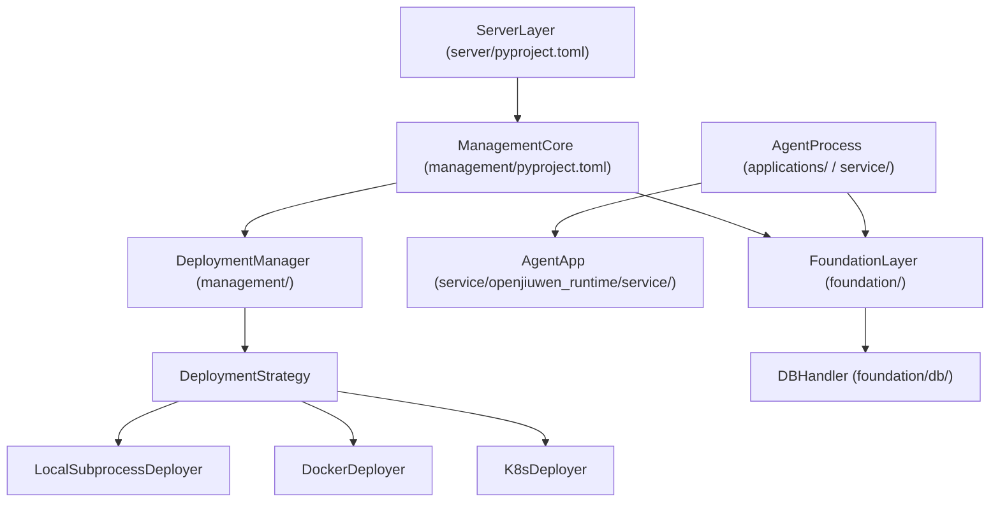
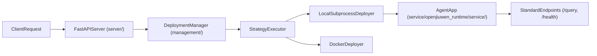

<!-- source: DeepWiki mcp.deepwiki.com · repo openJiuwen-ai/agent-runtime · page 1 Overview · fetched 2026-11-02 -->

# Overview

Relevant source files

The following files were used as context for generating this wiki page:

- [README.md](README.md)
- [README_zh.md](README_zh.md)
- [applications/lowcode_agent/pyproject.toml](applications/lowcode_agent/pyproject.toml)
- [cli/pyproject.toml](cli/pyproject.toml)
- [docs/zh/SUMMARY.md](docs/zh/SUMMARY.md)
- [management/openjiuwen_runtime/management/security/__init__.py](management/openjiuwen_runtime/management/security/__init__.py)
- [management/openjiuwen_runtime/management/security/certificate.py](management/openjiuwen_runtime/management/security/certificate.py)
- [management/pyproject.toml](management/pyproject.toml)
- [management/tests/unit_tests/management_security/test_certificate_manager.py](management/tests/unit_tests/management_security/test_certificate_manager.py)
- [management/tests/unit_tests/management_security/test_crypto.py](management/tests/unit_tests/management_security/test_crypto.py)
- [management/tests/unit_tests/management_security/test_signing.py](management/tests/unit_tests/management_security/test_signing.py)
- [server/pyproject.toml](server/pyproject.toml)
- [service/openjiuwen_runtime/service/__init__.py](service/openjiuwen_runtime/service/__init__.py)
- [service/pyproject.toml](service/pyproject.toml)

openJiuwen Agent Runtime is an enterprise-grade runtime and deployment system designed to transition AI agents reliably from development environments to production. The runtime provides uniform service exposure, multi-tenant resource isolation, multi-mode deployment strategies (subprocess, Docker, Kubernetes), and comprehensive lifecycle management.

For detailed setup instructions, run scripts, configuration options, and documentation sets, see [Getting Started & Configuration](#1.1). For workspace packaging details, dependency graphs, and wheel builds, see [Repository Structure & Packaging](#1.2).

Sources: [`README.md:1-46`](), [`README_zh.md:1-46`]().

---

## System Architecture & Monorepo Layout

The runtime is organized as a Python monorepo split into modular packages that interact across control and data planes. The foundation layer provides shared primitives, while the management layer orchestrates deployment strategies.

*Figure 1: High-level architectural layout bridging natural language concepts to code components.*

Sources: [`README.md:55-68`](), [`management/pyproject.toml:1-35`](), [`service/pyproject.toml:1-19`](), [`server/pyproject.toml:1-18`]().

---

## Core Capabilities & Deployment Flow

The runtime handles deployment orchestration through a structured lifecycle where client requests trigger strategy execution and spin up isolated agent apps.

*Figure 2: Deployment and request execution workflow mapping components to codebase entities.*

1. **Deployment Request**: Clients invoke management endpoints exposed by the server layer (`server/`).
2. **Strategy Selection**: The deployment manager determines the appropriate strategy (`subprocess`, `docker`, or `k8s`) based on metadata.
3. **Instance Provisioning**: The underlying deployer allocates ports, initializes virtual environments via `uv`, or provisions container/pod specs.
4. **Service Exposure**: The agent application starts, exposing standard conversation and health endpoints (`/query`, `/health`, `/reset_conversation`).

Sources: [`README.md:47-54`](), [`README.md:127-142`]().

---

## Child Pages

- **[Getting Started & Configuration](#1.1)** — Setup procedures, run scripts (`run-server.sh` / `run-server.ps1`), `.env` settings, database selection (SQLite, MySQL, GaussDB, openGauss), and documentation sets (`docs/en`, `docs/zh`).
- **[Repository Structure & Packaging](#1.2)** — Python workspace packaging, `pyproject.toml` dependency graphs, wheel building, PyPI upload configurations, and development source injection.

Sources: [`README.md:70-178`](), [`management/pyproject.toml:1-62`](), [`service/pyproject.toml:1-41`](), [`applications/lowcode_agent/pyproject.toml:1-43`]().

---

