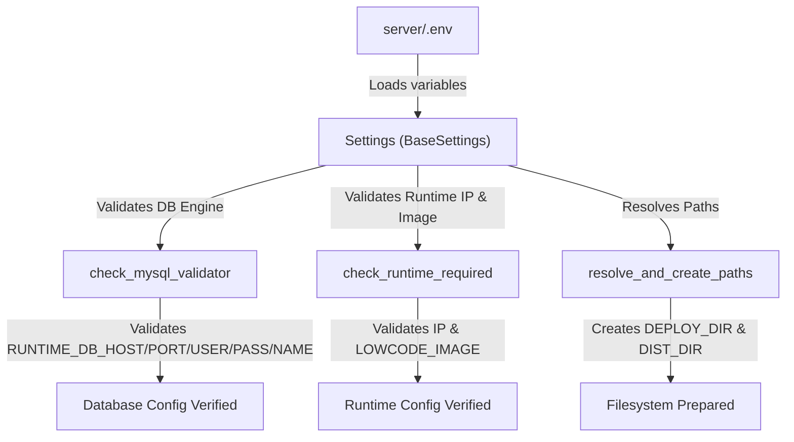
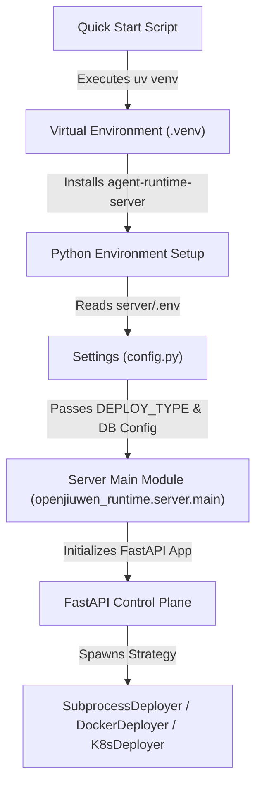

<!-- source: DeepWiki mcp.deepwiki.com · repo openJiuwen-ai/agent-runtime · page 1.1 Getting Started & Configuration · fetched 2026-11-02 -->

# Getting Started & Configuration

<details>
<summary>Relevant source files</summary>

The following files were used as context for generating this wiki page:

- [docs/en/0. Project Overview.md](docs/en/0. Project Overview.md)
- [docs/en/1. Quick Start.md](docs/en/1. Quick Start.md)
- [docs/en/2. Configuration.md](docs/en/2. Configuration.md)
- [docs/en/3. Agent Deployment.md](docs/en/3. Agent Deployment.md)
- [docs/en/4. Agent Integration.md](docs/en/4. Agent Integration.md)
- [foundation/openjiuwen_runtime/foundation/config.py](foundation/openjiuwen_runtime/foundation/config.py)
- [server/.env.example](server/.env.example)

</details>


## Purpose & Scope
This document covers the setup, installation scripts, environment configuration (`server/.env`), database backend selection (`RUNTIME_DB_TYPE`), and documentation sets (`docs/en`, `docs/zh`) for the openJiuwen Agent Runtime platform. It details how runtime configuration parameters are parsed, validated, and initialized programmatically via the Pydantic-based `Settings` class.

Sources: `docs/en/1. Quick Start.md:1-20`, `foundation/openjiuwen_runtime/foundation/config.py:4-15`

---

## Prerequisites & One-Step Installation

The runtime requires an isolated environment managed by `uv` and Python >= 3.11.4. The reference installation flow initializes a virtual environment, installs the server package, and launches the runtime service.

### System Requirements
- Python >= `3.11.4`
- `uv` >= `0.25.x`
- `git`
- `bash` (Linux/macOS) or **Git Bash** (Windows)

### Installation & Launch Sequence
1. Create and activate a virtual environment using `uv venv`:
   ```shell
   uv venv
   source .venv/bin/activate       # Linux/macOS
   source .venv/Scripts/activate   # Windows (Git Bash)
   ```
2. Install the `agent-runtime-server` distribution:
   ```shell
   uv pip install agent-runtime-server
   ```
3. Load environment variables from `server/.env` and start the server module:
   ```shell
   set -a; source server/.env; set +a
   python -m openjiuwen_runtime.server.main
   ```

Sources: `docs/en/1. Quick Start.md:5-56`

---

## Configuration & Environment Settings (`server/.env`)

Runtime behavior is controlled via environment variables loaded from `server/.env`. The configuration parser maps these variables into the `Settings` class (`foundation/openjiuwen_runtime/foundation/config.py:16`), performing strict model validation and dynamic path resolution.

### Core Configuration Parameters

| Environment Variable | Default Value | Description |
| :--- | :--- | :--- |
| `RUNTIME_DB_TYPE` | `sqlite` | Database engine selection (`mysql`, `sqlite`, `gaussdb`, `opengauss`). |
| `RUNTIME_DB_HOST` | `None` | Database server hostname or IP address. |
| `RUNTIME_DB_PORT` | `None` | Database connection port (`3306` for MySQL, `5432` for GaussDB/openGauss). |
| `RUNTIME_DB_USER` | `None` | Database authentication username. |
| `RUNTIME_DB_PASSWORD` | `None` | Database authentication password. |
| `RUNTIME_DB_NAME` | `None` | Target database instance name. |
| `IP` | `None` | Host IP address shared by runtime-server and low-code agents. |
| `LOWCODE_IMAGE` | `None` | Container image reference for containerized low-code agents (`docker` / `k8s`). |
| `DEPLOY_DIR` | `/tmp/deploys` | Directory for deployment artifacts and temporary files. |
| `DIST_DIR` | `/tmp/dist` | Directory holding `.whl` packages required by low-code agents. |
| `HOST` | `0.0.0.0` | Bind address for `agent-runtime-server`. |
| `PORT` | `8186` | TCP listening port for `agent-runtime-server`. |
| `UV_EXTRA_ARGS` | `""` | Global extra flags appended to `uv` command invocations. |
| `DEPLOY_TYPE` | `subprocess` | Execution strategy (`subprocess`, `docker`, `k8s`). |
| `MODE` | `product` | Dependency loading mode (`dev` or `product`) when `DEPLOY_TYPE=subprocess`. |

Sources: `server/.env.example:1-76`, `foundation/openjiuwen_runtime/foundation/config.py:16-47`

### Diagram: Settings Parsing & Validation Flow

The following diagram maps natural language configuration properties defined in `server/.env` to code entities inside `foundation/openjiuwen_runtime/foundation/config.py`.


Sources: `server/.env.example:1-76`, `foundation/openjiuwen_runtime/foundation/config.py:16-140`

---

## Database Selection & Optional Drivers

Runtime supports four database backends via `RUNTIME_DB_TYPE` (`foundation/openjiuwen_runtime/foundation/config.py:20`):

1. **SQLite**: Default embedded storage requiring no external server.
2. **MySQL**: Relational storage requiring valid connection parameters (`RUNTIME_DB_HOST`, `RUNTIME_DB_PORT`, `RUNTIME_DB_USER`, `RUNTIME_DB_PASSWORD`, `RUNTIME_DB_NAME`).
3. **GaussDB / openGauss**: Enterprise relational databases requiring `async-gaussdb>=0.30.4`.

### Driver Installation Note
- Default installations include dependencies for `sqlite` and `mysql`.
- When `RUNTIME_DB_TYPE=gaussdb` or `RUNTIME_DB_TYPE=opengauss`, the `async-gaussdb` driver must be installed:
  ```shell
  uv pip install -e "./foundation[gaussdb]"
  ```

Sources: `server/.env.example:1-30`, `docs/en/1. Quick Start.md:21-26`, `foundation/openjiuwen_runtime/foundation/config.py:20`

---

## Documentation Set Layout

The runtime documentation repository is organized into distinct language sets under `docs/en/` and `docs/zh/`, structured to guide developers through installation, configuration, and agent deployment:

- **Quick Start (`docs/en/1. Quick Start.md`)**: Prerequisites, virtual environment setup, package installation, and Studio publishing steps.
- **Configuration (`docs/en/2. Configuration.md`)**: Comprehensive documentation for `.env` parameters, database setup, and process options.
- **Agent Deployment (`docs/en/3. Agent Deployment.md`)**: Details on `subprocess`, `docker`, and `Kubernetes` deployment models.
- **Agent Integration (`docs/en/4. Agent Integration.md`)**: HTTP API specifications, SSE query handling (`/query`), health checks (`/health`), and conversation management.

Sources: `docs/en/0. Project Overview.md:67-73`, `docs/en/1. Quick Start.md:1-12`, `docs/en/2. Configuration.md:1-5`

### Diagram: Startup and Runtime Initialization Flow

The following diagram bridges user operations (Natural Language Space) to execution modules (Code Entity Space) during service bootstrap.


Sources: `docs/en/1. Quick Start.md:42-56`, `foundation/openjiuwen_runtime/foundation/config.py:16-167`, `server/.env.example:56-64`

---

