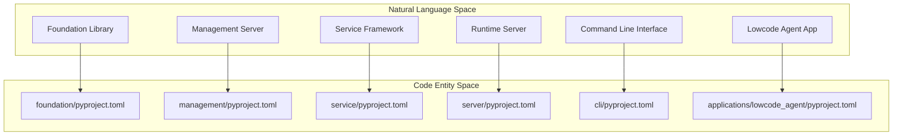
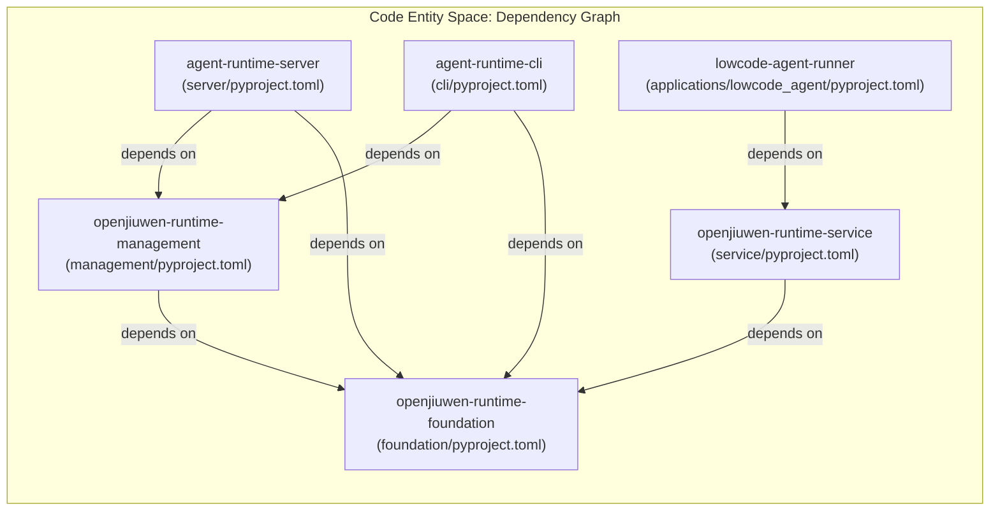

<!-- source: DeepWiki mcp.deepwiki.com · repo openJiuwen-ai/agent-runtime · page 1.2 Repository Structure & Packaging · fetched 2026-11-02 -->

# Repository Structure & Packaging

<details>
<summary>Relevant source files</summary>

The following files were used as context for generating this wiki page:

- [applications/lowcode_agent/pyproject.toml](applications/lowcode_agent/pyproject.toml)
- [cli/pyproject.toml](cli/pyproject.toml)
- [docker/Dockerfile.lowercode](docker/Dockerfile.lowercode)
- [docker/Dockerfile.server](docker/Dockerfile.server)
- [foundation/openjiuwen_runtime/foundation/__init__.py](foundation/openjiuwen_runtime/foundation/__init__.py)
- [foundation/openjiuwen_runtime/foundation/messaging/__init__.py](foundation/openjiuwen_runtime/foundation/messaging/__init__.py)
- [foundation/openjiuwen_runtime/foundation/messaging/amqp_json.py](foundation/openjiuwen_runtime/foundation/messaging/amqp_json.py)
- [foundation/pyproject.toml](foundation/pyproject.toml)
- [management/pyproject.toml](management/pyproject.toml)
- [scripts/add_dev_sources.py](scripts/add_dev_sources.py)
- [scripts/deploy_dev_server.sh](scripts/deploy_dev_server.sh)
- [scripts/run-server.ps1](scripts/run-server.ps1)
- [scripts/upload_pypi.sh](scripts/upload_pypi.sh)
- [server/pyproject.toml](server/pyproject.toml)
- [service/openjiuwen_runtime/service/__init__.py](service/openjiuwen_runtime/service/__init__.py)
- [service/pyproject.toml](service/pyproject.toml)

</details>


## Purpose & Scope
This page details the monorepo workspace architecture, inter-package dependency graphs, wheel compilation pipelines, PyPI publication workflows, and local development source injection mechanisms used across the `agent-runtime` codebase. 

---

## 1. Monorepo Workspace Packages & Layout
The repository is structured as a Python workspace containing multiple independent sub-packages sharing the `openjiuwen_runtime` namespace. Each package defines its own build configuration and dependencies via `pyproject.toml`.


*Figure 1: Mapping natural language package identities to physical `pyproject.toml` configurations.*

- **Foundation Library**: Shared utilities, database handlers, security, and messaging primitives (`foundation/pyproject.toml` [foundation/pyproject.toml:1-63]()).
- **Management Server (Control Plane)**: FastAPI management service, deployment orchestration, and database models (`management/pyproject.toml` [management/pyproject.toml:1-61]()).
- **Service Framework (Data Plane)**: Base application abstractions (`BaseApp`, `AgentApp`) for agent processes (`service/pyproject.toml` [service/pyproject.toml:1-41]()).
- **Runtime Server**: Orchestrator entrypoint (`server/pyproject.toml` [server/pyproject.toml:1-33]()).
- **CLI**: Management command-line interface (`cli/pyproject.toml` [cli/pyproject.toml:1-36]()).
- **Lowcode Agent Runner**: IR-driven agent runner application (`applications/lowcode_agent/pyproject.toml` [applications/lowcode_agent/pyproject.toml:1-42]()).

**Sources:**
- `foundation/pyproject.toml` [foundation/pyproject.toml:1-63]()
- `management/pyproject.toml` [management/pyproject.toml:1-61]()
- `service/pyproject.toml` [service/pyproject.toml:1-41]()
- `server/pyproject.toml` [server/pyproject.toml:1-33]()
- `cli/pyproject.toml` [cli/pyproject.toml:1-36]()
- `applications/lowcode_agent/pyproject.toml` [applications/lowcode_agent/pyproject.toml:1-42]()

---

## 2. Dependency Graph (`pyproject.toml`)
The packages depend on each other hierarchically. `openjiuwen-runtime-foundation` forms the base layer, consumed by both management and service layers, which are subsequently bundled by the server and CLI tiers.


*Figure 2: Inter-package dependency hierarchy across workspace packages.*

Key dependency mappings defined in configuration files:
- `agent-runtime-server` declares dependencies on `openjiuwen-runtime-foundation==0.1.0` and `openjiuwen-runtime-management==0.1.0` (`server/pyproject.toml` [server/pyproject.toml:10-17]()).
- `openjiuwen-runtime-management` declares a dependency on `openjiuwen-runtime-foundation==0.1.0` (`management/pyproject.toml` [management/pyproject.toml:10-35]()).
- `openjiuwen-runtime-service` requires `openjiuwen-runtime-foundation==0.1.0` (`service/pyproject.toml` [service/pyproject.toml:10-18]()).

**Sources:**
- `server/pyproject.toml` [server/pyproject.toml:10-17]()
- `management/pyproject.toml` [management/pyproject.toml:10-35]()
- `service/pyproject.toml` [service/pyproject.toml:10-18]()

---

## 3. Wheel Builds & Packaging Utilities
Packaging and wheel compilation leverage `setuptools` build backends with `uv build` for rapid workspace iteration. The foundation library also provides programmatic packaging utilities (`foundation/openjiuwen_runtime/foundation/__init__.py` [foundation/openjiuwen_runtime/foundation/__init__.py:4-11]()).

| Utility / Function | Code Path | Description |
| :--- | :--- | :--- |
| `package_python_to_whl` | `foundation/openjiuwen_runtime/foundation/packaging.py` | Programmatically packages Python code into `.whl` files. |
| `create_virtualenv` | `foundation/openjiuwen_runtime/foundation/packaging.py` | Provisions isolated virtual environments via `uv`/`venv`. |
| `install_package` / `uninstall_package` | `foundation/openjiuwen_runtime/foundation/packaging.py` | Installs or removes packages inside target virtual environments. |

**Sources:**
- `foundation/openjiuwen_runtime/foundation/__init__.py` [foundation/openjiuwen_runtime/foundation/__init__.py:4-11]()
- `foundation/pyproject.toml` [foundation/pyproject.toml:1-3]()

---

## 4. Dev Source Injection & Local Deployment
For local development and testing, intra-repo dependencies can cause installation conflicts if locked to exact PyPI versions. Deployment scripts (`scripts/deploy_dev_server.sh` [scripts/deploy_dev_server.sh:1-120]() and `scripts/run-server.ps1` [scripts/run-server.ps1:1-157]()) dynamically sanitize `pyproject.toml` files by stripping internal dependency constraints, building local wheels into a shared `dist` directory, and installing packages in editable mode (`uv pip install -e`).

```mermaid
sequenceDiagram
    participant Script as deploy_dev_server.sh
    participant Config as pyproject.toml
    participant UV as uv build / uv sync
    participant Server as server runtime

    Script->>Config: Strip internal dependencies (e.g. openjiuwen-runtime-foundation)
    Script->>UV: uv sync and uv build --out-dir dist
    UV--create-->DistFolder["dist/*.whl"]
    Script->>Server: uv pip install -e ../management & -e ../foundation
    Server->>Server: python -m openjiuwen_runtime.server.main
```
*Figure 3: Dev source injection and local wheel compilation workflow.*

- **Dependency Stripping**: `scripts/deploy_dev_server.sh` uses `sed` to remove lines referencing internal packages like `openjiuwen-runtime-service` or `openjiuwen-runtime-foundation` before compilation (`scripts/deploy_dev_server.sh` [scripts/deploy_dev_server.sh:53-55]()).
- **Editable Installation**: After syncing dependencies, local development mode installs management and foundation via editable links (`scripts/deploy_dev_server.sh` [scripts/deploy_dev_server.sh:117-118]()).

**Sources:**
- `scripts/deploy_dev_server.sh` [scripts/deploy_dev_server.sh:1-120]()
- `scripts/run-server.ps1` [scripts/run-server.ps1:1-157]()

---

## 5. Containerized Builds & Namespace Package Installation
Dockerfiles (`docker/Dockerfile.server` [docker/Dockerfile.server:1-69]() and `docker/Dockerfile.lowercode` [docker/Dockerfile.lowercode:1-63]()) use multi-stage builds to compile wheels and install them into a shared runtime container.

- **Namespace Protection**: Because multiple workspace packages share the root `openjiuwen_runtime` namespace, standard `pip install --target` has a known bug where installing subsequent packages deletes the existing namespace directory. The build pipelines enforce `uv pip install --target=/app/site-packages`, which safely adds or overwrites files without purging the parent namespace directory (`docker/Dockerfile.server` [docker/Dockerfile.server:53-59](), `docker/Dockerfile.lowercode` [docker/Dockerfile.lowercode:48-54]()).

**Sources:**
- `docker/Dockerfile.server` [docker/Dockerfile.server:1-69]()
- `docker/Dockerfile.lowercode` [docker/Dockerfile.lowercode:1-63]()

---

## 6. PyPI Publication & Release Automation
Automated releases and PyPI publication are handled by `scripts/upload_pypi.sh` [scripts/upload_pypi.sh:1-82]().

- **Version Propagation**: The script iterates over target package directories (`foundation`, `management`, `service`, `server`, `applications/lowcode_agent`, etc.), updates `pyproject.toml` version fields dynamically via `sed`, and adjusts internal dependency version specifiers (`scripts/upload_pypi.sh` [scripts/upload_pypi.sh:31-56]()).
- **Build & Upload**: Packages are compiled via `uv build` and published using `twine upload` to private Huaweicloud repositories or official PyPI indexes (`scripts/upload_pypi.sh` [scripts/upload_pypi.sh:58-81]()).

**Sources:**
- `scripts/upload_pypi.sh` [scripts/upload_pypi.sh:1-82]()

---

