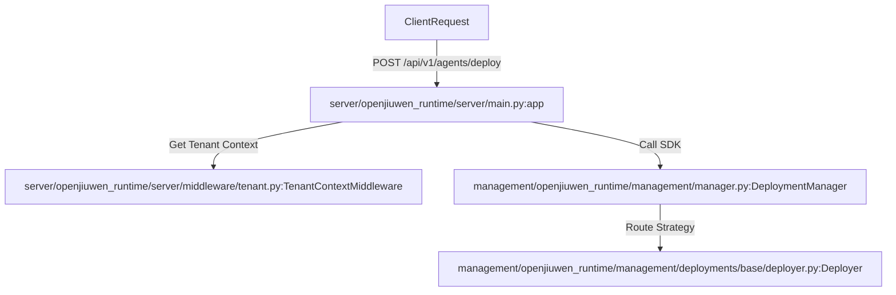
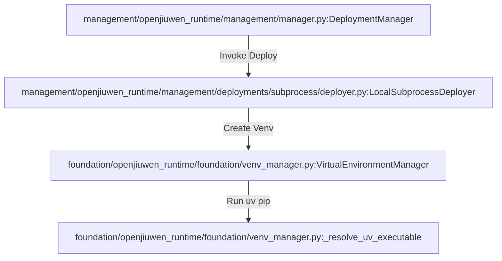

<!-- source: DeepWiki mcp.deepwiki.com · repo openJiuwen-ai/agent-runtime · page 2 Management Server (Control Plane) · fetched 2026-11-02 -->

# Management Server (Control Plane)

Relevant source files

The following files were used as context for generating this wiki page:

- [README.md](README.md)
- [README_zh.md](README_zh.md)
- [foundation/openjiuwen_runtime/foundation/venv_manager.py](foundation/openjiuwen_runtime/foundation/venv_manager.py)
- [management/openjiuwen_runtime/management/deployments/subprocess/deployer.py](management/openjiuwen_runtime/management/deployments/subprocess/deployer.py)
- [server/openjiuwen_runtime/server/main.py](server/openjiuwen_runtime/server/main.py)

The Management Server acts as the control plane for the openJiuwen Agent Runtime. It provides a FastAPI-based REST API service (`[server/openjiuwen_runtime/server/main.py:71-76]()`) that handles agent deployment requests, tenant context parsing, and database-backed instance tracking. It delegates execution tasks to the underlying deployment orchestration layers.

As a parent page, this section provides a high-level architectural overview of the control plane components. For in-depth technical details, refer to the child pages:
- [REST API & Middleware](#2.1)
- [DeploymentManager & Strategies](#2.2)

---

### Control Plane Architecture

The control plane coordinates client requests, intercepts them via tenant middleware, normalizes configurations, and routes them through the deployment manager to target execution environments.

### Diagram: Control Plane Request Flow to Deployment Execution

Sources: `[server/openjiuwen_runtime/server/main.py:71-216]()`, `[server/openjiuwen_runtime/server/middleware/tenant.py]()`

---

## 2.1 REST API & Middleware

The REST API layer (`[server/openjiuwen_runtime/server/main.py:84-216]()`) exposes endpoints for health checking (`[server/openjiuwen_runtime/server/main.py:84-88]()`), agent deployment (`[server/openjiuwen_runtime/server/main.py:169-216]()`), and listing deployments. It includes request query parsers (`[server/openjiuwen_runtime/server/main.py:158-164]()`) and tenant context extraction middleware to enforce resource boundaries across multiple users and spaces.

For implementation details on endpoints, request parsers, tenant context propagation, and CLI/WHL integration, see [REST API & Middleware](#2.1).

Sources: `[server/openjiuwen_runtime/server/main.py:84-216]()`

---

## 2.2 DeploymentManager & Strategies

The deployment orchestration layer (`[management/openjiuwen_runtime/management/manager.py]()`) manages the lifecycle of agent runtimes. It abstracts deployment models (`[management/openjiuwen_runtime/management/models/deployment_params.py]()`), tracks state in database handlers (`[server/openjiuwen_runtime/server/main.py:44-55]()`), and selects the appropriate strategy (such as subprocess, Docker, or Kubernetes) to instantiate agent services.

### Diagram: Deployment Execution Architecture

Sources: `[management/openjiuwen_runtime/management/deployments/subprocess/deployer.py:39-148]`, `[foundation/openjiuwen_runtime/foundation/venv_manager.py:21-180]()`

For detailed discussions on strategy abstraction, virtual environment provisioning via `uv`, port allocation, and container/K8s deployment lifecycles, see [DeploymentManager & Strategies](#2.2).

Sources: `[management/openjiuwen_runtime/management/deployments/subprocess/deployer.py:39-188]()`, `[foundation/openjiuwen_runtime/foundation/venv_manager.py:21-128]()`

---

