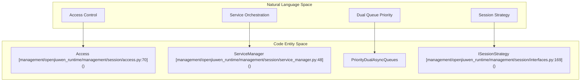
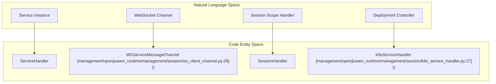

<!-- source: DeepWiki mcp.deepwiki.com · repo openJiuwen-ai/agent-runtime · page 3 Session Management Subsystem · fetched 2026-11-02 -->

# Session Management Subsystem

Relevant source files

The following files were used as context for generating this wiki page:

- [management/openjiuwen_runtime/management/session/DESIGN.md](management/openjiuwen_runtime/management/session/DESIGN.md)
- [management/openjiuwen_runtime/management/session/__init__.py](management/openjiuwen_runtime/management/session/__init__.py)
- [management/openjiuwen_runtime/management/session/access.py](management/openjiuwen_runtime/management/session/access.py)
- [management/openjiuwen_runtime/management/session/interfaces.py](management/openjiuwen_runtime/management/session/interfaces.py)
- [management/openjiuwen_runtime/management/session/models.py](management/openjiuwen_runtime/management/session/models.py)
- [management/openjiuwen_runtime/management/session/service_manager.py](management/openjiuwen_runtime/management/session/service_manager.py)

The Session Management Subsystem (`openjiuwen_runtime.management.session`) provides orchestration and routing between client request entrypoints and scalable backend agent workloads (such as Kubernetes pods, Docker containers, or local processes) [management/openjiuwen_runtime/management/session/DESIGN.md:7-16](). It guarantees session affinity, handles dual-queue request prioritization, manages instance pooling and autoscaling, and coordinates multi-路 multiplexed messaging channels.

As a parent page, this document provides a high-level overview of the session orchestration architecture. For granular implementation details, refer to the respective child pages linked below.

*Sources: [management/openjiuwen_runtime/management/session/access.py:70](), [management/openjiuwen_runtime/management/session/service_manager.py:48](), [management/openjiuwen_runtime/management/session/interfaces.py:169](), [management/openjiuwen_runtime/management/session/DESIGN.md:7-16]()*

---

## 3.1. Access, ServiceManager & Interfaces

The request ingestion and scheduling core is anchored by `Access` and `ServiceManager`. `Access` acts as the primary ingress controller that intercepts inbound requests, applies session routing strategies via `ISessionStrategy`, and wraps requests into `SessionRequestWrapper` instances before handing them to the queue layer [management/openjiuwen_runtime/management/session/access.py:70](), [management/openjiuwen_runtime/management/session/DESIGN.md:62](). 

`ServiceManager` consumes these wrapped requests through `PriorityDualAsyncQueues`, ensuring system-level internal events take priority over standard user traffic [management/openjiuwen_runtime/management/session/service_manager.py:48](), [management/openjiuwen_runtime/management/session/DESIGN.md:11](). It orchestrates service instance pools (`_in_use` and `_idle`), executes bootstrap pre-warming (`_bootstrap_min_idle`), manages background autoscaling (`_autoscale_loop`), and enforces service time-to-live (`service_ttl`) policies [management/openjiuwen_runtime/management/session/service_manager.py:48-175](), [management/openjiuwen_runtime/management/session/models.py:41-70]().

For details, see [Access, ServiceManager & Interfaces](#3.1).

*Sources: [management/openjiuwen_runtime/management/session/access.py:70-120](), [management/openjiuwen_runtime/management/session/service_manager.py:48-175](), [management/openjiuwen_runtime/management/session/models.py:41-70](), [management/openjiuwen_runtime/management/session/DESIGN.md:62]() *

---

## 3.2. Service Handlers & Channels

Backend agent instances are encapsulated by `ServiceHandler`, which coordinates instance-level concurrency, session routing tables (`ServiceRouter`), and lifecycle operations (`deploy` and `delete`) [management/openjiuwen_runtime/management/session/service_handler.py:1-50](), [management/openjiuwen_runtime/management/session/DESIGN.md:63](). Communication between the runtime and backend agent instances is facilitated by `WSServiceMessageChannel`, establishing persistent WebSocket connections that multiplex multiple concurrent streams using individual `request_id` attributes [management/openjiuwen_runtime/management/session/ws_client_channel.py:1-50](), [management/openjiuwen_runtime/management/session/DESIGN.md:66](). Concurrency is managed across two distinct tiers: service-wide limits and session-specific constraints via `SessionHandler` [management/openjiuwen_runtime/management/session/DESIGN.md:13]().

*Sources: [management/openjiuwen_runtime/management/session/ws_client_channel.py:26](), [management/openjiuwen_runtime/management/session/k8s_service_handler.py:27](), [management/openjiuwen_runtime/management/session/DESIGN.md:60-68]*

For details, see [Service Handlers & Channels](#3.2).

*Sources: [management/openjiuwen_runtime/management/session/service_handler.py:1-50](), [management/openjiuwen_runtime/management/session/ws_client_channel.py:1-50](), [management/openjiuwen_runtime/management/session/k8s_service_handler.py:1-50](), [management/openjiuwen_runtime/management/session/DESIGN.md:60-68]() *

---

## 3.3. Session Testing & System Tests

To guarantee stability under high load, the session management subsystem includes comprehensive unit and integration test suites. These tests validate session concurrency limits, timer expirations, multi-session Kubernetes scaling scenarios, failure recovery flows, and SDK usage patterns across asynchronous event loops.

For details, see [Session Testing & System Tests](#3.3).

*Sources: [management/openjiuwen_runtime/management/session/DESIGN.md:1-150]() *

---

