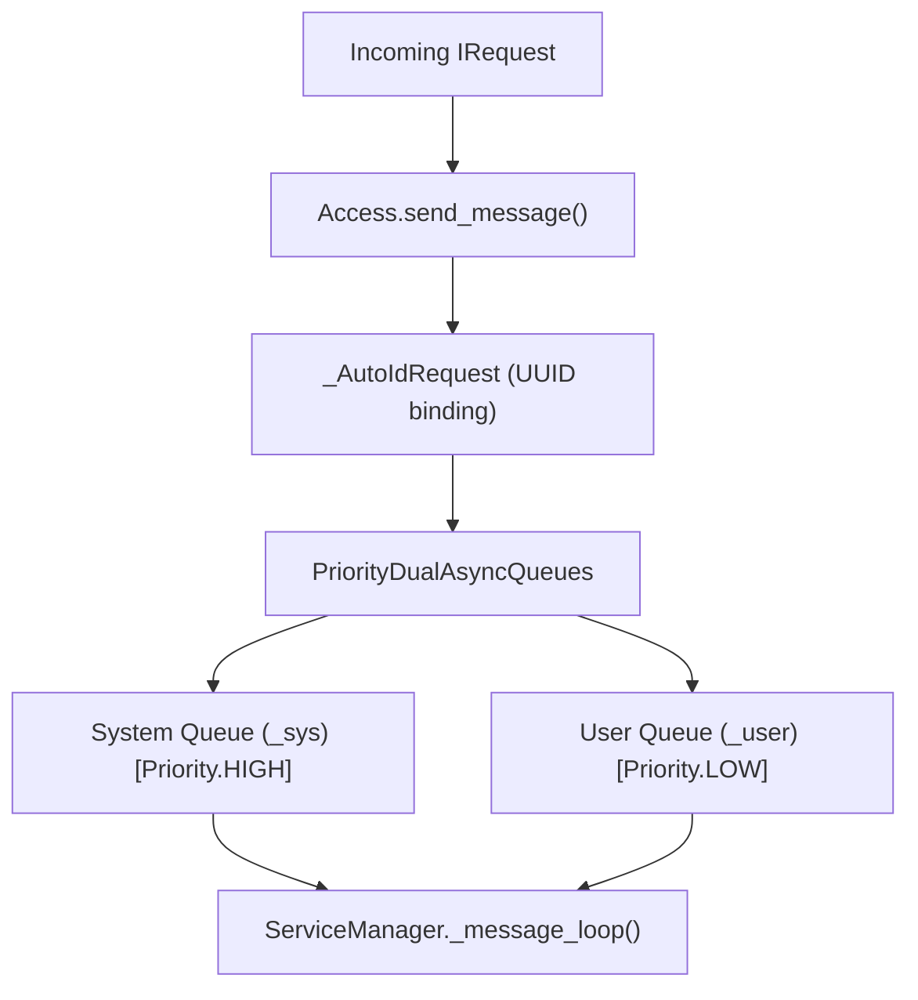
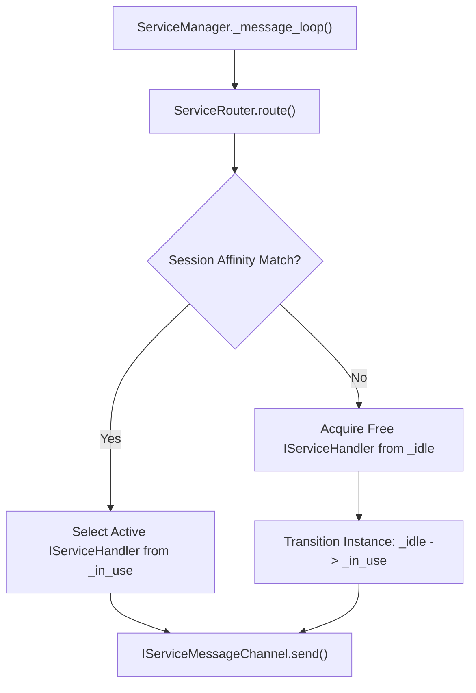
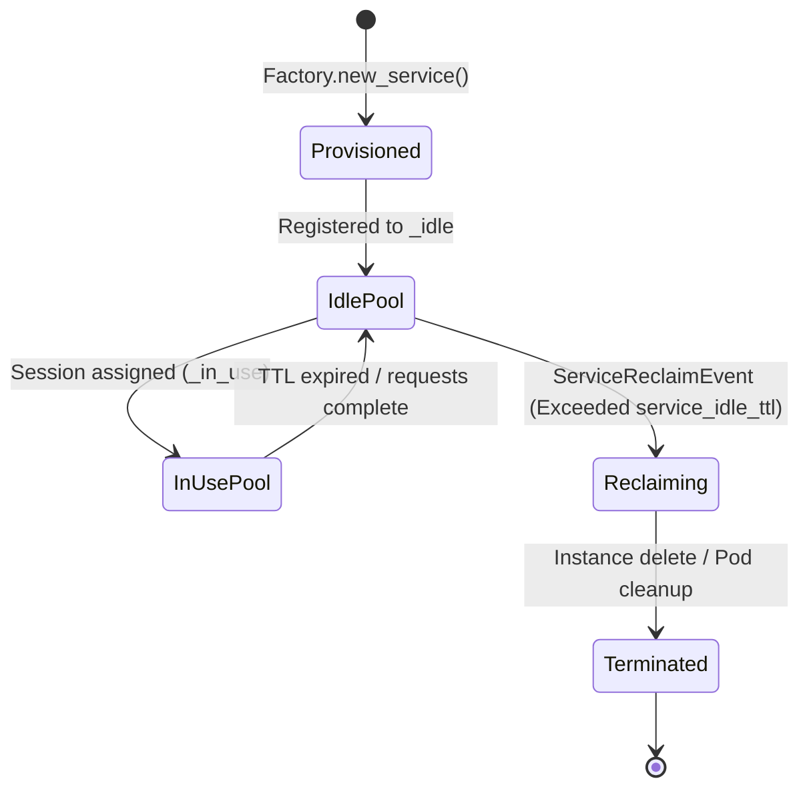

<!-- source: DeepWiki mcp.deepwiki.com · repo openJiuwen-ai/agent-runtime · page 3.1 Access, ServiceManager & Interfaces · fetched 2026-11-02 -->

# Access, ServiceManager & Interfaces

Relevant source files

The following files were used as context for generating this wiki page:

- [management/openjiuwen_runtime/management/session/access.py](management/openjiuwen_runtime/management/session/access.py)
- [management/openjiuwen_runtime/management/session/dual_queue.py](management/openjiuwen_runtime/management/session/dual_queue.py)
- [management/openjiuwen_runtime/management/session/exception.py](management/openjiuwen_runtime/management/session/exception.py)
- [management/openjiuwen_runtime/management/session/interfaces.py](management/openjiuwen_runtime/management/session/interfaces.py)
- [management/openjiuwen_runtime/management/session/internal_events.py](management/openjiuwen_runtime/management/session/internal_events.py)
- [management/openjiuwen_runtime/management/session/service_manager.py](management/openjiuwen_runtime/management/session/service_manager.py)

## Purpose and Scope
This section covers the session management subsystem core components: `Access`, `ServiceManager`, and their abstract interfaces. It details request ingestion via `PriorityDualAsyncQueues`, session routing and affinity with `ServiceRouter`, dynamic autoscaling policies, TTL management, internal events (`ServiceReclaimEvent`), and error handling primitives.

Sources: `management/openjiuwen_runtime/management/session/access.py:4-5`(), `management/openjiuwen_runtime/management/session/service_manager.py:4-5`()

---

## Core Interfaces and Protocols
The session subsystem relies on a set of abstract base classes and protocols defined in `interfaces.py` to decouple request ingress, routing, execution, and response parsing:

- `IAccess`: Defines the entry interface for handling incoming requests, initialization, configuration hot-updates, and shutdown `[management/openjiuwen_runtime/management/session/interfaces.py:180-223]()`.
- `IServiceManager`: Manages service instance provisioning, lifecycle, and task dispatch `[management/openjiuwen_runtime/management/session/interfaces.py:246-270]()`.
- `IServiceHandler`: Represents a running backend service instance wrapper (e.g., Kubernetes pod, Docker container, or local process) `[management/openjiuwen_runtime/management/session/interfaces.py:250-300]()`.
- `ISessionStrategy`: Abstracts session configuration generation, mapping raw incoming requests (`IRequest`) to session requests (`ISessionRequest`) `[management/openjiuwen_runtime/management/session/interfaces.py:169-178]()`.
- `IServiceMessageChannel`: A protocol used to communicate with downstream services over long-lived connections (such as WebSockets) with multiplexed request IDs `[management/openjiuwen_runtime/management/session/interfaces.py:225-243]()`.

Sources: `management/openjiuwen_runtime/management/session/interfaces.py:169-270`()

---

## Request Ingestion & Dual Queues
Incoming messages are ingested through `Access` which wraps raw requests, generates required identifiers via `_AutoIdRequest`, and routes them into a priority dual asynchronous queue (`PriorityDualAsyncQueues`) `[management/openjiuwen_runtime/management/session/access.py:29-68](), [management/openjiuwen_runtime/management/session/dual_queue.py:18-27]()`.

*Sources: `management/openjiuwen_runtime/management/session/access.py:29-68`(), `management/openjiuwen_runtime/management/session/dual_queue.py:18-64`()*

`PriorityDualAsyncQueues` manages two separate `asyncio.Queue` instances: a system queue (`_sys`) for internal control plane events and a user queue (`_user`) for client requests `[management/openjiuwen_runtime/management/session/dual_queue.py:21-24]`. The retrieval method (`get`) drains the system queue entirely before considering the user queue, ensuring operational control messages take precedence `[management/openjiuwen_runtime/management/session/dual_queue.py:65-107]()`.

Sources: `management/openjiuwen_runtime/management/session/dual_queue.py:18-107`()

---

## Affinity Routing & Service Management
`ServiceManager` orchestrates the lifecycle of backend service instances and binds sessions to specific workers using `ServiceRouter` `[management/openjiuwen_runtime/management/session/service_manager.py:48-94]()`. 

Instances are partitioned into two core dictionaries grouped by `template_id`:
- `self._in_use`: Active instances currently handling requests `[management/openjiuwen_runtime/management/session/service_manager.py:87-89]()`.
- `self._idle`: Unassigned instances waiting for inbound session requests or pending reclamation `[management/openjiuwen_runtime/management/session/service_manager.py:90]()`.

*Sources: `management/openjiuwen_runtime/management/session/service_manager.py:87-94`(), `management/openjiuwen_runtime/management/session/router.py:1-40`()*

Sources: `management/openjiuwen_runtime/management/session/service_manager.py:87-94`(), `management/openjiuwen_runtime/management/session/router.py:1-40`()

---

## Autoscaling, TTLs & Internal Events
`ServiceManager` runs a background autoscaling coroutine (`_autoscale_loop`) that maintains minimum idle instances (`min_idle_services`) and reclaims idle instances exceeding the time-to-live (`service_idle_ttl`) `[management/openjiuwen_runtime/management/session/service_manager.py:56-59](), [management/openjiuwen_runtime/management/session/service_manager.py:160]()`.

When an idle instance expires, a `ServiceReclaimEvent` is pushed into the system queue (`_sys`) to trigger cleanup `[management/openjiuwen_runtime/management/session/internal_events.py:11-15]()`.

*Sources: `management/openjiuwen_runtime/management/session/service_manager.py:87-105`(), `management/openjiuwen_runtime/management/session/internal_events.py:11-16`()*

Sources: `management/openjiuwen_runtime/management/session/service_manager.py:87-105`(), `management/openjiuwen_runtime/management/session/internal_events.py:11-16`()

---

## Exceptions and Error Handling
Runtime errors and protocol rejections are mapped through `exception_message` utilizing a dictionary mapping error codes to localized `ResponseMessage` objects `[management/openjiuwen_runtime/management/session/exception.py:3-19]()`.

Common error codes include:
- `-1`: General internal errors `[management/openjiuwen_runtime/management/session/exception.py:4-5]()`.
- `100001`: Service concurrency limit exceeded (`Service concurrency limit reached, request failed`) `[management/openjiuwen_runtime/management/session/exception.py:6-7]()`.
- `100002`: Service startup failure `[management/openjiuwen_runtime/management/session/exception.py:8-9]()`.

Sources: `management/openjiuwen_runtime/management/session/exception.py:3-20`()

---

