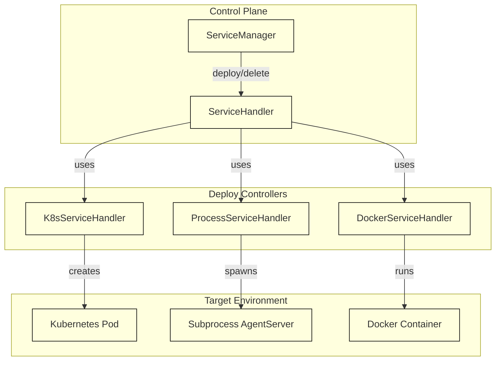
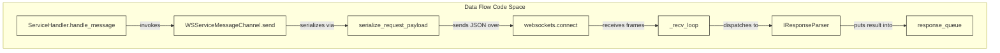
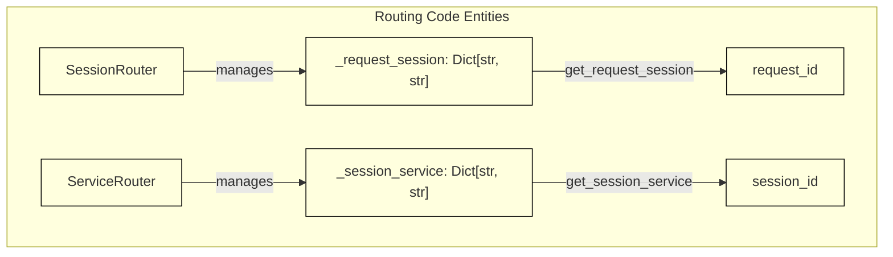

<!-- source: DeepWiki mcp.deepwiki.com · repo openJiuwen-ai/agent-runtime · page 3.2 Service Handlers & Channels · fetched 2026-11-02 -->

# Service Handlers & Channels

Relevant source files

The following files were used as context for generating this wiki page:

- [foundation/openjiuwen_runtime/foundation/db/postgresql_handler.py](foundation/openjiuwen_runtime/foundation/db/postgresql_handler.py)
- [foundation/openjiuwen_runtime/foundation/db/sqlalchemy_handler.py](foundation/openjiuwen_runtime/foundation/db/sqlalchemy_handler.py)
- [foundation/openjiuwen_runtime/foundation/docker_utils.py](foundation/openjiuwen_runtime/foundation/docker_utils.py)
- [foundation/tests/unit_tests/test_sqlite_handler.py](foundation/tests/unit_tests/test_sqlite_handler.py)
- [management/openjiuwen_runtime/management/session/docker_service_handler.py](management/openjiuwen_runtime/management/session/docker_service_handler.py)
- [management/openjiuwen_runtime/management/session/k8s_service_handler.py](management/openjiuwen_runtime/management/session/k8s_service_handler.py)
- [management/openjiuwen_runtime/management/session/process_service_handler.py](management/openjiuwen_runtime/management/session/process_service_handler.py)
- [management/openjiuwen_runtime/management/session/router.py](management/openjiuwen_runtime/management/session/router.py)
- [management/openjiuwen_runtime/management/session/runtime.py](management/openjiuwen_runtime/management/session/runtime.py)
- [management/openjiuwen_runtime/management/session/service_handler.py](management/openjiuwen_runtime/management/session/service_handler.py)
- [management/openjiuwen_runtime/management/session/session_request.py](management/openjiuwen_runtime/management/session/session_request.py)
- [management/openjiuwen_runtime/management/session/strategies/_base.py](management/openjiuwen_runtime/management/session/strategies/_base.py)
- [management/openjiuwen_runtime/management/session/ws_client_channel.py](management/openjiuwen_runtime/management/session/ws_client_channel.py)
- [management/tests/system_tests/management_session/test_session_sdk.py](management/tests/system_tests/management_session/test_session_sdk.py)
- [management/tests/unit_tests/management_session/test_access_session_st.py](management/tests/unit_tests/management_session/test_access_session_st.py)
- [management/tests/unit_tests/management_session/test_service_handler_unit.py](management/tests/unit_tests/management_session/test_service_handler_unit.py)
- [management/tests/unit_tests/management_session/test_session_concurrency_interleave.py](management/tests/unit_tests/management_session/test_session_concurrency_interleave.py)

This section details the runtime infrastructure for service handlers, transport channels, routing tables, and session request packaging within the `openJiuwen` agent runtime. It bridges management-plane orchestration with data-plane agent instances running across Kubernetes, Docker, or local processes, utilizing multiplexed WebSocket channels and session-affinity routers.

---

## 1. Service Handler Architecture & Deployers

The `ServiceHandler` class manages the lifecycle of a single agent service instance, coordinating concurrency quotas, active sessions, and underlying deployment controllers (`IDeployController`) [management/openjiuwen_runtime/management/session/service_handler.py:30-75]().

### Deployment Backends
- **Kubernetes (`K8sServiceHandler`)**: Manages asynchronous Pod lifecycles using `kubernetes_asyncio`, supporting custom container specifications, host path mounts, environment variables, and readiness probes [management/openjiuwen_runtime/management/session/k8s_service_handler.py:154-187]().
- **Process (`ProcessServiceHandler`)**: Spawns local agent server subprocesses via `subprocess.Popen`, injecting bootstrap environment variables and utilizing TCP port connection checks for readiness validation [management/openjiuwen_runtime/management/session/process_service_handler.py:71-192]().
- **Docker (`DockerServiceHandler`)**: Manages container lifecycles, volume mounts, and port bindings via container runtimes.

*Figure 1: Service Handler and Deployer Architecture.*

**Sources:**
- `management/openjiuwen_runtime/management/session/service_handler.py:30-75`
- `management/openjiuwen_runtime/management/session/k8s_service_handler.py:154-187`
- `management/openjiuwen_runtime/management/session/process_service_handler.py:71-192`

---

## 2. WebSocket Message Channel (`WSServiceMessageChannel`)

The `WSServiceMessageChannel` establishes a full-duplex WebSocket connection with an agent service instance [management/openjiuwen_runtime/management/session/ws_client_channel.py:73-135](). Multiple `request_id` streams are multiplexed over a single persistent connection.

### Key Mechanisms
- **Payload Serialization**: Converts requests to JSON using `serialize_request_payload`, supporting dataclasses, `model_dump()` methods, and explicit wire dictionaries [management/openjiuwen_runtime/management/session/ws_client_channel.py:33-56]().
- **Connection Handshake**: Invoked via `on_pod_ready()`, resolving container endpoints, constructing WebSocket URLs (`ws://` or `wss://`), and establishing the connection with optional ping/pong intervals and TLS settings [management/openjiuwen_runtime/management/session/ws_client_channel.py:149-181]().

*Figure 2: WebSocket Message Channel Data Flow.*

**Sources:**
- `management/openjiuwen_runtime/management/session/ws_client_channel.py:33-181`

---

## 3. Routing Subsystem: Session & Service Routers

The routing layer maintains bidirectional mappings between requests, sessions, and service instances using thread-safe asynchronous locks [management/openjiuwen_runtime/management/session/router.py:10-86]().

### Router Classes
- **`SessionRouter`**: Maps individual request IDs to session IDs (`request_id` $\rightarrow$ `session_id`) [management/openjiuwen_runtime/management/session/router.py:10-44]().
- **`ServiceRouter`**: Maps session IDs to active service instance IDs (`session_id` $\rightarrow$ `service_id`), enabling affinity routing and bulk cleanup during service scale-down [management/openjiuwen_runtime/management/session/router.py:46-86]().

*Figure 3: Router Class Mapping Relationships.*

**Sources:**
- `management/openjiuwen_runtime/management/session/router.py:10-87`

---

## 4. Session Requests & Strategies

Session requests encapsulate payload details, concurrency boundaries, and Time-To-Live (TTL) parameters [management/openjiuwen_runtime/management/session/session_request.py:12-58]().

### `SessionRequest` Attributes
- `session_id`: Unique identifier for the conversation session.
- `session_concurrency`: Maximum concurrent executions permitted within the session [management/openjiuwen_runtime/management/session/session_request.py:18]().
- `session_ttl`: Expiration timeout for idle sessions [management/openjiuwen_runtime/management/session/session_request.py:19]().
- `raw_msg`: Underlying request object (`IRequest`) [management/openjiuwen_runtime/management/session/session_request.py:28]().

Routing strategies (such as `PerChatBotStrategy`) utilize these request properties to determine affinity keys and allocate service instances across the worker pool.

**Sources:**
- `management/openjiuwen_runtime/management/session/session_request.py:12-59`

---

