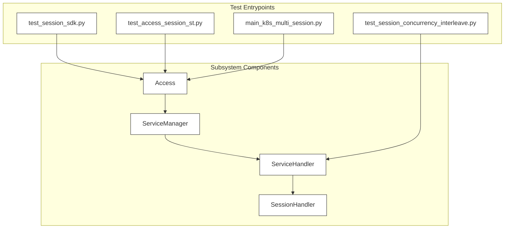
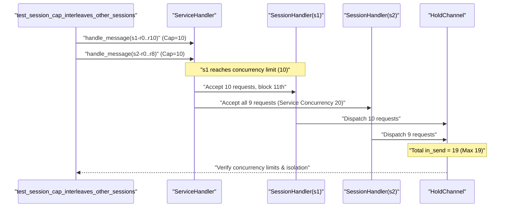
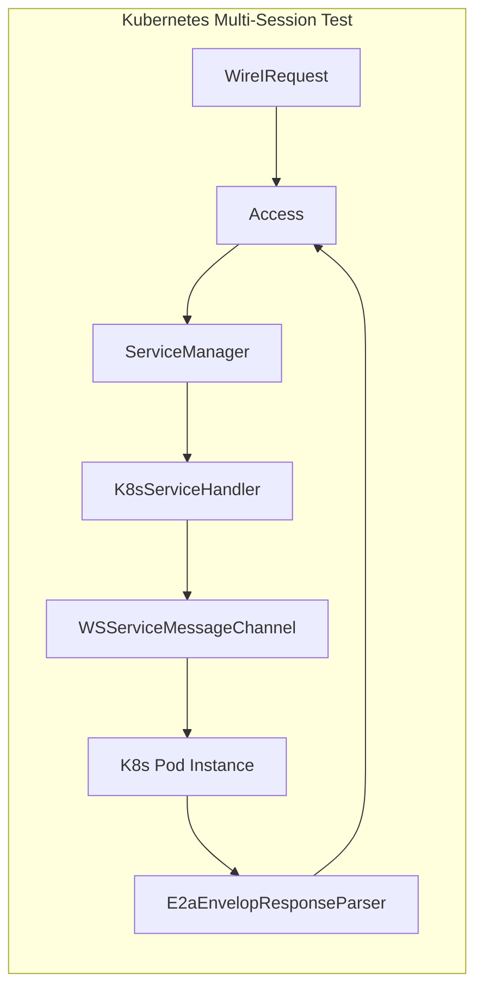
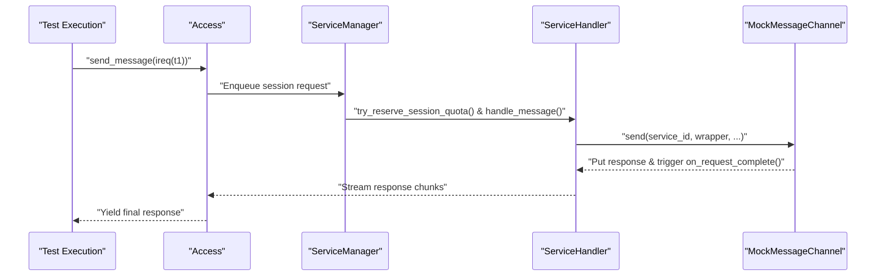

<!-- source: DeepWiki mcp.deepwiki.com · repo openJiuwen-ai/agent-runtime · page 3.3 Session Testing & System Tests · fetched 2026-11-02 -->

# Session Testing & System Tests

Relevant source files

The following files were used as context for generating this wiki page:

- [management/openjiuwen_runtime/management/session/service_handler.py](management/openjiuwen_runtime/management/session/service_handler.py)
- [management/tests/system_tests/management_session/main_k8s_access.py](management/tests/system_tests/management_session/main_k8s_access.py)
- [management/tests/system_tests/management_session/main_k8s_multi_session.py](management/tests/system_tests/management_session/main_k8s_multi_session.py)
- [management/tests/system_tests/management_session/test_session_sdk.py](management/tests/system_tests/management_session/test_session_sdk.py)
- [management/tests/unit_tests/management_session/test_access_session_st.py](management/tests/unit_tests/management_session/test_access_session_st.py)
- [management/tests/unit_tests/management_session/test_service_handler_unit.py](management/tests/unit_tests/management_session/test_service_handler_unit.py)
- [management/tests/unit_tests/management_session/test_session_concurrency_interleave.py](management/tests/unit_tests/management_session/test_session_concurrency_interleave.py)

## Purpose and Scope
This page documents the testing infrastructure, unit tests, and system tests for the session management subsystem of the `agent-runtime` codebase. The scope covers concurrency isolation across multiple sessions, mock-based end-to-end integration tests via `Access` [management/tests/unit_tests/management_session/test_access_session_st.py:14-30](), and real Kubernetes multi-session orchestrations using WebSocket channels and custom envelope parsers [management/tests/system_tests/management_session/main_k8s_multi_session.py:4-35]().

---

## 1. Test Architecture & Overview
The test suites for the session subsystem are split between isolated unit tests and system-level simulations. Unit tests validate individual components like `ServiceHandler` [management/openjiuwen_runtime/management/session/service_handler.py:30-125]() and `SessionRouter`, while system tests spin up an `Access` gateway connected to a `ServiceManager` backed by mock or real deployment controllers (`RecordingK8s`, `DockerDeployer`, or `K8sDeployController`) and message channels (`MockMessageChannel`, `WSServiceMessageChannel`).

*Sources: [management/tests/system_tests/management_session/test_session_sdk.py:14-182](), [management/tests/unit_tests/management_session/test_access_session_st.py:14-201](), [management/tests/unit_tests/management_session/test_session_concurrency_interleave.py:89-129](), [management/tests/system_tests/management_session/main_k8s_multi_session.py:47-72]()*

---

## 2. Concurrency & Interleaving Scenarios
Session-level concurrency isolation ensures that a high volume of requests from a single busy session does not starve other sessions mapped to the same service instance (`ServiceHandler`) [management/openjiuwen_runtime/management/session/service_handler.py:30-125]().

### Interleaving Mechanics
The test `test_session_cap_interleaves_other_sessions` validates that when session `s1` exceeds its concurrency cap (e.g., 11 requests submitted with a concurrency limit of 10), the 11th request blocks at the session layer. Meanwhile, session `s2` can still successfully dispatch its requests up to the remaining service concurrency limit [management/tests/unit_tests/management_session/test_session_concurrency_interleave.py:89-129]().

*Sources: [management/tests/unit_tests/management_session/test_session_concurrency_interleave.py:37-129](), [management/openjiuwen_runtime/management/session/service_handler.py:151-182]()*

---

## 3. Kubernetes Multi-Session Scenarios
Real-world K8s scenarios involve multiple sessions sharing a single pod lifecycle, governed by `service_ttl`, `session_ttl`, and priority dual queues [management/tests/system_tests/management_session/main_k8s_multi_session.py:4-35]().

### Serial Sending and Pod Reclamation
In `main_k8s_multi_session.py`, multiple sessions (`A`, `B`, `C`) with varying session TTLs share a single pod (`max-services=1`, `min-idle=0`). The script executes requests over a WebSocket channel (`WSServiceMessageChannel`) using a raw wire request model (`WireIRequest`) and parses responses via `E2aEnvelopResponseParser` [management/tests/system_tests/management_session/main_k8s_multi_session.py:47-123]().

*Sources: [management/tests/system_tests/management_session/main_k8s_multi_session.py:47-123](), [management/tests/system_tests/management_session/main_k8s_access.py:138-164]()*

---

## 4. SDK Usage & End-to-End Simulation
The SDK test suite (`test_session_sdk.py` and `test_access_session_st.py`) mocks underlying transport and cluster controllers to verify session routing affinity, failure recovery, and quota reservation [management/tests/system_tests/management_session/test_session_sdk.py:4-182](), [management/tests/unit_tests/management_session/test_access_session_st.py:4-201]().

### Key Test Utilities
* **`MockMessageChannel`**: Simulates asynchronous message transmission, tracking `send_calls` and immediately pushing responses into the `response_queue` [management/tests/system_tests/management_session/test_session_sdk.py:61-89]().
* **`RecordingK8s`**: Implements `IDeployController` to record deployment and teardown counts (`deploy_count`, `delete_count`) [management/tests/system_tests/management_session/test_session_sdk.py:91-113]().
* **`DictStreamParser`**: Parses incoming stream dictionaries and determines completion status based on `error_code` or `done` flags [management/tests/system_tests/management_session/test_session_sdk.py:46-59]().

*Sources: [management/tests/system_tests/management_session/test_session_sdk.py:61-182](), [management/tests/unit_tests/management_session/test_access_session_st.py:175-201]()`

---

