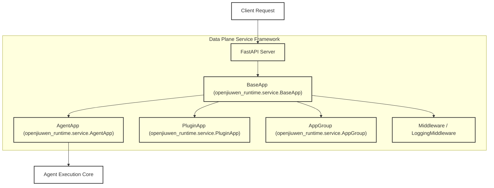

<!-- source: DeepWiki mcp.deepwiki.com · repo openJiuwen-ai/agent-runtime · page 4 Service Framework (Data Plane) · fetched 2026-11-02 -->

# Service Framework (Data Plane)

<details>
<summary>Relevant source files</summary>

The following files were used as context for generating this wiki page:

- [applications/lowcode_agent/pyproject.toml](applications/lowcode_agent/pyproject.toml)
- [cli/pyproject.toml](cli/pyproject.toml)
- [management/pyproject.toml](management/pyproject.toml)
- [server/pyproject.toml](server/pyproject.toml)
- [service/openjiuwen_runtime/service/__init__.py](service/openjiuwen_runtime/service/__init__.py)
- [service/openjiuwen_runtime/service/app/__init__.py](service/openjiuwen_runtime/service/app/__init__.py)
- [service/pyproject.toml](service/pyproject.toml)

</details>


The Service Framework (Data Plane) provides the core application and runtime abstractions used by individual agent processes in the openJiuwen Agent Runtime. Located within the `openjiuwen-runtime-service` workspace [service/pyproject.toml:6-18](), this layer handles HTTP and WebSocket route management, request lifecycle handling via FastAPI, standardized request models (such as `QueryRequest` and `ResetConversationRequest`), and composable middleware execution. 

The data plane framework is designed to run either as a standalone agent service or managed dynamically through orchestration strategies deployed by the Control Plane.


*Figure 1: Service Framework architectural abstraction bridging application types and routing components.*

Sources: [service/pyproject.toml:6-18](), [service/openjiuwen_runtime/service/__init__.py:4-9]()

---

## 4.1 BaseApp, AgentApp, PluginApp & AppGroup

The core application hierarchy establishes standard conventions for building and running agent services. At the root of this model is `BaseApp`, which sets up essential REST routes such as `/query`, `/health`, and `/reset_conversation`, along with port utility integrations. Specialized subclasses like `AgentApp` and `PluginApp` extend these primitives to encapsulate domain-specific agent logic or plugin capabilities, while `AppGroup` allows multiple applications to be aggregated under a unified runtime harness.

For a detailed technical description of the class inheritance model, REST endpoints, request structures (`QueryRequest`, `ResetConversationRequest`), and port utilities, see [BaseApp, AgentApp, PluginApp & AppGroup](#4.1).

Sources: [service/openjiuwen_runtime/service/__init__.py:4-9](), [service/openjiuwen_runtime/service/app/__init__.py:10-14]()

---

## 4.2 Middleware & Examples

To support cross-cutting concerns such as logging, request tracing, and context propagation, the service framework provides a modular middleware pipeline. Components like `Middleware`, `MiddlewareContext`, and `LoggingMiddleware` hook into the request-response lifecycle to intercept execution, inject state, and record structured telemetry without altering core agent logic.

```mermaid
sequenceDiagram
    participant Client as "Client"
    participant App as "BaseApp"
    participant MW as "LoggingMiddleware"
    participant Ctx as "MiddlewareContext"
    participant Handler as "Endpoint Handler"

    Client->>App: "HTTP /query Request"
    App->>MW: "dispatch(request, call_next)"
    MW->>Ctx: "Initialize Context"
    MW->>Handler: "Forward Request"
    Handler-->>MW: "Response / Stream"
    MW-->>App: "Return Response with Logging"
    App-->>Client: "HTTP Response"

    classDef default fill:none,stroke:#333,stroke-width:2px;
```
*Figure 2: Middleware execution lifecycle linking `LoggingMiddleware` and `MiddlewareContext` to request dispatching.*

For complete technical specifications on writing custom middleware, integrating `MiddlewareContext`, and examining service example applications and unit tests, see [Middleware & Examples](#4.2).

Sources: [service/openjiuwen_runtime/service/__init__.py:4-9](), [service/openjiuwen_runtime/service/app/__init__.py:14-16]()

---

