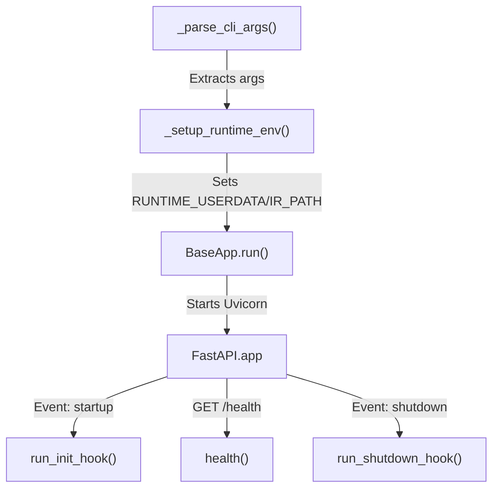
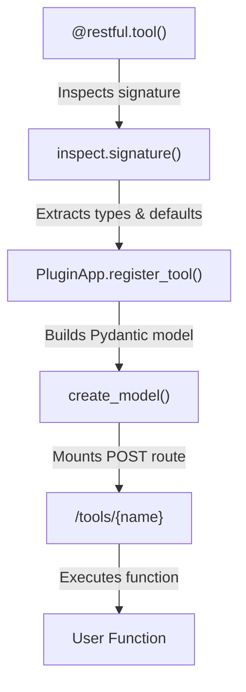
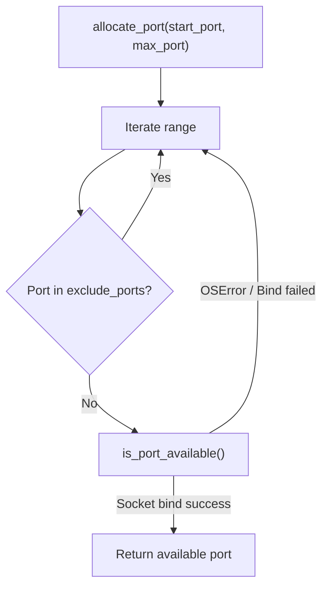

<!-- source: DeepWiki mcp.deepwiki.com · repo openJiuwen-ai/agent-runtime · page 4.1 BaseApp, AgentApp, PluginApp & AppGroup · fetched 2026-11-02 -->

# BaseApp, AgentApp, PluginApp & AppGroup

<details>
<summary>Relevant source files</summary>

The following files were used as context for generating this wiki page:

- [foundation/openjiuwen_runtime/foundation/port_utils.py](foundation/openjiuwen_runtime/foundation/port_utils.py)
- [service/openjiuwen_runtime/service/app/app_group.py](service/openjiuwen_runtime/service/app/app_group.py)
- [service/openjiuwen_runtime/service/app/base_app.py](service/openjiuwen_runtime/service/app/base_app.py)
- [service/openjiuwen_runtime/service/app/plugin_app.py](service/openjiuwen_runtime/service/app/plugin_app.py)
- [service/openjiuwen_runtime/service/app/restful.py](service/openjiuwen_runtime/service/app/restful.py)
- [service/openjiuwen_runtime/service/models/request.py](service/openjiuwen_runtime/service/models/request.py)

</details>


This page details the application class hierarchy within the openJiuwen Agent Runtime data plane (`service/openjiuwen_runtime/service/app/`). It covers the foundational `BaseApp` class, specialized application types like `PluginApp` (and its integration with `AgentApp`), the multi-application container `AppGroup`, standardized request models, and port allocation utilities.

---

## 1. BaseApp: Foundation and Lifecycle Management

`BaseApp` serves as the abstract parent class for all runtime service applications, including `AgentApp` and `PluginApp`. It wraps a FastAPI instance, manages application lifecycle hooks (`@init` and `@shutdown`), configures standard endpoints (such as `/health`), handles command-line argument parsing, and manages the underlying Uvicorn server execution.

### Key Components
* **FastAPI Initialization**: Instantiates `FastAPI` using `app_name`, `app_description`, and `version` [service/openjiuwen_runtime/service/app/base_app.py:84-99]().
* **Lifecycle Decorators**: Provides `.init()` and `.shutdown()` decorators to register asynchronous startup and teardown hooks [service/openjiuwen_runtime/service/app/base_app.py:122-146]().
* **Base Routes**: Automatically registers a `/health` endpoint and startup/shutdown event handlers that trigger the registered hooks [service/openjiuwen_runtime/service/app/base_app.py:148-171]().
* **CLI Argument Parsing & Runtime Setup**: Uses `_parse_cli_args()` to extract `--host`, `--port`, `--userdata`, and `--irpath` arguments, setting appropriate environment variables (`RUNTIME_USERDATA`, `RUNTIME_IR_PATH`) via `_setup_runtime_env()` [service/openjiuwen_runtime/service/app/base_app.py:26-70]() and [service/openjiuwen_runtime/service/app/base_app.py:172-204]().

### Diagram: BaseApp Execution and Lifecycle Flow


*Sources: `service/openjiuwen_runtime/service/app/base_app.py:26-204`*

---

## 2. PluginApp & Restful Tools

`PluginApp` inherits from `BaseApp` and specializes in hosting collections of related tools as RESTful microservices. It features an integrated `RestfulToolDecorator` (`@restful.tool()`) that inspects Python function signatures, dynamically builds Pydantic request validation models, and exposes individual tool endpoints under `/tools/{name}`.

### Implementation Details
* **Tool Registry**: Maintains `self._tools` to store tool metadata, underlying functions, and parameter definitions [service/openjiuwen_runtime/service/app/plugin_app.py:61-67]() & [service/openjiuwen_runtime/service/app/plugin_app.py:76-97]().
* **Signature Inspection & Dynamic Routing**: `RestfulToolDecorator` extracts parameter annotations and defaults using Python's `inspect` module [service/openjiuwen_runtime/service/app/restful.py:57-66](). `PluginApp` then dynamically constructs a Pydantic validation model using `create_model` and registers a POST route at `/tools/{name}` [service/openjiuwen_runtime/service/app/plugin_app.py:113-161]().
* **Discovery Endpoint**: Exposes a `/tools` listing route to inspect all available tools, their descriptions, and parameters [service/openjiuwen_runtime/service/app/plugin_app.py:184-201]().

### Diagram: Tool Registration to REST Route Mapping


*Sources: `service/openjiuwen_runtime/service/app/plugin_app.py:76-161]`, `service/openjiuwen_runtime/service/app/restful.py:44-80`*

---

## 3. AppGroup Multi-Application Container

`AppGroup` allows multiple `BaseApp` instances (such as `AgentApp` or `PluginApp`) to be mounted onto a single FastAPI service using URL path prefixes [service/openjiuwen_runtime/service/app/app_group.py:27-107]().

### Core Responsibilities
* **Prefix Mounting**: Normalizes path prefixes (ensuring leading slashes and stripped trailing slashes) and mounts sub-applications via `self.app.mount(prefix, app.app)` [service/openjiuwen_runtime/service/app/app_group.py:76-107]().
* **Aggregated Lifecycle Events**: During startup, iterates through mounted apps in registration order to run `init` hooks. During shutdown, executes `shutdown` hooks in reverse order [service/openjiuwen_runtime/service/app/app_group.py:109-146]().
* **Aggregated Health Check**: Combines health status reports from all mounted sub-applications into a unified payload at `/health`, reporting whether the group is healthy or degraded [service/openjiuwen_runtime/service/app/app_group.py:150-187]().

### Diagram: AppGroup Multiplexing Architecture

```mermaid
graph TD
    Client["HTTP Client Request"] -->|"/customer/query"| AG["AppGroup FastAPI Service"]
    AG -->|Mount Prefix "/customer"| CustApp["AgentApp: customer_app"]
    AG -->|Mount Prefix "/assistant"| AsstApp["AgentApp: assistant_app"]
    AG -->|Mount Prefix "/tools"| PluginApp["PluginApp: WeatherTools"]
    AG -->|GET /health| AggHealth["Aggregated /health Endpoint"]
```
*Sources: `service/openjiuwen_runtime/service/app/app_group.py:53-187`*

---

## 4. Request Models & Port Utilities

### REST Request Models
Data plane endpoints process standardized Pydantic models defined for agent interactions:
* `QueryRequest`: Manages incoming message arrays, conversation tracking (`conversation_id`), user/space identifiers, and streaming flags [service/openjiuwen_runtime/service/models/request.py:12-43]().
* `ResetConversationRequest`: Specifies targets for conversation context resets with optional authorization tokens [service/openjiuwen_runtime/service/models/request.py:46-62]().

### Port Utilities
Network port probing and dynamic allocation are handled by `port_utils.py` to avoid port conflicts when launching subprocess or containerized apps:
* `is_port_available(port, host)`: Attempts to bind a TCP socket with `SO_REUSEADDR` to verify availability [foundation/openjiuwen_runtime/foundation/port_utils.py:7-15]().
* `allocate_port(start_port, max_port, host, exclude_ports)`: Scans a port range, skipping excluded ports, and returns the first available port or raises a `RuntimeError` [foundation/openjiuwen_runtime/foundation/port_utils.py:18-36]().

### Diagram: Port Allocation Logic


*Sources: `foundation/openjiuwen_runtime/foundation/port_utils.py:7-36`, `service/openjiuwen_runtime/service/models/request.py:12-62`*

---

