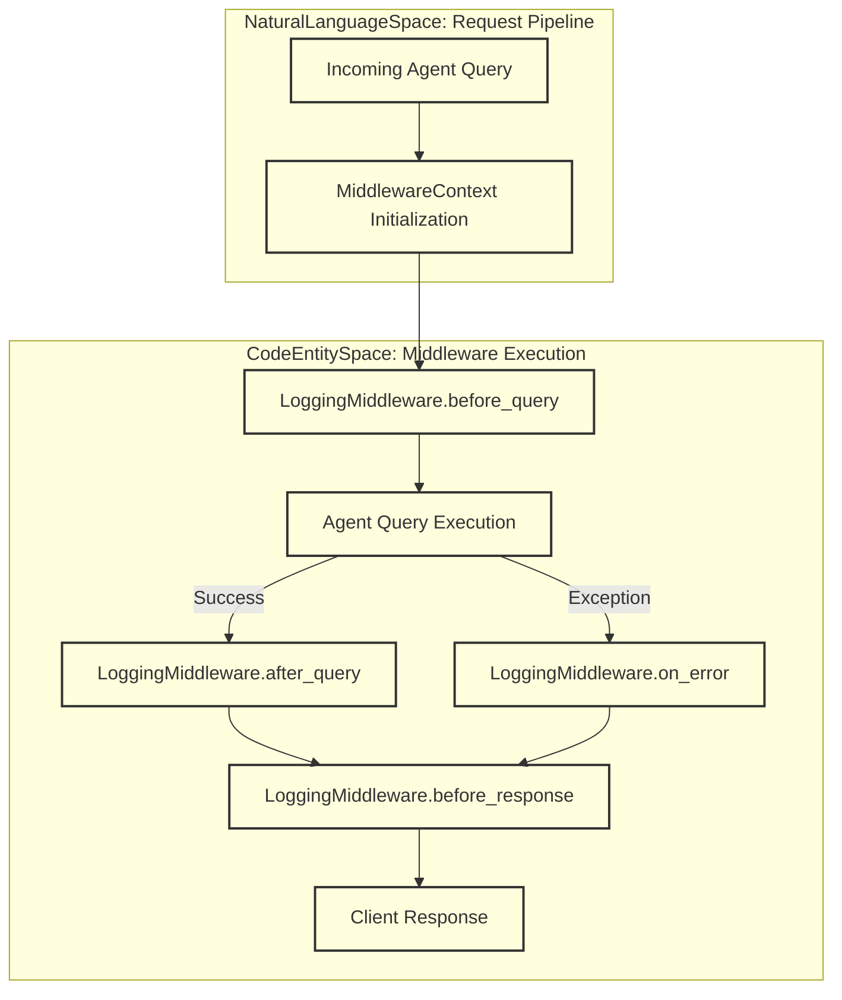
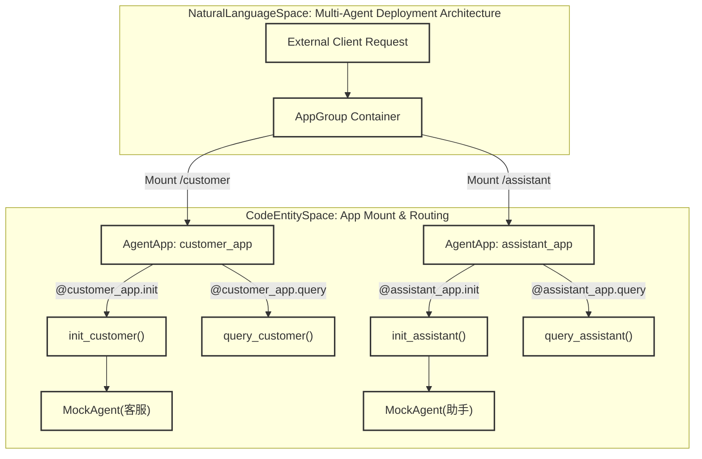

<!-- source: DeepWiki mcp.deepwiki.com · repo openJiuwen-ai/agent-runtime · page 4.2 Middleware & Examples · fetched 2026-11-02 -->

# Middleware & Examples

<details>
<summary>Relevant source files</summary>

The following files were used as context for generating this wiki page:

- [service/examples/calculator_plugin_app.py](service/examples/calculator_plugin_app.py)
- [service/examples/multi_agent_group.py](service/examples/multi_agent_group.py)
- [service/examples/simple_agent_app.py](service/examples/simple_agent_app.py)
- [service/openjiuwen_runtime/service/app/middleware.py](service/openjiuwen_runtime/service/app/middleware.py)
- [service/tests/unit_tests/__init__.py](service/tests/unit_tests/__init__.py)

</details>


## Purpose and Scope

This page covers section 4.2 of the data plane service framework: runtime middleware (`Middleware`, `MiddlewareContext`, and `LoggingMiddleware`) and service example applications (`SimpleAgentApp`, `CalculatorPluginApp`, and `Multi-Agent Group`). These components define the interceptor lifecycle for agent queries and provide reference implementations for building production-grade agent services and plugin tools using the `openjiuwen-agent-runtime` SDK.

---

## 1. Middleware Architecture & Context

The runtime service framework provides a pipeline-based middleware mechanism to intercept and manipulate requests, manage state across interceptors, and handle operational monitoring through the `Middleware` base class, `MiddlewareContext` state store, and pre-built `LoggingMiddleware` implementation [service/openjiuwen_runtime/service/app/middleware.py:4-141]().

### MiddlewareContext

`MiddlewareContext` acts as a request-scoped key-value store passed through every middleware hook [service/openjiuwen_runtime/service/app/middleware.py:16-48]().

```python
class MiddlewareContext:
    def __init__(self):
        self.data: Dict[str, Any] = {}

    def set(self, key: str, value: Any) -> None:
        self.data[key] = value

    def get(self, key: str, default: Any = None) -> Any:
        return self.data.get(key, default)
```

### Middleware Base Class and Hooks

The `Middleware` class defines four asynchronous lifecycle hooks that subclasses override [service/openjiuwen_runtime/service/app/middleware.py:50-134]():
- `before_query`: Executed prior to query processing. Can inspect or modify the `messages` list [service/openjiuwen_runtime/service/app/middleware.py:61-78]().
- `after_query`: Executed successfully after query execution [service/openjiuwen_runtime/service/app/middleware.py:80-94]().
- `on_error`: Executed when an exception occurs during query processing [service/openjiuwen_runtime/service/app/middleware.py:96-112]().
- `before_response`: Executed before sending the final response back to the client [service/openjiuwen_runtime/service/app/middleware.py:114-133]().

### LoggingMiddleware Implementation

`LoggingMiddleware` extends `Middleware` to log request tracking details across all query phases using a configurable Python logger [service/openjiuwen_runtime/service/app/middleware.py:136-240](). It records conversation identifiers, message counts, error exceptions, and response types.


*Diagram 1: Middleware Lifecycle and Request Interception Flow bridging runtime hooks to `LoggingMiddleware`.*

Sources: [service/openjiuwen_runtime/service/app/middleware.py:1-240]()

---

## 2. Service Example Applications & Tests

The SDK provides multiple reference examples demonstrating `AgentApp`, `PluginApp`, and `AppGroup` configurations.

### Simple Agent App

`SimpleAgentApp` (`simple_agent_app.py`) defines a minimal echo agent using `AgentApp` [service/examples/simple_agent_app.py:15-102](). It registers lifecycle handlers via decorators:
- `@app.init`: Initializes the mock agent state [service/examples/simple_agent_app.py:69-74]().
- `@app.query`: Streams back response chunks based on user inputs [service/examples/simple_agent_app.py:76-83]().
- `@app.shutdown`: Cleans up agent resources upon server termination [service/examples/simple_agent_app.py:86-91]().

### Calculator Plugin App

`CalculatorPluginApp` (`calculator_plugin_app.py`) demonstrates tool registration using `PluginApp` [service/examples/calculator_plugin_app.py:16-143](). It exposes mathematical operations (`add`, `multiply`, `subtract`, `divide`) as restful tools via `@app.restful.tool` [service/examples/calculator_plugin_app.py:28-120]().

### Multi-Agent Group

`Multi-Agent Group` (`multi_agent_group.py`) mounts multiple distinct `AgentApp` instances (`customer_app` and `assistant_app`) under a single `AppGroup` container (`group`) with prefix routing [service/examples/multi_agent_group.py:21-115]().


*Diagram 2: Multi-Agent App routing hierarchy illustrating `AppGroup`, `AgentApp`, and underlying mock agent bindings.*

Sources: [service/examples/calculator_plugin_app.py:1-143](), [service/examples/multi_agent_group.py:1-115](), [service/examples/simple_agent_app.py:1-102]()

---

