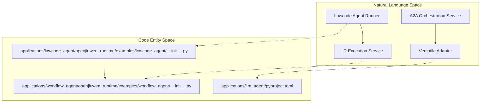
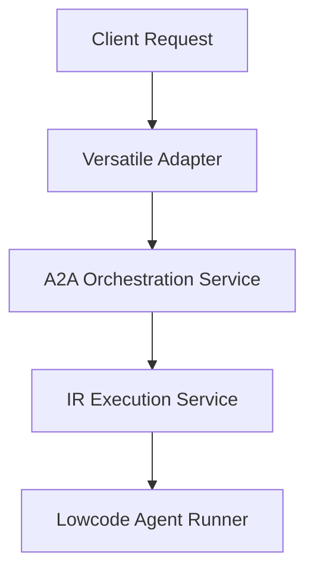

<!-- source: DeepWiki mcp.deepwiki.com · repo openJiuwen-ai/agent-runtime · page 5 Applications · fetched 2026-11-02 -->

# Applications

Relevant source files

The following files were used as context for generating this wiki page:

- [applications/llm_agent/pyproject.toml](applications/llm_agent/pyproject.toml)
- [applications/lowcode_agent/openjiuwen_runtime/examples/lowcode_agent/__init__.py](applications/lowcode_agent/openjiuwen_runtime/examples/lowcode_agent/__init__.py)
- [applications/workflow_agent/openjiuwen_runtime/examples/workflow_agent/__init__.py](applications/workflow_agent/openjiuwen_runtime/examples/workflow_agent/__init__.py)
- [applications/workflow_agent/pyproject.toml](applications/workflow_agent/pyproject.toml)

## Purpose and Scope

The `applications/` directory in the `openJiuwen-ai/agent-runtime` monorepo houses production-ready agent applications, runtime runners, orchestration services, and adapter layers. These components sit on top of the Service Framework data plane to deliver specific agent execution capabilities, low-code workflow processing, Agent-to-Agent (A2A) orchestration, and versatile protocol integration. 

This page provides a high-level overview of the shipped applications and adapters. For comprehensive technical details, implementation specifics, and API endpoints, refer to the respective child pages:
- [Lowcode Agent Runner](#5.1)
- [IR Execution Service](#5.2)
- [A2A Orchestration Service](#5.3)
- [Versatile Adapter](#5.4)

---

## Architecture Overview: Natural Language Space to Code Entity Space

The following diagram bridges high-level application concepts and protocol adapters to their concrete code entities within the repository.

Sources: `applications/lowcode_agent/openjiuwen_runtime/examples/lowcode_agent/__init__.py:1-3`, `applications/workflow_agent/openjiuwen_runtime/examples/workflow_agent/__init__.py:1-3`, `applications/llm_agent/pyproject.toml:1-12`

---

## 5.1 Lowcode Agent Runner

The Lowcode Agent Runner provides an Intermediate Representation (IR)-driven execution environment for agents defined via visual workflows or structured configurations. It handles workflow registration, streaming response timeouts, conversion to AGUI formats, and serves as the primary runtime entrypoint for customized low-code agents.

For full technical details, see [Lowcode Agent Runner](#5.1).

Sources: `applications/lowcode_agent/openjiuwen_runtime/examples/lowcode_agent/__init__.py:1-3`

---

## 5.2 IR Execution Service

The IR Execution Service exposes `IrExecutionServiceApp` endpoints to process and execute compiled agent instruction sets. It incorporates DFX (Design for Excellence) middleware, lifecycle runtime support including bootstrap procedures, result caching, state persistence, and granular interface logging.

For full technical details, see [IR Execution Service](#5.2).

Sources: `applications/workflow_agent/openjiuwen_runtime/examples/workflow_agent/__init__.py:1-3`

---

## 5.3 A2A Orchestration Service

The Agent-to-Agent (A2A) Orchestration Service enables multi-agent cooperation and delegation. It features an execution engine, `user_router` Server-Sent Events (SSE) dispatching, a Redis-backed task store, bootstrap coordination mechanisms, and rate limiting to ensure robust distributed agent workflows.

For full technical details, see [A2A Orchestration Service](#5.3).

Sources: `applications/llm_agent/pyproject.toml:1-12`

---

## 5.4 Versatile Adapter

The Versatile Adapter acts as an extensible integration bridge. It provides config-driven adapter routing, an SSE proxy, an A2A facade interface, a decoupled event model, and a persistent Redis task store for handling external request schemas and protocol conversions.

For full technical details, see [Versatile Adapter](#5.4).

Sources: `applications/workflow_agent/pyproject.toml:1-12`

---

## Application Interaction Architecture

Sources: `applications/llm_agent/pyproject.toml:1-12`, `applications/workflow_agent/pyproject.toml:1-12`

---

