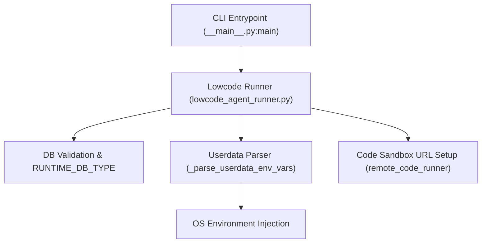
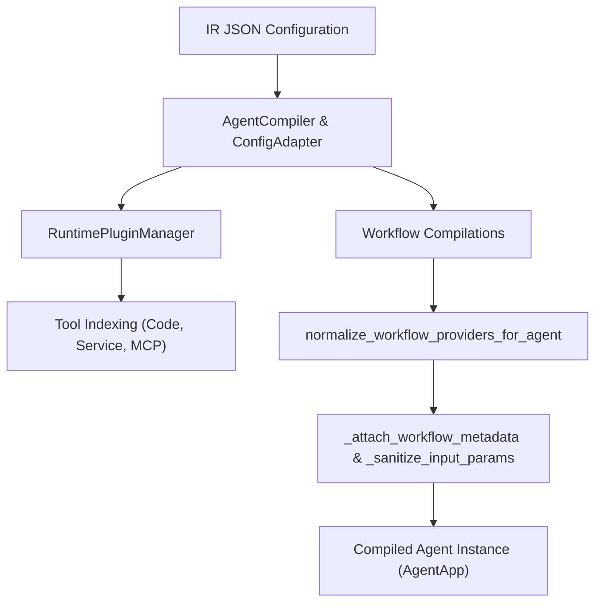
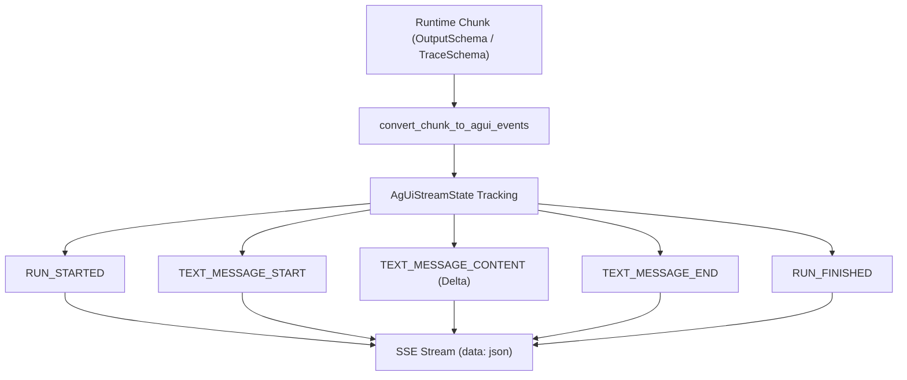

<!-- source: DeepWiki mcp.deepwiki.com · repo openJiuwen-ai/agent-runtime · page 5.1 Lowcode Agent Runner · fetched 2026-11-02 -->

# Lowcode Agent Runner

<details>
<summary>Relevant source files</summary>

The following files were used as context for generating this wiki page:

- [applications/lowcode_agent/openjiuwen_runtime/examples/lowcode_agent/__main__.py](applications/lowcode_agent/openjiuwen_runtime/examples/lowcode_agent/__main__.py)
- [applications/lowcode_agent/openjiuwen_runtime/examples/lowcode_agent/agui_converter.py](applications/lowcode_agent/openjiuwen_runtime/examples/lowcode_agent/agui_converter.py)
- [applications/lowcode_agent/openjiuwen_runtime/examples/lowcode_agent/lowcode_agent_runner.py](applications/lowcode_agent/openjiuwen_runtime/examples/lowcode_agent/lowcode_agent_runner.py)
- [applications/lowcode_agent/openjiuwen_runtime/examples/lowcode_agent/runtime_agent_adapters.py](applications/lowcode_agent/openjiuwen_runtime/examples/lowcode_agent/runtime_agent_adapters.py)
- [applications/lowcode_agent/openjiuwen_runtime/examples/lowcode_agent/workflow_registration.py](applications/lowcode_agent/openjiuwen_runtime/examples/lowcode_agent/workflow_registration.py)
- [management/openjiuwen_runtime/management/deployments/base/models.py](management/openjiuwen_runtime/management/deployments/base/models.py)
- [management/openjiuwen_runtime/management/deployments/subprocess/models.py](management/openjiuwen_runtime/management/deployments/subprocess/models.py)
- [management/openjiuwen_runtime/management/deployments/subprocess/strategy.py](management/openjiuwen_runtime/management/deployments/subprocess/strategy.py)
- [management/openjiuwen_runtime/management/manager.py](management/openjiuwen_runtime/management/manager.py)
- [service/openjiuwen_runtime/service/app/agent_app.py](service/openjiuwen_runtime/service/app/agent_app.py)
- [service/tests/unit_tests/test_middleware.py](service/tests/unit_tests/test_middleware.py)

</details>


## Purpose and Scope

The Lowcode Agent Runner (`openjiuwen_runtime.examples.lowcode_agent`) serves as the production execution engine for exported low-code agents and workflows created via Agent Studio. It loads agent configurations (IR JSON), compiles them into runtime-executable instances using `AgentCompiler` and `RuntimePluginManager`, and exposes standard HTTP service endpoints (`/query`, `/health`, `/reset_conversation`) via the `AgentApp` base framework. 

This page details the initialization sequence, environment injection, IR compilation and workflow registration logic, timeout configurations, and the Server-Sent Events (SSE) translation layer that converts low-level runtime streaming chunks into AG-UI protocol events.

---

## 1. Entrypoint & Environment Initialization

The runner can be invoked either as a Python module or through its console script entrypoint defined in `__main__.py`:
```python
python -m openjiuwen_runtime.examples.lowcode_agent --file config.json --port 8091
lowcode-agent-runner --file config.json --port 8091
``` [applications/lowcode_agent/openjiuwen_runtime/examples/lowcode_agent/lowcode_agent_runner.py:15-17]()

### Command-Line & Module Execution (`__main__.py`)
The command-line interface delegates execution directly to the runner application instance:
- `main()`: Imports `app` from `.lowcode_agent_runner` and executes `app.run()` [applications/lowcode_agent/openjiuwen_runtime/examples/lowcode_agent/__main__.py:15-18]().

### Environment Injection & Parameter Parsing (`lowcode_agent_runner.py`)
Before importing any framework or business packages, `lowcode_agent_runner.py` performs strict environment and database configuration injections:
- **Database Type Validation**: Reads and normalizes `RUNTIME_DB_TYPE` against valid types (`mysql`, `sqlite`, `gaussdb`, `opengauss`), falling back to `sqlite` [applications/lowcode_agent/openjiuwen_runtime/examples/lowcode_agent/lowcode_agent_runner.py:44-48]().
- **Studio DB Compatibility**: Adjusts `LOWCODE_STUDIO_DB_TYPE` when running under `gaussdb` or `opengauss` to prevent compatibility bottlenecks in internal Studio components [applications/lowcode_agent/openjiuwen_runtime/examples/lowcode_agent/lowcode_agent_runner.py:50-55]().
- **Userdata Parser (`_parse_userdata_env_vars`)**: Parses `RUNTIME_USERDATA` JSON strings to extract custom `env_vars`, injecting them into `os.environ` while preserving system-level overrides and protecting `RUNTIME_DB_TYPE` [applications/lowcode_agent/openjiuwen_runtime/examples/lowcode_agent/lowcode_agent_runner.py:57-83]().
- **Timeouts & Sandbox Defaults**: Sets default fallback values for `WORKFLOW_EXECUTE_TIMEOUT` (300s), `WORKFLOW_STREAM_FRAME_TIMEOUT`, `WORKFLOW_STREAM_FIRST_FRAME_TIMEOUT`, and `CODE_SANDBOX_URL` [applications/lowcode_agent/openjiuwen_runtime/examples/lowcode_agent/lowcode_agent_runner.py:87-97]().


*Figure 5.1.1: Runner Entrypoint and Environment Bootstrapping Architecture.*

Sources: 
- `applications/lowcode_agent/openjiuwen_runtime/examples/lowcode_agent/__main__.py:15-22`
- `applications/lowcode_agent/openjiuwen_runtime/examples/lowcode_agent/lowcode_agent_runner.py:35-124`

---

## 2. IR-Driven Compilation & Workflow Registration

The Lowcode Agent Runner transforms static declarative IR configurations into executable stateful agents via Studio compilation abstractions and custom runtime adapters.

### Plugin Management (`RuntimePluginManager`)
`RuntimePluginManager` inherits from `PluginManager` and indexes plugins, tools, and dependencies declared in the IR file [applications/lowcode_agent/openjiuwen_runtime/examples/lowcode_agent/runtime_agent_adapters.py:143-168](). It constructs:
- **Code Tools (`_build_code_tool`)**: Encapsulates Python or custom code snippets using `PluginCodeConfig` [applications/lowcode_agent/openjiuwen_runtime/examples/lowcode_agent/runtime_agent_adapters.py:71-81]().
- **Service Tools (`_build_service_tool`)**: Maps RESTful endpoints using `RestfulApiSchema` with HTTP method mapping and header propagation [applications/lowcode_agent/openjiuwen_runtime/examples/lowcode_agent/runtime_agent_adapters.py:84-115]().
- **MCP Tools (`_build_mcp_tool`)**: Configures Model Context Protocol tools across transport options (`stdio`, `sse`, `streamable_http`, etc.) [applications/lowcode_agent/openjiuwen_runtime/examples/lowcode_agent/runtime_agent_adapters.py:118-140]().

### Workflow Metadata Normalization (`workflow_registration.py`)
When workflows are compiled from the IR, `normalize_workflow_providers_for_agent()` prepares workflow cards for agent registration [applications/lowcode_agent/openjiuwen_runtime/examples/lowcode_agent/workflow_registration.py:72-93]():
- **`_normalize_workflow_id()`**: Strips redundant version suffixes from workflow IDs to ensure version identifiers are appended exactly once [applications/lowcode_agent/openjiuwen_runtime/examples/lowcode_agent/workflow_registration.py:10-20]().
- **`_attach_workflow_metadata()`**: Binds `.id`, `.version`, `.name`, `.description`, and `.input_params` directly onto the workflow callable provider [applications/lowcode_agent/openjiuwen_runtime/examples/lowcode_agent/workflow_registration.py:23-38]().
- **`_sanitize_input_params()`**: Cleans up JSON input schemas to prevent legacy controllers from misrouting optional compatibility `query` fields when required parameters (e.g., `city`) are present [applications/lowcode_agent/openjiuwen_runtime/examples/lowcode_agent/workflow_registration.py:41-70]().


*Figure 5.1.2: IR Compilation and Workflow Registration Data Flow.*

Sources:
- `applications/lowcode_agent/openjiuwen_runtime/examples/lowcode_agent/workflow_registration.py:10-94`
- `applications/lowcode_agent/openjiuwen_runtime/examples/lowcode_agent/runtime_agent_adapters.py:59-168`

---

## 3. Streaming Timeouts & Execution Control

Execution timeouts guard long-running agent loops, workflow steps, and network streaming connections.

### Timeout Environment Variables
The runner configures timeout enforcement globally via environment variables initialized at startup:
- `WORKFLOW_EXECUTE_TIMEOUT`: Maximum execution time in seconds for a workflow run (default `300`) [applications/lowcode_agent/openjiuwen_runtime/examples/lowcode_agent/lowcode_agent_runner.py:87]().
- `WORKFLOW_STREAM_FRAME_TIMEOUT`: Timeout for receiving intermediate streaming frames [applications/lowcode_agent/openjiuwen_runtime/examples/lowcode_agent/lowcode_agent_runner.py:89]().
- `WORKFLOW_STREAM_FIRST_FRAME_TIMEOUT`: Timeout for receiving the initial response frame [applications/lowcode_agent/openjiuwen_runtime/examples/lowcode_agent/lowcode_agent_runner.py:90]().

### Integration with `AgentApp` Query Endpoint
The compiled agent is hosted inside an `AgentApp` instance [service/openjiuwen_runtime/service/app/agent_app.py:30-57](). The `/query` HTTP endpoint handles client disconnection and cancellation signals:
- **Disconnection Monitoring**: Periodically checks `await request.is_disconnected()` during chunk iteration [service/openjiuwen_runtime/service/app/agent_app.py:193-196]().
- **Cancellation Signaling**: Triggers an `asyncio.Event` (`cancel_event`) to abort downstream execution streams when a client disconnects [service/openjiuwen_runtime/service/app/agent_app.py:188-195]().

Sources:
- `applications/lowcode_agent/openjiuwen_runtime/examples/lowcode_agent/lowcode_agent_runner.py:87-94`
- `service/openjiuwen_runtime/service/app/agent_app.py:153-219`

---

## 4. AG-UI Conversion Subsystem

To support frontend clients expecting AG-UI protocol events, `agui_converter.py` translates low-level runtime trace schemas and output schemas into structured Server-Sent Events (SSE).

### Core Components
- **`AgUiStreamState`**: Manages session state per conversation/run, tracking `thread_id`, `run_id`, `text_message_id`, and accumulation buffers (`text_acc`) [applications/lowcode_agent/openjiuwen_runtime/examples/lowcode_agent/agui_converter.py:45-55]().
- **`agui_trace_context()`**: Generates lightweight execution context mapping initial messages to `RUN_STARTED` events [applications/lowcode_agent/openjiuwen_runtime/examples/lowcode_agent/agui_converter.py:80-85]().
- **`convert_chunk_to_agui_events()`**: Inspects incoming `OutputSchema` chunks, mapping `llm_output`, `workflow_final`, `llm_reasoning`, `answer`, and interaction events into corresponding AG-UI event types [applications/lowcode_agent/openjiuwen_runtime/examples/lowcode_agent/agui_converter.py:102-194]().

### Mapped AG-UI Event Lifecycle
1. `RUN_STARTED`: Emitted upon first chunk processing with thread and run identifiers [applications/lowcode_agent/openjiuwen_runtime/examples/lowcode_agent/agui_converter.py:117-130]().
2. `TEXT_MESSAGE_START`: Signals the initiation of an assistant text message block [applications/lowcode_agent/openjiuwen_runtime/examples/lowcode_agent/agui_converter.py:133-138]().
3. `TEXT_MESSAGE_CONTENT`: Streams incremental text content deltas [applications/lowcode_agent/openjiuwen_runtime/examples/lowcode_agent/agui_converter.py:140-148]().
4. `TEXT_MESSAGE_END`: Finalizes the accumulated text response [applications/lowcode_agent/openjiuwen_runtime/examples/lowcode_agent/agui_converter.py:159-164]().
5. `RUN_FINISHED`: Concludes the execution run [applications/lowcode_agent/openjiuwen_runtime/examples/lowcode_agent/agui_converter.py:165-167]().


*Figure 5.1.3: AG-UI Event Conversion Pipeline.*

Sources:
- `applications/lowcode_agent/openjiuwen_runtime/examples/lowcode_agent/agui_converter.py:45-194`

---

