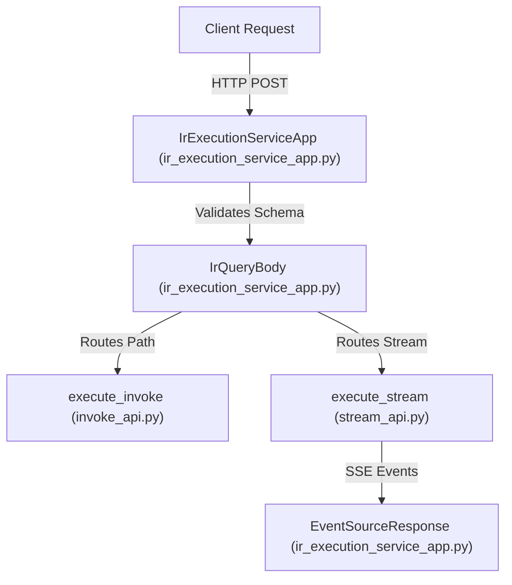
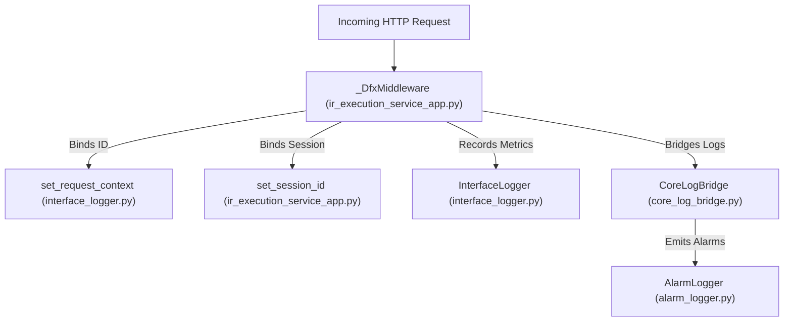

<!-- source: DeepWiki mcp.deepwiki.com · repo openJiuwen-ai/agent-runtime · page 5.2 IR Execution Service · fetched 2026-11-02 -->

# IR Execution Service

Relevant source files

The following files were used as context for generating this wiki page:

- [applications/ir_execution_service/.env.example](applications/ir_execution_service/.env.example)
- [applications/ir_execution_service/ir_execution_service/dsl_workflow_dependency_loader.py](applications/ir_execution_service/ir_execution_service/dsl_workflow_dependency_loader.py)
- [applications/ir_execution_service/ir_execution_service/invoke_api.py](applications/ir_execution_service/ir_execution_service/invoke_api.py)
- [applications/ir_execution_service/ir_execution_service/ir_execution_service_app.py](applications/ir_execution_service/ir_execution_service/ir_execution_service_app.py)
- [applications/ir_execution_service/ir_execution_service/react_agent_builder.py](applications/ir_execution_service/ir_execution_service/react_agent_builder.py)
- [applications/ir_execution_service/ir_execution_service/runtime_support/alarm_logger.py](applications/ir_execution_service/ir_execution_service/runtime_support/alarm_logger.py)
- [applications/ir_execution_service/ir_execution_service/runtime_support/context_persistence.py](applications/ir_execution_service/ir_execution_service/runtime_support/context_persistence.py)
- [applications/ir_execution_service/ir_execution_service/runtime_support/core_log_bridge.py](applications/ir_execution_service/ir_execution_service/runtime_support/core_log_bridge.py)
- [applications/ir_execution_service/ir_execution_service/runtime_support/execution_request.py](applications/ir_execution_service/ir_execution_service/runtime_support/execution_request.py)
- [applications/ir_execution_service/ir_execution_service/runtime_support/interface_logger.py](applications/ir_execution_service/ir_execution_service/runtime_support/interface_logger.py)
- [applications/ir_execution_service/ir_execution_service/runtime_support/ir_cache_fetch.py](applications/ir_execution_service/ir_execution_service/runtime_support/ir_cache_fetch.py)
- [applications/ir_execution_service/ir_execution_service/runtime_support/memory_engine_start.py](applications/ir_execution_service/ir_execution_service/runtime_support/memory_engine_start.py)
- [applications/ir_execution_service/ir_execution_service/runtime_support/runtime_bootstrap.py](applications/ir_execution_service/ir_execution_service/runtime_support/runtime_bootstrap.py)
- [applications/ir_execution_service/ir_execution_service/runtime_support/runtime_env.py](applications/ir_execution_service/ir_execution_service/runtime_support/runtime_env.py)
- [applications/ir_execution_service/ir_execution_service/runtime_support/runtime_env_prepare.py](applications/ir_execution_service/ir_execution_service/runtime_support/runtime_env_prepare.py)
- [applications/ir_execution_service/ir_execution_service/stream_api.py](applications/ir_execution_service/ir_execution_service/stream_api.py)
- [applications/ir_execution_service/ir_execution_service/test/llm_test.json](applications/ir_execution_service/ir_execution_service/test/llm_test.json)
- [applications/ir_execution_service/ir_execution_service/test/test_llm2.json](applications/ir_execution_service/ir_execution_service/test/test_llm2.json)
- [applications/ir_execution_service/pyproject.toml](applications/ir_execution_service/pyproject.toml)

## Purpose and Scope

The IR Execution Service (`ir-execution-service`) is a dedicated HTTP service responsible for compiling workflow Intermediate Representation (IR) definitions, executing graph nodes, managing session execution contexts, and handling interactive states for low-code agent workflows [applications/ir_execution_service/pyproject.toml:5-10](). Built on top of FastAPI and the `openjiuwen-runtime-service` framework, it provides high-throughput execution endpoints, two-tier IR caching, Redis-backed session persistence, and comprehensive DFX (Design for X) logging and alarming.

Sources:
- `applications/ir_execution_service/pyproject.toml:1-23`
- `applications/ir_execution_service/ir_execution_service/ir_execution_service_app.py:1-129`

---

## 1. Application Architecture & Endpoints (`IrExecutionServiceApp`)

The service core is implemented by `IrExecutionServiceApp`, which inherits from `BaseApp` rather than `AgentApp` to mount custom POST routing for workflow execution [applications/ir_execution_service/ir_execution_service/ir_execution_service_app.py:120-128]().

### Request and Response Contracts

Incoming requests are parsed and validated via the `IrQueryBody` Pydantic model, which requires:
- `user_id`: Unique identifier for the user.
- `conversation_id`: Session identifier for conversation continuity.
- `ir_path`: OBS bucket object key pointing to the target IR JSON file (cached in-memory and via Redis to avoid repetitive downloads) [applications/ir_execution_service/ir_execution_service/ir_execution_service_app.py:109-118]().
- `inputs`: JSON string containing execution inputs.
- `timeout_ms`: Execution timeout in milliseconds (default `120,000`).

The application exposes two primary public endpoints:
1. `POST /execute_invoke`: Synchronous execution endpoint that runs the compiled workflow or agent graph to completion and returns a unified JSON response.
2. `POST /execute_stream`: Streaming execution endpoint utilizing Server-Sent Events (SSE) via `sse_starlette` (`EventSourceResponse`) to stream node outputs, tool call states, and trace chunks [applications/ir_execution_service/ir_execution_service/ir_execution_service_app.py:17-18]().

### Natural Language to Code Entity Mapping: Execution Ingestion

*Figure 1: Mapping high-level client requests to `IrExecutionServiceApp` routing and execution modules.*

Sources:
- `applications/ir_execution_service/ir_execution_service/ir_execution_service_app.py:109-181`
- `applications/ir_execution_service/ir_execution_service/stream_api.py:1-35`

---

## 2. DFX Middleware & Interface Logging

To support production diagnostics, tracing, and operational monitoring, `IrExecutionServiceApp` installs a custom HTTP middleware (`_DfxMiddleware`) and a structured interface logging subsystem [applications/ir_execution_service/ir_execution_service/ir_execution_service_app.py:130-181]().

### `_DfxMiddleware` Execution Flow

`_DfxMiddleware` intercepts requests destined for `/execute_invoke` and `/execute_stream`:
1. Generates a unique `request_id` via `uuid.uuid4().hex` [applications/ir_execution_service/ir_execution_service/ir_execution_service_app.py:137-139]().
2. Extracts the client source IP and binds context variables using `set_request_context()` and `set_session_id()` [applications/ir_execution_service/ir_execution_service/ir_execution_service_app.py:140-142]().
3. Measures execution duration via `time.perf_counter()` [applications/ir_execution_service/ir_execution_service/ir_execution_service_app.py:145]().
4. Intercepts response streams or body buffers to log detailed interface metrics (`InterfaceLogRecord`) through `InterfaceLogger` [applications/ir_execution_service/ir_execution_service/runtime_support/interface_logger.py:126-190]().

### Natural Language to Code Entity Mapping: Observability Subsystem

*Figure 2: Mapping DFX interceptors and loggers to underlying runtime logging components.*

Sources:
- `applications/ir_execution_service/ir_execution_service/ir_execution_service_app.py:130-181`
- `applications/ir_execution_service/ir_execution_service/runtime_support/interface_logger.py:126-190`
- `applications/ir_execution_service/ir_execution_service/runtime_support/alarm_logger.py:107-137`
- `applications/ir_execution_service/ir_execution_service/runtime_support/core_log_bridge.py:86-165`

---

## 3. Runtime Support Subsystem

The runtime support directory (`runtime_support/`) contains critical infrastructure utilities required before and during workflow execution.

### Bootstrap and Environment Validation

Before starting the FastAPI application, `prepare_runtime_environment()` and `validate_runtime_environment()` validate that all mandatory environment variables (such as `LOWCODE_IR_EXECUTION_SERVICE_VERSION`, `CODE_SANDBOX_URL`, LLM API credentials, and Redis/OBS configurations) are properly injected [applications/ir_execution_service/ir_execution_service/runtime_support/runtime_env_prepare.py:116-161](). If required variables are missing, a `RuntimeError` is raised with a descriptive error list [applications/ir_execution_service/ir_execution_service/runtime_support/runtime_env_prepare.py:147-152]().

### Two-Tier IR Caching (`ir_cache_fetch.py`)

To optimize the retrieval of IR definitions from OBS, a two-tier caching mechanism is implemented:
- **Process-Level LRU Cache (`_IrJsonLru`)**: Thread-safe in-memory cache bounded by `LOWCODE_IR_MEMORY_LRU_MAX` with sliding TTL support (`LOWCODE_IR_MEMORY_TTL_SECONDS`) [applications/ir_execution_service/ir_execution_service/runtime_support/ir_cache_fetch.py:91-105, 151-187]().
- **Redis Secondary Cache**: Distributed cache layer utilizing `LOWCODE_DEFAULT_REDIS_URL` with distributed locking (`_UNLOCK_IF_TOKEN_MATCHES_LUA`) to prevent cache stampedes during concurrent fetches of the same OBS object key [applications/ir_execution_service/ir_execution_service/runtime_support/ir_cache_fetch.py:54-60, 107-148]().
- **OBS Fallback**: If both caches miss, the IR is fetched directly from the OBS object store and populated into the cache tiers.

### Context Persistence (`context_persistence.py`)

`RedisContextPersistence` manages the persistence and restoration of `SessionModelContext` states in Redis [applications/ir_execution_service/ir_execution_service/runtime_support/context_persistence.py:137-155](). 
- It serializes and persists **only user input messages** (`role=user`) to keep storage footprints minimal and prevent stale state overwrites [applications/ir_execution_service/ir_execution_service/runtime_support/context_persistence.py:7-14, 103-120]().
- It employs a Redis distributed lock mechanism (`_UNLOCK_IF_TOKEN_MATCHES_LUA`) keyed by `conversation_id` to guarantee thread-safety and prevent concurrent corruption across worker processes [applications/ir_execution_service/ir_execution_service/runtime_support/context_persistence.py:76-87]().

Sources:
- `applications/ir_execution_service/ir_execution_service/runtime_support/runtime_env_prepare.py:116-161`
- `applications/ir_execution_service/ir_execution_service/runtime_support/ir_cache_fetch.py:54-187`
- `applications/ir_execution_service/ir_execution_service/runtime_support/context_persistence.py:7-155`

---

